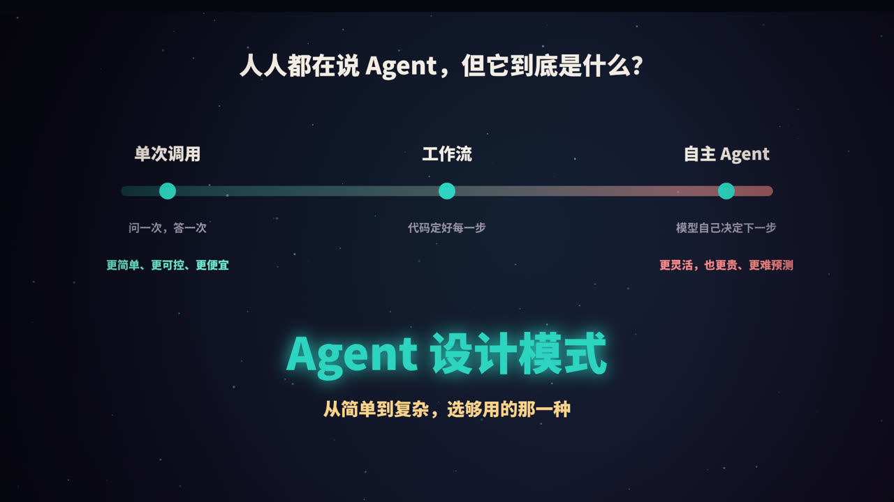
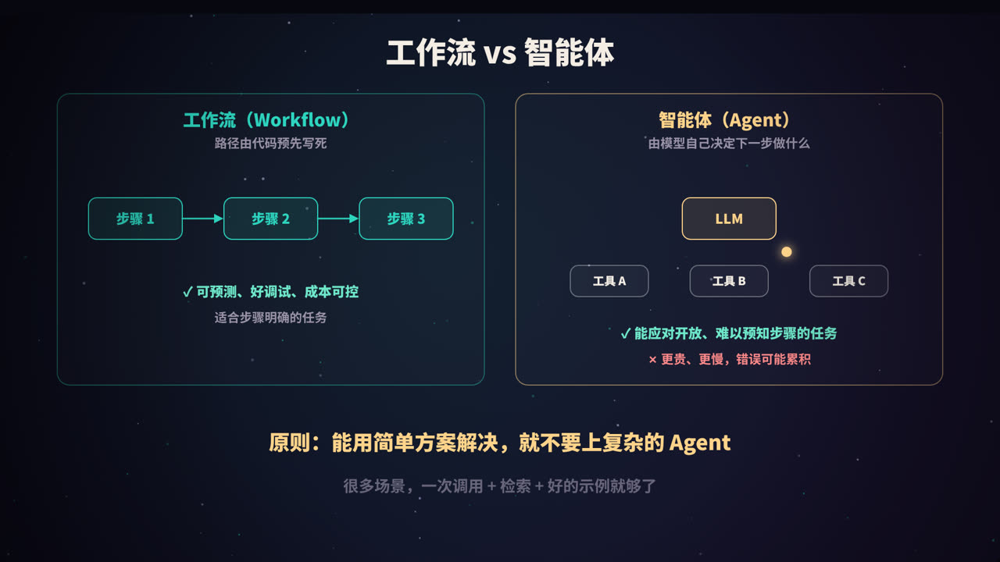
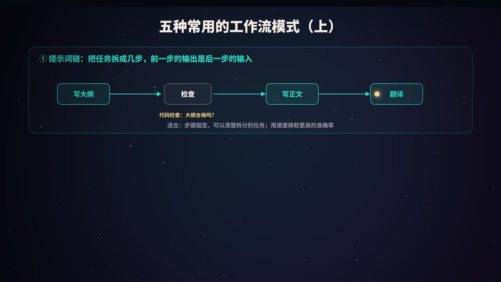
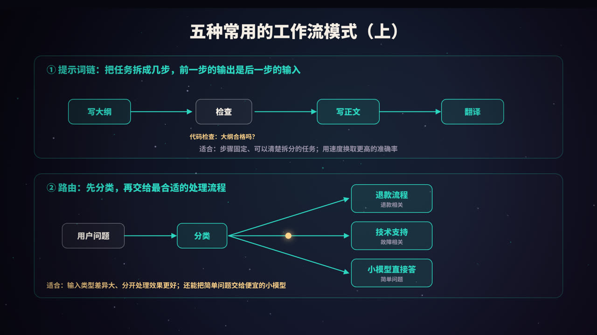
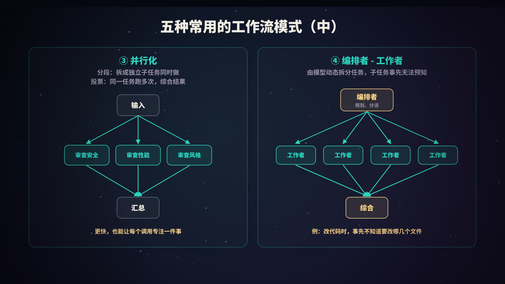
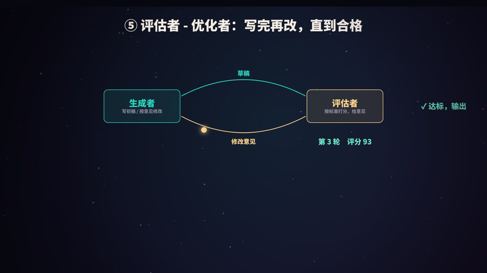
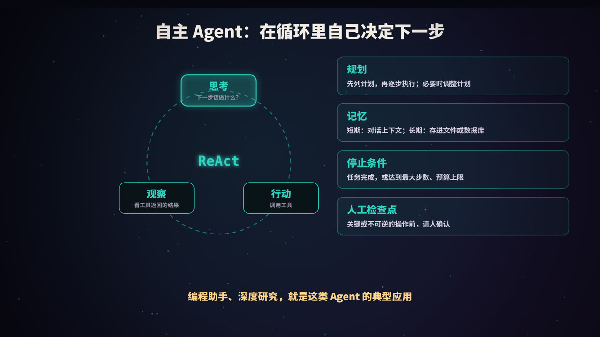
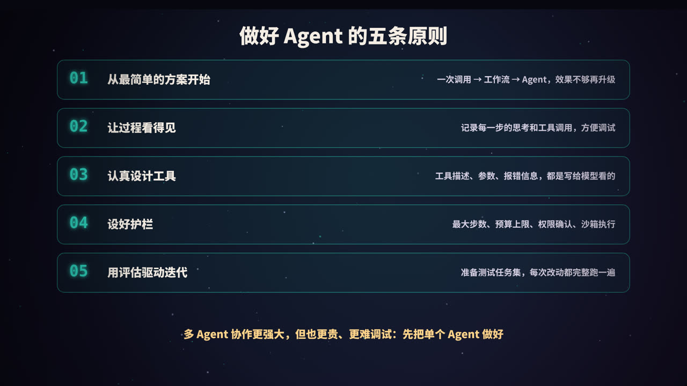
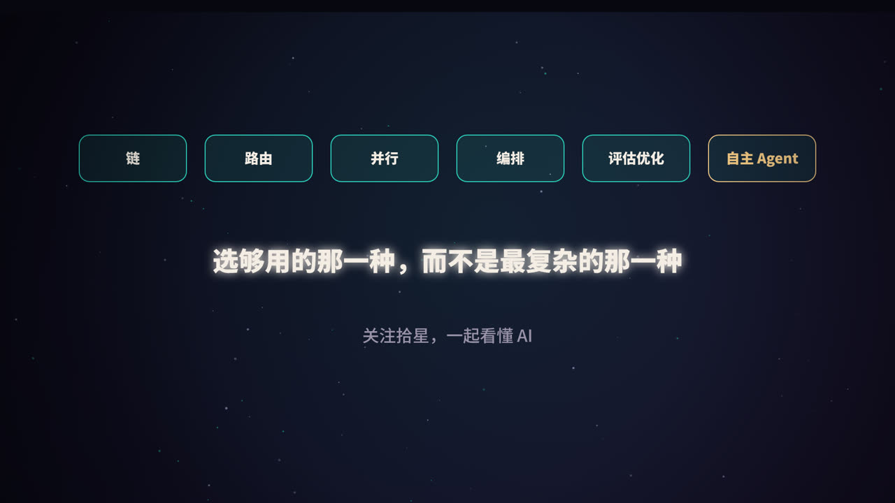

title: Agent 设计模式：从提示词链到自主智能体
subtitle: 工作流和智能体的区别，五种常用工作流模式与代码骨架，自主 Agent 的循环、规划、记忆和停止条件，以及做好 Agent 的五条原则
tag: AI 与大模型
color: #2dd4bf



## 先回答一个问题：真的需要 Agent 吗

「Agent」（智能体）是近两年最热的词之一，但它常常被用来指代很多不同的东西。把基于大模型的系统按「自主程度」排成一条光谱，会清楚很多：

| 形态 | 做法 | 特点 |
|---|---|---|
| **单次调用** | 问一次，答一次；配合检索、示例 | 最简单、最便宜、最可控 |
| **工作流** | 用代码把多次模型调用和工具编排成固定路径 | 可预测、好调试 |
| **自主 Agent** | 模型在循环中自己决定下一步做什么、用哪个工具 | 最灵活，也最贵、最难预测 |

越往右，能处理的任务越开放，但成本、延迟和出错的可能性也越高。所以设计 AI 应用的第一原则是：**从最简单的方案开始，效果不够时再升级。**很多场景，一次精心设计的调用，加上检索和好的示例，就已经足够了。

本文的分类主要参考了 Anthropic 在 2024 年发布的《Building effective agents》一文。

## 工作流 vs 智能体



- **工作流**（Workflow）：模型和工具的调用路径，由**代码预先定义**。模型负责每一步的具体内容，但「下一步做什么」是写死的。
- **智能体**（Agent）：由**模型自己动态决定**下一步做什么、调用哪个工具、什么时候结束。

| | 工作流 | 智能体 |
|---|---|---|
| 控制权 | 在代码 | 在模型 |
| 适合 | 步骤明确、可以拆分的任务 | 开放式、无法预知步骤的任务 |
| 优点 | 可预测、成本可控、易于调试 | 灵活，能处理新情况 |
| 风险 | 遇到预料之外的情况就处理不了 | 成本高、延迟大，错误可能累积 |

下面先看五种常用的工作流模式，再看自主 Agent。

## ① 提示词链



**做法**：把一个任务拆成几个固定的步骤，每一步一次模型调用，前一步的输出作为后一步的输入。步骤之间可以插入**代码检查**（gate），不合格就提前停止或重试。

**例子**：写文章 → 先生成大纲 → 检查大纲是否符合要求 → 根据大纲写正文 → 翻译成英文。

**适合**：任务可以清楚地拆成固定子任务。每次调用只专注一件事，准确率更高，代价是总耗时更长。

```python
def write_article(topic):
    outline = llm(f"为《{topic}》写一份文章大纲，3～5 个小节。")
    if not check_outline(outline):                  # 代码检查：结构、长度是否合格
        outline = llm(f"大纲不合格，请修改：\n{outline}")
    draft = llm(f"根据大纲写正文：\n{outline}")
    return llm(f"把下面的文章翻译成英文：\n{draft}")
```

## ② 路由



**做法**：先用一次调用（或传统分类模型）判断输入属于哪一类，再交给专门的处理流程。

**例子**：客服系统先判断用户问题是退款、技术故障还是一般咨询，再进入不同的处理流程，每个流程有自己专门的提示词和工具。

**适合**：输入的类型差异很大，分开处理效果更好。路由还有一个实际好处：**把简单问题交给便宜、快速的小模型，复杂问题再交给强模型**，能显著降低成本。

```python
def handle(question):
    category = llm(f"把问题分类为 refund / tech / general，只输出类别：\n{question}").strip()
    handler = {"refund": refund_flow, "tech": tech_flow}.get(category, general_flow)
    return handler(question)
```

## ③ 并行化



**做法**：同时发起多次调用，再用代码汇总结果。有两种形式：

- **分段**（sectioning）：把任务拆成**互相独立**的子任务并行处理。例如代码审查时，分别让三个调用检查安全、性能、代码风格；
- **投票**（voting）：把**同一个任务**执行多次，综合多个结果。例如判断一段内容是否违规，多数结果认为违规才判定违规。

**适合**：子任务互不依赖，可以提速；或者需要多个视角、多次尝试来提高可靠性。

```python
import asyncio

async def review(code):
    aspects = ["安全漏洞", "性能问题", "代码风格"]
    results = await asyncio.gather(*[allm(f"只从「{a}」角度审查这段代码：\n{code}") for a in aspects])
    return "\n\n".join(results)
```

## ④ 编排者-工作者

**做法**：由一个「编排者」模型分析任务，**动态地**决定拆成哪些子任务，分派给多个「工作者」执行，最后汇总。

和并行化的区别在于：并行化的子任务是事先写死的，而这里的子任务**由模型根据具体情况决定**。

**例子**：修改代码时，事先并不知道需要改哪几个文件；做调研时，事先不知道需要搜索哪些方向。

```python
def orchestrate(task):
    plan = llm_json(f"把任务拆成若干独立子任务，输出 JSON 列表：\n{task}")
    results = [llm(f"完成子任务：{sub}\n总任务背景：{task}") for sub in plan]
    return llm(f"综合以下结果，完成总任务「{task}」：\n" + "\n---\n".join(results))
```

## ⑤ 评估者-优化者



**做法**：一个调用负责生成，另一个调用负责按标准评估并给出修改意见，两者循环，直到评估通过或达到最大轮数。

**例子**：文学翻译（评估者检查信达雅）、写作润色、代码生成后的审查。

**适合**：有明确的评价标准，而且「多改几轮确实会变好」的任务。就像人写东西：先写初稿，再根据反馈修改。

```python
def refine(task, max_rounds=3):
    draft = llm(f"完成任务：{task}")
    for _ in range(max_rounds):                       # 一定要设上限
        review = llm_json(f"按以下标准评估，输出 {{\"pass\": bool, \"feedback\": str}}：\n标准：……\n内容：{draft}")
        if review["pass"]:
            break
        draft = llm(f"根据意见修改。\n意见：{review['feedback']}\n原稿：{draft}")
    return draft
```

## 自主 Agent



### 核心：一个循环

自主 Agent 的核心是一个循环，常被称为 **ReAct**（Reasoning + Acting）：

1. **思考**：根据目标和目前掌握的信息，决定下一步做什么；
2. **行动**：调用一个工具（搜索、读文件、执行代码、调用接口……）；
3. **观察**：拿到工具返回的结果，加入上下文；
4. 回到第 1 步，直到任务完成。

关键在于，每一步的决策都基于**真实环境返回的结果**，所以它能根据实际情况调整方向。编程助手、深度研究、自动化操作电脑，都是这类 Agent 的典型应用。一个完整的最小实现，可以参考本系列《从零做一个 Claude Code》。

### 四个关键组件

| 组件 | 作用 | 常见做法 |
|---|---|---|
| **规划** | 复杂任务先想清楚步骤 | 先让模型列出计划，执行中根据结果调整；用待办清单跟踪进度 |
| **记忆** | 让 Agent 记得做过什么、知道什么 | 短期：对话上下文；长期：写入文件、数据库或向量库，按需检索 |
| **停止条件** | 防止无休止地运行 | 任务完成；或达到最大步数、时间、花费上限 |
| **人工检查点** | 控制风险 | 删除、付款、发送消息、上线等不可逆操作前请人确认 |

### 上下文管理

Agent 运行的步数越多，上下文越长，成本越高，模型也越容易「迷失」。常见的应对方法：

- 截断或摘要过长的工具输出；
- 对话接近上限时，把前面的过程压缩成摘要；
- 把子任务交给独立上下文的**子 Agent**，只把结论带回来；
- 把中间结果写入文件，需要时再读取。

### 多 Agent 协作

多个 Agent 分工协作（比如一个负责研究、一个负责写作、一个负责审核）能处理更复杂的任务，但也带来更高的成本、更多的通信开销和更难的调试。建议**先把单个 Agent 做扎实**，确有需要时再引入多 Agent。

## 做好 Agent 的五条原则



### 1. 从最简单的方案开始

一次调用 → 工作流 → Agent。只有当简单方案确实不够用、并且用评估数据证明更复杂的方案效果更好时，才升级。

### 2. 让过程看得见

记录每一步的思考、工具调用和结果。出了问题，才能知道是哪一步走偏了。这也是用户建立信任的基础。

### 3. 认真设计工具

工具是 Agent 和世界交互的接口，工具的名字、描述、参数、返回值和报错信息，都是写给模型看的。花在打磨工具上的时间，往往比打磨提示词更值得（见本系列《Function Calling 与 MCP》）。

### 4. 设好护栏

- 最大步数、最大花费、超时时间；
- 最小权限：只给完成任务所需的工具和权限；
- 在沙箱中执行代码；
- 关键操作需要人工确认；
- 警惕提示词注入：Agent 读取的网页、文档中可能藏有恶意指令。

### 5. 用评估驱动迭代

准备一组有代表性的测试任务，每次修改提示词、工具或流程后都完整跑一遍，比较成功率、步数、耗时和成本，而不是凭几个例子的感觉做判断。

## 怎么选

| 你的任务 | 建议 |
|---|---|
| 一问一答，信息都在提示词里或可以检索到 | 单次调用 + RAG |
| 步骤固定，可以拆成几步 | 提示词链 |
| 输入类型多，需要不同处理方式 | 路由 |
| 子任务互相独立，或需要多个视角 | 并行化 |
| 子任务无法事先确定 | 编排者-工作者 |
| 有明确标准，需要反复打磨 | 评估者-优化者 |
| 开放式任务，需要根据环境反馈不断调整 | 自主 Agent |

这些模式也可以**组合使用**：比如先路由，某个分支内部是提示词链，链中的某一步又是一个评估者-优化者循环。

## 总结



- **工作流**由代码决定路径，**Agent** 由模型决定下一步；
- 五种工作流模式：**提示词链、路由、并行化、编排者-工作者、评估者-优化者**；
- 自主 Agent 的核心是**思考 → 行动 → 观察**的循环，配合规划、记忆、停止条件和人工检查点；
- 原则：**从简单开始、过程可见、认真设计工具、设好护栏、用评估驱动迭代**；
- 选够用的那一种，而不是最复杂的那一种。

<div class="refs" markdown="1">

### 参考资料

- Anthropic (2024). Building effective agents. anthropic.com/research
- Yao, S., et al. (2022). ReAct: Synergizing Reasoning and Acting in Language Models. *arXiv:2210.03629*.
- Madaan, A., et al. (2023). Self-Refine: Iterative Refinement with Self-Feedback. *NeurIPS*.
- Wang, X., et al. (2022). Self-Consistency Improves Chain of Thought Reasoning in Language Models. *arXiv:2203.11171*.
- Anthropic (2025). How we built our multi-agent research system.

</div>
