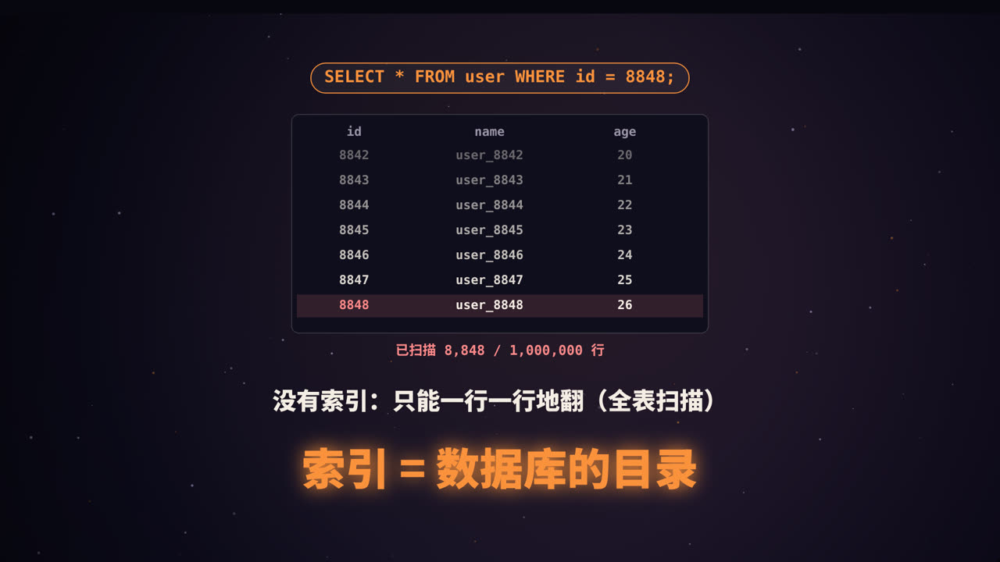
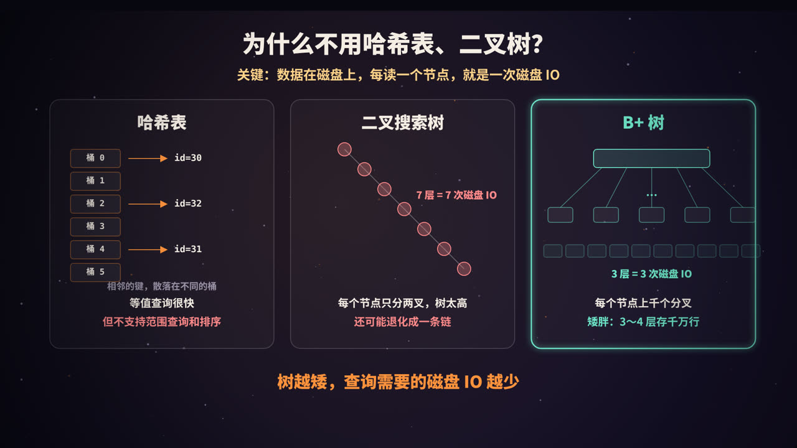
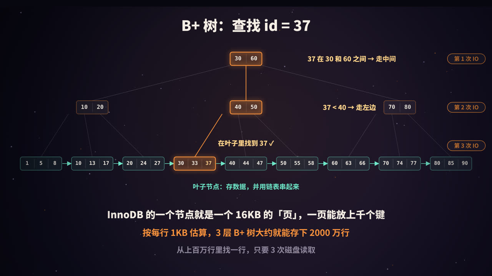
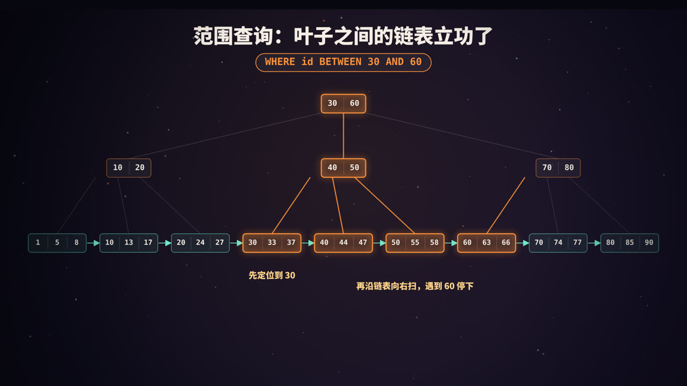
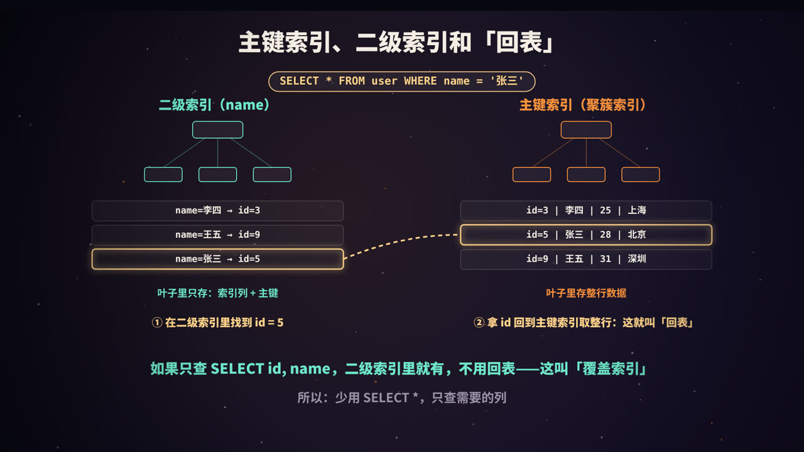

title: 数据库索引：为什么是 B+ 树
subtitle: 从磁盘 IO 讲起，看懂 B+ 树的结构与查找、聚簇索引与回表、覆盖索引、最左前缀和索引失效，最后学会用 EXPLAIN
tag: 计算机与后端
color: #fb923c



## 没有索引会怎样

在一张有一百万行的用户表里执行：

```sql
SELECT * FROM user WHERE id = 8848;
```

如果 `id` 上没有任何索引，数据库只能从第一行开始，一行一行地比对，直到找到为止，最坏情况要读完整张表。这叫**全表扫描**。

**索引**就像一本书的目录：数据库按照某一列提前把数据排好序，组织成便于查找的结构，查询时直接定位，不用逐页翻找。MySQL 的 InnoDB 存储引擎，用的就是 **B+ 树**。

## 关键约束：数据在磁盘上



理解 B+ 树，要先理解一个前提：**数据库的数据存放在磁盘上**，而磁盘的读取速度比内存慢几个数量级。

InnoDB 以**页**（page）为单位从磁盘读取数据，默认每页 **16KB**。索引树的每个节点就是一个页，**读一个节点，就是一次磁盘 IO**（如果这个页已经被缓存在内存的 Buffer Pool 里，就可以省掉这次 IO）。

所以，评价一种索引结构好不好，核心看：**找到一条数据，要读多少个节点？** 换句话说，就是**树有多高**。

### 几种候选结构的比较

| 结构 | 优点 | 缺点 |
|---|---|---|
| 哈希表 | 等值查询非常快 | 数据无序，不支持范围查询、排序和前缀匹配 |
| 二叉搜索树 | 有序，支持范围查询 | 每个节点只有两个分叉，树很高；插入有序数据时可能退化成链表 |
| 平衡二叉树 / 红黑树 | 不会退化 | 依然是二叉，一百万条数据大约需要 20 层，也就是约 20 次 IO |
| B 树 | 多叉，矮胖 | 每个节点都存数据，一页能放的键变少；范围查询需要在树中来回遍历 |
| **B+ 树** | 多叉、矮胖、叶子有序相连 | 写入时需要维护树结构，有一定开销 |

## B+ 树的结构



B+ 树有三个关键特征：

1. **非叶子节点只存「键 + 指针」**，不存数据。这样一个 16KB 的页能放下非常多的键，**分叉数（扇出）极大**，树就很矮；
2. **所有数据都存放在叶子节点**，因此每次查询都走到叶子，查询时间稳定；
3. **叶子节点按键的顺序排列，并用链表串起来**，方便范围扫描。

### 查找过程

以查找 `id = 37` 为例：

1. 读根节点 `[30 | 60]`：37 在 30 和 60 之间，走中间的指针；
2. 读中间节点 `[40 | 50]`：37 小于 40，走最左边的指针；
3. 读叶子节点 `[30, 33, 37]`：找到 37。

一共 3 次磁盘读取。而实际上，根节点和上层节点访问非常频繁，通常常驻在内存里，真正需要的磁盘 IO 往往更少。

### 3 层能存多少数据

这是一个经典的估算：

- 假设主键是 `BIGINT`（8 字节），InnoDB 中一个指针约 6 字节，一组「键 + 指针」约 14 字节；
- 一个 16KB 的非叶子节点大约能放 16384 ÷ 14 ≈ **1170** 个指针；
- 假设每行数据约 1KB，一个叶子节点能放约 **16** 行。

| 树高 | 大约能存的行数 |
|---|---|
| 2 层 | 1170 × 16 ≈ 1.9 万 |
| 3 层 | 1170 × 1170 × 16 ≈ **2190 万** |
| 4 层 | 1170³ × 16 ≈ 256 亿 |

所以，一张两千万行左右的表，主键查询通常只需要 3 层。这只是数量级上的估算，实际取决于行的大小和页的填充率。

## 范围查询：叶子链表的威力



```sql
SELECT * FROM user WHERE id BETWEEN 30 AND 60;
```

B+ 树的做法是：

1. 从根节点往下，定位到第一个满足条件的叶子（`id = 30`）；
2. 沿着叶子之间的链表**一路向右扫描**，直到遇到大于 60 的键为止。

不需要回到上层节点重新查找。同理，`ORDER BY id`、`id > 100` 这类查询，都能利用叶子的有序性高效完成。这也是 B+ 树相比 B 树更适合数据库的重要原因。

## 聚簇索引、二级索引与回表



### 聚簇索引：数据就是索引

在 InnoDB 中，**表的数据本身就存放在主键的 B+ 树里**，叶子节点存的是完整的行。这棵树叫**聚簇索引**（clustered index）。

- 如果表定义了主键，就用主键建聚簇索引；
- 没有主键，就选第一个非空的唯一索引；
- 都没有，InnoDB 会自动生成一个隐藏的 6 字节行 ID。

### 二级索引：叶子里存的是主键

在其他列上建的索引叫**二级索引**（secondary index）。它的叶子节点不存整行，只存**索引列的值 + 对应的主键值**。

### 回表

```sql
SELECT * FROM user WHERE name = '张三';   -- name 上有二级索引
```

1. 在 `name` 的二级索引里找到 `张三`，拿到主键 `id = 5`；
2. 再拿 `id = 5` 去聚簇索引里查一遍，取出整行数据。

第二步就叫**回表**。如果查询命中的行很多，每一行都要回表，开销就会很大。

### 覆盖索引：不用回表

```sql
SELECT id, name FROM user WHERE name = '张三';
```

需要的 `id` 和 `name` 在二级索引里都有，不用回表。这叫**覆盖索引**，在 `EXPLAIN` 的 `Extra` 列中会显示 `Using index`。这也是为什么提倡**少用 `SELECT *`，只查需要的列**。

### 主键怎么选

因为聚簇索引按主键排序存储，主键的选择会影响写入性能：

- **自增主键**：新数据总是追加到最右边的叶子，写入顺序、页面紧凑；
- **随机主键（如 UUID）**：新数据会插入到树的任意位置，频繁引发**页分裂**，产生碎片，写入变慢；
- **主键不宜过长**：每个二级索引的叶子都要存一份主键，主键越长，所有二级索引越占空间。

## 联合索引与最左前缀


### 联合索引是怎么排序的

```sql
CREATE INDEX idx_city_age ON user (city, age);
```

联合索引在 B+ 树中**先按 `city` 排序，`city` 相同时再按 `age` 排序**，就像字典先按第一个字母排，再按第二个字母排。

| 查询条件 | 能否用上索引 |
|---|---|
| `WHERE city = '北京'` | 能 |
| `WHERE city = '北京' AND age = 25` | 能，两列都用上 |
| `WHERE age = 25` | 不能用来定位：不同城市下的 age = 25 散落在各处 |
| `WHERE city = '北京' AND age > 20` | 能，city 等值定位，age 范围扫描 |

这就是**最左前缀原则**：联合索引只有从最左边的列开始连续使用，才能用来定位。

另外，在联合索引 `(a, b, c)` 上，如果条件是 `a = 1 AND b > 2 AND c = 3`，b 是范围条件，c 就无法再用来**定位**了。不过 MySQL 5.6 起支持**索引下推**（Index Condition Pushdown），可以在遍历索引时直接用 c 过滤，减少回表次数，`EXPLAIN` 中显示为 `Using index condition`。

### 设计联合索引的顺序

- 等值查询的列放前面，范围查询的列放后面；
- 区分度高（取值多样）的列优先；
- 尽量让常用查询能用上覆盖索引。

## 常见的索引失效

索引能不能用，本质上只看一件事：**查询条件能不能利用 B+ 树中已经排好的顺序。** 下面这些写法会破坏这一点：

| 写法 | 为什么失效 |
|---|---|
| 跳过联合索引的最左列 | 数据不是按后面的列全局排序的 |
| `LIKE '%三'`（左模糊） | 不知道开头是什么，无法定位；`LIKE '张%'` 则可以 |
| `WHERE YEAR(created_at) = 2026` | 对索引列做了函数运算，索引中存的是原值；可改写为 `created_at >= '2026-01-01' AND created_at < '2027-01-01'` |
| `WHERE id + 1 = 10` | 同上，对索引列做了运算 |
| 字符串列 `phone = 13800000000` | 隐式类型转换，相当于对列套了函数；应写成 `phone = '13800000000'` |
| `OR` 连接的条件中，有一边没有索引 | 可能导致整体放弃索引 |

还有一种情况：即使能用索引，优化器也可能**主动选择全表扫描**，比如表很小，或者条件匹配了表中大部分数据，此时走索引再回表反而更慢。

## 学会用 EXPLAIN

在查询前加上 `EXPLAIN`，就能看到 MySQL 打算怎么执行：

```sql
EXPLAIN SELECT id, name FROM user WHERE name = '张三';
```

重点关注几列：

| 列 | 关注什么 |
|---|---|
| `type` | 访问方式，从好到差大致是：`const` > `eq_ref` > `ref` > `range` > `index` > `ALL`（全表扫描） |
| `key` | 实际使用的索引，为 `NULL` 表示没用索引 |
| `rows` | 预计需要扫描的行数 |
| `Extra` | `Using index`（覆盖索引）、`Using where`、`Using filesort`（需要额外排序）、`Using temporary`（用了临时表）等 |

## 建索引的原则

1. 为经常出现在 `WHERE`、`JOIN`、`ORDER BY`、`GROUP BY` 中的列建索引；
2. 优先选择区分度高的列；
3. 索引不是越多越好：每次写入都要同步维护所有索引，也会占用存储空间；
4. 很长的字符串列，可以考虑**前缀索引**；
5. 用 `EXPLAIN` 和慢查询日志验证效果，而不是凭感觉。

## 高频面试题速答

**Q：为什么 MySQL 用 B+ 树而不是 B 树？**
B+ 树的非叶子节点不存数据，扇出更大，树更矮；数据都在叶子，查询性能稳定；叶子节点相连，范围查询和排序更高效。

**Q：为什么不用哈希索引？**
哈希无序，只适合等值查询，不支持范围查询、排序和最左前缀匹配。

**Q：什么是回表？如何避免？**
通过二级索引找到主键后，再去聚簇索引查整行，叫回表。可以通过覆盖索引避免。

**Q：为什么推荐自增主键？**
插入时顺序追加，避免页分裂和碎片；同时主键较短，能减小二级索引的体积。

## 总结


- 数据库索引的核心矛盾是**磁盘 IO**，B+ 树通过**巨大的扇出**让树非常矮，3 层就能存约两千万行；
- 数据全在叶子，叶子有序相连，**等值和范围查询都高效**；
- InnoDB 的表就是一棵**聚簇索引**；二级索引查整行需要**回表**，**覆盖索引**可以避免；
- 索引能否生效，关键看查询能否利用**已排好的顺序**：牢记最左前缀，避免对索引列做运算。

<div class="refs" markdown="1">

### 参考资料

- MySQL 8.0 Reference Manual: The Physical Structure of an InnoDB Index；Clustered and Secondary Indexes；Index Condition Pushdown Optimization；EXPLAIN Output Format.
- Comer, D. (1979). The Ubiquitous B-Tree. *ACM Computing Surveys*.
- 小孩子 4919.《MySQL 是怎样运行的：从根儿上理解 MySQL》.

</div>
