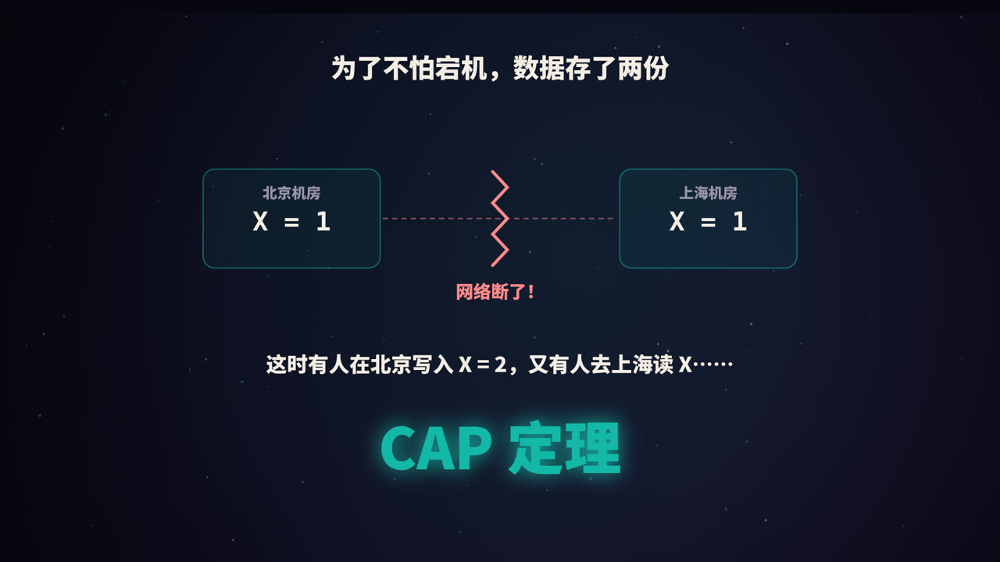
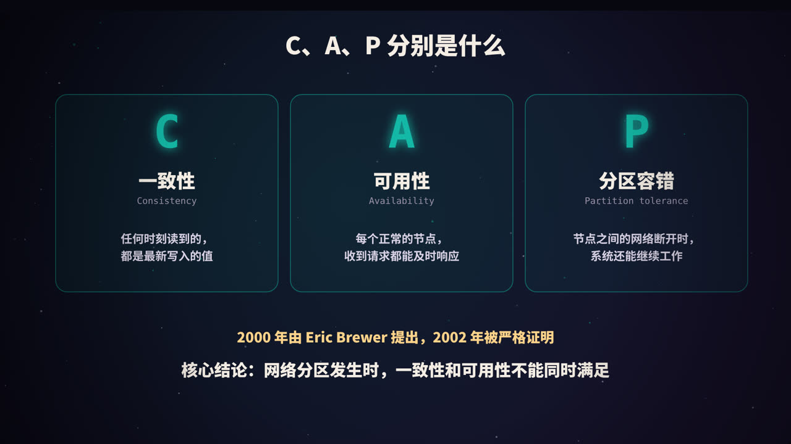
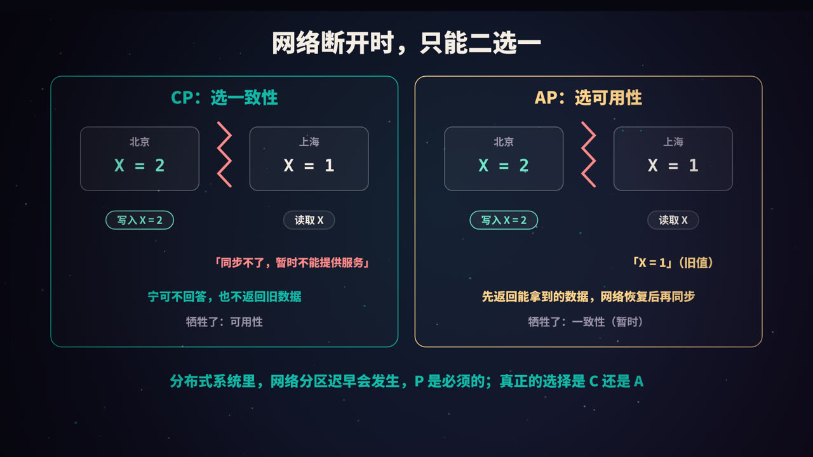
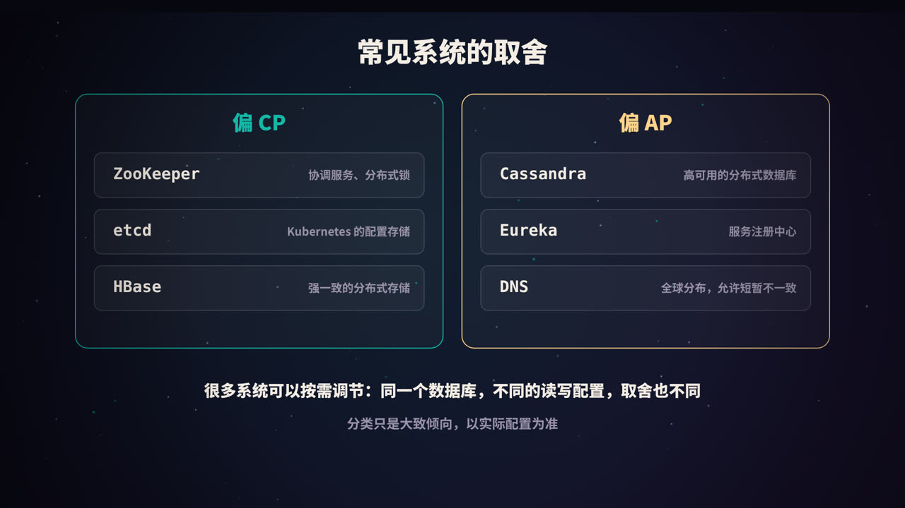
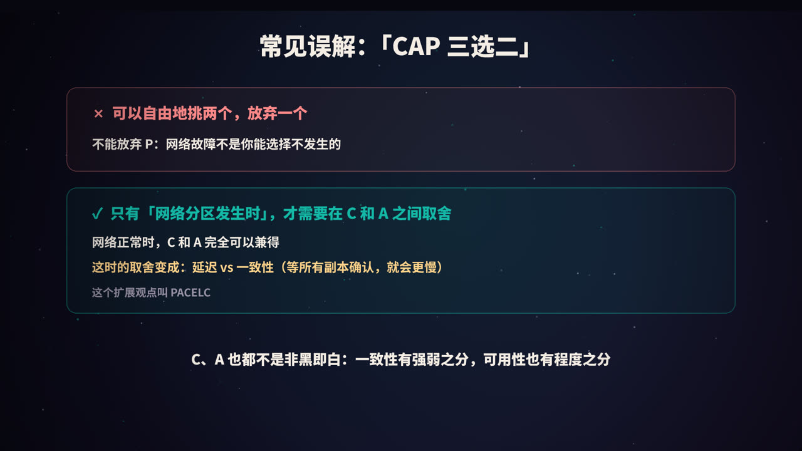
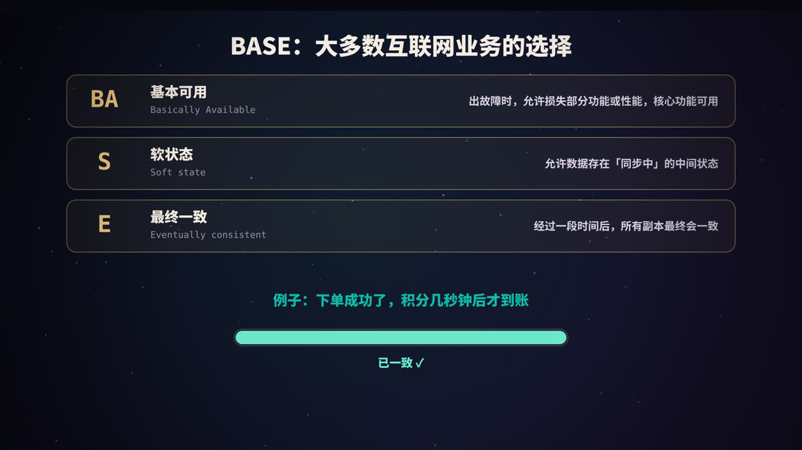
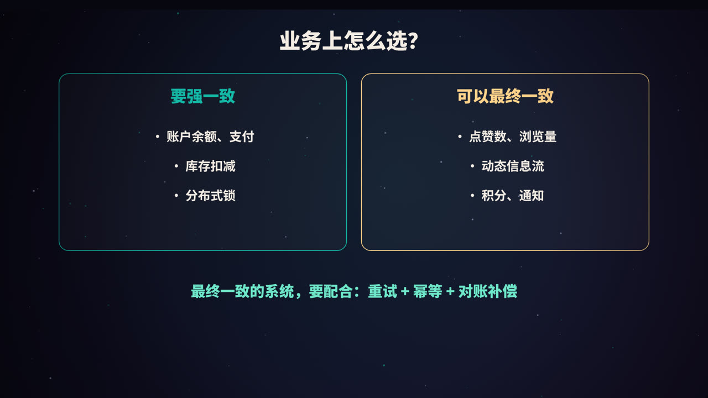
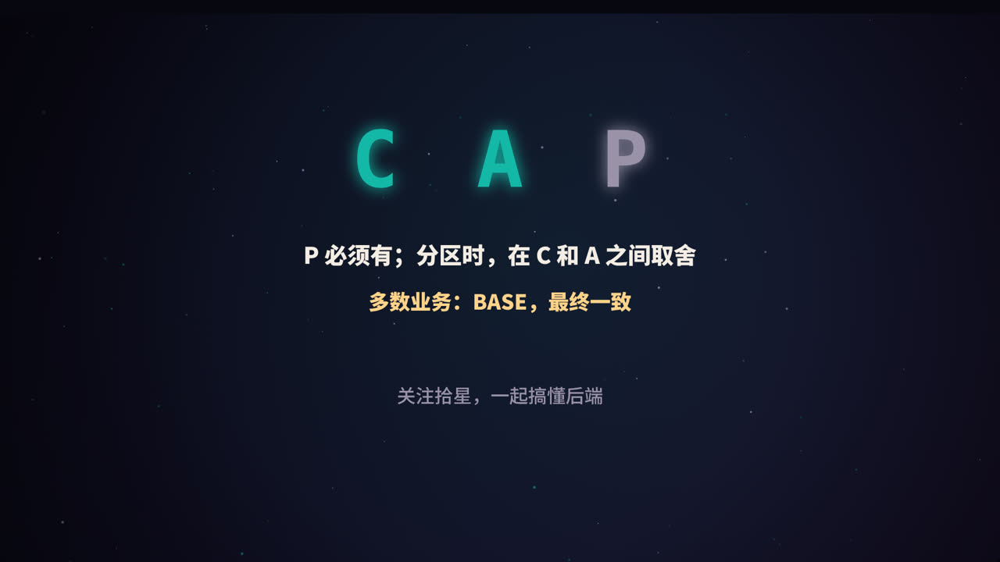

title: CAP 与 BASE：分布式系统绕不开的取舍
subtitle: C、A、P 的准确含义，为什么网络分区时只能二选一，「三选二」错在哪，PACELC，BASE 与最终一致性，以及业务上怎么选
tag: 计算机与后端
color: #14b8a6

## 从一个场景开始

为了防止单台机器宕机导致服务不可用，我们把数据复制到了北京和上海两个机房，两边实时同步。

某一天，两个机房之间的网络断了。这时：

- 有用户在北京写入了 `X = 2`；
- 另一个用户去上海读取 `X`。

上海该怎么回答？

- 如果返回 `X = 1`，用户拿到的是**旧数据**；
- 如果为了保证数据正确而拒绝回答，用户就**无法使用服务**。

这个两难，就是分布式系统中最著名的 **CAP 定理**要说的事。

## C、A、P 分别是什么

| 字母 | 名称 | 含义 |
|---|---|---|
| **C** | 一致性（Consistency） | 任何一次读取，都能读到最近一次写入的值，就像只有一份数据一样 |
| **A** | 可用性（Availability） | 每一个没有故障的节点，收到请求后都必须在合理的时间内给出响应（不能是错误或超时） |
| **P** | 分区容错（Partition tolerance） | 节点之间的网络发生分区（消息丢失或延迟到无法通信）时，系统仍然能够继续运行 |

需要注意，这里的「一致性」和数据库事务 ACID 里的「一致性」**不是同一个意思**：

- ACID 的 C：事务前后，数据满足业务规则和约束；
- CAP 的 C：多个副本之间的数据是否相同，严格来说指的是**线性一致性**（linearizability）。

### 来历

CAP 最早由加州大学伯克利分校的 Eric Brewer 在 2000 年的一次演讲中作为猜想提出。2002 年，MIT 的 Seth Gilbert 和 Nancy Lynch 给出了形式化的证明，它从此被称为 CAP 定理。

## 为什么只能二选一

回到开头的场景。网络已经断开，上海收到了读请求：

**选择 C（CP 系统）**：上海意识到自己可能没有最新数据，于是拒绝请求或等待，直到网络恢复。数据保证正确，但这段时间里服务**不可用**。

**选择 A（AP 系统）**：上海直接返回自己手上的 `X = 1`。服务一直**可用**，但用户可能读到旧数据；等网络恢复后，再把两边的数据同步一致。

不存在第三种办法：两个节点无法通信，上海不可能既「立刻回答」又「保证答案是最新的」。

### 为什么 P 必须要有

网络故障在分布式系统中**一定会发生**：交换机故障、光缆被挖断、机房断电、网络拥塞导致超时……这些都不是你能选择不发生的。

如果一个系统「不支持分区容错」，就意味着一旦网络出问题，系统就会出现不可预期的行为，这在生产环境中是不可接受的。所以，**对于真正的分布式系统，P 不是一个选项，而是一个前提**。真正的选择只有：分区发生时，要 C 还是要 A。

## 常见系统的取舍

| 倾向 | 系统 | 说明 |
|---|---|---|
| 偏 CP | ZooKeeper、etcd、Consul | 基于共识算法，少数派节点在分区时不提供写服务，常用于分布式锁、配置和选主 |
| 偏 CP | HBase | 每块数据由单个节点负责，节点故障转移期间那部分数据暂时不可用 |
| 偏 AP | Cassandra、DynamoDB 风格的数据库 | 分区时各节点继续读写，之后再合并冲突 |
| 偏 AP | Eureka | 服务注册中心，宁可返回可能过期的服务列表，也不让服务调用整体失败 |
| 偏 AP | DNS | 全球分布、层层缓存，修改记录后需要一段时间才能生效 |

这只是大致的倾向。很多系统可以通过配置调节：比如 Cassandra 可以设置每次读写需要多少个副本确认，读写确认数之和超过副本总数时，就能读到最新写入的数据，但可用性会相应下降。MySQL 主从复制则取决于同步方式和故障切换策略。

## 常见误解：「三选二」

「CAP 三个只能选两个」是流传最广的说法，但它很容易让人误解：

**误解一：可以选 CA，放弃 P。**
不能。网络分区不是你能放弃的。所谓「CA 系统」，其实只能是单机系统，或者假设网络永远不出问题的系统。

**误解二：系统必须永远在 C 和 A 之间牺牲一个。**
不对。CAP 讨论的只是**分区发生时**的情况。网络正常时，系统完全可以同时提供一致性和可用性。

**误解三：C 和 A 是非黑即白的。**
实际上，一致性有很多级别（线性一致、顺序一致、因果一致、最终一致……），可用性也是一个程度问题。设计系统时，往往是在不同程度之间做细致的权衡。

Eric Brewer 本人在 2012 年也专门写文章澄清了这些误解。

### PACELC：更完整的描述

计算机科学家 Daniel Abadi 提出了 **PACELC** 的说法，补上了「没有分区时」的那一半：

> 如果发生分区（**P**），要在可用性（**A**）和一致性（**C**）之间取舍；否则（**E**lse），要在延迟（**L**atency）和一致性（**C**）之间取舍。

网络正常时也有取舍：要保证强一致，一次写入就要等多个副本都确认，必然更慢；想要更快，就只能接受副本之间短暂的不一致。

## BASE：大多数互联网业务的选择

对于大多数互联网业务，「服务不可用」的代价往往比「数据短暂不一致」更大。于是出现了一套与 ACID 相对的设计理念：**BASE**。

| 字母 | 含义 | 解释 |
|---|---|---|
| **BA** | 基本可用（Basically Available） | 出现故障时，允许损失部分功能或性能，但保证核心功能可用。比如大促时关闭非核心的推荐功能，响应时间从 0.5 秒变成 2 秒 |
| **S** | 软状态（Soft state） | 允许系统中的数据存在中间状态，比如「同步中」「处理中」，并且这个中间状态不影响整体可用性 |
| **E** | 最终一致（Eventually consistent） | 在没有新的更新时，经过一段时间后，所有副本的数据最终会达到一致 |

一个直观的例子：下单成功后，积分没有立刻到账，而是几秒钟后才出现。这几秒钟里，订单数据和积分数据是「不一致」的，但最终会一致，而且用户的下单体验没有受到影响。

### 怎么做到「最终一致」

最终一致不是放任不管，而是要有可靠的机制保证「最终」一定会到达：

- **可靠消息**：通过消息队列异步通知下游，配合本地消息表保证消息一定发出（见本系列《消息队列》）；
- **重试**：失败了就重试，直到成功；
- **幂等**：重试和重复投递不会导致数据错误；
- **对账与补偿**：定期比对各系统的数据，发现不一致时自动或人工修正；
- **Saga 等补偿型事务**：某一步失败时，执行之前步骤的反向操作。

## 业务上怎么选

| 需要强一致 | 可以最终一致 |
|---|---|
| 账户余额、支付扣款 | 点赞数、浏览量、评论数 |
| 库存扣减（防超卖） | 动态信息流、推荐列表 |
| 分布式锁、选主 | 积分到账、消息通知 |
| 唯一性约束（用户名、订单号） | 搜索索引、数据报表 |

判断的思路是：**如果读到旧数据，会造成什么后果？** 后果严重（钱算错了、东西超卖了），就要强一致；后果轻微、可以接受短暂延迟，就用最终一致换取更高的可用性和性能。

同一个系统里，不同的数据完全可以选择不同的策略。

## 高频面试题速答

**Q：什么是 CAP 定理？**
在一个分布式系统中，发生网络分区时，无法同时保证一致性和可用性，必须二选一。

**Q：为什么说 P 一定要选？**
网络分区在分布式系统中无法避免，系统必须能够在分区时继续运行，所以真正的取舍是在 C 和 A 之间。

**Q：ZooKeeper 是 CP 还是 AP？**
通常认为是 CP：它基于 ZAB 共识协议，只有多数派节点能够正常处理写请求，少数派在分区时不对外提供写服务。

**Q：BASE 和 ACID 有什么区别？**
ACID 追求强一致，适合单机数据库事务；BASE 通过牺牲强一致性换取可用性，追求最终一致，适合大规模分布式系统。

## 总结

- **CAP**：一致性、可用性、分区容错，分区发生时 C 和 A 只能二选一；
- **P 必须有**，真正的选择是 CP 还是 AP；
- 「三选二」是简化的说法，网络正常时 C 和 A 可以兼得，此时的取舍是**延迟和一致性**（PACELC）；
- **BASE**：基本可用、软状态、最终一致，是大多数互联网业务的选择；
- 最终一致要配合**可靠消息、重试、幂等、对账补偿**；
- 选型时问自己：**读到旧数据，后果有多严重？**

### 参考资料

- Brewer, E. (2000). Towards Robust Distributed Systems. *PODC Keynote*.
- Gilbert, S., & Lynch, N. (2002). Brewer's Conjecture and the Feasibility of Consistent, Available, Partition-Tolerant Web Services. *ACM SIGACT News*.
- Brewer, E. (2012). CAP Twelve Years Later: How the "Rules" Have Changed. *IEEE Computer*.
- Abadi, D. (2012). Consistency Tradeoffs in Modern Distributed Database System Design (PACELC). *IEEE Computer*.
- Pritchett, D. (2008). BASE: An Acid Alternative. *ACM Queue*.
- Kleppmann, M. (2017). *Designing Data-Intensive Applications*, Chapter 9.

