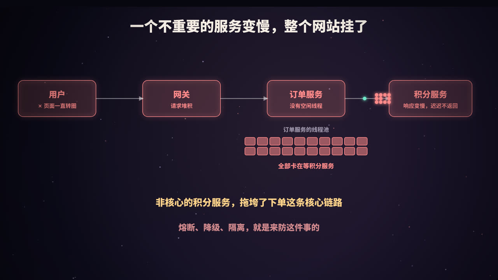
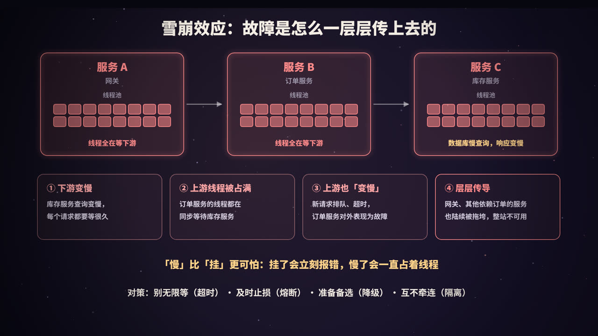
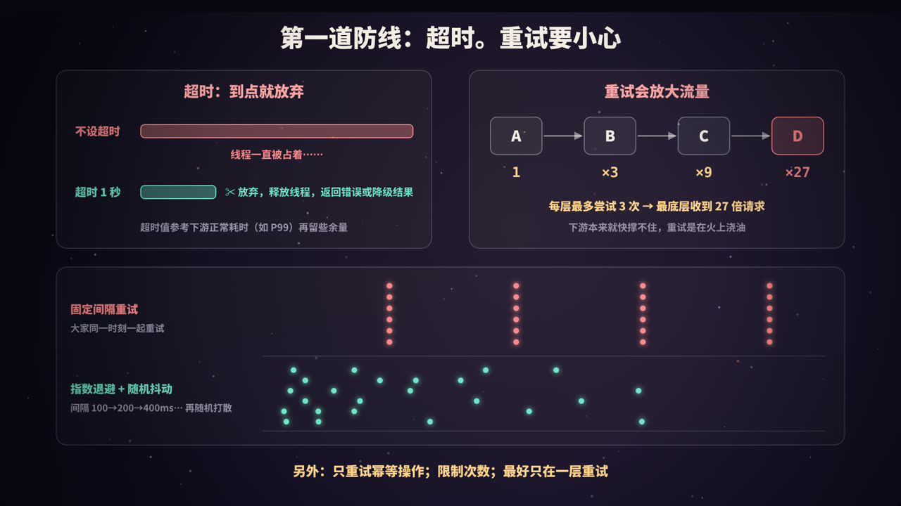
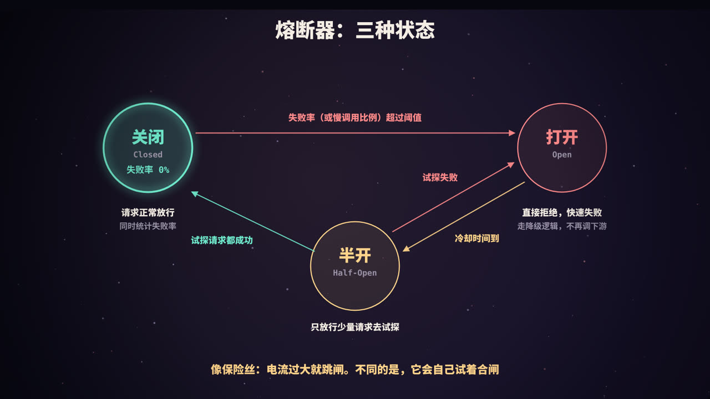
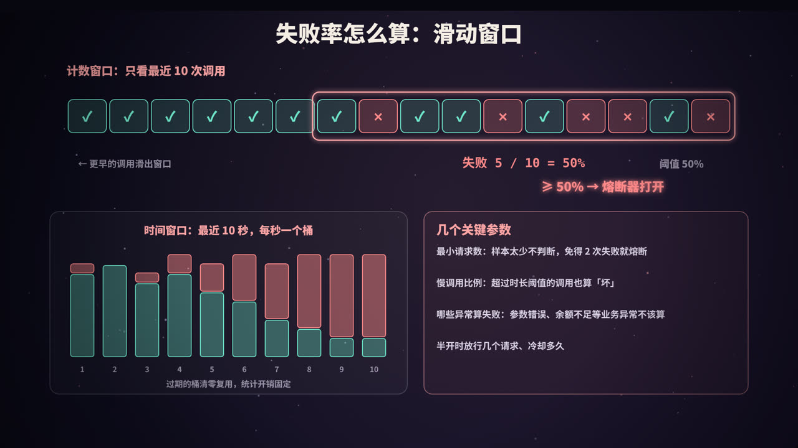
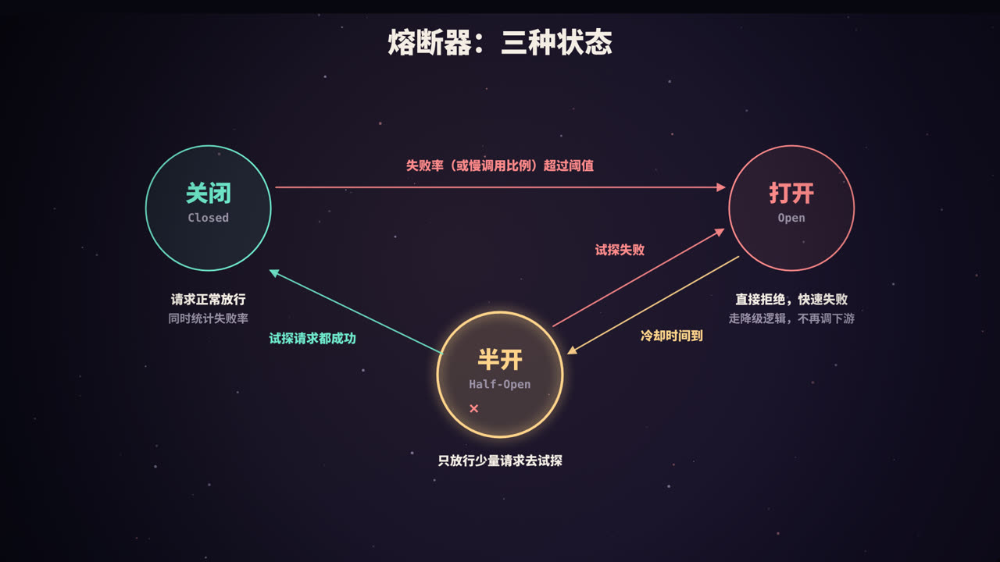
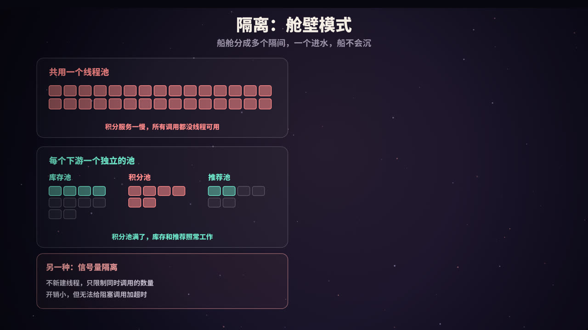
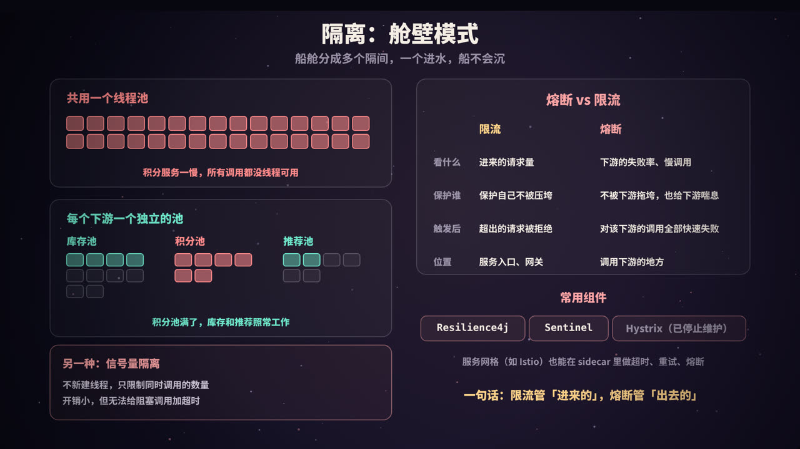

title: 熔断与降级：防止一个服务拖垮全部
subtitle: 雪崩效应怎么发生，超时与重试的正确姿势（指数退避 + 抖动），熔断器三态状态机与滑动窗口统计，降级与舱壁隔离，熔断和限流的区别，附手写熔断器、重试风暴模拟、舱壁隔离三段可运行代码与 Resilience4j / Sentinel 参考配置
tag: 计算机与后端
color: #fca5a5



## 一个不重要的服务，为什么能拖垮整个网站



设想一个电商系统：用户下单时，订单服务要依次调用库存服务、积分服务、优惠券服务。积分只是「下单送积分」的附属功能，就算暂时不加积分，用户也完全能接受。

某天积分服务的数据库出现慢查询，积分接口从 50ms 变成了 5 秒才返回。没有任何服务「挂掉」，但几分钟后，整个下单链路都不可用了：

1. **下游变慢**：积分服务的每个请求都要等 5 秒；
2. **上游线程被占满**：订单服务处理每个下单请求时，都有一个线程卡在「同步等待积分服务返回」上。线程池只有那么多线程，很快全部被占住；
3. **上游也「变慢」了**：新的下单请求拿不到线程，只能排队、超时。在调用订单服务的人看来，订单服务出了故障；
4. **层层传导**：网关、购物车、所有依赖订单服务的服务，又重复了第 2、3 步。最终整个网站不可用。

这就是**雪崩效应**（也叫级联故障，Cascading Failure）：一个局部的故障，沿着调用链一层层向上传播，最终拖垮整个系统。

### 「慢」比「挂」更可怕

直觉上，服务彻底宕机好像更严重。但实际上：

- 服务**挂了**：连接被拒绝，调用方几毫秒内就拿到错误，线程立刻被释放；
- 服务**变慢**：调用方的线程一直挂在那里等待，什么都做不了，资源被持续占用。

用一个简单的公式就能算出影响有多大。一个服务能同时处理的请求数，大约等于「吞吐量 × 每个请求的耗时」（排队论中的利特尔法则）。反过来，**线程数固定时，最大吞吐量 = 线程数 ÷ 每个请求的耗时**：

| 积分接口耗时 | 订单服务线程数 | 订单服务最多能撑住的 QPS |
|---|---|---|
| 50ms（正常） | 200 | 200 ÷ 0.05 = 4000 |
| 1s | 200 | 200 ÷ 1 = 200 |
| 5s | 200 | 200 ÷ 5 = 40 |

下游从 50ms 变成 5 秒，订单服务的处理能力直接下降到原来的 1%。如果平时有 1000 QPS 的下单请求，线程池在零点几秒内就会被占满。

> 本系列《线程池》介绍了线程池的工作原理；这里的问题是：线程池再大也没用，只要下游一直慢，多少线程都会被耗尽。

### 四个对策

| 对策 | 一句话 | 解决什么 |
|---|---|---|
| **超时** | 别无限等下去 | 每次调用最多占用线程多久 |
| **熔断** | 失败多了就断开 | 下游已经不行了，就别再调了，快速失败 |
| **降级** | 准备一个备选结果 | 调用失败时返回什么，让主流程能继续 |
| **隔离** | 故障关在一个舱里 | 一个下游出问题，最多影响它自己那部分资源 |

这几个手段经常放在一起使用，下面一个一个讲。

## 第一道防线：超时，以及小心使用重试



### 超时：到点就放弃

**所有远程调用都必须设置超时。** 这是最简单、也最容易被忽略的一条。不少客户端的默认超时是「无限等待」，例如 JDK 自带的 `HttpURLConnection`，连接超时和读超时的默认值都是 0，表示永不超时。

超时通常分两种：

- **连接超时**：建立 TCP 连接最多等多久，一般很短（几百毫秒到 1~2 秒）；
- **读超时 / 请求超时**：连接建立后，等待响应最多等多久。

超时值怎么定？

- 参考下游**正常情况下的耗时分布**，比如 P99 或 P999，再留一些余量。太短会误伤正常请求，太长则起不到保护作用；
- **上游的超时要比下游长**。如果网关给订单服务 1 秒超时，订单服务调用积分服务却设置了 3 秒超时，那网关早就放弃了，订单服务还在傻等；
- 更好的做法是**传递截止时间**（deadline）：入口处确定「这个请求最晚什么时候必须返回」，每往下调用一层，就把剩余时间传下去。gRPC 的 deadline 就是这种机制。剩余时间不够时，直接放弃，不再发起调用。

超时只能限制「单次调用最多浪费多少时间」。如果下游持续出问题，每个请求还是要白白等满超时时间才失败，这正是后面熔断器要解决的问题。

### 重试：可能是火上浇油

调用失败后重试，可以解决网络抖动之类的**偶发**错误。但当下游是因为**过载**而变慢时，重试会让情况更糟：本来 1 个请求，现在变成了 3 个。

更危险的是**多层重试**。假设调用链是 A → B → C → D，每一层都「失败了最多尝试 3 次」，当 D 持续失败时：

- B 收到 3 次请求；
- C 收到 3 × 3 = 9 次；
- D 收到 3 × 3 × 3 = **27 次**。

原本已经快撑不住的 D，流量被放大了 27 倍。

### 指数退避 + 随机抖动

即使只在一层重试，如果大量客户端**同时**失败、又按**相同的间隔**重试，它们的重试请求会在同一时刻一起到达，形成一波又一波的流量尖峰（有时被称为「惊群」）。解决办法是：

- **指数退避**（Exponential Backoff）：每次重试的等待时间翻倍，比如 1s → 2s → 4s → 8s，给下游留出恢复的时间；
- **随机抖动**（Jitter）：在退避时间上加入随机性，把大家的重试时间打散。常见的「全抖动」（Full Jitter）做法是：在 `[0, min(上限, 基数 × 2^n)]` 之间随机取一个值作为等待时间。

下面用 Python 模拟 1000 个客户端在同一时刻失败，各重试 4 次，统计重试请求在时间上的分布：

```python
"""重试风暴模拟：1000 个客户端在同一时刻失败后，用三种策略各重试 4 次。
统计每 100ms 内到达下游的重试请求数（峰值），以及每秒的分布。
运行：python3 retry_storm.py
"""
import random

random.seed(257)
CLIENTS, RETRIES, BUCKET = 1000, 4, 0.1      # 客户端数、最多重试次数、统计粒度（秒）
BASE, CAP = 1.0, 30.0                         # 退避基数 1s，上限 30s


def fixed(n):            # 固定间隔：每次都等 1 秒
    return 1.0


def expo(n):             # 指数退避：1s, 2s, 4s, 8s ...
    return min(CAP, BASE * 2 ** n)


def expo_jitter(n):      # 指数退避 + 全抖动（full jitter）：在 [0, 退避上限] 里随机取
    return random.uniform(0, min(CAP, BASE * 2 ** n))


def simulate(strategy):
    buckets = {}
    for _ in range(CLIENTS):
        t = 0.0                               # 所有客户端在 t=0 同时第一次失败
        for n in range(RETRIES):
            t += strategy(n)
            b = int(t / BUCKET)
            buckets[b] = buckets.get(b, 0) + 1
    return buckets


for name, fn in [("固定间隔 1s", fixed), ("指数退避", expo), ("指数退避 + 抖动", expo_jitter)]:
    bk = simulate(fn)
    per_sec = {}
    for b, n in bk.items():
        per_sec[int(b * BUCKET)] = per_sec.get(int(b * BUCKET), 0) + n
    print(f"{name}：重试共 {sum(bk.values())} 次，最拥挤的 100ms 里有 {max(bk.values())} 次，最后一次在 {max(bk) * BUCKET:.1f}s")
    for sec in range(0, 16):
        n = per_sec.get(sec, 0)
        if n:
            print(f"   {sec:2d}~{sec+1:2d}s {n:5d} " + "#" * max(1, round(n / 40)))
    print()

# 多层重试的放大效应
print("多层重试放大：每层最多尝试 3 次（1 次 + 重试 2 次），下游持续失败时")
calls = 1
for layer in "ABCD":
    print(f"   服务 {layer} 收到 {calls} 次请求")
    calls *= 3
```

运行 `python3 retry_storm.py`，输出：

```text
固定间隔 1s：重试共 4000 次，最拥挤的 100ms 里有 1000 次，最后一次在 4.0s
    1~ 2s  1000 #########################
    2~ 3s  1000 #########################
    3~ 4s  1000 #########################
    4~ 5s  1000 #########################

指数退避：重试共 4000 次，最拥挤的 100ms 里有 1000 次，最后一次在 15.0s
    1~ 2s  1000 #########################
    3~ 4s  1000 #########################
    7~ 8s  1000 #########################
   15~16s  1000 #########################

指数退避 + 抖动：重试共 4000 次，最拥挤的 100ms 里有 161 次，最后一次在 14.0s
    0~ 1s  1306 #################################
    1~ 2s   612 ###############
    2~ 3s   481 ############
    3~ 4s   331 ########
    4~ 5s   317 ########
    5~ 6s   255 ######
    6~ 7s   116 ###
    7~ 8s   126 ###
    8~ 9s   141 ####
    9~10s   111 ###
   10~11s    93 ##
   11~12s    65 ##
   12~13s    37 #
   13~14s     8 #
   14~15s     1 #

多层重试放大：每层最多尝试 3 次（1 次 + 重试 2 次），下游持续失败时
   服务 A 收到 1 次请求
   服务 B 收到 3 次请求
   服务 C 收到 9 次请求
   服务 D 收到 27 次请求
```

可以看到：

- **固定间隔**：1000 个重试请求在同一个 100ms 内一起到达，每秒一波，下游每次都被同时冲击；
- **只用指数退避**：间隔拉开了，但所有客户端仍然**同步**行动，每一波的峰值还是 1000；
- **指数退避 + 抖动**：最拥挤的 100ms 里只有 161 个请求，重试被摊平到十几秒里，下游有机会慢慢恢复。

### 重试的几条规矩

1. **只重试幂等的操作**。查询可以随便重试；「扣款」「下单」这类操作，如果没有幂等保护，重试可能导致重复扣款；
2. **只重试可能恢复的错误**。超时、连接失败、HTTP 503 值得重试；参数错误（400）、无权限（403）重试多少次都一样；
3. **限制次数**，并且最好**只在一层重试**（通常是最靠近出错点的那一层，或者最外层），避免层层放大；
4. **设置重试预算**：例如规定重试请求不能超过正常请求的 10%。下游大面积故障时，重试会被预算挡住，而不是放大流量；
5. **配合熔断器**：熔断器打开后，重试也会被直接拒绝，不会再打到下游。

## 熔断器：会自己合闸的保险丝



超时 + 有限重试，还是没有解决一个问题：下游已经明显不行了，每个请求却仍然要去「试一次」，等满超时时间才失败。

**熔断器**（Circuit Breaker）的思路来自电路里的保险丝或空气开关：电流过大时自动跳闸，保护整个电路。它包在对下游的调用外面，持续统计调用结果，在下游出问题时自动「断开」，让后续的请求**直接失败**，不再调用下游。

和保险丝不同的是：熔断器会**自己试着合闸**。

### 三种状态

| 状态 | 行为 | 什么时候离开这个状态 |
|---|---|---|
| **关闭**（Closed） | 正常状态。请求正常放行，同时统计失败率 | 失败率（或慢调用比例）超过阈值 → **打开** |
| **打开**（Open） | 所有请求直接被拒绝，立刻返回错误或走降级逻辑，**不调用下游** | 等待一段冷却时间后 → **半开** |
| **半开**（Half-Open） | 只放行少量试探请求，其余请求仍然拒绝 | 试探成功 → **关闭**；试探失败 → 回到**打开** |

一个完整的过程是这样的：

1. 平时处于**关闭**状态，熔断器只在旁边默默统计；
2. 下游出故障，失败率超过阈值（比如 50%），熔断器**打开**。之后的请求在本地就被拒绝，耗时几乎为 0，不占用线程，也不会给下游增加任何压力；
3. 等待一段时间（比如 10 秒），进入**半开**状态，放行几个请求去「探路」；
4. 如果这几个试探请求都成功了，说明下游已经恢复，回到**关闭**状态；如果还是失败，再次**打开**，继续等待下一个冷却期。

### 为什么需要「半开」

如果没有半开状态，冷却期结束后直接回到关闭状态，所有积压的流量会一下子涌向刚刚恢复的下游，很可能把它再次打垮，熔断器就会在打开和关闭之间反复切换。

半开状态相当于**小心地试水**：只用少量请求验证下游是否真的恢复了，确认之后再放开全部流量。

### 熔断器带来的好处

- **对调用方**：快速失败，线程不会被慢调用占住，自己不会被拖垮；
- **对下游**：故障期间流量被切断，获得喘息和恢复的机会，而不是在恢复过程中不断被请求压垮；
- **对用户**：配合降级，可以立刻得到一个「虽然不完整，但可用」的结果，而不是一直转圈。

## 失败率怎么算：滑动窗口



熔断器要判断「下游是不是出问题了」，需要统计**最近一段时间**的失败率。如果从启动开始累计统计，几天前的成功记录会把今天的故障「稀释」掉，反应就太迟钝了。所以统计用的是**滑动窗口**。

> 本系列《限流算法》中也讲过滑动窗口，这里的思路是相同的，只是统计的对象从「请求数」变成了「调用结果」。

### 计数窗口：最近 N 次调用

只看最近 N 次调用的结果，例如最近 100 次。实现上通常用一个长度为 N 的**环形数组**：

- 每完成一次调用，就把结果写入当前位置，指针后移；
- 数组写满后，新结果会覆盖最老的结果，相当于最老的那次调用「滑出」了窗口；
- 同时维护失败次数的计数：写入失败时加一，被覆盖的旧结果如果是失败就减一。这样计算失败率不需要遍历整个数组，时间复杂度是 O(1)。

### 时间窗口：最近 N 秒

只看最近 N 秒内的调用，例如最近 10 秒。如果把每一次调用都记录下来，内存会随着 QPS 增长，所以通常**分桶**：

- 每秒一个桶，每个桶只记录这一秒内的「总调用数、失败数、慢调用数、总耗时」；
- 10 个桶组成一个环；时间进入新的一秒时，把最老的桶清零后复用；
- 失败率 = 所有桶的失败数之和 ÷ 所有桶的调用数之和。

不管 QPS 多高，内存和计算开销都是固定的。代价是精度：桶的边界处会有一点误差，但对于熔断判断来说足够了。

| | 计数窗口 | 时间窗口 |
|---|---|---|
| 统计范围 | 最近 N 次调用 | 最近 N 秒 |
| 优点 | 样本量固定，结果稳定 | 反映的时间范围固定，流量变化时更直观 |
| 缺点 | 流量低时，窗口可能覆盖很长一段时间 | 流量低时样本太少，需要配合最小请求数 |

### 几个关键参数

- **最小请求数**：样本太少时不做判断。比如窗口里只有 2 次调用，碰巧都失败了，失败率 100%，但这并不能说明下游出了问题；
- **慢调用**：耗时超过某个阈值的调用，即使最终成功，也算作「不健康」。慢调用比例超过阈值同样会触发熔断。前面说过，「慢」比「挂」更危险，所以这条很重要；
- **哪些异常算失败**：超时、连接失败、5xx 应该算；参数校验失败、余额不足这类**业务异常**说明下游工作正常，不应该计入失败率，否则用户输错几次密码就可能把服务熔断；
- **冷却时间**和**半开时的试探次数**：冷却太短，下游还没恢复就去试探；太长，下游恢复了还在拒绝请求。

## 动手：手写一个带半开状态的熔断器



下面用 Java 21 实现一个熔断器，包含：计数滑动窗口（环形数组）、失败率和慢调用比例两个触发条件、最小请求数、冷却时间、半开状态的试探名额。

为了让结果可以重复，程序使用「虚拟时钟」模拟 30 秒：每 250ms 发起一次请求；下游「积分服务」在第 5 秒开始故障（80% 的请求超时），第 16 秒恢复。

```java
import java.util.Random;
import java.util.function.Supplier;

/**
 * 手写熔断器：计数滑动窗口 + 失败率/慢调用比例 + 半开探测。
 * 用「虚拟时钟」模拟 30 秒：下游 5s 开始故障，16s 恢复。
 * 运行：java CircuitBreakerDemo.java
 */
public class CircuitBreakerDemo {

    enum State { CLOSED, OPEN, HALF_OPEN }

    /** 熔断器配置（字段含义对应 Resilience4j 的同名参数） */
    record Config(int windowSize,            // slidingWindowSize：看最近多少次调用
                  int minimumCalls,          // minimumNumberOfCalls：样本少于这个数不做判断
                  double failureRateThreshold, // 失败率阈值（%）
                  long slowCallMillis,       // 超过这个耗时算「慢调用」
                  double slowRateThreshold,  // 慢调用比例阈值（%）
                  long openWaitMillis,       // 打开状态持续多久后进入半开
                  int halfOpenPermits) {}    // 半开时放行多少个试探请求

    static final class CircuitBreaker {
        private final Config cfg;
        private final Supplier<Long> clock;
        // 环形数组实现的计数滑动窗口：每格记录一次调用的结果
        private final boolean[] failed, slow;
        private int next, size, failedCnt, slowCnt;
        private State state = State.CLOSED;
        private long openedAt;
        private int halfOpenIssued, halfOpenOk;

        CircuitBreaker(Config cfg, Supplier<Long> clock) {
            this.cfg = cfg; this.clock = clock;
            failed = new boolean[cfg.windowSize()]; slow = new boolean[cfg.windowSize()];
        }

        State state() { return state; }

        /** 调用前询问：这次能不能真的去调下游？ */
        synchronized boolean tryAcquire() {
            if (state == State.OPEN) {
                if (clock.get() - openedAt < cfg.openWaitMillis()) return false;   // 冷却中：快速失败
                transition(State.HALF_OPEN, "冷却 " + cfg.openWaitMillis() / 1000 + "s 结束");
            }
            if (state == State.HALF_OPEN) {
                if (halfOpenIssued >= cfg.halfOpenPermits()) return false;         // 名额用完：其余请求仍然拒绝
                halfOpenIssued++;
                return true;
            }
            return true;                                                          // CLOSED：放行
        }

        /** 调用结束后上报结果 */
        synchronized void onResult(boolean success, long costMillis) {
            boolean isSlow = costMillis >= cfg.slowCallMillis();
            if (state == State.HALF_OPEN) {
                if (!success || isSlow) { transition(State.OPEN, "试探失败"); return; }
                if (++halfOpenOk >= cfg.halfOpenPermits()) transition(State.CLOSED, halfOpenOk + " 个试探请求全部成功");
                return;
            }
            if (state != State.CLOSED) return;
            record(!success, isSlow);
            if (size < cfg.minimumCalls()) return;
            double fr = failureRate(), sr = 100.0 * slowCnt / size;
            if (fr >= cfg.failureRateThreshold())
                transition(State.OPEN, String.format("失败率 %.0f%% ≥ %.0f%%", fr, cfg.failureRateThreshold()));
            else if (sr >= cfg.slowRateThreshold())
                transition(State.OPEN, String.format("慢调用比例 %.0f%% ≥ %.0f%%", sr, cfg.slowRateThreshold()));
        }

        double failureRate() { return size == 0 ? 0 : 100.0 * failedCnt / size; }

        private void record(boolean f, boolean s) {
            if (size == failed.length) {                 // 窗口满了：最老的一格滑出去
                if (failed[next]) failedCnt--;
                if (slow[next]) slowCnt--;
            } else size++;
            failed[next] = f; slow[next] = s;
            if (f) failedCnt++;
            if (s) slowCnt++;
            next = (next + 1) % failed.length;
        }

        private void transition(State to, String why) {
            System.out.printf("  [%5.1fs] %-9s → %-9s （%s）%n", clock.get() / 1000.0, state, to, why);
            state = to;
            if (to == State.OPEN) openedAt = clock.get();
            if (to == State.HALF_OPEN) { halfOpenIssued = 0; halfOpenOk = 0; }
            if (to == State.CLOSED) { next = size = failedCnt = slowCnt = 0;
                java.util.Arrays.fill(failed, false); java.util.Arrays.fill(slow, false); }
        }
    }

    // ---------------- 模拟 ----------------
    static long now = 0;                         // 虚拟时钟（毫秒）
    static final Random rnd = new Random(257);
    static final long TIMEOUT = 1000;            // 调用方设置的超时

    /** 模拟下游「积分服务」：5s~16s 故障期间 80% 的请求超时 */
    static boolean callPoints(long[] cost) {
        boolean faulty = now >= 5_000 && now < 16_000;
        if (faulty && rnd.nextDouble() < 0.8) { cost[0] = TIMEOUT; return false; }   // 等满超时才失败
        cost[0] = 40 + rnd.nextInt(30);
        return true;
    }

    public static void main(String[] args) {
        Config cfg = new Config(10, 10, 50, 800, 80, 4_000, 3);
        CircuitBreaker cb = new CircuitBreaker(cfg, () -> now);
        System.out.println("配置：" + cfg);
        System.out.println("下游：5s 开始故障（80% 超时），16s 恢复；每 250ms 一个请求\n");
        System.out.println("状态变化：");

        StringBuilder line = new StringBuilder();
        int sent = 0, ok = 0, fail = 0, rejected = 0;
        long waitedWithCb = 0, waitedWithoutCb = 0;
        StringBuilder[] rows = new StringBuilder[30];
        for (int i = 0; i < 30; i++) rows[i] = new StringBuilder();

        for (now = 0; now < 30_000; now += 250) {
            char mark;
            boolean faultyNow = now >= 5_000 && now < 16_000;
            waitedWithoutCb += faultyNow ? (long) (0.8 * TIMEOUT + 0.2 * 55) : 55;   // 对比：没有熔断器时的期望等待
            if (!cb.tryAcquire()) {                  // 熔断：不调下游，直接走降级
                rejected++; mark = '-';
            } else {
                long[] cost = new long[1];
                boolean success = callPoints(cost);
                sent++; waitedWithCb += cost[0];
                if (success) { ok++; mark = '.'; } else { fail++; mark = 'x'; }
                cb.onResult(success, cost[0]);
            }
            rows[(int) (now / 1000)].append(mark);
        }

        System.out.println("\n时间线（每秒 4 个请求；. 成功  x 失败/超时  - 被熔断，返回降级结果）：");
        for (int s = 0; s < 30; s += 5) {
            StringBuilder sb = new StringBuilder(String.format("  %2d-%2ds ", s, s + 5));
            for (int k = s; k < s + 5; k++) sb.append(rows[k]).append(' ');
            System.out.println(sb);
        }
        System.out.printf("%n共 120 个请求：真正调用下游 %d 次（成功 %d，失败 %d），被熔断快速失败 %d 次%n", sent, ok, fail, rejected);
        System.out.printf("调用方线程花在等待下游上的时间：有熔断器 %.1fs，没有熔断器约 %.1fs%n",
                waitedWithCb / 1000.0, waitedWithoutCb / 1000.0);
    }
}
```

保存为 `CircuitBreakerDemo.java`，直接运行 `java CircuitBreakerDemo.java`（Java 11 起支持单文件直接运行，`record` 需要 Java 16+），输出：

```text
配置：Config[windowSize=10, minimumCalls=10, failureRateThreshold=50.0, slowCallMillis=800, slowRateThreshold=80.0, openWaitMillis=4000, halfOpenPermits=3]
下游：5s 开始故障（80% 超时），16s 恢复；每 250ms 一个请求

状态变化：
  [  6.0s] CLOSED    → OPEN      （失败率 50% ≥ 50%）
  [ 10.0s] OPEN      → HALF_OPEN （冷却 4s 结束）
  [ 10.0s] HALF_OPEN → OPEN      （试探失败）
  [ 14.0s] OPEN      → HALF_OPEN （冷却 4s 结束）
  [ 14.0s] HALF_OPEN → OPEN      （试探失败）
  [ 18.0s] OPEN      → HALF_OPEN （冷却 4s 结束）
  [ 18.5s] HALF_OPEN → CLOSED    （3 个试探请求全部成功）

时间线（每秒 4 个请求；. 成功  x 失败/超时  - 被熔断，返回降级结果）：
   0- 5s .... .... .... .... .... 
   5-10s xxxx x--- ---- ---- ---- 
  10-15s x--- ---- ---- ---- x--- 
  15-20s ---- ---- ---- .... .... 
  20-25s .... .... .... .... .... 
  25-30s .... .... .... .... .... 

共 120 个请求：真正调用下游 75 次（成功 68，失败 7），被熔断快速失败 45 次
调用方线程花在等待下游上的时间：有熔断器 10.8s，没有熔断器约 39.9s
```

逐行看：

- **0~5 秒**：下游正常，熔断器处于关闭状态，所有请求都成功；
- **5~6 秒**：故障开始，连续出现 5 次超时。第 6 秒时窗口里的 10 次调用中有 5 次失败，失败率达到 50%，熔断器**打开**；
- **6~10 秒**：所有请求都被直接拒绝（`-`），返回降级结果，不再调用下游；
- **第 10 秒、第 14 秒**：冷却结束，进入**半开**状态，放行一个试探请求。此时下游仍在故障中，试探失败，熔断器重新**打开**；
- **第 16 秒**：下游恢复，但熔断器还处于打开状态，要等到下一个冷却期结束；
- **第 18 秒**：进入半开，连续 3 个试探请求都成功，熔断器**关闭**，恢复正常。

最后两行是熔断器的收益：故障持续了 11 秒，期间真正打到下游的失败请求只有 7 个；调用方线程花在等待上的时间从约 39.9 秒降到了 10.8 秒。其余 45 个请求都在本地立刻返回了降级结果。

同时也能看到熔断器的**代价**：下游第 16 秒就恢复了，但直到第 18.5 秒才完全恢复流量。冷却时间越长，这个延迟就越大。

### 和真实组件的差别

这个实现只是为了说明原理，和生产级组件相比还有一些差别：

- **半开的判断**：这里只要有一个试探请求失败就重新打开。Resilience4j 的做法是放行 `permittedNumberOfCallsInHalfOpenState` 个请求，然后计算它们的失败率，再和阈值比较；
- **并发**：这里用 `synchronized` 保证正确性。真实组件会用原子变量、无锁结构等方式减少锁竞争，因为熔断器在每一次调用的路径上；
- **状态转换的时机**：这里和 Resilience4j 的默认行为一样，是在「下一个请求到来时」才检查冷却时间是否结束；也可以用定时任务主动切换到半开；
- **可观测性**：真实组件会发布状态变化事件和各种指标，方便接入监控和告警。熔断器打开本身就是一个很重要的告警信号。

## 降级：有准备的失败


熔断器打开后，请求被拒绝了，然后呢？如果只是把异常抛给用户，体验并没有好多少。**降级**（Fallback / Degradation）回答的是：**调用失败时，返回什么。**

### 降级的几种做法

| 做法 | 例子 |
|---|---|
| **返回默认值** | 推荐服务不可用，返回空列表或者默认的热门榜单；配置中心不可用，使用本地的默认配置 |
| **返回缓存** | 返回上一次成功获取的数据，哪怕有点旧。比如商品详情页的价格以外的信息、用户头像 |
| **简化功能** | 搜索服务压力大时，关闭复杂排序，只按相关度返回；个性化推荐退化为非个性化推荐 |
| **异步补偿** | 积分服务不可用，先记录下来，稍后通过消息队列补发（见本系列《消息队列》），页面提示「积分稍后到账」 |
| **友好提示** | 实在给不出结果，至少返回「服务繁忙，请稍后再试」，而不是一个报错页面或一直转圈 |

关键在于**区分核心和非核心**。对于商品详情页来说，商品信息、价格、下单按钮是核心功能，必须保证；推荐、评论、积分是锦上添花，出了问题可以先不显示。核心功能本身出了问题（比如支付服务不可用），一般无法降级成「假装成功」，只能明确告诉用户失败了。

### 被动降级与主动降级

- **被动降级**：调用失败、超时或者熔断器打开时，自动执行降级逻辑。熔断和降级通常是一对：熔断器决定「要不要调用」，降级决定「不调用时返回什么」；
- **主动降级**：在大促、秒杀等可以预见的高峰之前，**提前手动关闭**非核心功能，比如关闭商品评论、把个性化推荐换成静态热门榜、把积分改为异步发放。这样可以把线程、数据库连接、CPU 都留给下单和支付。主动降级通常通过配置中心的**开关**实现，修改后实时生效，不需要重新发布。

### 降级逻辑的注意事项

- **降级逻辑本身要足够简单可靠**。不要在降级逻辑里再去调用另一个远程服务，否则那个服务也出问题时，降级本身也会失败；
- **降级结果要能被识别**。返回缓存数据或默认值时，最好有标记，方便前端展示（例如「数据可能不是最新」），也方便日志和监控统计降级的次数；
- **降级逻辑也需要测试**。降级代码平时很少执行，最容易在真正需要的时候才发现有 bug。可以通过故障演练（主动注入故障）来验证；
- **不要让降级掩盖问题**。降级让用户感受不到故障，但运维人员必须感受到：降级次数应该接入监控和告警。

## 隔离：舱壁模式



熔断器需要统计一段时间才能做出判断，在它打开之前，慢调用仍然可能占满线程。**隔离**的作用是：从一开始就**限制每个下游最多能占用多少资源**。

这个思路叫**舱壁模式**（Bulkhead）。轮船的船舱被分成多个互不相通的隔间，一个隔间进水，水不会漫到其他隔间，船也就不会沉。

### 两种隔离方式

**线程池隔离**：为每个下游分配一个独立的线程池。调用积分服务的任务提交到「积分线程池」，调用库存服务的任务提交到「库存线程池」。积分服务再慢，最多也只能占满积分线程池，库存的调用不受影响。

**信号量隔离**：不额外创建线程，而是在调用方线程中直接调用下游，但用一个信号量（计数器）限制**同时调用某个下游的并发数**。例如积分服务最多同时有 4 个调用，第 5 个调用会被立即拒绝并走降级逻辑。

| | 线程池隔离 | 信号量隔离 |
|---|---|---|
| 调用在哪个线程执行 | 独立线程池中的线程，调用方线程等待结果 | 调用方线程自己 |
| 超时控制 | 调用方可以在等待结果时设置超时，到点直接返回 | 无法打断已经阻塞的调用，只能依赖客户端本身的超时 |
| 开销 | 额外的线程和线程切换 | 几乎没有 |
| ThreadLocal 上下文 | 需要手动传递（如链路追踪 ID、登录用户） | 天然保留 |
| 适合 | 阻塞式的远程调用 | 耗时很短的调用、异步/响应式代码、网关 |

线程池隔离有一个容易忽略的细节：调用方在等待超时后可以直接返回，但**线程池里的那个线程仍然被阻塞着**，直到底层调用真正返回或者达到客户端自己的超时。所以即使用了线程池隔离，HTTP 客户端本身的超时仍然要设置。

### 动手验证

下面的 Java 程序模拟积分服务变慢（每次调用耗时 2 秒），先提交 30 个积分调用，紧接着提交 5 个库存调用（每次 20ms），比较三种方案下库存调用的耗时：

```java
import java.util.*;
import java.util.concurrent.*;

/**
 * 舱壁隔离演示：积分服务变慢（每次 2 秒），看库存调用受不受影响。
 * 三种方案：共用线程池 / 每个下游独立线程池 / 共用线程池 + 信号量限制并发。
 * 运行：java BulkheadDemo.java
 */
public class BulkheadDemo {

    static void slowPoints() throws InterruptedException { Thread.sleep(2000); }   // 出故障的积分服务
    static void fastStock()  throws InterruptedException { Thread.sleep(20); }     // 正常的库存服务

    /** 先提交 30 个积分调用，再提交 5 个库存调用，统计库存调用从提交到完成的耗时 */
    static void run(String name, ExecutorService pointsPool, ExecutorService stockPool, Semaphore pointsLimit)
            throws Exception {
        List<Future<?>> all = new ArrayList<>();
        int[] rejected = {0};
        for (int i = 0; i < 30; i++) {
            try {
                all.add(pointsPool.submit(() -> {
                    if (pointsLimit != null && !pointsLimit.tryAcquire()) {   // 信号量满了：立即降级
                        synchronized (rejected) { rejected[0]++; }
                        return null;
                    }
                    try { slowPoints(); } finally { if (pointsLimit != null) pointsLimit.release(); }
                    return null;
                }));
            } catch (RejectedExecutionException e) { rejected[0]++; }      // 线程池队列满了：拒绝
        }
        Thread.sleep(50);                                                  // 让积分调用先占住线程
        List<Long> stockCost = Collections.synchronizedList(new ArrayList<>());
        List<Future<?>> stock = new ArrayList<>();
        for (int i = 0; i < 5; i++) {
            long t0 = System.nanoTime();
            stock.add(stockPool.submit(() -> { fastStock(); stockCost.add((System.nanoTime() - t0) / 1_000_000); return null; }));
        }
        for (Future<?> f : stock) f.get();
        for (Future<?> f : all) f.get();
        Collections.sort(stockCost);
        System.out.printf("%s%n    库存调用耗时 %s ms；积分调用被拒绝/降级 %d 次%n", name, stockCost, rejected[0]);
    }

    public static void main(String[] args) throws Exception {
        // 方案一：所有下游共用一个 10 线程的池
        ExecutorService shared = Executors.newFixedThreadPool(10);
        run("① 共用线程池(10)", shared, shared, null);
        shared.shutdown();

        // 方案二：每个下游独立的池；积分池 4 线程 + 有界队列 6，满了直接拒绝
        ExecutorService points = new ThreadPoolExecutor(4, 4, 0, TimeUnit.SECONDS,
                new ArrayBlockingQueue<>(6), new ThreadPoolExecutor.AbortPolicy());
        ExecutorService stock = Executors.newFixedThreadPool(6);
        run("② 独立线程池(4+6)", points, stock, null);
        points.shutdown(); stock.shutdown();

        // 方案三：仍然共用 10 线程的池，但积分调用最多同时占 4 个（信号量隔离）
        ExecutorService shared2 = Executors.newFixedThreadPool(10);
        run("③ 共用池 + 信号量(4)", shared2, shared2, new Semaphore(4));
        shared2.shutdown();
    }
}
```

运行 `java BulkheadDemo.java`，输出：

```text
① 共用线程池(10)
    库存调用耗时 [5965, 5965, 5965, 5965, 5969] ms；积分调用被拒绝/降级 0 次
② 独立线程池(4+6)
    库存调用耗时 [20, 20, 20, 20, 20] ms；积分调用被拒绝/降级 20 次
③ 共用池 + 信号量(4)
    库存调用耗时 [20, 20, 20, 20, 20] ms；积分调用被拒绝/降级 26 次
```

- **共用线程池**：30 个积分调用占满了 10 个线程，排了 3 轮，库存调用只能排在后面，等了将近 6 秒。积分服务的问题完整地传导给了库存调用；
- **独立线程池**：积分池只接受 4 个执行 + 6 个排队，其余 20 个直接被拒绝（可以走降级逻辑）；库存调用在自己的线程池里执行，20ms 完成；
- **共用池 + 信号量**：仍然共用一个线程池，但同一时刻最多只有 4 个线程在调用积分服务，其余积分调用立即降级。剩余的线程可以继续处理库存调用，同样是 20ms。

在实际系统中，隔离通常和熔断一起使用：隔离保证故障**在任何时刻**都只影响一部分资源，熔断则在确认下游出问题后**彻底切断**调用。

## 熔断和限流有什么不同



熔断和限流都会「拒绝请求」，经常被混淆，但它们关注的方向正好相反（限流的原理见本系列《限流算法》）：

| | 限流 | 熔断 |
|---|---|---|
| 看什么 | **进来的**请求量（QPS、并发数） | **出去的**调用结果（失败率、慢调用比例） |
| 保护谁 | 保护自己，不被过多的请求压垮 | 保护自己不被下游拖垮，也给下游喘息的机会 |
| 触发条件 | 请求量超过预设的容量 | 下游表现出故障 |
| 触发后 | 超出容量的请求被拒绝，其余正常处理 | 对这个下游的调用全部快速失败，直到试探成功 |
| 通常位置 | 服务入口、网关、API 层 | 调用下游的客户端 |

一句话：**限流管「进来的」，熔断管「出去的」**。

### 一次下游调用外面的几层保护

把这几种手段组合起来，一次对下游的调用通常是这样被层层包裹的：

<figure>
<svg viewBox="0 0 440 430" xmlns="http://www.w3.org/2000/svg" role="img" aria-label="一次下游调用外面的几层保护">
  <rect width="440" height="430" fill="#0f0e1c"/>
  <defs>
    <marker id="cba" viewBox="0 0 10 10" refX="9" refY="5" markerWidth="7" markerHeight="7" orient="auto"><path d="M0,0 L10,5 L0,10 z" fill="#9a93a8"/></marker>
    <marker id="cbg" viewBox="0 0 10 10" refX="9" refY="5" markerWidth="7" markerHeight="7" orient="auto"><path d="M0,0 L10,5 L0,10 z" fill="#ffd38a"/></marker>
  </defs>
  <g font-family="PingFang SC, Noto Sans SC, sans-serif">
    <text x="220" y="28" fill="#fca5a5" font-size="17" font-weight="800" text-anchor="middle">请求从上往下，每一层都可能提前结束</text>
    <rect x="14" y="46" width="250" height="46" rx="10" fill="rgba(192,132,252,.12)" stroke="#c084fc"/>
    <text x="28" y="66" fill="#f4ede4" font-size="14" font-weight="800">入口限流</text>
    <text x="28" y="84" fill="#9a93a8" font-size="12">超出容量的请求，挡在门外</text>
    <line x1="139" y1="92" x2="139" y2="106" stroke="#9a93a8" stroke-width="2" marker-end="url(#cba)"/>
    <rect x="14" y="108" width="250" height="46" rx="10" fill="rgba(255,255,255,.05)" stroke="#9a93a8"/>
    <text x="28" y="128" fill="#f4ede4" font-size="14" font-weight="800">业务代码 · 有限重试（最外层）</text>
    <text x="28" y="146" fill="#9a93a8" font-size="12">只重试幂等操作，指数退避 + 抖动</text>
    <line x1="139" y1="154" x2="139" y2="168" stroke="#9a93a8" stroke-width="2" marker-end="url(#cba)"/>
    <rect x="14" y="170" width="250" height="46" rx="10" fill="rgba(252,165,165,.12)" stroke="#fca5a5"/>
    <text x="28" y="190" fill="#fca5a5" font-size="14" font-weight="800">熔断器</text>
    <text x="28" y="208" fill="#9a93a8" font-size="12">打开时直接短路，不调用下游</text>
    <line x1="139" y1="216" x2="139" y2="230" stroke="#9a93a8" stroke-width="2" marker-end="url(#cba)"/>
    <rect x="14" y="232" width="250" height="46" rx="10" fill="rgba(255,255,255,.05)" stroke="#9a93a8"/>
    <text x="28" y="252" fill="#f4ede4" font-size="14" font-weight="800">超时</text>
    <text x="28" y="270" fill="#9a93a8" font-size="12">到点就放弃，最多浪费这么久</text>
    <line x1="139" y1="278" x2="139" y2="292" stroke="#9a93a8" stroke-width="2" marker-end="url(#cba)"/>
    <rect x="14" y="294" width="250" height="46" rx="10" fill="rgba(110,231,200,.10)" stroke="#6ee7c8"/>
    <text x="28" y="314" fill="#6ee7c8" font-size="14" font-weight="800">舱壁隔离</text>
    <text x="28" y="332" fill="#9a93a8" font-size="12">这个下游最多占用 N 个线程 / 并发</text>
    <line x1="139" y1="340" x2="139" y2="354" stroke="#9a93a8" stroke-width="2" marker-end="url(#cba)"/>
    <rect x="14" y="356" width="250" height="46" rx="10" fill="rgba(255,255,255,.08)" stroke="#f4ede4"/>
    <text x="139" y="384" fill="#f4ede4" font-size="15" font-weight="800" text-anchor="middle">下游服务</text>
    <rect x="300" y="200" width="126" height="108" rx="12" fill="rgba(255,211,138,.12)" stroke="#ffd38a"/>
    <text x="363" y="232" fill="#ffd38a" font-size="16" font-weight="800" text-anchor="middle">降级</text>
    <text x="363" y="256" fill="#9a93a8" font-size="12" text-anchor="middle">默认值 / 缓存</text>
    <text x="363" y="274" fill="#9a93a8" font-size="12" text-anchor="middle">简化结果</text>
    <text x="363" y="292" fill="#9a93a8" font-size="12" text-anchor="middle">稍后再试</text>
    <line x1="264" y1="193" x2="298" y2="226" stroke="#ffd38a" stroke-width="2" stroke-dasharray="5 4" marker-end="url(#cbg)"/>
    <line x1="264" y1="255" x2="298" y2="255" stroke="#ffd38a" stroke-width="2" stroke-dasharray="5 4" marker-end="url(#cbg)"/>
    <line x1="264" y1="317" x2="298" y2="286" stroke="#ffd38a" stroke-width="2" stroke-dasharray="5 4" marker-end="url(#cbg)"/>
    <text x="363" y="186" fill="#9a93a8" font-size="12" text-anchor="middle">熔断 / 超时 / 满了</text>
    <text x="220" y="420" fill="#9a93a8" font-size="12" text-anchor="middle">熔断器在重试里面：熔断打开后，重试也会被立刻拒绝</text>
  </g>
</svg>
<figcaption>限流挡在入口；对下游的每次调用依次经过重试、熔断、超时、舱壁。任何一层拒绝或失败，都转向降级逻辑</figcaption>
</figure>

这里的顺序和 Resilience4j 在 Spring Boot 中默认的切面顺序一致：`Retry ( CircuitBreaker ( RateLimiter ( TimeLimiter ( Bulkhead ( 调用 ) ) ) ) )`。把熔断器放在重试**里面**，熔断器打开后，每一次重试都会被立刻拒绝，不会打到下游；每次重试的结果也都会被熔断器统计到。

## 常用组件与参考配置

### Hystrix：开创者，已停止维护

Netflix 开源的 Hystrix 是 Java 生态中最早被广泛使用的熔断组件，它提出的「熔断 + 降级 + 线程池隔离」的组合影响很大。但 Hystrix 在 2018 年宣布进入维护模式，不再开发新功能，官方推荐转向 Resilience4j 等项目。Spring Cloud 也在 2020.0 版本中移除了对 Hystrix 的支持。新项目不建议再使用 Hystrix，但它的设计思想仍然值得了解。

### Resilience4j

Resilience4j 是一个轻量级的容错库，按模块提供 CircuitBreaker（熔断）、Retry（重试）、TimeLimiter（超时）、Bulkhead（隔离，有信号量和线程池两种）、RateLimiter（限流）等功能，可以按需组合使用，也可以和 Spring Boot 集成。

以下是**参考写法**（需要 Spring Boot 和 resilience4j-spring-boot 依赖，具体属性名请以所用版本的官方文档为准），参数和前面手写的熔断器一一对应：

```yaml
resilience4j:
  circuitbreaker:
    instances:
      pointsService:
        slidingWindowType: COUNT_BASED        # 计数窗口；TIME_BASED 为时间窗口
        slidingWindowSize: 10                 # 窗口大小：最近 10 次调用
        minimumNumberOfCalls: 10              # 最小请求数
        failureRateThreshold: 50              # 失败率阈值（%）
        slowCallDurationThreshold: 800ms      # 超过 800ms 算慢调用
        slowCallRateThreshold: 80             # 慢调用比例阈值（%）
        waitDurationInOpenState: 4s           # 打开后的冷却时间
        permittedNumberOfCallsInHalfOpenState: 3   # 半开时的试探请求数
        recordExceptions:                     # 这些异常计入失败
          - java.io.IOException
          - java.util.concurrent.TimeoutException
        ignoreExceptions:                     # 业务异常不计入失败
          - com.example.points.BusinessException
  bulkhead:
    instances:
      pointsService:
        maxConcurrentCalls: 4                 # 信号量隔离：最多 4 个并发调用
        maxWaitDuration: 0                    # 拿不到许可立即失败
```

```java
// 参考写法
@Service
public class PointsClient {

    @CircuitBreaker(name = "pointsService", fallbackMethod = "addPointsFallback")
    @Bulkhead(name = "pointsService")
    public String addPoints(long userId, int points) {
        return restClient.post()...;          // 调用积分服务
    }

    // 降级方法：参数与原方法相同，最后多一个异常参数
    public String addPointsFallback(long userId, int points, Throwable e) {
        pendingPoints.save(userId, points);   // 记录下来，稍后异步补发
        return "积分稍后到账";
    }
}
```

除了打开、关闭、半开三种状态，Resilience4j 的熔断器还有 `DISABLED`（始终放行）、`FORCED_OPEN`（始终拒绝）等特殊状态，可以在运维时手动切换，用来实现前面说的主动降级。

### Sentinel

Sentinel 是阿里巴巴开源的流量治理组件，把**限流、熔断降级、系统自适应保护、热点参数限流**等功能放在了一起，并提供一个控制台，可以实时查看监控、动态修改规则。

Sentinel 的熔断支持三种策略：

| 策略 | 含义 |
|---|---|
| 慢调用比例 | 响应时间超过设定值的请求算慢调用，慢调用比例超过阈值时熔断 |
| 异常比例 | 异常请求的比例超过阈值时熔断 |
| 异常数 | 统计周期内的异常数超过阈值时熔断 |

熔断时长结束后，Sentinel 进入半开状态，放行一个请求进行探测：成功则结束熔断，失败则再次熔断。下面是**参考写法**：

```java
// 参考写法：对资源 pointsService 配置慢调用比例熔断
DegradeRule rule = new DegradeRule("pointsService")
        .setGrade(CircuitBreakerStrategy.SLOW_REQUEST_RATIO.getType())
        .setCount(800)               // 响应时间超过 800ms 算慢调用
        .setSlowRatioThreshold(0.5)  // 慢调用比例超过 50% 时熔断
        .setMinRequestAmount(10)     // 最小请求数
        .setStatIntervalMs(10_000)   // 统计窗口 10 秒
        .setTimeWindow(10);          // 熔断时长 10 秒
DegradeRuleManager.loadRules(List.of(rule));
```

Sentinel 的「并发线程数」限流规则，效果上相当于前面说的信号量隔离。

### 服务网格

在 Istio 这样的服务网格中，超时、重试、熔断可以在 sidecar 代理（Envoy）上配置，不需要修改业务代码，而且对各种语言的服务都有效。需要注意的是，网格中的「熔断」主要是两种机制：一是**连接池限制**（最大连接数、最大排队请求数，类似舱壁）；二是**异常点检测**（Outlier Detection），把连续返回错误的**实例**暂时从负载均衡中剔除。它和应用内熔断器「对整个下游服务快速失败」的语义不完全相同，而且网格无法替你写降级逻辑。

### 怎么选

| 场景 | 建议 |
|---|---|
| Java / Spring Boot 新项目，只需要客户端的容错 | Resilience4j，轻量，模块化 |
| 需要统一的流量治理（限流 + 熔断 + 控制台动态配置） | Sentinel |
| 多语言微服务，已经在使用服务网格 | 在网格层配置超时、重试、连接池和异常点检测，再在应用内实现降级 |
| 老项目还在用 Hystrix | 规划迁移；Spring Cloud CircuitBreaker 提供了统一抽象，可以切换底层实现 |

## 工程实践中的坑

1. **只配了熔断，没配超时**。熔断器统计的是调用结果，如果调用没有超时，一直不返回，熔断器就一直拿不到结果，也就不会打开；
2. **阈值照抄默认值**。默认值不一定适合你的服务。例如窗口太大、最小请求数太高，低流量的服务可能永远达不到触发条件；
3. **把业务异常算成失败**。参数错误、余额不足说明下游工作正常，计入失败率会导致误熔断；
4. **熔断器的粒度不对**。一个下游服务的多个接口共用一个熔断器，某个慢接口触发熔断，其他正常的接口也被拒绝了。通常按「下游服务 + 接口」划分；如果下游是按实例出问题（某一台机器坏了），更适合在负载均衡层剔除实例；
5. **降级逻辑里又调用远程服务**，或者降级逻辑从来没测试过；
6. **多层都配了重试**，故障时流量被放大好几倍；
7. **熔断状态没有监控**。熔断器打开、降级次数上升，都应该有告警。熔断器帮你扛住了故障，但故障本身还需要人来处理；
8. **没有做过故障演练**。可以在测试环境主动注入延迟和错误（混沌工程），验证超时、熔断、降级是否按预期工作。

## 高频面试题速答

**Q：什么是服务雪崩？怎么防止？**
下游服务变慢或故障，导致调用它的上游服务线程被占满，上游也随之变得不可用，故障沿调用链一层层向上传播，最终整个系统不可用。常用手段：超时、熔断、降级、隔离，配合入口限流和谨慎的重试。

**Q：熔断器有哪几种状态？怎么转换？**
关闭、打开、半开。关闭状态正常放行并统计失败率；失败率或慢调用比例超过阈值时转为打开，直接拒绝请求；冷却时间到后转为半开，放行少量试探请求；试探成功则关闭，失败则重新打开。

**Q：为什么要有半开状态？**
冷却期结束后直接恢复全部流量，可能会把刚恢复的下游再次打垮。半开状态只用少量请求验证下游是否恢复，确认后再放开全部流量。

**Q：熔断和降级是什么关系？**
熔断决定「要不要调用下游」，降级决定「调用不了或调用失败时返回什么」。熔断器打开后通常执行降级逻辑；降级也可以由超时、异常、隔离拒绝触发，或者人工主动开启。

**Q：熔断和限流有什么区别？**
限流看的是进来的请求量，保护自己不被过多请求压垮，通常放在入口；熔断看的是下游调用的失败率和响应时间，防止被下游拖垮，放在调用下游的地方。

**Q：失败率是怎么统计的？**
用滑动窗口统计最近一段时间的调用结果。计数窗口用环形数组记录最近 N 次调用；时间窗口把最近 N 秒分成多个桶，每个桶记录调用数和失败数，过期的桶清零复用。还要配合最小请求数，避免样本太少时误判。

**Q：线程池隔离和信号量隔离有什么区别？**
线程池隔离为每个下游分配独立的线程池，可以在等待时设置超时，但有线程切换开销，需要传递 ThreadLocal 上下文；信号量隔离只限制并发数，在调用方线程中执行，开销小，但无法打断已经阻塞的调用。

**Q：重试有什么风险？怎么正确重试？**
重试会放大流量，多层重试是指数级放大，同时重试还会形成流量尖峰。应该只重试幂等操作和可恢复的错误，限制次数，只在一层重试，使用指数退避加随机抖动，设置重试预算，并把熔断器放在重试里面。

**Q：Hystrix 现在还用吗？**
Hystrix 已经进入维护模式，不再开发新功能，新项目一般选择 Resilience4j 或 Sentinel。

## 总结


- **雪崩效应**：下游变慢 → 上游线程被占满 → 上游也变慢 → 层层传导。「慢」比「挂」更危险，因为慢调用会一直占着资源；
- **超时**：所有远程调用都要设超时，上游超时要比下游长，最好传递截止时间；**重试**要克制：只重试幂等操作，限制次数，只在一层重试，指数退避 + 随机抖动；
- **熔断器**：关闭 → 失败率超过阈值打开 → 冷却后半开、放少量请求试探 → 成功关闭、失败再打开。失败率用**滑动窗口**统计，配合最小请求数和慢调用比例；
- **降级**：提前想好「出问题时返回什么」——默认值、缓存、简化功能、异步补偿；大促前主动关闭非核心功能；
- **隔离**：舱壁模式，线程池隔离或信号量隔离，让一个下游的故障只影响它自己那部分资源；
- **限流管进来的，熔断管出去的**；组件上，Resilience4j 和 Sentinel 是主流选择，Hystrix 已停止维护。

一句话：**宁可快速失败，也不要被慢慢拖死。**

<div class="refs" markdown="1">

### 参考资料

- Nygard, M. T. *Release It! Design and Deploy Production-Ready Software* (2nd ed.). Pragmatic Bookshelf, 2018.（Circuit Breaker、Bulkhead、Timeouts 等稳定性模式）
- Beyer, B., Jones, C., Petoff, J., & Murphy, N. R. (Eds.). *Site Reliability Engineering*. O'Reilly, 2016. 第 21 章 Handling Overload、第 22 章 Addressing Cascading Failures.
- Fowler, M. (2014). CircuitBreaker. martinfowler.com/bliki/CircuitBreaker.html.
- AWS Architecture Blog：Exponential Backoff And Jitter.
- Amazon Builders' Library：Timeouts, retries, and backoff with jitter.
- Microsoft Azure Architecture Center：Circuit Breaker pattern、Bulkhead pattern、Retry pattern.
- Resilience4j 官方文档：CircuitBreaker、Bulkhead、Retry、Getting Started with Spring Boot.
- Sentinel 官方文档：熔断降级（Circuit Breaking）.
- Netflix Hystrix GitHub 仓库 README（维护模式说明）与 Wiki：How it Works.
- Istio 文档：Circuit Breaking 任务、DestinationRule（connectionPool、outlierDetection）.

</div>
