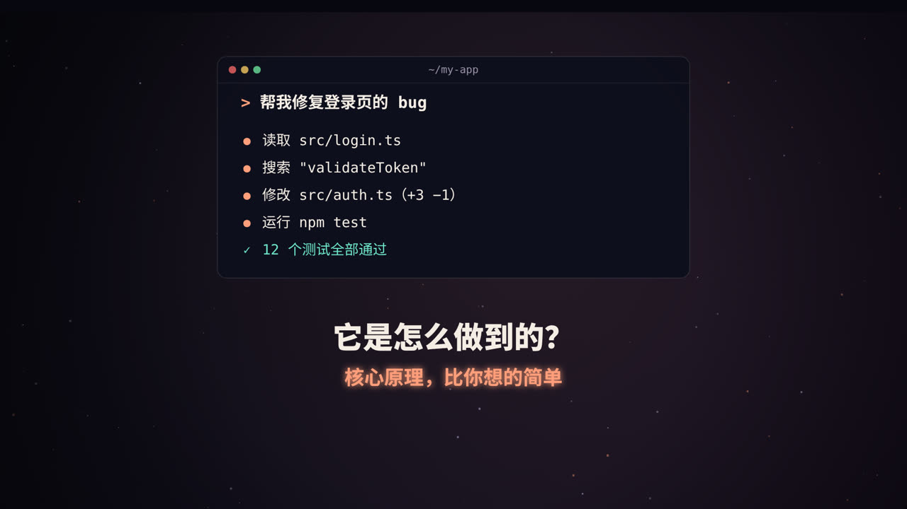
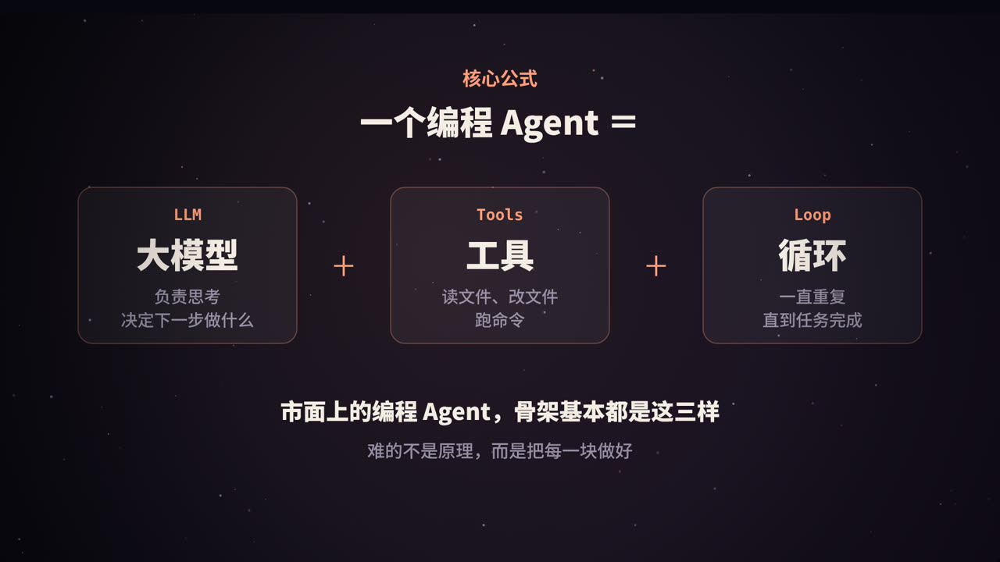
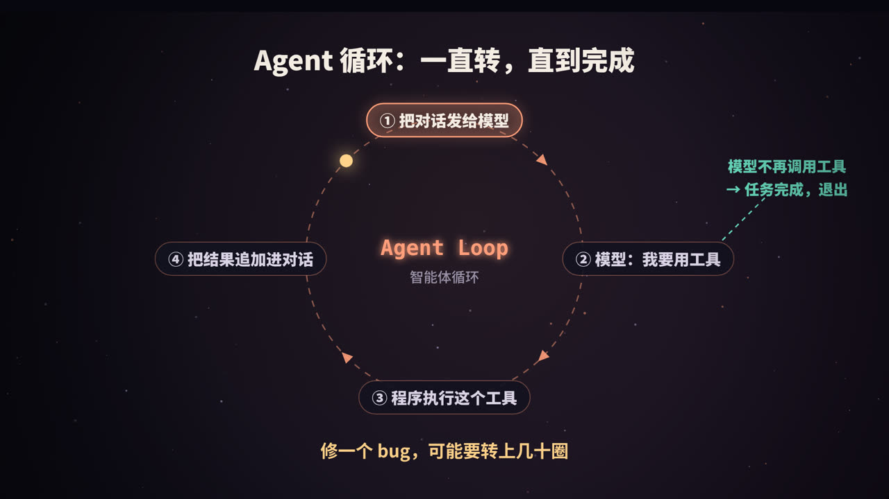
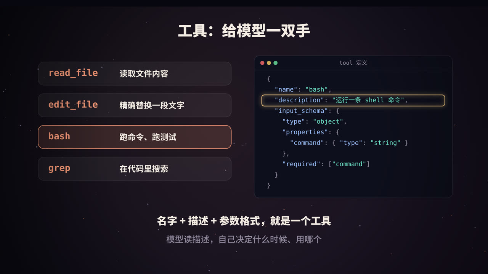
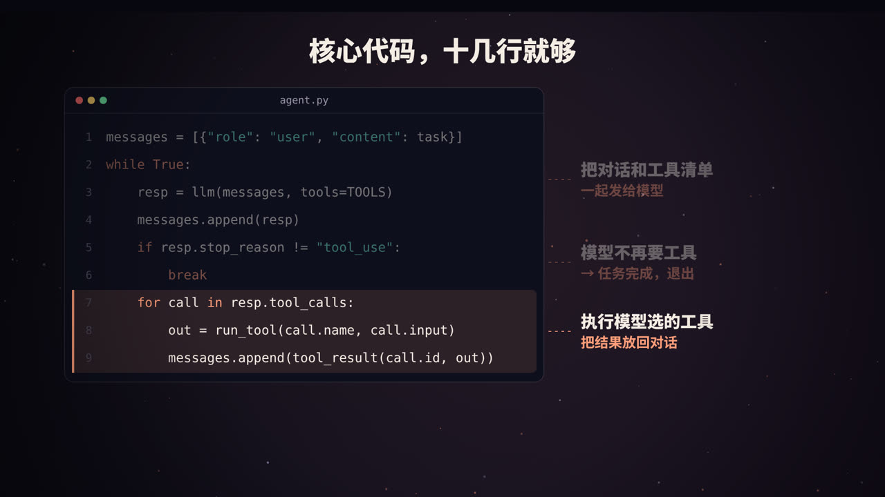

title: 从零做一个 Claude Code：编程 Agent 的核心原理与完整代码
subtitle: 大模型 + 工具 + 循环。从原理讲到一份 70 行就能跑起来的 Python 实现，再讲怎样把它从「能用」做到「好用」
tag: AI 与大模型
color: #ff9e7a



## 它到底做了什么

在终端里对 Claude Code 说一句「帮我修复登录页的 bug」，你会看到它依次：

1. 读取 `src/login.ts`；
2. 搜索 `validateToken` 在哪里定义；
3. 修改 `src/auth.ts` 中的几行代码；
4. 运行 `npm test`；
5. 报告「12 个测试全部通过」。

整个过程中，你没有告诉它要读哪个文件、改哪一行。看起来像魔法，但拆开以后，它的核心原理其实非常简洁。这篇文章会带你从原理出发，写出一个能真正运行的最小版本。

## 核心公式：大模型 + 工具 + 循环



### 为什么光有大模型不够

大模型本身只会做一件事：输入文字，输出文字。它碰不到你的硬盘，也运行不了命令。如果只用聊天的方式修 bug，你得自己把代码复制给它，再把它的修改粘贴回去，测试失败了再把报错复制给它……

**Agent（智能体）** 的思路，就是让程序替你完成这些「复制、粘贴、运行」的跑腿工作：

| 组成部分 | 负责什么 |
|---|---|
| **大模型（LLM）** | 思考：理解任务，决定下一步做什么、调用哪个工具、传什么参数 |
| **工具（Tools）** | 动手：读文件、改文件、运行命令、搜索代码 |
| **循环（Loop）** | 坚持：把工具结果交还给模型，让它继续决定，直到任务完成 |

市面上的编程 Agent，无论是 Claude Code 还是其他产品，骨架基本都是这三样。差别在于每一块做得有多好。

## Agent 循环：一直转，直到完成



### 四个步骤

1. **把对话发给模型**：包括用户的任务、可用的工具清单，以及之前所有的往来记录。
2. **模型回复「我要用工具」**：它不会自己执行任何东西，只是输出一段结构化的请求，比如「调用 `read_file`，参数是 `src/login.ts`」。
3. **程序执行这个工具**：你的代码真正去读文件，拿到内容。
4. **把结果追加进对话**：作为新的一条消息，然后回到第 1 步。

当模型认为任务已经完成，它就不再请求工具，而是直接给出最终回答，循环结束。

### 一个完整的例子

修 bug 的过程，在消息列表里大概长这样：

| 轮次 | 角色 | 内容 |
|---|---|---|
| 1 | 用户 | 帮我修复登录页的 bug |
| 2 | 模型 | 我先看看登录页的代码 → 调用 `read_file("src/login.ts")` |
| 3 | 程序 | （文件内容） |
| 4 | 模型 | 问题可能在 token 校验 → 调用 `bash("grep -rn validateToken src")` |
| 5 | 程序 | `src/auth.ts:42: export function validateToken…` |
| 6 | 模型 | 调用 `read_file("src/auth.ts")` |
| 7 | 程序 | （文件内容） |
| 8 | 模型 | 过期时间比较写反了 → 调用 `edit_file(...)` |
| 9 | 程序 | 已修改 |
| 10 | 模型 | 调用 `bash("npm test")` |
| 11 | 程序 | 12 passed |
| 12 | 模型 | 已修复：`auth.ts` 第 45 行把 `<` 改成了 `>`，测试全部通过。 |

可以看到，**模型的每一步决策，都基于上一步工具返回的真实结果**。测试如果失败，它会读到报错，再继续修改。一个稍微复杂的任务，可能要转上几十圈。

> 这种「思考 → 行动 → 观察 → 再思考」的模式，在学术界常被称为 ReAct（Reasoning + Acting）。

## 工具：给模型一双手



### 一个工具长什么样

以 Anthropic 的 Messages API 为例，每个工具用一段 JSON 描述：

```json
{
  "name": "bash",
  "description": "在当前目录运行一条 shell 命令，返回输出",
  "input_schema": {
    "type": "object",
    "properties": {
      "command": { "type": "string" }
    },
    "required": ["command"]
  }
}
```

- `name`：工具名；
- `description`：**写给模型看的说明书**。模型完全靠它来判断什么时候该用这个工具；
- `input_schema`：用 JSON Schema 描述参数格式，模型会按这个格式生成参数。

### 模型是怎么「调用」工具的

当模型决定使用工具时，API 返回的内容里会包含一个 `tool_use` 块，同时 `stop_reason` 是 `"tool_use"`：

```json
{
  "type": "tool_use",
  "id": "toolu_01A...",
  "name": "bash",
  "input": { "command": "npm test" }
}
```

你的程序执行完以后，把结果作为一条 `user` 消息发回去，并用 `tool_use_id` 对应上是哪一次调用：

```json
{
  "role": "user",
  "content": [
    { "type": "tool_result", "tool_use_id": "toolu_01A...", "content": "12 passed" }
  ]
}
```

**整个过程中，模型从来不直接执行任何东西。** 真正动手的永远是你的程序，这也是安全控制的关键所在。

### 编程 Agent 常用的工具

| 工具 | 作用 | 设计要点 |
|---|---|---|
| `read_file` | 读文件 | 大文件要支持按行读取，避免一次塞爆上下文 |
| `edit_file` | 改文件 | 用「精确替换一段文字」，而不是整个文件重写 |
| `bash` | 跑命令、跑测试 | 设置超时，截断过长输出，危险命令先确认 |
| `grep` / `glob` | 搜索代码、找文件 | 让模型快速定位，而不是一个个文件读 |

为什么编辑工具要用「精确替换」？因为让模型每次输出整个文件，既浪费 token，又容易在没改的地方「顺手」改错。要求 `old` 在文件中恰好出现一次，还能防止改错位置。

## 完整代码：70 行跑起来



下面是一个可以直接运行的最小编程 Agent，使用 Anthropic 官方 Python SDK。安装依赖并设置好 API Key 后即可运行：

```bash
pip install anthropic
export ANTHROPIC_API_KEY=你的密钥
python agent.py
```

```python
import subprocess, pathlib, anthropic

client = anthropic.Anthropic()          # 从环境变量读取 ANTHROPIC_API_KEY
MODEL = "claude-opus-5-5"

TOOLS = [
    {"name": "read_file", "description": "读取一个文本文件的全部内容",
     "input_schema": {"type": "object", "properties": {"path": {"type": "string"}},
                      "required": ["path"]}},
    {"name": "edit_file",
     "description": "把文件中唯一出现的一段文字 old 替换为 new；文件不存在且 old 为空时，创建新文件",
     "input_schema": {"type": "object",
                      "properties": {"path": {"type": "string"}, "old": {"type": "string"},
                                     "new": {"type": "string"}},
                      "required": ["path", "old", "new"]}},
    {"name": "bash", "description": "在当前目录运行一条 shell 命令，返回输出",
     "input_schema": {"type": "object", "properties": {"command": {"type": "string"}},
                      "required": ["command"]}},
]

def run_tool(name, args):
    try:
        if name == "read_file":
            return pathlib.Path(args["path"]).read_text()
        if name == "edit_file":
            p = pathlib.Path(args["path"])
            if not p.exists() and args["old"] == "":
                p.write_text(args["new"])
                return "已创建文件"
            text = p.read_text()
            if text.count(args["old"]) != 1:
                return "错误：old 必须在文件中恰好出现一次"
            p.write_text(text.replace(args["old"], args["new"]))
            return "已修改"
        if name == "bash":
            if input(f"运行命令 {args['command']!r}？[y/N] ") != "y":
                return "用户拒绝了这条命令"
            r = subprocess.run(args["command"], shell=True, capture_output=True,
                               text=True, timeout=120)
            return (r.stdout + r.stderr)[-10000:] or "(无输出)"
    except Exception as e:
        return f"错误：{e}"
    return f"未知工具：{name}"

SYSTEM = "你是一个编程助手。先阅读相关代码再动手修改；改完后运行测试验证。"

def agent(task):
    messages = [{"role": "user", "content": task}]
    while True:
        resp = client.messages.create(model=MODEL, max_tokens=4096, system=SYSTEM,
                                      tools=TOOLS, messages=messages)
        messages.append({"role": "assistant", "content": resp.content})
        for block in resp.content:
            if block.type == "text":
                print(block.text)
        if resp.stop_reason != "tool_use":
            return                                   # 模型不再调用工具：任务完成
        results = []
        for block in resp.content:
            if block.type == "tool_use":
                print(f"→ {block.name} {block.input}")
                out = run_tool(block.name, block.input)
                results.append({"type": "tool_result", "tool_use_id": block.id,
                                "content": out})
        messages.append({"role": "user", "content": results})

if __name__ == "__main__":
    agent(input("你想让我做什么？ "))
```

### 逐段解释

- **`TOOLS`**：三个工具的定义，就是发给模型的「说明书」。描述写得越清楚，模型用得越准。
- **`run_tool`**：真正执行工具的地方。注意几个细节：
  - 出错时**不抛异常，而是把错误信息返回给模型**。模型看到「old 必须恰好出现一次」，就会自己换个更精确的片段重试；
  - `bash` 运行前先问用户，这是最简单的权限控制；
  - 输出只保留最后 10000 个字符，防止一条命令的海量输出撑爆上下文。
- **`agent`**：就是视频里那个循环。模型的回复先追加进消息列表，然后检查 `stop_reason`：不是 `tool_use` 就结束；是的话，执行所有工具调用，把结果打包成一条 `user` 消息追加进去，再进入下一轮。

一个模型回复里可能同时包含多个 `tool_use`（比如同时读三个文件），所以要循环处理，并把所有结果放在同一条消息里返回。

## 从「能用」到「好用」


上面的代码已经能修简单的 bug 了，但离一个好用的产品还有很长的路。成熟的编程 Agent 通常还会在这些方面下功夫：

### 1. 权限与安全

- 读文件通常可以放行，写文件、运行命令、联网等操作要分级确认；
- 对 `rm -rf`、`git push --force` 这类高危命令单独拦截；
- 在沙箱或容器中运行，限制可访问的目录和网络。

### 2. 上下文管理

每一轮循环，消息列表都在变长，而模型的上下文窗口是有限的，成本也随 token 数增长。常见做法：

- **截断工具输出**：只保留关键部分，比如报错的最后几十行；
- **按需读取**：大文件只读相关的行；
- **自动压缩**：对话快满时，让模型把之前的过程总结成一段摘要，用摘要替换原始记录，再继续工作。

### 3. 系统提示词与项目约定

系统提示词决定了 Agent 的「工作习惯」：先读后改、改完跑测试、不要随意删除文件、遇到不确定的事先问用户等等。很多工具还支持在项目里放一个说明文件（Claude Code 用的是 `CLAUDE.md`），写清楚项目的构建命令、代码风格和注意事项，每次启动时自动加载。

### 4. 好用的界面

- **流式输出**：模型边生成边显示，不用干等；
- **展示每一步操作**：让用户随时知道它在读什么、改什么；
- **可以随时打断**：发现方向不对，立刻叫停并纠正。

### 5. 更多进阶能力

- **子 Agent**：把「在整个代码库里搜索某个功能」这类子任务交给另一个独立上下文的 Agent，只把结论带回来，节省主对话的上下文；
- **计划模式**：复杂任务先让模型列出计划，用户确认后再动手；
- **钩子（hooks）**：在工具调用前后自动执行格式化、代码检查等脚本。

## 常见的坑

| 问题 | 解决办法 |
|---|---|
| 模型陷入死循环，反复做同一件事 | 设置最大轮数；检测重复调用 |
| 一条命令输出几十万字，上下文爆了 | 截断输出，只保留头尾 |
| 改坏了文件，无法恢复 | 每次修改前自动备份，或依赖 git |
| 工具描述含糊，模型乱用 | 描述里写清楚用途、限制和示例 |
| 花费远超预期 | 监控 token 用量；对简单子任务用更小的模型 |

## 总结


- 编程 Agent 的核心只有三样：**大模型负责思考，工具负责动手，循环负责坚持到底**。
- 模型从不直接执行任何操作，它只是输出结构化的工具调用请求，由你的程序执行并返回结果。
- 一个可用的最小 Agent 只要几十行代码；真正的难点在于权限、上下文管理、工具设计和交互体验这些细节。

动手跑一遍上面的代码，你会对「AI 是怎么写代码的」有完全不同的理解。

<div class="refs" markdown="1">

### 参考资料

- Anthropic. Tool use with Claude（官方文档）. docs.claude.com
- Anthropic (2024). Building effective agents.
- Yao, S., et al. (2022). ReAct: Synergizing Reasoning and Acting in Language Models. *arXiv:2210.03629*.

</div>
