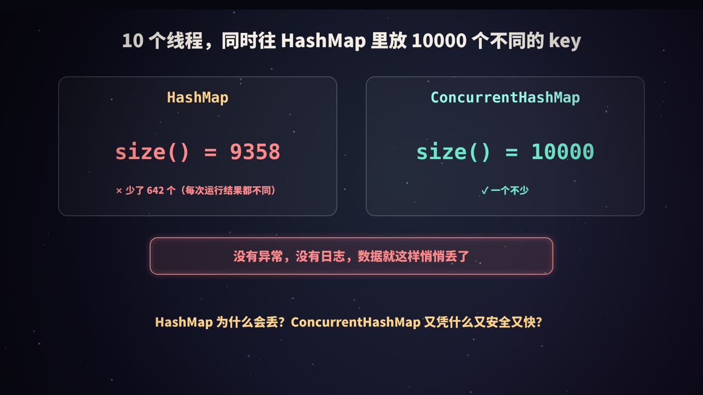
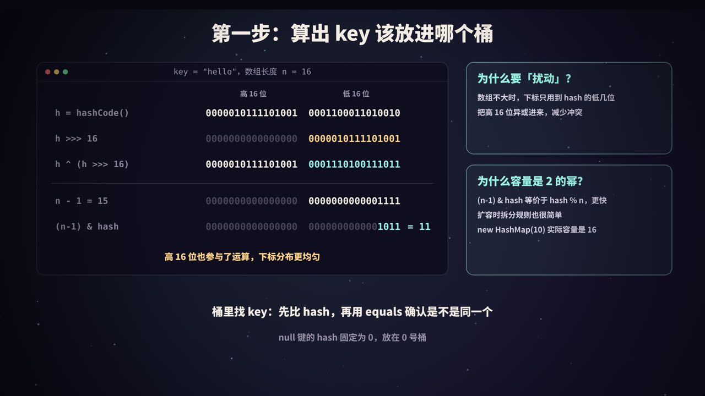
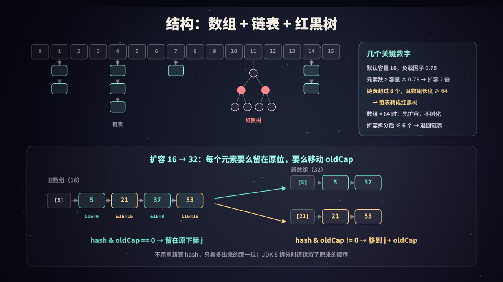
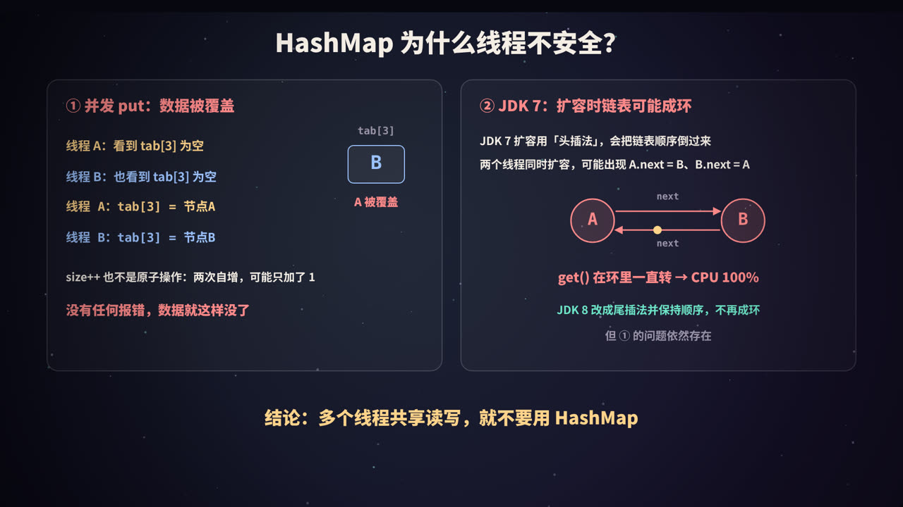
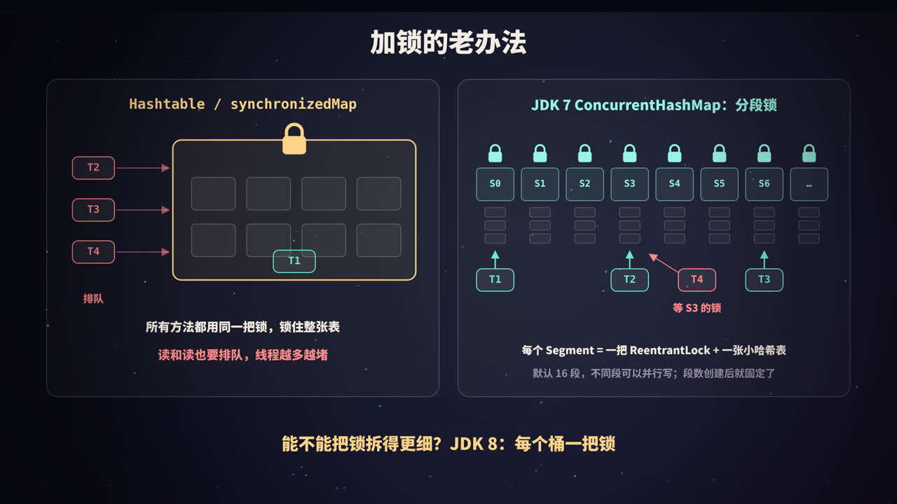
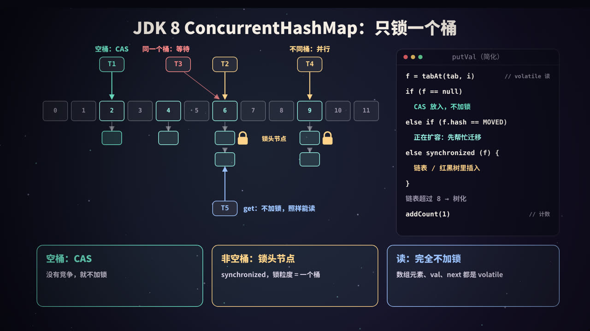
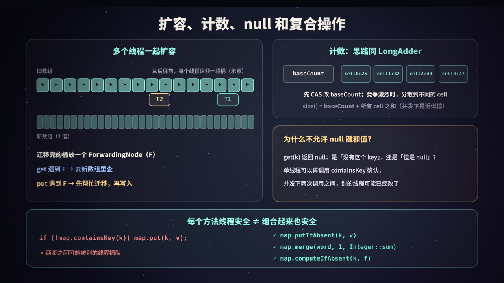

title: HashMap 与 ConcurrentHashMap：从一张哈希表到并发容器
subtitle: HashMap 的 hash 扰动、2 的幂容量、链表与红黑树、扩容拆分；并发下丢数据与 JDK 7 成环；Hashtable 大锁、JDK 7 分段锁、JDK 8 的 CAS + 锁桶头、协助扩容与 CounterCell 计数；附可运行的 Java 实验
tag: 计算机与后端
color: #99f6e4



## 一个会「悄悄丢数据」的 Map

先看一个实验：开 10 个线程，每个线程往同一个 `HashMap` 里放 1000 个**互不相同**的 key。理论上结束后 `size()` 应该是 10000。

在一台 2 核的机器上连跑 5 轮，结果是这样的（完整代码见后文「动手实验」）：

```text
第 1 轮  HashMap.size() =  9358   ConcurrentHashMap.size() = 10000
第 2 轮  HashMap.size() =  9852   ConcurrentHashMap.size() = 10000
第 3 轮  HashMap.size() =  9335   ConcurrentHashMap.size() = 10000
第 4 轮  HashMap.size() = 10000   ConcurrentHashMap.size() = 10000
第 5 轮  HashMap.size() = 10000   ConcurrentHashMap.size() = 10000
```

`HashMap` 有时对、有时少几百个，**没有异常，没有日志**。这正是并发 bug 最可怕的地方：测试环境里跑十次可能都没问题，上线后在高并发下偶尔丢几条数据，极难排查。

把 `HashMap` 换成 `ConcurrentHashMap`，每一轮都是 10000。

要理解这两者的区别，得先把 `HashMap` 本身拆开看清楚：它怎么存数据、怎么扩容；然后再看它在并发下哪里会出错；最后看 `ConcurrentHashMap` 是如何一步步把锁「拆细」，做到既线程安全、又尽量不让线程互相等待的。

> 本文以 JDK 8 及之后的实现为主（实验在 JDK 21 上运行），涉及 JDK 7 的地方会特别说明。线程、锁、CAS 的基础概念可以参考本系列《线程池》《进程、线程与协程》。

## HashMap 怎么定位一个 key



`HashMap` 的底层是一个数组，数组的每个位置叫一个**桶**（bucket）。`put(key, value)` 的第一件事，就是算出这个 key 应该放进哪个桶。分两步：

### 第一步：hash 扰动

```java
static final int hash(Object key) {
    int h;
    return (key == null) ? 0 : (h = key.hashCode()) ^ (h >>> 16);
}
```

这段代码来自 JDK 源码。它没有直接使用 `hashCode()`，而是把 hashCode 的**高 16 位**右移下来，和**低 16 位**做一次异或。这一步叫「扰动」。

以 `"hello"` 为例（下面的二进制由后文实验代码真实打印）：

```text
h            = 0000010111101001 0001100011010010
h >>> 16     = 0000000000000000 0000010111101001
h ^ (h>>>16) = 0000010111101001 0001110100111011
```

可以看到，结果的高 16 位保持不变，低 16 位「混入」了高 16 位的信息。

### 第二步：按位与取下标

```java
index = (n - 1) & hash      // n 是数组长度
```

数组长度 `n` 默认是 16，`n - 1 = 15`，二进制是 `1111`。和 hash 做按位与，等于**只取 hash 的最低 4 位**。`"hello"` 的 hash 最低 4 位是 `1011`，所以落在 11 号桶。

### 为什么要扰动？

因为数组不大时，下标只用到 hash 的**低几位**。如果某些 key 的 hashCode 只在高位上有差别，不扰动的话它们会全部挤进同一个桶。实验里构造了 4 个只有高位不同的 hashCode（`0x10000`、`0x20000`、`0x30000`、`0x40000`）：

```text
高位不同的 4 个 hashCode，不扰动的下标: 0 0 0 0
高位不同的 4 个 hashCode，扰动后的下标: 1 2 3 4
```

扰动之后，高位的差异也能影响下标，分布更均匀。只做一次移位和一次异或，代价极小。

### 为什么容量必须是 2 的幂？

- 当 `n` 是 2 的幂时，`(n - 1) & hash` 和 `hash % n`（对非负数）结果相同，但位运算比取模快得多；
- `n - 1` 的二进制全是 1，hash 的每一个低位都能参与运算，不会有桶永远用不上；
- 扩容时可以用一个非常简单的规则拆分链表（下一节详细讲）。

所以即使你写 `new HashMap<>(10)`，内部也会通过 `tableSizeFor` 向上取到最近的 2 的幂，实际数组长度是 16（实验已验证）。另外，数组是**懒加载**的：构造时不分配，第一次 `put` 时才创建。

### 桶里怎么找 key

同一个桶里可能有多个 key（哈希冲突）。查找时逐个比较：**先比 hash 值，相等再用 `equals` 确认**。比较 int 很便宜，能快速排除绝大多数不相等的 key。

这也是为什么重写 `equals` 就必须同时重写 `hashCode`：两个 `equals` 相等的对象如果 hashCode 不同，会被放进不同的桶，`HashMap` 就会把它们当成两个 key。

`null` 键的 hash 固定为 0，总是放在 0 号桶，所以 `HashMap` 允许一个 `null` 键。

## 数组 + 链表 + 红黑树，以及扩容



### 基本结构

JDK 8 的 `HashMap` 是**数组 + 链表 + 红黑树**：

- 数组 `table` 的每个元素是一个桶；
- 发生冲突时，同一个桶里的节点用**链表**串起来（新节点追加在尾部）；
- 链表太长时，转换为**红黑树**，把桶内查找从 O(n) 降到 O(log n)。

### 几个关键数字

| 常量 | 值 | 含义 |
|---|---|---|
| `DEFAULT_INITIAL_CAPACITY` | 16 | 默认数组长度 |
| `DEFAULT_LOAD_FACTOR` | 0.75 | 负载因子 |
| 扩容阈值 `threshold` | 容量 × 0.75 | 元素数超过它就扩容，数组长度翻倍 |
| `TREEIFY_THRESHOLD` | 8 | 链表树化的阈值 |
| `MIN_TREEIFY_CAPACITY` | 64 | 数组长度小于它时，优先扩容而不是树化 |
| `UNTREEIFY_THRESHOLD` | 6 | 扩容拆分后，树的节点数 ≤ 6 就退回链表 |

**负载因子 0.75** 是时间和空间的折中：太大，冲突多、查得慢；太小，数组空着一大片、浪费内存，还会频繁扩容。默认容量 16 时，放到第 13 个元素（超过 12）就会扩容到 32。

### 树化：为什么是 8，为什么还要看 64

源码注释里给出了理由：在 hashCode 分布良好、负载因子 0.75 的前提下，一个桶里的节点数近似服从泊松分布，**一个桶里出现 8 个节点的概率大约只有千万分之六**。所以链表长到 8 基本说明 hashCode 写得很差，或者有人在故意制造冲突（哈希碰撞攻击）。这时候转成红黑树兜底，最坏情况也只是 O(log n)。

红黑树节点（`TreeNode`）占用的空间大约是普通节点的两倍，所以不会一上来就树化。

还要注意两个细节：

1. **严格来说是「超过 8」**：源码在遍历链表、往尾部追加新节点时检查，往一个已经有 8 个节点的桶里再放入第 9 个时触发树化。很多资料说「长度达到 8」，差别就在这一个节点上；
2. **数组长度小于 64 时不树化，而是扩容**：数组太小时，冲突更可能是因为桶太少，扩容比树化更划算。

后文的 `TreeifyDemo` 实验把所有 key 的 hashCode 都设成 42，强行塞进同一个桶，结果是：

```text
第  8 个  数组长度= 16  桶[10]=Node
第  9 个  数组长度= 32  桶[10]=Node
第 10 个  数组长度= 64  桶[42]=Node
第 11 个  数组长度= 64  桶[42]=TreeNode
```

第 9 个和第 10 个都没有树化，而是触发了扩容（16 → 32 → 64）；数组长度到 64 之后，第 11 个才真正转成红黑树。

红黑树需要比较大小：先比 hash；hash 相同时，如果 key 实现了 `Comparable` 且类型相同，就用 `compareTo`；还分不出来，就用类名和 `System.identityHashCode` 决出一个固定的顺序。所以 key 实现 `Comparable` 能让树查得更快。

退化阈值是 6 而不是 8，是为了留出缓冲，避免节点数在 8 附近来回波动时反复树化、反树化。

### 扩容：元素要么留在原位，要么移动 oldCap

扩容时数组长度翻倍，所有元素要搬到新数组里。由于长度是 2 的幂，新下标的计算非常巧妙：

- 旧下标：`hash & (oldCap - 1)`，看的是低 4 位（oldCap = 16）；
- 新下标：`hash & (2 * oldCap - 1)`，看的是低 5 位；
- 多出来的那一位，正好是 `hash & oldCap`。

所以只需要看这一位：

| `hash & oldCap` | 新位置 |
|---|---|
| 0 | 留在原下标 `j` |
| 非 0 | 移到 `j + oldCap` |

实验中旧容量 16，key 为 5、21、37、53（Integer 的 hashCode 就是它本身）全在 5 号桶：

```text
key= 5  旧下标=5  hash&oldCap= 0  新下标= 5
key=21  旧下标=5  hash&oldCap=16  新下标=21
key=37  旧下标=5  hash&oldCap= 0  新下标= 5
key=53  旧下标=5  hash&oldCap=16  新下标=21
```

JDK 8 用两组头尾指针（lo 链和 hi 链）一次遍历把一个桶拆成两条链表，并且**保持了节点原来的相对顺序**。这一点很重要，后面讲 JDK 7 成环时会用到。

如果桶里是红黑树，同样按这一位拆成两部分，拆出来的部分节点数 ≤ 6 就退回链表。实验验证了这一点：

```text
扩容前  数组长度= 64  桶[42]=TreeNode
扩容后  数组长度=128  桶[42]=TreeNode（7 个）  桶[106]=Node（4 个）
```

> 扩容需要搬动所有元素，代价不小。如果事先知道大概要放多少元素，可以在构造时指定容量，比如要放 1000 个元素，容量至少设为 `1000 / 0.75 + 1 ≈ 1334`，实际会取到 2048。JDK 19 起还可以直接用 `HashMap.newHashMap(1000)`，由它替你算好。

## HashMap 为什么线程不安全



`HashMap` 的所有操作都没有任何同步措施。多个线程同时写，至少会出现下面几类问题。

### 问题一：并发 put，数据被覆盖

看 `putVal` 里「桶为空，直接放入」这一段（简化）：

```java
if ((p = tab[i = (n - 1) & hash]) == null)
    tab[i] = newNode(hash, key, value, null);
```

「检查是否为空」和「写入」是两步：

| 时刻 | 线程 A | 线程 B | tab[3] |
|---|---|---|---|
| 1 | 读到 `tab[3] == null` | | 空 |
| 2 | | 读到 `tab[3] == null` | 空 |
| 3 | `tab[3] = 节点A` | | A |
| 4 | | `tab[3] = 节点B` | **B（A 丢了）** |

两个线程都以为桶是空的，后写的直接覆盖了先写的。往链表尾部追加时也一样：两个线程同时拿到同一个尾节点，各自设置 `next`，后者覆盖前者。

### 问题二：size 不准

`++size` 看起来是一条语句，实际是「读 → 加 1 → 写回」三步。两个线程同时读到 100，各自加 1 写回 101，两次插入只加了 1。这和本系列《事务 ACID》里讲的「丢失更新」是同一类问题。

`size` 不准还会影响扩容判断：该扩容的时候没扩，或者多个线程同时触发扩容，互相覆盖对方新建的数组。

### 问题三（JDK 7）：扩容时链表成环

JDK 7 的 `HashMap` 在扩容时使用**头插法**把节点搬到新数组：

```java
// JDK 7 HashMap.transfer() 的核心逻辑（简化）
while (e != null) {
    Entry next = e.next;          // ① 记下一个节点
    int i = indexFor(e.hash, newCapacity);
    e.next = newTable[i];         // ② 插到新桶的头部
    newTable[i] = e;
    e = next;
}
```

头插法会把链表顺序倒过来：原来是 `A → B`，搬完变成 `B → A`。两个线程同时扩容时，就可能出问题：

1. 线程 1 执行到 ①，记下 `e = A, next = B`，然后被挂起；
2. 线程 2 完成了整个扩容，新链表变成 `B → A`，也就是 `B.next = A`；
3. 线程 1 恢复执行：把 A 放进自己的新桶；接着处理 B，读到 `B.next` 是 A（被线程 2 改过了），于是又把 A 拿来处理；最后执行 `A.next = B`；
4. 此时 `A.next = B` 且 `B.next = A`，**链表成环**。

之后任何一个线程 `get` 到这个桶，只要要找的 key 不在环上，就会沿着 `next` 永远转下去，CPU 飙到 100%。这是 JDK 7 时代很有名的线上事故。

JDK 8 改成了**尾插法**，扩容时也保持原有顺序，不会再出现这种环。但这不代表 JDK 8 的 `HashMap` 就能在并发下使用：问题一和问题二依然存在，并发写本身就是未定义行为，结构被破坏后出现什么后果都不奇怪。

> 结论只有一句：**多个线程共享、且有线程在写的 Map，不要用 HashMap**。如果 Map 在初始化后只读不写，并且是安全发布的（比如在构造完成后赋给 `final` 字段，或者用 `Map.copyOf` 生成不可变 Map），多线程读是没问题的。

## 加锁的老办法：大锁与分段锁



### Hashtable 与 Collections.synchronizedMap：一把大锁

最直接的办法是：给每个方法都加锁。

- `Hashtable`：JDK 1.0 就有的老类，`get`、`put`、`size` 等方法都是 `synchronized` 的，锁的是 `Hashtable` 对象本身；
- `Collections.synchronizedMap(map)`：返回一个包装器，每个方法都在 `synchronized (mutex)` 块里调用原 Map 的方法。

两者思路相同：**整张表只有一把锁**。任意时刻只有一个线程能访问这个 Map，连两个线程同时读也要排队。线程越多，排队越严重。

除此之外还有两个容易踩的坑：

- **复合操作依然不安全**：每个方法单独是原子的，但「先判断再写入」这类组合不是；
- **迭代要手动加锁**：用 `synchronizedMap` 遍历时，必须自己 `synchronized (map) { ... }` 把整个遍历包起来，否则别的线程修改时会抛 `ConcurrentModificationException`。

`Hashtable` 还有一些历史包袱：不允许 `null` 键和值、默认容量 11、下标用取模计算。新代码里基本不再使用。

### JDK 7 ConcurrentHashMap：分段锁

JDK 5 引入、到 JDK 7 一直沿用的 `ConcurrentHashMap` 用的是**分段锁**（lock striping）：

- 整个 Map 被分成若干个 **Segment**，默认 16 个（由构造参数 `concurrencyLevel` 决定）；
- 每个 `Segment` 继承自 `ReentrantLock`，内部是一张独立的小哈希表；
- 写操作先根据 hash 定位到 Segment，只锁这一段；
- 读操作一般不加锁，依靠 `volatile` 保证能看到最新写入。

于是不同 Segment 上的写操作可以并行，默认情况下最多可以有 16 个线程同时写。

它的局限也很明显：

- **段数在创建后就固定了**，并发度的上限也随之固定；
- 定位要经过两次哈希：先找 Segment，再找段内的桶；
- `size()` 要跨所有 Segment 统计：先不加锁统计两次，如果两次之间有修改，就把所有 Segment 都锁上再算一遍。

能不能把锁拆得更细，细到每个桶一把？这就是 JDK 8 做的事。

## JDK 8 ConcurrentHashMap：CAS + 只锁桶头



JDK 8 彻底重写了 `ConcurrentHashMap`，去掉了 Segment，结构和 `HashMap` 一样是**数组 + 链表 + 红黑树**。并发控制的核心是三件事：

1. **空桶：用 CAS 放入**，不加锁；
2. **非空桶：用 `synchronized` 锁住桶的头节点**，锁的粒度就是一个桶；
3. **读：完全不加锁**，靠 `volatile` 保证可见性。

### put 的流程

<figure>
<svg viewBox="0 0 440 420" xmlns="http://www.w3.org/2000/svg" role="img" aria-label="ConcurrentHashMap put 的流程">
  <rect width="440" height="420" fill="#0f0e1c"/>
  <defs><marker id="ca" viewBox="0 0 10 10" refX="9" refY="5" markerWidth="7" markerHeight="7" orient="auto"><path d="M0,0 L10,5 L0,10 z" fill="#99f6e4"/></marker></defs>
  <g font-family="PingFang SC, Noto Sans SC, sans-serif" text-anchor="middle">
    <text x="220" y="28" fill="#99f6e4" font-size="17" font-weight="800">ConcurrentHashMap.put（JDK 8+，简化）</text>
    <rect x="100" y="44" width="240" height="40" rx="10" fill="rgba(255,255,255,.06)" stroke="#9a93a8"/>
    <text x="220" y="69" fill="#f4ede4" font-size="13" font-weight="700">计算 spread(hash)，定位桶 i，循环：</text>
    <line x1="120" y1="84" x2="120" y2="100" stroke="#99f6e4" stroke-width="2" marker-end="url(#ca)"/>
    <rect x="20" y="102" width="200" height="44" rx="10" fill="rgba(255,255,255,.06)" stroke="#9a93a8"/>
    <text x="120" y="129" fill="#f4ede4" font-size="13" font-weight="700">数组还没初始化？</text>
    <line x1="220" y1="124" x2="246" y2="124" stroke="#99f6e4" stroke-width="2" marker-end="url(#ca)"/>
    <text x="233" y="117" fill="#9a93a8" font-size="10">是</text>
    <rect x="248" y="102" width="178" height="44" rx="10" fill="rgba(153,246,228,.10)" stroke="#99f6e4"/>
    <text x="337" y="120" fill="#99f6e4" font-size="13" font-weight="800">initTable()</text>
    <text x="337" y="138" fill="#9a93a8" font-size="11">CAS 抢到 sizeCtl 的线程建表</text>
    <line x1="120" y1="146" x2="120" y2="164" stroke="#99f6e4" stroke-width="2" marker-end="url(#ca)"/>
    <text x="132" y="159" fill="#9a93a8" font-size="10">否</text>
    <rect x="20" y="166" width="200" height="44" rx="10" fill="rgba(255,255,255,.06)" stroke="#9a93a8"/>
    <text x="120" y="193" fill="#f4ede4" font-size="13" font-weight="700">桶 i 为空？</text>
    <line x1="220" y1="188" x2="246" y2="188" stroke="#99f6e4" stroke-width="2" marker-end="url(#ca)"/>
    <text x="233" y="181" fill="#9a93a8" font-size="10">是</text>
    <rect x="248" y="166" width="178" height="44" rx="10" fill="rgba(110,231,200,.12)" stroke="#6ee7c8"/>
    <text x="337" y="184" fill="#6ee7c8" font-size="13" font-weight="800">CAS 放入新节点</text>
    <text x="337" y="202" fill="#9a93a8" font-size="11">不加锁；失败就重新循环</text>
    <line x1="120" y1="210" x2="120" y2="228" stroke="#99f6e4" stroke-width="2" marker-end="url(#ca)"/>
    <text x="132" y="223" fill="#9a93a8" font-size="10">否</text>
    <rect x="20" y="230" width="200" height="44" rx="10" fill="rgba(255,255,255,.06)" stroke="#9a93a8"/>
    <text x="120" y="257" fill="#f4ede4" font-size="13" font-weight="700">头节点 hash == MOVED？</text>
    <line x1="220" y1="252" x2="246" y2="252" stroke="#99f6e4" stroke-width="2" marker-end="url(#ca)"/>
    <text x="233" y="245" fill="#9a93a8" font-size="10">是</text>
    <rect x="248" y="230" width="178" height="44" rx="10" fill="rgba(156,195,255,.10)" stroke="#9cc3ff"/>
    <text x="337" y="248" fill="#9cc3ff" font-size="13" font-weight="800">helpTransfer()</text>
    <text x="337" y="266" fill="#9a93a8" font-size="11">先帮忙扩容，再重新循环</text>
    <line x1="120" y1="274" x2="120" y2="292" stroke="#99f6e4" stroke-width="2" marker-end="url(#ca)"/>
    <text x="132" y="287" fill="#9a93a8" font-size="10">否</text>
    <rect x="20" y="294" width="406" height="50" rx="10" fill="rgba(255,211,138,.10)" stroke="#ffd38a"/>
    <text x="223" y="314" fill="#ffd38a" font-size="13" font-weight="800">synchronized (头节点)</text>
    <text x="223" y="333" fill="#9a93a8" font-size="11">链表：找到相同 key 就覆盖，否则尾部追加；TreeBin：红黑树插入</text>
    <line x1="120" y1="344" x2="120" y2="362" stroke="#99f6e4" stroke-width="2" marker-end="url(#ca)"/>
    <rect x="20" y="364" width="406" height="50" rx="10" fill="rgba(255,255,255,.06)" stroke="#9a93a8"/>
    <text x="223" y="384" fill="#f4ede4" font-size="13" font-weight="800">链表超过 8 → treeifyBin；addCount(1)</text>
    <text x="223" y="403" fill="#9a93a8" font-size="11">计数用 CAS 改 baseCount 或 CounterCell，超过 sizeCtl 就扩容</text>
  </g>
</svg>
<figcaption>JDK 8 的 put：能用 CAS 就不加锁，必须加锁时只锁一个桶的头节点</figcaption>
</figure>

对应的源码结构大致如下（省略了大量细节）：

```java
final V putVal(K key, V value, boolean onlyIfAbsent) {
    if (key == null || value == null) throw new NullPointerException();
    int hash = spread(key.hashCode());
    for (Node<K,V>[] tab = table;;) {
        Node<K,V> f; int n, i, fh;
        if (tab == null || (n = tab.length) == 0)
            tab = initTable();
        else if ((f = tabAt(tab, i = (n - 1) & hash)) == null) {
            if (casTabAt(tab, i, null, new Node<K,V>(hash, key, value)))
                break;                         // CAS 成功，不加锁
        }
        else if ((fh = f.hash) == MOVED)
            tab = helpTransfer(tab, f);        // 正在扩容，先帮忙
        else {
            synchronized (f) {                 // 只锁这个桶的头节点
                if (tabAt(tab, i) == f) {      // 加锁后再确认头节点没变
                    // 链表：遍历，覆盖或尾部追加；红黑树：TreeBin 插入
                }
            }
            // 链表长度超过阈值 → treeifyBin
            break;
        }
    }
    addCount(1L, binCount);                    // 计数，必要时扩容
    return null;
}
```

几个值得注意的细节：

- **`spread` 和 `HashMap.hash` 很像**：也是 `h ^ (h >>> 16)`，但多了 `& 0x7fffffff`，保证普通节点的 hash 都是非负数。因为**负数 hash 被留作特殊用途**：`MOVED = -1` 表示 ForwardingNode（这个桶已迁移），`TREEBIN = -2` 表示红黑树的根容器，`RESERVED = -3` 表示 `computeIfAbsent` 等方法临时占位用的节点；
- **`tabAt` / `casTabAt`**：普通数组元素的读写没有 volatile 语义，所以 JDK 用 `Unsafe` 提供的带内存屏障的方法来读写数组元素，保证一个线程放进去的节点，其他线程马上看得到；
- **加锁后再检查一次**：`synchronized (f)` 拿到锁以后，要确认 `tabAt(tab, i) == f`，因为在等锁期间，头节点可能已经被换掉（比如桶被树化或被迁移），这时要放弃并重试；
- **为什么用 synchronized 而不是 ReentrantLock**：锁的数量和桶一样多，`synchronized` 不需要额外的锁对象（直接用头节点），内存开销更小；而且现代 JVM 对 `synchronized` 有很多优化，在竞争不激烈的单个桶上表现很好。

### 读为什么可以不加锁

`get` 的过程是：定位桶 → 比较头节点 → 沿着链表或树往下找。整个过程**不加任何锁**，因为：

- 数组元素通过 `tabAt` 以 volatile 语义读取；
- `Node` 的 `val` 和 `next` 字段都声明为 `volatile`；
- 写操作要么是 CAS 放入新节点，要么是在锁内修改 `val` / `next`，对读线程都立即可见。

这意味着读线程**可能读到旧值**（写操作还没完成时），但不会读到「写了一半」的错误结构。对于并发 Map，这种语义已经足够。

如果桶里是红黑树，情况稍复杂：树在插入时会旋转，读线程不能在旋转中途遍历树。所以 `ConcurrentHashMap` 的树桶头是一个 `TreeBin` 对象，它内部维护了一个轻量的读写状态：有线程在修改树结构时，读线程改为沿着 `TreeNode` 之间额外保留的 `next` 链表线性查找，不会被阻塞。

### 树化与 HashMap 相同

链表超过 8 个节点、并且数组长度 ≥ 64 时转成红黑树；数组长度不够时优先扩容。区别只是树桶的头节点是 `TreeBin`。

## 扩容、计数、null 与复合操作



### 多线程协助扩容

`ConcurrentHashMap` 的扩容不是一个线程独自完成的，而是**大家一起干**：

1. 某个线程发现元素数超过阈值（`sizeCtl`），创建一个两倍大的新数组 `nextTable`，开始迁移；
2. 迁移任务按桶划分：每个线程通过 CAS 修改 `transferIndex`，**从数组末尾往前**认领一段桶。每段的大小根据 CPU 核数计算，最少 16 个桶；
3. 迁移一个桶时，先锁住这个桶的头节点，按 `hash & n` 把节点拆成两部分，分别放到新数组的 `i` 和 `i + n` 位置（和 HashMap 的拆分规则一样）；
4. 迁移完的桶，在旧数组里放一个 **ForwardingNode**（hash 为 `MOVED`，内部持有新数组的引用）。

在扩容进行中：

- **`get` 遇到 ForwardingNode**：直接去新数组里查，读不受影响；
- **`put` 遇到 ForwardingNode**：调用 `helpTransfer`，先加入扩容大军帮忙迁移，迁移完成后再到新数组里写入；
- 还没迁移的桶，照常读写。

`sizeCtl` 这个字段身兼数职：数组未初始化时存初始容量；初始化中为 -1；正常时存下次扩容的阈值（容量的 0.75）；扩容时为负数，高位编码了本次扩容的标识，低位记录了参与扩容的线程数。

### 计数：思路和 LongAdder 一样

如果所有线程都去 CAS 同一个计数器，高并发下大量 CAS 会失败重试，计数器本身成了热点。`ConcurrentHashMap` 借鉴了 `LongAdder` 的思路：

- 先尝试 CAS 修改 `baseCount`；
- 失败了（说明有竞争），就改为在 `CounterCell[]` 数组里，根据线程的随机探针值选一个格子，CAS 这个格子；
- 竞争还激烈，就扩大 `CounterCell` 数组。
- `size()` = `baseCount` + 所有 `CounterCell` 的值之和。

所以并发修改时，`size()` 返回的是一个**近似值**（统计过程中其他线程可能还在增减）。`size()` 返回 `int`，元素可能超过 `Integer.MAX_VALUE` 时用 `mappingCount()`，它返回 `long`。

`CounterCell` 类上标注了 `@Contended`，让每个格子独占一个 CPU 缓存行，避免伪共享。

### 为什么不允许 null 键和值

`HashMap` 允许 `null` 键和 `null` 值，`ConcurrentHashMap` 两者都不允许，`put(k, null)` 直接抛 `NullPointerException`。

原因是**二义性**：`get(k)` 返回 `null` 时，可能是「没有这个 key」，也可能是「key 存在，值就是 null」。

- 单线程下可以再调用 `containsKey(k)` 区分；
- 并发下，`get` 和 `containsKey` 之间，别的线程可能已经插入或删除了这个 key，两次调用的结果对不上，根本无法区分。

干脆不允许 `null`，`get` 返回 `null` 就一定表示「不存在」。很多并发 API 也依赖这一点，比如 `putIfAbsent` 返回 `null` 表示放入成功。

### 复合操作：每个方法安全，组合起来不一定

这是使用 `ConcurrentHashMap` 时最常见的错误：

```java
// 错误：两步之间，别的线程可能已经放入了同一个 key
if (!map.containsKey(k)) {
    map.put(k, v);
}

// 错误：get 和 put 各自线程安全，但「读-改-写」整体不是原子的
Integer old = map.get(word);
map.put(word, old == null ? 1 : old + 1);
```

应该使用 `ConcurrentHashMap` 提供的原子方法，它们在桶锁内完成整个「读-改-写」：

| 需求 | 原子方法 |
|---|---|
| 不存在才放入 | `putIfAbsent(k, v)` |
| 不存在才计算并放入（如懒加载缓存） | `computeIfAbsent(k, k -> 创建值)` |
| 计数、累加 | `merge(k, 1, Integer::sum)` |
| 基于旧值计算新值 | `compute(k, (k, old) -> ...)` |
| 值等于预期时才替换 / 删除 | `replace(k, expected, newV)`、`remove(k, expected)` |

后面的实验会展示：用 `get + put` 做并发单词计数会少很多，用 `merge` 则完全正确。

## 动手实验

下面的代码都在 JDK 21 上实际运行过。实验环境是一台 **2 核**的 Linux 机器，涉及耗时的数字仅供参考。

### 实验一：并发丢数据、hash 计算、merge 计数、性能对比

把下面的代码保存为 `MapDemo.java`：

```java
import java.util.*;
import java.util.concurrent.*;

public class MapDemo {

    // ---------- 1. hash 扰动与下标计算 ----------
    static String bits(int x) {
        String s = String.format("%32s", Integer.toBinaryString(x)).replace(' ', '0');
        return s.substring(0, 16) + " " + s.substring(16);
    }

    static void hashDemo() {
        System.out.println("== 1. hash 扰动与下标 ==");
        String key = "hello";
        int h = key.hashCode();
        int hash = h ^ (h >>> 16);              // 与 HashMap.hash() 相同
        int n = 16;
        System.out.println("h            = " + bits(h));
        System.out.println("h >>> 16     = " + bits(h >>> 16));
        System.out.println("h ^ (h>>>16) = " + bits(hash));
        System.out.println("index = (n-1) & hash = " + ((n - 1) & hash)
                + "，等于 hash % n = " + Math.floorMod(hash, n));

        // 只有高位不同的 4 个 hashCode：不扰动时全部挤进同一个桶
        int[] codes = {0x10000, 0x20000, 0x30000, 0x40000};
        StringBuilder raw = new StringBuilder(), mixed = new StringBuilder();
        for (int c : codes) {
            raw.append((n - 1) & c).append(' ');
            mixed.append((n - 1) & (c ^ (c >>> 16))).append(' ');
        }
        System.out.println("高位不同的 4 个 hashCode，不扰动的下标: " + raw.toString().trim());
        System.out.println("高位不同的 4 个 hashCode，扰动后的下标: " + mixed.toString().trim());

        // 扩容拆分：hash & oldCap 决定留在原位还是移动 oldCap
        int oldCap = 16;
        for (int k : new int[]{5, 21, 37, 53}) {
            int newIdx = (2 * oldCap - 1) & k;
            System.out.printf("key=%2d  旧下标=%d  hash&oldCap=%2d  新下标=%2d%n",
                    k, (oldCap - 1) & k, k & oldCap, newIdx);
        }
    }

    // ---------- 2. 并发 put：HashMap 丢数据 ----------
    static int concurrentPut(Map<Integer, Integer> map, int threads, int perThread) throws Exception {
        ExecutorService pool = Executors.newFixedThreadPool(threads);
        CountDownLatch start = new CountDownLatch(1);
        List<Future<?>> fs = new ArrayList<>();
        for (int t = 0; t < threads; t++) {
            final int base = t * perThread;
            fs.add(pool.submit(() -> {
                start.await();
                for (int i = 0; i < perThread; i++) map.put(base + i, i);  // 每个线程的 key 互不相同
                return null;
            }));
        }
        start.countDown();
        String err = null;
        for (Future<?> f : fs) {
            try { f.get(); } catch (ExecutionException e) { err = e.getCause().getClass().getSimpleName(); }
        }
        pool.shutdown();
        if (err != null) System.out.print("（有线程抛出 " + err + "）");
        return map.size();
    }

    static void lostUpdateDemo() throws Exception {
        System.out.println("\n== 2. 10 个线程 × 每个 put 1000 个不同的 key，期望 size = 10000 ==");
        for (int round = 1; round <= 5; round++) {
            int a = concurrentPut(new HashMap<>(), 10, 1000);
            int b = concurrentPut(new ConcurrentHashMap<>(), 10, 1000);
            System.out.printf("第 %d 轮  HashMap.size() = %5d   ConcurrentHashMap.size() = %5d%n", round, a, b);
        }
    }

    // ---------- 3. 复合操作：用 merge 做线程安全的单词计数 ----------
    static void wordCountDemo() throws Exception {
        System.out.println("\n== 3. 4 个线程并发统计单词 ==");
        String[] words = {"apple", "banana", "cherry", "apple", "banana", "apple"};
        int repeat = 50_000;                                  // 每个线程把这 6 个词各数 50000 遍

        ConcurrentHashMap<String, Integer> wrong = new ConcurrentHashMap<>();
        ConcurrentHashMap<String, Integer> right = new ConcurrentHashMap<>();
        ExecutorService pool = Executors.newFixedThreadPool(4);
        List<Callable<Void>> jobs = new ArrayList<>();
        for (int t = 0; t < 4; t++) jobs.add(() -> {
            for (int r = 0; r < repeat; r++) for (String w : words) {
                // 错误：get 和 put 各自线程安全，但「读-改-写」整体不是原子的
                Integer old = wrong.get(w);
                wrong.put(w, old == null ? 1 : old + 1);
                // 正确：merge 在桶锁内原子地完成「读-改-写」
                right.merge(w, 1, Integer::sum);
            }
            return null;
        });
        pool.invokeAll(jobs);
        pool.shutdown();
        System.out.println("期望      : {apple=600000, banana=400000, cherry=200000}");
        System.out.println("get + put : " + new TreeMap<>(wrong));
        System.out.println("merge     : " + new TreeMap<>(right));
    }

    // ---------- 4. 性能：一把大锁 vs 锁桶头 ----------
    static long bench(Map<Integer, Integer> map, int threads, int opsPerThread) throws Exception {
        for (int i = 0; i < 10_000; i++) map.put(i, i);
        ExecutorService pool = Executors.newFixedThreadPool(threads);
        CountDownLatch start = new CountDownLatch(1);
        List<Future<?>> fs = new ArrayList<>();
        for (int t = 0; t < threads; t++) {
            final int seed = t;
            fs.add(pool.submit(() -> {
                start.await();
                SplittableRandom r = new SplittableRandom(seed);
                long sink = 0;
                for (int i = 0; i < opsPerThread; i++) {
                    int k = r.nextInt(10_000);
                    if (i % 10 == 0) map.put(k, i);          // 10% 写
                    else { Integer v = map.get(k); if (v != null) sink += v; }   // 90% 读
                }
                return sink;
            }));
        }
        long t0 = System.nanoTime();
        start.countDown();
        for (Future<?> f : fs) f.get();
        long ms = (System.nanoTime() - t0) / 1_000_000;
        pool.shutdown();
        return ms;
    }

    static void benchDemo() throws Exception {
        int threads = 8, ops = 2_000_000;
        System.out.printf("%n== 4. %d 个线程 × 每个 %d 次操作（90%% 读 10%% 写），CPU 核数 = %d ==%n",
                threads, ops, Runtime.getRuntime().availableProcessors());
        for (int round = 0; round < 4; round++) {             // 第 0 轮是预热
            long a = bench(Collections.synchronizedMap(new HashMap<>()), threads, ops);
            long b = bench(new Hashtable<>(), threads, ops);
            long c = bench(new ConcurrentHashMap<>(), threads, ops);
            if (round > 0)
                System.out.printf("第 %d 轮  synchronizedMap %5d ms   Hashtable %5d ms   ConcurrentHashMap %5d ms%n",
                        round, a, b, c);
        }
    }

    // ---------- 5. null 与弱一致迭代 ----------
    static void nullDemo() {
        System.out.println("\n== 5. null 键值 ==");
        Map<String, String> hm = new HashMap<>();
        hm.put(null, "v"); hm.put("k", null);
        System.out.println("HashMap 允许: " + hm);
        try {
            new ConcurrentHashMap<String, String>().put("k", null);
        } catch (NullPointerException e) {
            System.out.println("ConcurrentHashMap.put(\"k\", null) -> NullPointerException");
        }
    }

    public static void main(String[] args) throws Exception {
        hashDemo();
        lostUpdateDemo();
        wordCountDemo();
        benchDemo();
        nullDemo();
    }
}
```

运行：

```bash
javac MapDemo.java && java MapDemo
```

输出（第 2、3、4 部分每次运行都会不同）：

```text
== 1. hash 扰动与下标 ==
h            = 0000010111101001 0001100011010010
h >>> 16     = 0000000000000000 0000010111101001
h ^ (h>>>16) = 0000010111101001 0001110100111011
index = (n-1) & hash = 11，等于 hash % n = 11
高位不同的 4 个 hashCode，不扰动的下标: 0 0 0 0
高位不同的 4 个 hashCode，扰动后的下标: 1 2 3 4
key= 5  旧下标=5  hash&oldCap= 0  新下标= 5
key=21  旧下标=5  hash&oldCap=16  新下标=21
key=37  旧下标=5  hash&oldCap= 0  新下标= 5
key=53  旧下标=5  hash&oldCap=16  新下标=21

== 2. 10 个线程 × 每个 put 1000 个不同的 key，期望 size = 10000 ==
第 1 轮  HashMap.size() =  9358   ConcurrentHashMap.size() = 10000
第 2 轮  HashMap.size() =  9852   ConcurrentHashMap.size() = 10000
第 3 轮  HashMap.size() =  9335   ConcurrentHashMap.size() = 10000
第 4 轮  HashMap.size() = 10000   ConcurrentHashMap.size() = 10000
第 5 轮  HashMap.size() = 10000   ConcurrentHashMap.size() = 10000

== 3. 4 个线程并发统计单词 ==
期望      : {apple=600000, banana=400000, cherry=200000}
get + put : {apple=501189, banana=349108, cherry=164023}
merge     : {apple=600000, banana=400000, cherry=200000}

== 4. 8 个线程 × 每个 2000000 次操作（90% 读 10% 写），CPU 核数 = 2 ==
第 1 轮  synchronizedMap   900 ms   Hashtable   577 ms   ConcurrentHashMap   338 ms
第 2 轮  synchronizedMap   521 ms   Hashtable   424 ms   ConcurrentHashMap   382 ms
第 3 轮  synchronizedMap   618 ms   Hashtable   579 ms   ConcurrentHashMap   405 ms

== 5. null 键值 ==
HashMap 允许: {null=v, k=null}
ConcurrentHashMap.put("k", null) -> NullPointerException
```

逐段解读：

1. **hash 计算**：和前文的分析一致，`"hello"` 落在 11 号桶；只有高位不同的 4 个 hashCode，不扰动会全部落在 0 号桶；扩容时 5、37 留在原位，21、53 移动了 16。
2. **并发 put**：`HashMap` 前三轮都丢了数据，后两轮恰好没丢，**偶尔正确比一直错误更危险**；`ConcurrentHashMap` 每轮都是 10000。
3. **单词计数**：即使用的是 `ConcurrentHashMap`，`get + put` 的写法也少了大量计数（apple 期望 600000，只得到 501189）；`merge` 完全正确。**容器线程安全，不代表你的用法线程安全**。
4. **性能对比**：在这台 2 核机器上，8 个线程、90% 读的负载下，`ConcurrentHashMap` 比 `synchronizedMap` 和 `Hashtable` 快，但差距不算悬殊，而且几轮之间波动明显。原因是只有 2 个核时，真正能同时运行的线程最多 2 个，一把大锁的劣势没那么突出。核数越多、并发越高，读不加锁、锁粒度细的优势一般越明显。严肃的性能测试应该用 JMH 并在目标机器上进行。
5. **null**：`HashMap` 允许 null 键和值；`ConcurrentHashMap` 直接抛 `NullPointerException`。

### 实验二：亲眼看到树化与退化

`HashMap` 的 `table` 是私有字段，下面用反射读取它，所以运行时要加 `--add-opens` 参数（仅用于观察内部结构，生产代码不要这样做）：

```java
import java.lang.reflect.Field;
import java.util.HashMap;

// 运行：java --add-opens java.base/java.util=ALL-UNNAMED TreeifyDemo
public class TreeifyDemo {

    // hashCode 由我们指定，方便把很多 key 塞进同一个桶
    record Key(int id, int hash) implements Comparable<Key> {
        @Override public int hashCode() { return hash; }
        @Override public int compareTo(Key o) { return Integer.compare(id, o.id); }
    }

    static Object[] table(HashMap<?, ?> m) throws Exception {
        Field f = HashMap.class.getDeclaredField("table");
        f.setAccessible(true);
        return (Object[]) f.get(m);
    }

    static String bin(HashMap<?, ?> m, int hash) throws Exception {
        Object[] tab = table(m);
        int i = hash & (tab.length - 1);
        Object b = tab[i];
        return "桶[" + i + "]=" + (b == null ? "空" : b.getClass().getSimpleName());
    }

    public static void main(String[] args) throws Exception {
        System.out.println("-- A. 同一个桶里不断放入 hash=42 的 key --");
        HashMap<Key, Integer> m = new HashMap<>();
        for (int i = 1; i <= 11; i++) {
            m.put(new Key(i, 42), i);
            if (i >= 8) System.out.printf("第 %2d 个  数组长度=%3d  %s%n", i, table(m).length, bin(m, 42));
        }

        System.out.println("-- B. 扩容拆树：7 个 hash=42 + 4 个 hash=106，再放入其他 key 触发扩容 --");
        HashMap<Key, Integer> m2 = new HashMap<>(64);           // 数组长度 64，阈值 48
        for (int i = 0; i < 7; i++) m2.put(new Key(i, 42), i);
        for (int i = 7; i < 11; i++) m2.put(new Key(i, 106), i); // 106 & 63 = 42，同一个桶
        System.out.printf("扩容前  数组长度=%3d  %s%n", table(m2).length, bin(m2, 42));
        for (int i = 0; i < 40; i++) m2.put(new Key(100 + i, 200 + i), i);  // size 超过 48 → 扩容到 128
        System.out.printf("扩容后  数组长度=%3d  %s（7 个）  %s（4 个）%n",
                table(m2).length, bin(m2, 42), bin(m2, 106));
    }
}
```

运行：

```bash
javac TreeifyDemo.java
java --add-opens java.base/java.util=ALL-UNNAMED TreeifyDemo
```

输出：

```text
-- A. 同一个桶里不断放入 hash=42 的 key --
第  8 个  数组长度= 16  桶[10]=Node
第  9 个  数组长度= 32  桶[10]=Node
第 10 个  数组长度= 64  桶[42]=Node
第 11 个  数组长度= 64  桶[42]=TreeNode
-- B. 扩容拆树：7 个 hash=42 + 4 个 hash=106，再放入其他 key 触发扩容 --
扩容前  数组长度= 64  桶[42]=TreeNode
扩容后  数组长度=128  桶[42]=TreeNode（7 个）  桶[106]=Node（4 个）
```

- A 部分：同一个桶里放到第 9 个、第 10 个时，因为数组长度小于 64，都只是**扩容**（16 → 32 → 64）；到第 11 个时数组已经是 64，才**树化**为 `TreeNode`。注意 hash 都是 42，数组长度 16 和 32 时下标都是 `42 & 15 = 10`、`42 & 31 = 10`，到 64 时才是 42；
- B 部分：hash 为 42 和 106 的 key 在 64 长度的数组里同在 42 号桶，一共 11 个，已经树化。扩容到 128 后，`106 & 64 != 0` 的 4 个节点被拆到 106 号桶，数量 ≤ 6，**退回了普通链表**；留在 42 号桶的 7 个仍然是树。

### 实验三：几个容易踩的坑

```java
import java.util.*;
import java.util.concurrent.*;

public class Pitfalls {
    public static void main(String[] args) {
        ConcurrentHashMap<String, Integer> map = new ConcurrentHashMap<>();

        // 坑 1：在 computeIfAbsent 的函数里又去修改同一个 map
        try {
            map.computeIfAbsent("a", k -> map.computeIfAbsent("a", k2 -> 1));
        } catch (IllegalStateException e) {
            System.out.println("坑 1：" + e);
        }

        // 坑 2：迭代时修改 —— HashMap 快速失败，ConcurrentHashMap 弱一致
        Map<Integer, Integer> hm = new HashMap<>(Map.of(1, 1, 2, 2, 3, 3));
        try {
            for (Integer k : hm.keySet()) hm.remove(k);
        } catch (ConcurrentModificationException e) {
            System.out.println("坑 2：HashMap 边遍历边删除 -> " + e.getClass().getSimpleName());
        }
        Map<Integer, Integer> chm = new ConcurrentHashMap<>(Map.of(1, 1, 2, 2, 3, 3));
        for (Integer k : chm.keySet()) chm.remove(k);
        System.out.println("      ConcurrentHashMap 边遍历边删除 -> 不抛异常，剩下 " + chm.size() + " 个");

        // 坑 3：size() 返回 int，元素可能超过 int 范围时用 mappingCount()
        map.put("x", 1);
        System.out.println("坑 3：size() = " + map.size() + "，mappingCount() = " + map.mappingCount());
    }
}
```

输出：

```text
坑 1：java.lang.IllegalStateException: Recursive update
坑 2：HashMap 边遍历边删除 -> ConcurrentModificationException
      ConcurrentHashMap 边遍历边删除 -> 不抛异常，剩下 0 个
坑 3：size() = 1，mappingCount() = 1
```

- **坑 1**：`computeIfAbsent` 的映射函数在桶锁内执行，在里面再去修改同一个 Map（尤其是同一个桶）可能导致死锁或数据错误。JDK 9 起会检测这种情况并抛出 `IllegalStateException: Recursive update`。映射函数应该**短小、不修改这个 Map**；
- **坑 2**：`HashMap` 的迭代器是**快速失败**（fail-fast）的，遍历中被修改就抛 `ConcurrentModificationException`；`ConcurrentHashMap` 的迭代器是**弱一致**的，不会抛异常，能反映迭代器创建之后的部分修改；
- **坑 3**：`size()` 返回 int，大 Map 用 `mappingCount()`。

## 工程实践：怎么选、怎么用

### 选型

| 场景 | 选择 |
|---|---|
| 单线程，或线程封闭（只在一个线程里用） | `HashMap` |
| 初始化后只读，多线程共享 | `Map.copyOf` / `Map.of` 生成的不可变 Map，或安全发布的 `HashMap` |
| 多线程读写 | `ConcurrentHashMap` |
| 多线程读写，且需要按 key 排序 | `ConcurrentSkipListMap` |
| 需要保持插入顺序或 LRU | `LinkedHashMap`（非线程安全，需要自己加锁） |
| 老代码里的 `Hashtable` | 换成 `ConcurrentHashMap`，注意它同样不允许 null |

### 常见用法

```java
// 本地缓存：不存在就加载（映射函数要短，不能修改 map 本身）
Map<Long, User> cache = new ConcurrentHashMap<>();
User u = cache.computeIfAbsent(userId, id -> loadFromDb(id));

// 计数
ConcurrentHashMap<String, Long> counter = new ConcurrentHashMap<>();
counter.merge(api, 1L, Long::sum);

// 高频计数：值用 LongAdder，进一步减少同一个 key 上的竞争
ConcurrentHashMap<String, LongAdder> hot = new ConcurrentHashMap<>();
hot.computeIfAbsent(api, k -> new LongAdder()).increment();

// 分组：线程安全的「一对多」
ConcurrentHashMap<String, Set<String>> groups = new ConcurrentHashMap<>();
groups.computeIfAbsent(dept, k -> ConcurrentHashMap.newKeySet()).add(name);
```

这一段是参考写法，`loadFromDb`、`api`、`dept` 等需要换成你自己的代码和变量。

### 注意事项

- **key 要不可变**：key 放进 Map 后如果修改了参与 `hashCode` 计算的字段，它的 hash 变了，就再也找不到了，还会造成内存泄漏。`String`、`Integer`、`record` 都是很好的 key；
- **hashCode 要分布均匀**：大量冲突会让性能退化，严重时链表很长或频繁树化；
- **预估容量**：已知元素数量时，构造时指定容量，避免多次扩容。注意 `ConcurrentHashMap(int)` 的参数含义和 `HashMap` 略有不同：在 JDK 21 上，`new ConcurrentHashMap<>(16)` 的数组长度是 32（按「放 16 个元素不扩容」来算），`new ConcurrentHashMap<>(10)` 才是 16；
- **`computeIfAbsent` 里不要做慢操作**：映射函数执行期间持有桶锁，同一个桶上的其他写操作都要等待。远程调用之类的慢操作，考虑用 `Caffeine` 等专门的缓存库；
- **迭代结果是快照式的近似**：`ConcurrentHashMap` 的迭代、`size()`、`isEmpty()` 在并发修改时都只是近似值，不要基于它们做精确判断；
- **用作缓存时要考虑淘汰**：`ConcurrentHashMap` 不会自动删除数据，一直往里放就会内存溢出。需要过期和容量上限时，用成熟的本地缓存库（见本系列《Redis 缓存》中关于多级缓存的讨论）。

## 高频面试题速答

**Q：HashMap 的底层结构是什么？**
JDK 8 起是数组 + 链表 + 红黑树。数组的每个位置是一个桶，冲突的节点用链表串起来，链表超过 8 个节点且数组长度 ≥ 64 时转成红黑树。

**Q：HashMap 的 hash 方法为什么要 h ^ (h >>> 16)？**
下标是 `(n - 1) & hash`，数组不大时只用到低几位。把高 16 位异或到低 16 位，让高位也参与下标计算，减少冲突。

**Q：为什么容量是 2 的幂？**
`(n - 1) & hash` 等价于取模但更快；所有低位都能参与运算；扩容时只需看 `hash & oldCap` 一位，就能决定元素留在原位还是移动 oldCap。

**Q：负载因子为什么是 0.75？**
时间和空间的折中。太大冲突多，太小浪费空间且频繁扩容。

**Q：为什么链表长度超过 8 才树化？为什么退化阈值是 6？**
hash 分布良好时，一个桶里出现 8 个节点的概率极低（约千万分之六），树节点又占用约两倍的空间，所以只在异常情况下树化。6 和 8 之间留出缓冲，避免反复转换。数组长度小于 64 时优先扩容。

**Q：HashMap 为什么线程不安全？**
并发 put 可能互相覆盖导致丢数据；`size++` 不是原子操作；JDK 7 的头插法在并发扩容时可能形成环形链表，导致 get 死循环。JDK 8 改为尾插法不再成环，但仍然会丢数据。

**Q：Hashtable、synchronizedMap 和 ConcurrentHashMap 有什么区别？**
前两者整张表一把锁，所有操作串行；ConcurrentHashMap 在 JDK 7 是分段锁，JDK 8 起是 CAS + 锁桶头节点，读完全不加锁，并发度高得多。

**Q：JDK 7 和 JDK 8 的 ConcurrentHashMap 有什么区别？**
JDK 7：Segment 数组 + 每段一把 ReentrantLock，并发度受段数限制。JDK 8：去掉 Segment，空桶用 CAS、非空桶用 synchronized 锁头节点，锁粒度是单个桶；引入红黑树；多线程协助扩容；用 CounterCell 计数。

**Q：ConcurrentHashMap 的 get 需要加锁吗？**
不需要。数组元素以 volatile 语义读取，Node 的 val 和 next 是 volatile，写入对读线程立即可见。

**Q：ConcurrentHashMap 是怎么扩容的？**
多线程协作：每个线程从后往前认领一段桶进行迁移，迁移完的桶放一个 ForwardingNode；get 遇到它就去新数组查，put 遇到它就先帮忙迁移。

**Q：ConcurrentHashMap 的 size 是怎么实现的？准确吗？**
baseCount + CounterCell 数组，思路同 LongAdder：先 CAS baseCount，冲突时分散到不同 cell。size 是各部分之和，并发修改时只是近似值。

**Q：ConcurrentHashMap 为什么不允许 null？**
避免二义性：并发环境下无法通过 get + containsKey 区分「不存在」和「值为 null」。

**Q：用了 ConcurrentHashMap 就一定线程安全吗？**
不一定。单个方法是原子的，但「先检查再写入」「读-改-写」等复合操作需要使用 `putIfAbsent`、`computeIfAbsent`、`merge`、`compute` 等原子方法。

## 总结


- **HashMap 定位**：`hash = h ^ (h >>> 16)`，`index = (n - 1) & hash`，容量必须是 2 的幂；
- **结构**：数组 + 链表 + 红黑树；负载因子 0.75，超过阈值扩容翻倍；链表超过 8 个且数组 ≥ 64 时树化，拆分后 ≤ 6 退化；
- **扩容拆分**：只看 `hash & oldCap`，元素要么留在原位，要么移动 oldCap；
- **线程不安全**：并发 put 丢数据、size 不准；JDK 7 头插法扩容可能成环；
- **演进**：Hashtable / synchronizedMap 一把大锁 → JDK 7 分段锁 → JDK 8 CAS + 锁桶头；
- **JDK 8 CHM**：空桶 CAS、非空桶 synchronized、读不加锁、多线程协助扩容（ForwardingNode）、CounterCell 计数、不允许 null；
- **用法**：复合操作用 `computeIfAbsent` / `merge` / `compute`，映射函数要短、不修改 Map 本身。

一句话：**锁的范围越小，能同时干活的线程越多**。

<div class="refs" markdown="1">

### 参考资料

- OpenJDK 源码：`java.util.HashMap`、`java.util.concurrent.ConcurrentHashMap`（JDK 8 与 JDK 21），类开头的 Implementation notes 注释.
- OpenJDK 源码：JDK 7 的 `java.util.HashMap`（`transfer` 方法）与 `java.util.concurrent.ConcurrentHashMap`（`Segment`）.
- JEP 180：Handle Frequent HashMap Collisions with Balanced Trees.
- Java SE 21 API 文档：HashMap、ConcurrentHashMap、Hashtable、Collections.synchronizedMap、LongAdder.
- The Java Language Specification, Java SE 21 Edition, Chapter 17：Threads and Locks（Java 内存模型）.
- 《Java 并发编程实战》（Java Concurrency in Practice），第 5 章「基础构建模块」.

</div>
