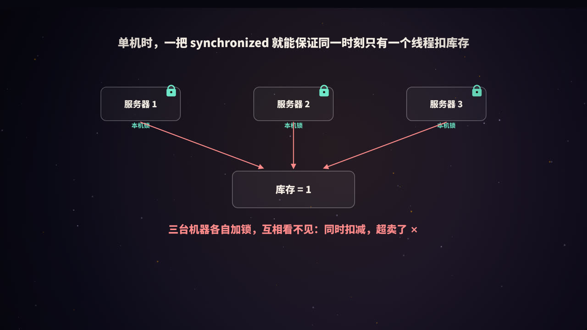
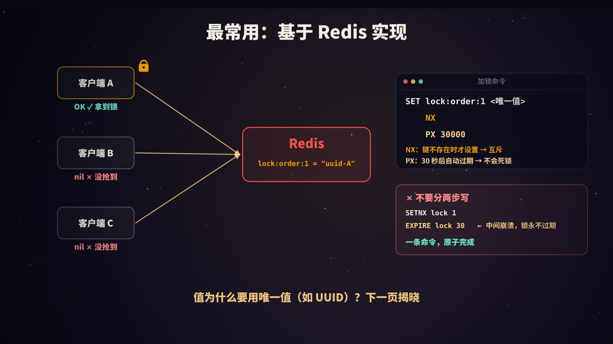
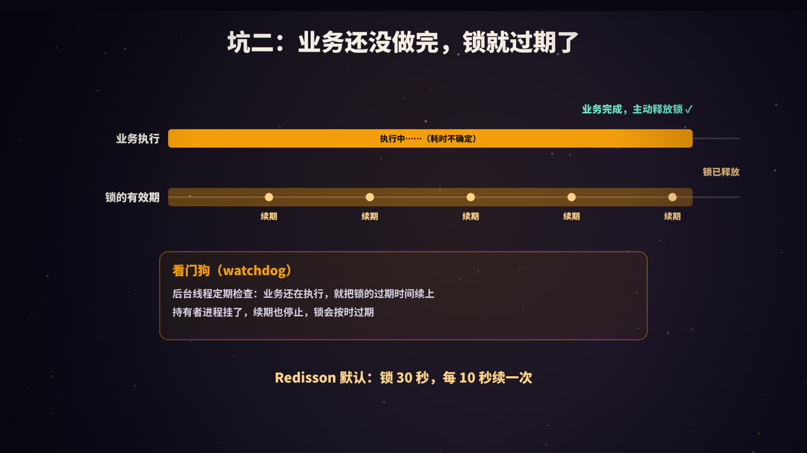
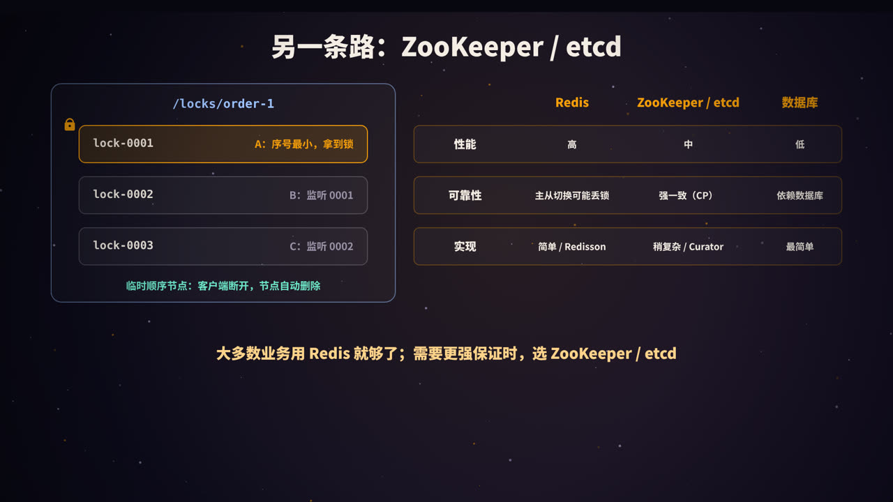

title: 分布式锁：一把所有机器都认的锁
subtitle: 为什么需要分布式锁，Redis 加锁与释放的正确姿势，锁过期、误删、主从切换丢锁三大坑，看门狗、Redlock 与 Fencing Token，以及 ZooKeeper 和数据库方案
tag: 计算机与后端
color: #f59e0b



## 为什么需要分布式锁

在单台机器上，用 `synchronized` 或 `ReentrantLock` 就能保证同一时刻只有一个线程执行扣库存的代码。

但服务通常部署在多台机器上。每台机器的锁只在自己的进程内有效，三台机器各自加锁、互相看不见，于是三个请求仍然可能同时扣减库存，造成超卖。

**分布式锁**就是一把放在公共位置、所有机器都认的锁。典型场景：

- 防止超卖、重复下单、重复支付；
- 定时任务部署在多台机器上，只允许一台执行；
- 缓存失效时，只让一个请求去重建缓存（防击穿，见本系列《Redis 缓存》）；
- 对同一份外部资源的互斥访问。

> 很多场景其实可以不用分布式锁：比如扣库存，可以用数据库的条件更新 `UPDATE ... SET stock = stock - 1 WHERE id = ? AND stock > 0` 原子完成。能用数据库约束或原子操作解决的，优先不用锁。

## 一把合格的分布式锁


| 要求 | 含义 |
|---|---|
| **互斥** | 同一时刻，只有一个客户端能持有锁 |
| **不会死锁** | 持有者崩溃、网络断开时，锁也能被释放 |
| **谁加谁解** | 只能释放自己加的锁，不能误删别人的 |
| **高可用** | 锁服务本身不能成为单点故障 |
| 可选：可重入 | 同一个线程可以多次获取同一把锁 |
| 可选：可等待 | 获取失败时可以排队等待，而不是立即返回 |

## 基于 Redis 实现



### 加锁

```bash
SET lock:order:1 <唯一值> NX PX 30000
```

- `NX`：只有键不存在时才设置成功，保证**互斥**；
- `PX 30000`：30 秒后自动过期，即使持有者崩溃，锁也会被释放，**不会死锁**；
- 值是一个**唯一值**（如 UUID），用来标识「这把锁是谁加的」。

返回 `OK` 表示拿到锁，返回 `nil` 表示锁已被别人持有。

**不要分两步写**：

```bash
SETNX lock:order:1 1      # 第一步：加锁
EXPIRE lock:order:1 30    # 第二步：设置过期时间
```

如果在两条命令之间进程崩溃，这把锁就永远不会过期，变成死锁。`SET ... NX PX` 一条命令就能原子地完成两件事。

## 坑一：删掉了别人的锁


设想这样一个时序：

1. 客户端 A 加锁成功，有效期 30 秒；
2. A 遇到长时间的 GC 停顿或网络卡顿，超过了 30 秒；
3. 锁自动过期，客户端 B 加锁成功；
4. A 恢复执行，业务完成后执行 `DEL`，**把 B 的锁删掉了**；
5. 此时客户端 C 也能加锁成功，B 和 C 同时进入临界区。

### 解决：释放时先比对，再删除

加锁时写入唯一值，释放时检查值是不是自己的，是才删除。「检查」和「删除」必须原子执行，所以要用 Lua 脚本：

```lua
-- KEYS[1]：锁的键   ARGV[1]：加锁时写入的唯一值
if redis.call("GET", KEYS[1]) == ARGV[1] then
    return redis.call("DEL", KEYS[1])
end
return 0
```

如果用两条命令（先 `GET` 判断，再 `DEL`），在两条命令之间锁可能刚好过期并被别人拿走，依然会误删。

## 坑二：业务还没做完，锁就过期了



过期时间设多长？设短了，业务没做完锁就过期，别人进来了；设长了，持有者崩溃后要等很久才能释放。业务耗时往往又是不确定的。

### 解决：看门狗续期

加锁成功后，启动一个后台线程（看门狗），定期检查：如果业务还在执行，就把锁的过期时间重新延长。

- 业务正常执行时，锁一直有效；
- 业务完成后，主动释放锁，看门狗停止；
- 持有者进程崩溃，看门狗也随之消失，锁会在有效期结束后自动过期。

Java 中最常用的 Redis 客户端 **Redisson** 内置了这个机制：不指定租约时间时，锁默认有效期 30 秒，每 10 秒（有效期的三分之一）续期一次。

```java
RLock lock = redisson.getLock("lock:order:1");
lock.lock();                       // 加锁，不指定时间则启用看门狗
try {
    // 业务逻辑
} finally {
    lock.unlock();                 // 内部会校验是否为当前线程持有
}

// 或者：最多等 3 秒，拿不到就放弃
if (lock.tryLock(3, TimeUnit.SECONDS)) {
    try { /* 业务逻辑 */ } finally { lock.unlock(); }
}
```

Redisson 还实现了**可重入**（用 Hash 结构记录持有者和重入次数）和**等待**（通过发布订阅，在锁释放时通知等待者），一般不建议自己从零手写。

## 坑三：主从切换，锁丢了


Redis 的主从复制是**异步**的：

1. 客户端 A 在主节点上加锁成功；
2. 锁还没来得及复制到从节点，主节点就宕机了；
3. 从节点被提升为新的主节点，上面没有这把锁；
4. 客户端 B 在新主节点上加锁成功，A 和 B 同时持有锁。

### 方案一：Redlock

Redis 作者提出的 **Redlock** 算法：部署 5 个**相互独立**的 Redis 主节点，客户端依次向它们加锁，只有在多数节点（至少 3 个）上加锁成功，且总耗时小于锁的有效期，才算拿到锁。

Redlock 提高了容错能力，但存在争议：分布式系统研究者 Martin Kleppmann 指出，它依赖于「各节点时钟基本准确」「进程停顿时间有限」等假设，在长时间 GC 停顿、时钟跳变等情况下仍可能失效。Redis 作者 antirez 也撰文做了回应。工程实践中，Redlock 需要维护多个独立节点，使用并不普遍。

### 方案二：Fencing Token

一个更根本的思路是：**不要完全依赖锁本身**，让被保护的资源也参与校验。

1. 每次加锁成功，锁服务返回一个**单调递增的编号**（fencing token），比如 33、34；
2. 客户端访问存储时带上这个编号；
3. 存储端记住见过的最大编号，**拒绝编号更小的请求**。

这样，即使 A 因为停顿而在锁过期后才去写数据，它带的是旧编号 33，而 B 已经用 34 写过了，A 的写入会被拒绝。

在数据库中，可以用版本号（乐观锁）实现类似的效果：

```sql
UPDATE account SET balance = ?, version = ? WHERE id = ? AND version < ?;
```

> 结论：基于 Redis 的锁只能「尽量」保证互斥，适合**效率类**场景（偶尔重复执行可以接受，比如避免重复计算）。对于**正确性**要求极高的场景（比如资金），要么使用 CP 的锁服务，要么在存储层做 fencing 或唯一约束兜底。

## 基于 ZooKeeper / etcd 实现



ZooKeeper 是一个强一致（CP）的分布式协调服务，利用它的两个特性实现锁：

- **临时节点**：创建节点的客户端会话断开后，节点自动删除，天然防止死锁；
- **顺序节点**：创建时自动追加一个递增的序号。

加锁流程：

1. 每个客户端在 `/locks/order-1` 下创建一个临时顺序节点，如 `lock-0001`、`lock-0002`、`lock-0003`；
2. 序号最小的客户端获得锁；
3. 其他客户端只**监听排在自己前一个的节点**，前一个节点被删除时再检查自己是不是最小的。只监听前一个节点，可以避免锁释放时所有等待者被同时唤醒（羊群效应）；
4. 释放锁就是删除自己的节点。

Java 中通常使用 **Apache Curator** 提供的 `InterProcessMutex`。etcd 的思路类似：基于租约（lease）实现自动过期，基于 revision 判断先后顺序。

## 基于数据库实现

最简单的方式是利用数据库的唯一约束：

```sql
CREATE TABLE distributed_lock (
  lock_key   VARCHAR(64) PRIMARY KEY,
  owner      VARCHAR(64) NOT NULL,
  expire_at  DATETIME NOT NULL
);

-- 加锁：插入成功即拿到锁，主键冲突说明已被占用
INSERT INTO distributed_lock VALUES ('order:1', 'uuid-A', NOW() + INTERVAL 30 SECOND);
-- 释放：只删除自己的
DELETE FROM distributed_lock WHERE lock_key = 'order:1' AND owner = 'uuid-A';
```

还需要定时清理过期的记录。也可以直接使用 `SELECT ... FOR UPDATE` 行锁（见本系列《MySQL 的锁》）。数据库方案实现简单，但性能较低，会给数据库增加压力。

## 三种方案对比

| | Redis | ZooKeeper / etcd | 数据库 |
|---|---|---|---|
| 性能 | 高 | 中 | 低 |
| 可靠性 | 异步复制，主从切换时可能丢锁 | 强一致（CP），更可靠 | 取决于数据库的高可用 |
| 防死锁 | 过期时间 | 临时节点 / 租约 | 过期时间 + 清理任务 |
| 实现 | 简单，常用 Redisson | 稍复杂，常用 Curator | 最简单 |
| 适合 | 大多数业务场景 | 对一致性要求高的协调场景 | 并发不高、不想引入新组件 |

## 使用分布式锁的建议

1. **能不用就不用**：优先考虑数据库原子更新、唯一约束、消息队列串行化等方案；
2. **锁的粒度要细**：锁 `order:1001`，而不是锁整个「订单」；
3. **锁内的逻辑要短**：不要在持有锁时调用耗时的外部接口；
4. **设置获取超时**：用 `tryLock` 设定最长等待时间，避免请求无限堆积；
5. **一定在 finally 中释放**，并只释放自己的锁；
6. **关键业务要有兜底**：幂等、唯一约束或 fencing，不把正确性完全押在锁上。

## 高频面试题速答

**Q：Redis 分布式锁怎么实现？**
用 `SET key 唯一值 NX PX 过期时间` 原子加锁；释放时用 Lua 脚本比对值后再删除；业务时间不确定时用看门狗续期。

**Q：为什么释放锁要用 Lua 脚本？**
「判断是不是自己的锁」和「删除」必须原子执行，否则在两步之间锁可能过期并被别人获取，导致误删。

**Q：Redis 主从切换时锁会丢吗？怎么办？**
会，因为复制是异步的。可以用 Redlock 降低风险，但它有争议；对正确性要求高的场景，用 ZooKeeper / etcd，或在存储层使用 fencing token。

**Q：ZooKeeper 怎么实现分布式锁？**
创建临时顺序节点，序号最小的获得锁；其他节点监听前一个节点；会话断开时节点自动删除，避免死锁。

## 总结


- 多机部署时，本机锁失效，需要**分布式锁**；
- Redis 加锁：**`SET NX PX` + 唯一值**，一条命令原子完成；
- 释放：**Lua 脚本比对后删除**，只删自己的锁；
- 业务耗时不确定：**看门狗续期**（Redisson 内置）；
- 主从切换可能丢锁：Redlock 有争议，关键场景用 **CP 系统**或 **fencing token** 兜底；
- 能用数据库约束或原子操作解决的，**优先不用锁**。

<div class="refs" markdown="1">

### 参考资料

- Redis 文档：Distributed Locks with Redis；SET 命令.
- Kleppmann, M. (2016). How to do distributed locking. martin.kleppmann.com
- antirez (2016). Is Redlock safe? antirez.com
- Redisson 文档：Distributed locks and synchronizers.
- Apache Curator 文档：Recipes — Shared Reentrant Lock.
- Burrows, M. (2006). The Chubby lock service for loosely-coupled distributed systems. *OSDI*.

</div>
