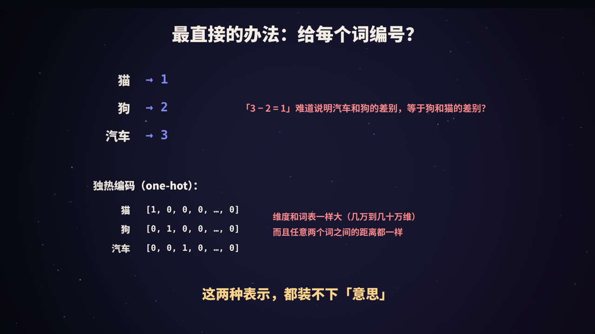
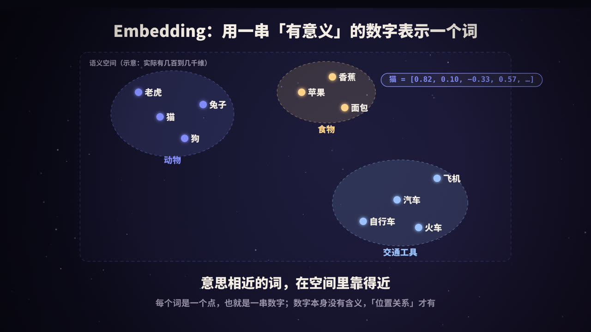
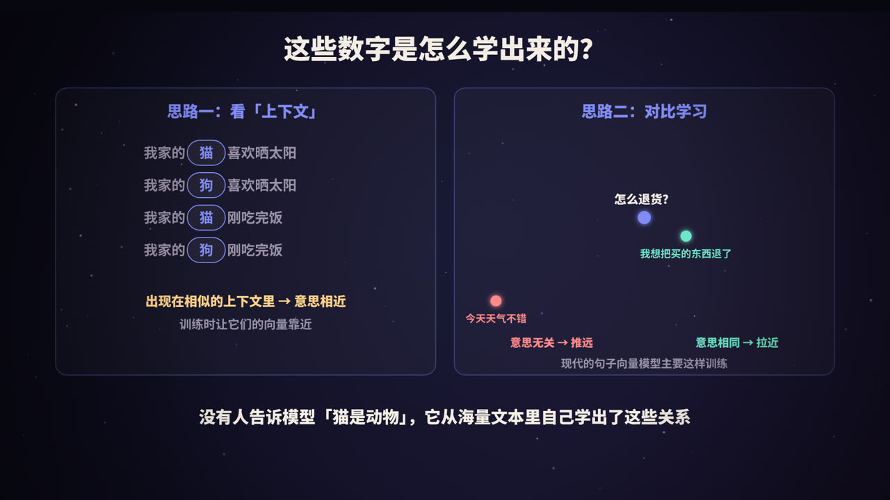
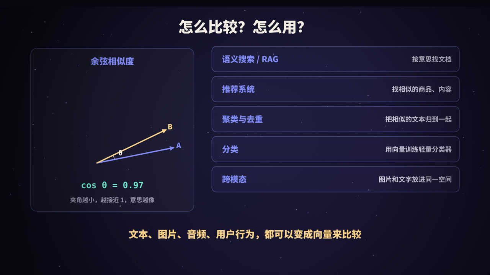

title: Embedding 向量：把「意思」变成一串数字
subtitle: 从独热编码到 word2vec、BERT 和句向量；向量为什么能表达语义、怎么比较相似度、怎么选模型，以及它在搜索、推荐、RAG 中的用法
tag: AI 与大模型
color: #818cf8


## 计算机怎么理解「意思」

人一眼就能看出「猫」和「狗」比较像，而和「汽车」不像。但对计算机来说，文字只是一串字符编码，`猫` 和 `狗` 之间没有任何天然的联系。

**Embedding**（嵌入、向量表示）就是用来解决这个问题的：把一个词、一句话、一张图片，转换成一串数字（向量），而且让**意思相近的东西，向量也相近**。有了它，计算机就能用数学的方法来「比较意思」。

今天的语义搜索、推荐系统、RAG 知识库问答，背后都离不开 Embedding。

## 为什么简单的编号不行



### 直接编号

给每个词一个整数：猫 = 1，狗 = 2，汽车 = 3。问题是这些数字之间的大小和差值毫无意义：「3 − 2 = 1」并不说明汽车和狗的差别，等于狗和猫的差别。

### 独热编码

准备一个和词表一样长的向量，每个词只在自己的位置上是 1，其余都是 0：

```text
猫   = [1, 0, 0, 0, …, 0]
狗   = [0, 1, 0, 0, …, 0]
汽车 = [0, 0, 1, 0, …, 0]
```

它有两个致命问题：

1. **维度太高**：词表有几万到几十万个词，每个向量就有几万到几十万维，几乎全是 0；
2. **毫无语义**：任意两个不同词的向量都互相垂直，「猫」和「狗」的距离，与「猫」和「汽车」的距离完全一样。

## Embedding：稠密、有语义的向量



Embedding 用一个**低维**（通常几百到几千维）、**稠密**（每一维都有取值）的向量来表示一个词或一段文字：

```text
猫 = [0.82, 0.10, −0.33, 0.57, …]
```

可以把它想象成一个高维空间里的一个**点**：

- 动物类的词聚在一起，交通工具聚在另一处，食物又在另一处；
- 意思越相近，点之间的距离越近。

要注意的是，**单独某一维的数字通常没有可解释的含义**。不像人为设计的特征（「是不是动物」「有多大」），模型学出来的每一维都混合了很多信息。真正有意义的，是**点与点之间的相对位置**。

## 方向也有含义：向量运算


2013 年，谷歌的研究人员发布了 **word2vec**，其中一个令人惊讶的发现是，词向量之间可以做「加减法」：

```text
vec(国王) − vec(男人) + vec(女人) ≈ vec(女王)
```

「男人 → 女人」的方向，大致代表了「性别」这层含义；从「国王」出发沿着同样的方向移动，就会到达「女王」附近。类似地，「法国 → 巴黎」的方向和「意大利 → 罗马」很接近，代表了「国家 → 首都」的关系。

这说明 Embedding 不只是把相似的词放在一起，还把**词与词之间的关系**编码成了空间中的方向。（这类类比在实际中并不总是完美成立，但它很直观地说明了向量空间的结构。）

## 这些数字是怎么学出来的



### 思路一：看上下文（分布式假设）

语言学中有一个经典的观点：**一个词的意思，可以从它经常和哪些词一起出现看出来。**

```text
我家的 [猫] 喜欢晒太阳        我家的 [狗] 喜欢晒太阳
我家的 [猫] 刚吃完饭          我家的 [狗] 刚吃完饭
```

「猫」和「狗」总是出现在相似的上下文里，所以它们的意思应该相近。word2vec 就是基于这个思想训练的：让模型根据一个词预测它周围的词（Skip-gram），或者根据周围的词预测中间的词（CBOW）。训练完成后，模型内部用来表示每个词的那组参数，就是词向量。

### 从词向量到上下文相关的向量

word2vec 有一个局限：一个词只有一个固定的向量。但「苹果」在「吃苹果」和「苹果手机」里的意思完全不同。

2018 年前后，以 **BERT** 为代表的 Transformer 模型带来了**上下文相关的向量**：同一个词在不同句子中，会得到不同的向量，因为注意力机制会综合整句话的信息。

### 思路二：对比学习（句向量）

在实际应用中，我们更常需要表示**一整句话或一段文字**。现代的句向量模型（比如 Sentence-BERT，以及之后的大量模型）主要用**对比学习**来训练：

- 准备大量「意思相同」的文本对，比如「怎么退货？」和「我想把买的东西退了」，训练时把它们的向量**拉近**；
- 同时把意思无关的文本（比如「今天天气不错」）的向量**推远**。

经过海量数据训练后，模型就学会了把任意一段文字映射到一个能反映语义的位置上。没有人告诉模型「猫是动物」，这些关系都是它从数据中自己学出来的。

## 怎么比较两个向量



| 方法 | 含义 | 特点 |
|---|---|---|
| **余弦相似度** | 两个向量夹角的余弦值，范围 −1 到 1 | 只看方向，不受向量长度影响，最常用 |
| **点积** | 对应维度相乘再求和 | 向量归一化（长度为 1）后，等于余弦相似度 |
| **欧氏距离** | 两点之间的直线距离 | 越小越相似 |

很多向量模型输出的向量已经做了归一化，或者建议你在使用时归一化。归一化之后，用点积计算就等价于余弦相似度，而且计算更快。

## 动手试一试

用开源的 `sentence-transformers` 库和一个中文向量模型，几行代码就能看到效果：

```python
from sentence_transformers import SentenceTransformer

model = SentenceTransformer("BAAI/bge-small-zh-v1.5")
texts = ["怎么退货？", "我想把买的东西退了", "今天天气不错"]
emb = model.encode(texts, normalize_embeddings=True)   # 每句话变成一个向量

print(emb.shape)        # (3, 512)：3 句话，每句 512 维
print(emb @ emb.T)      # 两两相似度矩阵
```

你会看到「怎么退货？」和「我想把买的东西退了」的相似度明显高于它和「今天天气不错」的相似度，尽管前两句几乎没有相同的字。

## Embedding 能用来做什么

| 应用 | 做法 |
|---|---|
| **语义搜索 / RAG** | 把文档切块后向量化存入向量数据库；问题也向量化，找最相近的片段（详见本系列《RAG 是什么》） |
| **推荐系统** | 用户和物品都表示成向量，推荐和用户向量最接近的物品，或者和用户喜欢的物品相似的物品 |
| **聚类与去重** | 把相似的文本自动归为一类，或者找出重复、近似重复的内容 |
| **分类** | 用向量作为特征，训练一个简单的分类器，比如情感分析、工单分类 |
| **异常检测** | 和大多数数据距离都很远的点，可能就是异常 |
| **跨模态检索** | 像 CLIP 这样的模型，把图片和文字映射到同一个空间，可以用文字搜图片 |

当数据量很大时，需要配合**向量数据库**和近似最近邻（ANN）算法，才能在毫秒级的时间内，从上百万个向量中找到最相似的几个。

## 怎么选向量模型

1. **语言**：中文场景要选在中文数据上训练过的模型，或者多语言模型；
2. **效果**：可以参考 **MTEB**（以及中文的 C-MTEB）等公开评测榜单，但最好在自己的数据上做一次小规模测试；
3. **维度**：维度越高，表达能力通常越强，但存储和计算成本也越高；
4. **最大长度**：模型能处理的文本长度有限，超出的部分会被截断，所以要配合合理的切块策略；
5. **一致性**：**建库和查询必须使用同一个模型**，不同模型生成的向量处在不同的空间里，不能混用；换了模型就要把所有数据重新向量化。

有些检索模型建议在**查询**前加一段固定的指令前缀，具体以模型的说明为准。

## 需要注意的局限

- **相似不等于正确**：Embedding 衡量的是「话题和表达是否接近」，而不是「内容是否正确」；
- **对否定和细节不敏感**：「我喜欢这个产品」和「我不喜欢这个产品」的向量往往很接近，因为它们的用词和话题几乎相同；
- **专业术语和编号**：对于型号、错误码、人名等，语义检索可能不如关键词检索准确，实践中常把两者结合（混合检索）；
- **偏见**：模型从数据中学习，也会学到数据中的偏见。

## 总结


- Embedding 把文字等内容转换成**稠密的向量**，让**意思相近的内容在空间中靠得近**；
- 它从数据中学出来：早期通过**上下文**（word2vec），现在主要通过**对比学习**训练句向量；
- 比较向量最常用**余弦相似度**；
- 它是语义搜索、推荐、RAG、聚类等应用的基础；
- 选模型要看语言、效果、维度和长度，**建库和查询必须用同一个模型**。

<div class="refs" markdown="1">

### 参考资料

- Mikolov, T., et al. (2013). Efficient Estimation of Word Representations in Vector Space. *arXiv:1301.3781*.
- Pennington, J., Socher, R., & Manning, C. (2014). GloVe: Global Vectors for Word Representation. *EMNLP*.
- Devlin, J., et al. (2019). BERT: Pre-training of Deep Bidirectional Transformers for Language Understanding. *NAACL*.
- Reimers, N., & Gurevych, I. (2019). Sentence-BERT. *EMNLP*.
- Radford, A., et al. (2021). Learning Transferable Visual Models From Natural Language Supervision (CLIP). *ICML*.
- Muennighoff, N., et al. (2023). MTEB: Massive Text Embedding Benchmark. *EACL*.

</div>
