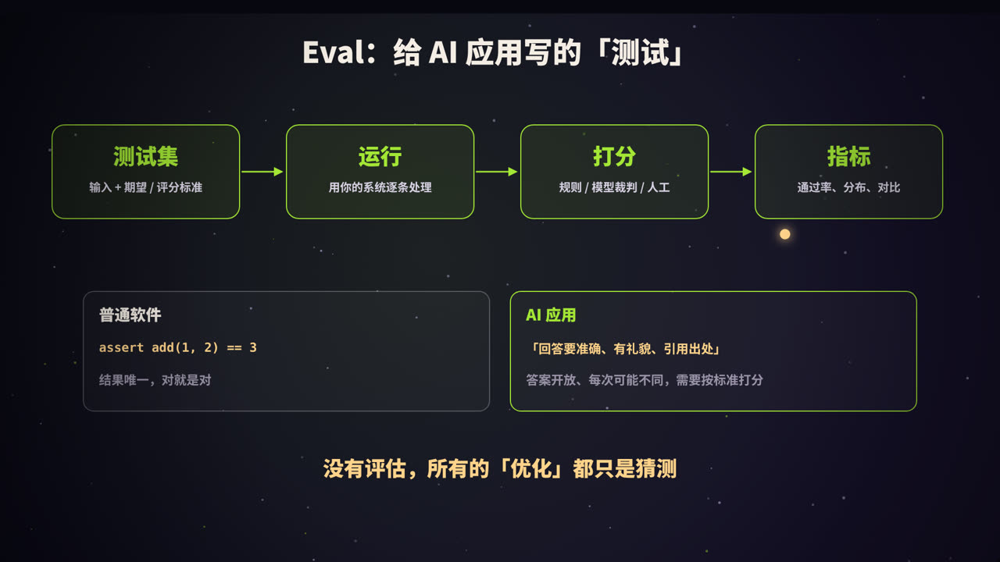
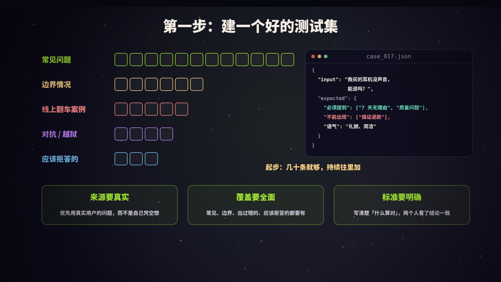
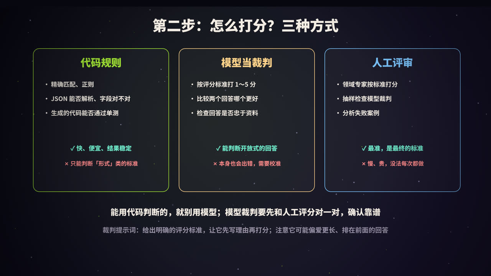
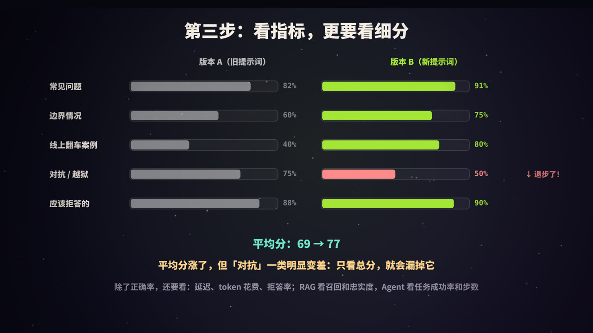
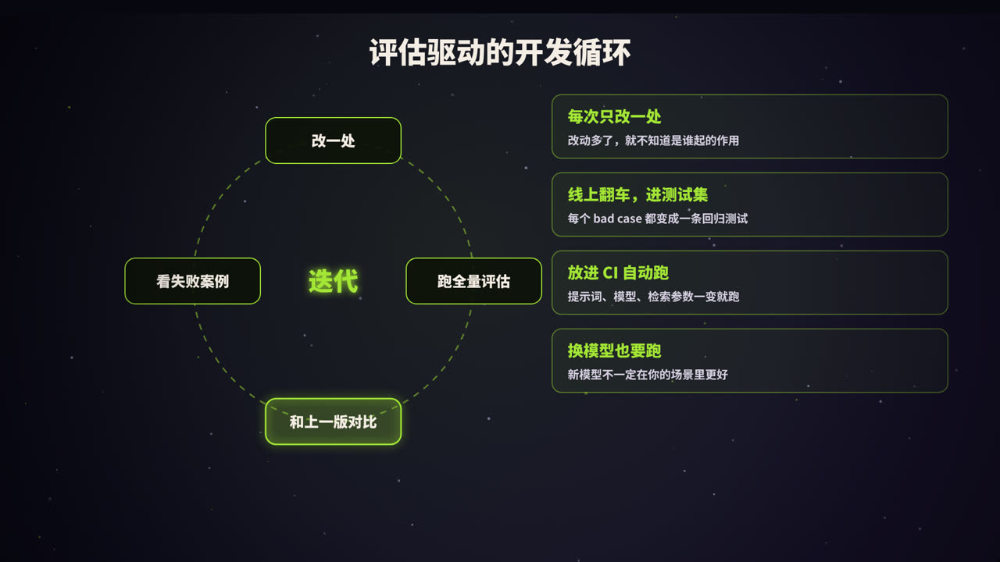
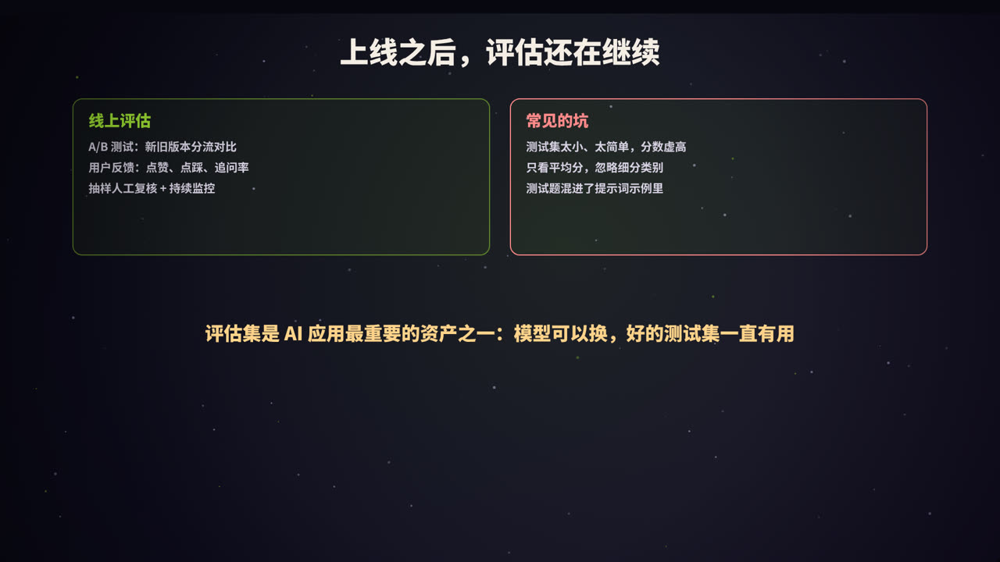

title: 评估（Evals）：用数据，而不是感觉，改进 AI 应用
subtitle: 为什么需要评估、怎么建测试集、三种打分方式（代码规则、模型裁判、人工）、看哪些指标、评估驱动的开发循环，附一个最小评估脚本
tag: AI 与大模型
color: #a3e635


## 一个常见的场景

你调整了提示词，随手试了三个例子，回答都比以前好，于是放心上线了。几天后，用户反馈另外一些问题全答错了，而这些问题以前是能答对的。

这就是开发 AI 应用最常见的陷阱：**凭感觉改**。大模型的输出是开放的、不确定的，改一处可能影响很多地方，只看几个例子，根本发现不了。

**评估**（Evaluation，常简称为 Evals）就是解决这个问题的方法：准备一组有代表性的测试用例，每次改动后都完整跑一遍，用数据判断系统是变好了还是变坏了。

## 什么是 Eval



一个评估流程包括四个环节：

| 环节 | 内容 |
|---|---|
| **测试集** | 一组输入，以及对应的期望输出或评分标准 |
| **运行** | 用你的完整系统（提示词、检索、工具……）逐条处理 |
| **打分** | 判断每条输出好不好：代码规则、模型裁判、人工评审 |
| **指标** | 汇总成通过率、平均分、分类别统计，并和上一版对比 |

可以把它理解为「给 AI 应用写的测试」。但和普通软件测试相比，有一个本质区别：

- 普通软件：`assert add(1, 2) == 3`，结果唯一，对就是对；
- AI 应用：要求「回答准确、有礼貌、引用出处」，答案是开放的，每次可能不同，需要**按标准打分**。

> 没有评估，所有的「优化」都只是猜测。

## 第一步：建一个好的测试集



### 测试用例从哪来

| 类别 | 说明 |
|---|---|
| **常见问题** | 用户最常问的、最核心的场景，占大头 |
| **边界情况** | 表述模糊、信息不全、多个意图混在一起的问题 |
| **线上翻车案例** | 真实出过错的 bad case，每一条都很宝贵 |
| **对抗与越狱** | 试图让系统做不该做的事、绕过限制的输入 |
| **应该拒答的** | 超出范围、资料中没有答案的问题，检验系统会不会「编」 |

原则：

1. **来源要真实**：优先使用真实用户的问题（注意脱敏），自己想出来的问题往往太「干净」；
2. **覆盖要全面**：各个类别都要有，不能只测简单情况；
3. **标准要明确**：写清楚「什么算对」，最好两个人独立判断能得到一致的结论；
4. **从小开始**：几十条精心挑选的用例，就足以发现大部分问题。之后持续往里加。

### 一条测试用例长什么样

```json
{
  "id": "case_017",
  "category": "售后",
  "input": "我买的耳机没声音，能退吗？",
  "expected": {
    "must_include": ["7 天无理由", "质量问题"],
    "must_not_include": ["保证退款"],
    "tone": "礼貌、简洁"
  }
}
```

对于有标准答案的任务（分类、信息提取、数学题），直接写期望的结果；对于开放式任务（客服回答、写作），写**评分标准**：必须包含什么、不能出现什么、语气和长度要求等。

## 第二步：怎么打分



| 方式 | 适合判断 | 优点 | 缺点 |
|---|---|---|---|
| **代码规则** | 精确匹配、关键词、正则、JSON 格式、字段值、代码能否通过单测 | 快、便宜、结果稳定可复现 | 只能判断形式上的标准 |
| **模型当裁判** | 回答是否正确、是否忠于资料、语气是否合适、两个回答哪个更好 | 能处理开放式回答，规模化 | 本身也会出错，需要校准 |
| **人工评审** | 任何标准，尤其是需要专业判断的 | 最准确，是最终标准 | 慢、贵，难以频繁进行 |

**原则：能用代码判断的，就不要用模型。** 比如「输出是否是合法 JSON」「是否包含必须提到的关键词」，用代码判断又快又准。

### 用模型当裁判（LLM-as-a-Judge）

对于开放式的回答，可以让另一个模型按照评分标准打分。一个裁判提示词的例子：

```text
你是一名客服质量评审员。请根据评分标准，评估下面的客服回答。

<question>{用户问题}</question>
<reference>{参考资料}</reference>
<answer>{待评估的回答}</answer>

评分标准：
1. 准确：内容与参考资料一致，没有编造（最重要）
2. 完整：回答了用户真正关心的问题
3. 得体：礼貌、简洁，没有承诺做不到的事

先逐条写出你的分析，再给出 1～5 的总分。
输出 JSON：{"reasoning": "...", "score": 1-5}
```

用好模型裁判的要点：

- **评分标准要具体**：「回答好不好」太模糊，要拆成可判断的维度；
- **先写理由，再打分**：判断更稳定，也便于人工检查裁判是否靠谱；
- **用人工结果校准**：抽取一部分用例，同时让人和模型打分，确认两者的一致程度足够高，再大规模使用；
- **注意偏差**：模型裁判可能偏爱更长的回答、排在前面的回答，或者和自己风格相近的回答。比较两个回答时，可以交换顺序各评一次；
- **二元判断比细分分数更可靠**：「是否忠于资料：是 / 否」往往比「1～10 分」更稳定。

## 第三步：看指标，更要看细分



假设新提示词在各类别上的表现如下：

| 类别 | 版本 A | 版本 B |
|---|---|---|
| 常见问题 | 82% | 91% |
| 边界情况 | 60% | 75% |
| 线上翻车案例 | 40% | 80% |
| **对抗 / 越狱** | **75%** | **50%** |
| 应该拒答的 | 88% | 90% |
| **平均** | **69%** | **77%** |

平均分从 69% 涨到了 77%，看起来是一次成功的改进。但按类别细看，「对抗 / 越狱」一类从 75% 跌到了 50%，安全性明显变差了。**只看总分，就会漏掉这种退步。**

### 除了正确率，还应该看什么

| 维度 | 指标 |
|---|---|
| 质量 | 通过率、平均分、各类别通过率 |
| 成本 | 每次请求的 token 数、费用 |
| 速度 | 延迟（平均值和 P95） |
| 安全 | 拒答率、越狱成功率、敏感信息泄露 |
| RAG 系统 | 检索召回率、回答忠实度、引用准确率 |
| Agent | 任务成功率、平均步数、工具调用错误率 |

因为模型输出有随机性，对于关键结论，可以把每条用例**多跑几次**，看结果是否稳定。

## 一个最小的评估脚本

```python
import json
from collections import defaultdict

def judge(case, output):
    exp = case["expected"]
    if any(k not in output for k in exp.get("must_include", [])):
        return False
    if any(k in output for k in exp.get("must_not_include", [])):
        return False
    return True                                    # 开放式标准可以再调用模型裁判

def run_eval(cases, system):
    stats = defaultdict(lambda: [0, 0])            # 类别 -> [通过数, 总数]
    failures = []
    for case in cases:
        output = system(case["input"])
        ok = judge(case, output)
        stats[case["category"]][0] += ok
        stats[case["category"]][1] += 1
        if not ok:
            failures.append({"id": case["id"], "output": output})
    for cat, (passed, total) in sorted(stats.items()):
        print(f"{cat:<10} {passed}/{total}  {passed / total:.0%}")
    return failures                                # 失败案例要逐条看

cases = [json.loads(line) for line in open("cases.jsonl", encoding="utf-8")]
failures = run_eval(cases, system=my_app)          # my_app：你的完整应用
```

不必一开始就用复杂的框架，一个脚本加一个 JSONL 文件就能起步。需求复杂之后，可以考虑 promptfoo、OpenAI Evals、RAGAS、LangSmith 等工具。

## 评估驱动的开发循环



1. **每次只改一处**：提示词、模型、检索参数、工具定义……同时改多处，就不知道是哪个起了作用；
2. **跑全量评估**：在整个测试集上运行，而不是只挑几个例子；
3. **和上一版对比**：整体指标和每个类别都要比，重点关注退步的地方；
4. **逐条看失败案例**：指标只告诉你「有问题」，失败案例才告诉你「问题是什么」。

再加上三个习惯：

- **线上翻车，进测试集**：每个 bad case 修复后都加入测试集，成为一条回归测试，防止同样的问题再次出现；
- **放进 CI 自动跑**：提示词、模型版本、关键参数变化时自动运行评估，结果不达标就阻止合并；
- **换模型也要跑**：新模型在通用榜单上更强，不代表在你的场景里更好。

## 上线之后，评估还在继续



离线测试集无法覆盖所有真实情况，上线后还需要：

- **A/B 测试**：新旧版本各分一部分流量，比较业务指标（问题解决率、转人工率、用户满意度）；
- **用户反馈**：点赞、点踩、重新生成、追问率，都是信号；
- **抽样人工复核**：定期随机抽取线上对话，人工评审，发现新的问题类型；
- **监控**：延迟、费用、错误率、拒答率的异常波动。

### 常见的坑

| 坑 | 后果 |
|---|---|
| 测试集太小、太简单 | 分数虚高，发现不了问题 |
| 只看平均分 | 某一类别的退步被掩盖 |
| 测试用例出现在提示词的示例里 | 相当于「泄题」，分数不可信 |
| 裁判没有校准 | 模型裁判本身的偏差被当成真相 |
| 测试集长期不更新 | 跟不上用户的真实使用情况 |

## 总结


- **为什么**：AI 应用的输出开放且不确定，凭感觉改很容易「按下葫芦浮起瓢」；
- **测试集**：真实、全面、标准明确，从几十条起步，持续积累；
- **打分**：能用代码就用代码，开放式的用模型裁判，并用人工校准；
- **指标**：不只看平均分，还要看细分类别、成本、延迟和安全；
- **循环**：改一处、跑全量、对比、看失败案例；线上 bad case 进测试集；
- 评估集是 AI 应用**最重要的资产之一**：模型可以换，好的测试集一直有用。

<div class="refs" markdown="1">

### 参考资料

- Anthropic. Define success criteria and build evaluations（官方文档）. docs.claude.com
- Zheng, L., et al. (2023). Judging LLM-as-a-Judge with MT-Bench and Chatbot Arena. *NeurIPS*.
- Es, S., et al. (2023). RAGAS: Automated Evaluation of Retrieval Augmented Generation. *arXiv:2309.15217*.
- Husain, H. (2024). Your AI Product Needs Evals. hamel.dev
- OpenAI Evals：github.com/openai/evals

</div>
