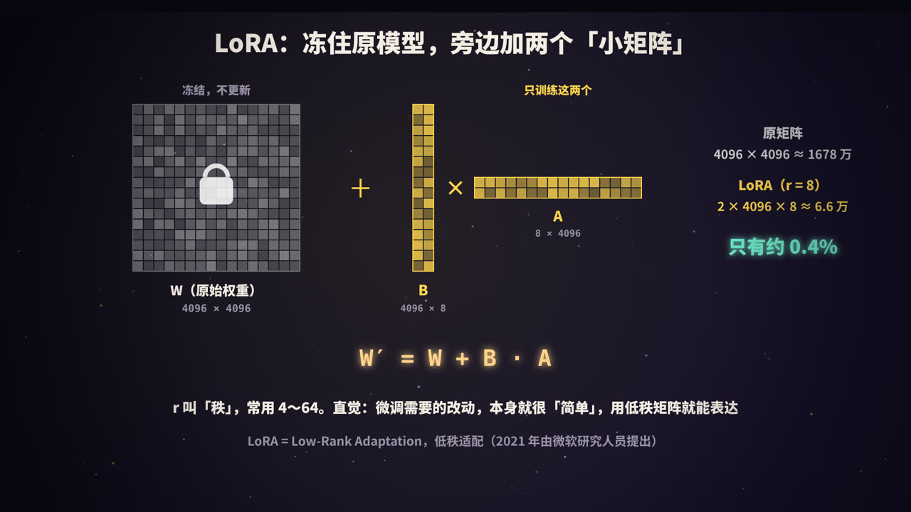
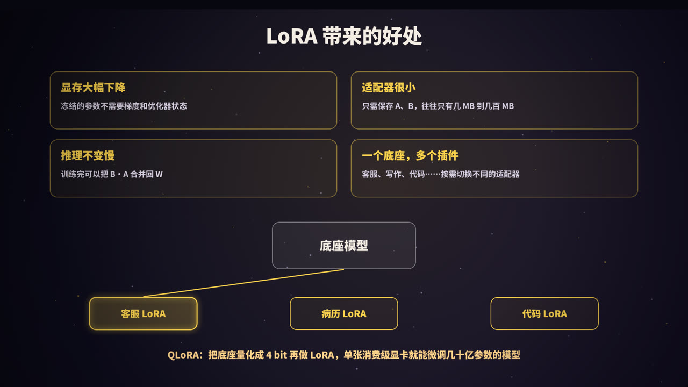
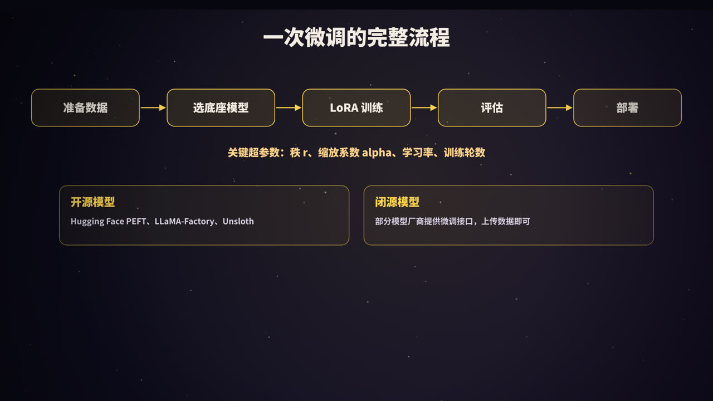

title: 微调与 LoRA：让大模型学会你想要的样子
subtitle: 什么时候该微调、什么时候用提示词或 RAG，全量微调为什么那么贵，LoRA 的低秩原理与参数量计算，QLoRA，数据准备、超参数与完整流程，附一段可运行的 NumPy 实现
tag: AI 与大模型
color: #fcd34d


## 微调是什么

大模型在预训练阶段读了海量文本，什么都会一点。但在具体业务里，我们常常希望它：

- 严格按照固定的格式输出，比如医院的病历、公司的工单；
- 用某种固定的语气说话，比如你们公司客服的风格；
- 在某个具体任务上表现得又稳又准，比如从合同里抽取字段、给工单分类。

靠提示词也能做到一部分，但规则一多，提示词越写越长，效果依然时好时坏，而且每次请求都要为这些长提示词付费。

**微调**（fine-tuning）就是：拿一个已经训练好的模型，用你自己准备的数据**再训练一下**，让它把这些要求「学进参数里」。微调之后，不需要长长的提示词，模型也能稳定地按你想要的方式工作。

## 先问：真的需要微调吗？


微调有成本：要准备数据、要算力、要评估、要维护。实践中，一般按照下面的顺序考虑：

1. **提示词**：最快、最便宜。先把提示词认真优化一遍，配合少量示例（见本系列《提示词工程》）；
2. **RAG**：如果问题是模型**缺少知识**，比如公司内部文档、最新的产品信息，就用检索增强生成，把资料查出来交给模型（见本系列《RAG》）；
3. **微调**：如果问题是要改变模型的**行为习惯**，比如格式、风格、某类任务的做法，再考虑微调。

| | 适合微调 | 不适合微调 |
|---|---|---|
| 目标 | 固定的输出格式、写作风格、语气 | 注入经常变化的知识（用 RAG） |
| 任务 | 分类、抽取等要求稳定的任务 | 提示词还没认真优化过 |
| 成本 | 用小模型学会大模型在某个任务上的能力，降低调用成本 | 数据很少、质量很差 |
| 提示词 | 规则太长，想把规则「训练进去」 | 需要随时修改规则 |

一句话概括：**RAG 让模型「知道」，微调让模型「学会」**。两者也可以结合使用：先微调让模型学会按格式回答，再用 RAG 提供最新的资料。

> 微调能不能用来给模型「灌知识」？可以有一些效果，但不推荐作为主要手段：知识一更新就要重新训练，模型也可能把知识记得不准，甚至编造出看起来很像的内容。需要准确、可更新、能溯源的知识，优先用 RAG。

## 全量微调：最直接，但很贵


最直接的方式是**全量微调**（full fine-tuning）：用你的数据继续训练，模型的**所有参数**都参与更新。

### 显存账

以 70 亿参数（7B）的模型为例，按常见的「混合精度 + Adam 优化器」训练，每个参数大约需要 16 字节：

| 内容 | 每个参数 | 7B 模型 |
|---|---|---|
| 模型参数（16 位） | 2 字节 | 14 GB |
| 梯度（16 位） | 2 字节 | 14 GB |
| 32 位主权重副本 | 4 字节 | 28 GB |
| Adam 一阶动量 | 4 字节 | 28 GB |
| Adam 二阶动量 | 4 字节 | 28 GB |
| **合计** | **16 字节** | **约 112 GB** |

这还没算训练时的**激活值**（每一层的中间结果，用于反向传播），它随批大小和序列长度增长。所以全量微调一个 7B 模型，通常需要多张高端显卡；模型更大，成本更高。各种显存优化技术（如 ZeRO、梯度检查点）可以降低需求，但无法改变「所有参数都要训练」的本质。

### 另外两个问题

- **存储**：每个任务都要保存一整份完整的模型。10 个任务，就是 10 份 14 GB；
- **遗忘**：训练数据较少、训练过头时，模型容易丢掉原有的通用能力，这叫**灾难性遗忘**（catastrophic forgetting）。

于是自然会想：能不能只改一小部分参数？这类方法统称为**参数高效微调**（PEFT，Parameter-Efficient Fine-Tuning），其中最流行的就是 LoRA。

## LoRA 的原理



LoRA 全称 **Low-Rank Adaptation**（低秩适配），2021 年由微软的研究人员提出。

### 核心想法

模型里有大量的大矩阵，比如注意力层中的 W_Q、W_V（见本系列《Transformer 详解》）。微调本质上是给这些矩阵加上一个改动量 ΔW：

```text
W′ = W + ΔW
```

全量微调直接训练整个 ΔW，它和 W 一样大，比如 4096 × 4096。

LoRA 的做法是：

1. **冻结**原始权重 W，不再更新；
2. 不直接学 ΔW，而是用两个「瘦长」的矩阵相乘来表示它：**ΔW = B · A**；
3. B 的形状是 4096 × r，A 的形状是 r × 4096，r 是一个很小的数，叫做**秩**（rank），常用 4～64；
4. 训练时，**只更新 A 和 B**。

<figure>
<svg viewBox="0 0 440 400" xmlns="http://www.w3.org/2000/svg" role="img" aria-label="LoRA 结构示意">
  <rect width="440" height="400" fill="#0f0e1c"/>
  <defs><marker id="la" viewBox="0 0 10 10" refX="9" refY="5" markerWidth="7" markerHeight="7" orient="auto"><path d="M0,0 L10,5 L0,10 z" fill="#9a93a8"/></marker>
  <marker id="lb" viewBox="0 0 10 10" refX="9" refY="5" markerWidth="7" markerHeight="7" orient="auto"><path d="M0,0 L10,5 L0,10 z" fill="#fcd34d"/></marker></defs>
  <g font-family="PingFang SC, Noto Sans SC, sans-serif" text-anchor="middle">
    <rect x="16" y="170" width="56" height="56" rx="12" fill="rgba(255,255,255,.06)" stroke="#9a93a8"/>
    <text x="44" y="206" fill="#f4ede4" font-size="22" font-weight="800">x</text>
    <path d="M72,190 L100,190 L100,95 L130,95" fill="none" stroke="#9a93a8" stroke-width="2.5" marker-end="url(#la)"/>
    <rect x="132" y="50" width="190" height="90" rx="14" fill="rgba(255,255,255,.06)" stroke="#9a93a8"/>
    <text x="227" y="88" fill="#f4ede4" font-size="20" font-weight="800">W（冻结）</text>
    <text x="227" y="116" fill="#9a93a8" font-size="14">d × d，不更新</text>
    <path d="M72,206 L100,206 L100,300 L112,300" fill="none" stroke="#fcd34d" stroke-width="2.5" marker-end="url(#lb)"/>
    <rect x="114" y="262" width="100" height="76" rx="14" fill="rgba(252,211,77,.12)" stroke="#fcd34d"/>
    <text x="164" y="296" fill="#fcd34d" font-size="20" font-weight="800">A</text>
    <text x="164" y="322" fill="#9a93a8" font-size="13">r × d：降到 r 维</text>
    <path d="M214,300 L232,300" fill="none" stroke="#fcd34d" stroke-width="2.5" marker-end="url(#lb)"/>
    <rect x="234" y="262" width="100" height="76" rx="14" fill="rgba(252,211,77,.12)" stroke="#fcd34d"/>
    <text x="284" y="296" fill="#fcd34d" font-size="20" font-weight="800">B</text>
    <text x="284" y="322" fill="#9a93a8" font-size="13">d × r：升回 d 维</text>
    <path d="M322,95 L380,95 L380,180" fill="none" stroke="#9a93a8" stroke-width="2.5" marker-end="url(#la)"/>
    <path d="M334,300 L380,300 L380,222" fill="none" stroke="#fcd34d" stroke-width="2.5" marker-end="url(#lb)"/>
    <circle cx="380" cy="201" r="19" fill="#0f0e1c" stroke="#f4ede4" stroke-width="2"/>
    <text x="380" y="209" fill="#f4ede4" font-size="24" font-weight="800">+</text>
    <text x="410" y="190" fill="#f4ede4" font-size="18" font-weight="800">h</text>
    <text x="220" y="385" fill="#fcd34d" font-size="16" font-weight="700">h = W·x + (α / r) · B·A·x　只训练 A、B</text>
  </g>
</svg>
<figcaption>LoRA 在原来的权重旁边加了一条「旁路」：输入先经过 A 降维，再经过 B 升维，结果加到原输出上</figcaption>
</figure>

### 参数量算一算

以一个 4096 × 4096 的矩阵、r = 8 为例：

| | 计算 | 参数量 |
|---|---|---|
| 原矩阵 W | 4096 × 4096 | 约 1678 万 |
| LoRA（A + B） | 4096 × 8 + 8 × 4096 | 约 6.6 万 |
| 比例 | | **约 0.4%** |

LoRA 论文中报告：在 1750 亿参数的 GPT-3 上，与全量微调相比，可训练参数减少约 1 万倍，训练所需显存减少约 3 倍，而效果相当。

### 为什么低秩就够了

「秩」可以粗略理解为一个矩阵中真正独立的「方向」有多少个。一个 4096 × 4096 的矩阵最多可以有 4096 个独立方向，而 B · A 最多只有 r 个。

LoRA 的假设是：**微调时需要的改动，本身就是「低秩」的**。预训练模型已经掌握了大量通用能力，适配一个具体任务，只需要在少数几个方向上做调整。此前也有研究发现，预训练模型的「内在维度」很低：只在一个很小的子空间里优化，就能达到接近全量微调的效果。

### 几个细节

- **初始化**：A 随机初始化，**B 初始化为 0**。这样训练刚开始时 B · A = 0，模型和原来完全一样，训练从原模型平稳出发；
- **缩放系数 alpha**：旁路的输出会乘以 `alpha / r`。调整 r 时，可以不用大幅重新调学习率。常见设置是 alpha 等于 r 或 2r；
- **加在哪些层**：原论文主要加在注意力的 W_Q 和 W_V 上；现在常见的做法是加在注意力和前馈网络的所有线性层上，效果通常更好；
- **合并**：训练完成后，可以直接计算 W′ = W + (alpha / r) · B · A，把它合并回原矩阵。合并后模型结构和原来完全一样，**推理不会变慢**。

## 动手：用 NumPy 训练一个 LoRA

下面这段代码模拟了 LoRA 的训练过程：有一个冻结的「预训练」权重 W0，新任务需要在它的基础上做一个低秩的改动。我们只训练 A 和 B，看它能不能学会这个改动。

```python
import numpy as np

rng = np.random.default_rng(0)
d, r, n = 256, 4, 2000                 # 维度、LoRA 的秩、样本数
alpha = 8                              # 缩放系数，实际缩放为 alpha / r
s = alpha / r

W0 = rng.normal(size=(d, d)) / np.sqrt(d)                          # 「预训练好」的权重，冻结
delta = rng.normal(size=(d, 2)) @ rng.normal(size=(2, d)) * 0.02   # 新任务需要的改动（低秩）
X = rng.normal(size=(n, d))
Y = X @ (W0 + delta).T                 # 新任务的「标准答案」

A = rng.normal(size=(r, d)) * 0.01     # A 随机初始化
B = np.zeros((d, r))                   # B 初始化为 0：训练开始时 B·A = 0，模型和原来完全一样

def forward(X):
    return X @ W0.T + s * (X @ A.T) @ B.T     # h = W0·x + (alpha/r)·B·A·x

# 一个极简的 Adam 优化器
m = {k: 0 for k in "AB"}; v = {k: 0 for k in "AB"}
lr, b1, b2 = 0.01, 0.9, 0.999
for step in range(1, 301):
    H = X @ A.T                        # (n, r)
    err = forward(X) - Y               # (n, d)
    loss = (err ** 2).sum(axis=1).mean()
    g = 2 * err / n                    # d loss / d 输出
    grads = {"B": s * g.T @ H,         # 只对 A、B 求梯度，W0 始终不动
             "A": s * (g @ B).T @ X}
    for k, P in (("A", A), ("B", B)):
        m[k] = b1 * m[k] + (1 - b1) * grads[k]
        v[k] = b2 * v[k] + (1 - b2) * grads[k] ** 2
        P -= lr * (m[k] / (1 - b1 ** step)) / (np.sqrt(v[k] / (1 - b2 ** step)) + 1e-8)
    if step in (1, 50, 100, 300):
        print(f"step {step:4d}  loss {loss:.4f}")

print("原矩阵参数量:", W0.size)
print("LoRA 参数量: ", A.size + B.size, f"({(A.size + B.size) / W0.size:.1%})")
W_merged = W0 + s * B @ A              # 训练完合并回去，推理不增加计算
print("合并前后输出一致:", np.allclose(X @ W_merged.T, forward(X)))
```

运行结果：

```text
step    1  loss 48.0525
step   50  loss 0.1517
step  100  loss 0.0016
step  300  loss 0.0000
原矩阵参数量: 65536
LoRA 参数量:  2048 (3.1%)
合并前后输出一致: True
```

只训练 3.1% 的参数，就完全学会了这个低秩的改动；合并回原矩阵后，输出与带旁路时完全一致。（这个小例子维度只有 256，所以比例是 3.1%；维度是 4096 时，同样的秩占比会小得多。）

真实的大模型训练中，用的是 PyTorch 和 Hugging Face 的 PEFT 库，原理完全相同。下面是参考写法（需要安装 `transformers` 和 `peft`，模型名换成你要用的）：

```python
from transformers import AutoModelForCausalLM
from peft import LoraConfig, get_peft_model

model = AutoModelForCausalLM.from_pretrained("你的底座模型")
config = LoraConfig(
    r=16,                      # 秩
    lora_alpha=32,             # 缩放系数
    lora_dropout=0.05,
    target_modules=["q_proj", "k_proj", "v_proj", "o_proj"],   # 加在哪些层，名称因模型而异
    task_type="CAUSAL_LM",
)
model = get_peft_model(model, config)
model.print_trainable_parameters()   # 打印可训练参数量和占比
# 之后用常规的训练流程训练，保存时只会保存 LoRA 的 A、B 两组矩阵
```

## LoRA 带来的好处



| 好处 | 原因 |
|---|---|
| **显存大幅下降** | 冻结的参数不需要梯度，也不需要优化器状态，前面那 98 GB 的大头几乎都省掉了 |
| **适配器很小** | 只需保存 A、B，往往只有几 MB 到几百 MB，而不是一整份模型 |
| **推理不变慢** | 训练完可以把 B · A 合并回 W |
| **一个底座，多个插件** | 同一个底座模型，可以按需挂载客服、病历、代码等不同的 LoRA 适配器，随时切换 |
| **遗忘较少** | 原始权重保持不变，研究发现 LoRA 比全量微调更少遗忘原有能力（相应地，在差异很大的新领域上学到的也可能少一些） |

「一个底座，多个插件」在部署上很实用：不合并权重，在推理服务中同时加载一个底座模型和很多个 LoRA 适配器，不同请求使用不同的适配器。vLLM 等推理框架都支持这种多 LoRA 服务。

### QLoRA：单卡也能微调

**QLoRA**（2023 年）在 LoRA 的基础上更进一步：

- 把冻结的底座模型**量化成 4 bit** 存储（一种叫 NF4 的格式），显存占用约为 16 位的四分之一；
- 计算时再临时还原成 16 位，LoRA 的 A、B 仍然用 16 位训练；
- 配合双重量化、分页优化器等技巧，进一步节省显存。

论文中，QLoRA 在单张 48 GB 显卡上微调了 650 亿参数的模型。对于几十亿参数的模型，一张消费级显卡就够了。

### 其他参数高效微调方法

| 方法 | 做法 |
|---|---|
| Adapter | 在每层中插入小的神经网络模块（比 LoRA 更早，但会增加推理延迟） |
| Prefix / Prompt Tuning | 只训练加在输入前面的一组「虚拟 token」向量 |
| DoRA 等 LoRA 变体 | 把权重分解为方向和大小分别调整，或改进初始化、秩的分配 |

目前实践中最常用的还是 LoRA 和 QLoRA。

## 真正决定效果的：数据


微调的效果，很大程度上取决于数据。对话模型的微调数据通常是 JSONL 格式，每行一条完整的对话：

```json
{"messages": [
  {"role": "system", "content": "你是某某公司的客服"},
  {"role": "user", "content": "快递三天没动了"},
  {"role": "assistant", "content": "非常抱歉让您久等！我马上帮您联系物流，今天之内给您回复。"}
]}
```

`assistant` 的回答就是你希望模型学会的样子。训练时，通常只在 `assistant` 部分计算损失，模型学习「在这样的上下文下，应该这样回答」。

### 数据的几条原则

1. **质量远比数量重要**：几百到几千条精心准备的样本，常常好过几万条粗糙的数据。研究也表明，少量高质量数据就能显著改变模型的行为风格；
2. **风格要统一**：如果数据中的回答风格各异，模型就会学得摇摆不定；
3. **覆盖真实场景**：数据要尽量接近线上真实的用户输入，包括各种边界情况、需要拒绝回答的情况；
4. **模型会学到数据里的一切**：包括数据中的错误、偏见和不好的习惯。错别字、错误的格式、编造的事实，都会被学进去；
5. **留出评估集**：从数据中单独留出一部分，不参与训练，用来评估效果；
6. **防止遗忘**：如果担心模型丢掉通用能力，可以在训练数据中混入一部分通用数据。

数据从哪里来？常见的来源有：历史上人工处理的真实记录（注意脱敏）、人工编写、用更强的模型生成后再由人审核。用大模型的输出来训练小模型，叫做**蒸馏**，是降低成本的常用手段（要注意遵守相关模型的使用条款）。

## 一次微调的完整流程



1. **明确目标与评估方法**：先想清楚「好」的标准是什么，并准备好评估集和评估方式（见本系列《Evals》）。先用提示词跑一遍，作为基线；
2. **准备数据**：收集、清洗、统一格式，划分训练集和评估集；
3. **选底座模型**：一般选择合适大小的指令微调版（Instruct / Chat）模型作为起点；
4. **LoRA 训练**：设置超参数，开始训练，观察训练集和评估集的损失曲线；
5. **评估**：用评估集对比微调前后的效果，同时检查通用能力有没有明显下降；
6. **部署**：合并权重后部署，或者以适配器的形式挂载到推理服务上。

### 关键超参数

| 超参数 | 常见取值 | 说明 |
|---|---|---|
| 秩 r | 8～64 | 越大表达能力越强，参数也越多。任务简单时，小的 r 就够 |
| alpha | r 或 2r | 控制 LoRA 旁路的影响程度 |
| 学习率 | 约 1e-4～2e-4 | 通常比全量微调的学习率高 |
| 训练轮数 | 1～3 轮 | 轮数过多容易过拟合：训练损失还在下降，评估集效果却变差 |
| 目标层 | 注意力层，或所有线性层 | 加的层越多，效果通常越好，参数也越多 |

这些只是起点，具体还要根据评估结果调整。

### 常用工具

- **开源模型**：Hugging Face 的 PEFT 和 TRL 库、LLaMA-Factory、Unsloth 等，后两者把数据处理、训练、合并、导出都封装好了，配置一下就能开始；
- **闭源模型**：部分模型厂商提供微调服务，上传数据即可训练，不需要自己管理 GPU，但能调整的选项较少。

## 微调在大模型训练中的位置

一个对话大模型通常经历这几个阶段：

1. **预训练**：在海量文本上学习「猜下一个词」，获得基础的语言能力和知识；
2. **监督微调**（SFT）：用大量「指令-回答」数据训练，让模型学会听指令、按对话的方式回答；
3. **偏好对齐**：用人类的偏好数据（RLHF、DPO 等方法），让模型的回答更有用、更安全。

本文讲的业务微调，大多属于在第 2 步的基础上**再做一次 SFT**，只是数据换成了你自己的。预训练、SFT 与 RLHF 的细节，会在本系列后续内容中介绍。

## 常见问题

**Q：微调之后，还需要写提示词吗？**
需要，但可以短很多。训练时用的系统提示词，推理时最好保持一致。

**Q：微调能让小模型赶上大模型吗？**
在**某个具体任务**上，经过微调的小模型常常能接近甚至超过未经微调的大模型，而且成本低、速度快。但在通用能力上，小模型仍然比不上大模型。

**Q：LoRA 的效果比全量微调差吗？**
在大多数常见任务上，二者效果相近。在与原模型差异很大的任务上（比如大量代码、数学的持续训练），全量微调可能学得更多。

**Q：需要多少数据？**
改变格式、风格这类任务，几百条高质量数据就可能见效；复杂任务需要更多。建议从小规模开始，看评估结果再决定是否扩充。

## 总结


- 先提示词，再 RAG，最后才考虑微调。**RAG 让模型「知道」，微调让模型「学会」**；
- 全量微调要更新所有参数，7B 模型就需要约 112 GB 显存，还要为每个任务保存完整模型；
- **LoRA 冻结原权重 W，只训练两个小矩阵 B · A**，参数量往往不到原来的 1%；训练后可以合并回去，推理不变慢；
- **QLoRA** 把底座量化到 4 bit，单卡也能微调；
- **数据为王**：质量大于数量，风格统一，留出评估集，警惕遗忘。

<div class="refs" markdown="1">

### 参考资料

- Hu, E. J., et al. (2021). LoRA: Low-Rank Adaptation of Large Language Models. *arXiv:2106.09685*.
- Dettmers, T., et al. (2023). QLoRA: Efficient Finetuning of Quantized LLMs. *NeurIPS*.
- Aghajanyan, A., et al. (2021). Intrinsic Dimensionality Explains the Effectiveness of Language Model Fine-Tuning. *ACL*.
- Houlsby, N., et al. (2019). Parameter-Efficient Transfer Learning for NLP. *ICML*.
- Liu, S.-Y., et al. (2024). DoRA: Weight-Decomposed Low-Rank Adaptation. *ICML*.
- Biderman, D., et al. (2024). LoRA Learns Less and Forgets Less. *TMLR*.
- Zhou, C., et al. (2023). LIMA: Less Is More for Alignment. *NeurIPS*.
- Rajbhandari, S., et al. (2020). ZeRO: Memory Optimizations Toward Training Trillion Parameter Models. *SC20*.
- Hugging Face PEFT 文档.

</div>
