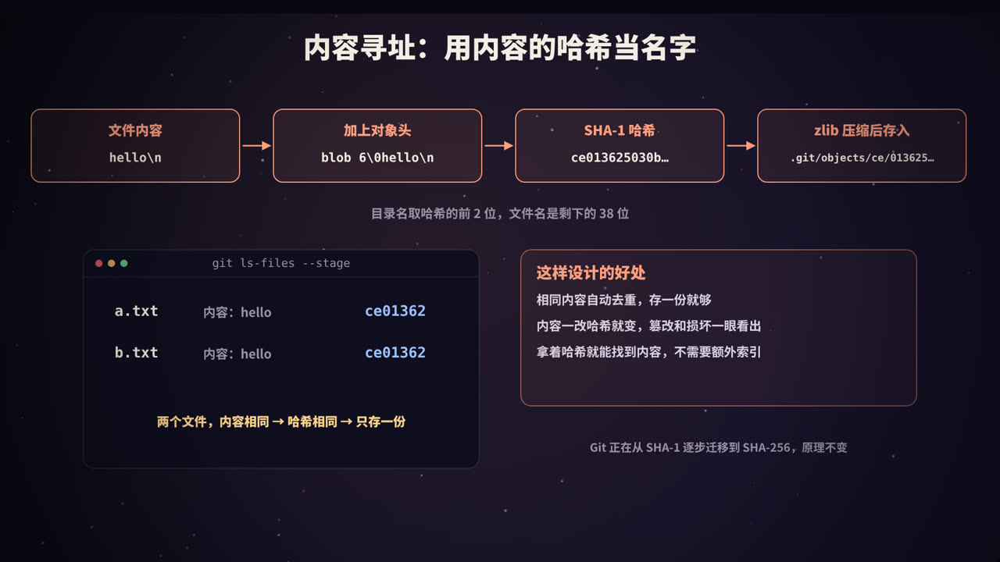
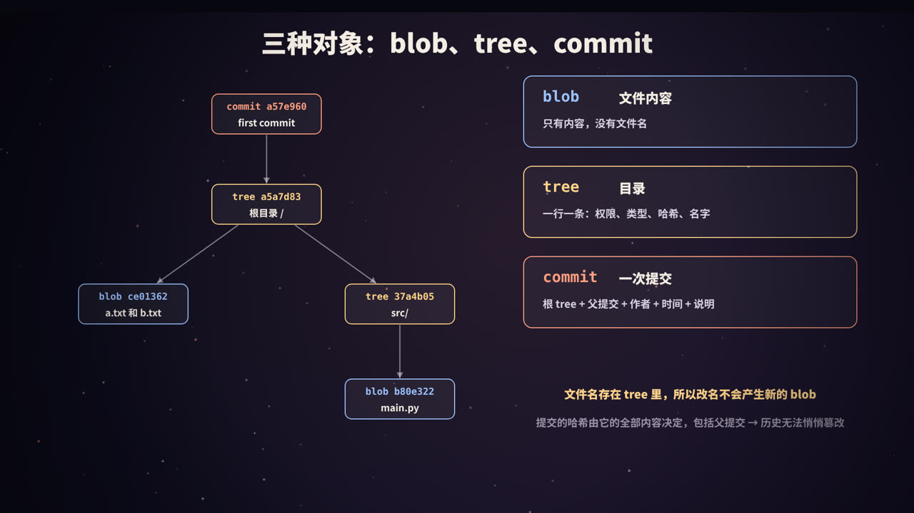
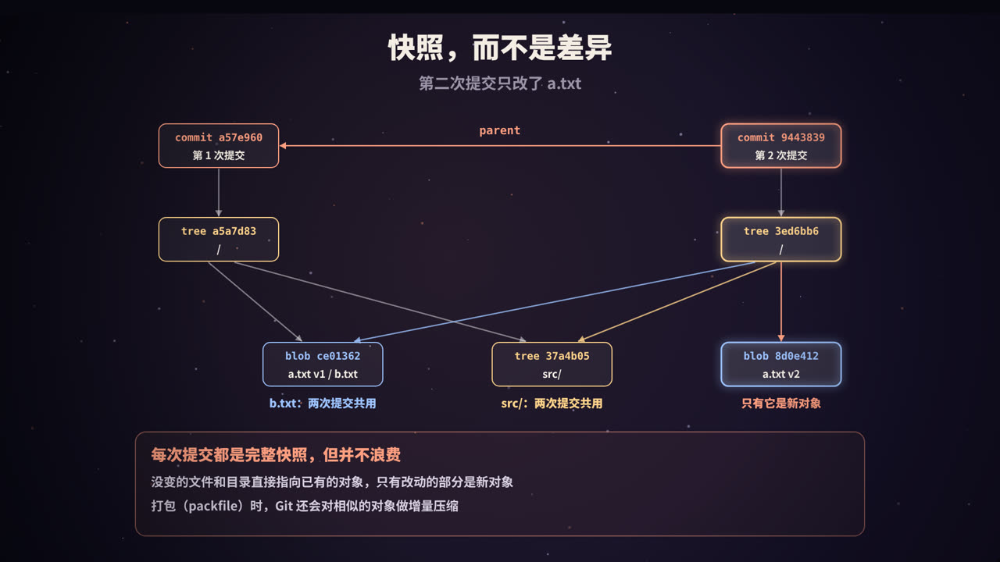
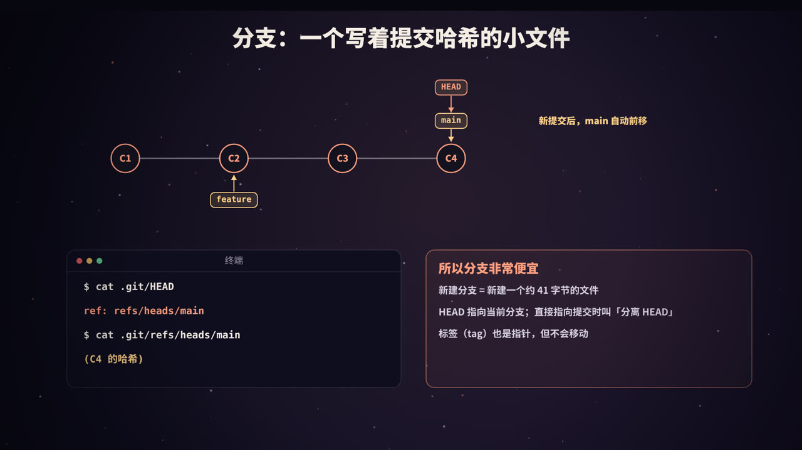
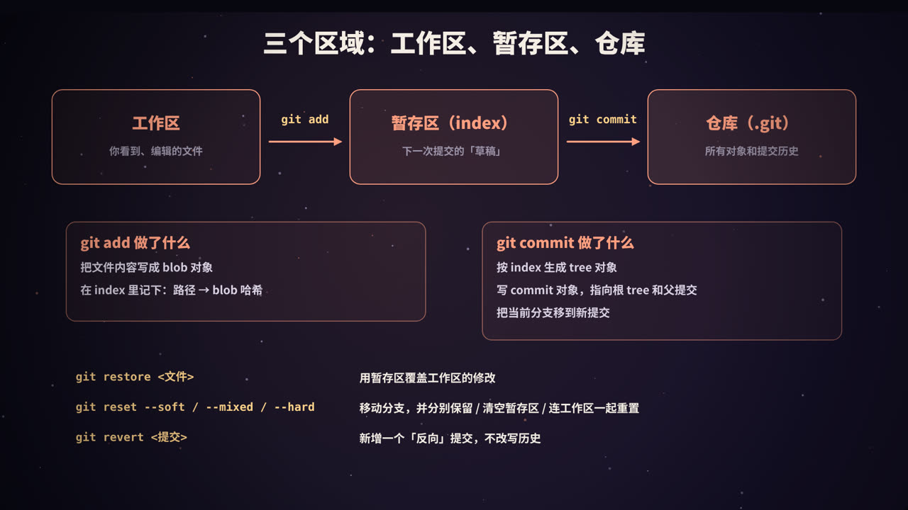
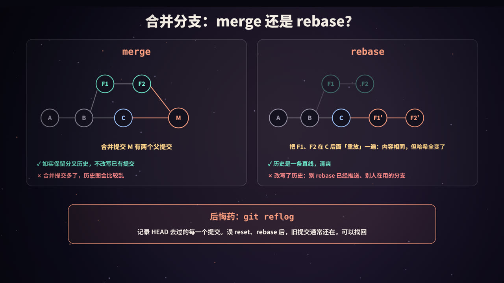

title: Git 原理：一个内容寻址的文件系统
subtitle: Git 存的是快照而不是差异，blob、tree、commit 三种对象与内容寻址，分支和 HEAD 只是指针，工作区、暂存区与仓库，merge、rebase、reset、revert 与 reflog，附一步步打开 .git 目录的实验和 Python 手动解析对象
tag: 计算机与后端
color: #ff9f80


## 每次 commit，Git 到底存了什么？

很多人对 Git 的印象是：每次提交，Git 记录下「改了哪几行」。这其实不对。Git 记录的是每个版本的**完整快照**，而且用了一种非常巧妙的方式，让快照几乎不占额外空间。

理解了 Git 的内部模型，很多原本「玄学」的操作都会变得清楚：为什么建分支几乎不花时间？为什么 rebase 之后提交的哈希全变了？`reset --hard` 之后真的找不回来了吗？

Git 的作者在早期的说明里这样描述它：Git 的核心是一个**内容寻址的文件系统**（content-addressable filesystem），版本控制的功能是在它上面搭建起来的。本文就从 `.git` 目录开始，一层层看下去。

## 内容寻址：用内容的哈希当名字



新建一个仓库，`.git` 目录里有这些东西：

```text
HEAD  branches  config  description  hooks  info  objects  refs
```

其中最核心的是两个：

- **`objects/`**：对象库，存放所有的文件内容、目录结构和提交；
- **`refs/`**：引用，也就是分支和标签，指向某个提交。

### 一个对象是怎么存进去的

以内容为 `hello` 的文件为例：

1. 取文件内容：`hello\n`（6 个字节）；
2. 在前面加上对象头「类型 + 空格 + 长度 + 空字节」：`blob 6\0hello\n`；
3. 对整段内容计算 **SHA-1** 哈希，得到 `ce013625030ba8dba906f756967f9e9ca394464a`；
4. 用 zlib 压缩后，存到 `.git/objects/ce/013625030ba8dba906f756967f9e9ca394464a`：哈希的前 2 位作为目录名，剩下 38 位作为文件名。

这就是**内容寻址**：对象的名字由内容唯一决定。带来的好处：

- **自动去重**：两个文件内容相同，哈希就相同，只存一份；
- **完整性校验**：内容只要被改动一个字节，哈希就完全不同，数据损坏或篡改立刻能发现；
- **不需要额外的索引**：知道哈希，就知道去哪个文件里找内容。

> SHA-1 已被证明可以人为构造碰撞。Git 采用了带碰撞检测的 SHA-1 实现，并且已经支持使用 **SHA-256** 的仓库格式（`git init --object-format=sha256`），整个生态正在逐步迁移。原理完全一样，只是哈希更长。

## 三种对象：blob、tree、commit



| 对象 | 代表 | 内容 |
|---|---|---|
| **blob** | 文件内容 | 只有文件的字节内容，**没有文件名** |
| **tree** | 目录 | 一条条记录：权限、类型、哈希、名字。可以指向 blob（文件）或另一个 tree（子目录） |
| **commit** | 一次提交 | 根目录的 tree、父提交（可能没有，也可能有多个）、作者、提交者、时间、提交说明 |
| tag | 附注标签 | 指向某个对象，并带有标签说明、签名等（轻量标签不会创建对象） |

一次提交，就是一棵由这些对象组成的树：commit 指向根 tree，根 tree 指向文件的 blob 和子目录的 tree，以此类推。

几个值得注意的点：

- **文件名存在 tree 里，不在 blob 里**。所以重命名一个文件，不会产生新的 blob，只有 tree 变了；
- **commit 的哈希由它的全部内容决定**，其中包括父提交的哈希。改动历史上任何一个提交，它之后所有提交的哈希都会跟着变。这和区块链的原理很像，也是 Git 历史难以被悄悄篡改的原因；
- 同样的内容、同样的作者和时间、同样的父提交，在任何机器上算出的提交哈希都一样。

## 动手：打开 .git 看一看

下面的脚本从零创建一个仓库，一步步观察对象库的变化。为了让结果可以复现，固定了提交时间，并关闭了提交签名：

```bash
export GIT_AUTHOR_DATE="2026-10-10T12:00:00+08:00" GIT_COMMITTER_DATE="2026-10-10T12:00:00+08:00"
G="git -c user.name=demo -c user.email=demo@example.com -c init.defaultBranch=main -c commit.gpgsign=false"

$G init -q demo && cd demo
echo "== 1. 空仓库的 .git 目录"
ls .git

echo "== 2. 计算一段内容的哈希（不写入）"
echo "hello" | git hash-object --stdin

echo "== 3. 创建文件并 add 之后，对象库里多了一个 blob"
echo "hello" > a.txt
$G add a.txt
find .git/objects -type f
git cat-file -t ce013625030ba8dba906f756967f9e9ca394464a
git cat-file -p ce013625030ba8dba906f756967f9e9ca394464a

echo "== 4. 再加一个内容相同的文件：不会多出新的 blob"
cp a.txt b.txt
$G add b.txt
find .git/objects -type f | wc -l
git ls-files --stage

echo "== 5. 第一次提交"
mkdir src && echo 'print("hi")' > src/main.py
$G add . && $G commit -q -m "first commit"
cat .git/HEAD
cat .git/refs/heads/main
git cat-file -p HEAD
echo "-- 根目录 tree:"
git cat-file -p 'HEAD^{tree}'
echo "-- src 子目录 tree:"
git cat-file -p HEAD:src

echo "== 6. 第二次提交：只改了 a.txt"
echo "hello git" > a.txt
$G commit -q -am "update a.txt"
git cat-file -p HEAD
echo "-- 新的根 tree:"
git cat-file -p 'HEAD^{tree}'

echo "== 7. 分支就是一个存着提交哈希的文件"
$G branch feature
cat .git/refs/heads/feature
$G switch -q feature
cat .git/HEAD

echo "== 8. 对象总数"
git count-objects -v | head -2
```

输出（Git 2.43）：

```text
== 1. 空仓库的 .git 目录
HEAD
branches
config
description
hooks
info
objects
refs
== 2. 计算一段内容的哈希（不写入）
ce013625030ba8dba906f756967f9e9ca394464a
== 3. 创建文件并 add 之后，对象库里多了一个 blob
.git/objects/ce/013625030ba8dba906f756967f9e9ca394464a
blob
hello
== 4. 再加一个内容相同的文件：不会多出新的 blob
1
100644 ce013625030ba8dba906f756967f9e9ca394464a 0	a.txt
100644 ce013625030ba8dba906f756967f9e9ca394464a 0	b.txt
== 5. 第一次提交
ref: refs/heads/main
a57e960e1d2b26ae97a9ed09c51917a83c6140c4
tree a5a7d839469dcdee79cdc2e5723631f633a99424
author demo <demo@example.com> 1791604800 +0800
committer demo <demo@example.com> 1791604800 +0800

first commit
-- 根目录 tree:
100644 blob ce013625030ba8dba906f756967f9e9ca394464a	a.txt
100644 blob ce013625030ba8dba906f756967f9e9ca394464a	b.txt
040000 tree 37a4b05693857e190d1ecbe45b4451bc36078274	src
-- src 子目录 tree:
100644 blob b80e3222ab264bd7cafb376749bd18814fd66776	main.py
== 6. 第二次提交：只改了 a.txt
tree 3ed6bb60bffc88e7a2c35e89fea8503c7e011703
parent a57e960e1d2b26ae97a9ed09c51917a83c6140c4
author demo <demo@example.com> 1791604800 +0800
committer demo <demo@example.com> 1791604800 +0800

update a.txt
-- 新的根 tree:
100644 blob 8d0e41234f24b6da002d962a26c2495ea16a425f	a.txt
100644 blob ce013625030ba8dba906f756967f9e9ca394464a	b.txt
040000 tree 37a4b05693857e190d1ecbe45b4451bc36078274	src
== 7. 分支就是一个存着提交哈希的文件
9443839ee2a02d7637f5b43ce39b8042bd7e163e
ref: refs/heads/feature
== 8. 对象总数
count: 8
size: 32
```

逐条解读：

- **第 2、3 步**：`hash-object` 算出的哈希就是对象文件的路径。`git add` 时就已经把内容写成了 blob，并不是等到 commit 才写；
- **第 4 步**：`a.txt` 和 `b.txt` 内容相同，指向同一个 blob，对象库里仍然只有 1 个文件；
- **第 5 步**：第一次提交没有 `parent` 行。根 tree 里两个文件指向同一个 blob，`src` 是一个子 tree；
- **第 6 步**：第二次提交有了 `parent`。新的根 tree 里，`a.txt` 指向新 blob `8d0e412`，而 `b.txt` 和 `src` 的哈希与上一次**完全相同**，直接复用；
- **第 7 步**：新建分支只是写了一个文件，内容是 41 个字节（40 位哈希加换行）；切换分支只是改了 `HEAD` 文件；
- **第 8 步**：两次提交一共 8 个对象：3 个 blob（hello、main.py、hello git）、3 个 tree（两个根目录和 src）、2 个 commit。

### 用 Python 验证：Git 对象没有魔法

```python
import hashlib, zlib, pathlib

repo = pathlib.Path("demo/.git")

# 1. 自己算 blob 的哈希：sha1("blob <字节数>\0" + 内容)
content = b"hello\n"
store = b"blob %d\0" % len(content) + content
print("自己算的哈希:", hashlib.sha1(store).hexdigest())

# 2. 读出 git 存的对象文件：前 2 位是目录名，后 38 位是文件名，内容用 zlib 压缩
oid = "ce013625030ba8dba906f756967f9e9ca394464a"
raw = zlib.decompress((repo / "objects" / oid[:2] / oid[2:]).read_bytes())
print("解压后的原始字节:", raw)
print("和自己拼的一致:", raw == store)

# 3. 读当前分支指向的提交对象
ref = (repo / "HEAD").read_text().split()[1]          # ref: refs/heads/feature
commit = (repo / ref).read_text().strip()
raw = zlib.decompress((repo / "objects" / commit[:2] / commit[2:]).read_bytes())
header, body = raw.split(b"\0", 1)
print("\n当前分支:", ref, "->", commit)
print("对象头:", header)
print(body.decode())
print("重新计算哈希:", hashlib.sha1(raw).hexdigest())

# 4. tree 对象是二进制格式：<模式> <文件名>\0<20 字节哈希>，一条接一条
tree = body.split()[1].decode()
raw = zlib.decompress((repo / "objects" / tree[:2] / tree[2:]).read_bytes())
data = raw.split(b"\0", 1)[1]
print("根 tree", tree[:7], "的条目:")
while data:
    meta, data = data.split(b"\0", 1)
    sha, data = data[:20].hex(), data[20:]
    mode, name = meta.decode().split(" ", 1)
    print(f"  {mode:>6} {sha}  {name}")
```

输出：

```text
自己算的哈希: ce013625030ba8dba906f756967f9e9ca394464a
解压后的原始字节: b'blob 6\x00hello\n'
和自己拼的一致: True

当前分支: refs/heads/feature -> 9443839ee2a02d7637f5b43ce39b8042bd7e163e
对象头: b'commit 207'
tree 3ed6bb60bffc88e7a2c35e89fea8503c7e011703
parent a57e960e1d2b26ae97a9ed09c51917a83c6140c4
author demo <demo@example.com> 1791604800 +0800
committer demo <demo@example.com> 1791604800 +0800

update a.txt

重新计算哈希: 9443839ee2a02d7637f5b43ce39b8042bd7e163e
根 tree 3ed6bb6 的条目:
  100644 8d0e41234f24b6da002d962a26c2495ea16a425f  a.txt
  100644 ce013625030ba8dba906f756967f9e9ca394464a  b.txt
   40000 37a4b05693857e190d1ecbe45b4451bc36078274  src
```

只用标准库的 `hashlib` 和 `zlib`，就能算出和 Git 完全一致的哈希，并读出提交和目录的内容。注意 tree 对象中目录的模式在二进制里写作 `40000`，`git cat-file -p` 显示时补成了 `040000`。

## 快照，而不是差异



从上面的实验可以看出：每个提交都指向一棵**完整的目录树**，是项目在那一刻的完整快照。但没有改动的文件和目录，新的 tree 直接指向已有的对象，所以每次提交真正新增的，只有「改动的文件 + 从它到根目录路径上的那些 tree + commit 本身」。

| | 存差异（如早期的 SVN、CVS 的思路） | 存快照（Git） |
|---|---|---|
| 查看某个历史版本 | 从基准版本开始依次应用差异 | 直接读那个提交的 tree |
| 比较两个版本 | 需要计算 | 对比两棵树，哈希相同的子树直接跳过，非常快 |
| 切换分支 | 较慢 | 按两棵树的差别更新工作区 |

那么，一个大文件改了一行，难道要再存一份完整的 blob？在松散对象（loose object）阶段确实如此。但 Git 会在合适的时候（比如 `git gc`、推送和拉取时）把对象打包成 **packfile**：把相似的对象放在一起，只存一个完整版本和其他版本的**增量**（delta），再整体压缩。所以，**差异压缩是存储层的优化，而不是 Git 的数据模型**。

## 分支和 HEAD：只是指针



- **分支**：`.git/refs/heads/<分支名>` 文件，内容是一个提交的哈希。提交时，当前分支自动指向新提交；
- **HEAD**：`.git/HEAD` 文件，通常的内容是 `ref: refs/heads/main`，表示「当前在 main 分支上」；
- **分离 HEAD**（detached HEAD）：`git switch --detach <提交>` 或 `git checkout <提交哈希>` 后，HEAD 直接存一个提交哈希，不在任何分支上。此时新建的提交没有分支指向它，切走之后容易「丢失」，需要的话要及时建一个分支；
- **标签**：`.git/refs/tags/<标签名>`，也指向一个提交（或附注标签对象），但不会随着新提交移动；
- **远程跟踪分支**：`refs/remotes/origin/main`，记录上次和远程同步时远程分支的位置，`git fetch` 会更新它。

> 引用多了以后，Git 可能会把它们合并存到 `.git/packed-refs` 文件中，所以有时在 `refs/heads/` 下找不到某个分支文件，这是正常的。

这就是 Git 分支「便宜」的原因：创建分支是写一个小文件，切换分支是改 HEAD 再更新工作区。相比之下，一些集中式版本控制系统的分支要复制整个目录。

## 三个区域：工作区、暂存区、仓库



| 区域 | 位置 | 内容 |
|---|---|---|
| **工作区** | 项目目录 | 你看到和编辑的文件 |
| **暂存区**（index） | `.git/index` 文件 | 下一次提交的「草稿」：每个路径对应哪个 blob |
| **仓库** | `.git/objects` 和 `.git/refs` | 所有对象和提交历史 |

- **`git add`**：把文件内容写成 blob，并在 index 中记录「路径 → blob 哈希」；
- **`git commit`**：按 index 生成 tree 对象，写 commit 对象，把当前分支移到新提交；
- **`git status`**：比较三者：工作区 vs index 是「未暂存的修改」，index vs HEAD 是「已暂存、待提交的修改」。

### 撤销操作分别动了哪里

| 命令 | 移动当前分支 | 暂存区 | 工作区 | 改写历史 |
|---|---|---|---|---|
| `git restore <文件>` | 否 | 不变 | 用暂存区覆盖 | 否 |
| `git restore --staged <文件>` | 否 | 用 HEAD 覆盖 | 不变 | 否 |
| `git reset --soft <提交>` | 是 | 不变 | 不变 | 是 |
| `git reset --mixed <提交>`（默认） | 是 | 重置 | 不变 | 是 |
| `git reset --hard <提交>` | 是 | 重置 | **重置，未提交的修改会丢失** | 是 |
| `git revert <提交>` | 新增一个反向提交 | — | — | 否 |

经验：**在自己的本地分支上，可以随意 reset；对已经推送、别人也在用的分支，用 revert**。

> `git checkout` 历史上身兼数职（切换分支、恢复文件），容易误用。Git 2.23 起引入了 `git switch`（切换分支）和 `git restore`（恢复文件），把这两件事分开。

## merge、rebase 与 reflog



### 实验：同一段历史，分别 merge 和 rebase

```bash
export GIT_AUTHOR_DATE="2026-10-10T12:00:00+08:00" GIT_COMMITTER_DATE="2026-10-10T12:00:00+08:00"
G="git -c user.name=demo -c user.email=demo@example.com -c init.defaultBranch=main -c commit.gpgsign=false"
rm -rf br && $G init -q br && cd br
c() { echo "$1" > "$1.txt"; $G add "$1.txt"; $G commit -q -m "$1"; }

c A; c B
$G switch -q -c feature; c F1; c F2
$G switch -q main; c C
echo "== 分叉后的历史"
git log --oneline --graph --all

echo "== merge：产生一个有两个父提交的合并提交"
$G merge -q --no-edit feature
git log --oneline --graph
git cat-file -p HEAD | grep -E "^(tree|parent)"

echo "== 撤销合并，改用 rebase"
$G reset -q --hard HEAD~1
F2_OLD=$(git rev-parse feature)
$G switch -q feature
$G rebase -q main
git log --oneline --graph
echo "F2 rebase 前: ${F2_OLD:0:7}  rebase 后: $(git rev-parse --short HEAD)"
echo "旧的 F2 提交还在吗: $(git cat-file -t $F2_OLD)"

echo "== 误操作：reset 丢掉了两个提交"
$G reset -q --hard HEAD~2
git log --oneline
echo "-- reflog 记得 HEAD 去过哪里:"
git reflog -5
$G reset -q --hard HEAD@{1}
echo "-- 找回之后:"
git log --oneline
```

输出：

```text
== 分叉后的历史
* 62618b5 F2
* a5253f1 F1
| * 778d4a7 C
|/  
* 0b41d81 B
* b05116e A
== merge：产生一个有两个父提交的合并提交
*   9213000 Merge branch 'feature'
|\  
| * 62618b5 F2
| * a5253f1 F1
* | 778d4a7 C
|/  
* 0b41d81 B
* b05116e A
tree 93b4e665af7efd60ca7d235ba1abe1badd172af5
parent 778d4a7b8527756c66dfc032423b2937ff37adc2
parent 62618b5059764c1888da48795c7b70715ddf8c59
== 撤销合并，改用 rebase
* 11b8024 F2
* 1aa95c3 F1
* 778d4a7 C
* 0b41d81 B
* b05116e A
F2 rebase 前: 62618b5  rebase 后: 11b8024
旧的 F2 提交还在吗: commit
== 误操作：reset 丢掉了两个提交
778d4a7 C
0b41d81 B
b05116e A
-- reflog 记得 HEAD 去过哪里:
778d4a7 HEAD@{0}: reset: moving to HEAD~2
11b8024 HEAD@{1}: rebase (finish): returning to refs/heads/feature
11b8024 HEAD@{2}: rebase (pick): F2
1aa95c3 HEAD@{3}: rebase (pick): F1
778d4a7 HEAD@{4}: rebase (start): checkout main
-- 找回之后:
11b8024 F2
1aa95c3 F1
778d4a7 C
0b41d81 B
b05116e A
```

### merge

`git merge feature` 做的是**三方合并**：找到两个分支的**共同祖先**（这里是 B），分别比较「B → C」和「B → F2」的改动，把两边的改动合到一起。如果两边改了同一个文件的同一处，就产生冲突，需要手动解决。

合并的结果是一个**合并提交**，它有**两个 parent**（实验中可以看到两行 `parent`）。如果当前分支是目标分支的祖先（没有分叉），Git 默认直接把分支指针往前移，这叫**快进合并**（fast-forward），不产生合并提交。

### rebase

`git rebase main` 做的是：找出 feature 上有、main 上没有的提交（F1、F2），把它们的改动**依次在 main 的最新提交后面重新应用一遍**，生成新的提交 F1'、F2'，再把 feature 分支指向 F2'。

实验中，F2 的哈希从 `62618b5` 变成了 `11b8024`：提交说明和改动都一样，但 **parent 变了**，所以哈希一定会变。rebase 并没有「移动」提交，而是**创建了新的提交**，旧提交仍然留在对象库中（实验中 `cat-file -t` 依然能查到它）。

| | merge | rebase |
|---|---|---|
| 历史 | 保留真实的分叉与合并 | 一条直线 |
| 已有提交 | 不变 | 生成新提交，原提交被替换 |
| 冲突 | 一次性解决 | 可能每重放一个提交就要解决一次 |
| 适合 | 合并公共分支、保留完整记录 | 整理自己本地、尚未分享的提交 |

**黄金法则：不要对已经推送、别人在其上工作的分支执行 rebase**。否则别人手里的旧提交和你的新提交是两套历史，再合并时会出现重复提交和大量冲突。如果确实需要强制推送自己的分支，使用 `git push --force-with-lease`，它会在远程分支被别人更新过时拒绝推送，比 `--force` 安全。

`git rebase -i`（交互式变基）还能合并、拆分、修改、重排提交，常用于提交 PR 之前整理历史。`git cherry-pick` 则是把指定的某个提交「重放」到当前分支，原理和 rebase 相同。

### reflog：后悔药

**reflog** 记录了 HEAD 和每个分支在本地**指向过的每一个提交**。只要提交曾经被 HEAD 指向过，即使后来被 reset、rebase 丢掉了，也能从 reflog 里找到它的哈希，再用 `git reset --hard <哈希>` 或 `git branch <新分支> <哈希>` 恢复。

几个限制：

- reflog 只在**本地**，不会推送到远程；
- 记录会过期，默认保留 90 天（不可达的提交为 30 天），之后在 `git gc` 时被清理；
- **从未提交过的修改**（只存在于工作区）被 `reset --hard` 清掉后，Git 帮不了你。如果已经 `git add` 过，blob 还在对象库里，可以用 `git fsck --lost-found` 碰碰运气。

所以在 Git 里，**一旦提交，就很难真正丢失**。

## 常用命令背后的对象操作

| 命令 | 背后发生了什么 |
|---|---|
| `git add` | 写 blob，更新 index |
| `git commit` | 写 tree 和 commit，移动当前分支 |
| `git branch x` | 新建 `refs/heads/x`，写入当前提交的哈希 |
| `git switch x` | 改 HEAD，按目标提交的 tree 更新 index 和工作区 |
| `git merge` | 三方合并，写合并提交（或快进） |
| `git rebase` | 逐个重放提交，生成新提交，移动分支 |
| `git fetch` | 下载对方有、自己没有的对象，更新远程跟踪分支 |
| `git pull` | `fetch` + `merge`（或配置为 `rebase`） |
| `git push` | 上传对象，请求远程更新分支指针 |
| `git gc` | 打包对象、清理过期的不可达对象 |

`fetch` 和 `push` 时，双方先交换「我有哪些提交」，再只传输对方缺少的对象，打包成 packfile 发送。这也是内容寻址的好处：用哈希就能判断对方有没有某个对象。

## 高频面试题速答

**Q：Git 存储的是差异还是快照？**
快照。每个提交指向一棵完整的目录树，未改动的文件和目录复用已有对象。打包时的增量压缩只是存储优化。

**Q：Git 有哪几种对象？**
blob（文件内容）、tree（目录）、commit（提交）、tag（附注标签）。对象用内容的 SHA-1（或 SHA-256）哈希命名。

**Q：分支是什么？为什么创建分支很快？**
分支是 `refs/heads/` 下的一个文件，内容是一个提交的哈希。创建分支只是写一个几十字节的文件。

**Q：merge 和 rebase 有什么区别？**
merge 通过三方合并生成一个有两个父提交的合并提交，保留分叉历史；rebase 把提交重放到目标分支之后，生成新提交，历史变成直线，但会改写历史。不要 rebase 已经推送的公共分支。

**Q：reset 和 revert 有什么区别？**
reset 移动分支指针，可以丢弃后面的提交，会改写历史；revert 新增一个撤销指定提交改动的提交，不改写历史，适合已推送的分支。

**Q：误用 reset --hard 之后还能恢复吗？**
已经提交过的内容可以通过 `git reflog` 找到提交哈希后恢复；从未提交、也从未 add 过的修改无法恢复。

## 总结


- Git 的核心是**内容寻址的文件系统**：对象以内容的哈希命名，自动去重、自带校验；
- **blob** 存文件内容，**tree** 存目录，**commit** 存快照的根 tree、父提交和元信息；
- 每次提交都是**完整快照**，没变的部分直接复用对象，packfile 再做增量压缩；
- **分支和 HEAD 都只是指针**，所以分支又快又便宜；
- **工作区 → 暂存区 → 仓库**：add 写 blob、更新 index，commit 写 tree 和 commit；
- **merge** 保留历史，**rebase** 改写历史；提交过的内容几乎不会丢，**reflog** 是后悔药。

<div class="refs" markdown="1">

### 参考资料

- Pro Git（第 2 版），第 10 章 Git Internals：Git Objects、Git References、Packfiles. git-scm.com/book
- Git 官方文档：git-hash-object、git-cat-file、git-rebase、git-reflog、git-reset、gitglossary.
- Git 官方文档：hash-function-transition（SHA-1 向 SHA-256 迁移的设计）.
- Git 源码仓库中的 README（早期版本对「内容寻址文件系统」的描述）.
- Git 2.23 Release Notes（引入 git switch 与 git restore）.

</div>
