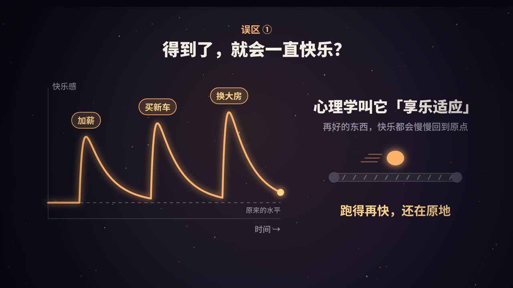

title: 幸福的科学：你可能一直追错了方向
subtitle: 享乐适应、哈佛 80 多年的追踪研究、心流——心理学研究告诉我们，幸福从哪里来，又不在哪里
tag: 心理学 · 人生
color: #ffb36b

[TOC]

## 一个反直觉的开头：越追，越远

几乎每个人都想过得更幸福。可心理学家发现了一个有点扎心的现象：**把「我要幸福」看得特别重的人，反而常常没那么幸福。**

2011 年，心理学家艾瑞斯·莫斯（Iris Mauss）和同事发表了一组研究，题目就叫《追求幸福会让人不幸福吗？》。他们先用问卷测量人们有多「看重幸福」，发现在生活压力不大的时候，越看重幸福的人，幸福感和心理健康反而越差。接着他们做了实验：让一部分人先读一篇强调「幸福很重要」的文章，再看一段开心的短片。结果这些人看完以后，比对照组更不开心。

研究者的解释是：当你把幸福当成一个必须达成的指标，就会不停地检查「我现在够不够快乐」。一旦现实没达到预期，失望感就来了。快乐本来是件自然发生的事，被你盯着看，它就跑了。

> 这并不是说「别追求幸福」，而是提醒我们：**追的方向和方式，比追的力度更重要。**

下面这三个发现，正好回答了「方向」的问题。

## 误区一：得到了，就会一直快乐？

### 彩票中奖者，真的更幸福吗？

1978 年有一项很有名的研究。心理学家布里克曼（Philip Brickman）等人访问了三组人：刚中了大额彩票的人、因事故导致瘫痪的人，以及普通人。

结果令人意外：中奖者并没有比普通人幸福多少，而且他们从日常小事中获得的乐趣（比如和朋友聊天、听到一个笑话）反而变少了。瘫痪的受访者幸福感确实低一些，但远没有人们想象的那样低。

### 什么是「享乐适应」

心理学把这种现象叫做**享乐适应**（hedonic adaptation），也常被形象地称为「享乐跑步机」：

- 加薪、买车、换大房，在得到的那一刻，快乐会明显冲高；
- 但几周到几个月后，新的东西变成了「理所当然」，快乐慢慢回落到原来的水平；
- 于是你开始盯着下一个目标，跑得越来越快，却总在原地。

适应发生的原因大致有三个：

1. **新鲜感消退**：大脑对持续存在的刺激会逐渐「调低音量」。
2. **期待上涨**：住进大房子后，你衡量「好」的标准也跟着变高了。
3. **比较对象变了**：收入提高后，你身边比较的人也换成了收入更高的人。

### 需要补充的一点：基线不是完全固定的

后来的长期追踪研究发现，「快乐总会回到原点」并不是绝对的。心理学家迪纳（Ed Diener）等人在 2006 年总结指出：失业、丧偶、严重残疾这类重大负面事件，可能让幸福感长期偏低；而一些积极的改变，比如建立稳定的亲密关系、持续练习某些习惯，也能让幸福感稳定地提高一点。

所以更准确的说法是：**物质上的获得，适应得特别快；而关系和习惯带来的改变，更持久。**

### 怎么对抗享乐适应

| 方法 | 为什么有用 |
|---|---|
| 把钱花在体验上，而不只是物品 | 体验会变成回忆和故事，适应得更慢 |
| 刻意制造变化 | 同样是周末出门，换一条路线、换一种玩法 |
| 学会「品味」 | 吃饭时专心吃，散步时注意风景，把快乐拉长 |
| 定期感恩 | 主动提醒自己「已经拥有的」，抵消「理所当然」 |

## 关键发现：哈佛追踪了一群人 80 多年

### 史上最长的人生研究之一

**哈佛成人发展研究**（Harvard Study of Adult Development）始于 1938 年，是心理学史上持续时间最长的追踪研究之一。它最初包含两组人：

- **格兰特研究**：268 名哈佛大学二年级男生；
- **格鲁克研究**：456 名来自波士顿贫困街区的少年。

研究者每隔几年就给他们寄问卷、做访谈、查看病历、做体检，甚至和他们的家人交谈。几十年后，研究又扩展到了他们的妻子和子女。研究先后由多位负责人主持，现任负责人是精神科医生罗伯特·瓦尔丁格（Robert Waldinger）。

### 他们发现了什么

在追踪了这些人几十年的一生之后，研究最响亮的结论是：

> **良好的人际关系，是让人保持幸福和健康最重要的因素之一。**

具体来说：

1. **关系的质量比数量更重要。** 不是朋友越多越好，而是身边有没有可以信任、可以依靠的人。
2. **关系影响身体健康。** 研究者回看数据发现，50 岁时对人际关系最满意的人，到了 80 岁往往也是最健康的。
3. **孤独是有害的。** 越孤立的人，越不快乐，健康状况也更早走下坡路，大脑功能下降得也更早。
4. **好的关系能保护大脑。** 晚年处在安全、可依靠关系中的人，记忆力保持得更好。

相比之下，财富、名气、年轻时的成就，并不能像关系那样，可靠地预测一个人晚年是否幸福。

### 要注意的地方

这是一项观察性研究，它能告诉我们「关系好的人往往更幸福、更健康」，但不能百分之百证明是关系「导致」了这一切。健康的人也可能更容易维持好关系。不过，大量其他研究（包括关于孤独和健康的研究）都指向同一个方向：**投资在关系上，几乎是一件稳赚不赔的事。**

## 误区二：幸福是一个要去追的终点？

### 心流是什么

心理学家米哈里·契克森米哈伊（Mihaly Csikszentmihalyi）研究了大量画家、棋手、攀岩者、外科医生，以及普通工人。他发现，人们在描述自己最好的时刻时，经常说到同一种状态：

- 全神贯注，忘了时间；
- 忘了自己，甚至忘了饿；
- 做的事情本身就是奖励，不需要外在的理由。

他把这种状态称为**心流**（flow）。

### 心流什么时候出现

视频里那张「挑战 × 技能」坐标图，就是理解心流的钥匙：

- **挑战远高于技能**：你会焦虑，比如刚学开车就上高速；
- **技能远高于挑战**：你会无聊，比如让大厨每天只煮泡面；
- **两者匹配，而且都在一个较高水平**：心流最容易出现。

除此之外，心流通常还需要：**清晰的目标**（知道自己要做什么）和**即时的反馈**（知道自己做得好不好）。这也是为什么打游戏、运动、写代码、演奏乐器特别容易让人进入心流。

### 为什么说幸福是「副产品」

契克森米哈伊用一种叫「经验取样」的方法做研究：给受试者发一个呼叫器，一天内随机响几次，每次响起时，让他们记录自己正在做什么、感觉怎样。

一个有意思的发现是：很多人在工作中体验到心流的次数，比在休闲时更多；可是在被问到时，他们却说自己更想休息。我们以为的快乐（躺着、什么都不做），和真正让我们感到充实的东西，并不总是一致。

心流本身在发生的时候，你甚至来不及感到「幸福」，因为你太投入了。但事后回想，那往往是最满足的时光。这就是为什么说**幸福更像一个副产品**：它常常在你专心做一件值得做的事时，悄悄发生。

## 今晚就能做的 3 件事

把上面的研究落到行动上，可以从这三件事开始：

1. **联系一个人。** 给一个很久没聊的朋友发条消息，不用找理由，问一句「最近怎么样」就够了。这是在给你的「关系账户」存钱。
2. **写下一件好事。** 睡前写下今天值得感谢的一件小事，以及它为什么会发生。这个练习能对抗享乐适应，让你重新看见「已经拥有的」。
3. **做一件让你忘记时间的事。** 画画、跑步、做饭、写代码、拼乐高都可以。找到那种挑战刚好、能让你投入的事，并给它留出不被打扰的时间。

## 常见问题

### 钱到底能不能买来幸福？

这是一个被研究了很多年的问题。2010 年，诺贝尔经济学奖得主卡尼曼（Daniel Kahneman）和迪顿（Angus Deaton）的研究发现，日常情绪上的幸福感会随收入增加而提高，但超过一定收入后就趋于平稳。2021 年，另一位研究者基林斯沃思（Matthew Killingsworth）用更大的数据发现，幸福感在高收入段仍在上升。

后来，双方合作做了一次「对抗性合作」研究（2023 年），得出了一个兼顾两边的结论：**对大多数人来说，收入越高，幸福感确实越高；但对于最不快乐的那一小部分人，收入超过某个水平后，带来的帮助就很有限了**，因为他们的痛苦往往来自钱解决不了的问题。

简单说：钱能解决很多烦恼，但它不是幸福的全部。

### 性格内向，是不是就很难幸福？

不是。哈佛研究强调的是关系的「质量」，而不是社交的「数量」。内向的人完全可以拥有少而深的关系。心流也不需要社交，很多人在独自专注的时候最容易进入心流。

### 「幸福」是一种可以练习的能力吗？

在一定程度上是的。研究普遍认为，一个人的幸福感有一部分受基因和性格影响，有一部分受生活环境影响，还有相当一部分取决于你日常的想法和行动。我们没法改变基因，但可以改变自己花时间的方式。

## 总结

- **别只盯着「得到」**：物质带来的快乐会被享乐适应吞掉。
- **把时间投进关系**：哈佛 80 多年的研究表明，关系的质量是幸福和健康最可靠的预测因素之一。
- **找到让你投入的事**：在心流里，幸福会作为副产品出现。

幸福不是一个要冲过去的终点线，而是你和世界、和他人连接的方式。

### 参考资料

- Mauss, I. B., Tamir, M., Anderson, C. L., & Savino, N. S. (2011). Can seeking happiness make people unhappy? Paradoxical effects of valuing happiness. *Emotion*.
- Brickman, P., Coates, D., & Janoff-Bulman, R. (1978). Lottery winners and accident victims: Is happiness relative? *Journal of Personality and Social Psychology*.
- Diener, E., Lucas, R. E., & Scollon, C. N. (2006). Beyond the hedonic treadmill: Revising the adaptation theory of well-being. *American Psychologist*.
- Waldinger, R., & Schulz, M. (2023). *The Good Life: Lessons from the World's Longest Scientific Study of Happiness*.
- Csikszentmihalyi, M. (1990). *Flow: The Psychology of Optimal Experience*.
- Csikszentmihalyi, M., & LeFevre, J. (1989). Optimal experience in work and leisure. *Journal of Personality and Social Psychology*.
- Killingsworth, M. A., Kahneman, D., & Mellers, B. (2023). Income and emotional well-being: A conflict resolved. *PNAS*.

