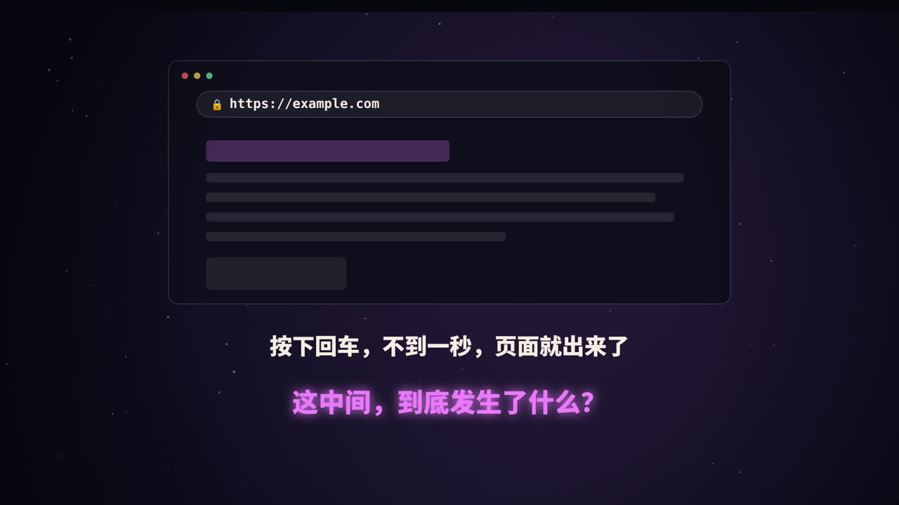
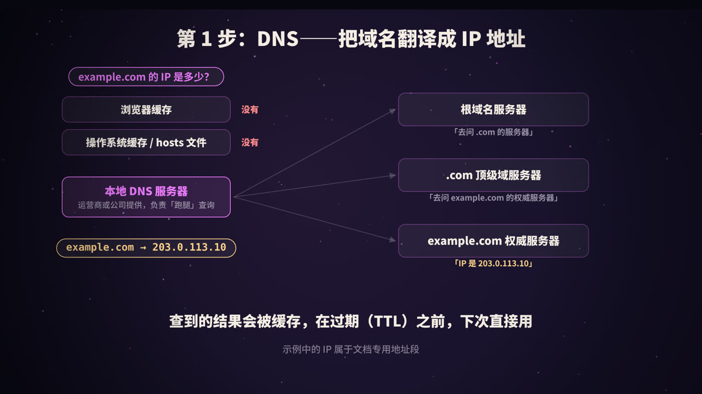
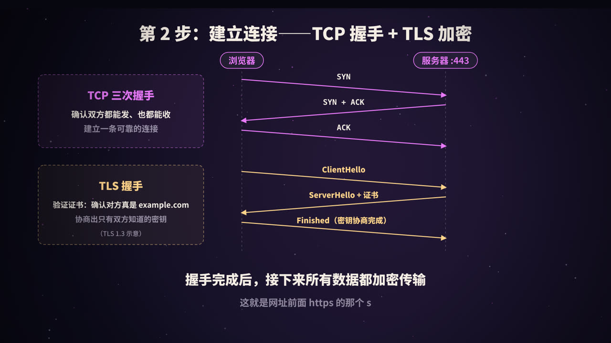
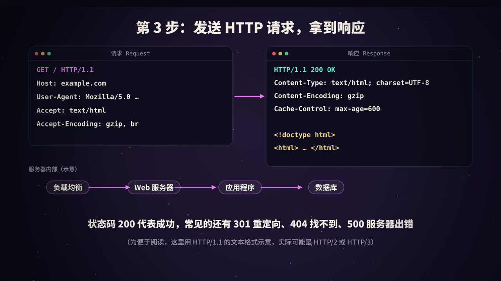
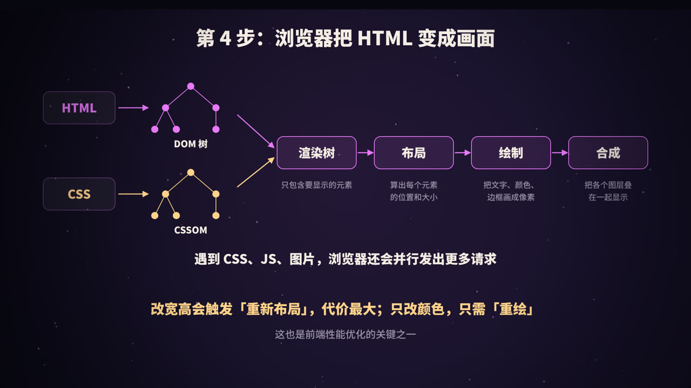
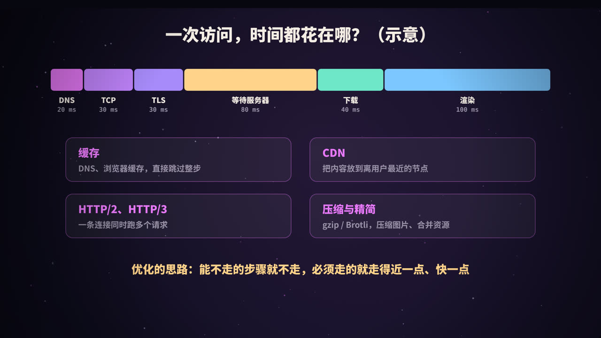
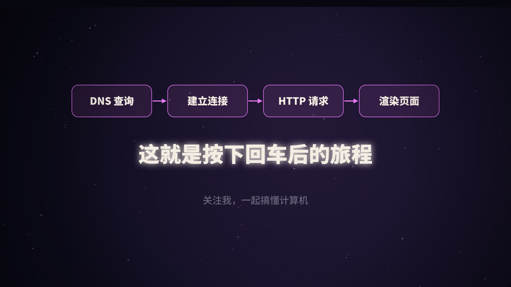

title: 按下回车后发生了什么：一次 HTTP 请求的一生
subtitle: DNS 解析、TCP 与 TLS 握手、HTTP 请求与响应、浏览器渲染，再到每一步的性能优化，一次讲完这道经典面试题
tag: 计算机与后端
color: #e879f9



## 一道经典的面试题

「在浏览器地址栏输入网址并按下回车后，发生了什么？」这道题几乎是计算机方向面试的必考题，因为它能串起网络、操作系统、服务端和前端的大量知识。

按时间顺序，整个过程可以分成四大步：

| 步骤 | 做什么 | 主要涉及 |
|---|---|---|
| 1. DNS 解析 | 把域名翻译成 IP 地址 | DNS 协议、各级缓存 |
| 2. 建立连接 | 和服务器建立可靠、加密的通道 | TCP、TLS |
| 3. 请求与响应 | 发送 HTTP 请求，拿到 HTML | HTTP 协议、服务端架构 |
| 4. 渲染页面 | 把 HTML、CSS、JS 变成屏幕上的像素 | 浏览器渲染引擎 |

在这之前，浏览器还会先做一点准备工作：判断你输入的是网址还是搜索词；如果没写协议，就补上；如果这个网站之前声明过只允许 HTTPS 访问（HSTS），浏览器会直接改用 HTTPS。

## 第 1 步：DNS——把域名翻译成 IP



网络中的设备靠 **IP 地址**互相找到对方，而 `example.com` 这样的**域名**是为了方便人记忆。DNS（Domain Name System，域名系统）就是互联网的「电话簿」。

### 先查缓存

为了快，查询会先在各级缓存里找：

1. **浏览器缓存**：最近访问过的域名；
2. **操作系统缓存**和 **hosts 文件**；
3. 以上都没有，才会去问**本地 DNS 服务器**（通常由运营商、公司网络或你手动设置的公共 DNS 提供）。

### 逐级查询

如果本地 DNS 服务器也没有缓存，它会替你跑一趟腿，从顶层开始逐级询问：

1. 问**根域名服务器**：`example.com` 在哪？根服务器说：我不知道，但你可以去问负责 `.com` 的服务器；
2. 问 **.com 顶级域服务器**：它说：去问 `example.com` 的权威服务器；
3. 问 **example.com 的权威服务器**：它给出最终答案，比如 `203.0.113.10`。

本地 DNS 服务器拿到结果后返回给你，并把结果缓存起来。

> 你问本地 DNS 服务器，它一次给你最终答案，这叫**递归查询**；本地 DNS 服务器向根、顶级域、权威服务器一级级地问，每次只得到「下一步去问谁」，这叫**迭代查询**。

### 几个常见概念

| 概念 | 说明 |
|---|---|
| A 记录 | 域名 → IPv4 地址 |
| AAAA 记录 | 域名 → IPv6 地址 |
| CNAME 记录 | 域名 → 另一个域名（别名），CDN 常用 |
| TTL | 记录可以被缓存多久，单位是秒 |

可以用 `dig` 命令亲自看看解析结果：

```bash
dig example.com A +short
```

> 本文和视频中的 IP `203.0.113.10` 属于专门用于文档示例的地址段，不对应真实网站。

## 第 2 步：建立连接——TCP 握手与 TLS 加密



### TCP 三次握手

拿到 IP 后，浏览器要和服务器的 443 端口（HTTPS 默认端口）建立 TCP 连接。TCP 提供**可靠传输**：数据不丢、不乱序、不重复。建立连接前，双方先交换三次消息：

1. 浏览器 → 服务器：`SYN`（我想建立连接）；
2. 服务器 → 浏览器：`SYN + ACK`（收到了，我也想建立连接）；
3. 浏览器 → 服务器：`ACK`（收到你的了）。

三次之后，双方都确认了「我能发、你能收；你能发、我能收」。为什么不能是两次？这个问题在本系列的《TCP 三次握手》里会详细展开。

### TLS 握手

HTTPS 就是在 TCP 之上，再加一层 **TLS** 加密。TLS 握手主要完成两件事：

1. **验证身份**：服务器出示**证书**，证书由受信任的证书颁发机构（CA）签发。浏览器会检查证书是否在有效期内、域名是否匹配、签名链能否追溯到系统信任的根证书。这一步防止你连上了冒充的网站。
2. **协商密钥**：双方通过密钥交换算法（如 ECDHE），在不安全的网络上协商出一个**只有双方知道**的会话密钥。之后的所有数据都用它加密。

TLS 1.3 把握手精简到了一个往返（1-RTT）；对于之前访问过的网站，还能借助会话恢复进一步减少延迟。

## 第 3 步：发送 HTTP 请求，拿到响应



### 请求长什么样

为了方便阅读，这里用 HTTP/1.1 的文本形式展示（HTTP/2 和 HTTP/3 在线路上是二进制格式，但语义是一样的）：

```http
GET / HTTP/1.1
Host: example.com
User-Agent: Mozilla/5.0 …
Accept: text/html
Accept-Encoding: gzip, br
```

- 第一行是**请求行**：方法 `GET`、路径 `/`、协议版本；
- 后面是**请求头**：告诉服务器要访问哪个网站、浏览器是谁、能接受什么格式和压缩方式；
- `POST` 等请求还会有**请求体**，比如提交的表单数据。

### 响应长什么样

```http
HTTP/1.1 200 OK
Content-Type: text/html; charset=UTF-8
Content-Encoding: gzip
Cache-Control: max-age=600

<!doctype html>
<html> … </html>
```

- 第一行是**状态行**，`200 OK` 表示成功；
- **响应头**说明内容类型、压缩方式、缓存策略等；
- 空行之后是**响应体**，也就是 HTML 正文。

### 常见的请求方法

| 方法 | 用途 |
|---|---|
| GET | 获取资源 |
| POST | 提交数据，创建资源 |
| PUT / PATCH | 整体 / 部分更新资源 |
| DELETE | 删除资源 |

### 常见的状态码

| 状态码 | 含义 |
|---|---|
| 200 | 成功 |
| 301 / 302 | 永久 / 临时重定向 |
| 304 | 资源没变，用你的缓存就行 |
| 400 | 请求有误 |
| 401 / 403 | 未登录 / 没有权限 |
| 404 | 找不到资源 |
| 500 | 服务器内部错误 |
| 502 / 504 | 网关收到无效响应 / 网关等待上游超时 |

### 服务器那边发生了什么

请求到达后，大型网站的内部通常还要经过好几层：

1. **负载均衡**：把请求分发到多台服务器中的一台；
2. **Web 服务器 / 反向代理**（如 Nginx）：处理 HTTPS、静态文件、转发动态请求；
3. **应用程序**：执行业务逻辑；
4. **缓存和数据库**：读取数据，优先查缓存（如 Redis），没有再查数据库。

最后，应用程序生成 HTML，原路返回给浏览器。

### HTTP 的几个版本

| 版本 | 特点 |
|---|---|
| HTTP/1.1 | 文本协议；支持长连接复用，但同一连接上的请求基本只能一个接一个处理 |
| HTTP/2 | 二进制分帧，**多路复用**：一条连接上同时跑多个请求；头部压缩 |
| HTTP/3 | 基于 **QUIC**（运行在 UDP 上），连接建立更快，丢包时不会阻塞其他请求 |

## 第 4 步：浏览器把 HTML 变成画面



拿到 HTML 后，浏览器的渲染引擎开始工作：

1. **解析 HTML，构建 DOM 树**：把标签变成一棵树形结构；
2. **解析 CSS，构建 CSSOM**：样式规则也组织成树；
3. **合成渲染树**：只保留需要显示的元素（`display: none` 的元素不在其中），并算出每个元素的最终样式；
4. **布局（Layout）**：计算每个元素在页面上的位置和大小；
5. **绘制（Paint）**：把文字、颜色、边框、阴影等画成像素；
6. **合成（Composite）**：把页面分成的多个图层按顺序叠在一起，显示到屏幕上。

### 更多的请求

解析 HTML 的过程中，遇到 `<link>`、`<script>`、`` 等标签，浏览器会**并行**发出更多请求去下载 CSS、JavaScript 和图片。

需要特别注意的是 JavaScript：普通的 `<script>` 会**阻塞** HTML 的解析，因为脚本可能修改 DOM。所以：

- 用 `defer`：脚本并行下载，等 HTML 解析完再按顺序执行；
- 用 `async`：脚本并行下载，下载完立刻执行，不保证顺序；
- 或者把脚本放在 `<body>` 末尾。

### 重排与重绘

页面加载完以后，JavaScript 修改了样式：

- 改变**几何属性**（宽、高、位置），需要重新**布局**，这叫**重排**（reflow），代价最高；
- 只改变**外观**（颜色、背景），跳过布局，只需重新**绘制**，叫**重绘**（repaint）；
- 只改 `transform` 和 `opacity`，通常连绘制都能跳过，直接在合成阶段处理，最适合做动画。

## 时间都花在哪：从每一步找优化空间



打开浏览器开发者工具的 **Network（网络）** 面板，点开任意一个请求的 **Timing**，就能看到 DNS、连接、TLS、等待服务器响应（TTFB）、下载各花了多少时间。

对应每一步，都有经典的优化手段：

| 环节 | 优化手段 |
|---|---|
| DNS | DNS 缓存；`<link rel="dns-prefetch">` 提前解析 |
| 连接 | 连接复用；`<link rel="preconnect">` 提前建立连接；TLS 1.3、会话恢复 |
| 距离 | CDN，把静态内容放到离用户最近的节点 |
| 服务器 | 缓存热点数据、优化慢查询，降低 TTFB |
| 传输 | gzip / Brotli 压缩；图片用 WebP、AVIF 等现代格式；HTTP/2、HTTP/3 |
| 缓存 | 合理设置 `Cache-Control`、`ETag`，让重复访问几乎不走网络 |
| 渲染 | 关键 CSS 内联；脚本 `defer`；减少重排；图片懒加载 |

衡量用户体验时，常用的指标包括 **TTFB**（首字节时间）、**FCP**（首次内容绘制）和 **LCP**（最大内容绘制）等。

## 用 curl 亲眼看看

`curl -v` 会把整个过程打印出来，包括 DNS 解析出的 IP、TLS 握手、请求头和响应头：

```bash
curl -v https://example.com -o /dev/null
```

以 `>` 开头的是发出的请求头，以 `<` 开头的是收到的响应头。

## 总结



- **DNS**：域名 → IP，层层缓存，逐级查询；
- **TCP + TLS**：三次握手建立可靠连接，TLS 验证证书、协商密钥，保证安全；
- **HTTP**：请求行、头、体；响应的状态码和头部决定了浏览器下一步怎么做；
- **渲染**：DOM + CSSOM → 渲染树 → 布局 → 绘制 → 合成；
- **优化**：能不走的步骤就不走（缓存），必须走的走得近一点（CDN）、快一点（压缩、新协议）。

<div class="refs" markdown="1">

### 参考资料

- RFC 1034 / 1035：Domain Names.
- RFC 9293：Transmission Control Protocol (TCP).
- RFC 8446：The Transport Layer Security (TLS) Protocol Version 1.3.
- RFC 9110：HTTP Semantics；RFC 9113：HTTP/2；RFC 9114：HTTP/3.
- RFC 5737：IPv4 Address Blocks Reserved for Documentation.
- MDN Web Docs：How browsers work；Critical rendering path.

</div>
