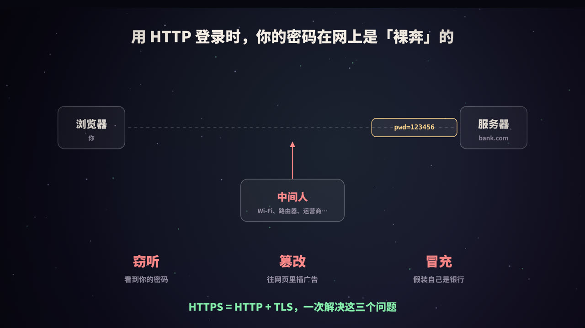
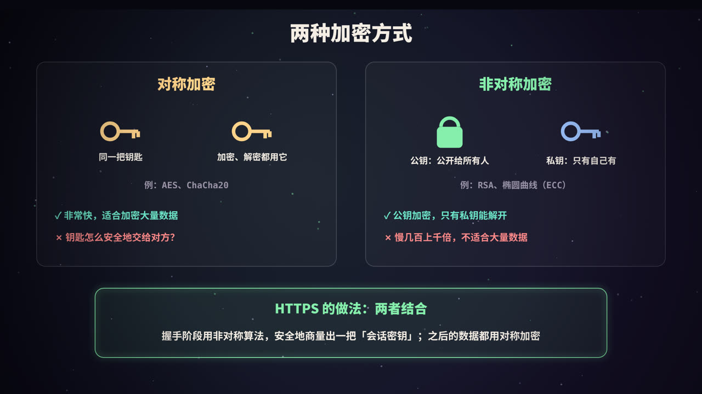
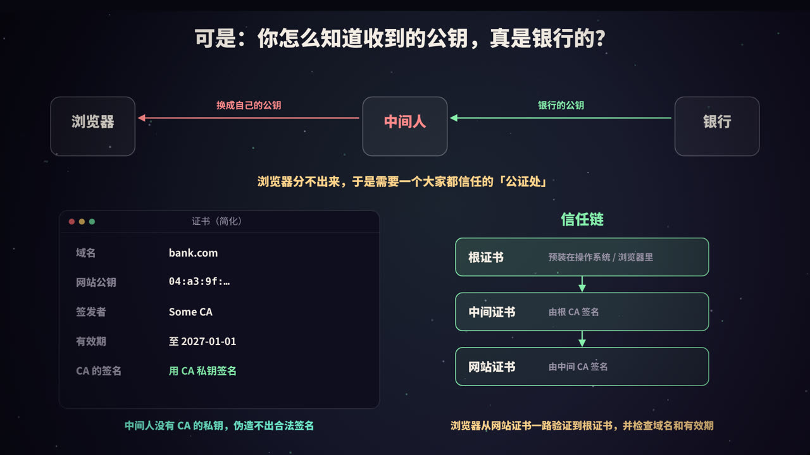
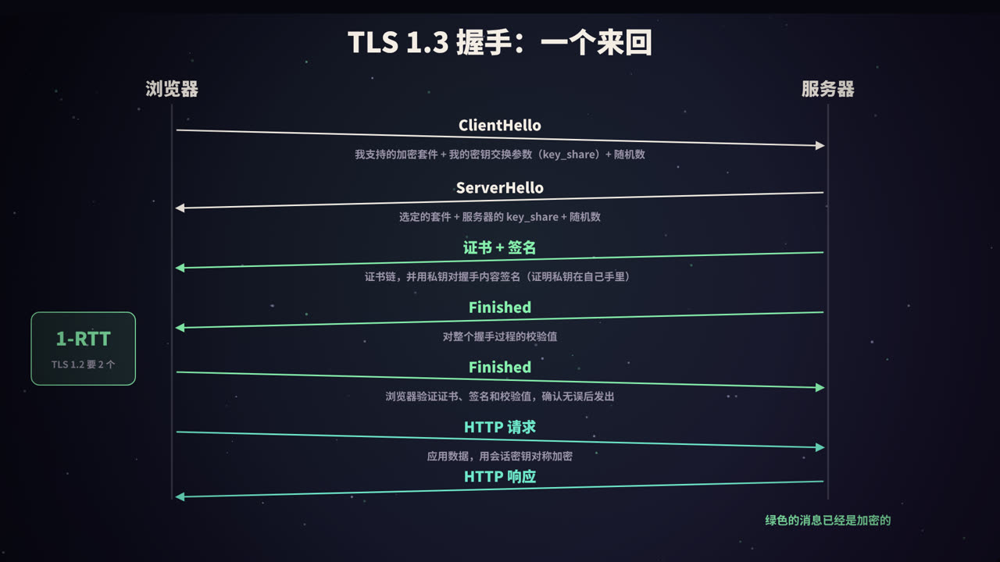
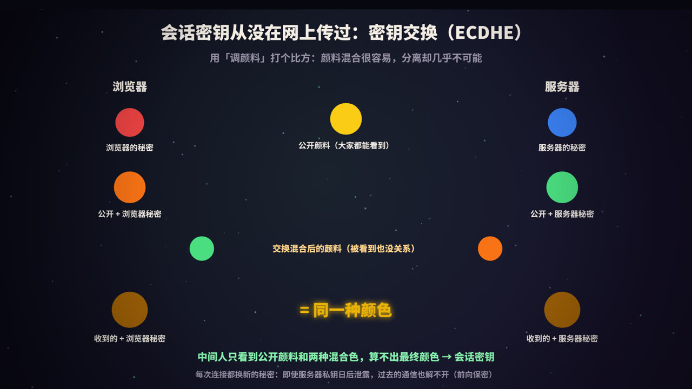
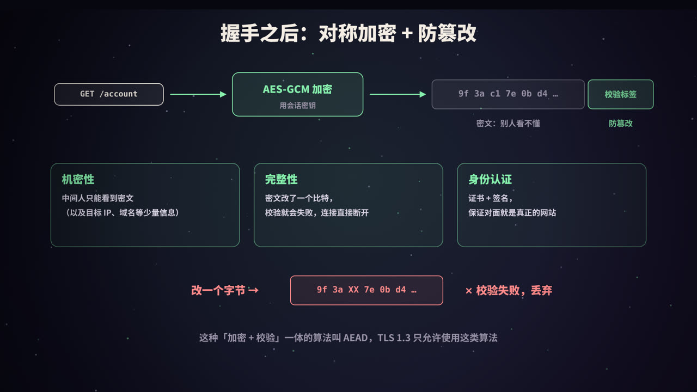
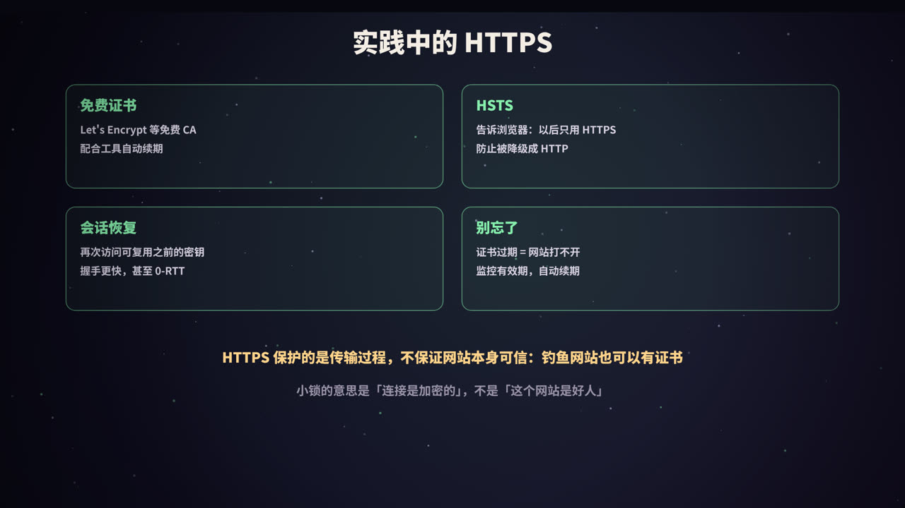
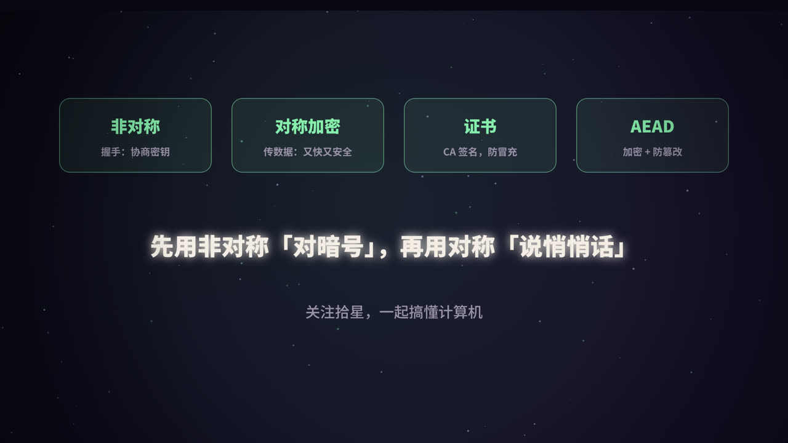

title: HTTPS 加密全过程：从「裸奔」到小绿锁
subtitle: 对称与非对称加密、数字签名与证书信任链、TLS 1.3 握手逐条拆解、ECDHE 密钥交换与前向保密、AEAD 防篡改，附两段可运行的 Python 演示和部署实践
tag: 计算机与后端
color: #86efac



## HTTP 的问题：明文传输

HTTP 是**明文**协议。你在网页上输入的密码、浏览的内容，在网络上传输时都是原样的文字。从你的电脑到网站的服务器，数据要经过 Wi-Fi 路由器、运营商的网络设备、各级交换节点……其中任何一个环节都可能存在「中间人」。

中间人能做三件事：

| 风险 | 例子 | 需要的保护 |
|---|---|---|
| **窃听** | 看到你的密码、聊天内容 | 机密性：加密 |
| **篡改** | 往网页里插入广告、替换下载文件 | 完整性：防篡改校验 |
| **冒充** | 假装自己是银行网站 | 身份认证：证书 |

**HTTPS = HTTP + TLS**。HTTP 本身没有变，只是在 HTTP 和 TCP 之间加了一层 **TLS**（Transport Layer Security，传输层安全协议），由它负责加密、防篡改和验证身份。TLS 的前身叫 SSL，所以很多地方仍然习惯说「SSL 证书」。

> 本系列《从输入网址到页面显示》介绍了 HTTPS 在整个请求流程中的位置，这一篇专门把 TLS 拆开讲。

## 两种加密方式



### 对称加密

加密和解密用**同一把密钥**。常用算法是 AES、ChaCha20。

- 优点：**非常快**。现代 CPU 有专门的 AES 指令，每秒可以加密数 GB 的数据；
- 问题：**密钥怎么交给对方？** 如果在网络上直接发送密钥，中间人也能拿到，加密就失去了意义。

### 非对称加密

有一对密钥：**公钥**可以公开给任何人，**私钥**只有自己知道。常用算法是 RSA 和椭圆曲线（ECC）。

- 用公钥加密的数据，只有对应的私钥能解开；
- 用私钥签名的数据，任何人都可以用公钥验证签名是否有效（这就是**数字签名**）；
- 问题：**很慢**，比对称加密慢几个数量级，不适合加密大量数据。

### HTTPS 的做法：混合使用

1. **握手阶段**：用非对称算法完成身份验证，并安全地协商出一把**会话密钥**；
2. **传输阶段**：所有 HTTP 数据都用这把会话密钥做**对称加密**。

这样既解决了密钥分发的问题，又保证了传输速度。

## 证书：证明「公钥真的是银行的」



### 问题：公钥也可能被替换

假设银行把自己的公钥发给浏览器，中间人可以把它拦下来，换成**自己的公钥**发给浏览器。浏览器用中间人的公钥加密，中间人就能解开，再用银行的公钥加密后转发给银行。双方都察觉不到。

所以关键问题变成了：**浏览器怎么确认收到的公钥属于 bank.com？** 答案是找一个大家都信任的第三方来担保，这就是**证书颁发机构**（CA，Certificate Authority）。

### 数字证书里有什么

| 字段 | 内容 |
|---|---|
| 主体 / 域名（SAN） | 这张证书属于哪些域名，比如 bank.com、www.bank.com |
| 公钥 | 网站的公钥 |
| 签发者 | 哪个 CA 签发的 |
| 有效期 | 从什么时候到什么时候有效 |
| 签名 | CA 用**自己的私钥**对以上内容生成的数字签名 |

### 签名与验证

<figure>
<svg viewBox="0 0 440 400" xmlns="http://www.w3.org/2000/svg" role="img" aria-label="证书签名与验证">
  <rect width="440" height="400" fill="#0f0e1c"/>
  <defs><marker id="ha" viewBox="0 0 10 10" refX="9" refY="5" markerWidth="7" markerHeight="7" orient="auto"><path d="M0,0 L10,5 L0,10 z" fill="#86efac"/></marker></defs>
  <g font-family="PingFang SC, Noto Sans SC, sans-serif" text-anchor="middle">
    <text x="220" y="30" fill="#86efac" font-size="18" font-weight="800">CA 签发证书</text>
    <rect x="14" y="50" width="120" height="64" rx="12" fill="rgba(255,255,255,.06)" stroke="#9a93a8"/>
    <text x="74" y="80" fill="#f4ede4" font-size="15" font-weight="700">证书内容</text>
    <text x="74" y="101" fill="#9a93a8" font-size="12">域名、公钥、有效期</text>
    <line x1="134" y1="82" x2="160" y2="82" stroke="#86efac" stroke-width="2.5" marker-end="url(#ha)"/>
    <rect x="162" y="50" width="110" height="64" rx="12" fill="rgba(255,255,255,.06)" stroke="#9a93a8"/>
    <text x="217" y="80" fill="#f4ede4" font-size="15" font-weight="700">计算哈希</text>
    <text x="217" y="101" fill="#9a93a8" font-size="12">SHA-256</text>
    <line x1="272" y1="82" x2="298" y2="82" stroke="#86efac" stroke-width="2.5" marker-end="url(#ha)"/>
    <rect x="300" y="50" width="126" height="64" rx="12" fill="rgba(134,239,172,.14)" stroke="#86efac"/>
    <text x="363" y="80" fill="#86efac" font-size="15" font-weight="800">用 CA 私钥签名</text>
    <text x="363" y="101" fill="#9a93a8" font-size="12">得到签名，附在证书上</text>
    <line x1="14" y1="150" x2="426" y2="150" stroke="rgba(255,255,255,.12)" stroke-dasharray="6 6"/>
    <text x="220" y="185" fill="#ffd38a" font-size="18" font-weight="800">浏览器验证证书</text>
    <rect x="14" y="205" width="190" height="64" rx="12" fill="rgba(255,255,255,.06)" stroke="#9a93a8"/>
    <text x="109" y="235" fill="#f4ede4" font-size="15" font-weight="700">自己对证书内容算哈希</text>
    <text x="109" y="256" fill="#9a93a8" font-size="12">得到哈希 H1</text>
    <rect x="236" y="205" width="190" height="64" rx="12" fill="rgba(255,255,255,.06)" stroke="#9a93a8"/>
    <text x="331" y="235" fill="#f4ede4" font-size="15" font-weight="700">用 CA 公钥验证签名</text>
    <text x="331" y="256" fill="#9a93a8" font-size="12">CA 公钥来自上一级证书</text>
    <line x1="109" y1="269" x2="190" y2="304" stroke="#ffd38a" stroke-width="2.5" marker-end="url(#ha)"/>
    <line x1="331" y1="269" x2="250" y2="304" stroke="#ffd38a" stroke-width="2.5" marker-end="url(#ha)"/>
    <rect x="70" y="306" width="300" height="70" rx="14" fill="rgba(255,211,138,.12)" stroke="#ffd38a"/>
    <text x="220" y="336" fill="#ffd38a" font-size="16" font-weight="800">签名与 H1 匹配？</text>
    <text x="220" y="360" fill="#9a93a8" font-size="12">匹配 → 未被篡改，确由该 CA 签发</text>
  </g>
</svg>
<figcaption>CA 用私钥签名，任何人都能用 CA 的公钥验证。中间人没有 CA 的私钥，改动证书内容后无法生成有效签名</figcaption>
</figure>

中间人可以拿到网站的证书（它本来就是公开的），但证书里的公钥是网站的，中间人没有对应的私钥。如果它把公钥换成自己的，签名就对不上了；它也没有 CA 的私钥，无法重新签名。

### 信任链

浏览器怎么拿到 CA 的公钥？通过一条**信任链**：

1. **根证书**：少数受信任的根 CA 的证书，**预装在操作系统和浏览器中**（称为「根证书库」）；
2. **中间证书**：根 CA 一般不直接签发网站证书，而是签发中间 CA 的证书，私钥保管得更安全；
3. **网站证书**：由中间 CA 签发。

服务器在握手时发送「网站证书 + 中间证书」，浏览器从网站证书开始，逐级验证签名，直到一个自己信任的根证书。

浏览器还会检查：

- **域名**：证书中的域名必须和你访问的域名一致；
- **有效期**：证书没有过期；
- **吊销状态**：证书没有被提前吊销（比如私钥泄露时）；
- **证书透明度**（CT）：主流浏览器要求证书已经登记在公开的审计日志中，这样 CA 一旦错误签发证书，很容易被发现。

任何一项检查失败，浏览器都会显示「您的连接不是私密连接」之类的警告页面。

## TLS 1.3 握手：一个来回



TLS 1.3 是目前最新的版本（RFC 8446，2018 年发布），握手只需要**一个来回**（1-RTT）。完整过程如下：

| 方向 | 消息 | 内容 |
|---|---|---|
| 浏览器 → 服务器 | **ClientHello** | 支持的 TLS 版本、加密套件列表、**密钥交换参数（key_share）**、随机数、要访问的域名（SNI） |
| 服务器 → 浏览器 | **ServerHello** | 选定的加密套件、**服务器的 key_share**、随机数 |
| | *（此时双方已经能算出握手密钥，后面的消息都是加密的）* | |
| 服务器 → 浏览器 | EncryptedExtensions | 其他扩展参数，比如协商好的应用层协议（HTTP/2 等） |
| 服务器 → 浏览器 | **Certificate** | 证书链 |
| 服务器 → 浏览器 | **CertificateVerify** | 用网站私钥对**整个握手过程**做的签名，证明自己确实持有证书对应的私钥 |
| 服务器 → 浏览器 | **Finished** | 对整个握手过程的校验值，确认握手没有被篡改 |
| 浏览器 → 服务器 | **Finished** | 浏览器验证证书、签名和校验值都没问题后发出 |
| 双向 | 应用数据 | HTTP 请求和响应，用会话密钥加密 |

几个要点：

- **ClientHello 直接带上 key_share**：浏览器「猜」服务器会选择哪种密钥交换算法（通常是 X25519），提前把参数带上，省掉了一个来回。如果猜错，服务器会要求重发（HelloRetryRequest）；
- **ServerHello 之后就开始加密**：证书也是加密传输的，这是 TLS 1.3 相比 1.2 在隐私上的改进；
- **CertificateVerify 是关键**：证书是公开的，谁都能拿到。只有用私钥对本次握手签名，才能证明「我就是证书的主人」。

### TLS 1.2 与 TLS 1.3 的对比

| | TLS 1.2 | TLS 1.3 |
|---|---|---|
| 完整握手 | 2-RTT | **1-RTT** |
| 会话恢复 | 1-RTT | 1-RTT，或 **0-RTT** |
| 密钥交换 | 支持 RSA 密钥交换（无前向保密）和 ECDHE | **只允许** (EC)DHE，强制前向保密 |
| 加密算法 | 支持 CBC、RC4 等老算法 | **只允许 AEAD**：AES-GCM、ChaCha20-Poly1305 等 |
| 证书 | 明文传输 | 加密传输 |

TLS 1.3 删掉了大量不安全或过时的选项，既更快，也更安全。TLS 1.0 和 1.1 已经被正式废弃，主流浏览器都不再支持。

## 会话密钥从没在网上传过：ECDHE



握手过程中，会话密钥本身**从来没有在网络上传输过**，双方是各自**算出来**的。这靠的是 **Diffie-Hellman 密钥交换**，现代 TLS 使用的是它的椭圆曲线版本 ECDHE（E 代表 Ephemeral，临时的）。

### 调颜料的比喻

1. 双方约定一种**公开的颜料**（黄色），大家都能看到；
2. 浏览器选一种**秘密颜料**（红色），服务器选一种**秘密颜料**（蓝色），都不告诉别人；
3. 各自把秘密颜料和公开颜料混合，得到橙色和绿色，**把混合色发给对方**。中间人能看到这两种混合色；
4. 浏览器把收到的绿色和自己的红色混合；服务器把收到的橙色和自己的蓝色混合。两边得到的都是「黄 + 红 + 蓝」，**同一种颜色**。

这个比喻成立的关键是：**颜料混合很容易，但从混合色中分离出原来的颜色几乎不可能**。中间人只有黄、橙、绿三种颜色，调不出最终的颜色。

### 数学上的版本

把「混合」换成数学运算。以最初的有限域版本为例（椭圆曲线版本原理相同，只是运算换成了椭圆曲线上的点乘）：

```text
公开：一个大素数 p 和一个底数 g
浏览器：选秘密数 a，发送 A = g^a mod p
服务器：选秘密数 b，发送 B = g^b mod p

浏览器算：B^a mod p = g^(ab) mod p
服务器算：A^b mod p = g^(ab) mod p     ← 两边相等
```

中间人知道 g、p、A、B，但从 A 反推出 a 是「离散对数问题」，在数字足够大时，现有计算机无法在可行时间内算出来。

双方得到共享秘密后，再结合握手过程中的所有消息，通过 **HKDF** 派生出一系列密钥：握手阶段用的密钥、应用数据用的密钥、两个方向各用一把，等等。

### 前向保密

ECDHE 中的秘密数是**临时**的，每次连接都重新生成，用完就丢弃。这带来一个重要的性质，叫**前向保密**（Forward Secrecy）：

> 即使服务器的证书私钥将来泄露了，攻击者也无法解密**过去**录下来的通信。

对比 TLS 1.2 中的 RSA 密钥交换：浏览器生成会话密钥后，用服务器的 RSA 公钥加密发送过去。一旦服务器私钥泄露，攻击者就能解开以前录下的所有握手，进而解密全部通信。这也是 TLS 1.3 移除 RSA 密钥交换的原因。

在 TLS 1.3 里，证书私钥的作用只剩下**签名**（证明身份），不再参与会话密钥的生成。

## 握手之后：加密 + 防篡改



握手完成后，HTTP 数据被切成一个个**记录**（record），每个记录用会话密钥做对称加密。

TLS 1.3 只允许 **AEAD**（带关联数据的认证加密）算法，比如 AES-GCM、ChaCha20-Poly1305。AEAD 在加密的同时生成一个**校验标签**：

- 没有密钥，看不懂密文 → **机密性**；
- 密文被改动哪怕一个比特，校验就会失败，TLS 会直接终止连接 → **完整性**；
- 每个记录都有隐含的序列号参与计算，被重放、删除或调换顺序的记录也会被发现。

加上握手阶段的证书验证 → **身份认证**。三个问题全部解决。

### HTTPS 能看到什么、看不到什么

| 中间人能看到 | 中间人看不到 |
|---|---|
| 你的 IP 和服务器的 IP | 完整的 URL 路径和参数 |
| 你访问的域名（DNS 查询、ClientHello 中的 SNI） | 请求头、Cookie |
| 数据量的大小和时间 | 请求和响应的内容 |

SNI 中的域名默认是明文，正在推广的 **ECH**（Encrypted Client Hello）可以把它也加密起来。

## 动手实验

### 实验一：密钥交换 + AEAD

用 Python 的 `cryptography` 库，模拟 ECDHE 密钥交换和 AES-GCM 加密：

```python
import os
from cryptography.hazmat.primitives.asymmetric.x25519 import X25519PrivateKey
from cryptography.hazmat.primitives.kdf.hkdf import HKDF
from cryptography.hazmat.primitives import hashes
from cryptography.hazmat.primitives.ciphers.aead import AESGCM
from cryptography.exceptions import InvalidTag

# 1. 双方各自生成一对临时密钥（「自己的秘密颜料」）
client_priv = X25519PrivateKey.generate()
server_priv = X25519PrivateKey.generate()

# 2. 只把公钥（「混合后的颜料」）发给对方，这一步可以被所有人看到
client_pub = client_priv.public_key()
server_pub = server_priv.public_key()

# 3. 用自己的私钥 + 对方的公钥，各自算出共享秘密
client_secret = client_priv.exchange(server_pub)
server_secret = server_priv.exchange(client_pub)
print("双方算出的共享秘密相同:", client_secret == server_secret)

# 4. 从共享秘密派生出会话密钥（TLS 1.3 用的也是 HKDF，只是步骤更多）
def derive(secret):
    return HKDF(algorithm=hashes.SHA256(), length=32, salt=None, info=b"demo session key").derive(secret)
key = derive(client_secret)

# 5. 用会话密钥做 AES-GCM 加密：同时得到密文和校验标签
aes = AESGCM(key)
nonce = os.urandom(12)                         # 每条消息用不同的 nonce
ct = aes.encrypt(nonce, b"GET /account HTTP/1.1", None)
print("密文:", ct[:16].hex(), "...")

# 6. 服务器用自己算出的同一把密钥解密
print("服务器解密:", AESGCM(derive(server_secret)).decrypt(nonce, ct, None))

# 7. 中间人改了一个字节
tampered = bytearray(ct); tampered[3] ^= 0x01
try:
    aes.decrypt(nonce, bytes(tampered), None)
except InvalidTag:
    print("被篡改的密文：校验失败，拒绝解密")
```

输出（密文每次运行都不同）：

```text
双方算出的共享秘密相同: True
密文: 50bf65cd5786c55e9e689975c7932556 ...
服务器解密: b'GET /account HTTP/1.1'
被篡改的密文：校验失败，拒绝解密
```

### 实验二：自己当一回 CA，跑通一次真实的 TLS 握手

先用 OpenSSL 生成一个「根证书」，再用它给 `localhost` 签发网站证书：

```bash
# 1. 自己当一回 CA：生成 CA 私钥和自签名的根证书
openssl req -x509 -newkey ec -pkeyopt ec_paramgen_curve:P-256 -nodes \
  -keyout ca.key.pem -out ca.pem -days 30 -subj "/CN=Demo Root CA" \
  -addext "basicConstraints=critical,CA:TRUE" -addext "keyUsage=critical,keyCertSign,cRLSign"

# 2. 网站生成自己的私钥和证书签名请求（CSR）
openssl req -newkey ec -pkeyopt ec_paramgen_curve:P-256 -nodes \
  -keyout server.key.pem -out server.csr -subj "/CN=localhost"

# 3. CA 用自己的私钥给网站证书签名，写入域名（SAN）等信息
cat > server.ext <<EOF
subjectAltName=DNS:localhost
basicConstraints=CA:FALSE
keyUsage=critical,digitalSignature
extendedKeyUsage=serverAuth
authorityKeyIdentifier=keyid
EOF
openssl x509 -req -in server.csr -CA ca.pem -CAkey ca.key.pem -CAcreateserial \
  -out server.pem -days 30 -extfile server.ext

# 4. 验证证书链
openssl verify -CAfile ca.pem server.pem      # 输出：server.pem: OK
```

然后用 Python 标准库起一个 TLS 服务器，再用客户端连接：

```python
import socket, ssl, threading

# 服务器：加载自己的证书和私钥
server_ctx = ssl.SSLContext(ssl.PROTOCOL_TLS_SERVER)
server_ctx.load_cert_chain("server.pem", "server.key.pem")

listener = socket.create_server(("127.0.0.1", 0))
port = listener.getsockname()[1]

def serve():
    while True:
        conn, _ = listener.accept()
        try:
            with server_ctx.wrap_socket(conn, server_side=True) as tls:
                tls.recv(1024)
                tls.sendall(b"HTTP/1.1 200 OK\r\nContent-Length: 5\r\n\r\nhello")
        except ssl.SSLError:
            pass                       # 客户端校验失败、中断握手

threading.Thread(target=serve, daemon=True).start()

# 客户端：只信任我们自己的「根证书」，并且会校验域名
client_ctx = ssl.create_default_context(cafile="ca.pem")
with socket.create_connection(("127.0.0.1", port)) as raw:
    with client_ctx.wrap_socket(raw, server_hostname="localhost") as tls:
        print("协议版本:", tls.version())
        print("加密套件:", tls.cipher()[0])
        print("证书主体:", dict(x[0] for x in tls.getpeercert()["subject"]))
        tls.sendall(b"GET / HTTP/1.1\r\nHost: localhost\r\n\r\n")
        print("响应:", tls.recv(1024).split(b"\r\n")[0])

# 换一个域名去连：证书和域名对不上，握手直接失败
try:
    with socket.create_connection(("127.0.0.1", port)) as raw:
        client_ctx.wrap_socket(raw, server_hostname="bank.com")
except ssl.SSLCertVerificationError as e:
    print("域名不匹配:", e.verify_message)
```

输出：

```text
协议版本: TLSv1.3
加密套件: TLS_AES_256_GCM_SHA384
证书主体: {'commonName': 'localhost'}
响应: b'HTTP/1.1 200 OK'
域名不匹配: Hostname mismatch, certificate is not valid for 'bank.com'.
```

浏览器做的事情本质上一样，只是它信任的是预装的根证书，而不是我们自己生成的 `ca.pem`。

> 想看真实网站的握手和证书，可以运行 `openssl s_client -connect example.com:443 -servername example.com`，或者在浏览器地址栏点击小锁图标查看证书详情。

## 实践中的 HTTPS



### 证书从哪里来

- **免费证书**：Let's Encrypt 等 CA 通过 **ACME 协议**自动签发证书。用 certbot 之类的工具，几条命令就能完成申请和自动续期；
- **证书类型**：DV（只验证域名所有权）、OV（验证组织）、EV（扩展验证）。对于加密强度来说三者没有区别，现代浏览器也不再特别展示 EV；
- **有效期越来越短**：业界已经决定逐步缩短证书的最长有效期，未来会缩短到几十天。手动续期不再现实，**自动化**是必须的；
- **证书过期 = 网站打不开**：这是最常见的 HTTPS 事故之一。要监控证书有效期，并确保自动续期真的在工作。

### Nginx 配置示例

```nginx
server {
    listen 443 ssl;
    http2 on;
    server_name example.com;

    ssl_certificate     /etc/ssl/example.com/fullchain.pem;   # 网站证书 + 中间证书
    ssl_certificate_key /etc/ssl/example.com/privkey.pem;
    ssl_protocols       TLSv1.2 TLSv1.3;                      # 不再启用 1.0 / 1.1

    # HSTS：告诉浏览器今后一年内只用 HTTPS 访问本站
    add_header Strict-Transport-Security "max-age=31536000; includeSubDomains" always;
}

server {
    listen 80;
    server_name example.com;
    return 301 https://$host$request_uri;                     # HTTP 跳转到 HTTPS
}
```

注意 `ssl_certificate` 要配置**完整的证书链**（fullchain），只配网站证书的话，部分客户端会因为找不到中间证书而验证失败。

### HSTS：防止被降级

用户在地址栏输入 `bank.com`，浏览器默认先用 HTTP 访问，再被 301 跳转到 HTTPS。这第一个 HTTP 请求就可能被中间人劫持，让用户一直停留在 HTTP 上（SSL 剥离攻击）。

**HSTS**（HTTP Strict Transport Security）响应头告诉浏览器：在指定时间内，访问这个网站一律直接使用 HTTPS。还可以把域名提交到浏览器内置的 **HSTS 预加载列表**，连第一次访问也受到保护。

### 性能

- TLS 1.3 的完整握手只要 1-RTT；
- **会话恢复**：再次访问时，复用之前协商的密钥（PSK），省去证书验证等步骤；
- **0-RTT**：会话恢复时，客户端可以在第一个消息里就带上请求数据。代价是 0-RTT 数据**可能被重放**，所以只适合幂等的请求（比如 GET），服务端需要谨慎开启；
- **HTTP/3** 基于 QUIC，把传输层握手和 TLS 1.3 握手合并在一起，进一步减少延迟。

加密本身的计算开销在现代硬件上已经很小，「HTTPS 很慢」基本是过去的说法了。

### 后端服务中的 TLS

- **TLS 终止**：常见架构是在负载均衡器或网关上处理 HTTPS（卸载 TLS），内网再用 HTTP 转发给后端服务。后端可以通过 `X-Forwarded-Proto` 等请求头知道原始请求是不是 HTTPS；
- **零信任与 mTLS**：对内网安全要求高的系统，服务之间也使用 TLS，并且**双向验证证书**（mutual TLS），客户端也要出示证书。服务网格（如 Istio）可以自动完成这件事；
- **调用外部 HTTPS 接口**：不要为了省事关闭证书校验（比如 `verify=False`、信任所有证书的 `TrustManager`），这等于把大门敞开给中间人。

## HTTPS 不能保证什么

- **不保证网站本身可信**：钓鱼网站也可以申请到合法的证书。小锁的意思是「这个连接是加密的，对面确实是这个域名」，不是「这个网站是好人」；
- **不保护两端**：数据到达服务器后会被解密，服务器被入侵、用户电脑中了木马，HTTPS 都无能为力；
- **依赖对 CA 的信任**：如果某个受信任的 CA 被攻破或违规签发证书，就可能被利用。证书透明度等机制就是为了降低这种风险；
- **企业代理**：一些公司网络会在员工电脑上安装自己的根证书，从而解密并检查 HTTPS 流量。这在技术上就是一个「被信任的中间人」。

## 高频面试题速答

**Q：HTTPS 和 HTTP 有什么区别？**
HTTPS 在 HTTP 和 TCP 之间加了 TLS 层，提供加密、完整性校验和身份认证；默认端口是 443；需要证书；多了 TLS 握手的开销。

**Q：为什么不全程使用非对称加密？**
非对称加密太慢。HTTPS 只在握手时用非对称算法协商密钥、验证身份，传输数据时用对称加密。

**Q：证书是怎么验证的？**
从网站证书开始，用上一级证书的公钥验证签名，逐级验证到预装的根证书；同时检查域名、有效期和吊销状态。

**Q：TLS 1.3 相比 1.2 改进了什么？**
握手从 2-RTT 减少到 1-RTT，支持 0-RTT；移除 RSA 密钥交换，强制前向保密；只保留 AEAD 加密算法；证书加密传输。

**Q：什么是前向保密？**
每次连接都使用临时生成的密钥交换参数，即使服务器私钥日后泄露，也无法解密过去的通信。

**Q：中间人攻击能成功吗？**
在证书验证正常的情况下不能：中间人没有网站的私钥，也无法伪造 CA 的签名。成功的中间人攻击通常是因为用户忽略了证书警告、设备被安装了恶意根证书，或者客户端代码关闭了证书校验。

## 总结



- HTTP 是明文，面临**窃听、篡改、冒充**三大风险；HTTPS = HTTP + TLS；
- **混合加密**：握手时用非对称算法协商会话密钥、验证身份，传输时用对称加密；
- **证书**：CA 用私钥签名，浏览器沿信任链逐级验证到预装的根证书，并检查域名和有效期；
- **TLS 1.3**：1-RTT 握手；**ECDHE** 让双方各自算出会话密钥，并提供**前向保密**；
- **AEAD**：加密的同时附带校验标签，任何篡改都会被发现；
- 实践中：自动化证书续期、配置完整证书链、开启 HSTS，永远不要关闭证书校验。

<div class="refs" markdown="1">

### 参考资料

- RFC 8446：The Transport Layer Security (TLS) Protocol Version 1.3.
- RFC 5246：The Transport Layer Security (TLS) Protocol Version 1.2.
- RFC 6797：HTTP Strict Transport Security (HSTS).
- RFC 8555：Automatic Certificate Management Environment (ACME).
- RFC 6962 / RFC 9162：Certificate Transparency.
- RFC 8996：Deprecating TLS 1.0 and TLS 1.1.
- Diffie, W., & Hellman, M. (1976). New Directions in Cryptography. *IEEE Transactions on Information Theory*.
- Cloudflare Learning Center：What happens in a TLS handshake?
- Python 文档：ssl — TLS/SSL wrapper for socket objects；cryptography 库文档.

</div>
