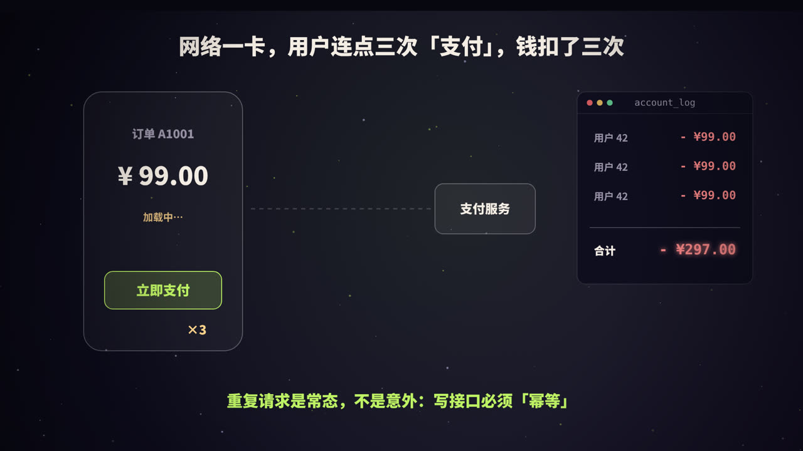
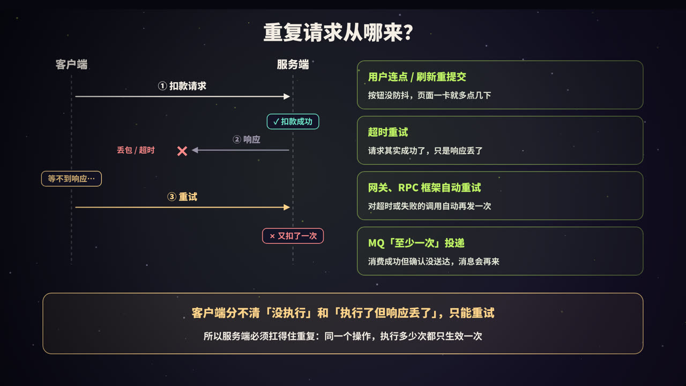
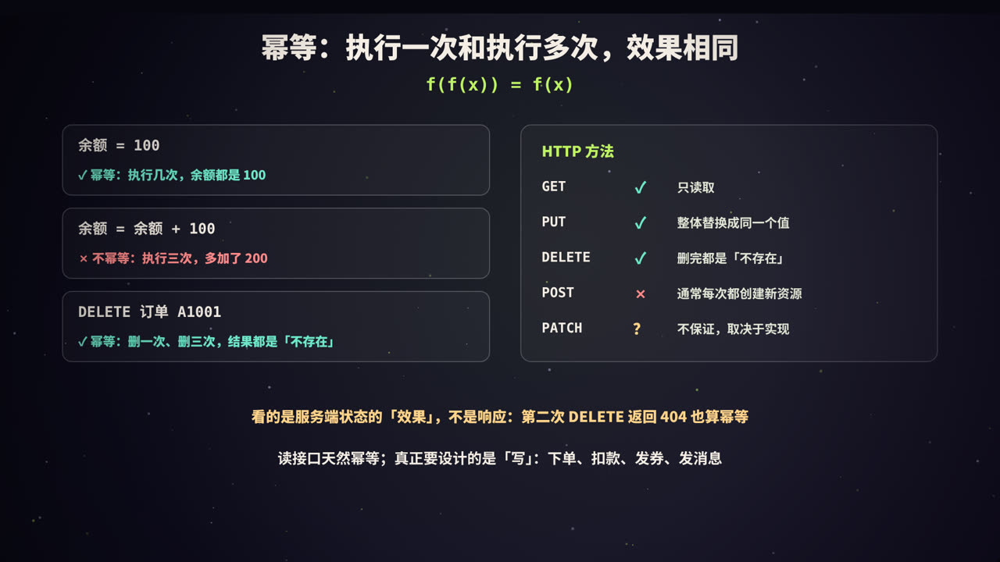
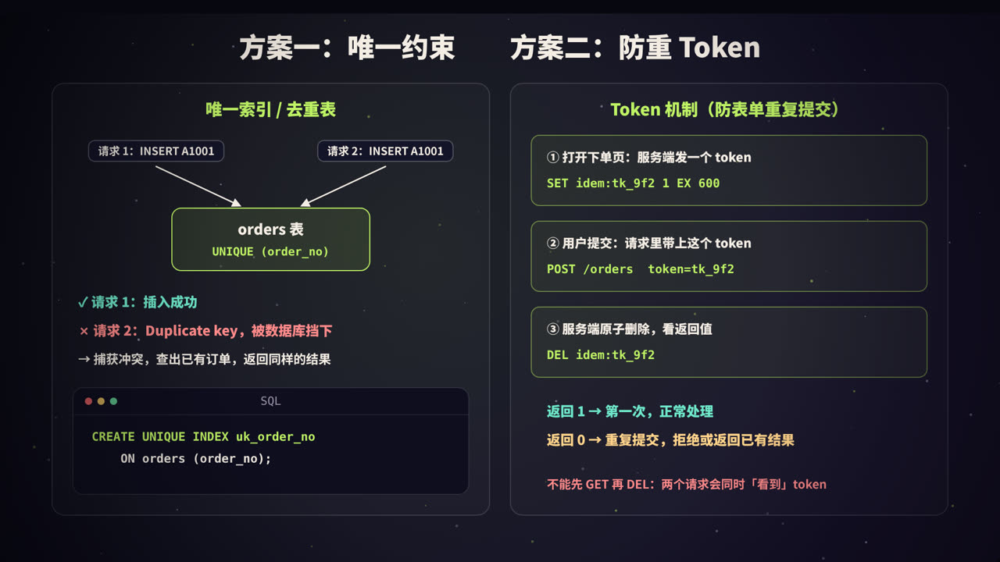
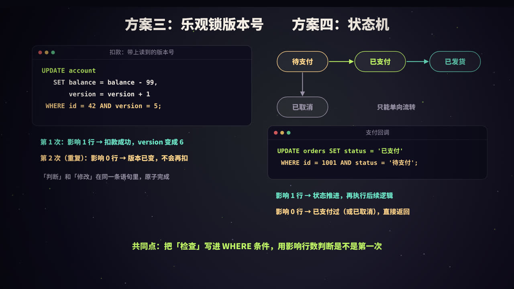
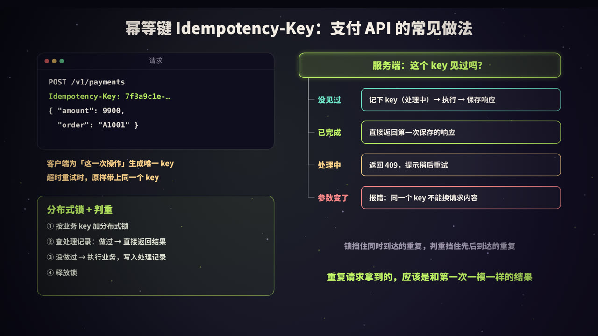
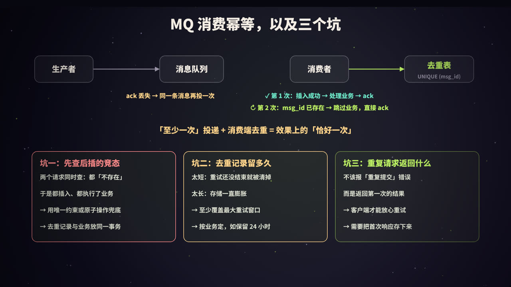

title: 幂等性设计：重复请求不出错，钱只扣一次
subtitle: 重复请求的四个来源、幂等的定义与 HTTP 方法、唯一约束与去重表、防重 Token、乐观锁与状态机、幂等键 Idempotency-Key、分布式锁 + 判重、MQ 消费幂等，以及先查后插、去重过期、返回首次结果三个坑，附五段可运行的演示
tag: 计算机与后端
color: #bef264



## 重复请求从哪来



支付页面转了几秒圈，用户着急，连点了三次「立即支付」。三个请求都到了服务端，服务端老老实实扣了三次钱。

这不是极端情况。在分布式系统里，**同一个请求被执行多次是常态**，主要来源有四个：

| 来源 | 怎么发生的 |
|---|---|
| **用户重复操作** | 连点按钮、页面卡顿时刷新、浏览器后退后重新提交表单 |
| **超时重试** | 客户端等不到响应就重试，但第一次请求其实已经执行成功了，只是响应丢在了路上 |
| **框架和网关自动重试** | RPC 框架、HTTP 客户端、负载均衡、服务网格对超时或失败的调用自动再发一次 |
| **消息队列「至少一次」投递** | 消费者处理完了，但确认（ack）没送达 Broker，同一条消息会被再次投递 |

其中最棘手的是**超时**。客户端发出请求后等不到响应，它无法区分三种情况：

1. 请求根本没到服务端；
2. 请求到了，服务端执行到一半出错了；
3. 请求执行成功了，**只是响应丢了**。

对于前两种，重试是对的；对于第三种，重试就会重复执行。客户端分不清，只能重试——否则一次网络抖动就会导致操作丢失。

既然重试不可避免，那么只剩一条路：**让服务端扛得住重复**。这就是幂等性设计。

> 自动重试比很多人以为的更普遍。例如 Nginx 的 `proxy_next_upstream` 在上游失败时会把请求转给下一台服务器（从 1.9.13 版本开始，默认不再对 POST 这类非幂等请求这样做）；不少 RPC 框架默认就带重试。接入任何带重试的组件之前，先确认被调用的接口是不是幂等的。

## 什么是幂等



**幂等**（idempotent）原本是数学概念：一个操作执行一次和执行多次，效果相同，即 `f(f(x)) = f(x)`。比如取绝对值，`abs(abs(-3)) = abs(-3)`。

放到接口上：**同一个请求，执行一次和执行多次，对系统状态产生的影响相同**。

| 操作 | 幂等吗 | 原因 |
|---|---|---|
| `余额 = 100` | ✓ | 执行几次，余额都是 100 |
| `余额 = 余额 + 100` | ✗ | 执行三次，多加了 200 |
| `DELETE 订单 A1001` | ✓ | 删一次、删三次，结果都是「不存在」 |
| `创建一个订单` | ✗ | 每执行一次就多一个订单 |
| `查询订单` | ✓ | 只读，不改变状态 |

### HTTP 方法的幂等性

HTTP 规范（RFC 9110）对每个方法的语义做了定义：

| 方法 | 安全（只读） | 幂等 | 说明 |
|---|---|---|---|
| GET / HEAD / OPTIONS | ✓ | ✓ | 只读取，不改变服务器状态 |
| PUT | ✗ | ✓ | 把资源**整体替换**成请求里的内容，替换多少次结果都一样 |
| DELETE | ✗ | ✓ | 删除后资源就不存在了，再删也还是不存在 |
| POST | ✗ | ✗ | 通常用于创建资源或触发处理，每次都可能产生新结果 |
| PATCH | ✗ | 不保证 | 取决于补丁内容：`设置名字为 X` 是幂等的，`数量加 1` 不是 |

几个容易混淆的点：

- **幂等看的是服务端状态的「效果」，不是响应**。第一次 DELETE 返回 200，第二次返回 404，状态都是「已删除」，仍然是幂等的；
- **规范说幂等，不代表你的实现就幂等**。如果你的 PUT 接口里写了「每次调用积分加 1」，它就不是幂等的；
- RFC 9110 允许客户端在连接中断时**自动重试幂等请求**，这正是规范区分幂等方法的原因之一。

### 幂等、防重、并发控制的区别

| 概念 | 关注点 |
|---|---|
| **幂等** | 同一个请求执行多次，结果和执行一次一样 |
| **防重** | 拦住重复的请求，不让它执行第二次（实现幂等的手段之一） |
| **并发控制** | 多个**不同的**请求同时修改同一数据时不出错（如两个用户抢最后一件库存） |

它们经常用到相同的工具（唯一约束、锁、版本号），但目标不同。幂等的关键是先回答一个问题：**怎么判断两个请求是「同一个」？** 答案通常是一个**业务唯一标识**：订单号、支付流水号、消息 ID、客户端生成的请求 ID……后面所有方案，都是围绕这个标识展开的。

## 方案一：唯一约束；方案二：防重 Token



### 唯一索引 / 去重表

最简单也最可靠的方案：**让数据库替你判重**。

```sql
CREATE UNIQUE INDEX uk_order_no ON orders (order_no);
```

两个请求带着同一个订单号同时插入，数据库保证只有一个成功，另一个收到「Duplicate key」错误。捕获这个错误，查出已有的订单返回给客户端即可。

如果业务表本身没有合适的唯一字段（比如「扣款」是 UPDATE 而不是 INSERT），可以单独建一张**去重表**：

```sql
CREATE TABLE dedup (
  biz_key    VARCHAR(64) PRIMARY KEY,   -- 如 "pay:流水号"、"msg:消息ID"
  created_at DATETIME NOT NULL
);
```

在**同一个事务**里先插入去重记录，再执行业务。插入失败就说明处理过了，整个事务回滚。去重记录和业务数据一起提交、一起回滚，不会出现「记录写了但业务没做」或反过来的情况。

MySQL 中还可以用 `INSERT IGNORE` 或 `INSERT ... ON DUPLICATE KEY UPDATE` 简化冲突处理。注意：唯一索引对 `NULL` 不生效，多行 `NULL` 不会冲突，用作判重的字段要设为 `NOT NULL`。

唯一约束的优点是**由数据库保证，在高并发下也挡得住**，是很多方案最后的兜底。缺点是依赖数据库，分库分表后唯一键要和分片键对齐，否则无法跨分片保证唯一。

### Token 机制：防表单重复提交

针对「用户连点、刷新重复提交」，常用 **Token 机制**：

1. 用户打开下单页时，服务端生成一个随机 token，存入 Redis（设置过期时间），同时下发给页面；
2. 用户提交时，请求里带上这个 token；
3. 服务端**原子地删除**这个 token：删除成功（`DEL` 返回 1）说明是第一次提交，继续处理；返回 0 说明 token 已经被用过了，是重复提交。

这里的关键是**原子**。如果写成「先 `GET` 判断 token 存在，再 `DEL`」，两个并发请求可能同时 `GET` 到 token，都认为自己是第一次。直接用 `DEL` 的返回值判断，Redis 单线程执行命令，只有一个请求能删除成功。（需要同时取出 token 里存的数据时，可以用 `GETDEL` 命令或 Lua 脚本。）

Token 机制的局限：

- 需要先发一次请求领 token，适合有「页面」的交互场景，不太适合服务间调用；
- 它只解决「重复提交」，token 删除后如果业务执行失败，用户需要重新领 token 才能重试。

## 方案三：乐观锁；方案四：状态机



很多写操作是 UPDATE，没有「插入」可以用来判重。这时可以把**判断条件写进 UPDATE 语句的 WHERE 里**，用**影响行数**区分第一次和重复。

### 乐观锁版本号

```sql
UPDATE account
   SET balance = balance - 99,
       version = version + 1
 WHERE id = 42 AND version = 5;
```

第一次执行，版本匹配，影响 1 行，版本变成 6；重复请求还带着 `version = 5`，匹配不上，影响 0 行，不会重复扣款。

乐观锁的本意是防止并发更新互相覆盖（见本系列《MySQL 的锁》）。把它用于幂等时有一个前提：**重试的请求必须带着第一次读到的版本号**。如果每次重试都重新读一遍最新版本，那它就是一个全新的请求，照样会再扣一次。

### 状态机

业务数据往往有明确的状态：订单从「待支付」到「已支付」再到「已发货」，或者从「待支付」到「已取消」。状态只能沿着规定的方向流转，不能回退、不能跳跃。

```sql
UPDATE orders SET status = '已支付'
 WHERE id = 1001 AND status = '待支付';
```

- 影响 1 行：状态推进成功，接着执行后续逻辑（发积分、通知仓库）；
- 影响 0 行：订单已经是「已支付」（重复回调），或者已经「已取消」（不允许支付），直接返回。

支付回调是最典型的场景：支付平台为了保证通知送达，会在没收到「成功」应答时**多次重复通知**。用状态机条件更新，重复的回调什么都改不了。注意，**后续逻辑也要以「这一次更新成功了」为前提**，不能每次回调都发一遍积分。

两种方案的共同点：把「检查」和「修改」放进**同一条原子的 SQL** 里，而不是先 SELECT 判断、再 UPDATE。

## 幂等键 Idempotency-Key



前面的方案都依赖业务自身的唯一标识。对于开放 API（尤其是支付），更通用的做法是**由客户端为每一次操作生成一个唯一的幂等键**，放在请求头里：

```text
POST /v1/payments
Idempotency-Key: 7f3a9c1e-5b2d-4c8e-9a01-3e6f2b7d4c10
Content-Type: application/json

{ "order": "A1001", "amount": 9900 }
```

客户端发生超时重试时，**原样带上同一个 key**。服务端按 key 判断：

| 情况 | 处理 |
|---|---|
| 没见过这个 key | 记录 key（状态为「处理中」）→ 执行业务 → 保存响应，状态改为「已完成」 |
| 已完成 | **直接返回第一次保存的响应**，不再执行业务 |
| 还在处理中 | 返回冲突错误（如 409），让客户端稍后重试 |
| key 相同但请求内容不同 | 报错（如 422），说明客户端用错了 key |

这就是一些支付平台 API 的做法。例如 Stripe 的 API 支持 `Idempotency-Key` 请求头，服务端会保存首次请求的结果，相同 key 的后续请求直接返回相同的结果，并会比对请求参数；key 在至少 24 小时后才可能被清理。IETF 也有一份正在推进的草案《The Idempotency-Key HTTP Header Field》，对这个请求头的语义做了标准化，其中建议并发重复请求返回 409、同一个 key 用于不同请求内容时返回 422。

实现要点：

- **抢占 key 要原子**：用唯一约束插入，或者 Redis 的 `SET key value NX`，不能先查后插；
- **保存响应和执行业务尽量在同一个事务里**，避免业务做完了、响应没存下来；
- **处理中崩溃了怎么办**：key 会一直停在「处理中」。需要给它设一个超时，超时后允许重新执行，或者由后台任务根据业务数据修正；
- key 由客户端生成（通常是 UUID），**一次用户操作对应一个 key**，而不是一次 HTTP 请求一个 key——否则重试时 key 变了，就失去了意义。

### 分布式锁 + 判重

当判重逻辑比较复杂、无法用一条 SQL 完成时，可以用「**一锁、二判、三更新**」：

1. 以业务唯一标识为 key 加**分布式锁**（见本系列《分布式锁》）；
2. 查处理记录：已经处理过 → 直接返回之前的结果；
3. 没有处理过 → 执行业务，并写入处理记录；
4. 释放锁。

锁解决的是**同时到达**的重复请求，判重解决的是**先后到达**的重复请求，两者缺一不可：只加锁不判重，第二个请求等第一个释放锁后照样会执行一遍；只判重不加锁，两个并发请求可能同时判断为「没处理过」。

由于分布式锁本身可能在极端情况下失效（锁过期、主从切换），关键业务还应该在数据库上加唯一约束做最后的兜底。

## MQ 消费幂等，以及三个坑



### 消息为什么会重复

主流消息队列（Kafka、RocketMQ、RabbitMQ 等）在常规配置下提供的都是「**至少一次**」（at-least-once）投递：

- **消费端**：处理完消息，提交位点或发送 ack 之前进程崩溃、网络中断，Broker 认为消息没被消费，会重新投递；消费者组重平衡时也可能重复消费；
- **生产端**：发送消息超时后重试，Broker 上可能出现两条内容相同的消息。

「至多一次」会丢消息，「恰好一次」代价很高且有严格的适用范围（比如 Kafka 的事务只在 Kafka 内部的「读-处理-写」链路上提供恰好一次语义）。所以通用的做法是：**接受至少一次投递，在消费端做幂等**。至少一次投递 + 消费端去重，得到的是效果上的「恰好一次」（见本系列《消息队列》）。

### 消费端怎么去重

- **去重表 + 唯一约束**：在消费的业务事务里插入 `msg_id` 或业务唯一键，冲突就跳过，然后照常 ack；
- **Redis `SET NX`**：性能更好，但它和数据库业务不在同一个事务里。如果先写了 Redis 标记，业务却执行失败，消息重投时会被误判为「已处理」而丢失，需要配合「处理中 / 已完成」两种状态和过期时间来处理；
- **业务自身的幂等**：比如状态机条件更新，本身就不怕重复。

用什么做去重 key？**优先用业务唯一键**（订单号、流水号），而不是消息系统生成的消息 ID。因为生产端重试发出的两条消息，消息 ID 可能并不相同，但它们代表的是同一个业务操作。RocketMQ 的官方文档就建议用业务唯一标识来做消费幂等。

### 坑一：先查后插的竞态

最常见的错误写法：

```text
if (查询去重表，不存在) {
    执行业务;
    插入去重记录;
}
```

两个重复请求**同时**到达，都查到「不存在」，于是都执行了业务。「查询」和「插入」之间的空档就是竞态窗口，并发越高越容易出现。实验一会复现这个问题：10 个并发请求全部「创建成功」。

解决：不要「先查后插」，而是**直接插入，让唯一约束或原子操作去判断**；并且把去重记录和业务放在同一个事务里。

### 坑二：去重记录留多久

去重记录不能永久保存，否则存储会无限膨胀；但也不能太短：

- **太短**：重试还没结束，去重记录就被清理了，晚到的重复请求又被执行一次；
- **太长**：存储和索引不断变大。

原则是**至少覆盖最大的重试窗口**：客户端会重试多久、消息队列会重投多久、人工补偿可能在多久之后发起。比如消息重投会持续几个小时、客户端最多会在一天之内重试，那去重记录至少要保留一天以上。对于订单、支付这类业务，唯一约束直接建在业务表上，就没有过期的问题。

### 坑三：重复请求应该返回什么

很多实现在检测到重复时返回「请勿重复提交」之类的错误。这对表单防重或许够用，但对 API 来说是**错误的**：

客户端重试是因为它**不知道第一次有没有成功**。如果重试得到的是一个错误，它会以为操作失败了，可能去提示用户「支付失败」，用户再换一种方式支付——反而造成了重复支付。

正确的做法是：**重复请求返回和第一次相同的结果**。第一次创建了订单 A1001，重复请求也返回「订单 A1001 创建成功」。为此，需要把第一次的结果存下来（幂等键方案），或者能根据唯一键查出来（唯一约束方案）。

## 动手实验

下面的代码在 Python 3.13（自带 SQLite 3.45）和 Redis 7.0 下实际运行。

### 实验一：先查后插 vs 唯一约束

用 10 个线程同时提交同一个订单号，模拟用户连点或并发重试：

```python
import os, sqlite3, tempfile, threading, time

DB = os.path.join(tempfile.mkdtemp(), "shop.db")

def conn():
    c = sqlite3.connect(DB, timeout=10, isolation_level=None)   # 自动提交，事务手动用 BEGIN 控制
    return c

with conn() as c:
    c.executescript("""
    CREATE TABLE orders_naive (id INTEGER PRIMARY KEY, order_no TEXT, amount INT);   -- 没有唯一约束
    CREATE TABLE orders (id INTEGER PRIMARY KEY, order_no TEXT UNIQUE, amount INT);  -- 有唯一约束
    """)

def run_concurrently(fn, n=10):
    barrier = threading.Barrier(n)                 # 让 n 个线程尽量同时开跑，模拟用户连点 / 重试
    results = [None] * n
    def worker(i):
        barrier.wait()
        results[i] = fn()
    ts = [threading.Thread(target=worker, args=(i,)) for i in range(n)]
    for t in ts: t.start()
    for t in ts: t.join()
    return results

# ---------- 错误示范：先查后插 ----------
def create_naive():
    c = conn()
    if c.execute("SELECT 1 FROM orders_naive WHERE order_no = 'A1001'").fetchone():
        return "已存在"
    time.sleep(0.05)                               # 查询和插入之间的空档（真实系统里是业务逻辑、网络耗时）
    c.execute("INSERT INTO orders_naive (order_no, amount) VALUES ('A1001', 99)")
    return "创建成功"

r = run_concurrently(create_naive)
cnt = conn().execute("SELECT COUNT(*) FROM orders_naive").fetchone()[0]
print(f"先查后插：{r.count('创建成功')} 个请求「创建成功」，表里有 {cnt} 条 A1001")

# ---------- 正确做法：直接插入，让唯一约束兜底 ----------
def create_with_unique():
    c = conn()
    try:
        c.execute("INSERT INTO orders (order_no, amount) VALUES ('A1001', 99)")
        return "创建成功"
    except sqlite3.IntegrityError:                 # 冲突 = 重复请求：查出已有订单，返回同样的结果
        oid = c.execute("SELECT id FROM orders WHERE order_no = 'A1001'").fetchone()[0]
        return f"重复请求，返回已有订单 id={oid}"

r = run_concurrently(create_with_unique)
cnt = conn().execute("SELECT COUNT(*) FROM orders").fetchone()[0]
print(f"唯一约束：{r.count('创建成功')} 个请求创建成功，表里有 {cnt} 条 A1001")
print("其余请求收到:", sorted(set(x for x in r if x != "创建成功")))
```

输出：

```text
先查后插：10 个请求「创建成功」，表里有 10 条 A1001
唯一约束：1 个请求创建成功，表里有 1 条 A1001
其余请求收到: ['重复请求，返回已有订单 id=1']
```

「先查后插」里的 `sleep` 只是把竞态窗口放大，让问题稳定复现；真实系统中这个窗口是业务逻辑和网络的耗时，并发量一大照样会出现。唯一约束版本没有任何「查询」，判重完全交给数据库，所以 10 个并发请求只有 1 个插入成功，其余 9 个都拿到了同一个订单。

### 实验二：Redis 原子删除 Token

启动一个本地 Redis（7.0），用 `redis-cli` 模拟 5 个同时到达的重复提交：

```bash
#!/bin/bash
R="redis-cli -p 6399"

# ① 打开下单页：服务端生成一个 token，存 10 分钟，并下发给页面
TOKEN=$(python3 -c "import secrets; print(secrets.token_hex(8))")
echo "发放 token: $TOKEN -> $($R SET idem:token:$TOKEN 1 EX 600)"

# ② 用户连点 5 次：5 个请求同时带着同一个 token 到达，服务端各自执行一次原子 DEL
for i in 1 2 3 4 5; do
  ( n=$($R DEL idem:token:$TOKEN)
    if [ "$n" = "1" ]; then echo "请求 $i: DEL 返回 $n -> 第一次提交，创建订单"
    else                    echo "请求 $i: DEL 返回 $n -> 重复提交，拒绝"; fi ) &
done
wait
```

输出（token 随机，哪个请求先到每次不同）：

```text
发放 token: 224889587b422fec -> OK
请求 1: DEL 返回 0 -> 重复提交，拒绝
请求 3: DEL 返回 1 -> 第一次提交，创建订单
请求 2: DEL 返回 0 -> 重复提交，拒绝
请求 5: DEL 返回 0 -> 重复提交，拒绝
请求 4: DEL 返回 0 -> 重复提交，拒绝
```

5 个并发请求，恰好一个 `DEL` 返回 1。

### 实验三：状态机与乐观锁

```python
import os, sqlite3, tempfile, threading

DB = os.path.join(tempfile.mkdtemp(), "shop.db")
conn = lambda: sqlite3.connect(DB, timeout=10, isolation_level=None)

with conn() as c:
    c.executescript("""
    CREATE TABLE orders  (id INTEGER PRIMARY KEY, status TEXT NOT NULL, amount INT);
    CREATE TABLE account (id INTEGER PRIMARY KEY, balance INT NOT NULL, version INT NOT NULL);
    CREATE TABLE points_log (order_id INT, points INT);
    INSERT INTO orders  VALUES (1001, '待支付', 99), (1002, '待支付', 50);
    INSERT INTO account VALUES (42, 1000, 5);
    """)

# ---------- 状态机：只允许 待支付 → 已支付 ----------
def on_pay_callback(order_id):
    c = conn()
    c.execute("BEGIN IMMEDIATE")
    n = c.execute("UPDATE orders SET status = '已支付' WHERE id = ? AND status = '待支付'", (order_id,)).rowcount
    if n == 1:                                     # 只有第一次推进成功的请求，才执行后续业务
        c.execute("INSERT INTO points_log VALUES (?, 99)", (order_id,))
    c.execute("COMMIT")
    return n

def run_concurrently(fn, n=10):
    b = threading.Barrier(n); out = [None] * n
    def w(i): b.wait(); out[i] = fn()
    ts = [threading.Thread(target=w, args=(i,)) for i in range(n)]
    [t.start() for t in ts]; [t.join() for t in ts]
    return out

r = run_concurrently(lambda: on_pay_callback(1001))
c = conn()
print("10 个支付回调同时到达，各自影响行数:", r)
print("订单状态:", c.execute("SELECT status FROM orders WHERE id = 1001").fetchone()[0],
      "| 积分发放次数:", c.execute("SELECT COUNT(*) FROM points_log").fetchone()[0])

n = c.execute("UPDATE orders SET status = '已取消' WHERE id = 1001 AND status = '待支付'").rowcount
print("已支付的订单再取消，影响行数:", n, "(状态不允许，什么也没改)")

# ---------- 乐观锁：带上读到的版本号 ----------
def deduct(expected_version):
    return conn().execute(
        "UPDATE account SET balance = balance - 99, version = version + 1 WHERE id = 42 AND version = ?",
        (expected_version,)).rowcount

balance, version = c.execute("SELECT balance, version FROM account WHERE id = 42").fetchone()
print(f"\n扣款前: balance={balance}, version={version}")
print("第 1 次扣款（version=5）影响行数:", deduct(version))
print("重复请求（仍带 version=5）影响行数:", deduct(version))
print("扣款后:", dict(zip(("balance", "version"), c.execute("SELECT balance, version FROM account WHERE id = 42").fetchone())))
```

输出（第一行中哪个线程得到 1 每次不同）：

```text
10 个支付回调同时到达，各自影响行数: [0, 0, 0, 0, 0, 0, 0, 0, 0, 1]
订单状态: 已支付 | 积分发放次数: 1
已支付的订单再取消，影响行数: 0 (状态不允许，什么也没改)

扣款前: balance=1000, version=5
第 1 次扣款（version=5）影响行数: 1
重复请求（仍带 version=5）影响行数: 0
扣款后: {'balance': 901, 'version': 6}
```

10 个并发回调只有一个把状态从「待支付」推进到「已支付」，积分也只发了一次。

### 实验四：Idempotency-Key 的完整实现

```python
import hashlib, json, os, sqlite3, tempfile, threading, time, uuid

DB = os.path.join(tempfile.mkdtemp(), "pay.db")
conn = lambda: sqlite3.connect(DB, timeout=10, isolation_level=None)
with conn() as c:
    c.executescript("""
    CREATE TABLE account (id INTEGER PRIMARY KEY, balance INT);
    INSERT INTO account VALUES (42, 1000);
    CREATE TABLE idempotency_keys (
        key          TEXT PRIMARY KEY,      -- 唯一约束：同一个 key 只能「抢占」一次
        request_hash TEXT NOT NULL,         -- 防止同一个 key 被用于不同的请求
        status       TEXT NOT NULL,         -- processing / done
        response     TEXT,                  -- 第一次的响应，重复请求原样返回
        created_at   REAL NOT NULL          -- 过期清理用（例如保留 24 小时）
    );
    """)

def pay(key, body):
    c = conn()
    req_hash = hashlib.sha256(json.dumps(body, sort_keys=True).encode()).hexdigest()
    try:   # 1. 抢占 key：插入成功说明是第一次
        c.execute("INSERT INTO idempotency_keys VALUES (?, ?, 'processing', NULL, ?)", (key, req_hash, time.time()))
    except sqlite3.IntegrityError:
        h, status, resp = c.execute("SELECT request_hash, status, response FROM idempotency_keys WHERE key = ?", (key,)).fetchone()
        if h != req_hash:
            return 422, {"error": "同一个 Idempotency-Key 不能用于不同的请求"}
        if status == "processing":
            return 409, {"error": "请求正在处理中，请稍后重试"}
        return 200, json.loads(resp) | {"replayed": True}           # 返回第一次的结果
    # 2. 执行业务，并在同一个事务里保存响应
    time.sleep(0.1)                                                  # 模拟调用下游、业务处理耗时
    c.execute("BEGIN IMMEDIATE")
    c.execute("UPDATE account SET balance = balance - ? WHERE id = 42", (body["amount"],))
    resp = {"payment_id": "pay_" + key[:8], "amount": body["amount"]}
    c.execute("UPDATE idempotency_keys SET status = 'done', response = ? WHERE key = ?", (json.dumps(resp), key))
    c.execute("COMMIT")
    return 200, resp

key = str(uuid.uuid4())                       # 客户端为「这一次支付」生成的 key
body = {"order": "A1001", "amount": 99}

# 用户连点：3 个请求几乎同时到达
out = []
ts = [threading.Thread(target=lambda: out.append(pay(key, body))) for _ in range(3)]
[t.start() for t in ts]; [t.join() for t in ts]
for code, r in sorted(out, key=lambda x: x[0]): print("并发:", code, r)

# 超时重试：稍后带同一个 key 再来一次
print("重试:", *pay(key, body))
# 同一个 key，金额却变了
print("换参数:", *pay(key, {"order": "A1001", "amount": 999}))
print("余额:", conn().execute("SELECT balance FROM account WHERE id = 42").fetchone()[0], "（只扣了一次 99）")
```

输出（key 是随机生成的）：

```text
并发: 200 {'payment_id': 'pay_14dcc00e', 'amount': 99}
并发: 409 {'error': '请求正在处理中，请稍后重试'}
并发: 409 {'error': '请求正在处理中，请稍后重试'}
重试: 200 {'payment_id': 'pay_14dcc00e', 'amount': 99, 'replayed': True}
换参数: 422 {'error': '同一个 Idempotency-Key 不能用于不同的请求'}
余额: 901 （只扣了一次 99）
```

四种情况都覆盖到了：并发的重复请求拿到 409，稍后的重试拿到**和第一次完全相同的支付单号**，换了参数的请求被拒绝，钱只扣了一次。这里为了简洁，「扣款」和「保存响应」放在一个事务里，但「抢占 key」是单独提交的，这正是上文说的「处理中崩溃」需要超时机制兜底的原因。

### 实验五：MQ 消费端去重

```python
import sqlite3

db = sqlite3.connect(":memory:", isolation_level=None)
db.executescript("""
CREATE TABLE account (id INTEGER PRIMARY KEY, points INT);
INSERT INTO account VALUES (42, 0);
CREATE TABLE consumed_msg (msg_id TEXT PRIMARY KEY, consumed_at TEXT DEFAULT CURRENT_TIMESTAMP);
""")

class Crash(Exception):
    pass

def consume(msg, crash=False):
    db.execute("BEGIN")
    try:
        db.execute("INSERT INTO consumed_msg (msg_id) VALUES (?)", (msg["id"],))   # 去重记录
        db.execute("UPDATE account SET points = points + ? WHERE id = 42", (msg["points"],))
        if crash:
            raise Crash()                                                            # 模拟提交前进程崩溃
        db.execute("COMMIT")                                                         # 去重记录和业务一起提交
        return "处理完成，ack"
    except sqlite3.IntegrityError:
        db.execute("ROLLBACK")
        return "重复消息，跳过业务，直接 ack"
    except Crash:
        db.execute("ROLLBACK")                                                       # 事务回滚，去重记录也没留下
        return "崩溃：没有 ack，稍后会重新投递"

# 「至少一次」投递：m-1、m-2 因为 ack 丢失被重复投递，m-3 第一次消费时进程崩溃
deliveries = [("m-1", False), ("m-2", False), ("m-1", False), ("m-3", True), ("m-2", False), ("m-3", False)]
points = {"m-1": 10, "m-2": 20, "m-3": 30}
for mid, crash in deliveries:
    print(f"{mid}: {consume({'id': mid, 'points': points[mid]}, crash)}")
print("最终积分:", db.execute("SELECT points FROM account").fetchone()[0], "（期望 10 + 20 + 30 = 60）")
```

输出：

```text
m-1: 处理完成，ack
m-2: 处理完成，ack
m-1: 重复消息，跳过业务，直接 ack
m-3: 崩溃：没有 ack，稍后会重新投递
m-2: 重复消息，跳过业务，直接 ack
m-3: 处理完成，ack
最终积分: 60 （期望 10 + 20 + 30 = 60）
```

注意 m-3：第一次消费时崩溃，**去重记录随事务一起回滚了**，所以重投时能被正常处理。如果去重标记写在事务之外（比如先在 Redis 里 `SET NX`），这条消息就会被误判为「已处理」而永远丢失。

## 方案怎么选

| 方案 | 适合场景 | 优点 | 注意 |
|---|---|---|---|
| 唯一约束 / 去重表 | 创建类操作、消息消费 | 数据库保证，最可靠 | 分库分表时唯一键要与分片键对齐 |
| Token | 页面表单防重复提交 | 实现简单 | 要先领 token；只防重复提交 |
| 乐观锁版本号 | 更新类操作 | 无需额外存储 | 重试必须携带首次读到的版本 |
| 状态机 | 有明确状态流转的业务（订单、支付回调） | 天然契合业务 | 后续动作要以状态推进成功为前提 |
| 幂等键 | 对外开放的 API、支付 | 通用，能返回首次结果 | 要存响应、处理「处理中」和过期 |
| 分布式锁 + 判重 | 判重逻辑复杂的场景 | 灵活 | 锁可能失效，需唯一约束兜底 |

实际系统往往**组合使用**：前端按钮防抖、页面用 Token 防重复提交、接口用幂等键、数据库用唯一约束兜底、下游回调用状态机。前端防抖只是改善体验，**不能代替服务端的幂等**，因为重复请求的来源远不止用户连点。

几条通用的建议：

1. **先找到业务唯一标识**：说不清「两个请求什么时候算同一个」，就没法做幂等；
2. **判断和修改要原子**：唯一约束、条件更新、`SET NX`、`DEL` 返回值，而不是先查后改；
3. **去重记录和业务放在同一个事务里**，做不到时要想清楚中间崩溃的后果；
4. **重复请求返回首次结果**，让调用方可以放心重试；
5. **重试要有上限和退避**：幂等让重试变得安全，但无限制的重试依然会把系统压垮（见本系列《限流算法》）。

## 高频面试题速答

**Q：什么是幂等？为什么需要幂等？**
同一个操作执行一次和执行多次，对系统状态的影响相同。因为用户重复操作、超时重试、框架自动重试、消息队列至少一次投递都会产生重复请求，而客户端无法区分「没执行」和「执行了但响应丢了」。

**Q：哪些 HTTP 方法是幂等的？**
GET、HEAD、OPTIONS、PUT、DELETE 是幂等的；POST 不是；PATCH 不保证。幂等指的是服务器状态的效果，响应可以不同。

**Q：如何防止接口重复提交？**
前端防抖改善体验；服务端用 Token 机制（先领 token，提交时原子删除，删除成功才处理）；数据库用唯一约束兜底。

**Q：常见的幂等方案有哪些？**
唯一索引 / 去重表、Token、乐观锁版本号、状态机条件更新、幂等键（Idempotency-Key）、分布式锁 + 判重。核心都是找到业务唯一标识，并原子地完成「判断 + 修改」。

**Q：支付回调重复通知怎么处理？**
用状态机条件更新：`UPDATE ... SET status='已支付' WHERE id=? AND status='待支付'`，影响 1 行才执行后续逻辑；影响 0 行说明已处理，直接返回成功应答。

**Q：MQ 如何保证消息不被重复消费？**
消息队列通常只保证至少一次投递，需要消费端幂等：在业务事务中插入消息的业务唯一键到去重表（唯一约束），冲突则跳过并 ack；也可以依赖业务本身的状态机。

**Q：「先查询是否存在，不存在再插入」有什么问题？**
查询和插入之间存在竞态窗口，并发的重复请求可能都查到「不存在」而都执行。应直接插入，依靠唯一约束判断。

**Q：检测到重复请求时应该返回什么？**
应返回与第一次相同的结果，而不是报错。否则客户端会误以为操作失败，可能引发新的重复操作。

## 总结


- 重复请求是常态：用户连点、超时重试、框架重试、MQ 至少一次投递；客户端分不清「没执行」和「响应丢了」，只能重试；
- **幂等**：执行一次和多次效果相同。GET、PUT、DELETE 幂等，POST 不幂等；
- 一切方案的起点是**业务唯一标识**，关键是**原子地判断 + 修改**；
- 方案：**唯一约束**兜底、**Token** 防重复提交、**乐观锁 / 状态机**条件更新、**幂等键**返回首次结果、**分布式锁 + 判重**；
- MQ：接受至少一次投递，**消费端用业务唯一键去重**，去重记录与业务同一事务；
- 三个坑：**先查后插**的竞态、去重记录的**过期时间**要覆盖重试窗口、重复请求要**返回第一次的结果**。

<div class="refs" markdown="1">

### 参考资料

- RFC 9110：HTTP Semantics（9.2.1 Safe Methods、9.2.2 Idempotent Methods）.
- RFC 5789：PATCH Method for HTTP.
- IETF HTTPAPI 工作组草案：The Idempotency-Key HTTP Header Field（draft-ietf-httpapi-idempotency-key-header）.
- Stripe API 文档：Idempotent requests.
- Nginx 文档：ngx_http_proxy_module — proxy_next_upstream.
- MySQL 8.0 参考手册：INSERT ... ON DUPLICATE KEY UPDATE；Unique Indexes.
- Redis 文档：SET（NX、EX 选项）、DEL、GETDEL.
- Apache RocketMQ 文档：消费幂等.
- Apache Kafka 文档：Message Delivery Semantics；Idempotent Producer.
- SQLite 文档：UNIQUE constraints；BEGIN IMMEDIATE.
- Python 文档：sqlite3、threading.

</div>
