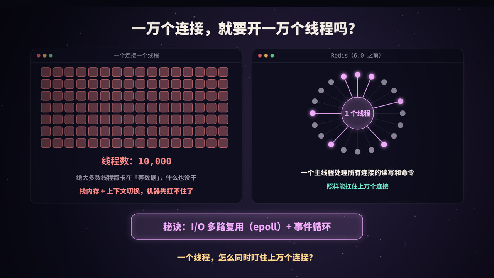
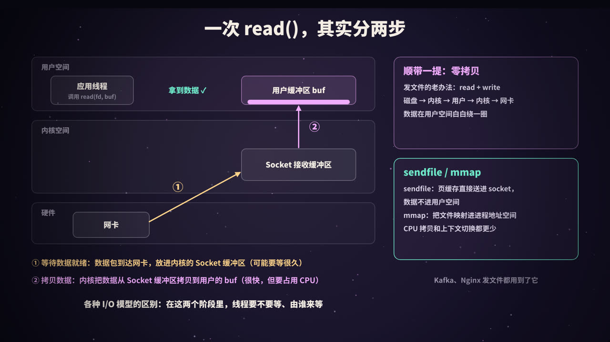
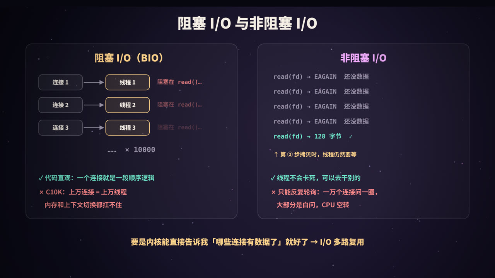
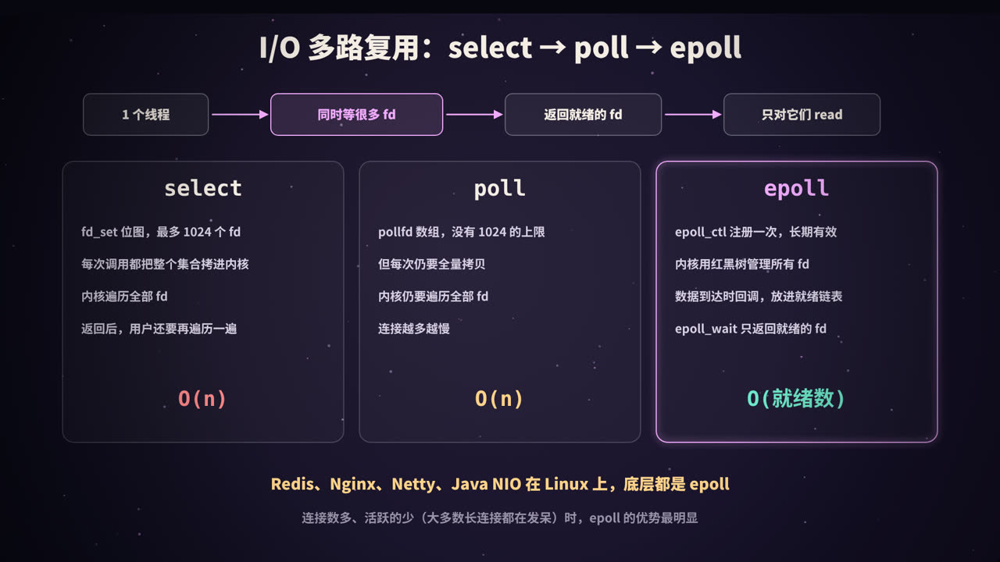
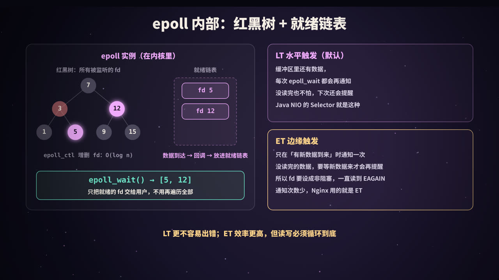
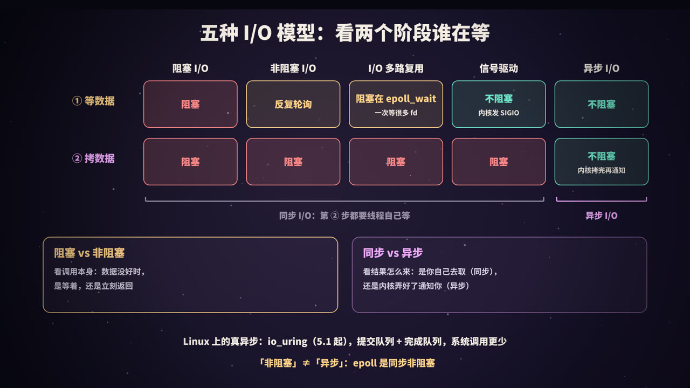
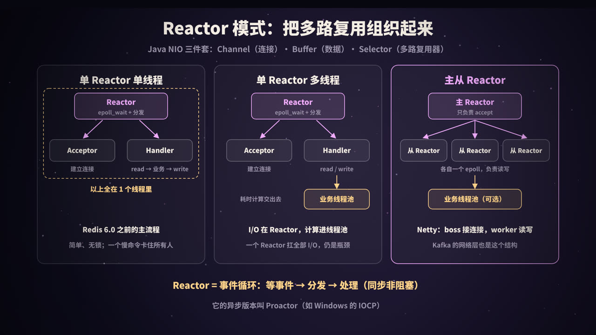

title: I/O 模型：从 BIO 到 epoll 与 Reactor
subtitle: 一次网络读取的两个阶段，阻塞、非阻塞、多路复用、信号驱动与异步 I/O，select/poll/epoll 的区别与 LT/ET，Reactor 三种线程模型、Java NIO 与零拷贝，附 Python 与 Java 可运行代码和 strace 实测
tag: 计算机与后端
color: #f0abfc



## 一个线程，怎么同时伺候上万个连接

写一个网络服务，最直观的写法是：来一个连接，开一个线程，线程里循环「读请求 → 处理 → 写响应」。代码顺着逻辑往下写，非常好懂。

问题出在连接数上来以后。一个聊天服务、一个推送网关、一个 Redis，常常同时挂着几万、几十万个长连接，而**绝大多数连接在绝大多数时间里都没有数据**，用户只是开着 App 而已。一连接一线程意味着：

- **一万个连接就是一万个线程**。每个线程都有自己的栈（Java 平台线程默认预留 1 MB 虚拟地址空间），还有内核里的调度结构；
- 这些线程几乎都**阻塞在 `read()` 上等数据**，什么也没干，却占着资源；
- 线程多了，操作系统在它们之间来回**上下文切换**，CPU 时间花在了「换人」上，而不是干活上。

这就是上世纪末被正式提出的 **C10K 问题**：单机怎么同时处理一万个并发连接？

而另一边，Redis 在 6.0 之前，网络读写和命令执行都由**一个主线程**完成，照样能同时服务上万个客户端连接；Nginx 每个 worker 进程也只有一个事件循环。它们靠的是同一个东西：**I/O 多路复用**（Linux 上是 epoll）+ **事件循环**。

这篇文章从最底层的「一次 read 到底发生了什么」讲起，依次讲清：

1. 五种 I/O 模型：阻塞、非阻塞、多路复用、信号驱动、异步；
2. select、poll、epoll 的区别，epoll 为什么快，LT 和 ET 是什么；
3. 「同步 / 异步」和「阻塞 / 非阻塞」到底怎么区分；
4. Reactor 模式的三种线程模型，Java NIO、Netty、Redis 分别对应哪种；
5. 零拷贝（sendfile、mmap）。

每个关键结论都配了能直接运行的代码，输出均为本机（Linux 6.x、Python 3.13、OpenJDK 21）真实运行结果。

> 本系列《进程、线程与协程》讲了线程本身的开销，《线程池》讲了线程的复用，《Redis 缓存》提到了 Redis 的单线程模型，这一篇把它们背后的 I/O 机制串起来。

## 一次 read()，其实分两步



### 用户空间与内核空间

应用程序运行在**用户空间**，不能直接操作网卡。网络数据的收发由**内核**负责：

- 网卡收到数据包后，通过 DMA 把数据写进内存，再由内核协议栈处理，最终放进这个连接对应的 **socket 接收缓冲区**；
- 应用调用 `read(fd, buf, len)`（或 `recv`）时，内核把接收缓冲区里的数据**拷贝**到应用提供的 `buf` 里。

这里的 `fd` 是**文件描述符**（file descriptor），一个小整数。在 Linux 上，打开的文件、socket、管道都用 fd 表示，「一切皆文件」。

### 两个阶段

所以一次网络读取，实际上包含两个阶段：

| 阶段 | 做什么 | 耗时特点 |
|---|---|---|
| **① 等待数据就绪** | 等数据从网络到达，进入内核的 socket 接收缓冲区 | 不确定，可能几毫秒，也可能几小时（对方一直不发） |
| **② 拷贝数据** | 内核把数据从 socket 缓冲区拷贝到用户空间的 buf | 很快，但需要 CPU 参与 |

**所有 I/O 模型的区别，都在于这两个阶段里，调用线程是否被阻塞、由谁来等。** 把这句话记住，后面的五种模型就都是它的变体。

阶段 ① 是真正「浪费时间」的地方。一个线程如果傻等在阶段 ①，那它在等待期间就什么也干不了。I/O 模型演进的主线，就是**怎么让线程不再傻等阶段 ①**。

## 阻塞 I/O 与非阻塞 I/O



### 阻塞 I/O（BIO）

socket 默认就是阻塞的。调用 `read()` 时，如果接收缓冲区里没有数据，线程就被挂起（阶段 ①），直到数据到达并拷贝完成（阶段 ②）才返回。

因为一个线程在 `read()` 上会一直卡住，所以要同时服务多个连接，只能**一个连接一个线程**：

```text
主线程：  while (true) { conn = accept(); new Thread(() -> handle(conn)).start(); }
工作线程：while (true) { read(conn) → 处理 → write(conn) }   // 没数据就阻塞在 read
```

| | 说明 |
|---|---|
| 优点 | 代码直观，一个连接的处理逻辑就是一段顺序执行的代码 |
| 缺点 | 线程数 = 连接数；大量线程阻塞在 `read` 上空等，内存和上下文切换开销随连接数线性增长 |
| 适合 | 连接数少、每个连接都很忙的场景，比如内部服务之间的少量长连接、数据库连接 |

用线程池代替「来一个开一个」（有时被称为「伪异步 I/O」），可以给线程数加上限，但治标不治本：线程池里的线程依然阻塞在 `read` 上，池满了以后，新连接只能排队，哪怕绝大多数已有连接根本没有数据。

### 非阻塞 I/O（NIO）

把 socket 设成非阻塞（`fcntl(fd, F_SETFL, O_NONBLOCK)`）后，`read()` 在没有数据时**立即返回** `-1`，错误码为 `EAGAIN`（或 `EWOULDBLOCK`），意思是「现在没数据，过会儿再来」。

```text
read(fd) → EAGAIN   还没数据
read(fd) → EAGAIN   还没数据
read(fd) → EAGAIN   还没数据
read(fd) → 128 字节  ✓          ← 这一次进入阶段 ②，拷贝时线程仍然要等
```

线程不会被卡死，可以一个线程轮流去问很多个连接。但问题也很明显：

- **只能靠轮询**：一万个连接问一圈，绝大多数回答都是 `EAGAIN`，CPU 在空转；
- 轮询间隔不好定：问得勤，浪费 CPU；问得少，响应变慢；
- 阶段 ② 的拷贝仍然是同步的，线程要等它完成。

> 注意：这里的「非阻塞 I/O」指的是 socket 的 `O_NONBLOCK` 模式。Java 里的 **NIO** 是「New I/O」的缩写，它的核心是下面要讲的多路复用（Selector），两者别混淆。

非阻塞 I/O 本身很少单独使用，但它是多路复用的**基础**：多路复用告诉你「哪些 fd 可以读了」，然后你用非阻塞的方式去读，保证不会意外卡住。

我们真正想要的是：**别让我一个个去问，让内核直接告诉我哪些连接有数据了**。这就是 I/O 多路复用。

## I/O 多路复用：select、poll、epoll



**多路复用**的意思是：用**一个线程**同时等待**多个 fd**，任何一个就绪了，内核就把线程唤醒，告诉它哪些就绪了。线程再只对这些就绪的 fd 做读写。

线程依然会阻塞，但阻塞在「等任意一个 fd 就绪」这件事上，一次等一万个，而不是一个线程等一个。Linux 提供了三代接口。

### select

```c
int select(int nfds, fd_set *readfds, fd_set *writefds,
           fd_set *exceptfds, struct timeval *timeout);
```

`fd_set` 是一个**位图**，第 n 位为 1 表示关心 fd n。用法是：

1. 每次调用前，把所有关心的 fd 写进 `fd_set`；
2. 调用 `select`，**整个位图被拷贝进内核**；
3. 内核**遍历所有 fd**，检查是否就绪；没有就绪的就睡眠，有就绪的就把位图中未就绪的位清零；
4. 返回后，**用户再遍历一遍位图**，找出哪些位还是 1；
5. 因为位图被内核改写了，下一轮要**重新填一遍**。

主要问题：

- **fd 上限**：`fd_set` 的大小由 `FD_SETSIZE` 决定，glibc 中是 **1024**。注意这是对 **fd 的编号**的限制，不是数量：只要某个 fd 的编号 ≥ 1024 就不能用 select，哪怕总共只监听几个；
- **每次全量拷贝**：每次调用都要把整个集合在用户态和内核态之间拷来拷去；
- **两次 O(n) 遍历**：内核遍历一次，用户再遍历一次，连接越多越慢。

### poll

```c
struct pollfd { int fd; short events; short revents; };
int poll(struct pollfd *fds, nfds_t nfds, int timeout);
```

poll 用一个 `pollfd` 数组代替位图：

- **没有 1024 的限制**，数组多长都可以（受进程 fd 上限约束）；
- `events`（关心什么）和 `revents`（发生了什么）分开，不用每轮重新初始化。

但本质没变：**每次调用仍然要把整个数组拷进内核，内核仍然要遍历全部**，返回后用户也要遍历全部。

### epoll

epoll 把「注册要监听的 fd」和「等待事件」**拆成了两步**：

```c
int epfd = epoll_create1(0);                          // 1. 创建一个 epoll 实例

struct epoll_event ev = { .events = EPOLLIN, .data.fd = connfd };
epoll_ctl(epfd, EPOLL_CTL_ADD, connfd, &ev);           // 2. 注册一次，长期有效

struct epoll_event events[1024];
int n = epoll_wait(epfd, events, 1024, -1);           // 3. 只返回就绪的 fd
for (int i = 0; i < n; i++) handle(events[i].data.fd);
```

- **注册一次，长期有效**：fd 只在加入、修改、删除时通过 `epoll_ctl` 告诉内核一次，不用每轮都全量拷贝；
- **只返回就绪的**：`epoll_wait` 直接返回就绪事件的列表，有 3 个就绪就返回 3 个，用户不用遍历全部；
- **没有 1024 的限制**。

### 对比

| | select | poll | epoll |
|---|---|---|---|
| fd 集合的表示 | 位图 `fd_set` | `pollfd` 数组 | 内核中的红黑树 |
| fd 数量限制 | fd 编号 < 1024 | 无（受进程 fd 上限约束） | 无（受进程 fd 上限约束） |
| 每次调用拷贝 | 整个集合 | 整个数组 | 无，注册时拷一次 |
| 内核找就绪 fd | 遍历全部 | 遍历全部 | 回调把就绪 fd 放进就绪链表 |
| 用户找就绪 fd | 遍历全部 | 遍历全部 | 直接拿到就绪列表 |
| 每次等待的复杂度 | O(监听数) | O(监听数) | O(就绪数) |
| 可移植性 | 几乎所有平台 | 类 Unix | 仅 Linux |

macOS / FreeBSD 上对应 epoll 的是 **kqueue**，Windows 上是 **IOCP**（它其实是异步 I/O，后面会讲）。Java 的 `Selector`、Netty、libuv（Node.js）等都在不同平台上封装了这些接口。

epoll 不是在所有情况下都比 select / poll 快。如果只监听几个 fd，或者所有连接都非常活跃（每次几乎全部就绪），三者差距不大。epoll 的优势在**连接多、活跃少**的场景，这恰恰是大多数长连接服务的常态。

### 实验：select 的 1024 限制

下面的代码创建 600 对 socket（共 1200 个 fd），分别用 select、poll、epoll 去监听其中 600 个：

```python
import select, socket

pairs = [socket.socketpair() for _ in range(600)]   # 600 对，共 1200 个 fd
socks = [b for _, b in pairs]                       # 监听每对的接收端
print("最大的 fd 编号:", max(s.fileno() for s in socks))

small = [s for s in socks if s.fileno() < 1024]
print("select 监听编号 < 1024 的", len(small), "个 fd:", len(select.select(small, [], [], 0)[0]), "个就绪")
try:
    select.select(socks, [], [], 0)                 # 含有编号 ≥ 1024 的 fd
except ValueError as e:
    print("select 监听全部", len(socks), "个 fd: ValueError:", e)

p = select.poll()
ep = select.epoll()
for s in socks:
    p.register(s, select.POLLIN)
    ep.register(s, select.EPOLLIN)
print("poll  监听", len(socks), "个 fd:", len(p.poll(0)), "个就绪")
print("epoll 监听", len(socks), "个 fd:", len(ep.poll(0)), "个就绪")

pairs[123][0].send(b"hi")                           # 只给其中一个连接发数据
print("给第 123 个连接发数据后 → poll 返回:", p.poll(0), " epoll 返回:", ep.poll(0))
print("第 123 个连接的 fd 是", socks[123].fileno())
```

输出：

```text
最大的 fd 编号: 1202
select 监听编号 < 1024 的 510 个 fd: 0 个就绪
select 监听全部 600 个 fd: ValueError: filedescriptor out of range in select()
poll  监听 600 个 fd: 0 个就绪
epoll 监听 600 个 fd: 0 个就绪
给第 123 个连接发数据后 → poll 返回: [(250, 1)]  epoll 返回: [(250, 1)]
第 123 个连接的 fd 是 250
```

只监听了 600 个 fd，select 就报错了，因为其中有编号超过 1024 的 fd。这也是 Linux 手册页明确建议新程序使用 poll 或 epoll、不要再用 select 的原因。

## epoll 内部：红黑树、就绪链表与 LT/ET



### 内部结构

调用 `epoll_create1` 时，内核创建一个 eventpoll 对象，里面有两个关键的数据结构：

- **红黑树**：保存所有通过 `epoll_ctl` 注册的 fd（每个 fd 对应一个节点）。增、删、改、查都是 O(log n)，也能快速判断一个 fd 是否已经注册过；
- **就绪链表**：保存当前已经就绪、等待交给用户的 fd。

关键在于**回调**：`epoll_ctl` 注册 fd 时，内核会在这个 socket 的等待队列上挂一个回调函数。当数据到达、socket 变为可读时，协议栈唤醒等待队列，回调函数就把对应的节点**加入就绪链表**，并唤醒阻塞在 `epoll_wait` 上的线程。

`epoll_wait` 要做的事情就很简单了：看就绪链表是否为空；不为空，就把就绪的事件拷贝到用户提供的数组里返回。**它从不遍历全部 fd**。

<figure>
<svg viewBox="0 0 440 300" xmlns="http://www.w3.org/2000/svg" role="img" aria-label="epoll 内部结构">
  <rect width="440" height="300" fill="#0f0e1c"/>
  <defs><marker id="ea" viewBox="0 0 10 10" refX="9" refY="5" markerWidth="7" markerHeight="7" orient="auto"><path d="M0,0 L10,5 L0,10 z" fill="#f0abfc"/></marker></defs>
  <g font-family="PingFang SC, Noto Sans SC, sans-serif" text-anchor="middle">
    <rect x="10" y="10" width="420" height="200" rx="14" fill="rgba(255,255,255,.03)" stroke="rgba(255,255,255,.2)"/>
    <text x="220" y="34" fill="#f0abfc" font-size="15" font-weight="800">内核中的 epoll 实例</text>
    <text x="120" y="58" fill="#9a93a8" font-size="12">红黑树：所有注册的 fd</text>
    <g stroke="rgba(255,255,255,.35)" stroke-width="1.5">
      <line x1="120" y1="82" x2="75" y2="122"/><line x1="120" y1="82" x2="165" y2="122"/>
      <line x1="75" y1="122" x2="50" y2="162"/><line x1="75" y1="122" x2="100" y2="162"/>
      <line x1="165" y1="122" x2="140" y2="162"/><line x1="165" y1="122" x2="190" y2="162"/>
    </g>
    <g font-size="12" font-weight="800" fill="#f4ede4">
      <circle cx="120" cy="82" r="15" fill="#3a3648"/><text x="120" y="86">7</text>
      <circle cx="75" cy="122" r="15" fill="#8a4a55"/><text x="75" y="126">3</text>
      <circle cx="165" cy="122" r="15" fill="#f0abfc"/><text x="165" y="126" fill="#1a0f22">12</text>
      <circle cx="50" cy="162" r="15" fill="#3a3648"/><text x="50" y="166">1</text>
      <circle cx="100" cy="162" r="15" fill="#f0abfc"/><text x="100" y="166" fill="#1a0f22">5</text>
      <circle cx="140" cy="162" r="15" fill="#3a3648"/><text x="140" y="166">9</text>
      <circle cx="190" cy="162" r="15" fill="#3a3648"/><text x="190" y="166">15</text>
    </g>
    <text x="340" y="58" fill="#9a93a8" font-size="12">就绪链表</text>
    <rect x="290" y="72" width="100" height="30" rx="8" fill="rgba(240,171,252,.14)" stroke="#f0abfc"/>
    <text x="340" y="92" fill="#f0abfc" font-size="13" font-weight="800">fd 5</text>
    <rect x="290" y="112" width="100" height="30" rx="8" fill="rgba(240,171,252,.14)" stroke="#f0abfc"/>
    <text x="340" y="132" fill="#f0abfc" font-size="13" font-weight="800">fd 12</text>
    <line x1="117" y1="160" x2="286" y2="90" stroke="#f0abfc" stroke-width="1.8" stroke-dasharray="5 4" marker-end="url(#ea)"/>
    <line x1="182" y1="122" x2="286" y2="127" stroke="#f0abfc" stroke-width="1.8" stroke-dasharray="5 4" marker-end="url(#ea)"/>
    <text x="340" y="170" fill="#f0abfc" font-size="12">数据到达 → 回调入链表</text>
    <text x="220" y="196" fill="#9a93a8" font-size="12">epoll_ctl：增删改红黑树节点，O(log n)</text>
    <line x1="340" y1="210" x2="340" y2="240" stroke="#86efac" stroke-width="2.5" marker-end="url(#ea)"/>
    <rect x="70" y="244" width="300" height="44" rx="12" fill="rgba(134,239,172,.12)" stroke="#86efac"/>
    <text x="220" y="271" fill="#86efac" font-size="14" font-weight="800">epoll_wait() 只取就绪链表 → [5, 12]</text>
  </g>
</svg>
<figcaption>红黑树负责「记住要监听谁」，就绪链表负责「记录谁已经好了」。epoll_wait 只看就绪链表，代价与就绪数成正比，与监听总数无关</figcaption>
</figure>

一个流传很广的说法是「epoll 用 mmap 在内核和用户空间共享内存，所以快」。这是**误解**：`epoll_wait` 是把就绪事件拷贝到用户数组里的。epoll 快，靠的是「注册与等待分离」和「回调 + 就绪链表」。

另外，epoll 只能用于支持「就绪通知」的 fd，比如 socket、管道、eventfd。**普通磁盘文件不行**：对普通文件调用 `epoll_ctl` 会返回 `EPERM`，因为在这个模型里普通文件永远被视为「就绪」。磁盘 I/O 的异步化要靠线程池或 io_uring。

### LT 与 ET：两种触发方式

epoll 有两种通知方式，区别在于「数据没读完时，下次还提不提醒」。

| | LT（水平触发，Level-Triggered） | ET（边缘触发，Edge-Triggered） |
|---|---|---|
| 何时通知 | 只要缓冲区里**还有**数据，每次 `epoll_wait` 都返回它 | 只在状态**变化**时（有新数据到达）通知一次 |
| 没读完会怎样 | 下次 `epoll_wait` 继续提醒 | 不再提醒，直到下一次有新数据到达 |
| 编程要求 | 宽松，读一部分也没关系 | fd 必须是非阻塞的，**循环读到 `EAGAIN`** 为止 |
| 默认 | 是（不加 `EPOLLET` 就是 LT） | 注册时加 `EPOLLET` |
| 使用者 | select / poll 都是这种语义；Java NIO 的 Selector；Redis | Nginx；Netty 的原生 epoll 传输默认使用 ET |

为什么 ET 必须用非阻塞 fd？因为 ET 要求你一直读到读空，而判断「读空」的唯一办法就是读到 `EAGAIN`。如果 fd 是阻塞的，最后一次 `read` 会因为没数据而**卡死**整个事件循环。

ET 的好处是通知次数少：同一批数据只通知一次，适合追求极致性能、并且能保证每次把数据处理干净的程序。代价是更容易写出 bug：只要有一次没读完，剩下的数据就可能「饿死」在缓冲区里，直到对端再发新数据。

### 实验：LT 和 ET 的区别

用 Python 的 `select.epoll` 直接观察。对端发来 10 字节，我们只读 4 字节，再看 epoll 还提不提醒：

```python
import select, socket

def demo(mode):
    a, b = socket.socketpair()                # 一对互相连通的 socket
    b.setblocking(False)
    ep = select.epoll()
    flags = select.EPOLLIN | (select.EPOLLET if mode == "ET" else 0)
    ep.register(b.fileno(), flags)

    a.send(b"0123456789")                     # 对端发来 10 字节
    print(f"[{mode}] 第 1 次 epoll_wait:", ep.poll(0))
    print(f"[{mode}] 只读 4 字节:", b.recv(4))
    print(f"[{mode}] 第 2 次 epoll_wait:", ep.poll(0), "  ← 缓冲区里还剩 6 字节")
    a.send(b"!")                              # 又来了新数据
    print(f"[{mode}] 新数据到达后:", ep.poll(0))
    # ET 的正确读法：循环读到 EAGAIN
    buf = b""
    while True:
        try:
            chunk = b.recv(4)
            if not chunk: break
            buf += chunk
        except BlockingIOError:               # EAGAIN：读空了
            break
    print(f"[{mode}] 循环读到 EAGAIN:", buf)
    print(f"[{mode}] 读空后 epoll_wait:", ep.poll(0))
    print()

demo("LT")
demo("ET")
```

输出（`(4, 1)` 表示 fd 4 上发生了 `EPOLLIN` 事件）：

```text
[LT] 第 1 次 epoll_wait: [(4, 1)]
[LT] 只读 4 字节: b'0123'
[LT] 第 2 次 epoll_wait: [(4, 1)]   ← 缓冲区里还剩 6 字节
[LT] 新数据到达后: [(4, 1)]
[LT] 循环读到 EAGAIN: b'456789!'
[LT] 读空后 epoll_wait: []

[ET] 第 1 次 epoll_wait: [(4, 1)]
[ET] 只读 4 字节: b'0123'
[ET] 第 2 次 epoll_wait: []   ← 缓冲区里还剩 6 字节
[ET] 新数据到达后: [(4, 1)]
[ET] 循环读到 EAGAIN: b'456789!'
[ET] 读空后 epoll_wait: []
```

关键就在第 2 次 `epoll_wait`：缓冲区里明明还剩 6 字节，LT 继续提醒，ET 一声不吭，直到新数据 `!` 到达才再次通知。如果程序在 ET 模式下只读一次就去干别的，那 6 个字节就会一直躺在缓冲区里。

> 还有一个相关的标志 `EPOLLONESHOT`：事件触发一次后自动禁用这个 fd，需要处理完后用 `EPOLL_CTL_MOD` 重新启用。多线程同时调用 `epoll_wait` 时，可以用它保证同一个连接同一时刻只被一个线程处理。

## 五种 I/O 模型，与「同步 / 异步、阻塞 / 非阻塞」



### 五种模型

经典的 Unix 网络编程教材把 I/O 分成五种模型。用「两个阶段」一对照就很清楚：

| 模型 | 阶段 ① 等数据 | 阶段 ② 拷数据 | 典型接口 |
|---|---|---|---|
| 阻塞 I/O | 阻塞 | 阻塞 | 默认的 `read` / `recv` |
| 非阻塞 I/O | 不阻塞，但要反复轮询 | 阻塞 | `O_NONBLOCK` + `read` 返回 `EAGAIN` |
| I/O 多路复用 | 阻塞在 select / epoll_wait 上（一次等很多 fd） | 阻塞 | select、poll、epoll |
| 信号驱动 I/O | 不阻塞，数据就绪时内核发 `SIGIO` 信号 | 阻塞 | `fcntl` 设置 `O_ASYNC` + 信号处理函数 |
| 异步 I/O | 不阻塞 | 不阻塞，内核拷贝完成后再通知 | POSIX AIO、Linux io_uring、Windows IOCP |

几点说明：

- **信号驱动 I/O** 在实践中很少用于 TCP：TCP socket 上很多种情况都会触发 `SIGIO`，信号处理函数里很难分辨到底发生了什么，而且信号本身就不好用；
- **异步 I/O** 才是唯一一个「两个阶段都不用等」的模型：你告诉内核「把数据读到这个 buf，好了叫我」，然后就去干别的，内核把数据**拷贝完**之后才通知你；
- 前四种模型中，阶段 ② 都需要调用线程亲自参与、等待拷贝完成。

### 两组概念：阻塞 / 非阻塞 vs 同步 / 异步

这是面试的高频混淆点。它们描述的是**两个不同的维度**：

| 维度 | 关心的问题 | 例子 |
|---|---|---|
| **阻塞 vs 非阻塞** | **调用本身**：数据没准备好时，这个调用是挂起等待，还是立刻返回 | 阻塞 socket 的 `read` 会挂起；非阻塞 socket 的 `read` 立刻返回 `EAGAIN` |
| **同步 vs 异步** | **结果怎么拿到**：是你的线程自己把数据取回来（同步），还是内核把事情全做完后通知你（异步） | `read` 是同步的：数据要靠你调用它才会拷贝进来；io_uring 是异步的：完成时结果已经在你的 buf 里了 |

按 POSIX 的定义：**同步 I/O 操作会让请求进程阻塞，直到 I/O 操作完成；异步 I/O 操作则不会**。这里的「I/O 操作完成」包括阶段 ②。所以：

- 阻塞 I/O、非阻塞 I/O、I/O 多路复用、信号驱动 I/O，都是**同步 I/O**；
- 只有异步 I/O 是**异步 I/O**；
- **epoll 是同步非阻塞模型**（通常和非阻塞 fd 一起使用），不是异步 I/O。「非阻塞」不等于「异步」。

一个生活化的比喻：去餐厅取餐。

- 阻塞：站在窗口一直等，餐好了自己端走；
- 非阻塞轮询：每隔一分钟去窗口问一次「好了没」；
- 多路复用：同时点了十家的餐，坐在大厅看叫号屏，哪家号亮了就去哪家端；
- 异步：外卖，做好了直接送到你桌上。

前三种，最后都是**你自己去端**（同步）；只有外卖是**送到手上**（异步）。

### Linux 上的异步 I/O：从 AIO 到 io_uring

Linux 在异步 I/O 上走过不少弯路：

- **POSIX AIO**（`aio_read` 等）：glibc 的实现其实是在用户态用线程池模拟的；
- **Linux 原生 AIO**（`io_submit`，常配合 libaio 使用）：主要在 `O_DIRECT`（绕过页缓存的直接 I/O）读写文件时才是真正异步的，对网络 socket 支持很差，主要被数据库等少数软件使用；
- **io_uring**（Linux 5.1 引入）：用户态和内核共享两个环形队列，**提交队列（SQ）**和**完成队列（CQ）**。应用把请求写进 SQ，内核完成后把结果放进 CQ。它同时支持文件和网络 I/O，还能批量提交，大幅减少系统调用次数，甚至可以配置内核线程主动轮询 SQ，做到提交时不需要系统调用。

io_uring 功能强大，但接口和安全模型都比较复杂，一些发行版和容器运行时出于安全考虑默认限制了它的使用。目前主流的网络框架仍以 epoll 为主，io_uring 正在逐步被采用。

### Java 的三种 I/O

| Java API | 引入版本 | 对应模型 | 说明 |
|---|---|---|---|
| `java.io`（`InputStream`、`Socket`） | JDK 1.0 | 阻塞 I/O | 常说的 **BIO** |
| `java.nio`（`Channel`、`Buffer`、`Selector`） | JDK 1.4 | I/O 多路复用 | 常说的 **NIO**；Linux 上 Selector 基于 epoll |
| `AsynchronousSocketChannel` 等 | JDK 7（NIO.2） | 异步 I/O（API 形式） | 常说的 **AIO**；Windows 上基于 IOCP，**Linux 上内部用 epoll + 线程池模拟** |

因为 Linux 上的 Java AIO 并不是内核级的异步，性能没有明显优势，所以 Netty 等主流框架在 Linux 上都基于 NIO（或直接调用 epoll 的原生传输）。

## Reactor 模式：把多路复用组织起来



epoll 只是一个系统调用。要用它写出一个结构清晰的服务器，需要一种组织方式，这就是 **Reactor 模式**（反应器模式）：

1. **等事件**：调用 `epoll_wait` / `selector.select()`，阻塞等待任意 fd 上的事件；
2. **分发**：根据事件类型，交给对应的处理器：新连接交给 **Acceptor**，可读 / 可写交给连接对应的 **Handler**；
3. **处理**：Handler 读数据、执行业务逻辑、写响应；
4. 回到第 1 步。

这个循环就叫**事件循环**（event loop）。Redis 的 ae、Nginx、Node.js 的 libuv、Netty 的 EventLoop，本质都是它。

### Java NIO 三件套

Java NIO 正好提供了实现 Reactor 所需的三块积木：

| 组件 | 作用 | 对应的底层概念 |
|---|---|---|
| **Channel** | 一个连接（或文件），可以设置为非阻塞，读写都要经过 Buffer | fd |
| **Buffer** | 一块内存，有 `position`、`limit`、`capacity` 三个指针；写完要 `flip()` 才能读 | 用户空间的 buf |
| **Selector** | 多路复用器：Channel 注册到它上面，`select()` 返回就绪的 SelectionKey | epoll 实例 |

### 三种线程模型

**① 单 Reactor 单线程**

所有事情都在一个线程里：等事件、accept、读、业务处理、写。

- 优点：没有线程切换，没有锁，实现简单；
- 缺点：只能用一个 CPU 核；**任何一个处理慢了，所有连接都要等**；
- 例子：**Redis 6.0 之前的主处理流程**。Redis 的命令绝大多数是内存操作，非常快，所以单线程反而是优势。这也是为什么 Redis 里要警惕 `KEYS *`、大 key 删除等慢操作，它们会卡住所有客户端。

**② 单 Reactor 多线程**

Reactor 线程负责等事件和 I/O 读写，读到完整请求后，把**业务处理**交给线程池，处理完再由 Reactor 线程写回。

- 优点：耗时的业务逻辑不再阻塞事件循环，能利用多核；
- 缺点：所有连接的 I/O 仍然由**一个** Reactor 线程完成，连接数和流量都很大时，它会成为瓶颈；业务线程和 Reactor 线程之间要做好线程安全。

**③ 主从 Reactor（多 Reactor 多线程）**

- **主 Reactor**（通常 1 个线程）：只负责 `accept` 新连接，然后把连接分配给某个从 Reactor；
- **从 Reactor**（多个线程，一般与 CPU 核数相当）：每个都有自己的 Selector / epoll 实例，负责一批连接的读写；一个连接从始至终由同一个从 Reactor 处理，不需要加锁；
- 耗时业务可以再交给单独的业务线程池。

这是目前高性能网络框架的主流方案：

- **Netty**：`bossGroup` 就是主 Reactor，`workerGroup` 就是从 Reactor，每个 `EventLoop` 是一个线程加一个 Selector；
- **Kafka** 的网络层：一个 Acceptor 线程接收连接，多个 Processor 线程（`num.network.threads`）各自用 Selector 处理读写，再把请求交给 I/O 线程池（`num.io.threads`）；
- **Redis 6.0 起**可以开启 I/O 线程（`io-threads`）分担网络读写和协议解析，但**命令仍然由主线程串行执行**，所以「Redis 执行命令是单线程的」这一点没变。

Netty 中的典型写法（参考写法，Netty 4.1 风格的 API，未在本机运行）：

```java
EventLoopGroup boss = new NioEventLoopGroup(1);      // 主 Reactor：1 个线程负责 accept
EventLoopGroup worker = new NioEventLoopGroup();     // 从 Reactor：默认 CPU 核数 × 2 个线程
try {
    new ServerBootstrap()
        .group(boss, worker)
        .channel(NioServerSocketChannel.class)
        .childHandler(new ChannelInitializer<SocketChannel>() {
            @Override
            protected void initChannel(SocketChannel ch) {
                ch.pipeline().addLast(new EchoHandler());   // 在 worker 线程中执行
            }
        })
        .bind(8080).sync()
        .channel().closeFuture().sync();
} finally {
    boss.shutdownGracefully();
    worker.shutdownGracefully();
}
```

**Netty 开发的铁律：不要在 EventLoop 线程里做阻塞操作**（查数据库、调用远程接口、`Thread.sleep`）。一个 EventLoop 线程负责成百上千个连接，它一卡，这些连接全都跟着卡。耗时操作要交给业务线程池。

### Reactor 与 Proactor

Reactor 基于**同步** I/O：内核告诉你「可以读了」，你自己去读。对应地，基于**异步** I/O 的模式叫 **Proactor**：你发起「读到这个 buf」的请求，内核读完后通知你「已经读好了」，你直接处理数据。Windows 的 IOCP 是典型的 Proactor 基础设施；Linux 上 io_uring 也让 Proactor 风格的实现成为可能。

### 题外话：写法是 BIO，底层是 epoll

Reactor 模型性能好，但代码被拆成了一个个回调，不如 BIO 好写好读。于是新的思路出现了：**让程序员写阻塞风格的代码，由运行时在底层换成 epoll**。

- **Go**：goroutine 里调用 `conn.Read()` 看起来是阻塞的，实际上 Go 运行时的 netpoller 把 socket 设为非阻塞并注册到 epoll，goroutine 被挂起，数据就绪后再被唤醒；
- **Java 21 虚拟线程**：在虚拟线程中调用阻塞的 socket 读写时，JDK 会把虚拟线程从载体线程上卸下，由内部基于 epoll 的 poller 等待就绪，再把虚拟线程调度回来。

于是「一连接一（虚拟）线程」的写法重新变得可行。这部分内容详见本系列《进程、线程与协程》。

## 零拷贝：让数据少绕路

回到「阶段 ② 拷贝数据」。读网络是这样，**发文件**的时候拷贝更多。比如一个静态文件服务器、Kafka 把消息日志发给消费者，最朴素的写法是：

```c
read(file_fd, buf, len);     // 磁盘 → 内核页缓存 → 用户 buf
write(sock_fd, buf, len);    // 用户 buf → socket 缓冲区 → 网卡
```

数据从磁盘出发，先进内核的**页缓存**，再拷到用户空间的 `buf`，再拷回内核的 socket 缓冲区，最后到网卡。应用程序对这些数据**什么也没做**，却让它在用户空间绕了一圈。

<figure>
<svg viewBox="0 0 440 330" xmlns="http://www.w3.org/2000/svg" role="img" aria-label="传统 read + write 与 sendfile 的数据路径对比">
  <rect width="440" height="330" fill="#0f0e1c"/>
  <defs>
    <marker id="za" viewBox="0 0 10 10" refX="9" refY="5" markerWidth="7" markerHeight="7" orient="auto"><path d="M0,0 L10,5 L0,10 z" fill="#ffd38a"/></marker>
    <marker id="zb" viewBox="0 0 10 10" refX="9" refY="5" markerWidth="7" markerHeight="7" orient="auto"><path d="M0,0 L10,5 L0,10 z" fill="#ff8a8a"/></marker>
    <marker id="zc" viewBox="0 0 10 10" refX="9" refY="5" markerWidth="7" markerHeight="7" orient="auto"><path d="M0,0 L10,5 L0,10 z" fill="#86efac"/></marker>
  </defs>
  <g font-family="PingFang SC, Noto Sans SC, sans-serif" text-anchor="middle">
    <text x="220" y="22" fill="#f4ede4" font-size="15" font-weight="800">read + write：4 次拷贝，其中 2 次是 CPU 拷贝</text>
    <text x="22" y="56" fill="#9a93a8" font-size="11" text-anchor="start">用户</text>
    <text x="22" y="106" fill="#9a93a8" font-size="11" text-anchor="start">内核</text>
    <text x="22" y="150" fill="#9a93a8" font-size="11" text-anchor="start">硬件</text>
    <line x1="14" y1="76" x2="426" y2="76" stroke="rgba(255,255,255,.15)" stroke-dasharray="4 4"/>
    <rect x="170" y="38" width="100" height="30" rx="8" fill="rgba(240,171,252,.14)" stroke="#f0abfc"/>
    <text x="220" y="58" fill="#f0abfc" font-size="13" font-weight="700">用户 buf</text>
    <rect x="62" y="88" width="96" height="30" rx="8" fill="rgba(255,255,255,.06)" stroke="#9a93a8"/>
    <text x="110" y="108" fill="#f4ede4" font-size="13" font-weight="700">页缓存</text>
    <rect x="282" y="88" width="120" height="30" rx="8" fill="rgba(255,255,255,.06)" stroke="#9a93a8"/>
    <text x="342" y="108" fill="#f4ede4" font-size="13" font-weight="700">socket 缓冲区</text>
    <rect x="62" y="134" width="96" height="28" rx="8" fill="rgba(255,255,255,.04)" stroke="#9a93a8"/>
    <text x="110" y="153" fill="#f4ede4" font-size="13">磁盘</text>
    <rect x="294" y="134" width="96" height="28" rx="8" fill="rgba(255,255,255,.04)" stroke="#9a93a8"/>
    <text x="342" y="153" fill="#f4ede4" font-size="13">网卡</text>
    <line x1="110" y1="134" x2="110" y2="122" stroke="#ffd38a" stroke-width="2.2" marker-end="url(#za)"/>
    <line x1="140" y1="88" x2="174" y2="70" stroke="#ff8a8a" stroke-width="2.2" marker-end="url(#zb)"/>
    <line x1="266" y1="70" x2="302" y2="88" stroke="#ff8a8a" stroke-width="2.2" marker-end="url(#zb)"/>
    <line x1="342" y1="118" x2="342" y2="131" stroke="#ffd38a" stroke-width="2.2" marker-end="url(#za)"/>
    <text x="220" y="188" fill="#9a93a8" font-size="12"><tspan fill="#ffd38a">黄色：DMA 拷贝</tspan>　<tspan fill="#ff8a8a">红色：CPU 拷贝</tspan>　另有 4 次用户态 / 内核态切换</text>
    <line x1="14" y1="204" x2="426" y2="204" stroke="rgba(255,255,255,.12)"/>
    <text x="220" y="228" fill="#86efac" font-size="15" font-weight="800">sendfile（网卡支持 SG-DMA）：不经过用户空间</text>
    <rect x="62" y="248" width="96" height="30" rx="8" fill="rgba(255,255,255,.06)" stroke="#9a93a8"/>
    <text x="110" y="268" fill="#f4ede4" font-size="13" font-weight="700">页缓存</text>
    <rect x="282" y="248" width="120" height="30" rx="8" fill="rgba(255,255,255,.06)" stroke="#9a93a8" stroke-dasharray="4 3"/>
    <text x="342" y="268" fill="#9a93a8" font-size="12">只放描述符</text>
    <rect x="294" y="294" width="96" height="28" rx="8" fill="rgba(255,255,255,.04)" stroke="#9a93a8"/>
    <text x="342" y="313" fill="#f4ede4" font-size="13">网卡</text>
    <rect x="62" y="294" width="96" height="28" rx="8" fill="rgba(255,255,255,.04)" stroke="#9a93a8"/>
    <text x="110" y="313" fill="#f4ede4" font-size="13">磁盘</text>
    <line x1="110" y1="294" x2="110" y2="282" stroke="#ffd38a" stroke-width="2.2" marker-end="url(#za)"/>
    <line x1="158" y1="270" x2="290" y2="304" stroke="#86efac" stroke-width="2.2" marker-end="url(#zc)"/>
    <text x="222" y="270" fill="#86efac" font-size="11">DMA 直接从页缓存取数据</text>
  </g>
</svg>
<figcaption>传统方式让数据在内核与用户空间之间来回拷贝；sendfile 让数据留在内核里，网卡支持分散/聚集 DMA 时，连内核内部的 CPU 拷贝也省掉了</figcaption>
</figure>

### 几种方式对比

| 方式 | 系统调用 | 上下文切换 | 拷贝次数 | 其中 CPU 拷贝 |
|---|---|---|---|---|
| `read` + `write` | 2 | 4 次 | 4 次 | 2 次 |
| `mmap` + `write` | 2 | 4 次 | 3 次 | 1 次（页缓存 → socket 缓冲区） |
| `sendfile` | 1 | 2 次 | 3 次 | 1 次 |
| `sendfile` + SG-DMA 网卡 | 1 | 2 次 | 2 次 | 0 次 |

（以上按一次完整传输的经典分析计；实际的系统调用次数取决于每次传输的数据量。）

- **mmap**：把文件映射进进程的地址空间，用户态访问这段内存就等于直接访问页缓存，省掉「页缓存 → 用户 buf」这次拷贝。RocketMQ 读写 CommitLog、很多数据库和搜索引擎都大量使用 mmap；
- **sendfile**：直接告诉内核「把这个文件的这一段发到这个 socket」，数据全程留在内核。Java 中对应 `FileChannel.transferTo`，Nginx 中是 `sendfile on;`，Kafka 把日志发给消费者时也用的是它；
- 「零拷贝」中的「零」，指的是**没有在内核与用户空间之间的 CPU 拷贝**，并不是一次拷贝都没有，DMA 拷贝始终存在。

零拷贝也有限制：数据在发送前**不能被应用修改**。比如开启了 TLS 的连接，数据要在用户态加密（除非使用内核 TLS 等特殊机制），就享受不到 sendfile 的好处。

### 实验：用 strace 数一数系统调用

发送一个 64 MB 的文件，分别用「read + 发送」和 `sendfile` 两种方式：

```python
import os, socket, sys, threading

PATH, MODE = "big.bin", sys.argv[1]           # MODE: copy 或 sendfile
size = os.path.getsize(PATH)

def sink(srv):                                 # 接收端：把数据读完丢掉
    conn, _ = srv.accept()
    got = 0
    while (chunk := conn.recv(1 << 20)):
        got += len(chunk)
    print(f"接收端收到 {got // (1 << 20)} MB")

srv = socket.create_server(("127.0.0.1", 0))
t = threading.Thread(target=sink, args=(srv,)); t.start()
s = socket.create_connection(srv.getsockname())

with open(PATH, "rb") as f:
    if MODE == "copy":                         # 传统方式：read 进用户空间，再发出去
        while (buf := f.read(64 * 1024)):
            s.sendall(buf)
    else:                                      # 零拷贝：sendfile，数据不经过用户空间
        os.sendfile(s.fileno(), f.fileno(), 0, size)
s.close(); t.join()
print(MODE, "完成")
```

```bash
head -c 64M /dev/urandom > big.bin
strace -f -c -e trace=read,sendto,recvfrom,sendfile python3 zerocopy.py copy
strace -f -c -e trace=read,sendto,recvfrom,sendfile python3 zerocopy.py sendfile
```

输出（`recvfrom` 是接收端线程的调用；`read` 里有约 70 次是 Python 启动时读取模块文件）：

```text
接收端收到 64 MB
copy 完成
% time     seconds  usecs/call     calls    errors syscall
------ ----------- ----------- --------- --------- ----------------
 55.61    0.060808          67       897           recvfrom
 29.44    0.032187          31      1024           sendto
 14.95    0.016352          14      1096           read
------ ----------- ----------- --------- --------- ----------------
100.00    0.109347          36      3017           total

接收端收到 64 MB
sendfile 完成
% time     seconds  usecs/call     calls    errors syscall
------ ----------- ----------- --------- --------- ----------------
 66.88    0.093805       93805         1           sendfile
 32.59    0.045710          93       488           recvfrom
  0.52    0.000735          10        71           read
------ ----------- ----------- --------- --------- ----------------
100.00    0.140250         250       560           total
```

传统方式在发送端做了 1024 次 `read` + 1024 次 `sendto`（64 MB ÷ 64 KB），每一次都伴随着用户态与内核态的切换和一次 CPU 拷贝；`sendfile` 只有 **1 次**系统调用，数据一个字节都没有进入 Python 进程。

（strace 本身会拖慢系统调用，表里的耗时没有参考意义，只看调用次数。在本机回环网络和文件已在页缓存的条件下，两种方式的总耗时差距不大；真实的收益体现在大流量、CPU 紧张的服务器上。）

## 动手：写一个单线程 echo 服务器

理论讲完，来写一个真正的服务器。功能很简单：客户端发什么，服务器就把它转成大写发回去。我们用同样的客户端压力（200 个客户端同时连接，每个发 3 条消息，每条间隔 0.1 秒），对比两种写法。

### 版本一：阻塞 I/O，一连接一线程

```python
import socket, threading, time

server = socket.create_server(("127.0.0.1", 0), backlog=1024)
port = server.getsockname()[1]
peak = {"threads": 0}
lock = threading.Lock()
active = {"n": 0}

def handle(conn):                             # 每个连接一个线程
    with lock:
        active["n"] += 1
        peak["threads"] = max(peak["threads"], active["n"])
    with conn:
        while True:
            data = conn.recv(4096)            # 没数据就阻塞在这里
            if not data:
                break
            conn.sendall(data.upper())
    with lock:
        active["n"] -= 1

def acceptor():
    while True:
        conn, _ = server.accept()             # 阻塞等新连接
        threading.Thread(target=handle, args=(conn,), daemon=True).start()

threading.Thread(target=acceptor, daemon=True).start()

N = 200
ok = []
def client(i):
    with socket.create_connection(("127.0.0.1", port)) as s:
        for j in range(3):
            msg = f"hello {i}-{j}".encode()
            s.sendall(msg)
            assert s.recv(4096) == msg.upper()
            time.sleep(0.1)
        ok.append(i)

t0 = time.time()
threads = [threading.Thread(target=client, args=(i,)) for i in range(N)]
for t in threads: t.start()
for t in threads: t.join()
time.sleep(0.1)
print(f"{len(ok)} 个客户端全部收到正确回显，耗时 {time.time() - t0:.2f}s")
print(f"服务端同时存在的处理线程峰值：{peak['threads']} 个")
```

输出：

```text
200 个客户端全部收到正确回显，耗时 0.50s
服务端同时存在的处理线程峰值：200 个
```

200 个连接，服务端就有 200 个线程，而它们在 0.5 秒里的绝大部分时间都阻塞在 `recv` 上。连接数到 2 万、20 万时，这条路就走不通了。

### 版本二：selectors（epoll）单线程事件循环

Python 标准库的 `selectors` 模块会自动选择平台上最好的多路复用机制，Linux 上就是 epoll：

```python
import selectors, socket, threading, time

sel = selectors.DefaultSelector()            # Linux 上是 EpollSelector
print("选择器:", type(sel).__name__)

def accept(server):
    conn, _ = server.accept()                 # 监听 socket 可读 = 有新连接
    conn.setblocking(False)
    sel.register(conn, selectors.EVENT_READ, handle)

def handle(conn):
    data = conn.recv(4096)                    # 已经就绪，不会阻塞
    if data:
        conn.sendall(data.upper())            # 回显（小数据，示例里直接发送）
    else:                                     # 对端关闭
        sel.unregister(conn)
        conn.close()

server = socket.create_server(("127.0.0.1", 0), backlog=1024)
server.setblocking(False)
sel.register(server, selectors.EVENT_READ, accept)
port = server.getsockname()[1]

stats = {"loops": 0, "events": 0, "max_ready": 0}
def event_loop():                             # Reactor：等事件 → 分发 → 处理
    while True:
        ready = sel.select()                  # 底层是 epoll_wait
        stats["loops"] += 1
        stats["events"] += len(ready)
        stats["max_ready"] = max(stats["max_ready"], len(ready))
        for key, _ in ready:
            key.data(key.fileobj)             # 分发给 accept 或 handle

threading.Thread(target=event_loop, daemon=True).start()

# ---------- 客户端：N 个线程同时连上来，每个发 3 条消息 ----------
N = 200
ok = []
def client(i):
    with socket.create_connection(("127.0.0.1", port)) as s:
        for j in range(3):
            msg = f"hello {i}-{j}".encode()
            s.sendall(msg)
            assert s.recv(4096) == msg.upper()
            time.sleep(0.1)
        ok.append(i)

t0 = time.time()
threads = [threading.Thread(target=client, args=(i,)) for i in range(N)]
for t in threads: t.start()
for t in threads: t.join()
time.sleep(0.1)                              # 等最后几个关闭事件处理完
print(f"{len(ok)} 个客户端全部收到正确回显，耗时 {time.time() - t0:.2f}s")
print("服务端只用了 1 个事件循环线程")
print(f"事件循环转了 {stats['loops']} 圈，处理 {stats['events']} 个事件，"
      f"单次最多同时就绪 {stats['max_ready']} 个")
```

输出（圈数和单次就绪数每次运行略有不同）：

```text
选择器: EpollSelector
200 个客户端全部收到正确回显，耗时 0.47s
服务端只用了 1 个事件循环线程
事件循环转了 389 圈，处理 1000 个事件，单次最多同时就绪 73 个
```

1000 个事件 = 200 次新连接 + 600 条消息 + 200 次连接关闭。一个线程、几百次 `epoll_wait`，就把它们全部处理完了，单次最多有几十个连接同时就绪，一次系统调用就全部拿到。

这里的 `accept` 和 `handle` 就是 Reactor 模式里的 Acceptor 和 Handler，`event_loop` 就是 Reactor。这正是「单 Reactor 单线程」。

用 strace 看一下事件循环实际调用了哪些系统调用：

```bash
strace -f -c -e trace=epoll_ctl,epoll_wait,accept4 python3 echo_selectors.py
```

```text
选择器: EpollSelector
200 个客户端全部收到正确回显，耗时 1.14s
服务端只用了 1 个事件循环线程
事件循环转了 228 圈，处理 1000 个事件，单次最多同时就绪 167 个
% time     seconds  usecs/call     calls    errors syscall
------ ----------- ----------- --------- --------- ----------------
 68.89    0.023711         103       228           epoll_wait
 15.89    0.005471          27       200           accept4
 15.22    0.005238          13       401           epoll_ctl
------ ----------- ----------- --------- --------- ----------------
100.00    0.034420          41       829           total
```

数字完全对得上：`epoll_wait` 228 次 = 事件循环 228 圈；`epoll_ctl` 401 次 = 监听 socket 注册 1 次 + 200 个连接各注册 1 次、注销 1 次；`accept4` 200 次 = 200 个新连接。注册只在连接建立和关闭时发生，平时只有 `epoll_wait`。

> 这个示例为了简洁做了简化：`sendall` 在非阻塞 socket 上如果遇到发送缓冲区满，会抛出 `BlockingIOError`。生产代码要把没发完的数据存起来，注册 `EVENT_WRITE` 事件，等 socket 可写时再继续发。另外，事件循环里不能有任何慢操作，否则所有连接都会被拖慢。实际项目中更推荐直接使用 `asyncio`，它就是在 selectors 之上实现的事件循环。

### 版本三：Java NIO Selector

同样的单线程 Reactor，用 Java NIO 写（客户端用 Java 21 的虚拟线程，每个客户端都是普通的阻塞写法）：

```java
import java.net.InetSocketAddress;
import java.nio.ByteBuffer;
import java.nio.channels.*;
import java.nio.charset.StandardCharsets;
import java.util.Iterator;
import java.util.concurrent.*;
import java.util.concurrent.atomic.AtomicInteger;

public class NioEcho {
    public static void main(String[] args) throws Exception {
        Selector selector = Selector.open();                       // 多路复用器
        System.out.println("Selector 实现类: " + selector.getClass().getName());

        ServerSocketChannel server = ServerSocketChannel.open();   // 监听 Channel
        server.bind(new InetSocketAddress("127.0.0.1", 0));
        server.configureBlocking(false);                           // 必须是非阻塞
        server.register(selector, SelectionKey.OP_ACCEPT);
        int port = ((InetSocketAddress) server.getLocalAddress()).getPort();

        Thread loop = new Thread(() -> {                           // 单线程 Reactor
            try {
                while (true) {
                    selector.select();                             // 等事件（epoll_wait）
                    Iterator<SelectionKey> it = selector.selectedKeys().iterator();
                    while (it.hasNext()) {
                        SelectionKey key = it.next();
                        it.remove();                               // 处理过的要手动移除
                        if (key.isAcceptable()) {                  // 新连接
                            SocketChannel ch = server.accept();
                            ch.configureBlocking(false);
                            ch.register(selector, SelectionKey.OP_READ, ByteBuffer.allocate(1024));
                        } else if (key.isReadable()) {             // 有数据可读
                            SocketChannel ch = (SocketChannel) key.channel();
                            ByteBuffer buf = (ByteBuffer) key.attachment();
                            int n = ch.read(buf);                  // Channel → Buffer
                            if (n < 0) { key.cancel(); ch.close(); continue; }
                            buf.flip();                            // 写模式 → 读模式
                            ch.write(buf);                         // Buffer → Channel（示例数据小，一次写完）
                            buf.clear();
                        }
                    }
                }
            } catch (Exception e) { e.printStackTrace(); }
        }, "reactor");
        loop.setDaemon(true);
        loop.start();

        // 客户端：200 个虚拟线程，每个用普通的阻塞写法连上来
        int n = 200;
        AtomicInteger ok = new AtomicInteger();
        long t0 = System.nanoTime();
        try (ExecutorService pool = Executors.newVirtualThreadPerTaskExecutor()) {
            for (int i = 0; i < n; i++) {
                int id = i;
                pool.submit(() -> {
                    try (SocketChannel c = SocketChannel.open(new InetSocketAddress("127.0.0.1", port))) {
                        for (int j = 0; j < 3; j++) {
                            byte[] msg = ("hello " + id + "-" + j).getBytes(StandardCharsets.UTF_8);
                            c.write(ByteBuffer.wrap(msg));
                            ByteBuffer r = ByteBuffer.allocate(64);
                            while (r.position() < msg.length) c.read(r);
                            if (!new String(r.array(), 0, r.position(), StandardCharsets.UTF_8).equals("hello " + id + "-" + j))
                                throw new IllegalStateException("回显错误");
                            Thread.sleep(100);
                        }
                        ok.incrementAndGet();
                    }
                    return null;
                });
            }
        }
        System.out.printf("%d 个客户端全部收到正确回显，耗时 %.2fs%n", ok.get(), (System.nanoTime() - t0) / 1e9);
        System.out.println("服务端事件循环线程: " + loop.getName() + "（只有 1 个）");
    }
}
```

用 JDK 21 直接运行源文件：`java NioEcho.java`，输出：

```text
Selector 实现类: sun.nio.ch.EPollSelectorImpl
200 个客户端全部收到正确回显，耗时 1.58s
服务端事件循环线程: reactor（只有 1 个）
```

第一行就说明了一切：在 Linux 上，`Selector.open()` 拿到的就是基于 epoll 的实现。

几个 Java NIO 的易错点，都在这段代码里：

- 注册到 Selector 的 Channel **必须** `configureBlocking(false)`，否则会抛 `IllegalBlockingModeException`；
- `selectedKeys()` 里的 key 处理完要**手动 `remove()`**，否则下一轮还会出现；
- Buffer 写入后要 **`flip()`** 才能读，读完要 `clear()` 或 `compact()`；
- `read` 返回 `-1` 表示对端关闭，要 `cancel` 并关闭 Channel，否则 LT 模式下会一直触发可读事件，CPU 被打满。

正是因为原生 NIO 这么多坑，实际项目一般都用 Netty。

## 工程实践与常见坑

### 怎么选

| 场景 | 推荐 |
|---|---|
| 连接少、每个连接都很忙（比如数据库连接池） | 阻塞 I/O + 线程池就够了，简单可靠 |
| 大量长连接（网关、推送、IM、游戏服务器、RPC 框架） | epoll / Netty 主从 Reactor |
| Java 业务代码，想要高并发又不想写回调 | Java 21 虚拟线程 + 阻塞写法 |
| Go 服务 | 直接用 goroutine + 阻塞写法，运行时帮你做了 epoll |
| 大文件下载、日志 / 消息分发 | sendfile / `transferTo` 零拷贝 |
| 追求极致的磁盘 I/O 或系统调用开销 | 评估 io_uring |

### 常见的坑

1. **在事件循环里做阻塞操作**：这是 Reactor 程序最常见、后果最严重的问题。一次慢查询就会让同一个 EventLoop 上的所有连接一起卡顿，表现为「偶发的、成片的超时」。
2. **ET 模式没有读到 `EAGAIN`**：数据「卡」在缓冲区里，表现为请求偶尔没有响应，对端再发一点数据又好了。
3. **忘记处理写不完**：非阻塞 `write` 可能只写了一部分。要把剩余数据存起来，注册可写事件；写完后要**取消**可写事件，否则在 LT 模式下 socket 几乎一直可写，事件循环会空转。
4. **文件描述符上限**：每个连接占一个 fd。Linux 默认的 `ulimit -n` 往往只有 1024，上线前要调大，否则会出现 `Too many open files`。
5. **惊群**：多个进程或线程等待同一个监听 socket，一个新连接到来时，它们可能被同时唤醒，但只有一个能 accept 成功。现代内核和软件通过 `EPOLLEXCLUSIVE`、`SO_REUSEPORT`（每个进程一个独立的监听 socket）、加锁 accept 等方式缓解。
6. **把 epoll 用在普通文件上**：会直接失败（`EPERM`）。磁盘 I/O 要用线程池（比如 Node.js 的 libuv 就是用线程池做文件 I/O）或 io_uring。
7. **只看平均值**：事件循环模型对「个别慢请求」非常敏感，要监控事件循环的延迟（比如每轮循环耗时、任务排队时长）和 P99 延迟。

## 高频面试题速答

**Q：一次网络读取经历哪两个阶段？**
① 等待数据就绪：数据从网络到达，进入内核的 socket 接收缓冲区；② 拷贝数据：内核把数据从 socket 缓冲区拷贝到用户空间。各种 I/O 模型的区别就在这两个阶段是否阻塞。

**Q：BIO、NIO、AIO 有什么区别？**
BIO 是阻塞 I/O，一个连接一个线程；NIO 基于 I/O 多路复用（Selector），一个线程管理很多连接，是同步非阻塞；AIO 是异步 I/O，发起读写后立即返回，完成后回调通知。Java 的 AIO 在 Linux 上内部是用 epoll 加线程池模拟的，所以用得不多。

**Q：select、poll、epoll 的区别？**
select 用位图，fd 编号不能超过 1024，每次全量拷贝和遍历；poll 用数组，去掉了 1024 限制，但仍然每次全量拷贝和遍历；epoll 注册和等待分离，内核用红黑树管理 fd，就绪时回调放入就绪链表，`epoll_wait` 只返回就绪的 fd，复杂度与就绪数成正比。

**Q：epoll 为什么高效？**
fd 只需注册一次，不用每次拷贝；内核通过回调维护就绪链表，不需要遍历全部 fd；返回的只有就绪事件，用户也不用遍历。在「连接多、活跃少」的场景下优势最明显。

**Q：LT 和 ET 的区别？ET 为什么必须用非阻塞 fd？**
LT 只要缓冲区还有数据就一直通知；ET 只在有新数据到来时通知一次。ET 下必须一次读完，判断读完的方法是读到 `EAGAIN`，如果 fd 是阻塞的，最后一次读会卡住整个线程。

**Q：同步 / 异步和阻塞 / 非阻塞有什么区别？**
阻塞 / 非阻塞看调用本身：数据没就绪时是挂起还是立即返回。同步 / 异步看数据怎么到手：是线程自己去读（包括等待拷贝完成），还是内核拷贝完再通知。epoll 是同步非阻塞，只有 AIO、io_uring、IOCP 这类才是异步。

**Q：Redis 为什么单线程还这么快？**
命令执行基于内存，非常快；基于 epoll 的单 Reactor 事件循环，一个线程就能处理大量连接；单线程没有锁和线程切换开销。6.0 之后可以开启 I/O 线程分担网络读写，但命令执行仍然是单线程的。

**Q：Netty 的线程模型是什么？**
主从 Reactor：bossGroup 负责 accept 新连接，workerGroup 中的每个 EventLoop（一个线程 + 一个 Selector）负责一批连接的读写；一个 Channel 始终由同一个 EventLoop 处理，无需加锁。耗时业务应交给单独的业务线程池。

**Q：什么是零拷贝？**
减少数据在内核与用户空间之间的 CPU 拷贝。mmap 把文件映射进用户空间，省掉一次拷贝；sendfile 让数据全程留在内核，网卡支持 SG-DMA 时可以完全没有 CPU 拷贝。Java 中对应 `FileChannel.transferTo` 和 `MappedByteBuffer`，Kafka、Nginx 都在使用。

**Q：Reactor 和 Proactor 的区别？**
Reactor 基于同步 I/O：内核通知「可以读了」，应用自己去读；Proactor 基于异步 I/O：应用发起读操作，内核读完后通知「已经读好了」。

## 总结


- 一次网络读取分两个阶段：**① 等数据就绪，② 从内核拷贝到用户空间**；五种 I/O 模型的区别，就是这两个阶段谁在等；
- **BIO** 一连接一线程，简单但扛不住 C10K；**非阻塞 I/O** 不卡线程，但只能空转轮询；
- **I/O 多路复用**让一个线程同时等很多 fd：select 有 1024 限制且每次全量拷贝遍历，poll 去掉了限制，**epoll** 用红黑树 + 就绪链表 + 回调，只返回就绪的 fd；
- epoll 有 **LT**（有数据就一直提醒）和 **ET**（只在变化时提醒一次，必须非阻塞读到 EAGAIN）两种触发方式；
- 阻塞 / 非阻塞看调用是否挂起，同步 / 异步看数据是谁拷贝到手的：**epoll 是同步非阻塞**，io_uring、IOCP 才是异步；
- **Reactor** 把多路复用组织成事件循环：Redis（6.0 前）是单 Reactor 单线程，Netty 和 Kafka 是主从 Reactor；
- **零拷贝**（sendfile、mmap）让数据少在用户空间绕路；
- 一句话：**别让线程等数据，让就绪的数据来找线程。**

<div class="refs" markdown="1">

### 参考资料

- Linux man-pages：select(2)、poll(2)、epoll(7)、epoll_ctl(2)、epoll_wait(2)、sendfile(2)、mmap(2)、io_uring(7).
- Linux 内核源码：fs/eventpoll.c.
- POSIX.1-2017（The Open Group Base Specifications Issue 7）：Definitions — Synchronous I/O Operation、Asynchronous I/O Operation.
- 《UNIX 网络编程 卷 1：套接字联网 API》（第 3 版），第 6 章「I/O 复用」.
- The C10K problem（kegel.com/c10k.html）.
- Reactor: An Object Behavioral Pattern for Demultiplexing and Dispatching Handles for Synchronous Events. *Pattern Languages of Program Design*, 1995.
- Scalable IO in Java（讲义，gee.cs.oswego.edu）.
- Java SE 21 API 文档：java.nio.channels.Selector、SocketChannel、FileChannel.transferTo；JEP 444: Virtual Threads.
- Netty 文档：User Guide for 4.x；Redis 文档：Redis configuration（io-threads）.
- Apache Kafka 文档：Design — Efficiency（sendfile 与零拷贝）.
- Python 文档：selectors — High-level I/O multiplexing；select — Waiting for I/O completion.

</div>
