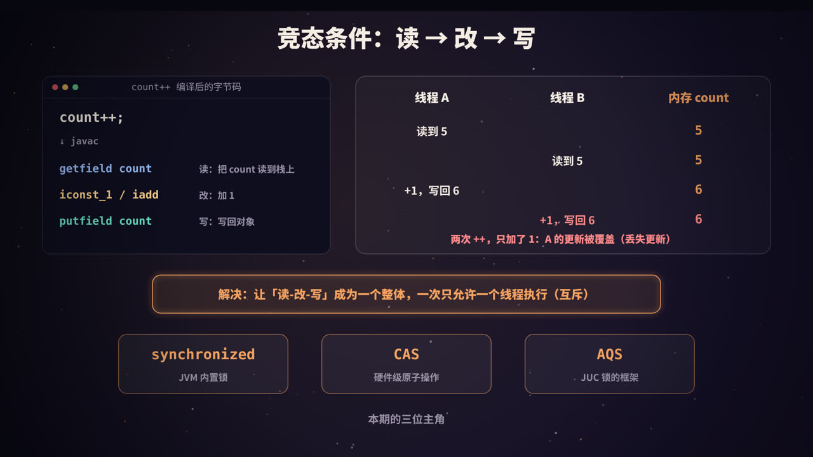
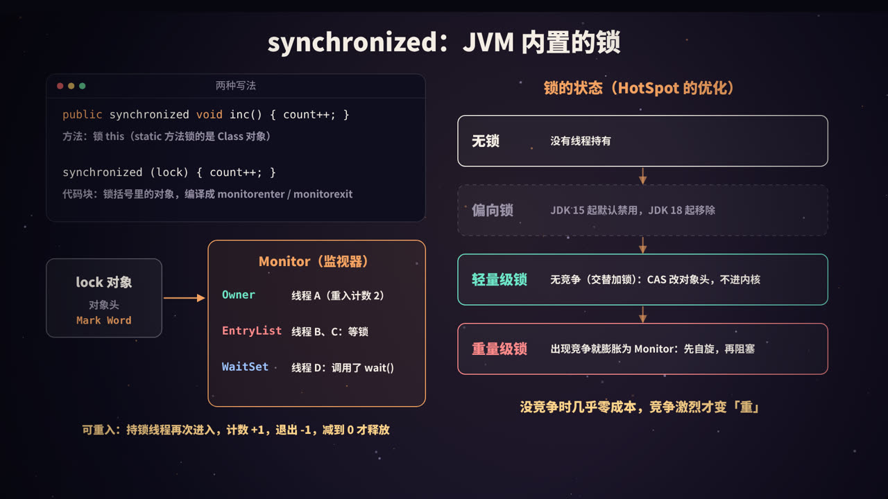
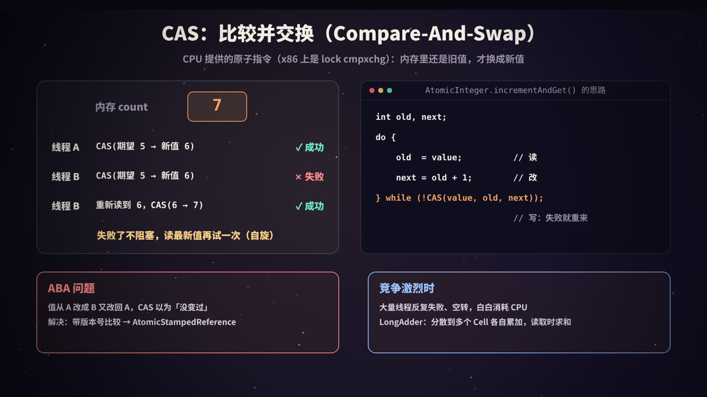
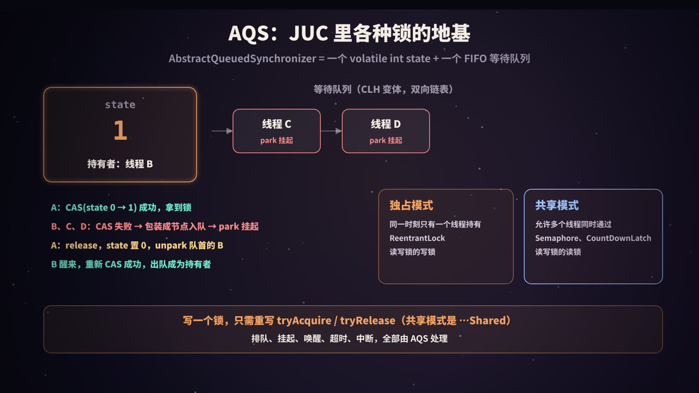
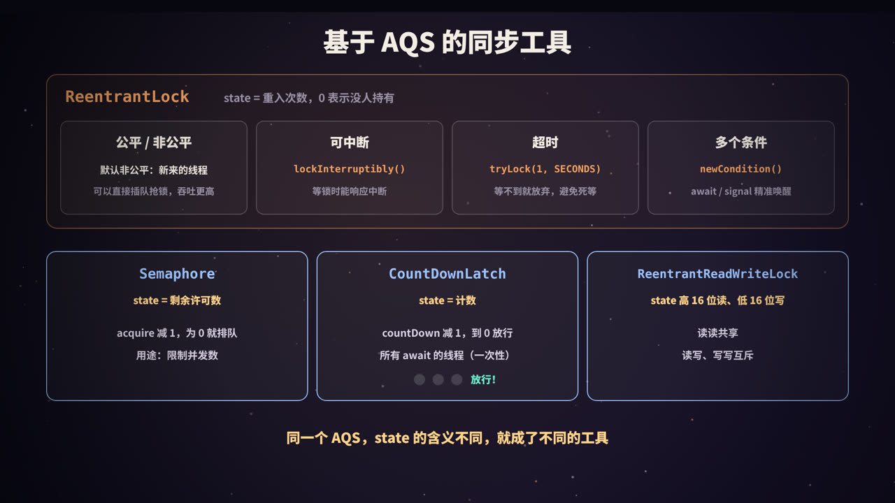
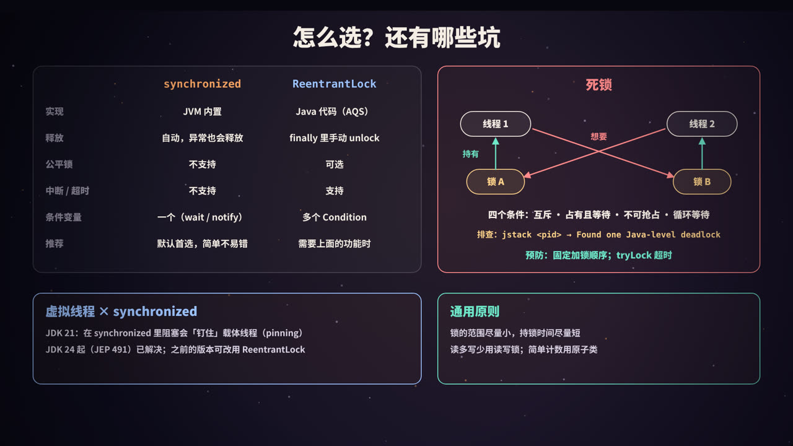

title: Java 的锁：从 count++ 出错讲到 synchronized、CAS 与 AQS
subtitle: 竞态条件与读-改-写、synchronized 的对象头与 Monitor 和锁升级、CAS 与 ABA 和 LongAdder、AQS 的 state 与等待队列、ReentrantLock 与 Semaphore 等同步工具、死锁排查与虚拟线程，附可运行的 Java 实验
tag: 计算机与后端
color: #f4a261


## 一个会算错的计数器

先看一段再普通不过的代码：4 个线程，每个线程执行 100 万次 `count++`，最后 `count` 应该是多少？

答案显然是 4,000,000。但在我的机器上实际跑一次，结果是 **3,665,104**，少了 33 万多次；再跑一次，又是另一个数字。

这不是 JVM 的 bug，而是多线程编程里最基础、也最容易被忽视的问题：**竞态条件**（Race Condition）。Java 为它准备了三套「武器」：

| 武器 | 层次 | 一句话 |
|---|---|---|
| **synchronized** | JVM 内置的关键字 | 给一段代码加互斥锁，进出自动加锁、解锁 |
| **CAS** | CPU 原子指令 | 「内存里还是旧值，才换成新值」，失败就重试，不阻塞 |
| **AQS** | `java.util.concurrent` 的框架 | 一个 `state` 加一个等待队列，ReentrantLock、Semaphore 等都建立在它之上 |

这篇文章从 `count++` 为什么会错讲起，逐层拆开这三样东西，最后讲选型和常见的坑。

> 本系列《进程、线程与协程》讲了线程是什么，《线程池》讲了线程怎么复用；本文讲线程之间怎么「不打架」。如果关心多台机器之间的互斥，见本系列《分布式锁》。

## 竞态条件：count++ 其实是三步



### 一条语句，三条指令

`count++` 在源码里只有一行，但用 `javap -c` 看编译后的字节码，它是这样的（`count` 是对象的字段）：

```text
aload_0
dup
getfield      #13      // 读：把 count 的值读到操作数栈上
iconst_1
iadd                   // 改：加 1
putfield      #13      // 写：把结果写回对象
```

**读、改、写**是三个独立的步骤，中间随时可能被打断（线程切换），也可能在多个 CPU 核上真正同时执行。

### 交错执行的后果

假设 `count` 当前是 5，两个线程同时执行 `count++`：

| 时刻 | 线程 A | 线程 B | 内存中的 count |
|---|---|---|---|
| 1 | 读到 5 | | 5 |
| 2 | | 读到 5 | 5 |
| 3 | 加 1，写回 6 | | 6 |
| 4 | | 加 1，写回 6 | **6** |

两次 `++`，结果只加了 1：线程 A 的更新被线程 B 覆盖了，这叫**丢失更新**。

像这种「结果取决于多个线程执行的先后顺序」的情况，就叫竞态条件。会被多个线程同时访问、并且有读-改-写操作的那段代码，叫**临界区**。

解决思路有两种：

1. **互斥（悲观）**：同一时刻只允许一个线程进入临界区，其他线程排队等着。synchronized 和各种 Lock 都是这个思路；
2. **乐观重试**：不加锁，先算出新值，提交时检查「在我计算期间有没有人改过」，改过就重来。这就是 CAS。

> 另一个经常和竞态一起出现的问题是**可见性**：一个线程写的值，另一个线程不一定马上能看到。锁同时解决了互斥和可见性，这部分属于 Java 内存模型的内容，见本系列《volatile 与 Java 内存模型》。

## synchronized：JVM 内置的锁



### 两种写法

```java
public synchronized void inc() { count++; }      // 锁的是 this
public static synchronized void sinc() { ... }   // 锁的是 当前类的 Class 对象

public void inc2() {
    synchronized (lock) { count++; }             // 锁的是括号里的对象
}
```

记住一点：**synchronized 锁的永远是一个对象**，不是一段代码。两个线程只有竞争**同一个对象**的锁才会互斥。常见的错误是每次 `new` 一个锁对象，或者锁了一个会变的引用，等于没加锁。

### 编译之后是什么

用 `javap -v` 看下面这个类：

```java
public class SyncBytecode {
    private int count;
    private final Object lock = new Object();

    public synchronized void incMethod() { count++; }

    public void incBlock() {
        synchronized (lock) { count++; }
    }
}
```

输出（节选）：

```text
  public synchronized void incMethod();
    flags: (0x0021) ACC_PUBLIC, ACC_SYNCHRONIZED
    Code:
         0: aload_0
         1: dup
         2: getfield      #13                 // Field count:I
         5: iconst_1
         6: iadd
         7: putfield      #13                 // Field count:I
        10: return

  public void incBlock();
    Code:
         0: aload_0
         1: getfield      #7                  // Field lock:Ljava/lang/Object;
         4: dup
         5: astore_1
         6: monitorenter
         7: aload_0
         8: dup
         9: getfield      #13                 // Field count:I
        12: iconst_1
        13: iadd
        14: putfield      #13                 // Field count:I
        17: aload_1
        18: monitorexit
        19: goto          27
        22: astore_2
        23: aload_1
        24: monitorexit
        25: aload_2
        26: athrow
        27: return
      Exception table:
         from    to  target type
             7    19    22   any
            22    25    22   any
```

- **同步方法**：没有额外的指令，只是方法标志里多了 `ACC_SYNCHRONIZED`，JVM 调用方法时自动加锁、返回或抛异常时自动解锁；
- **同步代码块**：编译成 `monitorenter` / `monitorexit`。注意有**两个** `monitorexit`：一个在正常路径，一个在异常处理路径（异常表里的 `any`）。这就是「synchronized 抛异常也会自动释放锁」的原因。

### 对象头与 Monitor

锁的状态记在哪？在**对象头**里。HotSpot 中每个对象都有一个对象头，其中一部分叫 **Mark Word**（64 位 JVM 上是 64 位），平时存哈希码、GC 年龄等信息，加锁时会被改写成锁的信息。以传统的 64 位 HotSpot 为例，最后两位是锁标志：

| 锁标志位 | 状态 | Mark Word 中存的主要内容 |
|---|---|---|
| `01` | 无锁 | 哈希码、GC 分代年龄 |
| `00` | 轻量级锁 | 指向持锁线程栈上「锁记录」的指针 |
| `10` | 重量级锁 | 指向 Monitor 对象的指针 |
| `11` | GC 标记 | 垃圾回收使用 |

> 偏向锁也使用 `01` 标志位，靠另外一个「偏向位」区分。另外，新版本 JDK 正在引入更紧凑的对象头（如 JEP 450），具体布局会有变化，但「对象头里记录锁状态」这个思路不变。

当锁进入重量级状态时，对象关联一个 **Monitor**（监视器，HotSpot 中的实现叫 `ObjectMonitor`，用 C++ 编写）。可以把它想象成一个带等候区的房间：

| 部分 | 作用 |
|---|---|
| **Owner** | 当前持有锁的线程 |
| **重入计数** | 持有者进入了几次 |
| **EntryList**（及相关队列） | 抢锁失败、在门口等待的线程，状态是 `BLOCKED` |
| **WaitSet** | 拿到过锁、但调用了 `wait()` 主动让出锁的线程，状态是 `WAITING` / `TIMED_WAITING`，要等 `notify()` |

这也解释了为什么 `wait()` / `notify()` 必须在 `synchronized` 块里调用：它们操作的就是这个对象的 Monitor，没持有锁就调用会抛 `IllegalMonitorStateException`。

### 可重入

**可重入**：已经持有锁的线程，可以再次进入同一把锁保护的代码，而不会自己把自己锁死：

```java
public synchronized void a() { b(); }   // 已持有 this 的锁
public synchronized void b() { ... }    // 再次获取 this 的锁：成功，计数 +1
```

每进入一次计数加 1，每退出一次减 1，**减到 0 才真正释放**。synchronized 和 ReentrantLock 都是可重入的。

### 锁升级：没竞争时几乎零成本

早期的 synchronized 一上来就是「重量级锁」：抢不到就让操作系统把线程挂起，涉及用户态和内核态切换，开销大。JDK 6 起，HotSpot 做了一系列优化，让锁根据竞争情况选择不同的实现：

| 状态 | 适用场景 | 做法 |
|---|---|---|
| **无锁** | 没有线程持有 | — |
| **偏向锁** | 始终只有一个线程加锁 | 在对象头里记下这个线程，以后它再来几乎不用做任何事。**JDK 15 起默认禁用并被标记为废弃（JEP 374），JDK 18 起相关实现被移除** |
| **轻量级锁** | 多个线程交替加锁，没有真正同时争抢 | 用 CAS 把 Mark Word 替换为指向线程栈上锁记录的指针，不需要进入内核 |
| **重量级锁** | 真正出现竞争 | 膨胀为 Monitor；抢锁时先**自适应自旋**一会儿，还抢不到才阻塞挂起 |

几点说明：

- **偏向锁为什么被去掉**：它在早期「大量使用 `Vector`、`Hashtable` 这类同步集合」的代码里收益明显，但撤销偏向需要在安全点进行，代价高、实现复杂。现代代码更多使用非同步集合或 JUC 并发容器，收益已经不值得维护成本。在 JDK 21 上执行 `java -XX:+UseBiasedLocking -version`，会直接报 `Unrecognized VM option`；
- **常说「锁只能升级不能降级」**，这是一种简化。HotSpot 会在后台把长时间空闲的 Monitor 回收（deflation），对象重新回到无锁状态；
- **JIT 还会做锁消除和锁粗化**：如果逃逸分析发现锁对象不会被其他线程访问，就把锁直接去掉；如果一段代码里对同一个对象反复加锁、解锁，就合并成一次。
- 新版本 HotSpot 还在持续改进轻量级锁的实现，细节在变，但「**没竞争时用 CAS，竞争激烈再退化为排队阻塞**」的总体思路一直没变。

## CAS：比较并交换



### 一条原子指令

CAS（Compare-And-Swap）有三个参数：内存地址 V、期望的旧值 A、新值 B。它做的事情是：

> **如果 V 处的值等于 A，就把它改成 B，返回成功；否则什么也不做，返回失败。**

关键在于：「比较」和「交换」是**一条 CPU 指令**完成的，中间不会被打断。x86 上是带 `lock` 前缀的 `cmpxchg` 指令，ARM 上有对应的原子指令。

用 CAS 实现 `count++`：

```java
// AtomicInteger.incrementAndGet() 的思路
int old, next;
do {
    old  = value;          // 读
    next = old + 1;        // 改
} while (!compareAndSet(old, next));   // 写：如果期间被人改过，就失败重来
return next;
```

如果两个线程都读到 5，都想改成 6：先执行 CAS 的线程成功；另一个线程的 CAS 发现值已经是 6、不等于期望的 5，于是失败，重新读到 6，再算出 7，再 CAS。没有线程被阻塞，失败的一方原地重试，这叫**自旋**。

> 实际实现上，`AtomicInteger` 通过 `Unsafe`（新代码中更推荐 `VarHandle`）调用底层原子操作；在 x86 上，JIT 甚至会把 `incrementAndGet` 直接编译成一条 `lock xadd` 指令。上面的循环表达的是 CAS 的通用用法：任何「读-改-写」都可以写成这样的重试循环，比如 `AtomicInteger.updateAndGet(x -> x * 2)`。

`java.util.concurrent.atomic` 包里的原子类都是基于这个思路：`AtomicInteger`、`AtomicLong`、`AtomicBoolean`、`AtomicReference`，以及数组版本和字段更新器。CAS 也是 synchronized 轻量级锁和 AQS 的基础。

### ABA 问题

CAS 只比较「值是不是一样」，不关心「中间有没有变过」：

1. 线程 1 读到值 A，准备把它改成 C；
2. 线程 2 把 A 改成 B，又改回 A；
3. 线程 1 执行 CAS(A → C)，**成功了**，它以为没人动过。

对于计数器这类场景，ABA 无所谓；但如果值是一个**引用**，比如用 CAS 实现的无锁栈的栈顶指针，「同一个节点被弹出又压回」可能意味着链表结构已经变了，这时 ABA 会导致数据错乱。

解决办法是**加版本号**：每次修改都让版本号加 1，CAS 时值和版本号都要对上。Java 提供了 `AtomicStampedReference`：

```java
import java.util.concurrent.atomic.AtomicReference;
import java.util.concurrent.atomic.AtomicStampedReference;

public class AbaDemo {
    public static void main(String[] args) {
        // 普通 CAS：只比较值
        AtomicReference<String> ref = new AtomicReference<>("A");
        String seen = ref.get();                 // 线程 1 读到 A，准备把它改成 C
        ref.set("B"); ref.set("A");              // 期间线程 2 把它改成 B 又改回 A
        System.out.println("AtomicReference        CAS(A→C) = " + ref.compareAndSet(seen, "C"));

        // 带版本号的 CAS：值和版本号都要对上
        AtomicStampedReference<String> sref = new AtomicStampedReference<>("A", 0);
        int stamp = sref.getStamp();             // 线程 1 读到 (A, 版本 0)
        String v = sref.getReference();
        sref.compareAndSet("A", "B", 0, 1);      // 线程 2：A→B，版本 1
        sref.compareAndSet("B", "A", 1, 2);      // 线程 2：B→A，版本 2
        System.out.println("AtomicStampedReference CAS(A→C) = " + sref.compareAndSet(v, "C", stamp, stamp + 1)
                + "（当前版本 " + sref.getStamp() + "，期望版本 " + stamp + "）");
    }
}
```

输出：

```text
AtomicReference        CAS(A→C) = true
AtomicStampedReference CAS(A→C) = false（当前版本 2，期望版本 0）
```

（为了让结果确定，这里用单线程模拟了两个线程的先后顺序。）数据库里的乐观锁 `UPDATE ... SET version = version + 1 WHERE id = ? AND version = ?` 也是同样的思路。

### 竞争激烈时：LongAdder

CAS 在低竞争时很快，但如果几十个线程同时更新**同一个变量**，大部分 CAS 都会失败、重试、再失败，CPU 都在空转；而且所有核心都在争抢同一个缓存行，缓存行在核心之间来回传递，开销也很大。

JDK 8 引入的 `LongAdder` 用**分散热点**的办法解决：

- 内部有一个 `base` 和一个 `Cell[]` 数组；
- 没有竞争时直接 CAS 更新 `base`；
- 出现竞争后，不同线程被分散到不同的 `Cell` 上各自累加，数组大小按需扩容（2 的幂，上限与 CPU 核数相关）；
- `sum()` 时把 `base` 和所有 `Cell` 加起来。`Cell` 之间做了缓存行填充，避免伪共享。

代价是：`sum()` 不是一个原子快照（求和过程中其他线程可能还在加），而且占用内存更多。所以它适合**写多读少的统计计数**（如 QPS、调用次数）；需要「加完立刻拿到精确的新值」时（如生成序号），还是用 `AtomicLong`。

### 实验：四种计数方式

把开头的计数器分别用四种方式实现，比较结果和耗时：

```java
import java.util.concurrent.atomic.AtomicInteger;
import java.util.concurrent.atomic.LongAdder;

public class CounterDemo {
    static final int THREADS = 4, N = 1_000_000;   // 4 个线程，每个加 100 万次

    static int plain = 0;                          // 1. 什么都不加
    static int synced = 0;                         // 2. synchronized
    static final Object LOCK = new Object();
    static final AtomicInteger atomic = new AtomicInteger();   // 3. CAS
    static final LongAdder adder = new LongAdder();            // 4. 分段累加

    // 让 THREADS 个线程同时执行 body，返回耗时（毫秒）
    static long run(Runnable body) throws InterruptedException {
        Thread[] ts = new Thread[THREADS];
        long start = System.nanoTime();
        for (int i = 0; i < THREADS; i++) (ts[i] = new Thread(body)).start();
        for (Thread t : ts) t.join();
        return (System.nanoTime() - start) / 1_000_000;
    }

    public static void main(String[] args) throws Exception {
        System.out.printf("CPU 核数: %d，期望结果: %,d%n%n", Runtime.getRuntime().availableProcessors(), THREADS * N);

        long t1 = run(() -> { for (int i = 0; i < N; i++) plain++; });
        System.out.printf("%s 结果 %,10d   耗时 %4d ms%n", "不加锁        ", plain, t1);

        long t2 = run(() -> { for (int i = 0; i < N; i++) synchronized (LOCK) { synced++; } });
        System.out.printf("%s 结果 %,10d   耗时 %4d ms%n", "synchronized  ", synced, t2);

        long t3 = run(() -> { for (int i = 0; i < N; i++) atomic.incrementAndGet(); });
        System.out.printf("%s 结果 %,10d   耗时 %4d ms%n", "AtomicInteger ", atomic.get(), t3);

        long t4 = run(() -> { for (int i = 0; i < N; i++) adder.increment(); });
        System.out.printf("%s 结果 %,10d   耗时 %4d ms%n", "LongAdder     ", adder.sum(), t4);
    }
}
```

用 JDK 21 直接运行 `java -Dstdout.encoding=UTF-8 CounterDemo.java`，我的机器（2 核）上一次的输出：

```text
CPU 核数: 2，期望结果: 4,000,000

不加锁         结果  3,665,104   耗时   28 ms
synchronized   结果  4,000,000   耗时  248 ms
AtomicInteger  结果  4,000,000   耗时   64 ms
LongAdder      结果  4,000,000   耗时   56 ms
```

多跑几次，「不加锁」的结果每次都不一样（我看到过 3,954,724、3,905,328、2,973,138 等），其余三种始终是 4,000,000。耗时也有波动，synchronized 在 126～254 ms 之间。几点解读：

- **不加锁最快，但结果是错的**，再快也没有意义；
- **synchronized 最慢**：每次 `++` 都要加锁、解锁，4 个线程激烈竞争同一把锁，锁膨胀为重量级锁，线程频繁阻塞、唤醒；
- **原子类快得多**：一条原子指令搞定，不阻塞线程；
- 这台机器只有 2 个核，竞争不够激烈，`LongAdder` 相对 `AtomicInteger` 的优势体现得不明显。核数越多、线程越多，`LongAdder` 的优势越大。

> 这只是一个粗略的演示，不是严谨的基准测试（没有预热，计时包含线程创建）。要严谨地比较性能，请使用 JMH。另外，「在循环里每次都加锁」本身就是一种反模式，实际代码应该让每个线程先在局部变量里累加，最后再合并一次。

## AQS：JUC 锁的地基



synchronized 是 JVM 用 C++ 实现的；而 `java.util.concurrent`（JUC）里的 `ReentrantLock`、`Semaphore`、`CountDownLatch`、`ReentrantReadWriteLock` 等，都是用 Java 代码写的，它们共同的基础是 **AbstractQueuedSynchronizer**（抽象队列同步器，简称 AQS）。

### 两个核心部件

1. **`volatile int state`**：同步状态。它的含义由子类决定：ReentrantLock 里是重入次数，Semaphore 里是剩余许可数，CountDownLatch 里是剩余计数；
2. **FIFO 等待队列**：一个 **CLH 队列的变体**，是由节点组成的双向链表，每个节点包装一个等待中的线程。

AQS 用 CAS 修改 `state` 和队列指针，用 `LockSupport.park()` / `unpark()` 挂起和唤醒线程。

### 获取与释放的流程

以独占模式为例：

**获取（acquire）**：

1. 调用子类实现的 `tryAcquire()`，通常是用 CAS 修改 `state`，成功就直接返回，拿到锁；
2. 失败：把当前线程包装成节点，用 CAS 加到队尾；
3. 如果自己排在队首（前驱是头节点），再尝试一次 `tryAcquire()`；
4. 还是失败，就 `park()` 挂起，等待被唤醒；被唤醒后回到第 3 步。

**释放（release）**：

1. 调用子类实现的 `tryRelease()`，修改 `state`；
2. 如果锁已完全释放，`unpark()` 唤醒队列中的下一个线程。

<figure>
<svg viewBox="0 0 440 380" xmlns="http://www.w3.org/2000/svg" role="img" aria-label="AQS 获取与释放流程">
  <rect width="440" height="380" fill="#0f0e1c"/>
  <defs><marker id="qa" viewBox="0 0 10 10" refX="9" refY="5" markerWidth="7" markerHeight="7" orient="auto"><path d="M0,0 L10,5 L0,10 z" fill="#f4a261"/></marker></defs>
  <g font-family="PingFang SC, Noto Sans SC, sans-serif" text-anchor="middle">
    <text x="220" y="28" fill="#f4a261" font-size="17" font-weight="800">acquire：拿不到就排队睡觉</text>
    <rect x="20" y="48" width="120" height="56" rx="12" fill="rgba(244,162,97,.14)" stroke="#f4a261"/>
    <text x="80" y="72" fill="#f4ede4" font-size="14" font-weight="700">tryAcquire</text>
    <text x="80" y="92" fill="#9a93a8" font-size="12">CAS 改 state</text>
    <line x1="140" y1="76" x2="166" y2="76" stroke="#f4a261" stroke-width="2.5" marker-end="url(#qa)"/>
    <text x="153" y="66" fill="#ff8a8a" font-size="11">失败</text>
    <rect x="168" y="48" width="120" height="56" rx="12" fill="rgba(255,255,255,.06)" stroke="#9a93a8"/>
    <text x="228" y="72" fill="#f4ede4" font-size="14" font-weight="700">包装成节点</text>
    <text x="228" y="92" fill="#9a93a8" font-size="12">CAS 加到队尾</text>
    <line x1="288" y1="76" x2="314" y2="76" stroke="#f4a261" stroke-width="2.5" marker-end="url(#qa)"/>
    <rect x="316" y="48" width="110" height="56" rx="12" fill="rgba(255,138,138,.12)" stroke="#ff8a8a"/>
    <text x="371" y="72" fill="#ff8a8a" font-size="14" font-weight="700">park 挂起</text>
    <text x="371" y="92" fill="#9a93a8" font-size="12">不占 CPU</text>
    <text x="80" y="128" fill="#6ee7c8" font-size="12">成功 → 直接返回，拿到锁</text>
    <line x1="14" y1="152" x2="426" y2="152" stroke="rgba(255,255,255,.12)" stroke-dasharray="6 6"/>
    <text x="220" y="182" fill="#f4a261" font-size="17" font-weight="800">等待队列（双向链表）</text>
    <rect x="20" y="200" width="88" height="48" rx="10" fill="rgba(255,255,255,.04)" stroke="#9a93a8" stroke-dasharray="4 4"/>
    <text x="64" y="229" fill="#9a93a8" font-size="13">head</text>
    <rect x="128" y="200" width="88" height="48" rx="10" fill="rgba(255,255,255,.06)" stroke="#ff8a8a"/>
    <text x="172" y="229" fill="#f4ede4" font-size="13" font-weight="700">线程 B</text>
    <rect x="236" y="200" width="88" height="48" rx="10" fill="rgba(255,255,255,.06)" stroke="#ff8a8a"/>
    <text x="280" y="229" fill="#f4ede4" font-size="13" font-weight="700">线程 C</text>
    <rect x="344" y="200" width="82" height="48" rx="10" fill="rgba(255,255,255,.06)" stroke="#ff8a8a"/>
    <text x="385" y="229" fill="#f4ede4" font-size="13" font-weight="700">线程 D</text>
    <text x="118" y="229" fill="#9a93a8" font-size="13">⇄</text>
    <text x="226" y="229" fill="#9a93a8" font-size="13">⇄</text>
    <text x="334" y="229" fill="#9a93a8" font-size="13">⇄</text>
    <line x1="14" y1="270" x2="426" y2="270" stroke="rgba(255,255,255,.12)" stroke-dasharray="6 6"/>
    <text x="220" y="298" fill="#6ee7c8" font-size="17" font-weight="800">release：释放后叫醒下一个</text>
    <rect x="20" y="314" width="150" height="52" rx="12" fill="rgba(110,231,200,.12)" stroke="#6ee7c8"/>
    <text x="95" y="345" fill="#f4ede4" font-size="14" font-weight="700">tryRelease 改 state</text>
    <line x1="170" y1="340" x2="196" y2="340" stroke="#6ee7c8" stroke-width="2.5" marker-end="url(#qa)"/>
    <rect x="198" y="314" width="228" height="52" rx="12" fill="rgba(110,231,200,.12)" stroke="#6ee7c8"/>
    <text x="312" y="345" fill="#f4ede4" font-size="14" font-weight="700">unpark 线程 B，它再去抢</text>
  </g>
</svg>
<figcaption>AQS 的核心流程：CAS 抢 state，失败入队并 park；释放时 unpark 队首的后继节点，被唤醒的线程再次尝试获取</figcaption>
</figure>

头节点是一个「哑节点」，代表当前持有锁（或刚刚释放锁）的位置。等待超时或被中断的节点会被标记为取消，并从队列中清理掉。

### 独占与共享

| 模式 | 子类需要实现 | 含义 | 例子 |
|---|---|---|---|
| **独占** | `tryAcquire` / `tryRelease` | 同一时刻只有一个线程能获取 | ReentrantLock、读写锁的写锁 |
| **共享** | `tryAcquireShared` / `tryReleaseShared` | 多个线程可以同时获取；一个线程获取成功后，会继续唤醒后面同样在等共享资源的线程 | Semaphore、CountDownLatch、读写锁的读锁 |

这就是**模板方法模式**：排队、挂起、唤醒、超时、中断这些最难写对的部分，AQS 全部实现好了；子类只需要回答一个问题——「**在当前 state 下，这次获取能不能成功？**」

### 实验：用 AQS 手写一把互斥锁

下面用 AQS 实现一个**不可重入**的互斥锁：`state = 0` 表示空闲，`1` 表示被占用。

```java
import java.util.concurrent.TimeUnit;
import java.util.concurrent.locks.AbstractQueuedSynchronizer;
import java.util.concurrent.locks.Condition;
import java.util.concurrent.locks.Lock;

/** 用 AQS 手写一个不可重入的互斥锁：state = 0 表示空闲，1 表示被占用 */
public class Mutex implements Lock {

    private static class Sync extends AbstractQueuedSynchronizer {
        @Override
        protected boolean tryAcquire(int arg) {
            if (compareAndSetState(0, 1)) {                 // CAS 抢锁
                setExclusiveOwnerThread(Thread.currentThread());
                return true;
            }
            return false;                                   // 失败：AQS 负责入队、park
        }

        @Override
        protected boolean tryRelease(int arg) {
            if (getState() == 0) throw new IllegalMonitorStateException();
            setExclusiveOwnerThread(null);
            setState(0);                                    // state 是 volatile，写入对后继线程可见
            return true;                                    // 返回 true：AQS 去唤醒队列里的下一个
        }

        @Override
        protected boolean isHeldExclusively() {
            return getExclusiveOwnerThread() == Thread.currentThread();
        }

        Condition newCondition() { return new ConditionObject(); }
    }

    private final Sync sync = new Sync();

    public void lock()                    { sync.acquire(1); }
    public void lockInterruptibly() throws InterruptedException { sync.acquireInterruptibly(1); }
    public boolean tryLock()              { return sync.tryAcquire(1); }
    public boolean tryLock(long t, TimeUnit u) throws InterruptedException { return sync.tryAcquireNanos(1, u.toNanos(t)); }
    public void unlock()                  { sync.release(1); }
    public Condition newCondition()       { return sync.newCondition(); }
    int queueLength()                     { return sync.getQueueLength(); }

    // ---------------- 测试 ----------------
    static int count = 0;

    public static void main(String[] args) throws Exception {
        Mutex m = new Mutex();

        // 1. 互斥：4 个线程各加 100 万次
        Thread[] ts = new Thread[4];
        for (int i = 0; i < ts.length; i++) {
            ts[i] = new Thread(() -> {
                for (int j = 0; j < 1_000_000; j++) { m.lock(); try { count++; } finally { m.unlock(); } }
            });
            ts[i].start();
        }
        for (Thread t : ts) t.join();
        System.out.printf("1. 互斥：count = %,d（期望 4,000,000）%n", count);

        // 2. 排队：主线程持锁，3 个线程来抢，都会进入 AQS 队列
        m.lock();
        Thread[] waiters = new Thread[3];
        for (int i = 0; i < 3; i++) {
            int id = i;
            waiters[i] = new Thread(() -> { m.lock(); try { System.out.println("   线程 " + id + " 拿到锁"); } finally { m.unlock(); } });
            waiters[i].start();
        }
        while (m.queueLength() < 3) Thread.sleep(10);
        System.out.println("2. 排队：等待队列长度 = " + m.queueLength() + "，线程 0 的状态 = " + waiters[0].getState());
        m.unlock();
        for (Thread t : waiters) t.join();

        // 3. 不可重入：已经持有锁的线程再 tryLock 会失败
        m.lock();
        System.out.println("3. 不可重入：持锁时再 tryLock() = " + m.tryLock());
        m.unlock();

        // 4. 超时：别的线程持锁，tryLock 等 200ms 后放弃
        Thread holder = new Thread(() -> { m.lock(); try { Thread.sleep(500); } catch (InterruptedException e) {} finally { m.unlock(); } });
        holder.start(); Thread.sleep(50);
        long st = System.nanoTime();
        boolean got = m.tryLock(200, TimeUnit.MILLISECONDS);
        System.out.printf("4. 超时：tryLock(200ms) = %s，等了约 %d ms%n", got, (System.nanoTime() - st) / 1_000_000);
        holder.join();
    }
}
```

输出：

```text
1. 互斥：count = 4,000,000（期望 4,000,000）
2. 排队：等待队列长度 = 3，线程 0 的状态 = WAITING
   线程 0 拿到锁
   线程 1 拿到锁
   线程 2 拿到锁
3. 不可重入：持锁时再 tryLock() = false
4. 超时：tryLock(200ms) = false，等了约 200 ms
```

只写了三个很短的方法，就得到了一把支持排队、阻塞、超时、可中断、条件变量的锁。几个值得注意的地方：

- 排队的线程状态是 **`WAITING`**（被 `LockSupport.park` 挂起），而等 synchronized 的线程状态是 **`BLOCKED`**。用 jstack 排查问题时，这能帮你区分线程卡在哪种锁上；
- 第 3 步说明这把锁**不可重入**：如果持锁线程调用 `lock()`（而不是 `tryLock()`），它会把自己挂起，永远等不到。ReentrantLock 的做法是：发现持有者就是自己时，`state + 1`；
- 第 2 步中三个线程拿到锁的顺序，取决于它们入队的顺序。

## 基于 AQS 的同步工具



### ReentrantLock

`state` 表示重入次数，0 表示没有线程持有。相比 synchronized，它多了几项能力：

| 能力 | API | 说明 |
|---|---|---|
| **公平 / 非公平** | `new ReentrantLock(true)` | **默认非公平**：新来的线程会先直接 CAS 抢一次，抢到就插队。公平锁则先检查队列里有没有人在等，有就老实排队。非公平锁吞吐更高（省掉了一次挂起-唤醒），但个别线程可能等很久 |
| **可中断** | `lockInterruptibly()` | 等锁的过程中可以响应 `interrupt()`，抛出 `InterruptedException` 退出等待 |
| **超时** | `tryLock(1, TimeUnit.SECONDS)` | 等不到就放弃，返回 false，可以用来避免死锁 |
| **多个条件** | `newCondition()` | 一把锁可以有多个等待队列，`await()` / `signal()` 精准唤醒 |

> 一个细节：不带参数的 `tryLock()` 即使在公平锁上也会直接插队抢锁，这是 Javadoc 中明确写的行为。想遵守公平性，可以用 `tryLock(0, TimeUnit.SECONDS)`。

使用 ReentrantLock 的固定写法：

```java
lock.lock();          // 放在 try 外面：如果加锁本身失败，不应该执行 unlock
try {
    // 临界区
} finally {
    lock.unlock();    // 一定在 finally 里释放，否则异常时锁永远不会被释放
}
```

### 实验：用 Condition 写生产者-消费者

synchronized 只有一个等待集合，`notifyAll()` 会把生产者和消费者一起叫醒。ReentrantLock 可以给「缓冲区不满」和「缓冲区不空」各建一个条件队列，只唤醒真正需要的线程：

```java
import java.util.ArrayDeque;
import java.util.Queue;
import java.util.concurrent.locks.Condition;
import java.util.concurrent.locks.ReentrantLock;

public class BoundedBuffer {
    private final Queue<Integer> items = new ArrayDeque<>();
    private final int capacity;
    private final ReentrantLock lock = new ReentrantLock();
    private final Condition notFull  = lock.newCondition();   // 「有空位了」
    private final Condition notEmpty = lock.newCondition();   // 「有数据了」

    BoundedBuffer(int capacity) { this.capacity = capacity; }

    public void put(int x) throws InterruptedException {
        lock.lock();
        try {
            while (items.size() == capacity) {      // 用 while，不用 if：醒来后要重新检查条件
                System.out.println("  缓冲区满，生产者等待");
                notFull.await();                    // 释放锁并等待
            }
            items.add(x);
            System.out.println("生产 " + x + "  缓冲区=" + items);
            notEmpty.signal();                      // 只叫醒等「有数据」的线程
        } finally {
            lock.unlock();
        }
    }

    public int take() throws InterruptedException {
        lock.lock();
        try {
            while (items.isEmpty()) notEmpty.await();
            int x = items.poll();
            System.out.println("        消费 " + x + "  缓冲区=" + items);
            notFull.signal();
            return x;
        } finally {
            lock.unlock();
        }
    }

    public static void main(String[] args) throws Exception {
        BoundedBuffer buf = new BoundedBuffer(2);
        Thread producer = new Thread(() -> {
            try { for (int i = 1; i <= 5; i++) buf.put(i); } catch (InterruptedException ignored) {}
        });
        Thread consumer = new Thread(() -> {
            try {
                int sum = 0;
                for (int i = 1; i <= 5; i++) { Thread.sleep(50); sum += buf.take(); }   // 消费得慢一点
                System.out.println("消费者收到的总和 = " + sum);
            } catch (InterruptedException ignored) {}
        });
        producer.start(); consumer.start();
        producer.join(); consumer.join();
    }
}
```

输出（线程调度不同，交错顺序可能略有差异）：

```text
生产 1  缓冲区=[1]
生产 2  缓冲区=[1, 2]
  缓冲区满，生产者等待
        消费 1  缓冲区=[2]
生产 3  缓冲区=[2, 3]
  缓冲区满，生产者等待
        消费 2  缓冲区=[3]
生产 4  缓冲区=[3, 4]
  缓冲区满，生产者等待
        消费 3  缓冲区=[4]
生产 5  缓冲区=[4, 5]
        消费 4  缓冲区=[5]
        消费 5  缓冲区=[]
消费者收到的总和 = 15
```

两个要点：

- `await()` 会**释放锁**并进入条件队列；被 `signal()` 后，线程从条件队列转移到 AQS 的同步队列，**重新抢到锁**之后才从 `await()` 返回；
- 等待条件**必须用 `while` 循环检查**，不能用 `if`：线程被唤醒时条件不一定成立（可能被别的线程抢先消费，也可能是虚假唤醒）。

实际项目中直接用 `ArrayBlockingQueue` 就行，它内部正是「一把 ReentrantLock + notEmpty、notFull 两个 Condition」的实现。

### Semaphore：控制并发数

`state` 是剩余**许可数**。`acquire()` 把许可减 1，减到 0 时后来的线程排队；`release()` 加 1 并唤醒等待者。典型用途是限制同时访问某个资源的线程数，比如最多 10 个线程同时调用下游接口。它同样支持公平和非公平模式。

```java
Semaphore permits = new Semaphore(10);
permits.acquire();
try { callDownstream(); } finally { permits.release(); }
```

> 单机限流用 Semaphore 控制的是「并发数」，而不是「每秒请求数」，两者的区别见本系列《限流算法》。

### CountDownLatch：等大家都到齐

`state` 是剩余计数。`countDown()` 减 1；`await()` 的线程在计数到 0 之前一直等待，**一到 0 就全部放行**。典型用途是主线程等待多个子任务完成，或者让多个线程在同一时刻开始执行（压测）。

它是**一次性**的，计数到 0 后不能重置。需要反复使用的「集合点」，可以用 `CyclicBarrier`（内部基于 ReentrantLock 和 Condition）或 `Phaser`。

### ReentrantReadWriteLock：读多写少

一个 `int` 型的 `state` 被拆成两半：**高 16 位记录读锁的持有次数，低 16 位记录写锁的重入次数**。

| | 读锁 | 写锁 |
|---|---|---|
| **读锁** | 共享，可以同时持有 | 互斥 |
| **写锁** | 互斥 | 互斥 |

注意两条规则：

- **锁降级可以**：持有写锁时，可以再获取读锁，然后释放写锁，从而「降级」为读锁；
- **锁升级不行**：持有读锁时去获取写锁会一直等待（写锁要等所有读锁释放，包括自己持有的），造成死锁。

读写锁适合读远多于写、且读操作耗时较长的场景，如本地缓存。如果读操作很短，读写锁维护读计数的开销可能抵消收益。JDK 8 还提供了 `StampedLock`，支持「乐观读」（读时不加锁，读完检查期间是否有写入），性能更好，但它**不可重入**、不支持 Condition，用起来更容易出错。它也不是基于 AQS 实现的。

## 怎么选？还有哪些坑



### synchronized 还是 ReentrantLock

| | synchronized | ReentrantLock |
|---|---|---|
| 实现 | JVM 内置（Monitor） | Java 代码（AQS） |
| 加锁、释放 | 自动，抛异常也会释放 | 手动，必须在 `finally` 里 `unlock()` |
| 可重入 | 是 | 是 |
| 公平锁 | 不支持（非公平） | 可选 |
| 等锁时可中断 | 不可以 | `lockInterruptibly()` |
| 超时放弃 | 不可以 | `tryLock(timeout)` |
| 条件变量 | 一个（`wait` / `notify`） | 多个 `Condition` |
| 等锁的线程状态 | `BLOCKED` | `WAITING` / `TIMED_WAITING` |
| 性能 | JDK 6 优化后与 ReentrantLock 相当 | 相当 |

**选择建议**：默认用 synchronized，代码简单，不会忘记解锁；当你需要**超时、可中断、公平性、多个条件**中的任何一项时，再用 ReentrantLock。至于性能，在现代 JDK 上通常不是选择的依据，用 JMH 实测说话。

### 死锁

两个线程各持有一把锁，又都在等对方手里的那一把，谁也不放手，就形成了死锁。下面这段代码几乎每次都会死锁：

```java
public class Deadlock {
    static final Object A = new Object(), B = new Object();

    public static void main(String[] args) {
        new Thread(() -> {
            synchronized (A) { sleep(100); synchronized (B) { System.out.println("t1 done"); } }
        }, "worker-1").start();
        new Thread(() -> {
            synchronized (B) { sleep(100); synchronized (A) { System.out.println("t2 done"); } }
        }, "worker-2").start();
    }

    static void sleep(long ms) { try { Thread.sleep(ms); } catch (InterruptedException e) {} }
}
```

运行后程序卡住不动。用 `jps` 找到进程号，再执行 `jstack <pid>`，输出的最后部分会直接告诉你发生了死锁（地址每次不同）：

```text
Found one Java-level deadlock:
=============================
"worker-1":
  waiting to lock monitor 0x00007fa834060510 (object 0x00000000a8518690, a java.lang.Object),
  which is held by "worker-2"

"worker-2":
  waiting to lock monitor 0x00007fa8300015b0 (object 0x00000000a8518680, a java.lang.Object),
  which is held by "worker-1"

Java stack information for the threads listed above:
===================================================
"worker-1":
	at Deadlock.lambda$main$0(Deadlock.java:6)
	- waiting to lock <0x00000000a8518690> (a java.lang.Object)
	- locked <0x00000000a8518680> (a java.lang.Object)
	...
"worker-2":
	at Deadlock.lambda$main$1(Deadlock.java:9)
	- waiting to lock <0x00000000a8518680> (a java.lang.Object)
	- locked <0x00000000a8518690> (a java.lang.Object)
	...

Found 1 deadlock.
```

（这里省略了栈中与本例无关的几行。）给线程起有意义的名字，排查时会轻松很多。除了 jstack，还可以用 `jcmd <pid> Thread.print`、JConsole / VisualVM 的「检测死锁」按钮，或者在程序里调用 `ThreadMXBean.findDeadlockedThreads()` 做监控告警。

死锁的发生需要**同时满足四个条件**：

| 条件 | 含义 | 怎么破坏 |
|---|---|---|
| **互斥** | 资源同一时刻只能被一个线程持有 | 通常无法破坏，这正是锁的意义 |
| **占有且等待** | 拿着一把锁，又去等另一把 | 一次性申请所有需要的锁 |
| **不可抢占** | 别人不能强行夺走已持有的锁 | 用 `tryLock(timeout)`，等不到就主动释放已持有的锁、稍后重试 |
| **循环等待** | 线程之间形成「你等我、我等你」的环 | **所有线程按固定顺序加锁**（如按账户 ID 从小到大） |

最常用、最有效的是最后一条。比如转账时同时锁住两个账户，就按账户 ID 的大小决定加锁顺序，而不是「先锁转出方、再锁转入方」——后者在 A 转 B 和 B 转 A 同时发生时就会死锁。

> 数据库里也会发生死锁，InnoDB 会自动检测并回滚其中一个事务，见本系列《MySQL 的锁》。

### 虚拟线程与 synchronized 的 pinning

JDK 21 正式推出了虚拟线程（JEP 444）。虚拟线程运行在少量「载体线程」（平台线程）之上，遇到阻塞操作时会从载体线程上卸载，让出载体线程去运行别的虚拟线程。

但在 JDK 21 中有一个限制：**虚拟线程在 synchronized 块内阻塞时，无法卸载，会把载体线程一起「钉住」（pinning）**。如果很多虚拟线程都在 synchronized 里做 IO，载体线程会被占满，吞吐大幅下降，严重时甚至死锁。

JDK 21 提供了 `-Djdk.tracePinnedThreads` 参数来发现这种情况：

```java
import java.util.concurrent.locks.ReentrantLock;

public class Pinning {
    static final Object MONITOR = new Object();
    static final ReentrantLock LOCK = new ReentrantLock();

    public static void main(String[] args) throws Exception {
        // 在 synchronized 块里阻塞（sleep 代表一次慢 IO）
        Thread.ofVirtual().start(() -> {
            synchronized (MONITOR) { sleep(20); }
        }).join();
        System.out.println("---- 换成 ReentrantLock ----");
        Thread.ofVirtual().start(() -> {
            LOCK.lock();
            try { sleep(20); } finally { LOCK.unlock(); }
        }).join();
        System.out.println("结束");
    }

    static void sleep(long ms) { try { Thread.sleep(ms); } catch (InterruptedException e) {} }
}
```

在 JDK 21 上运行 `java -Dstdout.encoding=UTF-8 -Djdk.tracePinnedThreads=short Pinning.java`：

```text
VirtualThread[#19]/runnable@ForkJoinPool-1-worker-1 reason:MONITOR
    Pinning.lambda$main$0(Pinning.java:10) <== monitors:1
---- 换成 ReentrantLock ----
结束
```

synchronized 版本被报告为因 `MONITOR` 而钉住；换成 ReentrantLock 后没有任何报告，因为 AQS 用的是 `LockSupport.park()`，虚拟线程可以正常卸载。所以在 JDK 21～23 上使用虚拟线程时，常见的建议是把「持锁期间会阻塞」的 synchronized 换成 ReentrantLock。

**JDK 24 通过 JEP 491 解决了这个问题**：虚拟线程在 synchronized 中阻塞（包括 `Object.wait()`）时也可以卸载了，`jdk.tracePinnedThreads` 参数随之被移除。调用本地方法等少数情况下仍会钉住，可以用 JFR 的 `jdk.VirtualThreadPinned` 事件观察。

### 通用原则

1. **锁的范围尽量小**：只把真正需要互斥的代码放进临界区，不要在持锁时做 IO、远程调用；
2. **锁的粒度尽量细**：`ConcurrentHashMap` 就是靠「只锁一个桶」而不是锁整张表获得高并发；
3. **能不用锁就不用**：简单计数用原子类，不可变对象天然线程安全，线程封闭（`ThreadLocal`、局部变量）不需要同步；
4. **优先用现成的并发工具**：`ConcurrentHashMap`、`BlockingQueue`、`CompletableFuture`，比自己用锁拼更不容易出错；
5. **锁对象要 `private final`**：不要锁 `String` 字面量、包装类型（如 `Integer`）这类可能被共享或缓存的对象，也不要锁会被重新赋值的字段。

## 高频面试题速答

**Q：synchronized 的原理是什么？**
同步代码块编译为 `monitorenter` / `monitorexit`，同步方法通过 `ACC_SYNCHRONIZED` 标志实现。锁状态记录在对象头的 Mark Word 中，竞争时关联一个 Monitor 对象，包含持有者、重入计数、等待锁的线程队列和调用 `wait()` 的等待集合。

**Q：说说锁升级的过程。**
无锁 → 轻量级锁（交替加锁时用 CAS 修改对象头，不进内核）→ 重量级锁（出现竞争时膨胀为 Monitor，先自适应自旋，再阻塞）。偏向锁在 JDK 15 起默认禁用，JDK 18 起已移除，回答时最好说明版本。

**Q：CAS 是什么？有什么问题？**
比较并交换，由 CPU 原子指令保证。问题有三：ABA 问题（用 `AtomicStampedReference` 加版本号解决）；高竞争时自旋空耗 CPU（用 `LongAdder` 分散热点）；只能保证一个变量的原子性（多个变量要合并成一个对象用 `AtomicReference`，或者加锁）。

**Q：AQS 的原理？**
一个 `volatile int state` 加一个 CLH 变体的 FIFO 双向队列。获取失败的线程被包装成节点入队，并通过 `LockSupport.park()` 挂起；释放时唤醒后继节点。子类只需实现 `tryAcquire` / `tryRelease`（或共享模式的对应方法）定义 state 的语义。

**Q：ReentrantLock 怎么实现可重入和公平性？**
获取时如果发现持有者是当前线程，就把 state 加 1；释放时减 1，到 0 才真正释放。公平锁在获取前先检查队列中是否有更早等待的线程（`hasQueuedPredecessors`），非公平锁直接尝试 CAS 插队。

**Q：synchronized 和 ReentrantLock 怎么选？**
默认用 synchronized；需要超时、可中断、公平锁或多个条件变量时用 ReentrantLock，且必须在 `finally` 中释放。

**Q：如何排查和避免死锁？**
用 jstack / jcmd 查看线程栈，JVM 会直接报告 `Found one Java-level deadlock`。避免死锁：按固定顺序加锁、用 `tryLock` 加超时、缩小锁的范围、避免持锁时调用外部方法。

**Q：LongAdder 为什么比 AtomicLong 快？**
AtomicLong 所有线程 CAS 同一个变量，竞争激烈时大量失败重试；LongAdder 把累加分散到多个 Cell 上，减少冲突，求和时再合并。代价是 `sum()` 不是原子快照、占用内存更多。

## 总结


- `count++` 是**读-改-写**三步，多线程交错执行会**丢失更新**，这就是竞态条件；
- **synchronized**：JVM 内置，锁的是对象；靠对象头的 Mark Word 和 Monitor 实现；可重入；没有竞争时用 CAS 轻量加锁，竞争激烈才膨胀为重量级锁。偏向锁已成为历史；
- **CAS**：CPU 原子指令，「内存里还是旧值才更新」，失败就重试，不阻塞；注意 ABA 问题，高竞争计数用 **LongAdder**；
- **AQS**：`state` + 等待队列，抢不到就入队 `park`，释放时 `unpark` 后继。ReentrantLock、Semaphore、CountDownLatch、读写锁都是它的子类，区别只在于 `state` 的含义；
- 默认用 synchronized，需要**超时、可中断、公平、多条件**时用 ReentrantLock；
- 死锁靠**固定加锁顺序**和**超时**预防，用 **jstack** 排查；在 JDK 21～23 中使用虚拟线程时，注意 synchronized 的 **pinning** 问题（JDK 24 已解决）。

<div class="refs" markdown="1">

### 参考资料

- 《Java 并发编程实战》（Java Concurrency in Practice），第 2、3、13、14、15 章.
- The Java Language Specification, Java SE 21 Edition, Chapter 17: Threads and Locks.
- The Java Virtual Machine Specification, Java SE 21 Edition, §2.11.10 Synchronization；monitorenter / monitorexit 指令.
- JEP 374: Deprecate and Disable Biased Locking.
- JEP 444: Virtual Threads；JEP 491: Synchronize Virtual Threads without Pinning.
- Java SE 21 API 文档：`java.util.concurrent.locks.AbstractQueuedSynchronizer`、`ReentrantLock`、`ReentrantReadWriteLock`、`java.util.concurrent.atomic.LongAdder`、`AtomicStampedReference`.
- The java.util.concurrent Synchronizer Framework（AQS 的设计论文，2004）.
- OpenJDK HotSpot Wiki：Synchronization.

</div>
