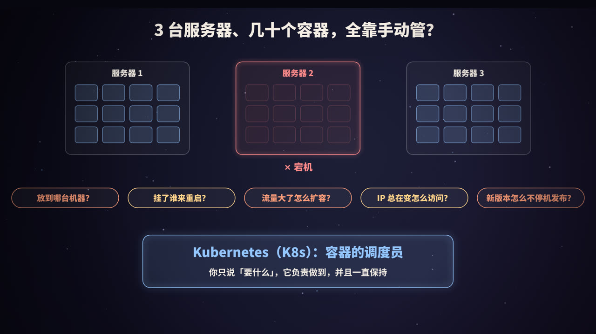
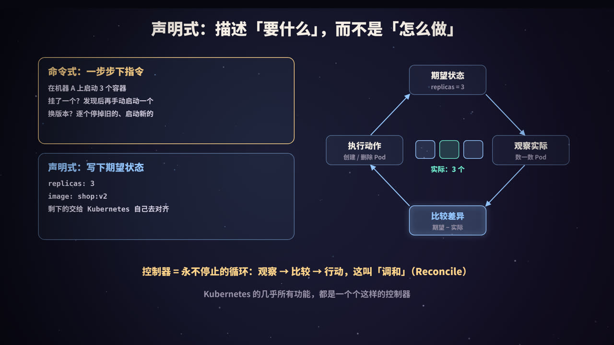
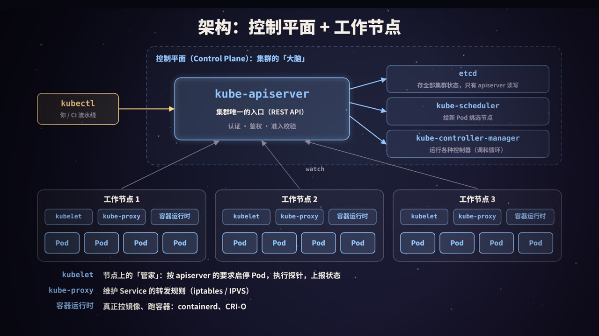
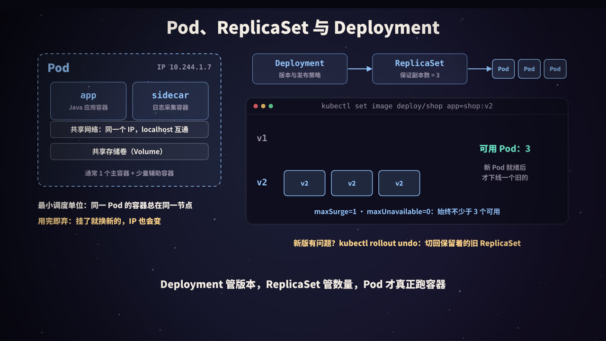
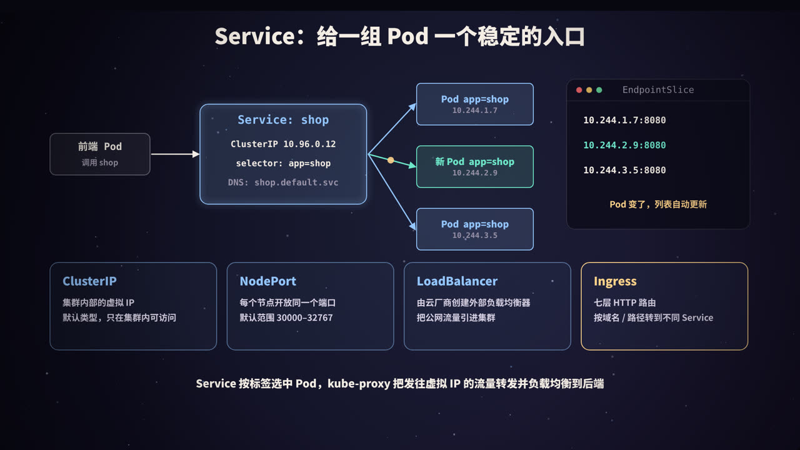
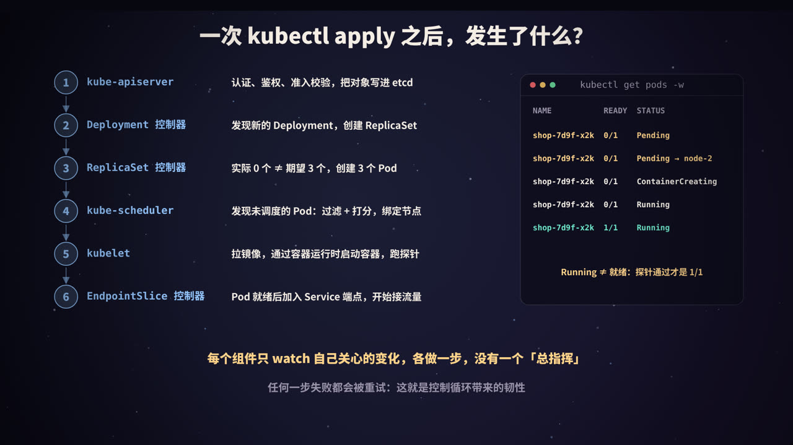
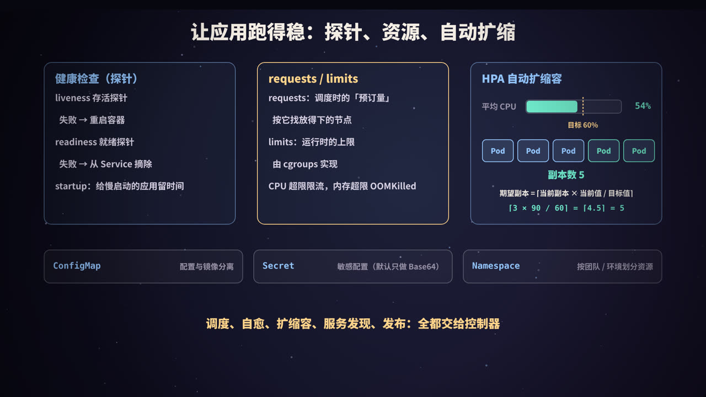
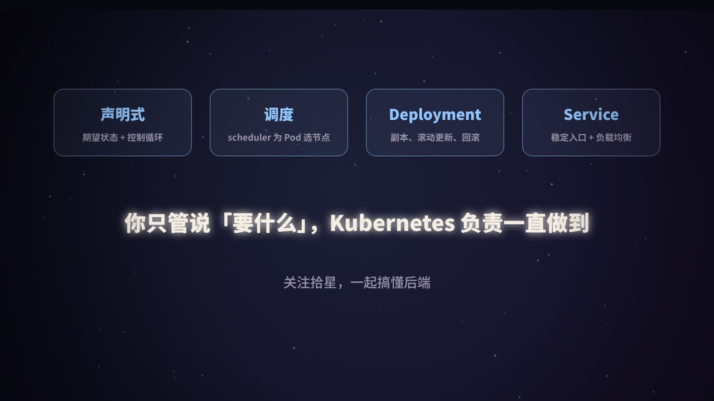

title: Kubernetes 入门：容器的调度员
subtitle: 容器多了以后的五个问题，声明式与控制循环，控制平面与工作节点，Pod、Deployment、Service、Ingress，探针、requests/limits 与 HPA，一次 kubectl apply 背后的完整链路，附可运行的 Python 控制循环模拟
tag: 计算机与后端
color: #93c5fd



## 容器多了以后：五个绕不开的问题

本系列《Docker 容器原理》讲过：容器把应用和运行环境一起打包成镜像，在哪台机器上都能一模一样地跑起来。一台机器、几个容器的时候，`docker run` 就够用了。

但真实的线上系统往往是几十上百个服务、成百上千个容器，分布在很多台机器上。这时候，下面五个问题一个都躲不掉：

| 问题 | 手动管理的做法 | 痛点 |
|---|---|---|
| **放到哪台机器？** | 登录机器看看哪台比较空 | 资源算不清，有的机器挤爆、有的闲着 |
| **挂了谁来重启？** | 监控报警，半夜爬起来手动拉起 | 慢，而且人会出错 |
| **流量大了怎么扩容？** | 再找几台机器，挨个 `docker run` | 大促前手忙脚乱，大促后忘了缩回去 |
| **IP 总在变，怎么访问？** | 手动改 Nginx 配置、改注册中心 | 容器重建一次，IP 就变一次 |
| **新版本怎么不停机发布？** | 写脚本逐台停旧的、启新的 | 脚本出错一半，线上就是新旧混杂 |

**Kubernetes**（常简写为 **K8s**，因为 K 和 s 之间有 8 个字母）就是为这些问题而生的容器编排系统。名字来自希腊语，意思是「舵手」。它起源于 Google，借鉴了其内部集群管理系统 Borg 十多年的经验，2014 年开源，2015 年发布 1.0 并捐给了 CNCF（云原生计算基金会），如今已经是容器编排事实上的标准。

一句话概括它的工作方式：**你只说「要什么」，它负责做到，并且一直保持。**

> 和《微服务：拆开之后的那些组件》对照着看：服务注册与发现、负载均衡、配置中心、弹性伸缩，这些在 Kubernetes 里大多有「原生」的对应物。

## 核心思想：声明式与控制循环



理解 Kubernetes，最重要的不是记住各种对象的名字，而是理解它的**工作方式**。

### 命令式 vs 声明式

**命令式**是一步步下指令：

```text
在机器 A 上启动 3 个容器
（过了一会儿，挂了一个）发现后再手动启动一个
换版本：停掉旧的，启动新的，再停掉下一个旧的……
```

**声明式**是只写下**期望状态**：

```yaml
replicas: 3
image: shop:v2
```

剩下的事情，「怎么从现在的样子变成这个样子」，交给系统自己去做。

两者的差别不只是写法不同。命令式的指令执行完就结束了，之后发生的任何意外（机器宕机、容器崩溃）都没人管；声明式的期望状态会被**一直**守护：任何时候实际状态偏离了期望，系统都会把它拉回来。

### 控制循环（调和，Reconcile）

守护期望状态的，是一个个**控制器**（Controller）。每个控制器都在跑同一个无限循环：

1. **观察**：看看现在实际是什么样，比如带 `app=shop` 标签的 Pod 有几个；
2. **比较**：和期望状态做对比，比如期望 3 个，实际 2 个；
3. **行动**：做出能缩小差距的最小动作，比如再创建 1 个 Pod；
4. 回到第 1 步。

这个过程叫**调和**（Reconcile）。它和空调的恒温器是一个道理：你设定 26 度，恒温器不断测量室温，高了就制冷，到了就停，永远不需要你说「现在开始制冷 10 分钟」。

控制循环有几个很好的性质：

- **自愈**：不管实际状态是因为什么变坏的（机器宕机、进程崩溃、有人手滑删了 Pod），控制器都只关心「差多少」，然后补上；
- **幂等**：同一份期望状态提交多少次结果都一样，所以 `kubectl apply` 可以放心重复执行；
- **最终一致**：每一步失败了都会在下一轮被重试，系统总会朝期望状态收敛；
- **可组合**：每个控制器只负责一小块，Deployment 控制器管 ReplicaSet，ReplicaSet 控制器管 Pod……它们互不调用，只通过读写共享的状态来协作。

Kubernetes 几乎所有的功能都是这样一个个控制器实现的。你甚至可以写自己的控制器来管理自定义资源（CRD），这就是 **Operator** 模式，比如用一个 MySQL Operator 来自动完成主从搭建、备份和故障切换。

## 集群架构：控制平面与工作节点



一个 Kubernetes 集群由两部分组成：负责「做决定」的**控制平面**，和负责「干活」的**工作节点**。

### 控制平面（Control Plane）

| 组件 | 职责 |
|---|---|
| **kube-apiserver** | 集群唯一的入口，提供 REST API。负责认证、鉴权、准入校验，然后把对象存进 etcd。**所有组件都只和它对话** |
| **etcd** | 分布式键值数据库，用 Raft 协议保证一致性，保存集群的**全部状态**（所有对象的期望状态和上报的实际状态）。只有 apiserver 直接读写它 |
| **kube-scheduler** | 调度器：发现还没分配节点的 Pod，为它挑选最合适的节点 |
| **kube-controller-manager** | 运行各种内置控制器：Deployment、ReplicaSet、Node、Job、EndpointSlice 等 |
| cloud-controller-manager | （云上才有）对接云厂商：创建负载均衡器、管理云盘、感知云主机状态 |

生产环境里控制平面通常是**高可用**的：多个 apiserver 实例前面挂负载均衡，etcd 部署 3 或 5 个节点（Raft 需要多数派存活），scheduler 和 controller-manager 也部署多个，通过选主保证同一时刻只有一个在工作。

在托管的 Kubernetes 服务（如各大云厂商提供的 K8s 服务）里，控制平面由云厂商维护，你只需要管理工作节点。

### 工作节点（Worker Node）

| 组件 | 职责 |
|---|---|
| **kubelet** | 节点上的「管家」。监听 apiserver 中分配给本节点的 Pod，调用容器运行时把它们跑起来，执行健康检查，并把状态上报回去 |
| **kube-proxy** | 维护 Service 的转发规则（iptables 或 IPVS 模式，较新版本还支持 nftables），把发往 Service 虚拟 IP 的流量转到后端 Pod |
| **容器运行时** | 真正拉镜像、创建容器的组件，如 containerd、CRI-O。kubelet 通过标准接口 **CRI** 与它对话 |

关于容器运行时有一个常见的误会：「Kubernetes 不支持 Docker 了」。准确的说法是：Kubernetes 1.24 移除了内置的 dockershim 适配层，kubelet 不再直接调用 Docker Engine，而是通过 CRI 调用 containerd 等运行时。**用 Docker 构建的镜像遵循 OCI 标准，照样可以运行**，什么都不用改。

此外，集群还需要**网络插件**（CNI，如 Calico、Cilium、Flannel）来实现一个扁平的 Pod 网络：每个 Pod 都有自己的 IP，任意两个 Pod 之间可以直接通信，不需要 NAT。以及 **CoreDNS** 这样的集群 DNS，让服务可以通过名字互相访问。

### 一切围绕 apiserver

这个架构最关键的一点：**组件之间不直接调用，全部通过 apiserver 读写状态**。scheduler 不会「通知」kubelet 去启动容器；它只是把「这个 Pod 分配给 node-2」写回 apiserver，node-2 上的 kubelet 通过 **watch** 机制看到这个变化，自己去执行。

这种设计让每个组件都可以独立重启、独立升级，任何一个组件短暂失联，其他组件也照常工作，等它恢复后继续从 apiserver 拿最新状态即可。

## Pod、ReplicaSet 与 Deployment



### Pod：最小调度单位

Kubernetes 调度的最小单位不是容器，而是 **Pod**。一个 Pod 里可以有一个或多个容器，它们：

- **共享网络**：同一个 IP、同一组端口，容器之间用 `localhost` 互相访问；
- **共享存储卷**：可以挂载同一个 Volume 来交换文件；
- **总是被调度到同一个节点**，一起创建、一起销毁。

实现上，Pod 里有一个不起眼的 pause 容器，专门「占住」网络命名空间，其他容器都加入这个命名空间。这正是《Docker 容器原理》里讲的 Namespace 机制的应用。

绝大多数 Pod 只有一个主容器。多容器 Pod 用于「紧密配合」的场景，常见模式是 **sidecar**（边车）：比如一个容器跑业务，另一个容器采集它写出的日志，或者在服务网格里负责代理所有进出流量。

Pod 有一个很重要的特点：**用完即弃**。Pod 挂了不会被「修好」，而是被删掉、换一个新的；新 Pod 的名字和 IP 都会变。所以：

- 不要在 Pod 里保存重要数据（需要持久化就用 PersistentVolume）；
- 不要直接用 Pod IP 访问服务（用 Service，见下一节）；
- 一般也不直接创建 Pod，而是通过 Deployment 这样的「上层对象」来管理。

### 三层结构

| 对象 | 负责什么 | 由谁维护 |
|---|---|---|
| **Deployment** | 版本与发布策略：现在应该跑哪个版本、怎么从旧版本过渡到新版本 | Deployment 控制器 |
| **ReplicaSet** | 数量：保证带某组标签的 Pod 正好有 N 个 | ReplicaSet 控制器 |
| **Pod** | 真正运行容器 | kubelet |

你只需要创建 Deployment。Deployment 控制器会为每个版本（Pod 模板）创建一个 ReplicaSet，ReplicaSet 控制器再去创建 Pod。三者通过**标签选择器**（label selector）关联起来：比如 ReplicaSet 管理所有带 `app=shop` 和某个模板哈希标签的 Pod。

### 滚动更新

把镜像从 v1 改成 v2 之后，Deployment 控制器会新建一个 v2 的 ReplicaSet，然后**一边扩新的、一边缩旧的**：

<figure>
<svg viewBox="0 0 440 300" xmlns="http://www.w3.org/2000/svg" role="img" aria-label="滚动更新中新旧 ReplicaSet 此消彼长">
  <rect width="440" height="300" fill="#0f0e1c"/>
  <g font-family="PingFang SC, Noto Sans SC, sans-serif" text-anchor="middle">
    <text x="220" y="26" fill="#93c5fd" font-size="16" font-weight="800">replicas=3，maxSurge=1，maxUnavailable=0</text>
    <text x="40" y="58" fill="#9a93a8" font-size="12">步骤</text>
    <text x="150" y="58" fill="#9a93a8" font-size="12">旧 ReplicaSet（v1）</text>
    <text x="320" y="58" fill="#9a93a8" font-size="12">新 ReplicaSet（v2）</text>
    <g font-size="12" font-weight="700">
      <text x="40" y="92" fill="#f4ede4">0</text>
      <rect x="96" y="76" width="32" height="24" rx="5" fill="rgba(255,255,255,.08)" stroke="#9a93a8"/><rect x="134" y="76" width="32" height="24" rx="5" fill="rgba(255,255,255,.08)" stroke="#9a93a8"/><rect x="172" y="76" width="32" height="24" rx="5" fill="rgba(255,255,255,.08)" stroke="#9a93a8"/>
      <text x="40" y="132" fill="#f4ede4">1</text>
      <rect x="96" y="116" width="32" height="24" rx="5" fill="rgba(255,255,255,.08)" stroke="#9a93a8"/><rect x="134" y="116" width="32" height="24" rx="5" fill="rgba(255,255,255,.08)" stroke="#9a93a8"/><rect x="172" y="116" width="32" height="24" rx="5" fill="rgba(255,255,255,.08)" stroke="#9a93a8"/>
      <rect x="266" y="116" width="32" height="24" rx="5" fill="none" stroke="#ffd38a" stroke-dasharray="4 3"/>
      <text x="390" y="132" fill="#ffd38a" font-size="11">新 Pod 启动中</text>
      <text x="40" y="172" fill="#f4ede4">2</text>
      <rect x="96" y="156" width="32" height="24" rx="5" fill="rgba(255,255,255,.08)" stroke="#9a93a8"/><rect x="134" y="156" width="32" height="24" rx="5" fill="rgba(255,255,255,.08)" stroke="#9a93a8"/><rect x="172" y="156" width="32" height="24" rx="5" fill="none" stroke="#ff8a8a" stroke-dasharray="4 3"/>
      <rect x="266" y="156" width="32" height="24" rx="5" fill="rgba(147,197,253,.18)" stroke="#93c5fd"/>
      <text x="390" y="172" fill="#9a93a8" font-size="11">就绪后删 1 个旧的</text>
      <text x="40" y="212" fill="#f4ede4">…</text>
      <text x="150" y="212" fill="#9a93a8">重复，直到</text>
      <text x="40" y="252" fill="#f4ede4">完成</text>
      <text x="150" y="252" fill="#9a93a8">缩容到 0（保留记录）</text>
      <rect x="266" y="236" width="32" height="24" rx="5" fill="rgba(147,197,253,.18)" stroke="#93c5fd"/><rect x="304" y="236" width="32" height="24" rx="5" fill="rgba(147,197,253,.18)" stroke="#93c5fd"/><rect x="342" y="236" width="32" height="24" rx="5" fill="rgba(147,197,253,.18)" stroke="#93c5fd"/>
    </g>
    <text x="220" y="288" fill="#ffd38a" font-size="12" font-weight="700">任何时刻：就绪 Pod ≥ 3，Pod 总数 ≤ 4</text>
  </g>
</svg>
<figcaption>滚动更新：新 ReplicaSet 每多一个就绪的 Pod，旧 ReplicaSet 才少一个，服务全程不中断</figcaption>
</figure>

两个参数控制节奏：

- **maxSurge**：发布过程中，Pod 总数最多可以比期望副本数**多出**几个（默认 25%）；
- **maxUnavailable**：发布过程中，最多允许有几个 Pod **不可用**（默认 25%）。

`maxSurge=1, maxUnavailable=0` 是最稳妥的配置：始终保持满额的可用副本，代价是需要多一个 Pod 的资源，发布也慢一些。资源紧张时可以反过来，`maxSurge=0, maxUnavailable=1`，先下线一个再启动一个。

注意「可用」的判断依据是**就绪探针**（readinessProbe）：新 Pod 只是「Running」还不算数，必须通过就绪探针才会被计为可用，旧 Pod 才会被删除。如果没有配置就绪探针，容器一启动就被认为可用，此时应用可能还在初始化，流量就进来了。

### 回滚

发布完成后，旧的 ReplicaSet 并不会被删除，而是缩容到 0 保留下来（默认保留最近 10 个，由 `revisionHistoryLimit` 控制）。所以回滚非常快：

```bash
kubectl rollout status deploy/shop        # 观察发布进度
kubectl rollout history deploy/shop       # 查看历史版本
kubectl rollout undo deploy/shop          # 回滚到上一个版本
kubectl rollout undo deploy/shop --to-revision=3
```

回滚本质上也是一次滚动更新，只不过是把旧 ReplicaSet 重新扩起来、新的缩下去。

除了 Deployment，还有几种常用的工作负载：

| 对象 | 适用场景 |
|---|---|
| **Deployment** | 无状态服务，Pod 之间完全对等、可以随意替换 |
| **StatefulSet** | 有状态服务（数据库、消息队列）：Pod 有稳定的名字（`mysql-0`、`mysql-1`）和各自独立的存储，按顺序启停 |
| **DaemonSet** | 每个节点跑一个：日志采集、监控代理、网络插件 |
| **Job / CronJob** | 一次性任务 / 定时任务，跑完就结束 |

## Service 与 Ingress：稳定的访问入口



### 为什么需要 Service

Pod 的 IP 会变，副本数也会变。前端服务要调用 shop 服务，不可能去记每个 Pod 的 IP。

**Service** 为一组 Pod 提供一个**稳定的虚拟 IP**（ClusterIP）和 **DNS 名字**，并在它们之间做**负载均衡**：

1. Service 通过**标签选择器**（如 `app=shop`）选中一组 Pod；
2. EndpointSlice 控制器持续维护一份「端点列表」：当前所有**就绪的** Pod 的 IP 和端口。Pod 挂了、被删了、未通过就绪探针，就会从列表里消失；新 Pod 就绪后自动加入；
3. 每个节点上的 kube-proxy watch 这些变化，生成转发规则：发往 `10.96.0.12:80` 的流量，随机或轮询转到某个后端 Pod 的 `8080` 端口；
4. 集群 DNS 为 Service 生成域名 `shop.<namespace>.svc.cluster.local`，同一命名空间里直接用 `shop` 就能访问。

注意 ClusterIP 是**虚拟**的：没有任何网卡真正拥有这个 IP，它只存在于各个节点的转发规则里，所以 `ping` 它通常是不通的，但 TCP 连接没问题。

> 这正好回答了开头的第四个问题：调用方只认 Service 的名字，后面的 Pod 怎么换都无所谓。这和微服务里的「注册中心 + 客户端负载均衡」解决的是同一个问题。

### 四种对外暴露方式

| 类型 | 作用 | 典型用途 |
|---|---|---|
| **ClusterIP**（默认） | 集群内部的虚拟 IP，只在集群内可访问 | 服务之间互相调用 |
| **NodePort** | 在**每个节点**上开放同一个端口（默认范围 30000–32767），访问任意节点的该端口都会转到 Service | 测试环境、自建负载均衡 |
| **LoadBalancer** | 在 NodePort 的基础上，由云厂商自动创建一个外部负载均衡器 | 云上对外暴露 TCP/UDP 服务 |
| **Ingress** | 不是 Service 类型，而是一个独立对象：**七层 HTTP 路由**，按域名和路径把请求转到不同的 Service | 一个入口承载多个 Web 服务，统一处理 HTTPS 证书 |

Service 工作在四层（TCP/UDP），只认 IP 和端口；Ingress 工作在七层，能看到 HTTP 的域名、路径、请求头，可以做「`/api` 转给 api 服务、`/` 转给前端服务」这样的路由，也可以在这里统一终止 HTTPS（见本系列《HTTPS 加密全过程》）。

Ingress 对象本身只是一份路由规则，需要部署一个 **Ingress Controller**（如基于 Nginx、Traefik、Envoy 的实现）来真正执行。社区的下一代方案是 **Gateway API**，它把「基础设施提供方」「集群运维」「应用开发者」的配置拆分得更清楚，表达能力也更强；Kubernetes 社区维护的 Ingress NGINX 项目已于 2025 年 11 月宣布退役：按计划，尽力维护只持续到 2026 年 3 月，此后不再发布任何版本、漏洞修复和安全补丁（已有部署仍能运行）。官方建议迁移到 Gateway API，或者换用其他 Ingress Controller。

### ConfigMap、Secret 与 Namespace

还有三个几乎每个应用都会用到的对象：

- **ConfigMap**：存放配置（键值对或整个配置文件），以环境变量或文件的形式注入容器。**配置与镜像分离**，同一个镜像在测试和生产环境用不同的 ConfigMap；
- **Secret**：存放密码、证书、Token 等敏感配置，用法和 ConfigMap 类似。要注意，Secret 默认只是做了 **Base64 编码**，不是加密，任何能读这个 Secret 的人都能解码。生产环境要开启 etcd 静态加密，严格控制 RBAC 权限，或者对接外部的密钥管理系统；
- **Namespace**：命名空间，把集群划分成多个逻辑分区（按团队、按环境），配合 RBAC 权限和资源配额（ResourceQuota）使用。注意它只是逻辑隔离，默认不隔离网络，需要 NetworkPolicy 来限制 Pod 之间的访问。

## 一次 kubectl apply 之后发生了什么



把前面的组件串起来，看看创建一个 3 副本的 Deployment 时，集群里到底发生了什么：

| 步骤 | 谁 | 做了什么 | Pod 状态 |
|---|---|---|---|
| 1 | kubectl → **kube-apiserver** | 认证（你是谁）→ 鉴权（RBAC：你能不能创建 Deployment）→ 准入控制（修改型准入填默认值、注入 sidecar；校验型准入检查策略）→ 写入 **etcd** | |
| 2 | **Deployment 控制器** | watch 到新的 Deployment，为当前 Pod 模板创建一个 ReplicaSet | |
| 3 | **ReplicaSet 控制器** | 期望 3 个、实际 0 个，创建 3 个 Pod 对象（此时 `nodeName` 为空） | Pending |
| 4 | **kube-scheduler** | watch 到未调度的 Pod：**过滤**（资源够不够、亲和性、污点容忍等）→ **打分**（资源均衡、镜像是否已在本地等）→ 选出最高分节点，通过 Binding 写回 apiserver | Pending（已分配节点） |
| 5 | 该节点的 **kubelet** | watch 到分配给自己的 Pod：通过 CRI 让容器运行时拉镜像、创建网络（调用 CNI 分配 IP）、启动容器 | ContainerCreating → Running |
| 6 | **kubelet** | 执行探针。就绪探针通过后，把 Pod 的 Ready 状态上报 | Running，READY 1/1 |
| 7 | **EndpointSlice 控制器** + **kube-proxy** | 把就绪 Pod 加入 Service 端点，各节点更新转发规则，Pod 开始接收流量 | |

从这张表能看出 Kubernetes 设计的精髓：

- **没有总指挥**：没有哪个组件从头到尾「编排」这个流程。每个组件只 watch 自己关心的那一类变化，做完自己的一步，把结果写回 apiserver，下一个组件自然就看到了；
- **天然可重试**：任何一步失败（镜像拉不下来、节点资源不够），对应的控制器都会在后续循环中重试，状态会如实反映在 Pod 的 Events 里；
- **排查有迹可循**：Pod 卡在哪个状态，就说明卡在哪一步。

| Pod 卡在 | 常见原因 | 怎么查 |
|---|---|---|
| Pending | 没有节点放得下（requests 太大）、亲和性 / 污点不匹配、PVC 未绑定 | `kubectl describe pod` 看 Events |
| ImagePullBackOff | 镜像名写错、私有仓库没配拉取凭证 | 同上 |
| CrashLoopBackOff | 容器启动后反复退出：配置错误、依赖连不上、OOM | `kubectl logs <pod> --previous` |
| Running 但 0/1 | 就绪探针一直失败 | 检查探针路径、端口、超时 |
| OOMKilled | 内存超过 limits | 调大 limits 或排查内存泄漏 |

## 让应用跑得稳：探针、资源与自动扩缩



### 三种探针

kubelet 会定期对容器做健康检查，方式可以是 HTTP 请求、TCP 连接、执行命令或 gRPC 健康检查：

| 探针 | 回答的问题 | 失败的后果 |
|---|---|---|
| **livenessProbe**（存活） | 进程还「活着」吗？有没有卡死？ | **重启容器** |
| **readinessProbe**（就绪） | 现在能接收流量吗？ | **从 Service 端点中摘除**（不重启） |
| **startupProbe**（启动） | 启动完成了吗？ | 启动成功前，另外两种探针都不执行；超过阈值仍未成功则重启 |

最常见的坑：

- **liveness 里检查数据库等外部依赖**：数据库一抖，所有 Pod 的存活探针同时失败，全部被重启，雪上加霜。liveness 只检查进程本身是否健康；依赖不可用可以体现在 readiness 上（或者干脆在业务层降级）；
- **慢启动应用被「杀死在启动中」**：比如 Java 应用启动要 60 秒，liveness 在第 30 秒判定失败就重启，永远起不来。用 startupProbe 给启动阶段单独的宽限时间；
- **只配了 liveness，没配 readiness**：滚动更新时新 Pod 还没准备好就接到流量，出现一批报错。

### requests 与 limits

每个容器可以声明两种资源量：

- **requests**：「预订量」。调度器按 requests 找放得下的节点：节点的可分配资源减去已有 Pod 的 requests 之和，必须大于新 Pod 的 requests。**调度只看 requests，不看实际用量**；
- **limits**：运行时的上限，由 Linux 的 **cgroups** 执行（《Docker 容器原理》里讲过同样的机制）：
  - CPU 超过 limits → 被限流（throttling），程序变慢，但不会被杀；
  - 内存超过 limits → 被内核 OOM Killer 杀掉，状态显示 `OOMKilled`，退出码 137。

CPU 的单位 `250m` 表示 0.25 个核，内存的 `512Mi` 表示 512 MiB。

根据 requests 和 limits 的设置，Pod 会被划分为三个 **QoS 等级**，节点资源紧张需要驱逐时，按 BestEffort → Burstable → Guaranteed 的顺序优先驱逐：

| QoS 等级 | 条件 | 特点 |
|---|---|---|
| **Guaranteed** | 每个容器的 CPU 和内存都设置了 requests，且 requests = limits | 最稳定，最后被驱逐 |
| **Burstable** | 至少一个容器设置了 requests 或 limits，但不满足 Guaranteed | 可以超用到 limits |
| **BestEffort** | 完全没设置 | 资源紧张时最先被驱逐 |

几条实践经验：

- **一定要设置 requests**，否则调度器不知道这个 Pod 要多少资源，容易把节点挤爆；HPA 按 CPU 利用率扩缩时也需要 requests 作为分母；
- **内存的 requests 和 limits 通常设成一样**，避免节点内存超卖导致随机 OOM；
- **CPU limits 要谨慎**：CPU 限流会导致延迟毛刺，不少团队对延迟敏感的服务只设 CPU requests 不设 CPU limits，具体取决于集群的资源规划；
- **Java 应用**：用 `-XX:MaxRAMPercentage` 按容器内存限制设置堆大小，并给堆外内存（元空间、线程栈、直接内存）留出余量。

### HPA：水平自动扩缩容

**HPA**（HorizontalPodAutoscaler）本身也是一个控制循环：每隔一段时间（默认 15 秒）读取指标，计算期望副本数，然后修改 Deployment 的 `replicas`：

```text
期望副本数 = ⌈ 当前副本数 × 当前指标值 / 目标指标值 ⌉
```

比如目标是平均 CPU 利用率 60%（相对于 requests），现在 3 个副本平均 90%：⌈3 × 90 / 60⌉ = ⌈4.5⌉ = 5 个。

为了避免抖动，HPA 还有两个保护：

- **容忍度**：当前值与目标值的比例偏差在 10% 以内时不调整；
- **缩容稳定窗口**：默认取过去 5 分钟内算出的最大推荐值，缩容不会因为短暂的低谷就立刻发生。

HPA 依赖 metrics-server 提供 CPU/内存指标，也可以通过适配器使用自定义指标（如每秒请求数、消息队列堆积长度）。此外还有：**VPA**（垂直扩缩，自动调整 requests）、**Cluster Autoscaler** 或 Karpenter（节点不够时自动加机器）。HPA 加 Pod，节点放不下时 Cluster Autoscaler 加节点，两者配合才是完整的弹性伸缩。

## 动手：用 Python 模拟控制循环

本机没有 Kubernetes 集群，但控制循环的思想完全可以用几十行代码模拟出来。下面的程序有：

- 一个**期望状态** `Spec`（副本数、镜像版本、滚动更新参数）；
- 一份**实际状态** `pods`（每个 Pod 有版本，以及是否就绪）；
- 一个 `kubelet_tick()`：模拟上一轮创建的 Pod 启动完成、通过就绪探针；
- 一个 `reconcile()`：控制器，**只比较期望与实际，做出最小调整**。它不知道 Pod 是怎么少的，也不需要知道。

然后按时间线制造一些事件：随机杀 Pod、扩容到 5、发布 v2。

```python
import random
from dataclasses import dataclass, field
from itertools import count

random.seed(42)
_ids = count(1)


@dataclass
class Pod:
    version: str
    name: str = field(default_factory=lambda: f"pod-{next(_ids):02d}")
    ready: bool = False          # 新 Pod 先是 Starting，下一个 tick 才通过就绪探针


@dataclass
class Spec:                      # 期望状态（相当于写进 etcd 的 Deployment）
    replicas: int
    image: str
    max_surge: int = 1           # 滚动更新时最多比期望多出几个 Pod
    max_unavailable: int = 0     # 滚动更新时最多允许几个 Pod 不可用


pods: list[Pod] = []             # 实际状态（集群里真正跑着的 Pod）


def kubelet_tick():
    """节点侧：上一轮创建的 Pod 启动完成，就绪探针通过。"""
    for p in pods:
        p.ready = True


def reconcile(spec: Spec) -> list[str]:
    """控制器：比较期望与实际，做出最小的调整。返回本轮做了什么。"""
    actions = []
    new = [p for p in pods if p.version == spec.image]
    old = [p for p in pods if p.version != spec.image]
    ready = sum(p.ready for p in pods)

    if not old:                                   # 没有在发布：只管副本数
        diff = spec.replicas - len(new)
        for _ in range(diff):                     # 少了就补
            p = Pod(spec.image); pods.append(p); actions.append(f"+{p.name}")
        for p in sorted(new, key=lambda p: p.ready)[:max(0, -diff)]:   # 多了就删（先删没就绪的）
            pods.remove(p); actions.append(f"-{p.name}")
        return actions

    # 滚动更新：先在「总数上限」内创建新版本 Pod
    room = spec.replicas + spec.max_surge - len(pods)
    for _ in range(min(room, spec.replicas - len(new))):
        p = Pod(spec.image); pods.append(p); actions.append(f"+{p.name}({spec.image})")
    # 再在「可用数下限」内删除旧版本 Pod：没就绪的旧 Pod 随时可删
    min_available = spec.replicas - spec.max_unavailable
    for p in sorted(old, key=lambda p: p.ready):
        if not p.ready or ready - 1 >= min_available:
            pods.remove(p); actions.append(f"-{p.name}({p.version})")
            ready -= p.ready
    return actions


def show(tick, spec, event, actions):
    view = " ".join(f"{p.version}{'●' if p.ready else '○'}" for p in pods)
    ready = sum(p.ready for p in pods)
    print(f"t={tick:<2} 期望 {spec.replicas} | 实际 {len(pods)} 就绪 {ready} | {view:<28} | {event}{' → ' + ' '.join(actions) if actions else ''}")


spec = Spec(replicas=3, image="v1")
schedule = {                      # 外部事件：第几个 tick 发生什么
    0: ("kubectl apply replicas=3 image=v1", None),
    2: ("混沌：随机杀掉 1 个 Pod", ("kill", 1)),
    4: ("混沌：一次杀掉 2 个 Pod", ("kill", 2)),
    6: ("kubectl scale --replicas=5", ("scale", 5)),
    8: ("kubectl set image app=v2", ("image", "v2")),
}

rollout_ready = []                # 记录滚动更新期间每个 tick 的就绪数
for tick in range(25):
    event, change = schedule.get(tick, ("", None))
    if change:
        kind, arg = change
        if kind == "kill":
            victims = random.sample(pods, arg)
            for v in victims:
                pods.remove(v)
            event += "：" + "、".join(v.name for v in victims)
        elif kind == "scale":
            spec.replicas = arg
        elif kind == "image":
            spec.image = arg
    kubelet_tick()                # 先让上一轮创建的 Pod 就绪
    actions = reconcile(spec)     # 控制循环：观察 → 比较 → 行动
    if tick >= 8:
        rollout_ready.append(sum(p.ready for p in pods))
    show(tick, spec, event or ("稳定，无事可做" if not actions else "调和中"), actions)
    if tick > 8 and not actions:  # 期望 == 实际，发布结束
        print(f"发布完成：滚动更新期间就绪 Pod 最少 {min(rollout_ready)} 个，从未低于期望的 {spec.replicas} 个")
        break
```

真实运行输出（`●` 表示就绪，`○` 表示启动中）：

```text
t=0  期望 3 | 实际 3 就绪 0 | v1○ v1○ v1○                  | kubectl apply replicas=3 image=v1 → +pod-01 +pod-02 +pod-03
t=1  期望 3 | 实际 3 就绪 3 | v1● v1● v1●                  | 稳定，无事可做
t=2  期望 3 | 实际 3 就绪 2 | v1● v1● v1○                  | 混沌：随机杀掉 1 个 Pod：pod-03 → +pod-04
t=3  期望 3 | 实际 3 就绪 3 | v1● v1● v1●                  | 稳定，无事可做
t=4  期望 3 | 实际 3 就绪 1 | v1● v1○ v1○                  | 混沌：一次杀掉 2 个 Pod：pod-01、pod-04 → +pod-05 +pod-06
t=5  期望 3 | 实际 3 就绪 3 | v1● v1● v1●                  | 稳定，无事可做
t=6  期望 5 | 实际 5 就绪 3 | v1● v1● v1● v1○ v1○          | kubectl scale --replicas=5 → +pod-07 +pod-08
t=7  期望 5 | 实际 5 就绪 5 | v1● v1● v1● v1● v1●          | 稳定，无事可做
t=8  期望 5 | 实际 6 就绪 5 | v1● v1● v1● v1● v1● v2○      | kubectl set image app=v2 → +pod-09(v2)
t=9  期望 5 | 实际 5 就绪 5 | v1● v1● v1● v1● v2●          | 调和中 → -pod-02(v1)
t=10 期望 5 | 实际 6 就绪 5 | v1● v1● v1● v1● v2● v2○      | 调和中 → +pod-10(v2)
t=11 期望 5 | 实际 5 就绪 5 | v1● v1● v1● v2● v2●          | 调和中 → -pod-05(v1)
t=12 期望 5 | 实际 6 就绪 5 | v1● v1● v1● v2● v2● v2○      | 调和中 → +pod-11(v2)
t=13 期望 5 | 实际 5 就绪 5 | v1● v1● v2● v2● v2●          | 调和中 → -pod-06(v1)
t=14 期望 5 | 实际 6 就绪 5 | v1● v1● v2● v2● v2● v2○      | 调和中 → +pod-12(v2)
t=15 期望 5 | 实际 5 就绪 5 | v1● v2● v2● v2● v2●          | 调和中 → -pod-07(v1)
t=16 期望 5 | 实际 6 就绪 5 | v1● v2● v2● v2● v2● v2○      | 调和中 → +pod-13(v2)
t=17 期望 5 | 实际 5 就绪 5 | v2● v2● v2● v2● v2●          | 调和中 → -pod-08(v1)
t=18 期望 5 | 实际 5 就绪 5 | v2● v2● v2● v2● v2●          | 稳定，无事可做
发布完成：滚动更新期间就绪 Pod 最少 5 个，从未低于期望的 5 个
```

几个值得注意的地方：

- **自愈不需要知道原因**：t=2 和 t=4，控制器完全不知道 Pod 是怎么没的，它只看到「期望 3、实际 2」，就补一个；
- **扩容只是改了一个数字**：t=6 把 `replicas` 改成 5，控制器在下一轮就补齐了；
- **滚动更新是逐个替换**：每一轮最多多出 1 个 Pod（maxSurge=1），只有新 Pod 就绪后才删一个旧的（maxUnavailable=0），就绪数始终是 5；
- **稳定后什么也不做**：期望等于实际时，控制循环照样在跑，只是没有动作。

真实的 ReplicaSet 和 Deployment 控制器要复杂得多（基于 watch 事件驱动而不是固定轮询，处理并发冲突、Pod 删除的优先级、发布超时等），但核心就是这个「观察 → 比较 → 行动」的循环。

### 调度和 HPA 的计算

再用一小段代码模拟调度器的「过滤 + 打分」和 HPA 的副本数公式：

```python
import math

# ---------- 1. 调度器：过滤 + 打分（极简版） ----------
# 每个节点：可分配资源 allocatable，已被其他 Pod 的 requests 占用的 used
nodes = {
    "node-1": {"cpu": 4000, "mem": 8192, "used_cpu": 3600, "used_mem": 4096},
    "node-2": {"cpu": 4000, "mem": 8192, "used_cpu": 1000, "used_mem": 2048},
    "node-3": {"cpu": 8000, "mem": 16384, "used_cpu": 2000, "used_mem": 14848},
}
pod_req = {"cpu": 500, "mem": 1024}        # 500m CPU、1Gi 内存

def schedule(req):
    feasible = {}
    for name, n in nodes.items():
        free_cpu, free_mem = n["cpu"] - n["used_cpu"], n["mem"] - n["used_mem"]
        if req["cpu"] > free_cpu or req["mem"] > free_mem:          # 过滤：放不下就淘汰
            print(f"  过滤 {name}: 剩余 CPU {free_cpu}m / 内存 {free_mem}Mi，放不下")
            continue
        # 打分：放进去之后剩得越多分越高（类似 LeastAllocated 策略）
        score = ((free_cpu - req["cpu"]) / n["cpu"] + (free_mem - req["mem"]) / n["mem"]) / 2 * 100
        feasible[name] = round(score, 1)
    print("  打分:", feasible)
    return max(feasible, key=feasible.get)

print("调度结果 →", schedule(pod_req))

# ---------- 2. HPA：期望副本数 ----------
def hpa(current_replicas, current_util, target_util, tolerance=0.1, lo=3, hi=10):
    ratio = current_util / target_util
    if abs(ratio - 1) <= tolerance:          # 偏差在 10% 以内不动，避免来回抖动
        return current_replicas
    return max(lo, min(hi, math.ceil(current_replicas * ratio)))

for cur, util in [(3, 90), (5, 54), (5, 20), (6, 150)]:
    print(f"当前 {cur} 个副本，平均 CPU {util}%（目标 60%）→ 期望 {hpa(cur, util, 60)} 个")
```

输出：

```text
  过滤 node-1: 剩余 CPU 400m / 内存 4096Mi，放不下
  打分: {'node-2': 62.5, 'node-3': 35.9}
调度结果 → node-2
当前 3 个副本，平均 CPU 90%（目标 60%）→ 期望 5 个
当前 5 个副本，平均 CPU 54%（目标 60%）→ 期望 5 个
当前 5 个副本，平均 CPU 20%（目标 60%）→ 期望 3 个
当前 6 个副本，平均 CPU 150%（目标 60%）→ 期望 10 个
```

node-1 的 CPU 只剩 400m，放不下 500m 的请求，在过滤阶段就被淘汰了；node-3 虽然 CPU 很多，但内存只剩 1.5Gi，放进去后剩得少，打分输给了 node-2。HPA 部分：54% 和 60% 的偏差在 10% 以内，保持不动；20% 算出来是 2 个，被 `minReplicas=3` 兜住；150% 算出 15 个，被 `maxReplicas=10` 封顶。

## 一份完整的部署清单（参考写法）

下面是一个典型 Web 服务的部署清单，包含 ConfigMap、Deployment、Service、Ingress 和 HPA。本机没有集群，这份 YAML 是**参考写法**，没有实际部署；但已经用 PyYAML 解析过语法，并用脚本检查了几个最容易写错的对应关系（标签选择器、端口、HPA 目标）。

```yaml
apiVersion: v1
kind: ConfigMap
metadata:
  name: shop-config
  namespace: shop
data:
  LOG_LEVEL: "info"
  FEATURE_NEW_CHECKOUT: "false"
---
apiVersion: apps/v1
kind: Deployment
metadata:
  name: shop
  namespace: shop
spec:
  replicas: 3                      # 期望状态：3 个副本
  selector:
    matchLabels:
      app: shop                    # 管理带 app=shop 标签的 Pod
  strategy:
    type: RollingUpdate
    rollingUpdate:
      maxSurge: 1                  # 发布时最多多出 1 个
      maxUnavailable: 0            # 发布时一个都不能少
  template:                        # Pod 模板
    metadata:
      labels:
        app: shop
    spec:
      containers:
        - name: app
          image: registry.example.com/shop:1.0.0
          ports:
            - containerPort: 8080
          envFrom:
            - configMapRef:
                name: shop-config  # 配置以环境变量注入
          env:
            - name: DB_PASSWORD
              valueFrom:
                secretKeyRef:
                  name: shop-secret
                  key: db-password
          resources:
            requests:              # 调度依据：节点上至少要空出这么多
              cpu: 250m
              memory: 512Mi
            limits:                # 运行上限：由 cgroups 执行
              memory: 512Mi
          startupProbe:            # 启动期间：最多给 30 × 2 = 60 秒
            httpGet: {path: /healthz/live, port: 8080}
            periodSeconds: 2
            failureThreshold: 30
          livenessProbe:           # 失败 3 次 → 重启容器
            httpGet: {path: /healthz/live, port: 8080}
            periodSeconds: 10
            failureThreshold: 3
          readinessProbe:          # 失败 → 从 Service 端点中摘除
            httpGet: {path: /healthz/ready, port: 8080}
            periodSeconds: 5
---
apiVersion: v1
kind: Service
metadata:
  name: shop
  namespace: shop
spec:
  type: ClusterIP
  selector:
    app: shop                      # 按标签找到后端 Pod
  ports:
    - port: 80                     # Service 端口
      targetPort: 8080             # Pod 端口
---
apiVersion: networking.k8s.io/v1
kind: Ingress
metadata:
  name: shop
  namespace: shop
spec:
  ingressClassName: nginx
  rules:
    - host: shop.example.com
      http:
        paths:
          - path: /
            pathType: Prefix
            backend:
              service:
                name: shop
                port:
                  number: 80
---
apiVersion: autoscaling/v2
kind: HorizontalPodAutoscaler
metadata:
  name: shop
  namespace: shop
spec:
  scaleTargetRef:
    apiVersion: apps/v1
    kind: Deployment
    name: shop
  minReplicas: 3
  maxReplicas: 10
  metrics:
    - type: Resource
      resource:
        name: cpu
        target:
          type: Utilization
          averageUtilization: 60   # 目标：平均 CPU 使用率 = requests 的 60%
```

检查脚本：

```python
import yaml
docs = list(yaml.safe_load_all(open("shop.yaml")))
by_kind = {d["kind"]: d for d in docs}
for d in docs:
    print(f'{d["apiVersion"]:<24} {d["kind"]:<24} {d["metadata"]["namespace"]}/{d["metadata"]["name"]}')
dep, svc = by_kind["Deployment"], by_kind["Service"]
tpl_labels = dep["spec"]["template"]["metadata"]["labels"]
assert dep["spec"]["selector"]["matchLabels"].items() <= tpl_labels.items(), "Deployment 选择器必须匹配 Pod 模板标签"
assert svc["spec"]["selector"].items() <= tpl_labels.items(), "Service 选择器选不到 Pod"
c = dep["spec"]["template"]["spec"]["containers"][0]
assert svc["spec"]["ports"][0]["targetPort"] == c["ports"][0]["containerPort"]
assert by_kind["HorizontalPodAutoscaler"]["spec"]["scaleTargetRef"]["name"] == dep["metadata"]["name"]
assert "cpu" in c["resources"]["requests"], "HPA 按 CPU 利用率扩缩，必须设置 CPU requests"
print("YAML 语法正确，标签、端口、HPA 目标互相对得上")
```

输出：

```text
v1                       ConfigMap                shop/shop-config
apps/v1                  Deployment               shop/shop
v1                       Service                  shop/shop
networking.k8s.io/v1     Ingress                  shop/shop
autoscaling/v2           HorizontalPodAutoscaler  shop/shop
YAML 语法正确，标签、端口、HPA 目标互相对得上
```

在真实集群上的常用操作（**参考写法**，需要一个可用的集群，比如本地用 kind 或 minikube 搭建）：

```bash
kubectl create namespace shop
kubectl -n shop create secret generic shop-secret --from-literal=db-password='换成真实密码'
kubectl apply -f shop.yaml                        # 声明期望状态，可重复执行

kubectl -n shop get deploy,rs,pods,svc,hpa        # 一次看全
kubectl -n shop get pods -w                       # 实时观察 Pod 状态变化
kubectl -n shop describe pod <pod>                # 看 Events：卡在哪一步
kubectl -n shop logs <pod> --previous             # 上一次崩溃前的日志

kubectl -n shop delete pod <pod>                  # 手动「杀」一个，看它被自动补上
kubectl -n shop scale deploy/shop --replicas=5    # 扩容
kubectl -n shop set image deploy/shop app=registry.example.com/shop:1.1.0   # 发布
kubectl -n shop rollout status deploy/shop
kubectl -n shop rollout undo deploy/shop          # 回滚

kubectl -n shop port-forward svc/shop 8080:80     # 本地调试访问 Service
```

注意：`kubectl scale` 和 `kubectl set image` 是命令式的「临时修改」，生产环境更推荐把 YAML 放进 Git，修改后 `apply`，或者交给 Argo CD、Flux 这样的 **GitOps** 工具自动同步。这样「期望状态」只有一份来源，也有完整的变更记录。另外，开启 HPA 之后，YAML 里最好不要再写死 `replicas`，否则每次 apply 都会把 HPA 调好的副本数改回去。

## 工程实践与常见坑

### 优雅停机

Pod 被删除时（发布、缩容、驱逐），流程是这样的：

1. Pod 被标记为删除，**同时**开始两件事：EndpointSlice 控制器把它从端点中摘除、kubelet 开始停止容器；
2. kubelet 先执行 `preStop` 钩子（如果配置了），再向容器的 1 号进程发送 **SIGTERM**；
3. 等待 `terminationGracePeriodSeconds`（默认 30 秒），还没退出就发 SIGKILL 强杀。

问题在于第 1 步的两件事是**并行**的：各节点的 kube-proxy 更新转发规则需要一点时间，在此期间可能还有新请求被转到这个已经开始退出的 Pod。常见的做法：

- 应用要正确处理 SIGTERM：停止接收新请求，处理完进行中的请求再退出（Spring Boot 配置 `server.shutdown=graceful`）；
- 配一个短暂的 `preStop`（比如 sleep 几秒），等摘流量的规则生效后再开始停机；
- 容器的 1 号进程要能收到信号：用 `exec` 形式的 ENTRYPOINT，别让 shell 吞掉信号。

### 高可用

- **副本分散**：用 `topologySpreadConstraints` 或 Pod 反亲和，让副本分布在不同节点、不同可用区，别让一台机器宕机带走所有副本；
- **PodDisruptionBudget**（PDB）：限制「主动驱逐」（如节点维护、升级）时最多同时下线几个 Pod；
- **节点故障的恢复不是秒级的**：节点失联后，控制平面要先等一段宽限期才把它标记为不可用；默认情况下，节点上的 Pod 再等约 5 分钟才会被驱逐、在别处重建。所以单副本服务在 Kubernetes 上也会有分钟级的中断，**关键服务至少要两个副本**。

### 资源与成本

- requests 设得太高，节点上「看起来满了」，实际利用率很低，浪费钱；设得太低，节点超卖，高峰期互相争抢；
- 用监控数据（P95 的实际用量）来校准 requests，或者借助 VPA 的推荐值；
- 给每个 Namespace 设置 ResourceQuota 和 LimitRange，防止某个团队一不小心把集群资源用光。

### 什么时候不需要 Kubernetes

Kubernetes 很强大，但学习和运维成本也很高。如果你只有少量服务、团队很小，一台云主机加 Docker Compose，或者云厂商的 Serverless 容器服务，可能是更务实的选择。当服务数量、发布频率和弹性需求真正上来了，再引入 Kubernetes（并且优先用托管服务）不迟。

## 高频面试题速答

**Q：Kubernetes 解决了什么问题？**
容器的规模化管理：调度（放到哪台机器）、自愈（挂了自动重建）、扩缩容、服务发现与负载均衡、滚动发布与回滚、配置管理。

**Q：什么是声明式 API？和命令式有什么区别？**
声明式只描述期望状态，由控制器不断对比实际状态并调和；命令式是一步步下指令。声明式天然具备自愈、幂等、可重试的特性。

**Q：Kubernetes 有哪些核心组件？**
控制平面：kube-apiserver（唯一入口）、etcd（存储状态）、kube-scheduler（调度）、kube-controller-manager（控制器）。工作节点：kubelet（管理 Pod）、kube-proxy（Service 转发）、容器运行时（containerd 等）。

**Q：Pod 和容器是什么关系？为什么要有 Pod？**
Pod 是最小调度单位，包含一个或多个容器，共享网络命名空间和存储卷，总是调度到同一节点。它让「紧密配合」的容器（如业务 + sidecar）可以像在同一台机器上一样协作。

**Q：Deployment、ReplicaSet、Pod 是什么关系？**
Deployment 管版本和发布策略，为每个版本创建 ReplicaSet；ReplicaSet 保证 Pod 数量；Pod 运行容器。滚动更新就是新 ReplicaSet 逐步扩容、旧的逐步缩容，回滚就是反过来。

**Q：Service 是怎么实现的？**
Service 通过标签选择器选中 Pod，EndpointSlice 控制器维护就绪 Pod 的端点列表，kube-proxy 在每个节点上生成 iptables/IPVS 规则，把发往 ClusterIP 的流量转发并负载均衡到后端 Pod；CoreDNS 提供服务名解析。

**Q：liveness 和 readiness 探针有什么区别？**
liveness 失败会重启容器，用于检测卡死；readiness 失败会从 Service 端点中摘除、不重启，用于判断能否接流量。startupProbe 用于给慢启动应用宽限时间。

**Q：requests 和 limits 有什么区别？**
requests 是调度依据（预订量），limits 是运行上限（cgroups 执行）。CPU 超限被限流，内存超限被 OOMKilled。两者的组合决定了 Pod 的 QoS 等级。

**Q：一个 Pod 从创建到运行经历了什么？**
apiserver 认证鉴权准入后写 etcd → 控制器创建 Pod 对象 → scheduler 过滤打分绑定节点 → kubelet 通过 CRI 拉镜像、CNI 配网络、启动容器 → 探针通过后就绪 → 加入 Service 端点。

**Q：HPA 是怎么工作的？**
控制循环定期读取指标，按「期望副本 = ⌈当前副本 × 当前值 / 目标值⌉」计算，在容忍度和稳定窗口的保护下修改 Deployment 的副本数。

## 总结



- 容器多了以后，**放哪、重启、扩容、访问、发布**五个问题必须自动化，Kubernetes 就是容器的调度员；
- 核心思想是**声明式 + 控制循环**：你描述期望状态，控制器不断「观察 → 比较 → 行动」，把实际状态拉向期望状态；
- 架构上，**控制平面**（apiserver、etcd、scheduler、controller-manager）做决定，**工作节点**（kubelet、kube-proxy、容器运行时）干活，所有组件只通过 apiserver 协作；
- **Pod** 是最小调度单位，**Deployment → ReplicaSet → Pod** 分别管版本、数量和运行，滚动更新靠两个 ReplicaSet 此消彼长；
- **Service** 提供稳定的虚拟 IP、DNS 和负载均衡，**Ingress / Gateway API** 做七层路由；
- **探针**保证只把流量给健康的 Pod，**requests/limits** 决定调度与资源上限，**HPA** 按指标自动扩缩；
- 一次 `kubectl apply` 背后没有总指挥，只有一群各司其职、不断重试的控制器。

<div class="refs" markdown="1">

### 参考资料

- Kubernetes 官方文档：Concepts — Overview / Cluster Architecture / Kubernetes Components.
- Kubernetes 官方文档：Controllers；Deployments（Rolling Update、Rollback）；ReplicaSet.
- Kubernetes 官方文档：Service；EndpointSlices；Ingress；Gateway API.
- Kubernetes Blog (2025-11-11)：Ingress NGINX Retirement: What You Need to Know；(2026-01-29)：Ingress NGINX: Statement from the Kubernetes Steering and Security Response Committees.
- Kubernetes 官方文档：Configure Liveness, Readiness and Startup Probes.
- Kubernetes 官方文档：Resource Management for Pods and Containers；Pod Quality of Service Classes.
- Kubernetes 官方文档：Horizontal Pod Autoscaling（算法细节）.
- Kubernetes 官方文档：Kubernetes Scheduler；Pod Lifecycle（Termination of Pods）.
- Kubernetes 博客：Dockershim removal FAQ（Kubernetes 1.24）.
- *Large-scale cluster management at Google with Borg*. EuroSys 2015.
- *Borg, Omega, and Kubernetes*. ACM Queue, 2016.
- etcd 官方文档；*In Search of an Understandable Consensus Algorithm*（Raft 论文），USENIX ATC 2014.

</div>
