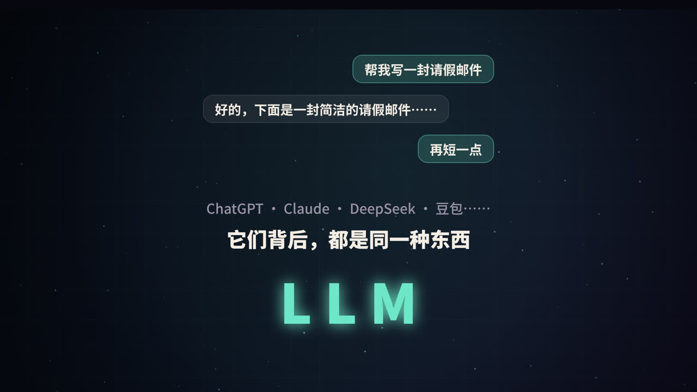
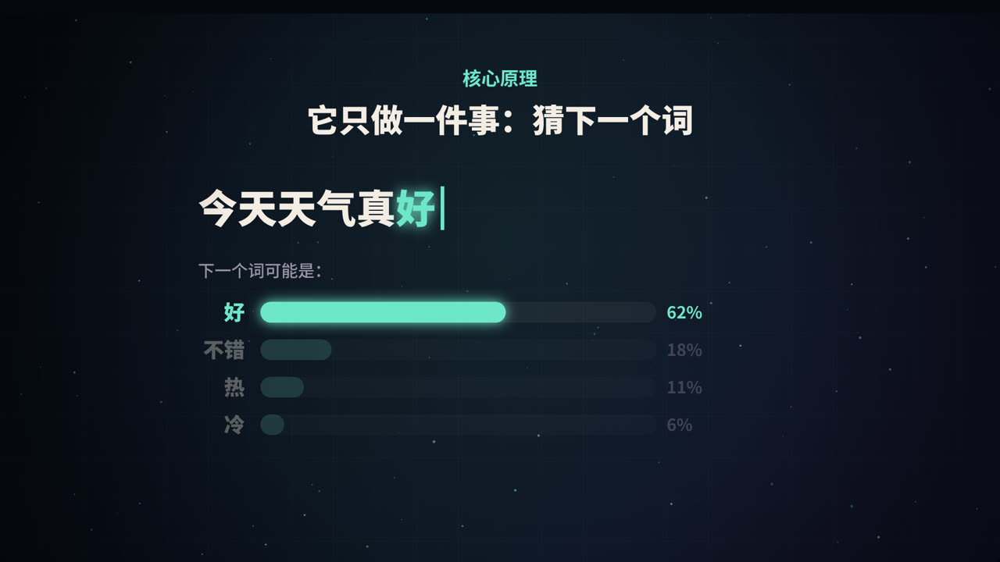
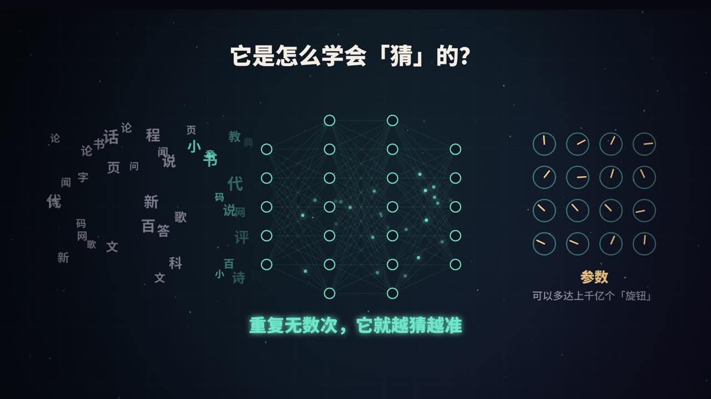
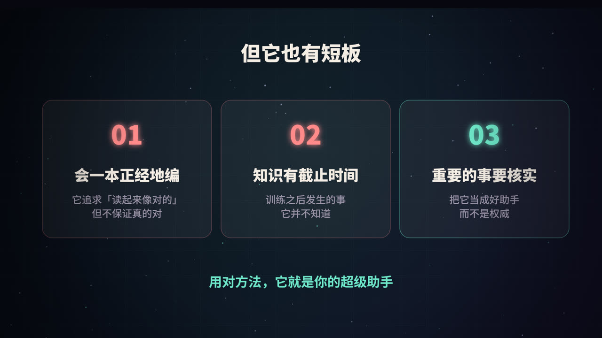
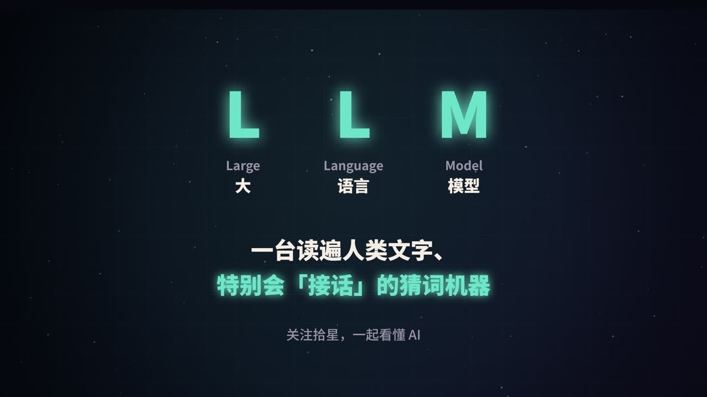

title: 什么是 LLM：一台读遍人类文字、特别会「接话」的机器
subtitle: 从「猜下一个词」讲起，把 token、训练、注意力机制、幻觉这些概念一次讲清楚
tag: 计算机 · AI
color: #6ee7c8

## LLM 是什么

LLM 是 **Large Language Model** 的缩写，中文叫**大语言模型**。拆开看：

- **Large（大）**：参数量巨大，常见的有几十亿到上千亿个参数；训练用的文字也极多，往往是万亿级别的 token。
- **Language（语言）**：它处理的对象是语言，包括自然语言，也包括代码。
- **Model（模型）**：本质是一个数学函数，输入一段文字，输出对下一段文字的预测。

你平时用的 ChatGPT、Claude、DeepSeek、豆包等，是「产品」；它们背后驱动对话的，就是 LLM。产品会在模型之外再加上界面、记忆、联网搜索、工具调用等功能。

## 核心原理：它只做一件事——猜下一个词

### 一个最简单的例子

输入「今天天气真」，模型会对「下一个词」给出一个概率分布，比如：

| 候选 | 概率（示意） |
|---|---|
| 好 | 62% |
| 不错 | 18% |
| 热 | 11% |
| 冷 | 6% |

它从中选出一个词，比如「好」，拼到句子后面，得到「今天天气真好」。然后**把整句话再输入一遍**，继续猜下一个词。如此循环，一个词接一个词地「写」出整段回答。这种方式叫**自回归生成**。

<figure>
<svg viewBox="0 0 440 400" xmlns="http://www.w3.org/2000/svg" role="img" aria-label="自回归生成循环">
  <rect width="440" height="400" fill="#0f0e1c"/>
  <defs><marker id="a" viewBox="0 0 10 10" refX="9" refY="5" markerWidth="7" markerHeight="7" orient="auto"><path d="M0,0 L10,5 L0,10 z" fill="#6ee7c8"/></marker></defs>
  <g font-family="PingFang SC, Noto Sans SC, sans-serif" text-anchor="middle">
    <rect x="70" y="24" width="240" height="76" rx="14" fill="rgba(255,255,255,.05)" stroke="rgba(255,255,255,.3)"/>
    <text x="190" y="56" fill="#f4ede4" font-size="21" font-weight="800">前文</text>
    <text x="190" y="84" fill="#9a93a8" font-size="17">今天天气真</text>
    <rect x="70" y="156" width="240" height="86" rx="16" fill="rgba(110,231,200,.15)" stroke="#6ee7c8" stroke-width="2"/>
    <text x="190" y="193" fill="#6ee7c8" font-size="26" font-weight="900">LLM</text>
    <text x="190" y="223" fill="#9a93a8" font-size="17">算出每个词的概率</text>
    <rect x="70" y="298" width="240" height="76" rx="14" fill="rgba(255,255,255,.05)" stroke="rgba(255,255,255,.3)"/>
    <text x="190" y="330" fill="#f4ede4" font-size="21" font-weight="800">选出一个词</text>
    <text x="190" y="358" fill="#ffd38a" font-size="17">「好」</text>
    <line x1="190" y1="100" x2="190" y2="152" stroke="#6ee7c8" stroke-width="3" marker-end="url(#a)"/>
    <line x1="190" y1="242" x2="190" y2="294" stroke="#6ee7c8" stroke-width="3" marker-end="url(#a)"/>
    <path d="M310,336 C400,336 400,62 314,62" fill="none" stroke="#6ee7c8" stroke-width="3" stroke-dasharray="7 7" marker-end="url(#a)"/>
    <text x="420" y="190" fill="#6ee7c8" font-size="16" font-weight="700" transform="rotate(90 420 190)">接回前文，继续猜</text>
  </g>
</svg>
<figcaption>自回归生成：每次只预测一个 token，然后把它接回输入，反复进行</figcaption>
</figure>

### 为什么同一个问题，每次回答不一样

因为模型并不总是选概率最高的那个词，而是按概率「抽签」。控制抽签方式的常见参数有：

- **温度（temperature）**：越低越保守，倾向于选高概率词；越高越发散，更有创意，也更容易跑偏。
- **Top-p / Top-k**：只在概率最高的一部分候选里抽签，过滤掉离谱的选项。

写代码、做数学时一般用低温度；写故事、头脑风暴时可以适当调高。

### 准确说，它猜的是 token

模型处理的最小单位不是「字」或「词」，而是 **token**。一个 token 可能是一个完整的英文单词、一个词根、一个汉字，也可能是半个汉字的编码片段，取决于模型使用的**分词器（tokenizer）**。

这有几个实际影响：

- 模型的「上下文长度」和 API 的计费，都是按 token 算的；
- 同样意思的一段话，中文和英文消耗的 token 数可能不同；
- 让模型「数一个单词里有几个字母」这类任务，它有时会出错，因为它看到的是 token，而不是一个个字母。

## 它是怎么学会「猜」的

### 第一阶段：预训练

模型最开始是一堆随机的数字（参数），什么也不会。训练时，把海量文本切成片段，遮住每个位置的下一个 token，让模型去猜：

1. 模型给出预测的概率分布；
2. 和真实答案对比，算出「错了多少」（这个数叫**损失**）；
3. 用**反向传播**算出每个参数该往哪个方向调、调多少；
4. 按这个方向把所有参数微调一点点。

这样的过程要重复成千上万亿次。训练数据包括书籍、网页、百科、论文、代码等。因为答案就藏在文本本身里，不需要人工标注，所以这种方法叫**自监督学习**。

为了把下一个词猜准，模型必须在内部学会语法、常识、事实，甚至一定程度的推理能力。这就是为什么「只是猜下一个词」的模型，却能表现出相当的「理解」能力。

### 第二阶段：让它变成「助手」

只做过预训练的模型更像一个「续写机器」：你问它一个问题，它可能会接着写出更多问题，而不是回答。要把它变成好用的助手，还需要：

- **指令微调（SFT）**：用大量「问题 → 高质量回答」的示例，教它按照指令回应；
- **基于人类反馈的强化学习（RLHF）** 及类似方法：让人类（或 AI）对多个回答打分排序，训练模型更倾向于给出有帮助、诚实、无害的回答。

### 参数是什么

参数就是模型内部那些可以调整的数字，视频里把它比作「旋钮」。模型学到的所有知识和能力，都以某种分布式的方式存储在这些数字里。参数越多，模型的容量通常越大，但训练和运行的成本也越高。

## 关键结构：Transformer 与注意力机制

### 「它」指的是谁

看这句话：「小猫追着球跑，因为它饿了。」人很容易知道「它」指的是小猫，因为球不会饿。模型要做到这一点，就必须在处理「它」的时候，回头看看前文里每个词，判断谁和它最相关。

这就是**注意力机制**（attention）做的事。在处理每个 token 时，模型会计算它与上下文中其他所有 token 的相关程度（注意力权重），然后按权重把这些信息汇总起来。

### 稍微技术一点的解释

在自注意力中，每个 token 会生成三个向量：

- **Query（查询）**：我在找什么信息？
- **Key（键）**：我能提供什么信息？
- **Value（值）**：我实际携带的信息内容。

用一个 token 的 Query 去和所有 token 的 Key 做比较，得到相关度分数，再归一化成权重，最后用这些权重对 Value 做加权求和。这样，「它」就能从「小猫」那里拿到最多的信息。

真实的模型会同时运行很多组这样的计算（**多头注意力**），每一组可以关注不同的关系，比如指代关系、语法关系、主题关系等。再把这样的层堆叠几十层，就构成了模型的主体。

### Transformer 的由来

这种以注意力为核心的结构叫 **Transformer**，出自 2017 年谷歌研究人员发表的论文《Attention Is All You Need》。GPT 的全称是 Generative Pre-trained Transformer，最后那个 T 指的就是它。

相比之前的循环神经网络（RNN），Transformer 可以并行处理整段文字，非常适合在大量 GPU 上训练，这也是大模型得以「做大」的关键原因之一。

### 上下文窗口

模型一次能「看到」的 token 数量是有限的，这叫**上下文窗口**。超过窗口的内容，模型就看不到了。这也是为什么很长的对话里，模型有时会「忘记」最开始说过的话。

## 它的短板

### 1. 会一本正经地胡说（幻觉）

模型的训练目标是生成「看起来合理」的文字，而不是「保证正确」的文字。当它不知道答案时，并不一定会说「我不知道」，而可能编出一个听起来很像真的回答，比如不存在的论文、错误的数据。这种现象叫**幻觉**（hallucination）。

### 2. 知识有截止时间

模型的知识来自训练数据，训练数据有截止日期。在那之后发生的事，模型原本并不知道，除非产品给它接上了搜索等工具。

### 3. 不擅长精确计算和「数数」

因为是按 token 生成文字，模型在大数乘法、精确计数这类任务上容易出错。很多产品会让模型调用计算器或代码执行工具来弥补。

### 怎么缓解

- **接入检索（RAG）**：先查资料，再基于资料回答（详见本系列《RAG 是什么》）；
- **接入工具**：搜索、计算器、代码执行；
- **要求给出处**：让它标明信息来源，方便核对；
- **人来把关**：重要的事，把它当作助手而不是权威。

## 怎么用好 LLM

1. **把背景讲清楚**：你是谁、要做什么、给谁看、有什么限制。
2. **给例子**：想要什么格式，就给它一个样例。
3. **让它分步思考**：复杂问题让它先列出思路再作答。
4. **追问和修改**：第一次结果不满意，指出具体哪里不好，让它改。
5. **核实关键信息**：数字、引用、法律和医疗相关内容，务必再确认。

## 名词速查

| 名词 | 一句话解释 |
|---|---|
| Token | 模型处理文字的最小单位 |
| 参数 | 模型内部可调整的数字，存储学到的知识 |
| 预训练 | 在海量文本上练习「猜下一个词」 |
| 微调 / RLHF | 让模型学会按指令回答、符合人类偏好 |
| Transformer | 以注意力机制为核心的神经网络结构 |
| 注意力 | 计算每个 token 该关注上下文中的哪些部分 |
| 上下文窗口 | 模型一次能看到的最大 token 数 |
| 温度 | 控制输出随机程度的参数 |
| 幻觉 | 模型生成看似合理但实际错误的内容 |

## 总结

一句话概括：**LLM 是一个通过阅读海量文字、学会「猜下一个词」的模型。** 它借助 Transformer 和注意力机制理解上下文，通过预训练获得知识，通过微调学会做一个助手。它很强大，但也会编造、有知识截止时间。了解它的原理，才能更好地用它。

### 参考资料

- Vaswani, A., et al. (2017). Attention Is All You Need. *NeurIPS*.
- Radford, A., et al. (2018). Improving Language Understanding by Generative Pre-Training. OpenAI.
- Brown, T., et al. (2020). Language Models are Few-Shot Learners. *NeurIPS*.
- Ouyang, L., et al. (2022). Training language models to follow instructions with human feedback. *NeurIPS*.

