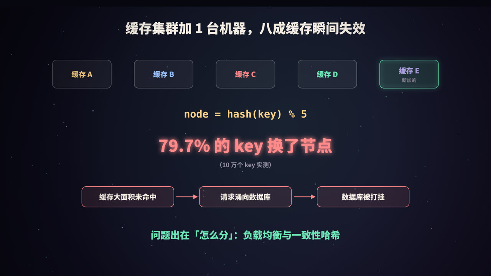
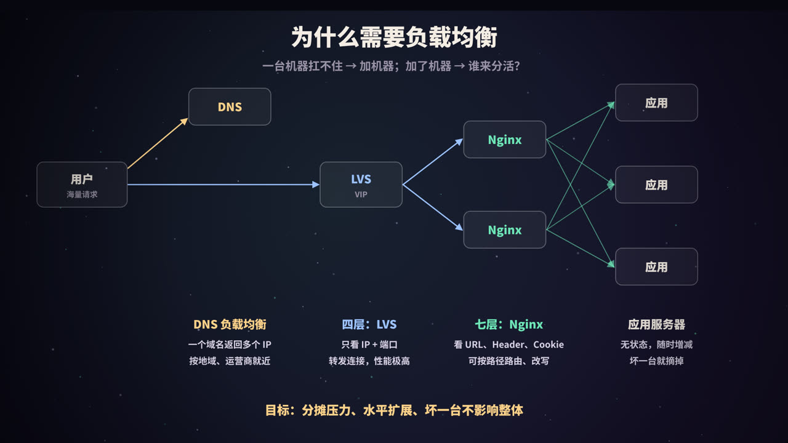
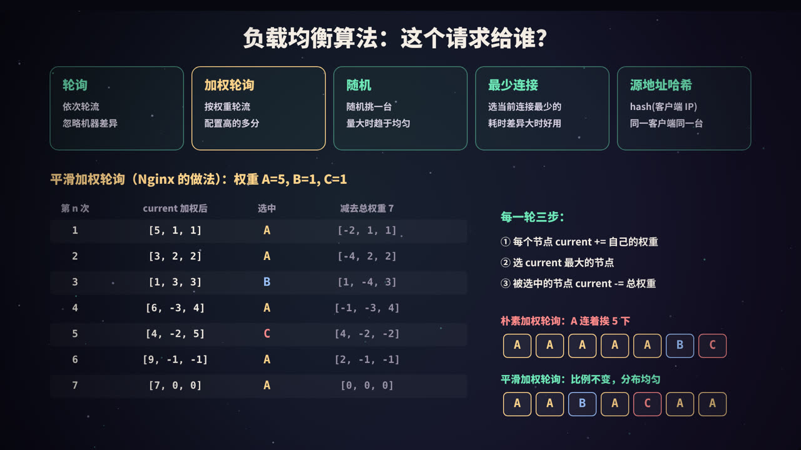
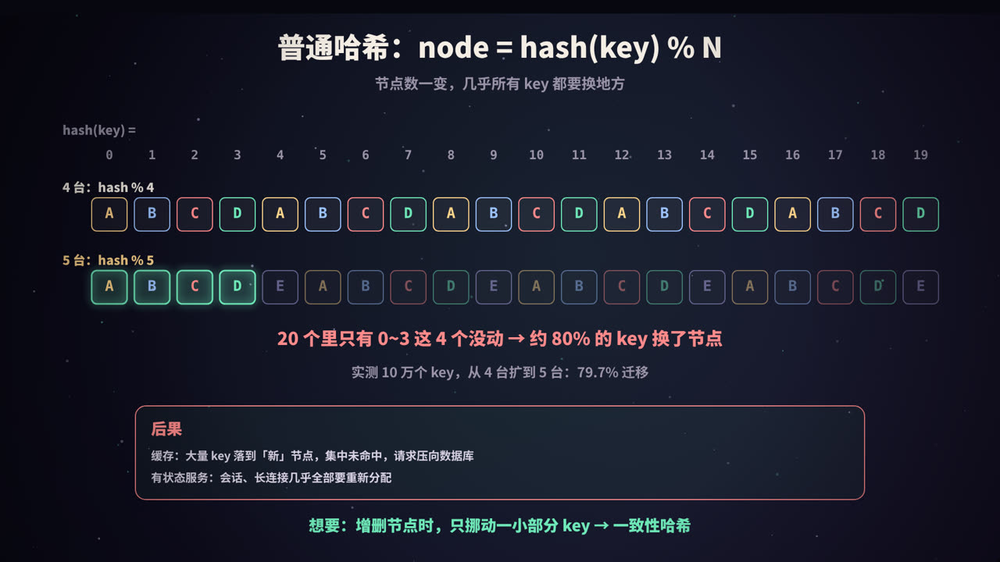
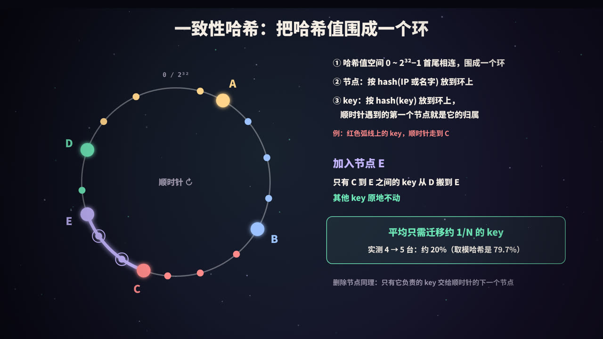

title: 负载均衡与一致性哈希：请求该交给谁
subtitle: 为什么需要负载均衡，DNS、四层、七层与客户端负载均衡，轮询、平滑加权轮询、最少连接、哈希等算法，取模哈希扩容的问题，一致性哈希环与虚拟节点，健康检查，附可运行的 Python 实测
tag: 计算机与后端
color: #6ee7b7



## 一个真实的坑

一个缓存集群有 4 台机器，用 `hash(key) % 4` 决定每个 key 存在哪台。流量涨了，运维加了第 5 台，公式变成 `hash(key) % 5`。

结果是：**大约 80% 的 key 换了节点**。这些 key 在新节点上找不到，缓存大面积不命中，请求全部打到数据库，数据库被打垮。

这个问题的本质是「**请求和数据该怎么分**」。本文从负载均衡讲起，再讲清楚为什么需要一致性哈希。

## 为什么需要负载均衡



一台服务器扛不住，就加机器（**水平扩展**）。但加了机器，就要有人决定每个请求交给哪一台，这就是**负载均衡**（Load Balancing）。它的目标是：

- **分摊压力**：让每台机器的负载大致均衡；
- **水平扩展**：加机器就能提升整体容量；
- **高可用**：一台机器故障，自动把流量转给其他机器，用户无感知。

一个典型的大型网站，负载均衡往往是**分层**的：

1. **DNS**：同一个域名解析出多个 IP，或者按用户所在地区返回最近机房的 IP；
2. **四层负载均衡**（如 LVS）：在机房入口，按 IP 和端口把连接分给多台七层代理；
3. **七层负载均衡**（如 Nginx）：按 URL、请求头等 HTTP 内容把请求转发给应用服务器；
4. **应用服务器**：处理请求。

## 四层、七层与客户端负载均衡


### 四层与七层

「四层」「七层」指的是网络模型中的层次：第四层是传输层（TCP/UDP），第七层是应用层（HTTP 等）。

| | 四层（LVS、云厂商的网络型负载均衡） | 七层（Nginx、Envoy、云厂商的应用型负载均衡） |
|---|---|---|
| 依据 | IP + 端口 | HTTP 的 URL、Header、Cookie 等 |
| 连接 | 只转发数据包或连接，不解析内容 | 终止客户端连接，解析请求后再向后端发起新请求 |
| 性能 | 很高 | 相对低一些，要解析协议 |
| 能力 | 简单分发 | 按路径路由、改写请求、TLS 卸载、限流、灰度…… |

两者常常配合使用：四层负责扛住海量连接，把流量分给多台七层代理；七层负责精细的路由。

### DNS 负载均衡

最简单，但有明显的局限：DNS 有缓存，修改后生效慢；客户端拿到 IP 后不知道这台机器是否健康。所以 DNS 一般只做粗粒度的调度，比如按地区分到不同机房。

### 客户端负载均衡

在微服务内部，经常不经过集中式的代理，而是由**调用方自己选**：

1. 调用方从注册中心拿到某个服务的所有实例地址（见本系列《微服务》）；
2. 每次调用时，在本地用负载均衡算法挑一个实例，直接连接。

| | 集中式（LVS / Nginx） | 客户端式 |
|---|---|---|
| 调用方 | 无感知，只认一个入口地址 | 需要集成服务发现和负载均衡逻辑 |
| 网络 | 多一跳 | 直连，少一跳 |
| 单点 | 代理本身要做高可用 | 没有中心节点 |
| 语言 | 与语言无关 | 每种语言的客户端都要实现一遍 |

Dubbo、gRPC、Spring Cloud LoadBalancer 都支持客户端负载均衡。服务网格（如 Istio）则把这部分逻辑放到每个服务旁边的代理（sidecar）中。

## 负载均衡算法



| 算法 | 做法 | 适合 |
|---|---|---|
| **轮询** | 依次分给每台机器 | 机器配置相同、请求耗时差不多 |
| **加权轮询** | 按权重分配，配置高的机器多分 | 机器配置不同 |
| **随机 / 加权随机** | 随机挑选，请求量大时接近均匀 | 实现简单，无状态 |
| **最少连接** | 选当前活跃连接（或请求）最少的机器 | 请求耗时差异大，比如长连接 |
| **源地址哈希** | `hash(客户端 IP)` 选机器，同一客户端总是到同一台 | 需要会话保持 |
| **一致性哈希** | 见下文 | 有状态的路由，如缓存分片 |

另外还有一些更「聪明」的策略：按响应时间加权、「两次随机选择」（随机挑两台，选负载低的那台，实现简单且效果很好）等。

### 平滑加权轮询

假设 A、B、C 三台机器的权重是 5、1、1。最朴素的加权轮询是按权重展开后轮转：`A A A A A B C`。比例没问题，但 A 会**连续**挨 5 个请求，流量不够平滑。

Nginx 使用的是**平滑加权轮询**，每次选择分三步：

1. 每个节点的 `current += 自己的权重`；
2. 选出 `current` 最大的节点；
3. 被选中节点的 `current -= 总权重`。

```python
class SmoothWeightedRR:
    """平滑加权轮询（Nginx upstream 默认的加权轮询算法）"""

    def __init__(self, weights: dict):
        self.weights = dict(weights)
        self.current = {n: 0 for n in weights}
        self.total = sum(weights.values())

    def next(self, trace=False):
        for n, w in self.weights.items():          # 1. 每个节点的 current += 自己的权重
            self.current[n] += w
        best = max(self.current, key=self.current.get)   # 2. 选 current 最大的（相同时取先出现的）
        before = dict(self.current)
        self.current[best] -= self.total            # 3. 被选中的节点 current -= 总权重
        if trace:
            print(f"  加权后 {list(before.values())!s:<14} 选 {best}   减总权重后 {list(self.current.values())}")
        return best


def naive_weighted_rr(weights: dict, n: int):
    """朴素加权轮询：按权重把节点「展开」后依次轮转"""
    seq = [node for node, w in weights.items() for _ in range(w)]
    return [seq[i % len(seq)] for i in range(n)]


W = {"A": 5, "B": 1, "C": 1}
print("权重:", W)
print("朴素加权轮询:", " ".join(naive_weighted_rr(W, 7)))

print("平滑加权轮询，逐步计算（current 依次是 A、B、C）:")
lb = SmoothWeightedRR(W)
seq = [lb.next(trace=True) for _ in range(7)]
print("平滑加权轮询:", " ".join(seq))
print("7 次之后 current 回到:", list(lb.current.values()))

lb = SmoothWeightedRR({"A": 4, "B": 2, "C": 1})
print("\n权重 {A:4, B:2, C:1} 的前 14 次:", " ".join(lb.next() for _ in range(14)))
```

输出：

```text
权重: {'A': 5, 'B': 1, 'C': 1}
朴素加权轮询: A A A A A B C
平滑加权轮询，逐步计算（current 依次是 A、B、C）:
  加权后 [5, 1, 1]      选 A   减总权重后 [-2, 1, 1]
  加权后 [3, 2, 2]      选 A   减总权重后 [-4, 2, 2]
  加权后 [1, 3, 3]      选 B   减总权重后 [1, -4, 3]
  加权后 [6, -3, 4]     选 A   减总权重后 [-1, -3, 4]
  加权后 [4, -2, 5]     选 C   减总权重后 [4, -2, -2]
  加权后 [9, -1, -1]    选 A   减总权重后 [2, -1, -1]
  加权后 [7, 0, 0]      选 A   减总权重后 [0, 0, 0]
平滑加权轮询: A A B A C A A
7 次之后 current 回到: [0, 0, 0]

权重 {A:4, B:2, C:1} 的前 14 次: A B A C A B A A B A C A B A
```

7 次中 A 仍然被选 5 次，比例不变，但 B 和 C 被均匀地插在中间。每一轮结束后 `current` 回到全 0，序列周期性重复。

## 普通哈希的问题



有些场景**必须**让同一个 key 总是落在同一台机器上，比如分布式缓存：`user:42` 的数据存在哪台，读的时候就要去哪台。

最直接的做法是取模：`node = hash(key) % N`。它分布均匀、计算简单，问题出在 **N 变化的时候**。

把哈希值 0～19 分别对 4 和 5 取模：

| hash | 0 | 1 | 2 | 3 | 4 | 5 | 6 | 7 | 8 | 9 | … |
|---|---|---|---|---|---|---|---|---|---|---|---|
| % 4 | A | B | C | D | A | B | C | D | A | B | … |
| % 5 | A | B | C | D | E | A | B | C | D | E | … |

只有在 `hash % 4 == hash % 5` 的时候 key 才不需要移动。在 0～19 这 20 个数里，只有 0、1、2、3 这 4 个满足，**约 80% 的 key 都换了节点**。一般来说，从 N 台扩到 N+1 台，只有约 1/(N+1) 的 key 能留在原地。

对于缓存，这意味着扩容（或者一台机器故障被摘除）的瞬间，大部分缓存失效，形成**缓存雪崩**（见本系列《Redis 缓存》）。对于需要会话保持的服务，大部分用户的会话会被打散。

我们希望：**增删节点时，只挪动一小部分 key**。

## 一致性哈希



**一致性哈希**（Consistent Hashing）的做法：

1. 把哈希值的空间 0 ～ 2³²−1 **首尾相连**，围成一个环；
2. 把每个**节点**按 `hash(节点 IP 或名字)` 放到环上；
3. 把每个 **key** 按 `hash(key)` 放到环上，从它的位置出发**顺时针**走，遇到的第一个节点就是它的归属。

### 增删节点只影响相邻的一段

- **加入节点 E**：E 落在 C 和 D 之间，那么原本属于 D 的、位于 C 到 E 之间的 key 改归 E。**其他所有 key 都不动**；
- **删除节点 B**：只有 B 负责的那段 key 交给顺时针的下一个节点，其他 key 不受影响。

平均来说，增加或删除一个节点只需要迁移约 **1/N** 的 key，而取模哈希几乎要迁移全部。

### 虚拟节点

只把每台机器放到环上一个点，有两个问题：

- **数据倾斜**：几个点在环上的位置是随机的，间隔有大有小，负责大区间的节点压力大；
- **扩容不均**：新节点只从**一个**邻居那里分走 key，其他节点的压力没有减轻。

解决办法是**虚拟节点**：每台物理机器在环上放很多个点，比如 A#0、A#1……A#99，key 落到虚拟节点上，再映射回物理机器。点越多，分布越均匀；新机器加入时，它的上百个虚拟节点散落在环上各处，从**每一台**老机器那里都分走一小部分。

虚拟节点还能用来实现**权重**：性能好的机器分配更多的虚拟节点。

## 实测：取模哈希 vs 一致性哈希


下面的程序用 10 万个 key，测量从 4 台扩到 5 台时 key 的迁移比例和各节点的负载：

```python
import bisect
import hashlib
from collections import Counter


def h32(s: str) -> int:
    """把字符串映射到 0 ~ 2^32-1：取 MD5 的前 4 个字节（演示用，生产中常用 MurmurHash 等更快的哈希）"""
    return int.from_bytes(hashlib.md5(s.encode()).digest()[:4], "big")


class ModHash:
    """普通取模哈希：node = hash(key) % N"""

    def __init__(self, nodes):
        self.nodes = list(nodes)

    def get(self, key):
        return self.nodes[h32(key) % len(self.nodes)]


class ConsistentHash:
    """一致性哈希环，每个物理节点放 vnodes 个虚拟节点"""

    def __init__(self, nodes, vnodes=1):
        self.vnodes = vnodes
        self.ring = []                        # 有序的 (位置, 物理节点) 列表
        for n in nodes:
            self.add(n)

    def add(self, node):
        for i in range(self.vnodes):
            bisect.insort(self.ring, (h32(f"{node}#{i}"), node))

    def remove(self, node):
        self.ring = [(p, n) for p, n in self.ring if n != node]

    def get(self, key):
        pos = h32(key)
        i = bisect.bisect_left(self.ring, (pos,))      # 二分查找：顺时针第一个位置 >= key 的节点
        return self.ring[i % len(self.ring)][1]        # 走到末尾就绕回环的起点


KEYS = [f"user:{i}" for i in range(100_000)]
OLD = ["A", "B", "C", "D"]
NEW = OLD + ["E"]


def moved_ratio(before, after):
    return sum(before.get(k) != after.get(k) for k in KEYS) / len(KEYS)


def load(lb):
    c = Counter(lb.get(k) for k in KEYS)
    return "  ".join(f"{n}:{c[n] / len(KEYS):6.1%}" for n in sorted(c))


print(f"共 {len(KEYS)} 个 key，从 4 台扩容到 5 台\n")

print("取模哈希")
print("  迁移比例:", f"{moved_ratio(ModHash(OLD), ModHash(NEW)):.1%}")
print("  扩容后负载:", load(ModHash(NEW)))

for v in (1, 10, 100, 200):
    before, after = ConsistentHash(OLD, v), ConsistentHash(NEW, v)
    print(f"\n一致性哈希（每台 {v} 个虚拟节点）")
    print("  迁移比例:", f"{moved_ratio(before, after):.1%}")
    print("  扩容前负载:", load(before))
    print("  扩容后负载:", load(after))

# 迁走的 key 都去了哪里？
before, after = ConsistentHash(OLD, 100), ConsistentHash(NEW, 100)
flows = Counter((before.get(k), after.get(k)) for k in KEYS if before.get(k) != after.get(k))
print("\n100 个虚拟节点时，迁移的 key 的去向:", dict(sorted(flows.items())))

# 缩容：4 台里去掉 B
before = ConsistentHash(OLD, 100)
after = ConsistentHash(OLD, 100)
after.remove("B")
print("去掉 B 后的迁移比例:", f"{moved_ratio(before, after):.1%}",
      "| 迁移的 key 原来都在:", {before.get(k) for k in KEYS if before.get(k) != after.get(k)})
```

输出：

```text
共 100000 个 key，从 4 台扩容到 5 台

取模哈希
  迁移比例: 79.7%
  扩容后负载: A: 20.0%  B: 20.0%  C: 20.0%  D: 20.1%  E: 19.9%

一致性哈希（每台 1 个虚拟节点）
  迁移比例: 17.3%
  扩容前负载: A:  3.1%  B:  1.3%  C: 40.2%  D: 55.4%
  扩容后负载: A:  3.1%  B:  1.3%  C: 40.2%  D: 38.1%  E: 17.3%

一致性哈希（每台 10 个虚拟节点）
  迁移比例: 24.9%
  扩容前负载: A: 12.0%  B: 39.9%  C: 21.8%  D: 26.3%
  扩容后负载: A:  9.6%  B: 32.7%  C: 16.4%  D: 16.3%  E: 24.9%

一致性哈希（每台 100 个虚拟节点）
  迁移比例: 19.6%
  扩容前负载: A: 25.7%  B: 24.8%  C: 25.2%  D: 24.3%
  扩容后负载: A: 20.6%  B: 22.5%  C: 19.5%  D: 17.7%  E: 19.6%

一致性哈希（每台 200 个虚拟节点）
  迁移比例: 18.9%
  扩容前负载: A: 26.7%  B: 26.4%  C: 26.3%  D: 20.5%
  扩容后负载: A: 20.6%  B: 22.6%  C: 20.7%  D: 17.2%  E: 18.9%

100 个虚拟节点时，迁移的 key 的去向: {('A', 'E'): 5070, ('B', 'E'): 2340, ('C', 'E'): 5619, ('D', 'E'): 6532}
去掉 B 后的迁移比例: 24.8% | 迁移的 key 原来都在: {'B'}
```

从结果可以看出：

- **取模哈希**分布非常均匀，但扩容时 **79.7%** 的 key 要迁移，和前面的推算一致；
- **一致性哈希**扩容时只迁移了约 20% 的 key，接近理想的 1/5。而且**迁移的 key 全部去了新节点 E**，老节点之间没有任何 key 互相搬家；
- **只有 1 个点时**，分布严重倾斜：D 承担了 55.4%，B 只有 1.3%；而且 E 只从 D 那里分走了 key，A、B、C 毫无变化；
- **虚拟节点增加到 100 个以上**，各节点的负载接近均匀，E 从 A、B、C、D **每一台**都分走了一部分；
- **删除节点 B** 时，迁移的 key 原来都在 B 上，其他节点的 key 一个都没动。

## 一致性哈希的应用

| 场景 | 说明 |
|---|---|
| **分布式缓存分片** | 客户端按 key 选择缓存节点，扩缩容时只有少量缓存失效。Memcached 的很多客户端就采用这种方式 |
| **有状态路由** | 同一个用户、同一个会话的请求固定落到同一台机器，比如长连接网关、本地缓存命中率优化 |
| **负载均衡器** | Nginx 的 `hash $key consistent`；Dubbo 的一致性哈希负载均衡策略，相同参数的请求总是发给同一个提供者 |
| **分布式存储** | 早期 Amazon Dynamo 的数据分区就基于一致性哈希和虚拟节点；Cassandra 等系统沿用了类似的思路 |

> **Redis Cluster 并没有用一致性哈希**，而是用了**哈希槽**：固定 16384 个槽，`CRC16(key) % 16384` 决定 key 属于哪个槽，再把槽分配给节点。扩容时整槽迁移。它和虚拟节点的思想类似：都是先把 key 映射到固定数量的「中间桶」，再把桶分给机器，这样增减机器时只需要移动部分桶。

## 健康检查与故障摘除

负载均衡不仅要「分得匀」，还要「**不把请求分给坏掉的机器**」：

- **主动健康检查**：负载均衡器定期探测每台后端（TCP 连接、HTTP 请求 `/health`），连续失败若干次就把它摘除，恢复后再加回来；
- **被动健康检查**：根据真实请求的结果判断，比如 Nginx 的 `max_fails` 和 `fail_timeout`：在一段时间内失败次数达到阈值，就暂时不再转发给它；
- **优雅上下线**：发布时先把实例从负载均衡中摘掉，等正在处理的请求完成后再停机；新实例启动并预热完成后再接入流量（Kubernetes 的 readiness 探针就是做这件事，见本系列《Kubernetes 入门》）。

Nginx 配置示例（参考写法）：

```nginx
upstream app {
    server 10.0.0.1:8080 weight=5 max_fails=3 fail_timeout=30s;   # 平滑加权轮询
    server 10.0.0.2:8080 weight=1;
    server 10.0.0.3:8080 backup;            # 其他节点都不可用时才启用
    # least_conn;                           # 改为最少连接
    # hash $request_uri consistent;         # 改为一致性哈希
}

server {
    listen 80;
    location / {
        proxy_pass http://app;
        proxy_next_upstream error timeout;  # 出错或超时时尝试下一台
    }
}
```

## 高频面试题速答

**Q：四层负载均衡和七层负载均衡有什么区别？**
四层基于 IP 和端口转发连接，不解析内容，性能高；七层解析 HTTP 等应用层协议，可以按 URL、Header 路由，功能强但开销大一些。

**Q：常见的负载均衡算法有哪些？**
轮询、加权轮询、随机、最少连接、源地址哈希、一致性哈希等。机器配置相同用轮询，配置不同用加权，请求耗时差异大用最少连接，需要固定路由用哈希。

**Q：Nginx 的平滑加权轮询是怎么做的？**
每次所有节点的 current 加上各自权重，选出 current 最大的节点，再把它的 current 减去总权重。这样既保证了比例，又让各节点交替出现，不会连续命中同一台。

**Q：为什么要用一致性哈希？**
普通取模哈希在节点数变化时几乎所有 key 都要重新映射；一致性哈希把节点和 key 放在同一个环上，增删一个节点只影响相邻区间，平均只迁移约 1/N 的 key。

**Q：一致性哈希有什么问题？怎么解决？**
节点少时分布不均（数据倾斜），扩容时新节点只分担一个邻居的压力。用虚拟节点解决：每台物理机器在环上映射多个点。

**Q：Redis Cluster 用的是一致性哈希吗？**
不是，它用 16384 个哈希槽，`CRC16(key) % 16384` 定位槽，槽再分配给节点。

## 总结


- 负载均衡解决「**这个请求交给谁**」，通常是 DNS、四层、七层、客户端多层配合；
- 算法上，轮询、加权、最少连接管「**分得匀**」，Nginx 的**平滑加权轮询**让流量交替分布；
- 需要固定路由时，取模哈希在扩缩容时会让约 80% 的 key 换节点；
- **一致性哈希**把节点和 key 放到一个环上，增删节点只迁移约 1/N 的 key，管「**变得少**」；
- **虚拟节点**解决数据倾斜，让扩容时每台老节点都分担一点；
- **健康检查**管「**不给坏的**」：及时摘除故障节点，优雅上下线。

<div class="refs" markdown="1">

### 参考资料

- Karger, D., et al. (1997). Consistent Hashing and Random Trees: Distributed Caching Protocols for Relieving Hot Spots on the World Wide Web. *STOC*.
- DeCandia, G., et al. (2007). Dynamo: Amazon's Highly Available Key-value Store. *SOSP*.
- Mitzenmacher, M. (2001). The Power of Two Choices in Randomized Load Balancing. *IEEE TPDS*.
- Nginx 文档：ngx_http_upstream_module；Nginx 源码 ngx_http_upstream_round_robin.c.
- Redis 文档：Redis cluster specification（Hash slots）.
- LVS 项目文档：Linux Virtual Server.
- Apache Dubbo 文档：负载均衡.

</div>
