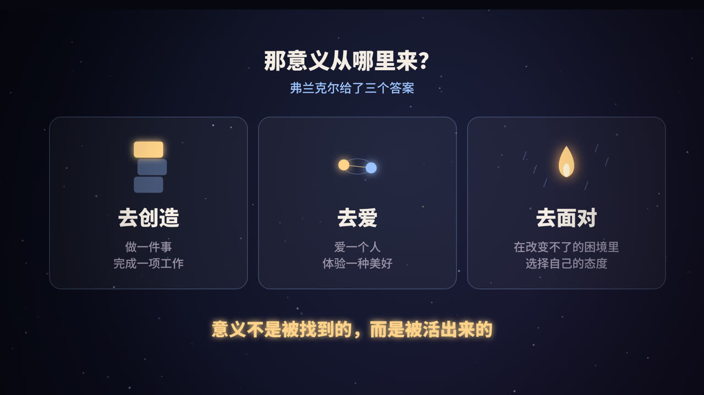
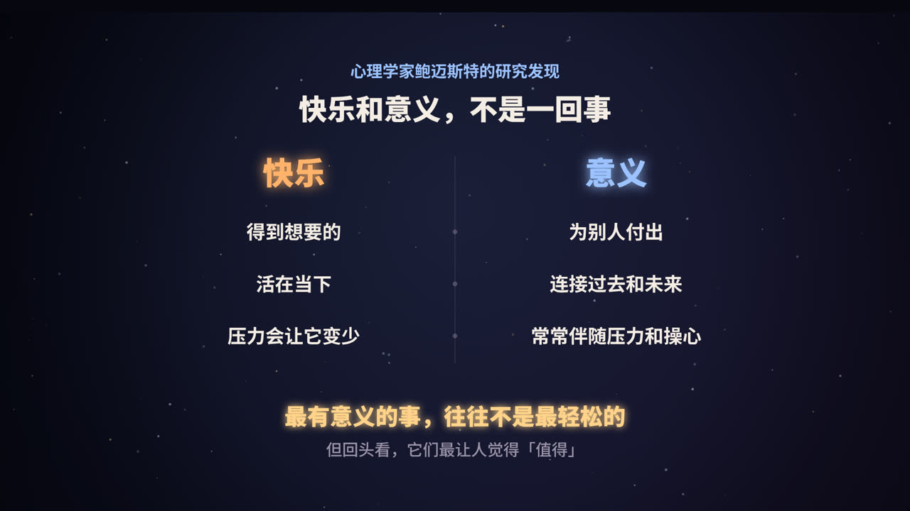

title: 人生的意义：不是被找到的，而是被活出来的
subtitle: 从弗兰克尔在集中营里的观察，到当代心理学对「意义」的研究，聊聊意义从哪里来，以及它和快乐有什么不同
tag: 心理学 · 人生
color: #9cc3ff

## 也许，这个问题问反了

「人生的意义是什么？」几乎每个人都在某个深夜问过自己。我们习惯把它当成一道有标准答案的题，好像只要想得够久、读得够多，答案就会在某一天突然出现。

奥地利精神科医生维克多·弗兰克尔（Viktor Frankl）给出了一个完全不同的角度。他认为，与其问「人生能给我什么意义」，不如反过来想：**人生正在向我提出什么问题？我要怎样用行动去回答它？**

在他看来，意义不是一个藏在某处、等你去挖出来的宝藏，而是在具体的处境里，由你的选择和行动「活」出来的。

这篇文章会沿着视频的思路，展开讲四件事：

1. 弗兰克尔在集中营里看到了什么；
2. 他提出的意义的三个来源；
3. 心理学研究发现，「快乐」和「意义」其实不是一回事；
4. 怎样在普通的日子里，找到属于自己的意义。

## 一个真实的故事：集中营里的「为什么」

### 弗兰克尔是谁

弗兰克尔 1905 年出生于维也纳，是一位精神科和神经科医生。还在二战之前，他就已经在关注人们为什么会失去活下去的动力，并开始发展自己的理论。

1942 年，因为犹太人身份，他和家人被纳粹送进了集中营。在接下来的近三年里，他先后被关押在特雷津、奥斯维辛，以及达豪集中营的分营。他的父母、哥哥和妻子都没能活下来。1945 年集中营解放时，他几乎一无所有。

第二年，他只用了很短的时间，就写出了后来闻名世界的《活出生命的意义》（英文书名 *Man's Search for Meaning*）。书的前半部分记录了他在集中营里的亲身经历，后半部分介绍了他创立的心理治疗方法——**意义疗法**（logotherapy）。

### 他观察到了什么

在集中营这种极端环境里，弗兰克尔作为一名囚犯，同时也作为一名医生，观察着身边的人。他发现：

- 那些对未来完全失去希望的人，常常会很快垮掉，无论是精神上还是身体上；
- 而那些心里还有一件「没完成的事」、还有「一个在等自己的人」的人，往往更能撑下去。

他自己也是这样。他被送进奥斯维辛时，一份准备出版的书稿被没收了。在之后的日子里，「把这本书重新写出来」成了支撑他的念头之一。他还常常在脑海里和妻子对话，尽管当时他并不知道她是否还活着。

> 弗兰克尔很喜欢引用哲学家尼采的一句话：**「知道为什么而活的人，几乎能承受任何一种活法。」**

### 人最后的自由

弗兰克尔在书中写道：一个人的一切几乎都可以被夺走，但有一样东西夺不走，那就是在任何处境下，**选择自己以什么态度去面对的自由**。

这句话并不是在美化苦难，而是在说：即使外部环境完全无法改变，人仍然保有一个属于自己的内在空间。

## 意义从哪里来：三个来源

弗兰克尔认为，人可以通过三条路径发现意义。

### 一、去创造：做一件事

通过工作、创作、完成一项任务，或者做出某种贡献，人会感到自己的存在是有用的。

这件事不一定要很宏大。一个把每道菜都认真做好的厨师，一个把系统维护得稳稳当当的工程师，一个耐心辅导孩子功课的家长，都在「创造」。

### 二、去爱：体验与相遇

通过体验美好的事物（自然、艺术、音乐），或者通过爱一个人、深入地了解一个人，人也能感受到意义。

弗兰克尔特别强调爱：当你真正爱一个人的时候，你能看到他身上的潜能，也会因为他的存在而觉得这个世界值得。

### 三、去面对：对苦难的态度

当人遇到无法改变的困境，比如绝症、失去至亲、无法挽回的损失时，仍然可以通过选择自己的态度来实现意义。

这里有一个很重要的前提：**只有当苦难无法避免时，才谈得上在苦难中寻找意义。** 如果痛苦是可以消除的，比如一份伤害你的工作、一段可以离开的关系，那么正确的做法是去改变它，而不是硬扛。弗兰克尔本人也明确说过，不必要的受苦并不高尚。

<figure>
<svg viewBox="0 0 720 260" xmlns="http://www.w3.org/2000/svg" role="img" aria-label="意义的三个来源示意图">
  <rect width="720" height="260" fill="#0f0e1c"/>
  <g font-family="PingFang SC, Noto Sans SC, sans-serif" text-anchor="middle">
    <circle cx="140" cy="120" r="78" fill="rgba(156,195,255,.10)" stroke="#9cc3ff" stroke-width="2"/>
    <text x="140" y="112" fill="#f4ede4" font-size="26" font-weight="800">去创造</text>
    <text x="140" y="146" fill="#9a93a8" font-size="15">工作 · 创作 · 贡献</text>
    <circle cx="360" cy="120" r="78" fill="rgba(255,211,138,.10)" stroke="#ffd38a" stroke-width="2"/>
    <text x="360" y="112" fill="#f4ede4" font-size="26" font-weight="800">去爱</text>
    <text x="360" y="146" fill="#9a93a8" font-size="15">体验美 · 爱一个人</text>
    <circle cx="580" cy="120" r="78" fill="rgba(255,138,138,.10)" stroke="#ff8a8a" stroke-width="2"/>
    <text x="580" y="112" fill="#f4ede4" font-size="26" font-weight="800">去面对</text>
    <text x="580" y="146" fill="#9a93a8" font-size="15">无法改变时的态度</text>
    <text x="360" y="236" fill="#9cc3ff" font-size="17" font-weight="700">对应：你给世界什么 · 你从世界接受什么 · 你如何面对命运</text>
  </g>
</svg>
<figcaption>弗兰克尔的意义三来源，可以理解为三种和世界相处的方式</figcaption>
</figure>

## 快乐和意义，不是一回事

### 一项有意思的研究

2013 年，社会心理学家罗伊·鲍迈斯特（Roy Baumeister）和同事调查了约 400 名美国成年人，请他们评价自己的生活有多快乐、有多有意义，并回答大量关于日常生活的问题。

结果发现，快乐和意义高度相关：大多数情况下，有意义的生活也是比较快乐的生活。但在把两者的共同部分剥离之后，它们之间出现了一些有意思的差异：

| | 和「快乐」更相关 | 和「意义」更相关 |
|---|---|---|
| 给予与获取 | 需求被满足，得到想要的 | 为别人付出，做一个给予者 |
| 时间 | 关注当下 | 把过去、现在和未来连起来思考 |
| 压力 | 压力和烦恼会降低快乐 | 常常伴随更多的压力和操心 |
| 人际 | 和朋友相处带来快乐 | 和所爱的人相处、照顾他人带来意义 |
| 自我 | — | 表达自我，与身份认同有关 |

### 为什么这很重要

这能解释很多生活中的现象。比如：

- 养育孩子常常让父母疲惫、焦虑，单看某一天未必「快乐」，但很多父母会说这是自己人生中最有意义的事；
- 一份艰苦的志愿工作、一个熬夜赶出来的项目，过程中可能很辛苦，回头看却觉得非常「值得」。

> 快乐更像是「此刻感觉好不好」，意义更像是「这一切值不值得」。两者都重要，但不能互相替代。

### 意义对健康也有好处

不少研究发现，觉得人生有目标、有意义的人，身心健康状况也更好。例如 2014 年，心理学家希尔（Patrick Hill）和图里亚诺（Nicholas Turiano）分析了一项长达 14 年的全国追踪调查，发现在控制了其他因素之后，人生目标感更强的人，在追踪期间的死亡风险更低，而且这一点在青年、中年和老年人身上都成立。

## 心理学怎么定义「意义感」

近年来，心理学家逐渐对「人生意义」形成了一个比较统一的理解。马泰拉（Frank Martela）和斯特格（Michael Steger）在 2016 年总结认为，意义感由三个部分组成：

1. **可理解（coherence）**：我的生活是说得通的，我能理解发生在我身上的事。
2. **有目标（purpose）**：我有方向，有想去追求的东西。
3. **有价值（significance）**：我的存在是重要的，是值得的。

你可以用这三个问题快速自查：我现在的生活说得通吗？我知道自己要往哪走吗？我觉得自己的存在有分量吗？哪一项最薄弱，就可以从哪一项开始改变。

## 今晚，问自己 3 个问题

视频的最后留了三个问题，这里展开说说它们背后的思路。

### 1. 最近一次忘了时间，是在做什么？

这个问题对应的是**投入**。让你忘记时间的事，通常是你真正在乎、也有能力做好的事。它是「去创造」这条路径的最好线索。

### 2. 如果没人看见，你还愿意做什么？

这个问题用来过滤掉「为了别人的眼光」而做的事。剩下的，才更接近你自己真正认同的价值。

### 3. 谁的生活，会因为你变好一点？

这个问题对应的是**联结**与**贡献**。鲍迈斯特的研究说明，意义常常来自付出。当你意识到自己对某个人很重要，意义感会非常具体地出现。

## 几个常见的误解

### 意义必须很宏大吗？

不必。改变世界当然有意义，但照顾好家人、把一份平凡的工作做扎实、成为朋友在难过时第一个想到的人，同样有意义。研究中的「意义感」本来就大量来自日常生活。

### 找不到意义，是不是我有问题？

不是。几乎每个人都会经历觉得「一切都没意思」的阶段，尤其是在转变期，比如毕业、换工作、失去亲人之后。弗兰克尔的建议是：不要停留在抽象的「人生意义」上，而是回到眼前具体的处境，问问自己此刻能做的、值得做的事情是什么。

> 如果这种空虚感持续很久，并且伴随明显的情绪低落、失眠或对一切失去兴趣，那可能不只是「意义」的问题，及时向专业的心理咨询师或医生求助是很重要的。

### 意义和快乐只能二选一吗？

不是。研究显示两者大部分时候是一致的。只是在某些时刻，比如需要付出、需要承担的时候，它们会分开。认识到这一点，能帮你在辛苦的时候，看清自己在坚持的是什么。

## 总结

- 弗兰克尔认为，意义不是被找到的，而是在回应生活的过程中被活出来的。
- 意义可以来自三条路径：**去创造、去爱、去面对**。
- 快乐和意义高度相关，但不完全相同：**意义更多来自付出、联结和对时间的整体感**。
- 心理学把意义感拆成三部分：**可理解、有目标、有价值**。

意义不是一个答案，而是你每天走出来的路。

### 参考资料

- Frankl, V. E. (1946/2006). *Man's Search for Meaning*. Beacon Press.（中译本：《活出生命的意义》）
- Nietzsche, F. (1889). *Twilight of the Idols*.
- Baumeister, R. F., Vohs, K. D., Aaker, J. L., & Garbinsky, E. N. (2013). Some key differences between a happy life and a meaningful life. *The Journal of Positive Psychology*.
- Hill, P. L., & Turiano, N. A. (2014). Purpose in life as a predictor of mortality across adulthood. *Psychological Science*.
- Martela, F., & Steger, M. F. (2016). The three meanings of meaning in life: Distinguishing coherence, purpose, and significance. *The Journal of Positive Psychology*.

