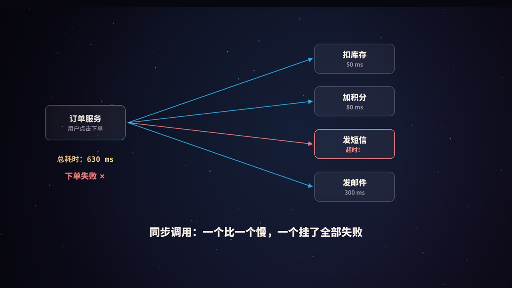
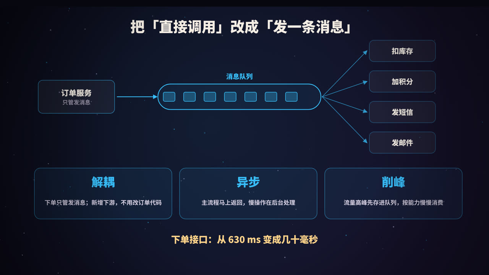
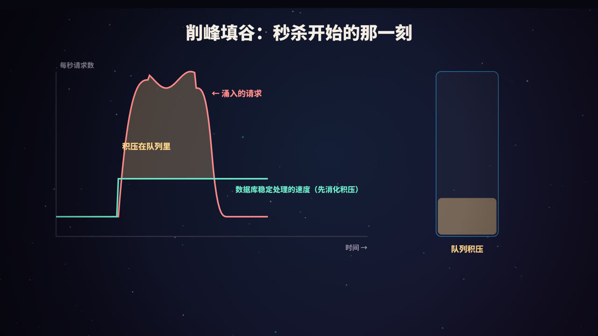
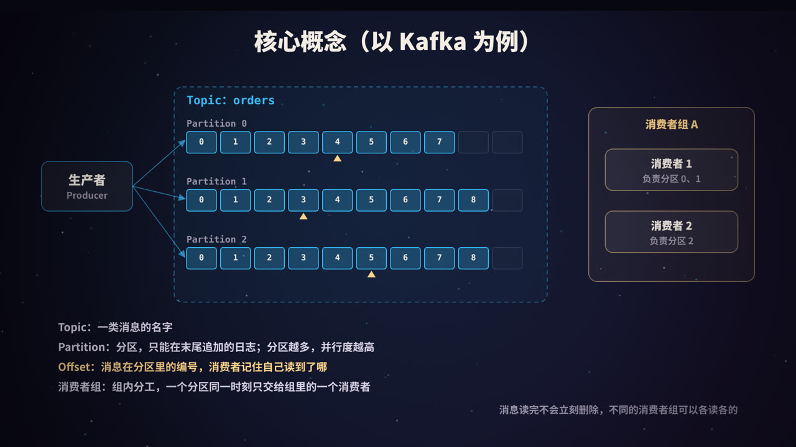
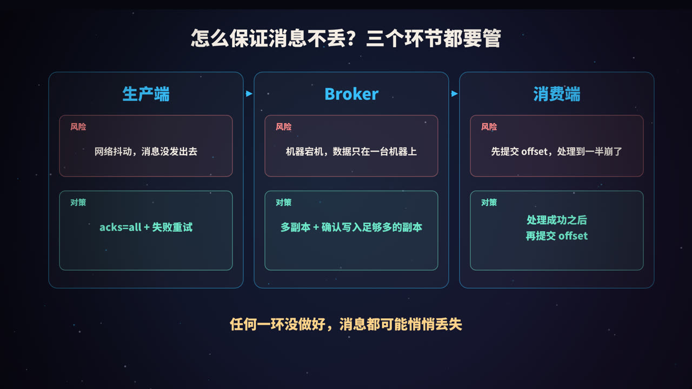
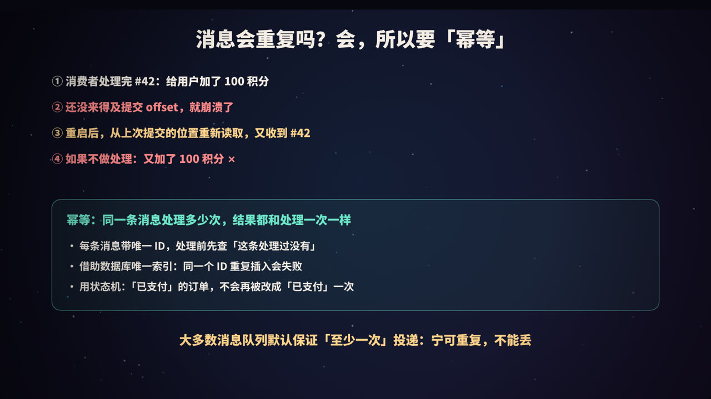
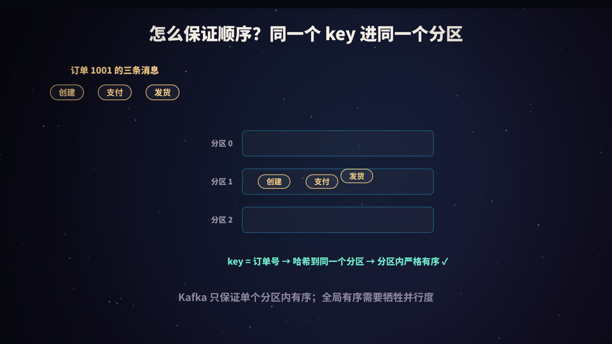

title: 消息队列：解耦、异步、削峰，以及不丢、不重、有序
subtitle: 以 Kafka 为例讲清 Topic、分区、Offset 和消费者组；三个环节怎么保证不丢消息，为什么一定要幂等，怎么保证顺序，以及积压、死信、事务消息和选型
tag: 计算机与后端
color: #38bdf8



## 同步调用的两个问题

用户下单后，订单服务要依次调用：扣库存、加积分、发短信、发邮件。如果全部同步调用：

1. **慢**：总耗时是所有调用之和，用户要等每一个下游都处理完；
2. **脆弱**：任何一个下游超时或宕机，整个下单流程都失败了，哪怕发短信这种和下单本身关系不大的步骤。

更麻烦的是，每加一个新的下游（比如「下单后给推荐系统发数据」），订单服务的代码都要改一次。

**消息队列**（Message Queue，MQ）的思路是：订单服务完成核心操作后，只发一条「订单已创建」的消息到队列，就立即返回；其他服务各自从队列中订阅、处理这条消息。

## 三大作用



| 作用 | 解决什么问题 |
|---|---|
| **解耦** | 生产者不需要知道谁在消费。新增一个下游，只需要它自己去订阅，生产者的代码不用动 |
| **异步** | 主流程只做最核心的事，耗时的操作在后台处理，接口响应快得多 |
| **削峰** | 流量高峰时先把请求存进队列，下游按自己的能力稳定消费，不会被瞬间压垮 |

除此之外，消息队列还常用于**日志收集**、**数据同步**（比如把数据库变更同步到搜索引擎）、**流式计算**等场景。

### 削峰填谷



秒杀开始的那一刻，请求量可能是平时的几十倍，而数据库每秒能处理的写入是有限的。如果请求直接打到数据库，数据库很可能被压垮。

把请求先写入消息队列，下游服务按固定速度消费：高峰时，多出来的请求在队列里**积压**；高峰过后，下游继续以稳定速度把积压**消化**掉。数据库始终工作在安全负载之内，代价是一部分请求处理得晚一些。

### 引入消息队列的代价

消息队列不是免费的：

- 系统多了一个组件，需要部署、监控和运维；
- 数据从「立即一致」变成「**最终一致**」：下单成功的那一刻，积分可能还没加上；
- 需要处理消息丢失、重复、乱序、积压等新问题，也就是本文后半部分的内容。

## 核心概念：以 Kafka 为例



| 概念 | 解释 |
|---|---|
| **Producer（生产者）** | 发送消息的一方 |
| **Broker** | 消息队列的服务器节点，多个 Broker 组成集群 |
| **Topic（主题）** | 一类消息的名字，比如 `orders` |
| **Partition（分区）** | 一个 Topic 被分成多个分区，每个分区是一个**只能在末尾追加**的日志文件 |
| **Offset（偏移量）** | 消息在分区中的位置编号，从 0 开始递增 |
| **Consumer Group（消费者组）** | 一组共同消费同一个 Topic 的消费者 |

### 分区：并行的关键

一个 Topic 的多个分区可以分布在不同的 Broker 上，生产者往不同分区写，消费者从不同分区读，从而实现**水平扩展**。

在一个消费者组内，**每个分区同一时刻只会分配给组内的一个消费者**。所以组内消费者的数量超过分区数时，多出来的消费者会闲着。**分区数决定了一个消费者组的最大并行度。** 当组内消费者增减时，分区会重新分配，这个过程叫**再均衡**（rebalance）。

### Offset：各读各的

消息被消费后**不会立即删除**，而是按照配置的保留时间或大小保留一段时间。每个消费者组各自记录自己在每个分区上读到了哪个 Offset。所以：

- 不同的消费者组可以独立地读取同一份数据，互不影响（这就是「发布-订阅」）；
- 必要时，还可以把 Offset 调回去，**重新消费**历史消息。

### Kafka 为什么吞吐量高

- **顺序写磁盘**：消息只在分区末尾追加，顺序写的速度远高于随机写；
- **利用操作系统的页缓存**：读写大多发生在内存中；
- **零拷贝**：发送数据时，减少数据在内核和用户空间之间的复制；
- **批量和压缩**：生产者和消费者都可以批量收发，并压缩数据。

## 怎么保证消息不丢



消息从发出到被成功处理，要经过三个环节，每个环节都可能丢消息。

### 1. 生产端

**风险**：网络抖动，消息根本没有到达 Broker，而生产者以为发成功了。

**对策**：

- 设置 `acks=all`：消息被所有同步副本（ISR）写入后，Broker 才返回成功；
- 发送失败时**重试**，并处理回调中的异常，不要「发了就不管」；
- 开启生产者幂等（`enable.idempotence=true`，较新版本的 Kafka 默认开启），避免重试导致消息在 Broker 端重复。

### 2. Broker 端

**风险**：消息只写在一台机器上，这台机器坏了，消息就没了。

**对策**：

- 每个分区设置多个**副本**，比如 `replication.factor=3`；
- 设置 `min.insync.replicas=2`：至少有 2 个副本写入成功，才算写入成功；
- 关闭「非同步副本当选领导者」（`unclean.leader.election.enable=false`），避免数据不全的副本成为主副本。

### 3. 消费端

**风险**：消费者先提交了 Offset，然后在处理消息的过程中崩溃了。重启后从新的 Offset 开始读，那条消息就再也不会被处理。

**对策**：**处理成功之后，再提交 Offset**。通常要关闭自动提交（`enable.auto.commit=false`），在业务逻辑完成后手动提交。

## 消息会重复吗：幂等



「处理成功后再提交 Offset」带来了另一个问题：如果消息处理完了，**还没来得及提交 Offset** 消费者就崩溃了，重启后会从上次提交的位置重新读取，同一条消息就会被**再处理一次**。

这几乎无法完全避免。所以消息队列通常保证的是**至少一次**（at least once）投递：宁可重复，也不丢。

| 投递语义 | 含义 |
|---|---|
| 最多一次 | 可能丢，但不会重复 |
| **至少一次** | 不会丢，但可能重复（最常用） |
| 恰好一次 | 不丢不重，实现成本最高 |

既然会重复，**消费逻辑就必须是幂等的**：同一条消息处理多少次，结果都和处理一次一样。常见做法：

```sql
-- 1. 用唯一索引防重：消息 ID 重复插入会失败，说明已经处理过
CREATE TABLE consumed_message (
  message_id VARCHAR(64) PRIMARY KEY,
  consumed_at DATETIME NOT NULL
);

-- 2. 用状态机：只有「待支付」的订单才能变成「已支付」
UPDATE orders SET status = 'PAID' WHERE id = 1001 AND status = 'UNPAID';
```

把「记录消息 ID」和「执行业务操作」放在**同一个本地事务**里，就能保证两者同时成功或同时失败。

> Kafka 提供了事务和幂等生产者，可以在「Kafka 读取 → 处理 → 写回 Kafka」的链路内实现恰好一次。但只要处理过程涉及外部系统（比如写数据库、调接口），仍然需要业务层面的幂等。

## 怎么保证顺序



订单 1001 的三条消息「创建 → 支付 → 发货」必须按顺序处理。如果它们被分散到不同的分区，被不同的消费者并行处理，就可能先处理「发货」再处理「创建」。

Kafka **只保证单个分区内的消息有序**。解决办法是：发送时指定**消息的 key**，比如用订单号作为 key。Kafka 会对 key 做哈希，相同 key 的消息总是进入同一个分区，于是同一个订单的消息就是有序的，而不同订单之间仍然可以并行处理。

还要注意：

- 消费者内部如果用多线程处理，也要保证同一个 key 的消息交给同一个线程；
- 生产者重试可能导致乱序，开启幂等生产者可以在重试时保持分区内的顺序；
- 如果要求**全局**严格有序，只能使用一个分区，代价是失去并行能力。

## 实战中的常见问题

### 消息积压了怎么办

1. **先排查消费者**：是不是下游变慢了、出现了报错重试、有慢 SQL；
2. **扩容消费者**：增加消费者实例，但不能超过分区数；
3. **增加分区**：分区数是并行度的上限（注意：增加分区会改变 key 到分区的映射，影响顺序性）；
4. **临时方案**：写一个程序把积压的消息快速转移到一个分区更多的临时 Topic，再用更多的消费者处理。

### 处理一直失败的消息：重试与死信

某条消息因为数据问题，无论重试多少次都失败。如果一直重试，它会卡住后面所有的消息。常见做法是：重试几次仍然失败后，把它投递到**死信队列**（Dead Letter Queue），并发送告警，由人工排查处理，让正常消息继续流动。

### 数据库和消息怎么保持一致

「先写数据库，再发消息」：如果写库成功、发消息失败，下游就永远收不到通知。「先发消息，再写数据库」：如果消息发出了、写库失败，下游就会处理一条「不存在」的订单。

常用的解法：

- **本地消息表（Outbox）**：在同一个本地事务里，同时写业务数据和一条「待发送消息」记录；再由后台任务把消息可靠地发到队列，发送成功后标记为已发送；
- **事务消息**：RocketMQ 支持「半消息」机制：先发一条对消费者不可见的消息，本地事务提交后再确认投递，并能在状态不明时回查。

## 常见消息队列对比

| | Kafka | RocketMQ | RabbitMQ |
|---|---|---|---|
| 定位 | 高吞吐的分布式日志，流处理 | 业务消息，阿里开源 | 灵活路由的传统消息代理 |
| 吞吐量 | 非常高 | 高 | 中等 |
| 特色功能 | 消息可长期保留、可回放 | 事务消息、延时消息、消息过滤 | 丰富的交换机路由规则，协议支持多 |
| 适合场景 | 日志收集、大数据管道、事件流 | 电商订单、交易等业务消息 | 中小规模业务、复杂路由需求 |

没有绝对的好坏，要根据吞吐量、可靠性要求、功能需求和团队熟悉程度来选择。

## 高频面试题速答

**Q：为什么使用消息队列？**
解耦、异步、削峰。代价是系统复杂度增加，数据变为最终一致。

**Q：如何保证消息不丢失？**
生产端 `acks=all` 加重试；Broker 多副本，`min.insync.replicas` 至少为 2；消费端处理成功后再手动提交 Offset。

**Q：如何避免重复消费？**
无法完全避免，消费逻辑要做幂等：唯一消息 ID、数据库唯一索引、状态机。

**Q：如何保证消息顺序？**
相同业务 key 的消息发往同一个分区，分区内有序；消费端也要保证同一个 key 串行处理。

## 总结


- 消息队列的三大作用：**解耦、异步、削峰**；
- Kafka 的核心：**Topic、分区、Offset、消费者组**，分区数决定并行度；
- **不丢**：生产端确认重试、Broker 多副本、消费端处理完再提交；
- **不重**：至少一次投递下，消费者必须**幂等**；
- **有序**：同一个 key 进同一个分区；
- 实战中还要处理**积压、死信，以及数据库和消息的一致性**。

<div class="refs" markdown="1">

### 参考资料

- Apache Kafka Documentation：Design；Producer Configs；Consumer Configs；Semantics.
- Kreps, J., Narkhede, N., & Rao, J. (2011). Kafka: a Distributed Messaging System for Log Processing. *NetDB*.
- Apache RocketMQ 官方文档：事务消息.
- Richardson, C. Microservices Patterns: Transactional Outbox.

</div>
