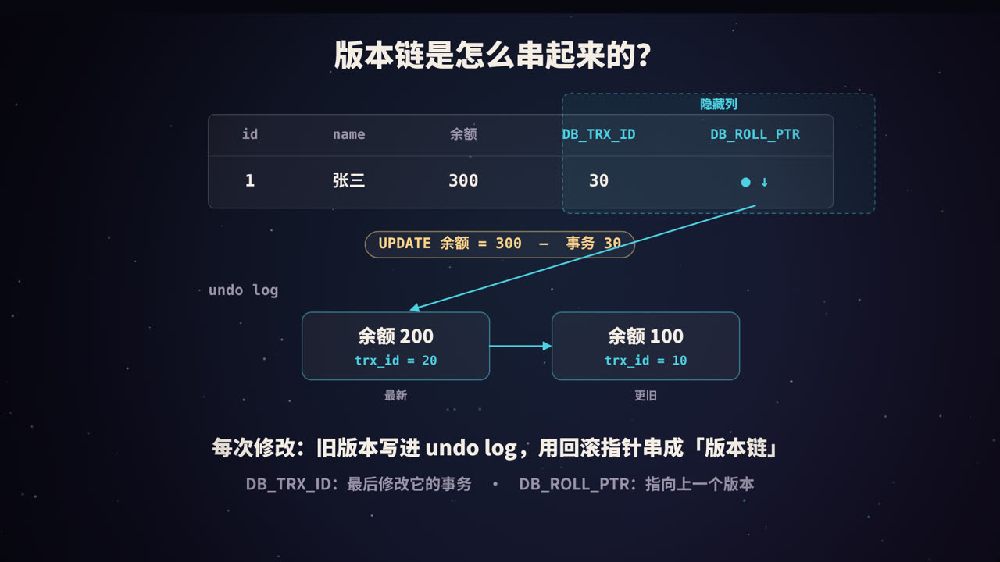
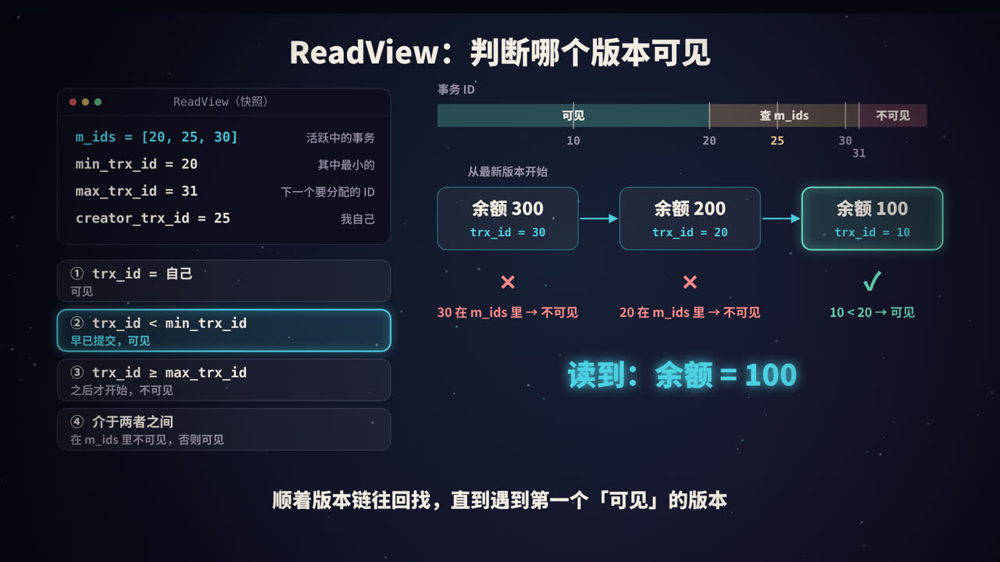
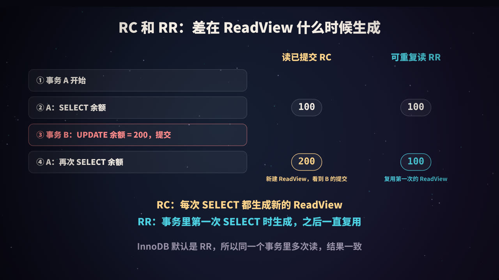

title: MySQL 的 MVCC：让读和写互不阻塞
subtitle: 隐藏列、undo log 版本链、ReadView 可见性规则，RC 和 RR 的真正区别，以及快照读、当前读、幻读和长事务问题
tag: 计算机与后端
color: #4dd0e1


## 从一个问题开始

事务 A 正在修改一行数据，还没提交；这时事务 B 想读这一行。B 应该读到什么？

- 读到 A 改了一半、还没提交的新值？如果 A 最后回滚了，B 就读到了一个「从未真正存在过」的数据，这叫**脏读**。
- 那就让 B 等 A 提交以后再读？正确是正确了，但读和写互相阻塞，并发一高，性能就很差。

数据库里读操作通常远多于写操作。有没有办法，**既不让读者看到未提交的数据，又不让读者等待写者**？

InnoDB 的答案就是 **MVCC（Multi-Version Concurrency Control，多版本并发控制）**。

## 先复习：并发事务的三种读问题与隔离级别

| 问题 | 描述 |
|---|---|
| 脏读 | 读到了其他事务**未提交**的修改 |
| 不可重复读 | 同一个事务里两次读同一行，结果不一样（中间被别人修改并提交了） |
| 幻读 | 同一个事务里两次按同一条件查询，第二次多出了（或少了）几行 |

SQL 标准定义了四个隔离级别：

| 隔离级别 | 脏读 | 不可重复读 | 幻读 |
|---|---|---|---|
| 读未提交（READ UNCOMMITTED） | 可能 | 可能 | 可能 |
| 读已提交（READ COMMITTED，RC） | 避免 | 可能 | 可能 |
| 可重复读（REPEATABLE READ，RR） | 避免 | 避免 | 标准中可能 |
| 串行化（SERIALIZABLE） | 避免 | 避免 | 避免 |

InnoDB 的默认隔离级别是 **RR**。RC 和 RR 这两个最常用的级别，都是靠 MVCC 实现的；而 InnoDB 的 RR 在 MVCC 和间隙锁的配合下，在很大程度上也避免了幻读（后面会细说）。

## 核心思路：一行数据，保存多个版本


MVCC 的想法很朴素：**修改数据时不直接覆盖旧值，而是把旧版本保留下来。** 于是同一行数据在某一时刻可能同时存在多个版本：

- 已经提交了很久的版本 1；
- 刚刚提交的版本 2；
- 某个事务正在修改、还没提交的版本 3。

每个事务读数据时，根据自己的「视角」，从这些版本里挑出它应该看到的那一个。读的人读旧版本，写的人写新版本，**互不干扰，也就不需要用锁来协调普通的读写冲突**。

要实现这一点，InnoDB 需要三样东西：

1. **隐藏列**：记录每个版本是谁写的、上一个版本在哪；
2. **undo log 版本链**：把旧版本串起来保存；
3. **ReadView**：判断某个版本对当前事务是否可见的规则。

## 第一样：隐藏列



InnoDB 会在每一行记录上，自动加几个用户看不到的字段：

| 隐藏列 | 大小 | 含义 |
|---|---|---|
| `DB_TRX_ID` | 6 字节 | 最后一次插入或修改这行的**事务 ID** |
| `DB_ROLL_PTR` | 7 字节 | **回滚指针**，指向 undo log 中这行的上一个版本 |
| `DB_ROW_ID` | 6 字节 | 行 ID，只有表没有主键、也没有非空唯一键时，才会用它生成聚簇索引 |

此外，每行记录头里还有一个**删除标记**。`DELETE` 时并不会立刻物理删除这一行，而是先打上标记，等确认没有事务再需要它时才真正清理。

事务 ID 是全局递增分配的，越晚开始写数据的事务，ID 越大。（只读事务通常不会分配这样的事务 ID，只有在第一次修改数据时才会分配。）

## 第二样：undo log 版本链

undo log 原本是为了**回滚**而存在的：事务修改数据前，先把旧值记下来，万一事务失败，就能用它把数据恢复原样。MVCC 顺便利用了它。

以视频里的例子来看版本链是怎么形成的：

1. 事务 10 插入了一行：`id=1, 余额=100`，此时 `DB_TRX_ID=10`。
2. 事务 20 执行 `UPDATE ... SET 余额=200`：
   - 把旧版本（余额 100，trx_id 10）写进 undo log；
   - 修改行数据为余额 200，`DB_TRX_ID=20`；
   - `DB_ROLL_PTR` 指向 undo log 里那条旧版本。
3. 事务 30 执行 `UPDATE ... SET 余额=300`：
   - 把余额 200 的版本写进 undo log，它的回滚指针仍然指向余额 100 的版本；
   - 行数据变成余额 300，`DB_TRX_ID=30`，回滚指针指向余额 200 的版本。

于是形成了一条从新到旧的链：

```text
当前行: 余额 300 (trx 30)  →  undo: 余额 200 (trx 20)  →  undo: 余额 100 (trx 10)
```

这就是**版本链**。任何一个事务，都可以顺着回滚指针，找到这一行过去的任意一个版本。

> undo log 分两类：插入产生的 undo 在事务提交后就可以删掉（新插入的行没有「更旧的版本」可言）；更新和删除产生的 undo 可能还要服务于其他事务的快照读，必须等没人需要时才能清理。

## 第三样：ReadView，判断谁可见


### ReadView 里有什么

事务在执行快照读时，会生成一个 **ReadView**（读视图），可以理解为「此刻数据库里各个事务状态的一张快照」。它包含四个关键信息：

| 字段 | 含义 |
|---|---|
| `m_ids` | 生成 ReadView 时，**所有活跃（已开始、未提交）的读写事务** ID 列表 |
| `min_trx_id` | `m_ids` 中最小的 ID |
| `max_trx_id` | 生成 ReadView 时，系统**下一个要分配**的事务 ID |
| `creator_trx_id` | 生成这个 ReadView 的事务自己的 ID |

> 在 InnoDB 源码里，这几个字段分别叫 `m_ids`、`m_up_limit_id`（即最小值）、`m_low_limit_id`（即「下一个要分配的 ID」）和 `m_creator_trx_id`。名字里的 up 和 low 和直觉正好相反，读源码时容易看反。

### 四条可见性规则

拿版本链上某个版本的 `trx_id`，按顺序判断：

1. **`trx_id == creator_trx_id`**：这是我自己改的，**可见**。
2. **`trx_id < min_trx_id`**：生成 ReadView 时，这个事务早就提交了，**可见**。
3. **`trx_id >= max_trx_id`**：这个事务是在我生成 ReadView **之后**才开始的，**不可见**。
4. **`min_trx_id <= trx_id < max_trx_id`**：看它在不在 `m_ids` 里：
   - 在：生成 ReadView 时它还没提交，**不可见**；
   - 不在：生成 ReadView 时它已经提交了，**可见**。

如果当前版本不可见，就顺着回滚指针找上一个版本，再用同样的规则判断，直到找到第一个可见的版本。如果一直找到链的末尾都没有可见版本，说明这行对当前事务来说「还不存在」，查询结果里就没有它。

<figure>
<svg viewBox="0 0 440 520" xmlns="http://www.w3.org/2000/svg" role="img" aria-label="可见性判断流程">
  <rect width="440" height="520" fill="#0f0e1c"/>
  <defs><marker id="m" viewBox="0 0 10 10" refX="9" refY="5" markerWidth="7" markerHeight="7" orient="auto"><path d="M0,0 L10,5 L0,10 z" fill="#4dd0e1"/></marker></defs>
  <g font-family="PingFang SC, Noto Sans SC, sans-serif" font-size="17">
    <rect x="70" y="16" width="300" height="50" rx="12" fill="rgba(77,208,225,.14)" stroke="#4dd0e1"/>
    <text x="220" y="47" fill="#f4ede4" text-anchor="middle" font-weight="800">取版本链上的一个版本</text>
    <g text-anchor="start">
      <rect x="20" y="96" width="270" height="56" rx="10" fill="rgba(255,255,255,.04)" stroke="rgba(255,255,255,.25)"/>
      <text x="36" y="130" fill="#f4ede4">trx_id = 自己？</text>
      <rect x="20" y="176" width="270" height="56" rx="10" fill="rgba(255,255,255,.04)" stroke="rgba(255,255,255,.25)"/>
      <text x="36" y="210" fill="#f4ede4">trx_id &lt; min_trx_id？</text>
      <rect x="20" y="256" width="270" height="56" rx="10" fill="rgba(255,255,255,.04)" stroke="rgba(255,255,255,.25)"/>
      <text x="36" y="290" fill="#f4ede4">trx_id ≥ max_trx_id？</text>
      <rect x="20" y="336" width="270" height="56" rx="10" fill="rgba(255,255,255,.04)" stroke="rgba(255,255,255,.25)"/>
      <text x="36" y="370" fill="#f4ede4">trx_id 在 m_ids 中？</text>
    </g>
    <g font-weight="800" text-anchor="middle">
      <text x="372" y="130" fill="#6ee7c8">是 → 可见</text>
      <text x="372" y="210" fill="#6ee7c8">是 → 可见</text>
      <text x="372" y="290" fill="#ff8a8a">是 → 不可见</text>
      <text x="372" y="370" fill="#ff8a8a">是 → 不可见</text>
    </g>
    <line x1="220" y1="66" x2="220" y2="92" stroke="#4dd0e1" stroke-width="2.5" marker-end="url(#m)"/>
    <line x1="155" y1="152" x2="155" y2="172" stroke="#4dd0e1" stroke-width="2.5" marker-end="url(#m)"/>
    <line x1="155" y1="232" x2="155" y2="252" stroke="#4dd0e1" stroke-width="2.5" marker-end="url(#m)"/>
    <line x1="155" y1="312" x2="155" y2="332" stroke="#4dd0e1" stroke-width="2.5" marker-end="url(#m)"/>
    <text x="168" y="166" fill="#9a93a8" font-size="14">否</text><text x="168" y="246" fill="#9a93a8" font-size="14">否</text><text x="168" y="326" fill="#9a93a8" font-size="14">否</text>
    <line x1="155" y1="392" x2="155" y2="420" stroke="#4dd0e1" stroke-width="2.5" marker-end="url(#m)"/>
    <text x="168" y="410" fill="#9a93a8" font-size="14">否</text>
    <rect x="70" y="424" width="170" height="44" rx="10" fill="rgba(110,231,200,.12)" stroke="#6ee7c8"/>
    <text x="155" y="452" fill="#6ee7c8" text-anchor="middle" font-weight="800">可见（已提交）</text>
    <text x="220" y="502" fill="#ffd38a" text-anchor="middle" font-size="16" font-weight="700">不可见 → 顺着回滚指针取上一个版本，重新判断</text>
  </g>
</svg>
<figcaption>可见性判断流程：不可见就沿版本链往回找</figcaption>
</figure>

### 走一遍例子

假设事务 25 生成 ReadView 时，事务 20 和 30 都还没提交：

```text
m_ids = [20, 25, 30]    min_trx_id = 20    max_trx_id = 31    creator_trx_id = 25
```



| 版本 | trx_id | 判断 | 结果 |
|---|---|---|---|
| 余额 300 | 30 | 介于 20 和 31 之间，且在 `m_ids` 里 | 不可见，往回找 |
| 余额 200 | 20 | 介于 20 和 31 之间，且在 `m_ids` 里 | 不可见，往回找 |
| 余额 100 | 10 | 小于 `min_trx_id` | **可见** |

所以事务 25 读到的余额是 **100**。尽管当前行上的最新值已经是 300，但对它来说，事务 20 和 30 的修改都「还没发生」。

## RC 和 RR：差在 ReadView 什么时候生成



MVCC 的规则在 RC 和 RR 下完全一样，**唯一的区别是 ReadView 的生成时机**：

- **RC（读已提交）**：事务里**每一次**快照读，都生成一个新的 ReadView。所以每次都能看到在那之前已经提交的修改。
- **RR（可重复读）**：只在事务里**第一次**快照读时生成 ReadView，之后整个事务都复用它。所以不管别人中途提交了什么，这个事务看到的始终是同一个「快照」。

### 用两个会话亲自验证

准备一张表：

```sql
CREATE TABLE account (id INT PRIMARY KEY, balance INT);
INSERT INTO account VALUES (1, 100);
```

打开两个 MySQL 客户端，按顺序执行：

```sql
-- 会话 A
SET SESSION TRANSACTION ISOLATION LEVEL REPEATABLE READ;
BEGIN;
SELECT balance FROM account WHERE id = 1;   -- 100（此时生成 ReadView）

-- 会话 B（自动提交）
UPDATE account SET balance = 200 WHERE id = 1;

-- 会话 A
SELECT balance FROM account WHERE id = 1;   -- RR 下仍是 100；换成 RC 则是 200
COMMIT;
```

把第一行的隔离级别改成 `READ COMMITTED` 再做一遍，就能看到区别。

> 注意：`BEGIN` 或 `START TRANSACTION` 并不会立即生成 ReadView，第一次快照读时才会。如果希望事务一开始就生成，可以用 `START TRANSACTION WITH CONSISTENT SNAPSHOT`。

## 快照读和当前读


MVCC 只管一类读操作，这一点非常关键。

| | 快照读 | 当前读 |
|---|---|---|
| 哪些语句 | 普通的 `SELECT` | `SELECT ... FOR UPDATE`、`SELECT ... FOR SHARE`（旧写法 `LOCK IN SHARE MODE`）、`INSERT`、`UPDATE`、`DELETE` |
| 读哪个版本 | ReadView 可见的版本，可能是历史版本 | 最新的已提交版本 |
| 是否加锁 | 不加锁 | 加锁 |

### 为什么 UPDATE 一定是当前读

如果 `UPDATE` 也基于旧快照计算，就会出现「丢失更新」。接着上面 RR 的例子：

```sql
-- 会话 A（RR，快照里余额是 100；B 已经把余额改成 200 并提交）
UPDATE account SET balance = balance + 1 WHERE id = 1;
SELECT balance FROM account WHERE id = 1;   -- 201，而不是 101
```

`UPDATE` 读的是最新值 200，所以结果是 201。更新之后，这一行最新版本的 `trx_id` 变成了 A 自己，按照规则 1，A 的下一次快照读就能看到它。所以 A 先读到 100，更新后又读到 201，这在 RR 下是正常现象，并不矛盾。

## RR 能避免幻读吗

- **对快照读来说**：ReadView 在第一次读时就固定了，别的事务后来插入并提交的新行，`trx_id` 一定不小于 `max_trx_id`，对当前事务不可见。所以同样的 `SELECT` 执行多次，不会多出行来。
- **对当前读来说**：InnoDB 使用**临键锁**（next-key lock，即记录锁加间隙锁），把查询范围内的记录和记录之间的「间隙」都锁住，别的事务无法往这个范围里插入新行。

但要注意一种边界情况：事务 A 先快照读，看到 3 行；事务 B 插入第 4 行并提交；A 再执行一次覆盖这个范围的 `UPDATE`（当前读），会把第 4 行也更新掉，于是第 4 行的 `trx_id` 变成了 A 自己。A 之后再快照读，就会「突然」看到第 4 行。所以准确地说，**InnoDB 的 RR 在绝大多数情况下避免了幻读，但快照读和当前读混用时，仍可能出现类似幻读的现象。** 如果业务逻辑依赖「这个范围里不会多出数据」，应该一开始就用当前读（如 `SELECT ... FOR UPDATE`）加锁。

## 旧版本什么时候清理：purge 与长事务

undo log 中的旧版本不能一直保留。InnoDB 有后台的 **purge 线程**，会检查当前所有活跃的 ReadView：如果某个旧版本已经不可能再被任何事务读到，就把它清理掉，同时真正删除那些打了删除标记的行。

问题出在**长事务**上：只要有一个很早开启、一直不提交的事务，它的 ReadView 就可能需要非常旧的版本，于是从那时起产生的所有 undo 都不能清理。结果是：

- undo 日志越积越多，占用大量存储空间；
- 版本链变长，别的查询沿链查找的成本上升；
- 长事务往往还持有锁，阻塞其他写操作。

### 怎么发现长事务

```sql
-- 运行时间最长的事务
SELECT trx_id, trx_started, trx_mysql_thread_id, trx_query
FROM information_schema.innodb_trx
ORDER BY trx_started
LIMIT 10;

-- 查看 History list length：未清理的 undo 数量，持续变大说明清理跟不上
SHOW ENGINE INNODB STATUS;
```

### 怎么避免

- 事务里不要做和数据库无关的耗时操作，比如调用外部接口、等待用户输入；
- 批量处理大量数据时，分批提交；
- 注意框架和连接池的自动提交设置，避免「开了事务忘了提交」；
- 监控 `innodb_trx` 和 History list length，设置告警。

## 高频面试题速答

**Q：MVCC 解决了什么问题？**
让读写不互相阻塞：普通 `SELECT` 读历史版本，不加锁，也不会被写操作阻塞，同时不会读到未提交的数据。

**Q：MVCC 由哪几部分组成？**
隐藏列（`DB_TRX_ID`、`DB_ROLL_PTR`）、undo log 版本链、ReadView 可见性规则。

**Q：RC 和 RR 在 MVCC 上的区别？**
RC 每次快照读都生成新的 ReadView；RR 只在第一次快照读时生成，之后复用。

**Q：MVCC 能完全替代锁吗？**
不能。MVCC 只解决快照读的读写冲突；写和写之间的冲突，以及当前读，仍然要靠行锁、间隙锁、临键锁。

**Q：为什么不建议使用长事务？**
长事务会阻止 undo log 清理，导致空间膨胀、版本链变长，而且往往长期持有锁。

## 总结

- **MVCC = 隐藏列 + undo 版本链 + ReadView**；
- 修改数据时保留旧版本，读的时候按 ReadView 规则沿版本链找到第一个可见的版本；
- **RC 和 RR 的唯一区别是 ReadView 的生成时机**；
- MVCC 只作用于**快照读**；当前读读最新版本并加锁；
- 避免长事务，否则旧版本无法清理。

<div class="refs" markdown="1">

### 参考资料

- MySQL 8.0 Reference Manual: InnoDB Multi-Versioning；Consistent Nonlocking Reads；Phantom Rows；Transaction Isolation Levels.
- MySQL 源码：`storage/innobase/include/read0types.h`（ReadView 定义）.
- 小孩子 4919.《MySQL 是怎样运行的：从根儿上理解 MySQL》.

</div>
