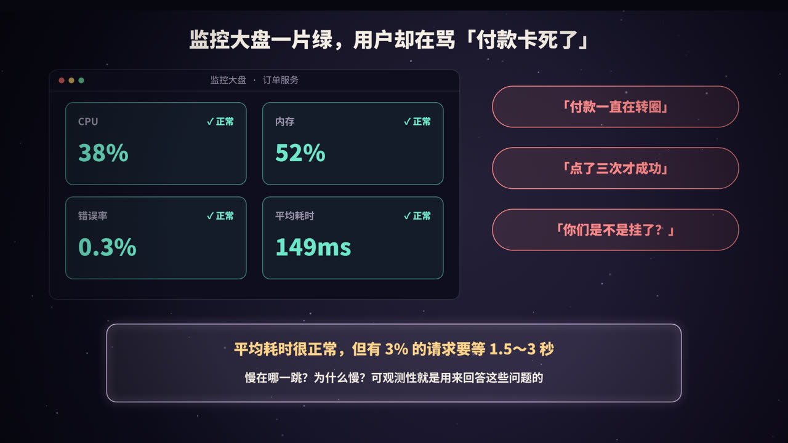
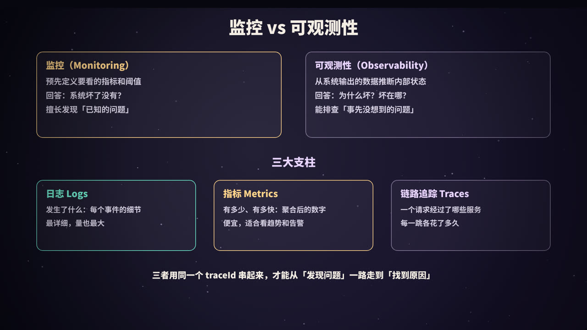
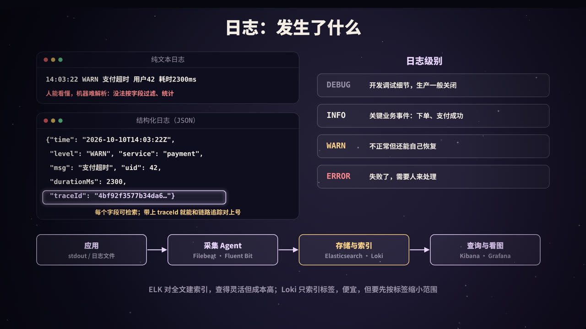
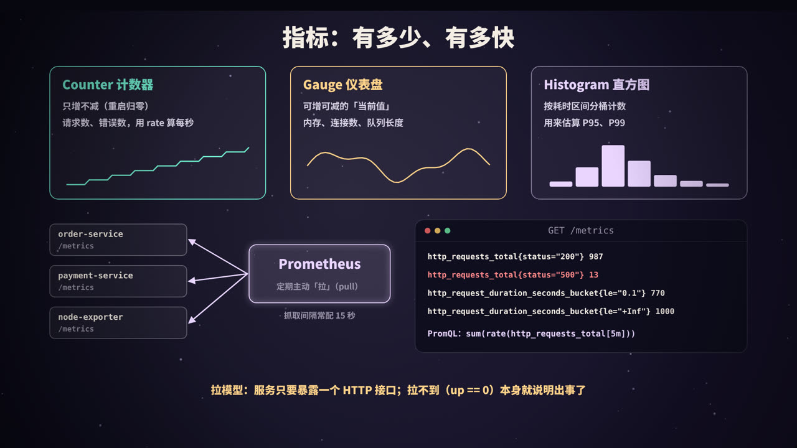
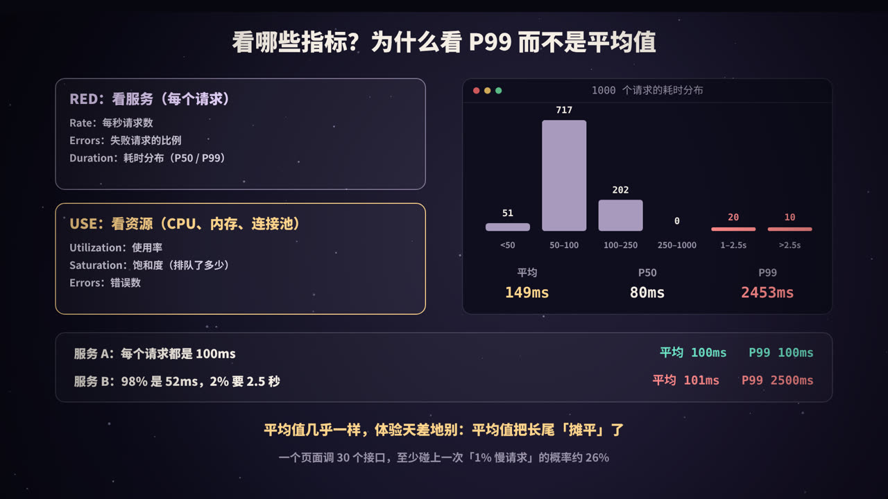
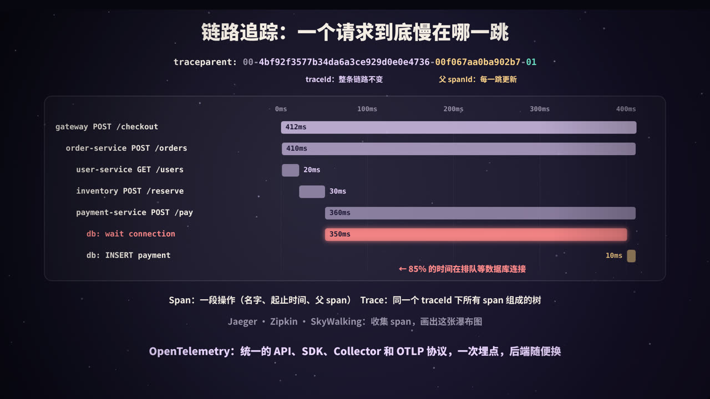
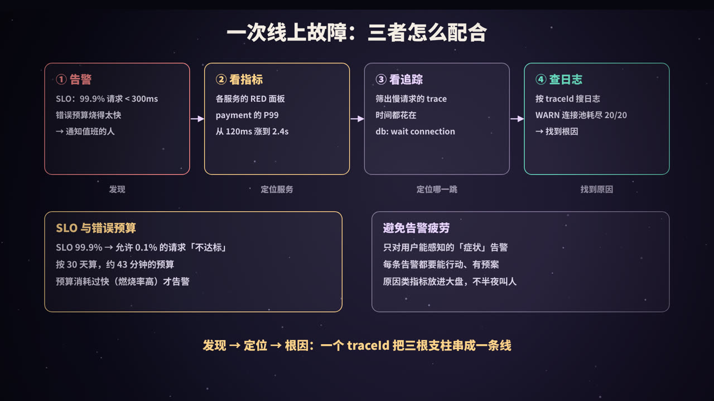

title: 可观测性：日志、指标与链路追踪
subtitle: 监控与可观测性的区别，结构化日志与 traceId，Counter/Gauge/Histogram 与 Prometheus 拉模型，RED/USE 方法与为什么看 P99，trace/span 与 W3C traceparent，OpenTelemetry，基于 SLO 和错误预算的告警，以及三者联动排查一次线上故障，附四段可运行的 Python 演示
tag: 计算机与后端
color: #e9d5ff



## 大盘一片绿，用户却在骂

这是很多后端工程师都经历过的一幕：用户群里有人说「付款一直在转圈」「点了三次才成功」，你打开监控大盘：CPU 38%、内存 52%、错误率 0.3%、平均耗时 149ms，全是绿的。

问题出在哪？可能是：

- **平均值骗了你**：1000 个请求里 970 个只要几十毫秒，30 个要 1.5～3 秒，平均下来还是很「正常」的 149ms；
- **不知道慢在哪一跳**：一次付款要经过网关、订单服务、用户服务、库存服务、支付服务、数据库……大盘只告诉你「订单服务有点慢」，没告诉你慢在它调用的哪一个下游；
- **不知道为什么慢**：就算找到了是支付服务慢，日志有几十 GB，从哪里开始翻？

这些问题有一个共同点：**你事先没有想到要问它们**。你不可能为「支付服务在连接池满时排队」预先建一块仪表盘。能不能在出事之后，借助系统已经输出的数据，把这些问题一路追问下去并找到答案，这种能力就叫**可观测性**（Observability）。

这篇文章会讲清楚：

1. 监控和可观测性有什么区别；
2. 三大支柱：**日志**、**指标**、**链路追踪**分别是什么、怎么用；
3. 为什么要看 **P99** 而不是平均值；
4. **traceId** 怎么在服务之间传递，OpenTelemetry 又是什么；
5. 怎样基于 **SLO 和错误预算**告警，以及三者怎么配合排查一次线上故障。

## 监控 vs 可观测性



### 两个词的区别

| | 监控（Monitoring） | 可观测性（Observability） |
|---|---|---|
| 关注的问题 | 系统坏了**没有**？ | 系统**为什么**坏？坏在**哪里**？ |
| 工作方式 | 预先定义好指标、仪表盘和告警阈值 | 采集足够丰富、能互相关联的数据，事后任意切分、下钻 |
| 擅长 | 「已知的未知」：知道可能出什么问题，提前盯着 | 「未知的未知」：从没见过的故障，也能一步步查下去 |
| 典型产物 | 仪表盘、告警 | 带上下文的日志、高维度的指标、完整的调用链 |

「可观测性」这个词来自控制理论：如果能通过一个系统的**外部输出**推断出它的**内部状态**，这个系统就是可观测的。放到软件里，就是：只看服务吐出来的日志、指标和追踪数据，不用登录机器加日志、不用重新发版，就能弄明白里面发生了什么。

两者不是替代关系。监控是可观测性的一部分：先由监控和告警发现「出事了」，再用可观测性的数据去定位「为什么」。

### 三大支柱

| 支柱 | 回答的问题 | 数据形态 | 特点 |
|---|---|---|---|
| **日志**（Logs） | 发生了什么？ | 一条条离散的事件记录 | 最详细；量最大，存储和检索成本最高 |
| **指标**（Metrics） | 有多少？有多快？ | 按时间聚合的数字（时间序列） | 便宜、可长期保存，适合看趋势和告警；但丢失了单个请求的细节 |
| **链路追踪**（Traces） | 一个请求经过了哪里？每一跳花了多久？ | 一棵由 span 组成的树 | 天然跨服务；通常需要采样 |

三者各有盲区，单独使用都不够：指标告诉你 P99 涨了，但不知道是哪些请求；日志里有错误详情，但不知道它和哪次用户请求有关；追踪能看到慢在哪一跳，但看不到那一跳里面具体发生了什么。**把它们串起来的，是同一个 traceId。**

近年来也常把**持续性能剖析**（Continuous Profiling，持续采集 CPU、内存火焰图）称为「第四根支柱」，用来回答「这段代码为什么慢」。

## 日志：发生了什么



### 结构化日志

传统的日志是给人看的一行文本：

```text
14:03:22 WARN 支付超时 用户42 耗时2300ms
```

人能看懂，但机器很难处理：想统计「过去一小时耗时超过 2 秒的支付有多少笔」，就得写正则去抠数字，格式稍微一变就失效。

**结构化日志**把每条日志写成一个 JSON 对象（或其他键值格式）：

```json
{"time": "2026-10-10T14:03:22Z", "level": "WARN", "service": "payment",
 "msg": "支付超时", "uid": 42, "durationMs": 2300,
 "traceId": "4bf92f3577b34da6a3ce929d0e0e4736", "spanId": "00f067aa0ba902b7"}
```

好处是每个字段都能直接检索、过滤、聚合：`service="payment" AND durationMs > 2000`。

写好结构化日志的几个要点：

- **固定的公共字段**：时间（带时区，最好是 UTC）、级别、服务名、实例、环境、版本；
- **带上 traceId 和 spanId**：这是日志和追踪关联的关键。Java 里通常把它们放进 SLF4J 的 **MDC**，日志格式里引用；OpenTelemetry 的 Java Agent 可以自动完成注入；
- **消息文本固定，变量放字段**：写 `msg="支付超时", uid=42`，而不是 `msg="用户 42 支付超时"`，这样同一类事件可以被聚合；
- **不要打印敏感信息**：密码、完整的手机号和身份证号、Token 要脱敏或干脆不打；
- **输出到 stdout**：在容器环境里（见本系列《Kubernetes 入门》），应用把日志写到标准输出，由节点上的采集器统一收集，比每个应用自己管日志文件简单得多。

### 日志级别

| 级别 | 用途 | 例子 |
|---|---|---|
| DEBUG | 开发调试的细节，生产环境一般关闭 | SQL 参数、中间变量 |
| INFO | 关键业务事件，事后用来还原发生了什么 | 订单创建、支付成功、服务启动 |
| WARN | 不正常，但系统还能自己处理 | 重试成功、降级、连接池接近用满 |
| ERROR | 失败了，需要人来关注 | 请求最终失败、数据不一致 |

常见的问题是级别用得太随意：把每一次可预期的业务失败（比如用户密码输错）都打成 ERROR，ERROR 日志多到没人看，真正的错误被淹没。**ERROR 的标准应该是「值得有人去看一眼」。**

### 日志的采集与存储

```text
应用（stdout / 文件）→ 采集 Agent（Filebeat、Fluent Bit、Vector…）→ 缓冲（可选：Kafka）→ 存储与索引（Elasticsearch、Loki…）→ 查询界面（Kibana、Grafana）
```

两种主流的存储思路：

| | Elasticsearch（ELK / EFK） | Grafana Loki |
|---|---|---|
| 索引方式 | 对日志内容建**全文倒排索引** | **只索引标签**（服务名、环境、Pod 等），日志正文压缩存储 |
| 查询 | 任意字段、全文检索都很快 | 先按标签缩小范围，再在这些日志里扫描过滤 |
| 成本 | 索引体积大，存储和内存成本高 | 便宜得多，适合海量日志 |

日志是三大支柱里最贵的。控制成本的常用办法：生产环境默认 INFO 级别、对高频日志采样、按价值分级设置保留时间（比如热数据 7 天、归档 90 天），以及把「统计类」需求交给指标而不是日志。

## 指标：有多少、有多快



### 指标是什么

指标是**按时间聚合的数字**。一个指标由「名字 + 一组标签」唯一确定一条时间序列，比如：

```text
http_requests_total{service="payment", method="POST", status="200"}
```

每隔一段时间记录一个值，就得到一条随时间变化的曲线。和日志相比，指标不管来了一亿个请求还是一百个请求，存储量都差不多，所以可以**长期保存、快速查询**，非常适合画趋势图和做告警。

### 三种基本类型

| 类型 | 特点 | 例子 | 怎么用 |
|---|---|---|---|
| **Counter** 计数器 | 只增不减（进程重启时归零） | 请求总数、错误总数、发送的字节数 | 看绝对值没意义，要用 `rate()` 算「每秒增长多少」 |
| **Gauge** 仪表盘 | 可增可减，表示「当前值」 | 内存使用量、在途请求数、队列长度、连接池活跃数 | 直接看当前值和变化趋势 |
| **Histogram** 直方图 | 把观测值按区间**分桶计数**，同时记录总和与总个数 | 请求耗时、响应体大小 | 用 `histogram_quantile()` 估算 P95、P99 |

Prometheus 还有一种 **Summary** 类型，在客户端直接算好分位数。缺点是分位数**不能跨实例聚合**（10 个实例各自的 P99 求平均，并不是整体的 P99），所以服务端聚合的场景更推荐 Histogram。

一个常见的错误：把耗时用 Gauge 记录「最近一次请求的耗时」。每次抓取只能看到某一个瞬间的值，中间的几千个请求全丢了。**耗时一定要用 Histogram。**

### Prometheus 的拉模型

Prometheus 是最流行的开源指标系统，也是继 Kubernetes 之后第二个从 CNCF 毕业的项目。它的工作方式是**拉**（pull）：

1. 每个服务暴露一个 HTTP 接口（通常是 `/metrics`），返回当前所有指标的文本；
2. Prometheus 按配置的间隔（常配 15 秒）去每个目标「抓取」（scrape）一次，存进自己的时序数据库；
3. 用 **PromQL** 查询、画图（通常配合 Grafana），并按规则计算告警，交给 Alertmanager 去分组、去重、通知。

拉模型的好处：

- 服务端只需要暴露一个接口，不需要知道监控系统在哪里；
- Prometheus 掌握抓取节奏，不会被某个服务「推爆」；
- **抓不到本身就是信号**：每个目标都有一个自动生成的 `up` 指标，`up == 0` 说明这个实例挂了或者网络不通。

对于运行时间很短、来不及被抓取的批处理任务，可以用 Pushgateway 中转；OpenTelemetry 的场景下也可以由 Collector 统一接收应用推来的指标，再暴露给 Prometheus。机器层面的指标（CPU、内存、磁盘、网络）由 node_exporter 之类的 **exporter** 提供，MySQL、Redis 等中间件也都有对应的 exporter。

### 标签基数：指标系统最常见的坑

每一种标签值的组合都是一条独立的时间序列。如果把 `userId`、`orderId`、完整 URL（带参数）这样**取值无穷多**的东西放进标签，时间序列的数量会爆炸（「高基数」问题），Prometheus 的内存很快被撑爆。

原则是：**标签只放取值有限的维度**（服务、接口模板、状态码、实例、区域）；要按用户、按订单去查，那是日志和追踪的活。

## 看哪些指标：RED、USE 与分位数



### RED 方法：看服务

面向请求的服务（HTTP 接口、RPC 服务），每个服务都看这三个指标：

| 指标 | 含义 | PromQL 示意 |
|---|---|---|
| **R**ate | 每秒请求数 | `sum(rate(http_requests_total[5m]))` |
| **E**rrors | 失败请求的比例 | 5xx 请求速率 ÷ 总请求速率 |
| **D**uration | 耗时**分布**（P50、P95、P99） | `histogram_quantile(0.99, …)` |

### USE 方法：看资源

面向资源（CPU、内存、磁盘、网卡、连接池、线程池），每种资源看：

| 指标 | 含义 | 例子 |
|---|---|---|
| **U**tilization 使用率 | 资源有多忙 | CPU 使用率 70% |
| **S**aturation 饱和度 | 有多少工作在**排队** | CPU 运行队列长度、连接池等待线程数、磁盘 IO 队列 |
| **E**rrors 错误 | 资源相关的错误 | 网卡丢包、磁盘错误、获取连接超时 |

饱和度经常被忽略，却往往是最早的预警信号：连接池使用率 100% 本身未必是问题，**有线程在排队等连接**才是。本文开头的故障就是这样：支付服务的数据库连接池 20/20 用满，后来的请求都在排队。

Google SRE 书里的「四个黄金信号」（延迟、流量、错误、饱和度）可以看作这两种方法的合体。

### 为什么看 P99，而不是平均值

**分位数**的意思是：把所有请求按耗时从小到大排好，P99 就是排在 99% 位置的那个值，即「99% 的请求都不超过这个耗时」。P50 就是中位数。

平均值的问题是：它把少数极慢的请求「摊平」了。下面「动手」一节的代码模拟了 1000 个请求，其中 3% 撞上了慢查询：

| 统计量 | 值 |
|---|---|
| 平均值 | 148.7 ms |
| P50（中位数） | 79.8 ms |
| P95 | 148.2 ms |
| P99 | 2452.8 ms |

平均值 149ms 看起来很健康，但它既不能代表大多数请求（中位数只有 80ms），也完全看不出有 30 个用户等了 1.5 秒以上。更极端的对比：

- 服务 A：每个请求都是 100ms，平均 100ms，P99 100ms；
- 服务 B：98% 的请求 52ms，2% 要 2.5 秒，平均 101ms，P99 2500ms。

两个服务平均值几乎一样，用户体验天差地别。

为什么 1% 的慢请求值得这么在意？

1. **一个页面会调用很多接口**：打开一个页面要调 30 个接口时，至少碰上一次「1% 慢请求」的概率是 1 − 0.99³⁰ ≈ 26%；
2. **慢请求常常来自最重要的用户**：数据最多、订单最多的用户，查询往往最慢；
3. **长尾是故障的前兆**：连接池、锁、GC 等资源争抢，最先体现在尾部延迟上，平均值要等到问题很严重时才会动。

所以耗时类指标，**看 P99（甚至 P99.9），而不是平均值**；同时看 P50，知道「大多数人」的体验。另外要注意：不同实例的 P99 **不能简单求平均**，要用 Histogram 的桶数据先合并再计算分位数。

## 链路追踪：一个请求到底慢在哪一跳



### trace 与 span

一个用户请求进入系统后，会经过多个服务、多次数据库和缓存访问。链路追踪把这次请求的完整路径记录下来：

- **Span**：一段操作，比如「order-service 处理 POST /orders」或者「执行一条 SQL」。它记录名字、开始时间、耗时、所属服务、状态，以及若干属性（如 HTTP 状态码、SQL 语句模板）；
- **Trace**：同一个请求产生的所有 span，通过 **traceId** 归到一起，通过「父 span」关系连成一棵树；
- **瀑布图**：按时间把 span 画成横条，嵌套关系一目了然，**哪一段最长、哪些调用是串行的**，一眼就能看出来。

这个思路最早由 Google 2010 年的 Dapper 论文系统地提出，之后出现了 Zipkin、Jaeger、SkyWalking 等开源实现。

### traceId 怎么跨服务传递

关键在于**上下文传播**（Context Propagation）：服务 A 调用服务 B 时，把「当前的 traceId 和自己的 spanId」放进请求头；服务 B 收到后，用这个 traceId 继续记录，并把 A 的 spanId 作为自己的父 span。

W3C 的 **Trace Context** 规范统一了这个请求头的格式：

```text
traceparent: 00-4bf92f3577b34da6a3ce929d0e0e4736-00f067aa0ba902b7-01
             │  │                                │                └ flags：01 表示被采样
             │  │                                └ parent-id：调用方 span 的 ID（16 位十六进制）
             │  └ trace-id：整条链路共用（32 位十六进制）
             └ version
```

规范还定义了一个 `tracestate` 头，用来携带各厂商自己的扩展信息。有了统一格式，不同语言、不同框架、不同厂商的组件就能接力传递同一个 traceId。

服务内部的传递也同样重要：一个请求在服务里可能跨越多个函数、多个线程、多个协程。Java 一般用 ThreadLocal 保存当前上下文，Python 用 `contextvars`，Go 用显式传递的 `context.Context`。**线程池、异步回调、消息队列**是最容易断链的地方：

- 提交到线程池的任务，默认拿不到提交者线程的上下文，需要包装（OpenTelemetry 的 Java Agent 对常见线程池做了自动处理）；
- 消息队列（见本系列《消息队列》）要把 traceparent 放进**消息头**，消费者处理时再恢复。

### 采样

每个请求都完整记录 trace，存储成本很高。常用两种采样策略：

| 策略 | 做法 | 优缺点 |
|---|---|---|
| **头部采样** | 请求入口就决定这条 trace 要不要记录（比如 10%），通过 flags 告诉下游 | 简单、开销小；但慢请求和错误请求也可能被丢掉 |
| **尾部采样** | 先把所有 span 收集到 Collector，整条 trace 结束后再决定留不留 | 可以「错误全留、慢请求全留、正常请求留 10%」；需要缓存数据，Collector 成本更高 |

### OpenTelemetry：统一标准

过去每家追踪系统都有自己的 SDK 和数据格式，换一个后端就要改一遍埋点代码。**OpenTelemetry**（简称 OTel）由 OpenTracing 和 OpenCensus 两个项目在 2019 年合并而来，是 CNCF 的项目，目标是成为可观测性数据的统一标准：

| 组成部分 | 作用 |
|---|---|
| **API / SDK** | 各语言统一的埋点接口，覆盖 traces、metrics、logs |
| **自动埋点** | 如 Java Agent：不改代码，自动为常见框架（HTTP、gRPC、JDBC、Redis 客户端、消息队列）生成 span 并传播上下文 |
| **OTLP 协议** | 统一的数据传输协议（gRPC 默认端口 4317，HTTP 默认 4318） |
| **Collector** | 独立部署的「数据中转站」：接收、处理（批量、过滤、采样、脱敏）、再导出到任意后端 |

OTel **只负责采集和传输，不负责存储和展示**。后端可以是 Jaeger、Zipkin、SkyWalking、Prometheus、Loki、Elasticsearch，或者各种商业平台。好处是：**一次埋点，后端随便换**；而且三种数据共享同一套资源属性（服务名、版本、实例）和同一个 trace 上下文，天然可以关联。

## 动手：用 Python 标准库串起三根支柱

下面的代码只用 Python 标准库，所有输出都是真实运行的结果。

### 实验一：traceId 传播、span 树与结构化日志

模拟一次下单请求：`gateway → order-service → (user-service, inventory-service, payment-service → 数据库)`。几个关键点：

- `contextvars` 保存「当前 span」，同一服务内的子 span 自动找到父 span；
- 服务之间的「HTTP 调用」只传一个 `headers` 字典，traceId 通过 W3C `traceparent` 请求头传过去；
- 日志的 Formatter 从 contextvars 里取出当前的 traceId 和 spanId，**业务代码打日志时完全不用操心**；
- 支付服务里故意让「等待数据库连接」花掉 350ms。

```python
"""用标准库模拟分布式追踪：traceId 在服务间通过 traceparent 请求头传播，
contextvars 保存「当前 span」，日志自动带上 traceId / spanId。"""
import contextvars, json, logging, os, sys, time
from contextlib import contextmanager

current_span = contextvars.ContextVar("current_span", default=None)
finished = []                                  # 相当于发给 Jaeger / Zipkin 的 span 数据

class Span:
    def __init__(self, name, trace_id, parent_id):
        self.name, self.trace_id, self.parent_id = name, trace_id, parent_id
        self.span_id = os.urandom(8).hex()     # 16 个十六进制字符
        self.start = time.perf_counter()
        self.end = None

@contextmanager
def span(name, parent_header=None):
    """开始一个 span。parent_header 是从上游请求头里取出的 traceparent。"""
    parent = current_span.get()
    if parent_header:                          # 跨服务：从请求头恢复上下文
        _, trace_id, parent_id, _ = parent_header.split("-")
    elif parent:                               # 同一服务内：继承当前 span
        trace_id, parent_id = parent.trace_id, parent.span_id
    else:                                      # 入口：生成新的 traceId
        trace_id, parent_id = os.urandom(16).hex(), None
    s = Span(name, trace_id, parent_id)
    token = current_span.set(s)
    try:
        yield s
    finally:
        s.end = time.perf_counter()
        current_span.reset(token)
        finished.append(s)

def inject_headers():
    """发起下游调用前，把当前上下文写进 W3C traceparent 请求头"""
    s = current_span.get()
    return {"traceparent": f"00-{s.trace_id}-{s.span_id}-01"}

# ---------- 结构化 JSON 日志：自动带上 traceId ----------
class JsonFormatter(logging.Formatter):
    def format(self, record):
        s = current_span.get()
        return json.dumps({
            "level": record.levelname, "service": record.name, "msg": record.getMessage(),
            "traceId": s.trace_id if s else None, "spanId": s.span_id if s else None,
            **getattr(record, "fields", {}),
        }, ensure_ascii=False)

handler = logging.StreamHandler(sys.stdout); handler.setFormatter(JsonFormatter())
def logger(name):
    lg = logging.getLogger(name); lg.addHandler(handler); lg.setLevel(logging.INFO); return lg

# ---------- 三级服务调用：gateway → order → (user, inventory, payment → db) ----------
def call(service_fn, **kw):                    # 模拟一次 HTTP 调用：只传请求头
    return service_fn(inject_headers(), **kw)

def user_service(headers, uid):
    with span("user-service GET /users/{id}", headers["traceparent"]):
        time.sleep(0.02)
        return {"uid": uid, "level": "gold"}

def inventory_service(headers, sku):
    with span("inventory-service POST /reserve", headers["traceparent"]):
        time.sleep(0.03)
        return True

def payment_service(headers, amount):
    log = logger("payment-service")
    with span("payment-service POST /pay", headers["traceparent"]):
        with span("db: wait connection"):      # 连接池满了，排队等连接
            time.sleep(0.35)
        log.warning("数据库连接池耗尽，等待连接", extra={"fields": {"poolActive": 20, "poolMax": 20, "waitMs": 350}})
        with span("db: INSERT payment"):
            time.sleep(0.01)
        return "PAID"

def order_service(headers, uid, sku):
    log = logger("order-service")
    with span("order-service POST /orders", headers["traceparent"]):
        log.info("创建订单", extra={"fields": {"uid": uid, "sku": sku}})
        call(user_service, uid=uid)
        call(inventory_service, sku=sku)
        status = call(payment_service, amount=99)
        log.info("订单完成", extra={"fields": {"status": status}})

def gateway(uid, sku):
    with span("gateway POST /api/checkout") as root:
        call(order_service, uid=uid, sku=sku)
        return root.trace_id

trace_id = gateway(uid=42, sku="A-1001")

# ---------- 打印 span 树（瀑布图）----------
spans = {s.span_id: s for s in finished}
root = next(s for s in finished if s.parent_id is None)
total = root.end - root.start
def show(s, depth=0):
    off, dur = (s.start - root.start) * 1000, (s.end - s.start) * 1000
    bar = " " * round(off / total / 1000 * 40) + "█" * max(1, round(dur / total / 1000 * 40))
    print(f"{'  ' * depth + s.name:<36} {off:6.0f}ms +{dur:5.0f}ms |{bar:<40}|")
    for c in sorted((c for c in finished if c.parent_id == s.span_id), key=lambda c: c.start):
        show(c, depth + 1)
print(f"\ntraceId = {trace_id}，共 {len(finished)} 个 span，全部共享这一个 traceId：{len({s.trace_id for s in finished}) == 1}")
show(root)
leaf = max((s for s in finished if not any(c.parent_id == s.span_id for c in finished)), key=lambda s: s.end - s.start)
print(f"最慢的叶子 span：{leaf.name}，{(leaf.end - leaf.start)*1000:.0f}ms，占整个请求的 {(leaf.end - leaf.start)/total:.0%}")
```

运行结果（traceId 和 spanId 是随机生成的，耗时每次会有毫秒级的差异）：

```text
{"level": "INFO", "service": "order-service", "msg": "创建订单", "traceId": "c89580b537436b836445f7bee518cf80", "spanId": "d4feba643f106eed", "uid": 42, "sku": "A-1001"}
{"level": "WARNING", "service": "payment-service", "msg": "数据库连接池耗尽，等待连接", "traceId": "c89580b537436b836445f7bee518cf80", "spanId": "7ce5d4723d20291b", "poolActive": 20, "poolMax": 20, "waitMs": 350}
{"level": "INFO", "service": "order-service", "msg": "订单完成", "traceId": "c89580b537436b836445f7bee518cf80", "spanId": "d4feba643f106eed", "status": "PAID"}

traceId = c89580b537436b836445f7bee518cf80，共 7 个 span，全部共享这一个 traceId：True
gateway POST /api/checkout                0ms +  411ms |████████████████████████████████████████|
  order-service POST /orders              0ms +  411ms |████████████████████████████████████████|
    user-service GET /users/{id}          0ms +   20ms |██                                      |
    inventory-service POST /reserve      20ms +   30ms |  ███                                   |
    payment-service POST /pay            51ms +  361ms |     ███████████████████████████████████|
      db: wait connection                51ms +  350ms |     ██████████████████████████████████ |
      db: INSERT payment                401ms +   10ms |                                       █|
最慢的叶子 span：db: wait connection，350ms，占整个请求的 85%
```

可以看到：

- 3 条日志来自两个不同的服务，但 **traceId 完全相同**。在日志系统里搜这个 traceId，就能拿到这次请求在所有服务里的全部日志；
- 警告（WARNING）日志的 spanId 是 payment-service 那个 span 的 ID，它告诉你这条日志具体发生在调用链的哪个位置；
- span 树一眼看出：整个请求约 410ms，user-service 和 inventory-service 都很快，**85% 的时间花在支付服务等待数据库连接上**。如果只看订单服务的耗时指标，你只知道「订单服务慢」，不会知道原因在两跳之外。

### 实验二：三种指标和 /metrics 的样子

```python
"""三种指标类型 + Prometheus 文本格式（/metrics 接口返回的内容），只用标准库。"""
import random
from collections import defaultdict

random.seed(3)

class Counter:                       # 只增不减：请求总数、错误总数
    def __init__(self, name): self.name, self.v = name, defaultdict(float)
    def inc(self, **labels): self.v[tuple(sorted(labels.items()))] += 1

class Gauge:                         # 可增可减：当前值，如在途请求数、队列长度
    def __init__(self, name): self.name, self.value = name, 0
    def set(self, x): self.value = x

class Histogram:                     # 分桶计数：耗时分布，用来估算分位数
    def __init__(self, name, buckets):
        self.name, self.buckets = name, buckets
        self.counts, self.sum, self.count = [0] * len(buckets), 0.0, 0
    def observe(self, x):
        self.sum += x; self.count += 1
        for i, le in enumerate(self.buckets):
            if x <= le: self.counts[i] += 1       # 累积桶：le=0.25 也包含 ≤0.1 的样本

def lbl(t): return "{" + ",".join(f'{k}="{v}"' for k, v in t) + "}"

requests = Counter("http_requests_total")
inflight = Gauge("http_requests_in_flight")
latency = Histogram("http_request_duration_seconds", [0.05, 0.1, 0.25, 0.5, 1, 2.5])

for _ in range(1000):                # 模拟 1000 个请求
    slow = random.random() < 0.03
    sec = random.uniform(1.5, 3) if slow else random.uniform(0.03, 0.12)
    status = "500" if random.random() < 0.01 else "200"
    requests.inc(method="GET", status=status)
    latency.observe(sec)
inflight.set(7)

# Prometheus 每隔 15 秒左右来「拉」一次的就是下面这段文本
print(f"# TYPE {requests.name} counter")
for k, v in sorted(requests.v.items()): print(f"{requests.name}{lbl(k)} {v:g}")
print(f"# TYPE {inflight.name} gauge\n{inflight.name} {inflight.value}")
print(f"# TYPE {latency.name} histogram")
for le, c in zip(latency.buckets, latency.counts): print(f'{latency.name}_bucket{{le="{le}"}} {c}')
print(f'{latency.name}_bucket{{le="+Inf"}} {latency.count}')
print(f"{latency.name}_sum {latency.sum:.3f}\n{latency.name}_count {latency.count}")
```

输出（这就是 Prometheus 每次抓取时拿到的文本格式）：

```text
# TYPE http_requests_total counter
http_requests_total{method="GET",status="200"} 987
http_requests_total{method="GET",status="500"} 13
# TYPE http_requests_in_flight gauge
http_requests_in_flight 7
# TYPE http_request_duration_seconds histogram
http_request_duration_seconds_bucket{le="0.05"} 207
http_request_duration_seconds_bucket{le="0.1"} 770
http_request_duration_seconds_bucket{le="0.25"} 973
http_request_duration_seconds_bucket{le="0.5"} 973
http_request_duration_seconds_bucket{le="1"} 973
http_request_duration_seconds_bucket{le="2.5"} 994
http_request_duration_seconds_bucket{le="+Inf"} 1000
http_request_duration_seconds_sum 129.933
http_request_duration_seconds_count 1000
```

注意 Histogram 的桶是**累积**的：`le="0.25"` 的 973 包含了 `le="0.1"` 的 770。Prometheus 不存每个请求的耗时，只存这几个桶的计数，所以无论请求量多大，一个接口的耗时分布只占固定的几条时间序列。

### 实验三：平均值、分位数与直方图估算

```python
import random, math

random.seed(7)
# 模拟 1000 个请求的耗时（毫秒）：大多数很快，但有 3% 撞上了慢查询 / 锁等待
fast = [random.lognormvariate(math.log(80), 0.3) for _ in range(970)]
slow = [random.uniform(1500, 3000) for _ in range(30)]
lat = sorted(fast + slow)

def pct(data, p):
    """最近秩法：至少 p% 的请求不超过这个值"""
    k = max(1, math.ceil(p / 100 * len(data)))
    return data[k - 1]

mean = sum(lat) / len(lat)
print(f"请求数 {len(lat)}")
print(f"平均值 {mean:7.1f} ms")
for p in (50, 90, 95, 99, 99.9):
    print(f"P{p:<4} {pct(lat, p):7.1f} ms")
print(f"最大值 {lat[-1]:7.1f} ms")
print(f"超过 1 秒的请求：{sum(x > 1000 for x in lat)} 个（{sum(x > 1000 for x in lat) / len(lat):.1%}）")

# 两个服务：平均值几乎一样，体验天差地别
a = [100.0] * 1000                         # 服务 A：每个请求都是 100ms
b = [52.0] * 980 + [2500.0] * 20           # 服务 B：98% 很快，2% 要 2.5 秒
for name, d in (("服务 A", a), ("服务 B", b)):
    d = sorted(d)
    print(f"{name}: 平均 {sum(d)/len(d):6.1f} ms   P50 {pct(d,50):6.1f}   P99 {pct(d,99):7.1f} ms")

# Prometheus 直方图：只存「每个桶里有多少个」，分位数靠桶内线性插值估算
buckets = [50, 100, 250, 500, 1000, 2500, 5000, float("inf")]
cum = [sum(x <= le for x in lat) for le in buckets]       # 累积计数，对应 le="..." 标签
print("直方图累积计数:", {("+Inf" if le == float("inf") else le): c for le, c in zip(buckets, cum)})

def histogram_quantile(q, buckets, cum):
    rank = q * cum[-1]
    for i, c in enumerate(cum):
        if c >= rank:
            lo = buckets[i - 1] if i else 0
            prev = cum[i - 1] if i else 0
            return lo + (buckets[i] - lo) * (rank - prev) / (c - prev)

for q in (0.5, 0.95, 0.99):
    print(f"histogram_quantile({q}) ≈ {histogram_quantile(q, buckets, cum):7.1f} ms   （精确值 {pct(lat, q*100):7.1f} ms）")
```

输出：

```text
请求数 1000
平均值   148.7 ms
P50      79.8 ms
P90     124.7 ms
P95     148.2 ms
P99    2452.8 ms
P99.9  2982.6 ms
最大值  2982.6 ms
超过 1 秒的请求：30 个（3.0%）
服务 A: 平均  100.0 ms   P50  100.0   P99   100.0 ms
服务 B: 平均  101.0 ms   P50   52.0   P99  2500.0 ms
直方图累积计数: {50: 51, 100: 768, 250: 970, 500: 970, 1000: 970, 2500: 990, 5000: 1000, '+Inf': 1000}
histogram_quantile(0.5) ≈    81.3 ms   （精确值    79.8 ms）
histogram_quantile(0.95) ≈   235.1 ms   （精确值   148.2 ms）
histogram_quantile(0.99) ≈  2500.0 ms   （精确值  2452.8 ms）
```

三个结论：

1. **平均值（148.7ms）被 3% 的慢请求拉高了近一倍**，却仍然远远低于这些慢请求本身的耗时，P99 才暴露出 2.4 秒的长尾；
2. **服务 A 和服务 B 平均值几乎相同，P99 差了 25 倍**；
3. **直方图估算的分位数精度取决于桶的划分**：P95 的真实值是 148ms，但它落在 100～250ms 这个宽桶里，线性插值估出了 235ms。所以桶的边界要围绕你关心的阈值来设计（比如 SLO 是 300ms，就要有一个 0.3 秒的桶）。Prometheus 较新的版本提供了原生直方图（native histograms），可以自动使用更细的指数分桶。

### 实验四：SLO 与错误预算

```python
# SLO 与错误预算：允许多少「坏」、按什么速度烧完
WINDOW_DAYS = 30
minutes = WINDOW_DAYS * 24 * 60
for slo in (0.99, 0.999, 0.9999):
    budget = 1 - slo
    print(f"SLO {slo:.2%}：错误预算 {budget:.2%}，30 天内全站故障最多 {minutes * budget:7.1f} 分钟")

print()
slo = 0.999
for burn in (1, 2, 6, 14.4):
    hours_to_empty = WINDOW_DAYS * 24 / burn
    print(f"燃烧率 {burn:>4}（错误率 {burn * (1 - slo):.2%}）：{hours_to_empty:6.1f} 小时烧完预算；"
          f"1 小时消耗预算的 {1 / (WINDOW_DAYS * 24) * burn:.1%}")
```

输出：

```text
SLO 99.00%：错误预算 1.00%，30 天内全站故障最多   432.0 分钟
SLO 99.90%：错误预算 0.10%，30 天内全站故障最多    43.2 分钟
SLO 99.99%：错误预算 0.01%，30 天内全站故障最多     4.3 分钟

燃烧率    1（错误率 0.10%）： 720.0 小时烧完预算；1 小时消耗预算的 0.1%
燃烧率    2（错误率 0.20%）： 360.0 小时烧完预算；1 小时消耗预算的 0.3%
燃烧率    6（错误率 0.60%）： 120.0 小时烧完预算；1 小时消耗预算的 0.8%
燃烧率 14.4（错误率 1.44%）：  50.0 小时烧完预算；1 小时消耗预算的 2.0%
```

## 告警与联动排查



### 基于 SLO 的告警

几个概念：

- **SLI**（服务水平指标）：衡量服务质量的指标，比如「耗时小于 300ms 且成功的请求所占比例」；
- **SLO**（服务水平目标）：给 SLI 定的目标，比如「30 天内 99.9% 的请求满足要求」；
- **错误预算**：1 − SLO。99.9% 的 SLO 意味着有 0.1% 的「额度」可以失败，换算成全站完全不可用的时间，30 天大约 **43 分钟**（实验四的输出）；
- **燃烧率**（burn rate）：错误预算被消耗的速度。燃烧率为 1，表示刚好在 30 天末用完；燃烧率为 14.4，表示 1 小时就会烧掉 2% 的预算，约 50 小时就会全部烧光。

传统的告警是「CPU > 80% 就报警」「错误率 > 1% 就报警」。问题是：CPU 高未必影响用户，错误率在流量低谷时偶尔一跳也会触发，于是告警越来越多，大家开始习惯性忽略，这就是**告警疲劳**。真正的故障反而被淹没在噪音里。

基于 SLO 的告警换了一个角度：**只在错误预算被快速消耗时告警**。常见做法是多窗口、多燃烧率：

| 燃烧率 | 长窗口 / 短窗口 | 消耗预算 | 处理方式 |
|---|---|---|---|
| 14.4 | 1 小时 / 5 分钟 | 2% | 立刻叫醒值班的人 |
| 6 | 6 小时 / 30 分钟 | 5% | 立刻叫醒值班的人 |
| 1 | 3 天 / 6 小时 | 10% | 提工单，工作时间处理 |

长窗口保证不会因为一次小抖动就报警，短窗口保证问题恢复后告警能尽快消失。

几条告警原则：

- **对症状告警，而不是对原因告警**：用户感知到的是「慢」「失败」，而不是「CPU 高」。CPU、连接池、GC 这些原因类指标放进大盘，用于排查，不用来半夜叫人；
- **每条告警都要可行动**：收到告警的人应该知道要做什么，最好附上排查手册（runbook）链接；
- **定期清理**：一条告警如果经常触发、却从来不需要处理，就该删掉或者调整阈值。

错误预算还有一个管理上的用途：预算充足时可以放心地快速发布；预算快用完时，就该放慢发布节奏，优先投入稳定性。

### 三者联动：排查一次线上故障

回到文章开头的场景，完整的排查过程是这样的：

| 步骤 | 用什么 | 看到了什么 |
|---|---|---|
| ① 发现 | **告警**（SLO 燃烧率） | 下单接口的耗时 SLO 预算消耗过快，通知值班工程师 |
| ② 定位服务 | **指标**（各服务的 RED 面板） | 网关和订单服务的 P99 都涨了，但订单服务调用的下游里，只有 payment 的 P99 从 120ms 涨到了 2.4s；错误率基本没变 |
| ③ 定位哪一跳 | **追踪**（筛选慢 trace） | 在追踪系统里筛出 payment 耗时超过 1 秒的 trace，瀑布图显示时间都花在 `db: wait connection` 这个 span 上 |
| ④ 找到原因 | **日志**（按 traceId 检索） | 用这条 trace 的 traceId 搜日志，看到 WARN「数据库连接池耗尽，active 20/20」；再看连接池的饱和度指标，发现一个新上线的对账任务占住了大量连接 |

把三者串起来的关键是**关联**：

- 日志里带 traceId，追踪的 span 可以一键跳转到对应日志；
- 指标图上可以附带 **exemplar**（样例）：在某个时间点的耗时数据旁边，附上一个当时真实请求的 traceId，从「P99 突然升高」的图上直接点进一条慢 trace；
- 所有数据使用相同的服务名、实例、版本等资源属性，可以在不同视图之间切换而不丢失上下文。

**指标告诉你「有问题」，追踪告诉你「在哪」，日志告诉你「为什么」。**

## 参考写法：PromQL、告警规则与 OpenTelemetry

下面的配置需要真实的 Prometheus、OpenTelemetry Collector 等组件才能运行，属于**参考写法**，本机没有部署；其中的 YAML 已经用 PyYAML 检查过语法，Collector 配置还用脚本检查了 pipelines 里引用的组件都已定义。

### 常用 PromQL

```text
# 每个服务的每秒请求数（R）
sum by (service) (rate(http_requests_total[5m]))

# 错误率（E）：5xx 占比
sum by (service) (rate(http_requests_total{status=~"5.."}[5m]))
  / sum by (service) (rate(http_requests_total[5m]))

# P99 耗时（D）：先按桶把所有实例合并，再算分位数
histogram_quantile(0.99, sum by (service, le) (rate(http_request_duration_seconds_bucket[5m])))

# 哪些实例抓取失败了
up == 0
```

`rate()` 会自动处理 Counter 因进程重启而归零的情况，所以对 Counter 永远用 `rate()` 或 `increase()`，不要直接对原始值做减法。

### 基于燃烧率的告警规则（Prometheus）

```yaml
groups:
  - name: checkout-slo
    rules:
      # 快速燃烧：1 小时和 5 分钟窗口的错误率都超过预算的 14.4 倍 → 立刻叫人
      - alert: CheckoutErrorBudgetFastBurn
        expr: |
          (
            sum(rate(http_requests_total{service="checkout",status=~"5.."}[1h]))
              / sum(rate(http_requests_total{service="checkout"}[1h])) > (14.4 * 0.001)
          )
          and
          (
            sum(rate(http_requests_total{service="checkout",status=~"5.."}[5m]))
              / sum(rate(http_requests_total{service="checkout"}[5m])) > (14.4 * 0.001)
          )
        labels:
          severity: page
        annotations:
          summary: "下单接口错误预算正在快速消耗"
          runbook: "https://wiki.example.com/runbooks/checkout-errors"
      # 慢速燃烧：3 天和 6 小时窗口都超过预算的 1 倍 → 提工单，工作时间处理
      - alert: CheckoutErrorBudgetSlowBurn
        expr: |
          (
            sum(rate(http_requests_total{service="checkout",status=~"5.."}[3d]))
              / sum(rate(http_requests_total{service="checkout"}[3d])) > (1 * 0.001)
          )
          and
          (
            sum(rate(http_requests_total{service="checkout",status=~"5.."}[6h]))
              / sum(rate(http_requests_total{service="checkout"}[6h])) > (1 * 0.001)
          )
        labels:
          severity: ticket
```

### OpenTelemetry Collector 配置

```yaml
receivers:
  otlp:                              # 接收应用用 OTLP 协议发来的数据
    protocols:
      grpc:
        endpoint: 0.0.0.0:4317
      http:
        endpoint: 0.0.0.0:4318

processors:
  memory_limiter:                    # 防止 Collector 自己被打爆
    check_interval: 1s
    limit_percentage: 80
    spike_limit_percentage: 20
  batch: {}                          # 攒一批再发，减少网络开销
  tail_sampling:                     # 尾部采样：整条 trace 结束后再决定留不留
    decision_wait: 10s
    policies:
      - name: keep-errors
        type: status_code
        status_code: {status_codes: [ERROR]}
      - name: keep-slow
        type: latency
        latency: {threshold_ms: 1000}
      - name: sample-10-percent
        type: probabilistic
        probabilistic: {sampling_percentage: 10}

exporters:
  otlp/jaeger:                       # 追踪 → Jaeger（原生支持 OTLP）
    endpoint: jaeger-collector:4317
    tls:
      insecure: true
  prometheus:                        # 指标 → 暴露给 Prometheus 来拉
    endpoint: 0.0.0.0:8889
  otlphttp/loki:                     # 日志 → Loki 的 OTLP 接口
    endpoint: http://loki:3100/otlp

service:
  pipelines:
    traces:
      receivers: [otlp]
      processors: [memory_limiter, tail_sampling, batch]
      exporters: [otlp/jaeger]
    metrics:
      receivers: [otlp]
      processors: [memory_limiter, batch]
      exporters: [prometheus]
    logs:
      receivers: [otlp]
      processors: [memory_limiter, batch]
      exporters: [otlphttp/loki]
```

应用侧接入（以 Java 为例，参考写法）：不用改代码，启动时挂上 OpenTelemetry Java Agent，通过环境变量配置服务名和 Collector 地址即可：

```bash
export OTEL_SERVICE_NAME=payment-service
export OTEL_EXPORTER_OTLP_ENDPOINT=http://otel-collector:4318
export OTEL_RESOURCE_ATTRIBUTES=deployment.environment=prod,service.version=1.4.2
java -javaagent:opentelemetry-javaagent.jar -jar payment-service.jar
```

Agent 会自动为 Spring MVC、JDBC、HTTP 客户端、常见消息队列客户端等生成 span、传播 traceparent，并把 traceId 注入日志框架的 MDC。需要在业务代码里加自定义 span 或属性时，再使用 OTel 的 API。

## 工程实践与常见坑

- **先统一，再丰富**：服务名、环境、版本这些资源属性在三类数据里保持一致；日志格式全公司统一；traceId 字段名统一。没有统一的命名，关联就无从谈起；
- **网关和入口一定要接入追踪**：链路从第一跳就断了，后面全白费。同样要关注线程池、异步任务、消息队列这些容易断链的地方；
- **控制指标的标签基数**：不要把 userId、订单号、带参数的 URL 放进标签。接口路径要用路由模板（`/orders/{id}`），而不是真实路径；
- **日志不是越多越好**：循环里打日志、每个请求打十几条 INFO，会把存储和网络打爆，也会拖慢应用。高频路径考虑采样或降级为 DEBUG；
- **敏感信息脱敏**：日志、span 属性、SQL 参数都可能带出用户隐私。可以在 Collector 里统一做过滤和脱敏；
- **注意时钟**：瀑布图依赖各机器的时间戳，时钟偏差会让子 span 看起来比父 span 先开始。服务器要开启时间同步；
- **可观测性系统本身也要被监控**：Collector 积压、Prometheus 抓取失败、日志采集延迟，都会让你在故障时「失明」。最怕的就是出事时才发现监控系统先挂了；
- **大盘要有层次**：先是业务总览（下单量、支付成功率），再是各服务的 RED，最后才是资源的 USE。值班的人应该能在一分钟内回答「用户受影响了吗」。

## 高频面试题速答

**Q：监控和可观测性有什么区别？**
监控是预先定义指标和阈值，回答「坏了没有」，擅长已知问题；可观测性是通过系统输出的数据推断内部状态，回答「为什么坏、坏在哪」，能排查事先没想到的问题。

**Q：可观测性的三大支柱是什么？各自适合做什么？**
日志记录离散事件的细节，用于找原因；指标是聚合的时间序列，便宜，用于看趋势和告警；链路追踪记录请求在服务间的完整路径和每段耗时，用于定位慢在哪一跳。三者通过 traceId 关联。

**Q：Counter、Gauge、Histogram 有什么区别？**
Counter 只增不减，用 rate 算速率；Gauge 表示可增可减的当前值；Histogram 按区间分桶计数，用于估算分位数，并且可以跨实例聚合。

**Q：Prometheus 为什么用拉模型？**
服务只需暴露 /metrics，不需要知道监控系统在哪；Prometheus 掌控抓取节奏；抓不到（up == 0）本身就能发现实例故障。短任务可以通过 Pushgateway 推送。

**Q：为什么要看 P99 而不是平均值？**
平均值会被大量快请求「摊平」，掩盖长尾；一个页面调用很多接口时，用户很容易碰上尾部的慢请求；长尾往往是资源争抢的早期信号。

**Q：traceId 是怎么在服务间传递的？**
调用下游时把 traceId 和当前 spanId 写进请求头（W3C 标准是 traceparent），下游取出后继续使用同一个 traceId，并把上游 spanId 作为父 span。进程内用 ThreadLocal、contextvars 或 context.Context 传递，线程池和消息队列需要特别处理。

**Q：OpenTelemetry 是什么？**
CNCF 的可观测性标准，提供统一的 API/SDK、自动埋点、OTLP 协议和 Collector，覆盖 traces、metrics、logs；只负责采集和传输，后端可以自由选择。

**Q：头部采样和尾部采样有什么区别？**
头部采样在请求入口就决定是否记录，简单但可能丢掉错误和慢请求；尾部采样在整条 trace 结束后再按规则决定，能保留所有错误和慢请求，但需要在 Collector 中缓存数据。

**Q：如何避免告警疲劳？**
基于 SLO 和错误预算的燃烧率告警；对用户可感知的症状告警，而不是对原因告警；每条告警都要可行动、有 runbook；定期清理没有价值的告警。

## 总结


- **监控**回答「坏了没有」，**可观测性**回答「为什么坏、坏在哪」，能排查事先没想到的问题；
- **日志**记录发生了什么：用结构化 JSON、合理的级别，一定要带上 traceId；
- **指标**回答有多少、有多快：Counter、Gauge、Histogram，Prometheus 定期拉取；服务看 **RED**，资源看 **USE**；耗时看 **P99**，不要被平均值骗了；
- **链路追踪**回答慢在哪一跳：trace 是一棵 span 树，traceId 通过 **traceparent** 请求头在服务间传递；
- **OpenTelemetry** 统一了埋点、协议和采集，一次埋点、后端随便换；
- 告警基于 **SLO 和错误预算**，对症状告警，避免告警疲劳；
- 排查故障：告警发现 → 指标定位服务 → 追踪定位哪一跳 → 日志找到原因。**指标说「有问题」，追踪说「在哪」，日志说「为什么」。**

<div class="refs" markdown="1">

### 参考资料

- *Dapper, a Large-Scale Distributed Systems Tracing Infrastructure*. Google Technical Report, 2010.
- W3C Recommendation：Trace Context.
- OpenTelemetry 官方文档：Concepts（Traces、Metrics、Logs、Context Propagation、Sampling）；Collector 配置；Java Agent.
- OpenTelemetry Collector Contrib：Tail Sampling Processor 文档.
- Prometheus 官方文档：Data Model；Metric Types；Histograms and Summaries；Querying Basics；Alerting Rules.
- *Site Reliability Engineering*（Google SRE 书），第 6 章 Monitoring Distributed Systems（四个黄金信号）.
- *The Site Reliability Workbook*，Alerting on SLOs（多窗口、多燃烧率告警）.
- Grafana Loki 官方文档：Architecture / Labels.
- Elastic 官方文档：Elastic Stack 概述.
- Python 文档：contextvars — Context Variables；logging.

</div>
