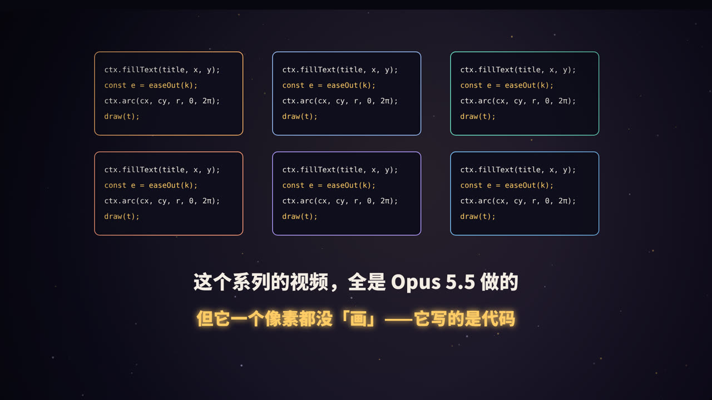
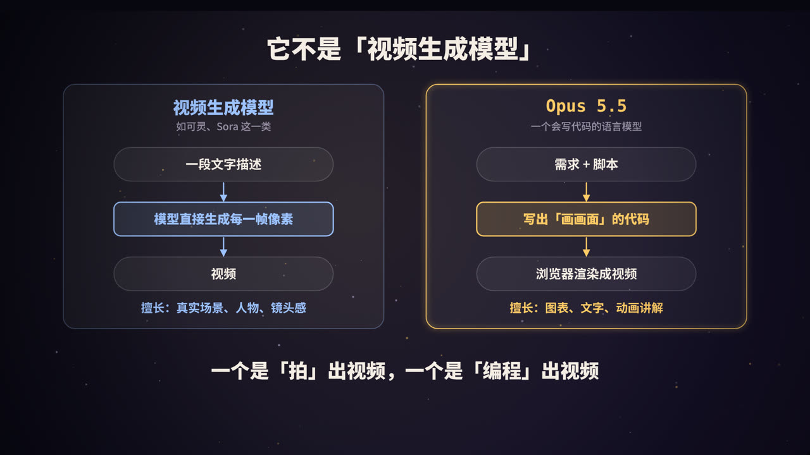
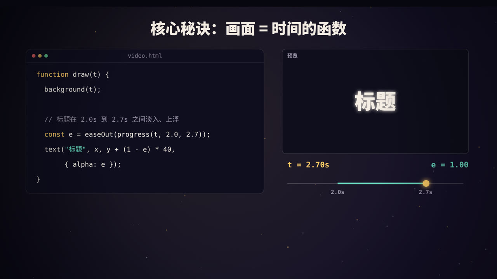

title: Opus 5.5 是怎么做出视频的：用代码「画」出每一帧
subtitle: 这个系列的所有视频都出自 Opus 5.5。这篇文章完整拆解它的做法：不生成像素，而是写一个能渲染视频的程序
tag: 计算机 · AI
color: #ffcc66



## 先说结论

你在这个系列里看到的每一部动画，从文字、图表到粒子特效，**没有一帧是由视频生成模型「画」出来的**。Claude Opus 5.5 做的事情是：

1. 根据主题写出脚本和分镜；
2. 写一个 HTML 文件，用代码描述「任意时刻画面应该长什么样」；
3. 用无头浏览器把每一帧截下来；
4. 用 ffmpeg 把截图合成 MP4。

换句话说，**Opus 5.5 写的是一个能渲染视频的程序，而不是视频本身。** 这也是网上很多「Opus 5.5 一键生成动画」案例背后的真实做法：模型输出的是代码，由代码画出像素。

## 它不是视频生成模型



市面上有两类完全不同的「AI 做视频」：

| | 视频生成模型（如可灵、Sora 一类） | 大语言模型写代码渲染（本系列的做法） |
|---|---|---|
| 输入 | 一段画面描述 | 需求、脚本、设计要求 |
| 输出 | 直接生成的像素画面 | 一段程序（HTML / JavaScript） |
| 擅长 | 真实场景、人物、镜头运动、实拍质感 | 文字排版、图表、示意图、原理动画 |
| 文字准确性 | 画面中的文字容易出错 | 文字百分之百准确 |
| 可修改性 | 改一处往往要整段重新生成 | 改一行代码，只影响那一处 |
| 可复现性 | 每次生成结果不同 | 同样的代码永远渲染出同样的画面 |

所以两者不是谁取代谁，而是分工不同。**知识讲解类视频需要大量准确的文字、数字和图表，正好是代码渲染的强项。** 需要真人或实拍画面时，可以让语言模型去调用视频生成模型的接口，自己负责编排和剪辑。

## 四步流水线


### 第 1 步：写脚本和分镜

每部视频开始前，先定好结构。以《幸福的科学》为例，72 秒被分成 6 个场景：

| 时间 | 场景 | 画面 |
|---|---|---|
| 0–6s | 钩子 | 「越用力追求幸福，可能越不幸福」，文字碎裂 |
| 6–22s | 享乐适应 | 快乐曲线冲高回落，小球在跑步机上原地跑 |
| 22–39s | 哈佛研究 | 年份计数、划掉「财富名气成就」、关系网络 |
| 39–53s | 心流 | 挑战 × 技能坐标图，光点移入心流区 |
| 53–66s | 行动建议 | 三张卡片依次滑入 |
| 66–72s | 收尾 | 光点聚成光环 |

这一步决定了视频「讲什么、怎么讲」，也是最需要内容判断力的一步。

### 第 2 步：写一个 HTML 动画

整部视频就是一个 HTML 文件，里面只有一个 1920×1080 的 `<canvas>` 画布，所有画面都用 JavaScript 绘制。文件同时也是一个播放器：用浏览器打开就能播放、暂停、拖动进度。

每个场景是一个函数，再用一张表规定它们在时间轴上的位置：

```js
const SCENES = [[s1, -1, 7], [s2, 7, 21], [s3, 21, 34],
                [s4, 34, 48], [s5, 48, 62], [s6, 62, 72]];

function draw(t) {
  background(t);                       // 背景和漂浮的粒子
  for (const [fn, a, b] of SCENES) {
    if (t < a || t > b) continue;
    SA = sceneA(t, a, b);              // 场景整体的淡入淡出
    if (SA > 0) fn(t);                 // 绘制这个场景在 t 时刻的样子
  }
  vignette();                          // 四周压暗
}
```

### 第 3 步：逐帧截图

用 Playwright 控制一个无头 Chrome，打开页面后，依次让它画出第 0 帧、第 1 帧……并截图：

```js
for (let i = 0; i < frames; i++) {
  await page.evaluate(t => window.renderFrame(t), i / fps);   // 画出这一帧
  const png = await stage.screenshot({ type: 'png' });        // 截图
  ffmpeg.stdin.write(png);                                    // 直接送给 ffmpeg
}
```

一部 72 秒、每秒 30 帧的视频，就是 **2160 张截图**。

### 第 4 步：合成 MP4

截图通过管道直接送进 ffmpeg，编码成 H.264 格式的 MP4：

```bash
ffmpeg -f image2pipe -framerate 30 -i - \
       -c:v libx264 -pix_fmt yuv420p -crf 18 -movflags +faststart out.mp4
```

这几步的完整脚本就在仓库的 `render.mjs` 里，一条命令就能导出任意一部视频：

```bash
node render.mjs llm/landscape.html llm.mp4
```

## 核心秘诀：画面 = 时间的函数



### 为什么不用普通的网页动画

网页里常见的动画方式，比如 CSS 动画或者依赖真实时间流逝的 `requestAnimationFrame`，画面取决于「现在过去了多久」。截图时，浏览器每截一张都要花上几十毫秒，时间对不上，导出的视频就会卡顿或跳帧。

所以这里的所有动画都遵循一个原则：**画面只由时间参数 `t` 决定。** 给定同一个 `t`，永远画出完全相同的一帧。这样既可以按 1/30 秒的步长精确地逐帧导出，也可以在浏览器里随意拖动进度条预览。

### 一个动画元素是怎么写的

比如「标题在第 2.0 秒到第 2.7 秒之间淡入并上浮」：

```js
const p  = (t, a, b) => Math.min(1, Math.max(0, (t - a) / (b - a)));  // 进度：0 → 1
const eo = x => 1 - Math.pow(1 - x, 3);                                // 缓动：先快后慢

function rise(text, x, y, t, t0, opts, dur = 0.7) {
  const e = eo(p(t, t0, t0 + dur));
  if (e <= 0) return;
  txt(text, x, y + (1 - e) * 36, { ...opts, alpha: e });   // 位置和透明度都跟着 e 变
}

rise('它是怎么做到的？', 960, 715, t, 4.8, { size: 64 });
```

- `p()` 把时间换算成 0 到 1 的进度；
- `eo()` 是缓动函数，让运动先快后慢，看起来更自然；
- `rise()` 根据进度同时改变位置和透明度。

整套视频里几百个动画元素，基本都是这几个小函数的组合。

### 连随机也要可复现

背景里漂浮的粒子、文字碎裂时飞散的方向，看起来是随机的，但用的不是 `Math.random()`，而是**带种子的伪随机数生成器**：

```js
function rnd(seed) {
  let s = seed >>> 0;
  return () => { s = (s * 1664525 + 1013904223) >>> 0; return s / 4294967296; };
}
```

同一个种子永远产生同一串「随机数」，于是每一帧里每个粒子的位置都是确定的，导出时不会闪烁。

## AI 怎么知道自己画得好不好


写代码的模型，看不到代码运行后的样子吗？其实看得到。Opus 5.5 是多模态模型，可以读图。制作过程中，它会：

1. 写完代码后，挑几个关键时刻截图；
2. 用 ffmpeg 把这些截图拼成一张「样片总览」；
3. **自己看这张图**，检查有没有文字重叠、元素出框、留白不均；
4. 发现问题就改代码，再截图确认。

这个系列制作过程中真实修过的问题，比如：

| 视频 | 发现的问题 | 怎么改的 |
|---|---|---|
| 什么是 LLM | 注意力连线的弧太高，盖住了标题 | 降低弧线高度，句子下移 |
| 从零做 Claude Code | 循环图左右两个标签压住了中间的「Agent Loop」 | 把标签移到圆外，扩大半径 |
| JVM 是什么 | 代码框里第二行超出了边框 | 加宽代码面板 |
| RAG 是什么 | 问题标签和「住宿费上限」重叠 | 把问题标签移到星标左侧 |

这和人类设计师「做一版、看一眼、调一调」的工作方式是一样的。

## 优势与局限


### 适合

- **知识讲解、原理演示**：概念图、流程图、对比表，信息准确，排版清晰；
- **数据图表**：数字就是代码里的数据，不会出错；
- **文字动效**：标题、字幕、片头片尾；
- **成系列的内容**：同一套视觉风格和工具函数可以复用，做第二部比第一部快得多。

### 不适合，或需要配合其他工具

- **真人、实拍质感的画面**：代码没有「镜头」，画不出真实的世界，需要视频生成模型；
- **配音和音乐**：可以由文本转语音服务和音乐素材补上，或者在剪映等软件里后期添加；
- **复杂的 3D 镜头**：可以用 Three.js 做一部分，但复杂场景还是专业软件更合适。

## 你也可以这样做

### 需要准备

- Node.js、Google Chrome（或 Playwright 自带的 Chromium）、ffmpeg；
- 一个能写代码、能运行命令的 AI 编程环境。

### 一份可以参考的需求描述

```text
做一个 72 秒的横屏科普动画，主题是「什么是 HTTP」。
要求：
1. 先给分镜：6 个场景，每个场景的时间段、讲什么、画面是什么。
2. 写成单个 HTML 文件，1920×1080 的 canvas，
   所有动画只由时间 t 决定，提供 window.renderFrame(t) 给截图用。
3. 深色背景、一种主色、中文字体，文字不要小于 28px。
4. 写完后截取 6 个关键帧检查：不能有文字重叠、元素出框。
5. 用 Playwright 逐帧截图，ffmpeg 合成 30fps 的 MP4。
```

关键在于：**把「确定性渲染」和「自我检查」写进要求里**，这两点决定了结果是否稳定可用。

## 总结

- Opus 5.5 做视频，本质是**写一个能渲染视频的程序**，而不是生成像素；
- 流程是四步：**分镜 → HTML 动画 → 逐帧截图 → ffmpeg 合成**；
- 核心秘诀是**画面 = 时间的函数**，加上可复现的随机数，保证每一帧都确定；
- 它会**截图自查**，像设计师一样反复调整；
- 这种方式最适合知识讲解类内容。你正在看的这个系列，就是这样做出来的。

<div class="refs" markdown="1">

### 参考资料

- OrcaRouter. Claude Opus 5.5 One-Shot a Music Video: What "Plan a Video" Actually Produces. orcarouter.ai
- laozhang.ai. Claude Opus 5.5 Video Generation: Code In, Rendered MP4 Out. blog.laozhang.ai
- WPS. How Claude Opus 5.5 Generates Videos with Code. wps.com
- Playwright 官方文档：playwright.dev
- FFmpeg 官方文档：ffmpeg.org
- 本系列源代码：github.com/mbwjs/science-explainer-videos

</div>
