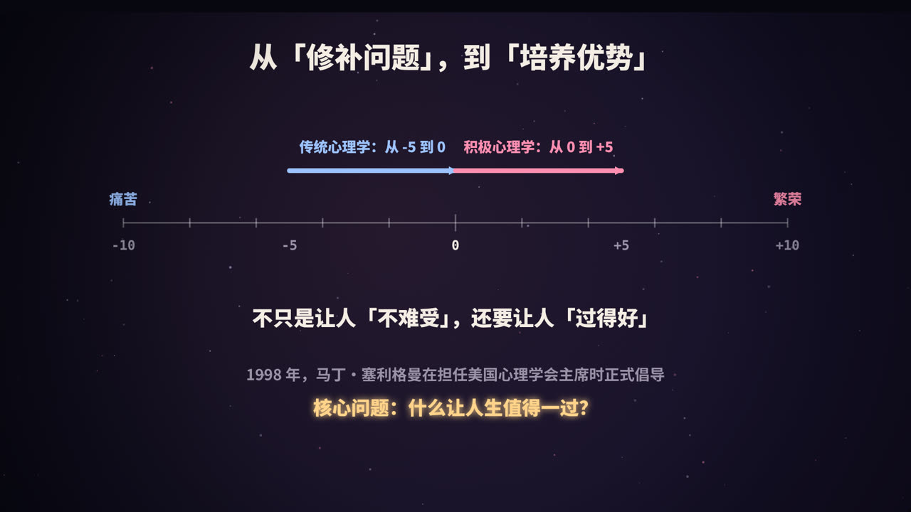
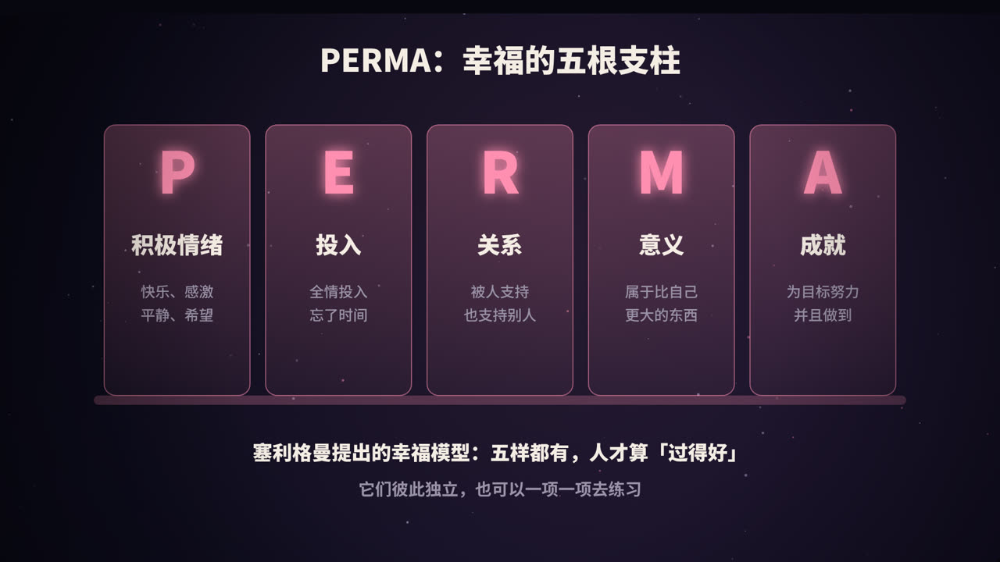

title: 积极心理学：不只是让人「不难受」，还要让人「过得好」
subtitle: 它从哪里来、PERMA 幸福模型、24 项品格优势、被实验验证过的练习，以及它受到的批评
tag: 心理学 · 人生
color: #ff8fb1

## 心理学的另一半

翻开 20 世纪的心理学研究，绝大部分篇幅都在讨论问题：抑郁、焦虑、创伤、成瘾、精神障碍。这些研究非常重要，帮助无数人摆脱了痛苦。

但有人开始追问：**一个人没有心理疾病，就等于过得好吗？** 显然不是。很多人既没有抑郁，也没有焦虑，却依然觉得日子平淡、空洞，缺少热情。如何让普通人活得更充实、更有意义，这一半问题，长期被心理学忽视了。

**积极心理学**（Positive Psychology）就是为了补上这一半而诞生的。

## 从「修补问题」到「培养优势」

### 一个直观的比喻

如果把人的状态画在一条从 -10 到 +10 的数轴上：

- **传统心理学**主要关心的是把人从 -5 拉回到 0，也就是消除痛苦和疾病；
- **积极心理学**关心的是从 0 到 +5：在没有问题的基础上，怎样活得更好、更「繁荣」。

两者不是对立关系，而是互补的。

### 它是怎么诞生的

积极心理学的代表人物是美国心理学家**马丁·塞利格曼**（Martin Seligman）。有意思的是，他早年最出名的研究恰恰是关于「消极」的——**习得性无助**：当个体反复经历无法控制的负面事件后，会放弃努力，即使后来有机会改变，也不再尝试。这项研究成为理解抑郁的重要理论之一。

后来他把研究方向转向了乐观和幸福。1998 年，塞利格曼担任美国心理学会主席，他在任期内大力倡导心理学应该同样重视人的优势和美好的一面。2000 年，他和心流理论的提出者米哈里·契克森米哈伊一起，在《美国心理学家》期刊上主编了积极心理学专刊，这通常被看作这个领域正式确立的标志。

积极心理学并非凭空出现。更早的人本主义心理学家，比如提出需求层次理论的马斯洛、强调「无条件积极关注」的罗杰斯，都关注过人的成长和潜能。积极心理学的不同之处在于，它更强调用实证研究和实验数据来检验这些想法。

### 研究什么

塞利格曼和契克森米哈伊最初把积极心理学的研究对象概括为三个层面：

| 层面 | 关注 |
|---|---|
| 积极的主观体验 | 快乐、满足、希望、心流、感恩 |
| 积极的个人特质 | 品格优势、勇气、韧性、创造力 |
| 积极的组织与社会 | 让人更好成长的家庭、学校、职场和社区 |

## PERMA：幸福的五根支柱

2011 年，塞利格曼在《持续的幸福》（*Flourish*）一书中提出了 **PERMA 模型**，认为一个人「过得好」（他称之为「蓬勃」，flourishing）由五个要素构成：

### P：积极情绪（Positive Emotion）

快乐、感激、平静、希望、兴趣、爱。它们让此刻的感觉更好。

心理学家芭芭拉·弗雷德里克森（Barbara Fredrickson）的**拓展-建构理论**解释了积极情绪的长远价值：负面情绪会让人的注意力变窄，专注于眼前的威胁；而积极情绪会**拓展**人的思维和行动范围，让人更愿意探索、学习、交朋友，从而逐渐**建构**起身体、智力和社会方面的资源。

### E：投入（Engagement）

全情投入一件事，以至于忘记时间、忘记自我，也就是**心流**。投入感通常来自运用自己擅长的能力去迎接适度的挑战。

### R：关系（Relationships）

被人支持，也支持别人。几乎所有关于幸福的研究都指向同一个结论：良好的人际关系是幸福最重要的来源之一。

### M：意义（Meaning）

属于并服务于某种比自己更大的东西，比如家庭、团队、信仰、事业或社会。

### A：成就（Accomplishment）

为目标努力并有所达成，感受到自己在进步、在掌控生活。

这五个要素相对独立，各自都可以被测量，也都可以被刻意培养。一个人可能在「成就」上很高，在「关系」上很弱，这就提示了改进的方向。

## 品格优势：每个人都有自己的长处

### VIA 品格优势分类

2004 年，心理学家克里斯托弗·彼得森（Christopher Peterson）和塞利格曼带领团队，梳理了世界各地的哲学、宗教和文化传统，总结出被普遍推崇的 **6 大美德**，并细分为 **24 项品格优势**。这套体系被称为 **VIA 分类**：

| 美德 | 包含的品格优势 |
|---|---|
| 智慧 | 创造力、好奇心、判断力、好学、洞察力 |
| 勇气 | 勇敢、坚持、正直、热情 |
| 仁爱 | 爱、善良、社交智慧 |
| 正义 | 团队精神、公平、领导力 |
| 节制 | 宽恕、谦逊、审慎、自律 |
| 超越 | 对美和卓越的欣赏、感恩、希望、幽默、灵性 |

每个人都拥有这 24 项优势，只是强弱程度不同。可以通过 VIA 研究所提供的免费问卷，测出自己的优势排序。

### 标志性优势

排在最前面、最能代表你的那 3 到 5 项，被称为**标志性优势**（signature strengths）。它们通常有这样的特点：

- 让你觉得「这才是真正的我」；
- 使用时感到兴奋、精力充沛，而不是消耗；
- 学习和运用它们时进步很快。

积极心理学的一个核心主张是：**与其花大量精力补短板，不如多发挥自己的长处。** 在工作和生活中更多地运用标志性优势，人会更投入，也更有满足感。

## 研究验证过的 3 个小练习

### 一项经典的随机对照实验

2005 年，塞利格曼和同事在网上招募了数百名参与者，随机分配他们做一项为期一周的练习（其中一组做的是对照用的「安慰剂」练习：每晚写下自己的童年回忆），然后在之后的半年里多次测量他们的幸福感和抑郁症状。

结果显示：

| 练习 | 做法 | 效果 |
|---|---|---|
| **感恩拜访** | 给一位曾经帮助过你、却从未被好好感谢的人写一封信，然后当面读给他听 | 幸福感提升幅度最大，效果大约持续一个月 |
| **三件好事** | 连续一周，每晚写下当天顺利的 3 件事，以及它们为什么会发生 | 幸福感上升、抑郁症状下降，效果持续约六个月 |
| **用新方式发挥优势** | 先测出自己的标志性优势，然后连续一周，每天用一种新方式运用其中一项 | 同样持续约六个月 |

一个值得注意的细节是：实验只要求做一周，但那些在实验结束后**自发坚持**下去的人，获益最明显。这说明这些练习更像锻炼身体，需要持续去做。

### 怎么做「三件好事」

1. 每晚睡前花 10 分钟；
2. 写下今天顺利的 3 件事，大事小事都可以，比如「同事帮我解决了一个难题」「晚饭很好吃」；
3. 每件事后面，写一句它**为什么**会发生，比如「因为我主动开口问了」「因为我提前做好了准备」。

第三步很关键。它会训练你把注意力放在生活中好的部分，并且看到自己在其中的作用。

## 它受到的批评

一门学科成熟的标志之一，是能够正视批评。积极心理学也面临不少质疑：

1. **部分研究难以重复**。和整个心理学领域一样，一些早期的明星研究在后续重复实验中效果变小，甚至没能重复出来。最著名的例子是曾经流行一时的「积极率」理论：它声称积极情绪和消极情绪的比例超过约 2.9 比 1 时，人就会「蓬勃发展」。2013 年，其中依据的数学模型被其他研究者指出存在严重问题，相关论文的数学部分后来被正式撤回。
2. **效果可能被夸大**。很多干预的效果是真实存在的，但幅度往往没有通俗读物里描述得那么大。
3. **容易被误用成「强制乐观」**。积极心理学从来不主张压抑负面情绪，但在大众传播中，它常被简化成「永远要正能量」。
4. **文化差异**。很多研究以西方人群为样本，「什么是幸福」在不同文化中的理解并不完全相同。

> 这些批评并不意味着积极心理学没有价值，而是提醒我们：**对研究结论保持合理的期待，对夸张的说法保持警惕。**

## 积极心理学 ≠ 强颜欢笑

一个常见的误解，是把积极心理学等同于「凡事往好处想」「不许难过」。事实上：

- 负面情绪有它的功能：恐惧让我们避开危险，悲伤让我们停下来消化失去，愤怒提醒我们边界被侵犯了；
- 强行压抑负面情绪，通常会让情况更糟；
- 积极心理学关注的是**在承认痛苦的同时，也去培养那些让生活更好的东西**。

所以它的精神可以概括为一句话：**它不否认痛苦，而是在修补问题之外，多问一句：怎样才能过得更好？**

## 从今天开始的行动清单

- 今晚开始做「三件好事」，先坚持一周；
- 做一次 VIA 品格优势测试，找出你的标志性优势，想想明天可以怎样用一种新方式运用它；
- 想一位你一直想感谢、却没说出口的人，给他写一封信；
- 用 PERMA 的五个维度给自己打个分，挑分数最低的一项，设定一个小目标。

> 如果你正经历持续的情绪低落、焦虑或其他困扰，这些练习可以作为辅助，但不能替代专业的心理咨询或治疗。

### 参考资料

- Seligman, M. E. P., & Csikszentmihalyi, M. (2000). Positive psychology: An introduction. *American Psychologist*.
- Seligman, M. E. P., Steen, T. A., Park, N., & Peterson, C. (2005). Positive psychology progress: Empirical validation of interventions. *American Psychologist*.
- Peterson, C., & Seligman, M. E. P. (2004). *Character Strengths and Virtues: A Handbook and Classification*.
- Seligman, M. E. P. (2011). *Flourish*.（中译本：《持续的幸福》）
- Fredrickson, B. L. (2001). The role of positive emotions in positive psychology: The broaden-and-build theory of positive emotions. *American Psychologist*.
- Brown, N. J. L., Sokal, A. D., & Friedman, H. L. (2013). The complex dynamics of wishful thinking: The critical positivity ratio. *American Psychologist*.

