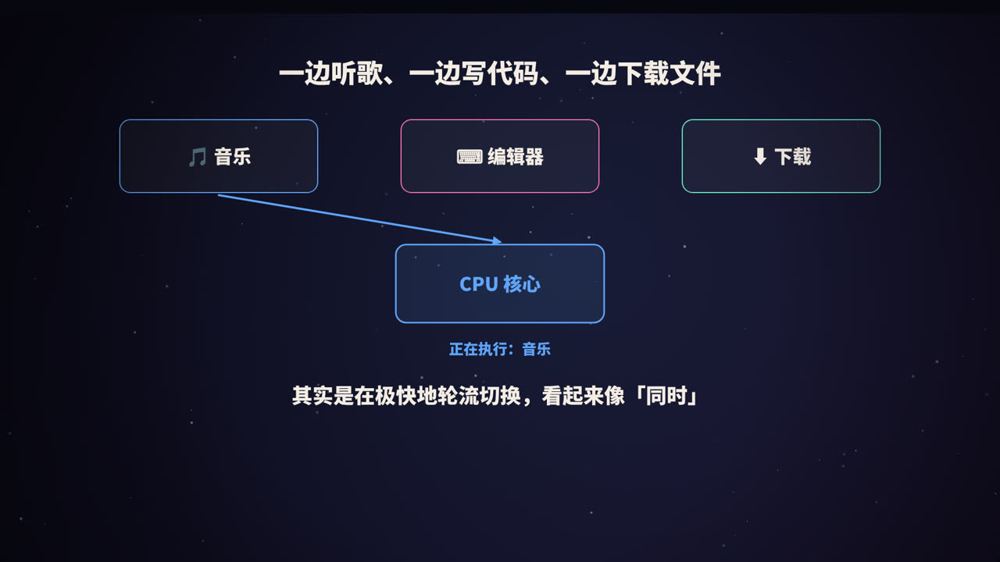
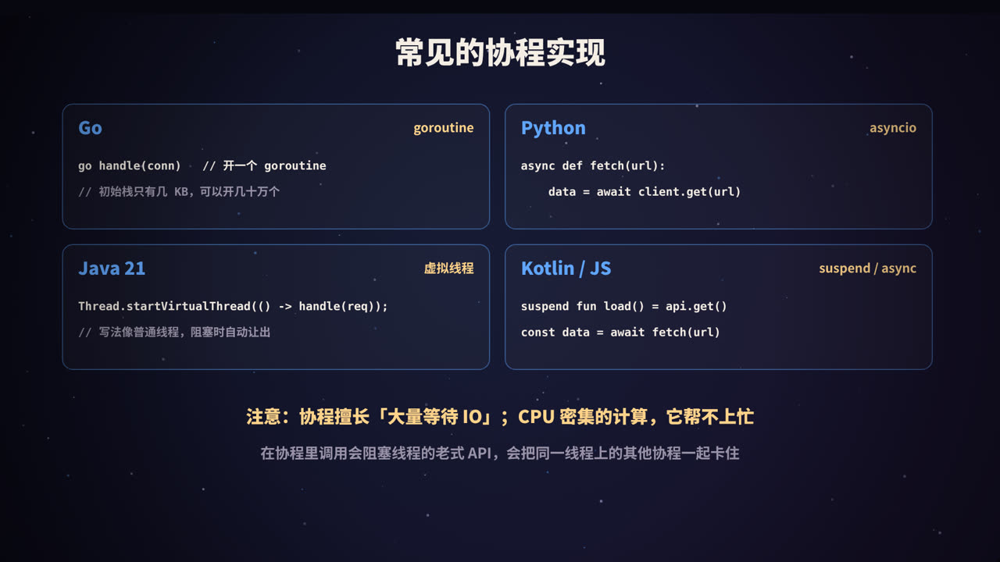

title: 进程、线程与协程：工厂、工人，和会见缝插针的工人
subtitle: 它们分别是什么、有什么区别；线程为什么危险、上下文切换的代价、为什么需要协程，以及 Go、Python、Java 虚拟线程中的协程怎么用
tag: 计算机与后端
color: #60a5fa



## 「同时」做很多事的秘密

你可以一边听歌、一边写代码、一边下载文件。但一个 CPU 核心在同一时刻只能执行一条指令流。之所以看起来「同时」，是因为操作系统让 CPU 在不同的任务之间**极快地轮流切换**，每个任务执行几毫秒就换下一个，人根本察觉不到。

在这背后，有三个层层递进的概念：**进程**、**线程**和**协程**。

## 进程：一个运行中的程序


双击打开浏览器，操作系统就创建了一个（或多个）**进程**。进程是一个正在运行的程序实例，它拥有：

- 自己独立的**虚拟内存空间**：代码、全局数据、堆、栈；
- 打开的文件、网络连接等系统资源；
- 至少一个执行流（线程）。

### 隔离是进程最大的特点

不同进程的内存是**互相隔离**的，一个进程无法直接读写另一个进程的内存。所以：

- 一个进程崩溃，通常不会影响其他进程；
- 这也是安全的基础：恶意程序不能随意窃取其他程序的数据。

现代浏览器把每个标签页放在单独的进程里运行，一个网页崩溃不会拖垮整个浏览器，就是利用了这一点。

### 代价

- **创建和销毁比较重**：要分配独立的地址空间和各种资源；
- **切换开销大**：需要切换内存映射（页表）；
- **通信麻烦**：进程之间交换数据要通过 **IPC**（进程间通信）机制，比如管道、消息队列、Socket、共享内存。

> 进程是操作系统**分配资源**的基本单位。

## 线程：进程里的工人


如果把进程比作一座**工厂**，线程就是工厂里的**工人**。一个进程可以有多个线程，它们：

- **共享**进程的代码、堆内存、全局变量、打开的文件；
- **各自拥有**自己的栈、程序计数器（执行到哪了）和寄存器。

> 线程是操作系统**调度 CPU** 的基本单位。

### 线程的优点

- **比进程轻**：创建和切换开销更小；
- **通信方便**：多个线程直接读写同一块内存，不需要 IPC；
- **利用多核**：多个线程可以同时在多个 CPU 核心上运行，真正地并行计算。

### 共享带来的危险：竞态条件

正因为共享内存，多个线程同时修改同一份数据时就可能出错。经典例子是两个线程同时执行 `count++`：

| 时间 | 线程 1 | 线程 2 | count |
|---|---|---|---|
| 1 | 读取 count = 5 | | 5 |
| 2 | | 读取 count = 5 | 5 |
| 3 | 计算 5 + 1，写回 6 | | 6 |
| 4 | | 计算 5 + 1，写回 6 | 6 |

加了两次，结果只多了 1。这种结果依赖于执行时序的错误叫**竞态条件**，而且很难复现和调试。解决方法包括：

- **加锁**（如 Java 的 `synchronized`、`ReentrantLock`），让同一时刻只有一个线程能修改；
- **原子操作**（如 `AtomicInteger`），由 CPU 指令保证「读-改-写」不可分割；
- **避免共享**：尽量使用不可变数据，或者让每个线程处理自己的数据。

此外，一个线程如果发生严重错误（比如访问了非法内存），可能会导致**整个进程**崩溃，所有线程一起终止。

## 上下文切换的代价


当 CPU 从一个线程切换到另一个线程时，需要：

1. **保存现场**：把当前线程的寄存器、程序计数器等状态保存起来；
2. **恢复现场**：载入下一个线程的状态；
3. 切换通常需要进入**内核态**，由操作系统调度器完成。

还有一些隐性开销：

- **缓存变冷**：CPU 缓存中是上一个线程的数据，新线程的数据需要重新从内存加载；
- **进程切换更重**：如果切换到另一个进程的线程，还要切换内存地址空间，导致 TLB（地址转换缓存）失效。

一次线程切换的直接开销通常在微秒量级。单次看起来很小，但如果开了成千上万个线程频繁切换，CPU 就会把大量时间浪费在「换人」上，而不是做实际的工作。这也是线程池要限制线程数量的原因之一（见本系列《线程池是什么》）。

## 线程的尴尬：大部分时间在等待


一个典型的 Web 服务处理请求时，真正占用 CPU 计算的时间很短，大部分时间在**等待**：等数据库返回、等下游接口响应、等磁盘读写。

在传统的「一个连接一个线程」模型中：

- 线程在等待 IO 时被**阻塞**，什么也不做，但依然占用着资源；
- 每个线程都要分配栈内存（常见默认值在几百 KB 到 1 MB 级别）；
- 一万个并发连接就需要一万个线程，内存占用和切换开销都难以承受。

这就是著名的 **C10K 问题**（单机同时处理一万个连接）背后的挑战之一。

## 协程：会见缝插针的工人

**协程**（coroutine）是一种比线程更轻量的执行单元。它的核心思想是：

- **在用户态调度**：协程的切换由程序自己的运行时（或语言库）完成，不需要操作系统介入，开销极小；
- **主动让出**：遇到 IO 等待时，协程把 CPU 让给其他协程，等 IO 完成后再被唤醒继续执行；
- **M:N 调度**：大量协程（M 个）运行在少量线程（N 个，通常约等于 CPU 核数）之上。

就像一个工人在等待机器加工时，不站着干等，而是先去做别的零件，机器好了再回来。

协程有多轻？以 Go 为例，一个 goroutine 的初始栈只有几 KB，并且可以按需增长，单机创建几十万甚至上百万个 goroutine 是常见的事情。

### 协程适合什么、不适合什么

| | 说明 |
|---|---|
| **适合** | 大量 IO 等待的场景：Web 服务、网关、爬虫、消息推送、调用大量下游接口 |
| **不适合** | CPU 密集型计算：计算本身不会「等待」，协程无法凭空变出更多 CPU；这时应使用多线程或多进程 |
| **要小心** | 在协程中调用会**阻塞线程**的传统 API（比如同步的文件读写、老式的数据库驱动），会把同一个线程上的其他协程一起卡住 |

## 各语言中的协程



### Go：goroutine

Go 在语言层面内置了协程，`go` 关键字就能启动一个 goroutine，运行时负责把它们调度到线程上：

```go
func main() {
    for i := 0; i < 100000; i++ {
        go func(id int) {
            time.Sleep(time.Second)      // 模拟 IO：goroutine 被挂起，不占用线程
        }(i)
    }
    time.Sleep(2 * time.Second)
}
```

goroutine 之间推荐通过 **channel** 通信：「不要通过共享内存来通信，而要通过通信来共享内存」。

### Python：asyncio

Python 使用 `async` / `await` 语法，由事件循环调度：

```python
import asyncio

async def fetch(i):
    await asyncio.sleep(1)               # 模拟 IO，等待时让出控制权
    return i

async def main():
    results = await asyncio.gather(*(fetch(i) for i in range(10000)))
    print(len(results))                  # 约 1 秒完成，而不是 10000 秒

asyncio.run(main())
```

需要注意，`async` 函数中必须使用异步版本的库（如 `aiohttp`、`asyncpg`）；在其中调用同步阻塞的函数，会卡住整个事件循环。

### Java 21：虚拟线程

Java 21 正式引入了**虚拟线程**（Virtual Threads），它本质上就是 JVM 管理的协程。最大的特点是**写法和普通线程完全一样**，遇到阻塞操作时由 JVM 自动挂起、让出底层的平台线程：

```java
try (var executor = Executors.newVirtualThreadPerTaskExecutor()) {
    for (int i = 0; i < 100_000; i++) {
        executor.submit(() -> {
            Thread.sleep(Duration.ofSeconds(1));   // 阻塞时自动让出底层线程
            return null;
        });
    }
}   // 等待所有任务完成
```

这意味着，大量已有的「一个请求一个线程」风格的同步代码，几乎不用改写就能获得高并发能力。

### Kotlin、JavaScript

Kotlin 的 `suspend` 函数和协程库、JavaScript 的 `async` / `await`（基于事件循环和 Promise），也都是协程思想的体现。

## 一张表看懂


| | 进程 | 线程 | 协程 |
|---|---|---|---|
| 谁来调度 | 操作系统 | 操作系统 | 语言运行时 / 程序自身 |
| 内存 | 各自独立 | 共享所在进程的内存 | 共享所在线程（进程）的内存 |
| 创建开销 | 大 | 中 | 极小 |
| 切换 | 内核态，需切换地址空间，最重 | 内核态 | 用户态，很轻 |
| 常见数量 | 几十到几百 | 几百到几千 | 几万到百万 |
| 隔离性 | 强 | 弱，一个崩溃可能拖垮整个进程 | 弱 |
| 适合 | 需要隔离、稳定性要求高 | 利用多核进行计算 | 海量 IO 并发 |

## 并发与并行

最后区分两个常被混用的词：

- **并发**（concurrency）：多个任务在**同一段时间内**交替推进，单核也能做到；
- **并行**（parallelism）：多个任务在**同一时刻**真正同时执行，需要多个 CPU 核心。

协程主要解决**并发**问题（高效地处理大量等待中的任务）；多线程、多进程则可以实现真正的**并行**计算。实际系统中两者常常结合：比如 Go 运行时会把 goroutine 调度到多个线程上，同时获得并发和并行。

## 高频面试题速答

**Q：进程和线程的区别？**
进程是资源分配的基本单位，拥有独立的内存空间；线程是 CPU 调度的基本单位，同一进程内的线程共享内存。进程隔离性好但开销大；线程开销小但需要处理并发安全问题。

**Q：协程和线程的区别？**
线程由操作系统调度，切换需要进入内核；协程由用户态的运行时调度，切换开销极小，可以创建大量协程，适合 IO 密集型的高并发场景。

**Q：为什么协程能支持更高的并发？**
协程占用的内存极小，切换在用户态完成，遇到 IO 时主动让出，少量线程就能承载大量协程。

## 总结


- **进程**：运行中的程序，资源分配的单位，相互隔离；
- **线程**：进程中的执行流，CPU 调度的单位，共享内存，要注意并发安全；
- **上下文切换**有代价，线程不是越多越好；
- **协程**：用户态的轻量执行单元，遇到 IO 主动让出，适合海量 IO 并发；
- Go 的 goroutine、Python 的 asyncio、Java 21 的虚拟线程，都是协程思想的实现。

<div class="refs" markdown="1">

### 参考资料

- Arpaci-Dusseau, R. H., & Arpaci-Dusseau, A. C. *Operating Systems: Three Easy Pieces*.
- Bryant, R. E., & O'Hallaron, D. R. *Computer Systems: A Programmer's Perspective*.（中译本：《深入理解计算机系统》）
- Kegel, D. The C10K problem.
- The Go Programming Language Documentation: Effective Go — Concurrency.
- Python 文档：asyncio — Asynchronous I/O.
- JEP 444: Virtual Threads (JDK 21).

</div>
