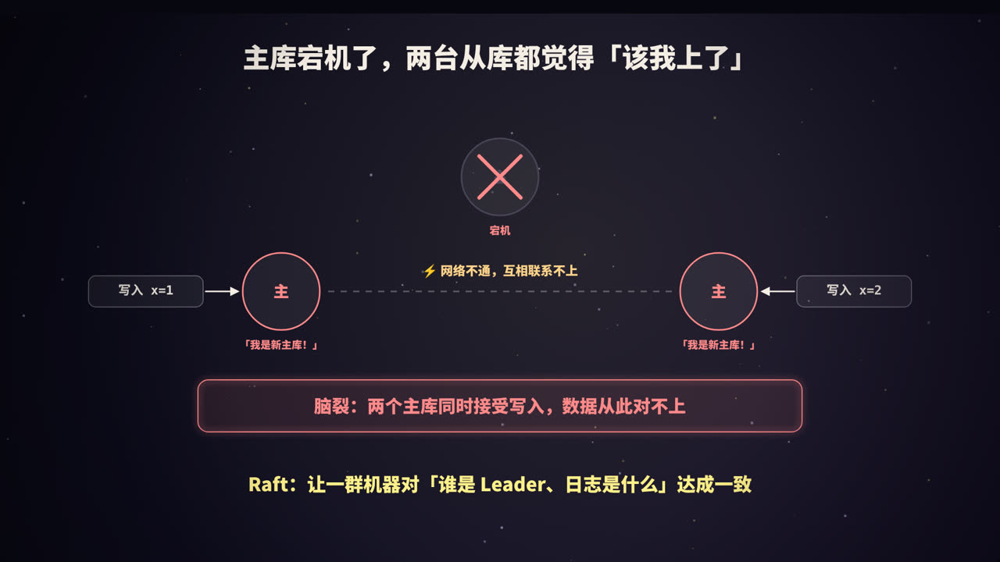
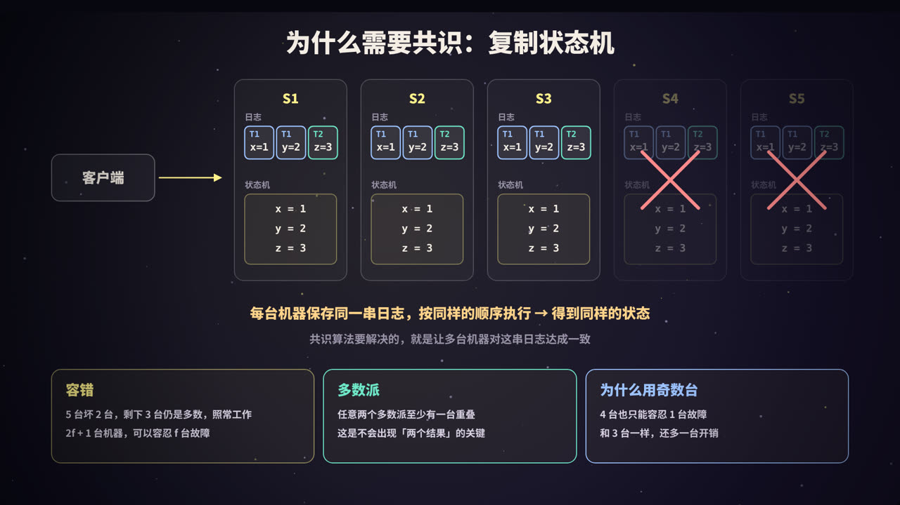
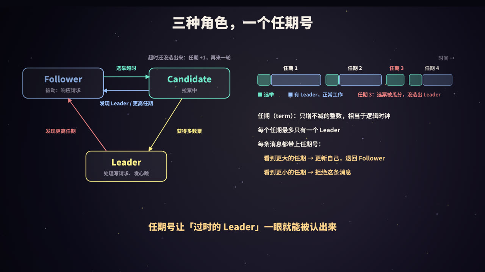
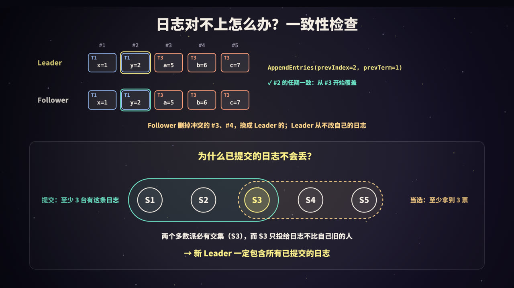
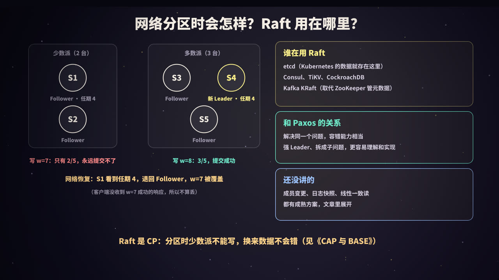

title: Raft：让多台机器对同一串日志达成一致
subtitle: 复制状态机与多数派、三种角色与任期、领导者选举与随机超时、日志复制与提交、一致性检查与日志修复、安全性证明的直觉、网络分区、成员变更与快照，附一个可复现的 Python Raft 模拟器
tag: 计算机与后端
color: #fef08a



## 从「脑裂」说起

一个最常见的高可用方案是「一主多从」：主库负责写，从库实时复制数据。主库宕机了，就把某个从库提升为新的主库。

问题出在「谁来决定提升哪一台」上：

- 如果由一个外部的「哨兵」来决定，哨兵自己也可能宕机，或者和一部分机器之间网络不通；
- 如果让从库自己判断「主库好像没了，我来接班」，那么当两台从库之间网络也不通时，它们可能**各自**认为自己应该成为新主库。

于是出现了两个主库，各自接受写入：左边写了 `x = 1`，右边写了 `x = 2`。等网络恢复，两边的数据已经对不上，而且没有一个简单的规则能判断该保留哪一边。这就是**脑裂**（split brain）。

根本原因是：**多台机器之间没有对「谁是主」「数据是什么」达成一致**。

解决这个问题的一类算法叫**共识算法**（consensus algorithm）。Raft 是目前工程上用得最广的一个：etcd、Consul、TiKV、CockroachDB，以及 Kafka 用来取代 ZooKeeper 的 KRaft，核心都是 Raft 或它的变体。

> Raft 来自 2014 年 USENIX ATC 会议的论文《In Search of an Understandable Consensus Algorithm》，标题就点明了它的设计目标：**可理解**。

## 共识要解决什么：复制状态机



### 复制状态机

几乎所有需要「多副本强一致」的系统，都可以抽象成**复制状态机**（replicated state machine）：

1. 每台机器上有一个**状态机**，比如一个 KV 存储，它是**确定性**的：相同的初始状态，执行相同的命令序列，一定得到相同的结果；
2. 每台机器上有一份**日志**，按顺序记录要执行的命令：`x=1`、`y=2`、`z=3`……
3. 只要所有机器的日志**内容相同、顺序相同**，大家按顺序执行，状态就一定相同。

所以问题被转化成：**怎么让多台机器对同一串日志达成一致**，即使有机器宕机、消息丢失或延迟、网络被切断。这就是共识算法要做的事。

### 多数派：2f + 1 台机器容忍 f 台故障

Raft 的所有决定都依赖**多数派**（majority，也叫 quorum）：一条日志只要被超过半数的机器保存，就算「提交」了；一个候选人只要拿到超过半数的选票，就能当选。

| 集群规模 | 多数派 | 能容忍的故障数 |
|---|---|---|
| 1 | 1 | 0 |
| 3 | 2 | 1 |
| 4 | 3 | 1 |
| 5 | 3 | 2 |
| 7 | 4 | 3 |

规律是：**2f + 1 台机器可以容忍 f 台故障**。

为什么一定要「过半」？因为**任意两个多数派至少有一台机器是重叠的**。5 台里选 3 台，再选另外 3 台，必然有一台同时在两组里。这台重叠的机器就是「不会出现两个结果」的关键：它不可能在同一个任期里投票给两个人，已经提交的日志也一定会被它带到下一个多数派里。

### 为什么集群通常是奇数台

从表里可以看到，4 台和 3 台都只能容忍 1 台故障，5 台和 6 台都只能容忍 2 台。偶数台多出来的那一台不提升容错能力，反而增加了复制的开销（多数派更大、要等更多机器确认）。所以生产环境通常部署 **3 台或 5 台**。

台数也不是越多越好：每次写入都要等多数派确认，机器越多，Leader 的网络和 CPU 压力越大，延迟也可能越高。

### Raft 不解决什么

Raft 假设机器只会**宕机**或者变慢，消息只会**丢失、延迟、重复或乱序**，但不会有机器**故意撒谎**（比如伪造消息）。能容忍恶意节点的叫拜占庭容错（BFT）算法，常见于区块链，代价要高得多。在数据中心内部，一般不需要考虑拜占庭故障。

## 三种角色与任期



### 三种角色

Raft 中每台机器在任意时刻处于三种角色之一：

| 角色 | 做什么 |
|---|---|
| **Follower**（跟随者） | 完全被动：响应 Leader 和 Candidate 的请求，自己从不主动发请求。启动时所有节点都是 Follower |
| **Candidate**（候选人） | 选举期间的临时角色：向其他节点拉票 |
| **Leader**（领导者） | 处理所有客户端的写请求，把日志复制给 Follower，定期发心跳 |

正常运行时，集群里只有 **1 个 Leader**，其余都是 Follower。客户端如果把请求发给了 Follower，Follower 会告诉它 Leader 是谁（或者帮它转发）。

这种「强 Leader」的设计是 Raft 易于理解的重要原因：**日志只从 Leader 流向 Follower**，数据流向非常简单。

角色转换：

- Follower 在一段时间内没收到 Leader 的消息（**选举超时**）→ 变成 Candidate，发起选举；
- Candidate 拿到多数票 → 变成 Leader；
- Candidate 发现已经有合法的 Leader，或者看到了更大的任期 → 退回 Follower；
- Candidate 这一轮没选出结果（超时）→ 任期 +1，再来一轮；
- Leader 发现了更大的任期 → 退回 Follower。

### 任期（term）

Raft 把时间划分成一个个**任期**，用连续递增的整数编号。每个任期从一次选举开始：

- 选举成功，这个任期里就由选出的 Leader 负责到底；
- 选票被瓜分、没人拿到多数，这个任期就没有 Leader，很快会进入下一个任期。

**每个任期最多只有一个 Leader**。

任期起到了**逻辑时钟**的作用。每个节点都保存自己看到的最新任期 `currentTerm`，并且在**每条消息里都带上任期号**：

- 收到的消息任期**比自己大**：更新自己的任期；如果自己是 Leader 或 Candidate，立刻退回 Follower；
- 收到的消息任期**比自己小**：这是一条过时的消息，直接拒绝。

这条简单的规则能自动处理很多棘手情况。比如一个旧 Leader 因为网络问题被隔离了一段时间，期间集群已经选出了新 Leader、任期变大了；旧 Leader 恢复后发出的任何请求都会因为任期太小被拒绝，它一看到更大的任期，就知道自己已经「下台」了。

### 两种 RPC，几个必须持久化的状态

Raft 的核心只需要两种 RPC：

| RPC | 发送方 | 作用 |
|---|---|---|
| **RequestVote** | Candidate | 拉票，带上自己的任期和最后一条日志的 (下标, 任期) |
| **AppendEntries** | Leader | 复制日志；不带日志条目时就是**心跳** |

（另外还有一个用于传输快照的 InstallSnapshot，后面会讲。）

每个节点必须**在回复任何 RPC 之前**持久化到磁盘的状态只有三个：

| 状态 | 含义 |
|---|---|
| `currentTerm` | 见过的最新任期 |
| `votedFor` | 当前任期把票投给了谁 |
| `log[]` | 日志条目，每条包含任期和命令 |

`commitIndex`（已知已提交的最大下标）、`lastApplied`（已执行到状态机的最大下标）等都是易失的，重启后可以从日志和 Leader 那里重新得到。为什么 `votedFor` 也要持久化？如果不存，节点投完票后重启，可能在同一个任期里再投给另一个人，两个候选人都可能拿到「多数票」。

## 领导者选举


### 选举过程

1. Leader 会周期性地给所有 Follower 发心跳（不带日志的 AppendEntries）；
2. 如果 Follower 在**选举超时**时间内没收到心跳，就认为 Leader 可能挂了：把 `currentTerm` 加 1，变成 Candidate，**先投自己一票**，然后并行地给其他所有节点发 RequestVote；
3. 其他节点收到 RequestVote，满足以下条件就投赞成票：
   - 候选人的任期不小于自己的；
   - **这个任期里自己还没投过票**（或者投的就是它）——每个节点在每个任期里只有一票，**先到先得**；
   - 候选人的日志**不比自己旧**（见下文的投票限制）；
4. 候选人拿到**多数票**（包括自己的一票），就成为 Leader，并立刻向所有节点发心跳，宣告自己的地位，同时阻止其他节点发起新的选举；
5. 如果在等待选票期间收到了任期不小于自己的 Leader 发来的 AppendEntries，说明别人已经当选，自己退回 Follower；
6. 如果一直没有结果（比如选票被瓜分），等到再次超时，就进入下一个任期重新选举。

由于每个节点每个任期只投一票，而当选需要过半，**同一个任期里不可能选出两个 Leader**。这就是 Raft 的「选举安全性」。

### 随机超时：避免瓜分选票

如果所有 Follower 的选举超时都一样，Leader 一挂，大家会**同时**超时、同时成为 Candidate、都投自己一票，结果谁也拿不到多数。下一轮又同时超时……可能一直选不出来。

Raft 的解决办法非常简单：**每个节点的选举超时在一个范围内随机选取**（论文建议 150～300 ms），并且每次重置计时器时都重新随机。这样大概率只有一个节点最先超时，它在别人醒来之前就已经拉到了多数票。

后文的实验对比了不同的超时范围，200 次随机启动中，超时固定为 150 ms 时**一次都选不出 Leader**，而 150～300 ms 时每次都在第一个任期内选出。

超时时间的选择还要满足一个大致的关系：

> 广播时间（一次 RPC 来回）≪ 选举超时 ≪ 平均故障间隔

心跳间隔要明显小于选举超时，否则网络稍有抖动，Follower 就会误以为 Leader 挂了，引发不必要的选举；选举超时又不能太长，否则 Leader 真挂了，要等很久才能恢复服务。

### 投票限制：只投给日志「不比自己旧」的候选人

如果一个日志落后很多的节点当选了 Leader，它会用自己的日志去覆盖别人的，已经提交的数据就丢了。所以 Raft 规定：**投票时要比较双方日志的新旧，只投给日志不比自己旧的候选人**。

「新旧」的比较规则：

1. 先比**最后一条日志的任期**，任期大的更新；
2. 任期相同，再比**日志长度**，更长的更新。

RequestVote 里带着候选人最后一条日志的下标和任期，就是为了这个比较。

后文的模拟器里有一个真实的例子：S5 掉线期间错过了两条已提交的日志，恢复后它最先超时、发起选举，结果被所有节点拒绝：

```text
[  630 ms] S5 选举超时 → 成为 Candidate，任期 2，日志末尾 (#0, 任期0)
[  640 ms] S1 拒绝给 S5 投票：对方日志 (#0, 任期0) 比我的 (#2, 任期1) 旧
[  640 ms] S4 拒绝给 S5 投票：对方日志 (#0, 任期0) 比我的 (#2, 任期1) 旧
[  650 ms] S2 拒绝给 S5 投票：对方日志 (#0, 任期0) 比我的 (#2, 任期1) 旧
[  740 ms] S4 选举超时 → 成为 Candidate，任期 3，日志末尾 (#2, 任期1)
[  750 ms] S5 发现更高任期 3，从 Candidate 退回 Follower
[  770 ms] ★ S4 获得 3 票（S1,S4,S5），成为任期 3 的 Leader
```

注意 S5 虽然落选了，但它把大家的任期推到了 2，所以接下来当选的 S4 的任期是 3。

### 一个工程问题：被隔离的节点「捣乱」

设想一个 Follower 被网络隔离了，它收不到心跳，就会不断超时、不断把自己的任期加 1。等网络恢复，它带着一个很大的任期回来，其他节点（包括正常工作的 Leader）一看到更大的任期，就会退回 Follower，触发一次完全没必要的选举。

常见的解决办法是 **Pre-Vote**（预投票）：节点在真正发起选举、增加任期之前，先问一圈「如果我参选，你会投我吗？」。只有能拿到多数的预投票，才真正增加任期。被隔离的节点拿不到多数，任期就不会无限上涨。etcd 等实现都支持这个机制。

## 日志复制


### 日志条目

每条日志包含三样东西：

- **下标**（index）：在日志中的位置，从 1 开始；
- **任期**（term）：这条日志被 Leader 创建时的任期；
- **命令**（command）：要交给状态机执行的内容，比如 `SET z=3`。

### 复制流程

1. 客户端把命令发给 Leader；
2. Leader 把命令**追加到自己的日志**末尾，此时这条日志还是**未提交**的；
3. Leader **并行**地向所有 Follower 发送 AppendEntries，带上新的日志条目；
4. Follower 通过一致性检查（下一节）后，把条目写入自己的日志（要持久化），回复成功；
5. Leader 发现这条日志已经保存在**多数派**上（包括自己），就把它标记为**已提交**（更新 `commitIndex`）；
6. Leader 把这条命令应用到自己的状态机，把结果返回给客户端；
7. Leader 在之后的 AppendEntries（包括心跳）里带上自己的 `commitIndex`，Follower 得知后，也把已提交的日志应用到各自的状态机。

模拟器中的真实输出：S5 宕机，只有 S1～S4 在线，每条命令只要 3 台确认就能提交：

```text
[  400 ms] ✗ S5 宕机（Follower，任期 1）
[  400 ms] 客户端 → S3：x=1，追加为 #1（任期1）
[  430 ms] S3 提交到 #1：3/5 个节点已有（S1,S2,S3）
[  500 ms] 客户端 → S3：y=2，追加为 #2（任期1）
[  530 ms] S3 提交到 #2：3/5 个节点已有（S1,S3,S4）
```

### 提交意味着什么

一条日志被**提交**（committed），意味着它**已经安全了**：Raft 保证它最终会被所有正常的节点执行，并且之后的任何 Leader 的日志里都一定有它。所以只有提交之后，才能告诉客户端「成功」。

一条日志被提交时，它之前的所有日志也一起被提交了。

### 几个工程细节

- **一次写入的延迟**：理想情况下是 Leader 到多数派 Follower 的一个来回，加上一次磁盘写（fsync）。Leader 不需要等最慢的那台机器，所以**个别慢节点不影响写入延迟**；
- **宕机或落后的节点**：Leader 会无限重试 AppendEntries，直到它们追上来；
- **批量与流水线**：真实实现会把多条日志打包成一个 AppendEntries，并且不等上一批的回复就发下一批，以提高吞吐；
- **Leader 是瓶颈**：所有写请求都经过 Leader。数据量大的系统（如 TiKV、CockroachDB）会把数据按范围切成很多分片，**每个分片是一个独立的 Raft 组**（Multi-Raft），不同分片的 Leader 分散在不同机器上。

## 日志修复与安全性：已提交的日志不会丢



### 日志为什么会不一致

正常情况下，Leader 和 Follower 的日志保持一致。但 Leader 宕机时可能留下「烂摊子」：

- 旧 Leader 刚把一条日志追加到自己本地，还没来得及复制出去就挂了；
- 某个 Follower 宕机了一段时间，错过了很多日志；
- 一台机器在多个任期里当过 Leader，每次都留下一些没提交的日志。

于是 Follower 的日志可能**缺少**一些条目，也可能**多出**一些新 Leader 没有的条目，或者两种情况同时存在。

### 一致性检查

Raft 用 AppendEntries 里的两个参数来检查：

- `prevLogIndex`：新条目前面那一条的下标；
- `prevLogTerm`：那一条的任期。

Follower 收到后，看自己在 `prevLogIndex` 位置的日志任期是不是等于 `prevLogTerm`：

- **对不上**：拒绝这次请求；
- **对得上**：接受。如果新条目和自己已有的条目冲突（同一个下标、任期不同），就**删除这个位置及之后的所有条目**，再追加 Leader 发来的条目。

这个检查之所以有效，依赖于 Raft 的**日志匹配特性**（Log Matching Property）：

1. 如果两份日志在某个下标上的条目任期相同，那么它们存储的命令也相同（因为一个 Leader 在一个任期里，对一个下标只会创建一个条目）；
2. 如果两份日志在某个下标上的条目任期相同，那么**这个下标之前的所有条目也都相同**（由一致性检查归纳保证）。

所以只要找到「最后一个一致的位置」，它前面的日志就一定全都一致，只需要从那之后用 Leader 的覆盖。

### 往前退，直到对上

Leader 为每个 Follower 维护一个 `nextIndex`：下一条要发给它的日志下标。刚当选时，初始化为自己最后一条日志的下标 + 1。

- AppendEntries 被拒绝 → `nextIndex` 减 1，用更早的 `prevLogIndex` 再试；
- 一路退到双方一致的位置，Follower 删除冲突部分，Leader 把之后的日志一次补齐。

视频里的例子：Leader 的日志是 `[T1 x=1][T1 y=2][T3 a=5][T3 b=6][T3 c=7]`，Follower 是 `[T1 x=1][T1 y=2][T2 q=8][T2 r=9]`。

| 尝试 | prevLogIndex / prevLogTerm | Follower 在该位置的任期 | 结果 |
|---|---|---|---|
| 1 | 4 / 3 | 2 | 拒绝 |
| 2 | 3 / 3 | 2 | 拒绝 |
| 3 | 2 / 1 | 1 | 接受：删除 #3、#4，追加 #3～#5 |

一条一条往前退在落后很多时比较慢。常见的优化是 Follower 在拒绝时顺便告诉 Leader 冲突条目的任期，以及自己这个任期的第一条日志的下标，Leader 一次就可以跳过一整个任期。

注意两个原则：

- **Leader 从不删除或修改自己的日志**，只会追加（Leader Append-Only）；
- 被删掉的 Follower 日志一定是**未提交**的，下面解释为什么。

### 为什么已提交的日志不会丢

这是 Raft 最核心的安全保证（**Leader 完整性**，Leader Completeness）：**一条日志一旦在某个任期被提交，之后所有任期的 Leader 都一定包含它**。

直觉上的证明只需要两步：

1. 日志被提交 → 它至少存在于**多数派 A** 上；
2. 新 Leader 当选 → 它拿到了**多数派 B** 的选票；
3. A 和 B 必有交集，交集里的那台机器既有这条日志，又投了票给新 Leader；
4. 而它只会投给「日志不比自己旧」的候选人，所以新 Leader 的日志一定也包含这条日志。

再加上 Follower 只会用 Leader 的日志覆盖自己的冲突部分，已提交的日志就永远不会被覆盖。最终所有节点在同一个下标上执行的一定是同一条命令（**状态机安全性**）。

### 一个微妙的细节：不能靠「计数」提交以前任期的日志

Raft 论文专门讨论了一个反例（论文图 8）：新 Leader 看到一条**以前任期**的日志已经复制到了多数派上，**不能**因此就认为它已提交。因为在某些宕机和重新选举的交错下，这条日志仍然可能被另一个后来当选的 Leader 覆盖。

所以 Raft 规定：**Leader 只通过统计副本数来提交自己当前任期的日志**；以前任期的日志，在当前任期的某条日志被提交时，按照日志匹配特性被「顺带」提交。

这带来一个实践中的做法：Leader 刚当选时，立刻追加一条当前任期的**空操作日志（no-op）**并复制出去。它一旦提交，前面所有遗留的日志也就都确定提交了。后文的模拟器在 `advance_commit` 里实现了这条规则。

### 五条安全性质

| 性质 | 含义 |
|---|---|
| 选举安全性（Election Safety） | 一个任期内最多选出一个 Leader |
| Leader 只追加（Leader Append-Only） | Leader 从不覆盖或删除自己的日志 |
| 日志匹配（Log Matching） | 两份日志某个下标的任期相同，则此下标及之前的条目全部相同 |
| Leader 完整性（Leader Completeness） | 已提交的日志一定出现在之后所有 Leader 的日志中 |
| 状态机安全性（State Machine Safety） | 一个节点在某个下标执行了某条命令，其他节点在这个下标不会执行别的命令 |

## 网络分区、读请求、成员变更与快照



### 网络分区

5 台机器被网络切成两部分：{S1, S2} 和 {S3, S4, S5}，旧 Leader S1 在少数派一侧。

- **少数派一侧**：S1 仍然以为自己是 Leader，可以接收客户端的写入并追加到日志，但最多只能复制到 2 台，**永远达不到多数，永远提交不了**，客户端也就收不到成功的响应；
- **多数派一侧**：收不到心跳，超时后选出新 Leader（任期更大），正常提交新的写入；
- **网络恢复后**：S1 收到带有更大任期的消息，立刻退回 Follower；它那些未提交的日志在一致性检查中被新 Leader 的日志覆盖。

整个过程中，**不会有两个 Leader 同时提交数据**，脑裂问题被彻底解决。代价是分区期间少数派一侧无法写入。用本系列《CAP 与 BASE》的话说，**Raft 是一个 CP 系统**：网络分区时，它选择一致性，牺牲少数派一侧的可用性。只要多数派存活且互通，系统就可用。

后文的模拟器完整演示了这个过程：S4 在少数派一侧接受了 `w=7` 却无法提交；多数派选出 S5 并提交了 `w=8`；网络恢复后 S4 退位，`w=7` 被删除。

### 读请求也要小心

写入走日志很好理解，读呢？如果直接在 Leader 上读本地状态机，可能读到旧数据：这个 Leader 可能已经被隔离、新 Leader 已经提交了新数据，它自己却还不知道。

常见的做法：

| 方式 | 做法 | 特点 |
|---|---|---|
| 读也走日志 | 把读请求作为一条日志提交，再执行 | 最简单，但每次读都要写日志，开销大 |
| **ReadIndex** | Leader 记下当前 `commitIndex`，再发一轮心跳确认自己仍是 Leader（多数派回复），等状态机执行到这个位置后再读 | 线性一致，只需一轮网络往返，不写磁盘 |
| Lease Read | Leader 在租约期内认为自己一定是 Leader，直接读 | 更快，但依赖各机器时钟的漂移有上界 |
| Follower Read | Follower 向 Leader 询问 ReadIndex，等自己执行到那里再读 | 分摊 Leader 的读压力 |
| 允许旧数据 | 任意节点直接读本地 | 最快，但可能读到旧值 |

例如 etcd 默认的读是线性一致的（基于 ReadIndex），也可以显式选择允许旧数据的「串行化读」以换取性能。

### 成员变更

集群要从 3 台扩到 5 台，不能简单地让所有机器「同时」切换到新配置，因为不同机器切换的时间点不同，可能出现旧配置的多数派和新配置的多数派**互不相交**，从而在同一个任期选出两个 Leader。

Raft 给出了两种方案：

- **联合共识**（joint consensus）：先进入一个过渡配置 C(old,new)，这期间的决定需要**同时**得到旧配置和新配置各自的多数派同意，然后再切换到新配置；
- **单节点变更**：每次只增加或删除一台机器。可以证明，此时新旧配置的多数派一定有交集，一次变更就是安全的，多次变更依次进行即可。这种方式实现更简单，许多系统采用它。

工程上还常用**学习者**（learner）节点：新机器先以不投票的身份加入，追上日志之后再升级为正式成员，避免一台空机器加入后拖慢提交，etcd 就支持这种方式。

### 日志压缩与快照

日志不能无限增长。Raft 的做法是**快照**：每个节点定期把状态机的当前状态保存成快照，然后删除快照之前的所有日志，只保留快照对应的最后一条日志的下标和任期（用于一致性检查）。

如果某个 Follower 落后太多，它需要的日志已经被 Leader 删掉了，Leader 就通过 **InstallSnapshot** RPC 直接把快照发给它。

## 动手实验：一个可复现的 Raft 模拟器

下面用 Python 写一个单进程、离散时间步进的 Raft 模拟器：5 个节点，消息延迟 10～20 ms，心跳 50 ms，选举超时在 150～300 ms 之间随机。随机数用固定的种子，**每次运行的输出完全相同**。

它实现了论文中的选举、日志复制、一致性检查、日志冲突修复、提交规则；没有实现成员变更、快照和真正的持久化。它只用于理解算法，不能用于生产环境。

### 代码

保存为 `raft_sim.py`（只依赖 Python 标准库，在 Python 3.13 上测试）：

```python
"""一个单进程、离散时间步进的 Raft 模拟器（选举 + 日志复制）。

- 1 个时间步 = 10 ms；消息延迟 10~20 ms；心跳间隔 50 ms；选举超时随机 150~300 ms
- 随机数用固定种子，每次运行结果完全相同
- 只实现论文里最核心的部分：没有成员变更、没有快照、没有持久化
"""
import random

N = 5
HEARTBEAT = 5                 # 心跳间隔（步）
TIMEOUT = (15, 30)            # 选举超时范围（步）
rng = random.Random(311)


class Node:
    def __init__(self, nid):
        self.id = nid
        self.alive = True
        self.role = "Follower"
        self.term = 0
        self.voted_for = None
        self.log = []                     # [(term, command)]，下标从 1 开始编号
        self.commit = 0
        self.applied = 0
        self.kv = {}                      # 状态机：一个简单的 KV
        self.votes = set()
        self.next_idx = {}
        self.match_idx = {}
        self.reset_timer(0)

    def name(self):
        return f"S{self.id}"

    def reset_timer(self, now):
        self.deadline = now + rng.randint(*TIMEOUT)

    def last(self):
        """(最后一条日志的下标, 任期)"""
        return (len(self.log), self.log[-1][0] if self.log else 0)

    def term_at(self, i):
        return self.log[i - 1][0] if i >= 1 else 0


class Cluster:
    def __init__(self):
        self.nodes = {i: Node(i) for i in range(1, N + 1)}
        self.now = 0
        self.net = []                     # [(送达时间, 发送方, 接收方, 消息)]
        self.cut = set()                  # 网络分区：断开的 (a, b) 对

    # ---------- 工具 ----------
    def log(self, msg):
        print(f"[{self.now * 10:5d} ms] {msg}")

    def send(self, src, dst, msg):
        if (src, dst) in self.cut:
            return                        # 分区：消息直接丢失
        self.net.append((self.now + rng.randint(1, 2), src, dst, msg))

    def majority(self):
        return N // 2 + 1

    def step_down(self, n, term):
        if n.role != "Follower":
            self.log(f"{n.name()} 发现更高任期 {term}，从 {n.role} 退回 Follower")
        n.term, n.role, n.voted_for = term, "Follower", None

    # ---------- 选举 ----------
    def start_election(self, n):
        n.role = "Candidate"
        n.term += 1
        n.voted_for = n.id
        n.votes = {n.id}
        n.reset_timer(self.now)
        li, lt = n.last()
        self.log(f"{n.name()} 选举超时 → 成为 Candidate，任期 {n.term}，日志末尾 (#{li}, 任期{lt})")
        for p in self.nodes:
            if p != n.id:
                self.send(n.id, p, ("RequestVote", n.term, n.id, li, lt))

    def on_request_vote(self, n, term, cand, li, lt):
        if term > n.term:
            self.step_down(n, term)
        my_li, my_lt = n.last()
        up_to_date = (lt, li) >= (my_lt, my_li)          # 候选人的日志不比我旧
        grant = term == n.term and n.voted_for in (None, cand) and up_to_date
        if grant:
            n.voted_for = cand
            n.reset_timer(self.now)
        elif term == n.term and not up_to_date:
            self.log(f"{n.name()} 拒绝给 S{cand} 投票：对方日志 (#{li}, 任期{lt}) 比我的 (#{my_li}, 任期{my_lt}) 旧")
        self.send(n.id, cand, ("VoteReply", n.term, n.id, grant))

    def on_vote_reply(self, n, term, voter, grant):
        if term > n.term:
            self.step_down(n, term)
            return
        if n.role != "Candidate" or term != n.term or not grant:
            return
        n.votes.add(voter)
        if len(n.votes) >= self.majority():
            n.role = "Leader"
            votes = ",".join(f"S{v}" for v in sorted(n.votes))
            self.log(f"★ {n.name()} 获得 {len(n.votes)} 票（{votes}），成为任期 {n.term} 的 Leader")
            for p in self.nodes:
                n.next_idx[p] = len(n.log) + 1
                n.match_idx[p] = 0
            n.match_idx[n.id] = len(n.log)
            self.broadcast(n)

    # ---------- 日志复制 ----------
    def broadcast(self, n):
        for p in self.nodes:
            if p == n.id:
                continue
            prev = n.next_idx[p] - 1
            entries = n.log[prev:]
            self.send(n.id, p, ("AppendEntries", n.term, n.id, prev, n.term_at(prev), entries, n.commit))
        n.hb_due = self.now + HEARTBEAT

    def on_append(self, n, term, leader, prev, prev_term, entries, leader_commit):
        if term < n.term:
            self.send(n.id, leader, ("AppendReply", n.term, n.id, False, 0))
            return
        if term > n.term or n.role != "Follower":
            self.step_down(n, term)
        n.reset_timer(self.now)
        # 一致性检查：我在 prev 位置的日志任期必须和 Leader 一致
        if prev > len(n.log) or n.term_at(prev) != prev_term:
            self.send(n.id, leader, ("AppendReply", n.term, n.id, False, 0))
            return
        for k, e in enumerate(entries):
            i = prev + 1 + k
            if i <= len(n.log) and n.log[i - 1][0] != e[0]:
                dropped = ", ".join(f"#{j + 1}(任期{t}) {c}" for j, (t, c) in enumerate(n.log) if j >= i - 1)
                self.log(f"{n.name()} 日志在 #{i} 与 Leader 冲突，删除 {dropped}")
                del n.log[i - 1:]
            if i > len(n.log):
                n.log.append(e)
        if leader_commit > n.commit:
            n.commit = min(leader_commit, prev + len(entries))
            self.apply(n)
        self.send(n.id, leader, ("AppendReply", n.term, n.id, True, prev + len(entries)))

    def on_append_reply(self, n, term, peer, ok, match):
        if term > n.term:
            self.step_down(n, term)
            return
        if n.role != "Leader" or term != n.term:
            return
        if ok:
            n.match_idx[peer] = max(n.match_idx[peer], match)
            n.next_idx[peer] = n.match_idx[peer] + 1
            self.advance_commit(n)
        else:
            n.next_idx[peer] = max(1, n.next_idx[peer] - 1)   # 一致性检查失败：往前退一条再试

    def advance_commit(self, n):
        for i in range(len(n.log), n.commit, -1):
            replicated = sum(1 for p in self.nodes if n.match_idx.get(p, 0) >= i)
            # 只能通过「计数」提交当前任期的日志
            if replicated >= self.majority() and n.term_at(i) == n.term:
                holders = ",".join(f"S{p}" for p in sorted(self.nodes) if n.match_idx.get(p, 0) >= i)
                self.log(f"{n.name()} 提交到 #{i}：{replicated}/{N} 个节点已有（{holders}）")
                n.commit = i
                self.apply(n)
                break

    def apply(self, n):
        while n.applied < n.commit:
            n.applied += 1
            k, v = n.log[n.applied - 1][1].split("=")
            n.kv[k] = int(v)

    # ---------- 外部事件 ----------
    def client_put(self, nid, cmd):
        n = self.nodes[nid]
        if not n.alive or n.role != "Leader":
            self.log(f"客户端 → {n.name()}：{cmd}，但 {n.name()} 不是 Leader，被拒绝")
            return
        n.log.append((n.term, cmd))
        n.match_idx[n.id] = len(n.log)
        self.log(f"客户端 → {n.name()}：{cmd}，追加为 #{len(n.log)}（任期{n.term}）")
        self.broadcast(n)

    def crash(self, nid):
        n = self.nodes[nid]
        n.alive = False
        self.log(f"✗ {n.name()} 宕机（{n.role}，任期 {n.term}）")

    def restart(self, nid, timeout=None):
        n = self.nodes[nid]
        n.alive, n.role = True, "Follower"
        n.commit = n.applied = 0; n.kv = {}       # 易失状态清空，日志和任期视为已持久化
        n.reset_timer(self.now)
        if timeout is not None:
            n.deadline = self.now + timeout
        self.log(f"↺ {n.name()} 重启，任期 {n.term}，日志长度 {len(n.log)}")

    def partition(self, a, b):
        self.cut = {(x, y) for x in a for y in b} | {(y, x) for x in a for y in b}
        self.log(f"⚡ 网络分区：{{{','.join(f'S{i}' for i in a)}}} | {{{','.join(f'S{i}' for i in b)}}}")

    def heal(self):
        self.cut = set()
        self.log("⚡ 网络恢复")

    def leader(self):
        ls = [n for n in self.nodes.values() if n.alive and n.role == "Leader"]
        return max(ls, key=lambda n: n.term).id if ls else None

    # ---------- 主循环 ----------
    def tick(self):
        due = [m for m in self.net if m[0] <= self.now]
        self.net = [m for m in self.net if m[0] > self.now]
        for _, src, dst, msg in due:
            n = self.nodes[dst]
            if not n.alive or not self.nodes[src].alive:
                continue
            kind, *args = msg
            getattr(self, {"RequestVote": "on_request_vote", "VoteReply": "on_vote_reply",
                           "AppendEntries": "on_append", "AppendReply": "on_append_reply"}[kind])(n, *args)
        for n in self.nodes.values():
            if not n.alive:
                continue
            if n.role == "Leader":
                if self.now >= n.hb_due:
                    self.broadcast(n)
            elif self.now >= n.deadline:
                self.start_election(n)
        self.now += 1

    def run_until(self, ms):
        while self.now * 10 < ms:
            self.tick()

    def dump(self, title):
        print(f"\n--- {title} ---")
        for n in self.nodes.values():
            entries = " ".join(f"[{t}]{c}" for t, c in n.log) or "（空）"
            state = n.role.ljust(9) if n.alive else "宕机".ljust(7)   # 中文占两列，补齐对齐
            print(f"S{n.id} {state} 任期{n.term}  commit={n.commit}  日志: {entries}  状态机: {n.kv}")
        print()


if __name__ == "__main__":
    c = Cluster()

    print("=== 场景 1：启动，选出第一个 Leader ===")
    c.run_until(400)
    L1 = c.leader()

    print("\n=== 场景 2：写入两条命令，复制到多数派后提交 ===")
    c.crash(5)                                  # 先让 S5 掉线，它会错过这些写入
    c.client_put(L1, "x=1")
    c.run_until(500)
    c.client_put(L1, "y=2")
    c.run_until(600)
    c.dump("写入后")

    print("=== 场景 3：Leader 宕机，重新选主（投票限制）===")
    c.client_put(L1, "z=3")                     # 这条刚追加到本地，还没来得及发出去
    c.nodes[L1].alive = False                   # 立刻宕机：消息不会被投递
    c.net = [m for m in c.net if m[1] != L1]
    c.log(f"✗ S{L1} 宕机（Leader，任期 {c.nodes[L1].term}），#3 z=3 只在它自己那里")
    c.restart(5, timeout=3)                     # 让日志落后的 S5 恢复后最先超时
    c.run_until(1200)
    L2 = c.leader()
    c.client_put(L2, "z=9")
    c.run_until(1400)
    c.dump("新 Leader 写入后")

    print(f"=== 场景 4：旧 Leader S{L1} 回来，冲突日志被覆盖 ===")
    c.restart(L1)
    c.run_until(1800)
    c.dump("旧 Leader 恢复后")

    print("=== 场景 5：网络分区，少数派的 Leader 无法提交 ===")
    others = [i for i in c.nodes if i != L2]
    minority, majority = [L2, others[0]], others[1:]
    c.partition(minority, majority)
    c.client_put(L2, "w=7")                     # 发给少数派那边的旧 Leader
    c.run_until(2600)
    L3 = c.leader()
    c.client_put(L3, "w=8")
    c.run_until(2800)
    c.dump("分区期间")
    c.heal()
    c.run_until(3200)
    c.dump("分区恢复后")
```

### 运行结果

```bash
python3 raft_sim.py
```

```text
=== 场景 1：启动，选出第一个 Leader ===
[  170 ms] S3 选举超时 → 成为 Candidate，任期 1，日志末尾 (#0, 任期0)
[  200 ms] ★ S3 获得 3 票（S2,S3,S5），成为任期 1 的 Leader

=== 场景 2：写入两条命令，复制到多数派后提交 ===
[  400 ms] ✗ S5 宕机（Follower，任期 1）
[  400 ms] 客户端 → S3：x=1，追加为 #1（任期1）
[  430 ms] S3 提交到 #1：3/5 个节点已有（S1,S2,S3）
[  500 ms] 客户端 → S3：y=2，追加为 #2（任期1）
[  530 ms] S3 提交到 #2：3/5 个节点已有（S1,S3,S4）

--- 写入后 ---
S1 Follower  任期1  commit=2  日志: [1]x=1 [1]y=2  状态机: {'x': 1, 'y': 2}
S2 Follower  任期1  commit=2  日志: [1]x=1 [1]y=2  状态机: {'x': 1, 'y': 2}
S3 Leader    任期1  commit=2  日志: [1]x=1 [1]y=2  状态机: {'x': 1, 'y': 2}
S4 Follower  任期1  commit=2  日志: [1]x=1 [1]y=2  状态机: {'x': 1, 'y': 2}
S5 宕机      任期1  commit=0  日志: （空）  状态机: {}

=== 场景 3：Leader 宕机，重新选主（投票限制）===
[  600 ms] 客户端 → S3：z=3，追加为 #3（任期1）
[  600 ms] ✗ S3 宕机（Leader，任期 1），#3 z=3 只在它自己那里
[  600 ms] ↺ S5 重启，任期 1，日志长度 0
[  630 ms] S5 选举超时 → 成为 Candidate，任期 2，日志末尾 (#0, 任期0)
[  640 ms] S1 拒绝给 S5 投票：对方日志 (#0, 任期0) 比我的 (#2, 任期1) 旧
[  640 ms] S4 拒绝给 S5 投票：对方日志 (#0, 任期0) 比我的 (#2, 任期1) 旧
[  650 ms] S2 拒绝给 S5 投票：对方日志 (#0, 任期0) 比我的 (#2, 任期1) 旧
[  740 ms] S4 选举超时 → 成为 Candidate，任期 3，日志末尾 (#2, 任期1)
[  750 ms] S5 发现更高任期 3，从 Candidate 退回 Follower
[  770 ms] ★ S4 获得 3 票（S1,S4,S5），成为任期 3 的 Leader
[ 1200 ms] 客户端 → S4：z=9，追加为 #3（任期3）
[ 1240 ms] S4 提交到 #3：3/5 个节点已有（S1,S4,S5）

--- 新 Leader 写入后 ---
S1 Follower  任期3  commit=3  日志: [1]x=1 [1]y=2 [3]z=9  状态机: {'x': 1, 'y': 2, 'z': 9}
S2 Follower  任期3  commit=3  日志: [1]x=1 [1]y=2 [3]z=9  状态机: {'x': 1, 'y': 2, 'z': 9}
S3 宕机      任期1  commit=2  日志: [1]x=1 [1]y=2 [1]z=3  状态机: {'x': 1, 'y': 2}
S4 Leader    任期3  commit=3  日志: [1]x=1 [1]y=2 [3]z=9  状态机: {'x': 1, 'y': 2, 'z': 9}
S5 Follower  任期3  commit=3  日志: [1]x=1 [1]y=2 [3]z=9  状态机: {'x': 1, 'y': 2, 'z': 9}

=== 场景 4：旧 Leader S3 回来，冲突日志被覆盖 ===
[ 1400 ms] ↺ S3 重启，任期 1，日志长度 3
[ 1420 ms] S3 日志在 #3 与 Leader 冲突，删除 #3(任期1) z=3

--- 旧 Leader 恢复后 ---
S1 Follower  任期3  commit=3  日志: [1]x=1 [1]y=2 [3]z=9  状态机: {'x': 1, 'y': 2, 'z': 9}
S2 Follower  任期3  commit=3  日志: [1]x=1 [1]y=2 [3]z=9  状态机: {'x': 1, 'y': 2, 'z': 9}
S3 Follower  任期3  commit=3  日志: [1]x=1 [1]y=2 [3]z=9  状态机: {'x': 1, 'y': 2, 'z': 9}
S4 Leader    任期3  commit=3  日志: [1]x=1 [1]y=2 [3]z=9  状态机: {'x': 1, 'y': 2, 'z': 9}
S5 Follower  任期3  commit=3  日志: [1]x=1 [1]y=2 [3]z=9  状态机: {'x': 1, 'y': 2, 'z': 9}

=== 场景 5：网络分区，少数派的 Leader 无法提交 ===
[ 1800 ms] ⚡ 网络分区：{S4,S1} | {S2,S3,S5}
[ 1800 ms] 客户端 → S4：w=7，追加为 #4（任期3）
[ 1980 ms] S5 选举超时 → 成为 Candidate，任期 4，日志末尾 (#3, 任期3)
[ 2000 ms] ★ S5 获得 3 票（S2,S3,S5），成为任期 4 的 Leader
[ 2600 ms] 客户端 → S5：w=8，追加为 #4（任期4）
[ 2640 ms] S5 提交到 #4：3/5 个节点已有（S2,S3,S5）

--- 分区期间 ---
S1 Follower  任期3  commit=3  日志: [1]x=1 [1]y=2 [3]z=9 [3]w=7  状态机: {'x': 1, 'y': 2, 'z': 9}
S2 Follower  任期4  commit=4  日志: [1]x=1 [1]y=2 [3]z=9 [4]w=8  状态机: {'x': 1, 'y': 2, 'z': 9, 'w': 8}
S3 Follower  任期4  commit=4  日志: [1]x=1 [1]y=2 [3]z=9 [4]w=8  状态机: {'x': 1, 'y': 2, 'z': 9, 'w': 8}
S4 Leader    任期3  commit=3  日志: [1]x=1 [1]y=2 [3]z=9 [3]w=7  状态机: {'x': 1, 'y': 2, 'z': 9}
S5 Leader    任期4  commit=4  日志: [1]x=1 [1]y=2 [3]z=9 [4]w=8  状态机: {'x': 1, 'y': 2, 'z': 9, 'w': 8}

[ 2800 ms] ⚡ 网络恢复
[ 2810 ms] S1 日志在 #4 与 Leader 冲突，删除 #4(任期3) w=7
[ 2820 ms] S4 发现更高任期 4，从 Leader 退回 Follower
[ 2820 ms] S4 日志在 #4 与 Leader 冲突，删除 #4(任期3) w=7

--- 分区恢复后 ---
S1 Follower  任期4  commit=4  日志: [1]x=1 [1]y=2 [3]z=9 [4]w=8  状态机: {'x': 1, 'y': 2, 'z': 9, 'w': 8}
S2 Follower  任期4  commit=4  日志: [1]x=1 [1]y=2 [3]z=9 [4]w=8  状态机: {'x': 1, 'y': 2, 'z': 9, 'w': 8}
S3 Follower  任期4  commit=4  日志: [1]x=1 [1]y=2 [3]z=9 [4]w=8  状态机: {'x': 1, 'y': 2, 'z': 9, 'w': 8}
S4 Follower  任期4  commit=4  日志: [1]x=1 [1]y=2 [3]z=9 [4]w=8  状态机: {'x': 1, 'y': 2, 'z': 9, 'w': 8}
S5 Leader    任期4  commit=4  日志: [1]x=1 [1]y=2 [3]z=9 [4]w=8  状态机: {'x': 1, 'y': 2, 'z': 9, 'w': 8}
```

### 逐段解读

**场景 1：正常选主**。S3 最先超时（170 ms），任期变为 1，拿到 S2、S3、S5 三票，30 ms 后当选。另外两个节点的选票还在路上，但已经不重要了，多数派已经形成。

**场景 2：多数派提交**。S5 掉线，S3 写入 `x=1`、`y=2`。每条只需要 3 台确认，30 ms 后就提交了。S5 的日志是空的，但这不影响提交。

**场景 3：Leader 宕机与投票限制**。S3 刚把 `z=3` 追加到本地（#3，任期 1）就宕机了，这条日志没有发出去。为了演示投票限制，我们让刚恢复、日志落后的 S5 最先超时：它的日志是空的，**所有人都拒绝投票**。接着 S4 超时，它的日志是最新的，当选为任期 3 的 Leader，然后写入 `z=9`（#3，任期 3）并提交。

**场景 4：旧 Leader 回来，冲突日志被覆盖**。S3 重启，它的 #3 是任期 1 的 `z=3`，新 Leader 的 #3 是任期 3 的 `z=9`。一致性检查发现冲突，S3 删掉了 `z=3`。这条日志**从未提交**，客户端也从未收到成功的响应，所以删掉它是安全的。

**场景 5：网络分区**。S4（Leader）和 S1 被分到少数派。S4 接受了 `w=7`，但只有 2 份，永远提交不了。多数派一侧 S5 超时当选（任期 4），写入 `w=8` 并提交。分区期间可以看到**同时存在两个自认为是 Leader 的节点**，但只有多数派那边的能提交，这就是 Raft 防止脑裂的方式。网络恢复后，S4 看到任期 4 立刻退位，S1 和 S4 的 `w=7` 都被删除，五台机器的日志和状态机最终完全一致。

### 实验二：随机超时有多重要

把上面的文件改造成可导入的模块（已经用 `if __name__ == "__main__":` 包好），再写一个脚本，用 200 个不同的随机种子从零启动集群，统计多久能选出第一个 Leader：

```python
"""比较不同的选举超时范围：从启动到选出第一个 Leader 要多久。"""
import random
import raft_sim


class Quiet(raft_sim.Cluster):
    def log(self, msg):
        pass                                   # 不打印事件


def first_leader_ms(lo, hi, seed, limit_ms=3000):
    raft_sim.TIMEOUT = (lo, hi)
    raft_sim.rng = random.Random(seed)
    c = Quiet()
    while c.now * 10 < limit_ms:
        c.tick()
        if c.leader():
            return c.now * 10, max(n.term for n in c.nodes.values())
    return None, max(n.term for n in c.nodes.values())


for lo, hi in [(15, 15), (15, 17), (15, 20), (15, 30)]:
    times, terms, fail = [], [], 0
    for seed in range(200):
        ms, term = first_leader_ms(lo, hi, seed)
        if ms is None:
            fail += 1
        else:
            times.append(ms); terms.append(term)
    times.sort()
    desc = f"{lo*10}~{hi*10} ms"
    if times:
        print(f"超时 {desc:>11}: 3 秒内选不出 Leader {fail:3d}/200 次；"
              f"选出时平均 {sum(times)/len(times):5.0f} ms，最慢 {times[-1]:4d} ms，平均用了 {sum(terms)/len(terms):.2f} 个任期")
    else:
        print(f"超时 {desc:>11}: 3 秒内选不出 Leader {fail:3d}/200 次")
```

输出：

```text
超时  150~150 ms: 3 秒内选不出 Leader 200/200 次
超时  150~170 ms: 3 秒内选不出 Leader   0/200 次；选出时平均   240 ms，最慢  670 ms，平均用了 1.33 个任期
超时  150~200 ms: 3 秒内选不出 Leader   0/200 次；选出时平均   208 ms，最慢  530 ms，平均用了 1.08 个任期
超时  150~300 ms: 3 秒内选不出 Leader   0/200 次；选出时平均   212 ms，最慢  440 ms，平均用了 1.00 个任期
```

- **超时固定为 150 ms**：所有节点同时超时、同时投自己，每一轮都瓜分选票，200 次里**没有一次**在 3 秒内选出 Leader；
- **范围很窄（150～170 ms）**：总能选出来，但平均要 1.33 个任期，最慢 670 ms，说明还经常发生瓜分；
- **150～300 ms**：几乎总在第一个任期就选出 Leader，最慢 440 ms。

范围也不是越宽越好：超时上限越大，Leader 宕机后要等待的最长时间也越长。

## 工程实践

### 谁在用 Raft

| 系统 | 用 Raft 做什么 |
|---|---|
| **etcd** | 整个 KV 存储就是一个 Raft 组。Kubernetes 的所有集群状态都存在 etcd 里 |
| **Consul** | 服务注册与发现、配置中心，服务端节点之间用 Raft 保持一致 |
| **TiKV / TiDB** | 数据按范围切成很多 Region，每个 Region 是一个 Raft 组（Multi-Raft） |
| **CockroachDB** | 同样是按范围分片，每个分片一个 Raft 组 |
| **Kafka KRaft** | 用基于 Raft 的协议管理集群元数据，取代了原来对 ZooKeeper 的依赖 |

基于这些系统，可以实现分布式锁、选主、配置中心、服务发现等功能（见本系列《分布式锁》中 etcd 的部分）。

### 和 Paxos、ZAB 的关系

| | Paxos（Multi-Paxos） | Raft | ZAB（ZooKeeper） |
|---|---|---|---|
| 出现时间 | 最早，理论基础 | 2014 年 | 用于 ZooKeeper |
| 是否需要 Leader | 基础 Paxos 不需要；Multi-Paxos 实践中通常有 | 必须有，强 Leader | 必须有 |
| 日志 | 允许有「空洞」，各位置可以独立决定 | 必须连续，只从 Leader 流向 Follower | 连续 |
| 任期概念 | 提案编号 | term | epoch |
| 可理解性 | 公认难懂，且论文与工程实现之间差距很大 | 设计目标就是易于理解，论文给出了接近实现的完整描述 | 中等 |

Raft 和 Multi-Paxos 在容错能力上是相当的：都是 2f + 1 台容忍 f 台故障，都需要多数派。Raft 的主要贡献是**可理解性**：把共识问题拆分成「选举、日志复制、安全性」几个相对独立的子问题，并且通过强 Leader、随机超时、投票限制等设计减少了需要考虑的状态。

### 部署和调参建议

- **3 台或 5 台**：3 台容忍 1 台故障，5 台容忍 2 台。跨机房部署时，要保证任何一个机房挂掉后，剩下的机器仍然构成多数派（比如 5 台分布在 3 个机房：2 + 2 + 1）；
- **磁盘延迟很关键**：每条日志都要 fsync 才能回复，磁盘慢会直接拖慢写入，甚至让心跳超时引发频繁选举。etcd 官方就建议使用 SSD；
- **超时参数要匹配网络**：心跳间隔大致取网络往返时间的量级，选举超时取心跳间隔的数倍到十倍。跨地域部署时网络延迟大，需要相应调大。例如 etcd 默认心跳间隔 100 ms、选举超时 1000 ms；
- **监控 Leader 切换次数**：频繁换主通常意味着网络抖动、磁盘慢或者机器负载过高；
- **不要把它当大数据存储**：Raft 组的每次写入都要复制到多数派，单个 Raft 组适合存元数据、配置这类数据量不大但要求强一致的数据；大数据量请用 Multi-Raft 的系统；
- **客户端要处理「不确定」的结果**：请求超时时，命令可能已经提交、也可能没有。重试可能导致重复执行，所以写操作最好设计成幂等的，或者带上客户端请求 ID 让服务端去重（见本系列《消息队列》和接口幂等相关的讨论）。

## 高频面试题速答

**Q：Raft 解决什么问题？**
让多台机器对同一串日志达成一致，从而实现复制状态机：只要多数派存活，系统就能正常工作，并且不会出现脑裂和数据不一致。

**Q：Raft 有哪几种角色？怎么转换？**
Follower、Candidate、Leader。Follower 选举超时变成 Candidate；Candidate 拿到多数票变成 Leader；任何角色看到更大的任期都会退回 Follower。

**Q：任期（term）有什么用？**
逻辑时钟。每个任期最多一个 Leader；每条消息带任期，收到更大的任期就更新并退回 Follower，收到更小的任期就拒绝，从而识别过时的 Leader 和消息。

**Q：选举过程是怎样的？**
Follower 超时后任期加 1，变成 Candidate，投自己一票并发 RequestVote；每个节点每个任期只投一票、先到先得；拿到多数票就成为 Leader，并立即发送心跳。

**Q：如何避免选票被瓜分？**
随机化选举超时（如 150～300 ms），让通常只有一个节点最先超时。即使瓜分了，下一轮重新随机，很快就能选出。

**Q：什么样的候选人能拿到选票？**
任期不小于投票者，投票者本任期还没投过别人，且候选人的日志不比投票者旧：先比最后一条日志的任期，再比日志长度。

**Q：日志什么时候算提交？**
Leader 把当前任期的一条日志复制到多数派节点上时，这条日志及其之前的所有日志都算提交。之后才能应用到状态机并回复客户端。

**Q：Follower 的日志和 Leader 不一致怎么办？**
AppendEntries 带上 prevLogIndex 和 prevLogTerm 做一致性检查，不一致就拒绝；Leader 把 nextIndex 往前退，直到找到一致的位置，Follower 删除之后的冲突日志，用 Leader 的覆盖。

**Q：为什么已提交的日志不会丢？**
提交需要多数派保存，当选需要多数派投票，两者必有交集；投票者只投给日志不比自己旧的候选人，所以新 Leader 一定包含所有已提交的日志。

**Q：发生网络分区时会怎样？**
少数派一侧的旧 Leader 无法提交任何日志；多数派一侧选出任期更大的新 Leader 继续服务。分区恢复后，旧 Leader 看到更大的任期就退位，它未提交的日志被覆盖。Raft 是 CP 系统。

**Q：Raft 和 Paxos 有什么区别？**
容错能力相当，Raft 采用强 Leader、日志连续、随机超时等设计，把问题拆成选举、复制、安全性几个子问题，更容易理解和正确实现。

**Q：Leader 读本地数据安全吗？**
不一定，它可能已经被隔离而不自知。线性一致读要用 ReadIndex（确认自己仍是 Leader 后再读）、Lease Read 或者让读也走日志。

## 总结


- **目标**：复制状态机。让多台机器对同一串日志达成一致，2f + 1 台容忍 f 台故障；
- **角色与任期**：Follower、Candidate、Leader；任期是逻辑时钟，更大的任期说了算；
- **选举**：超时后拉票，每任期每节点一票，多数票当选；随机超时避免瓜分；只投给日志不比自己旧的候选人；
- **复制**：Leader 追加日志并并行复制，多数派确认后提交、执行、回复客户端；
- **修复**：prevLogIndex / prevLogTerm 一致性检查，对不上就往前退，再用 Leader 的日志覆盖；
- **安全**：两个多数派必有交集 + 投票限制 → 已提交的日志不会丢；只靠计数提交当前任期的日志；
- **分区**：少数派无法提交，多数派继续服务，Raft 是 CP 系统；
- **工程**：etcd、Consul、TiKV、CockroachDB、Kafka KRaft；部署 3 或 5 台，注意磁盘延迟和超时参数。

一句话：**少数服从多数，日志一致，状态就一致**。

<div class="refs" markdown="1">

### 参考资料

- In Search of an Understandable Consensus Algorithm (Extended Version). USENIX ATC 2014.
- Consensus: Bridging Theory and Practice. Stanford University 博士论文，2014（包含成员变更、Pre-Vote、日志压缩、客户端交互等工程细节）.
- The Raft Consensus Algorithm 官方网站：raft.github.io（含可视化演示和各语言实现列表）.
- The Part-Time Parliament. *ACM Transactions on Computer Systems*, 1998（Paxos 原始论文）.
- Paxos Made Simple. *ACM SIGACT News*, 2001.
- etcd 文档：etcd-io/raft 库；Tuning；Learner；API guarantees（线性一致读）.
- Apache Kafka 文档：KRaft；KIP-500：Replace ZooKeeper with a Self-Managed Metadata Quorum.
- TiKV 文档：Multi-Raft.

</div>
