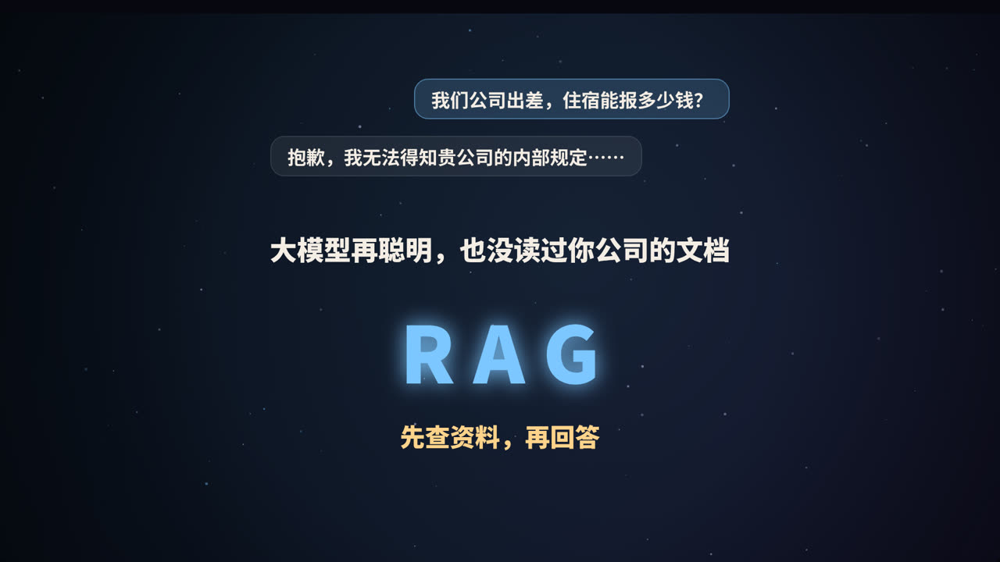
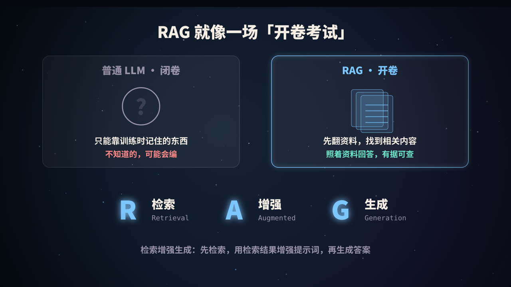
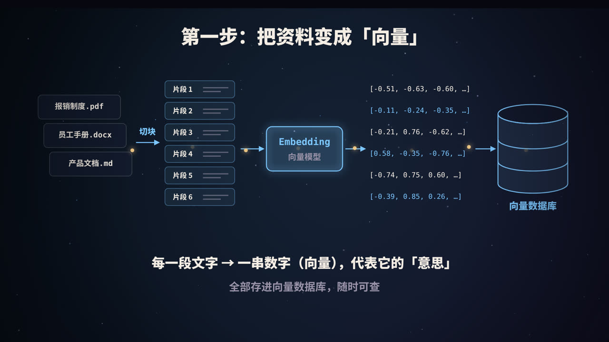
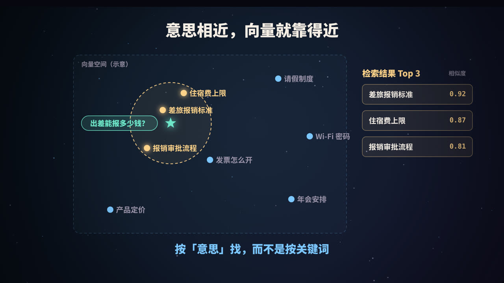
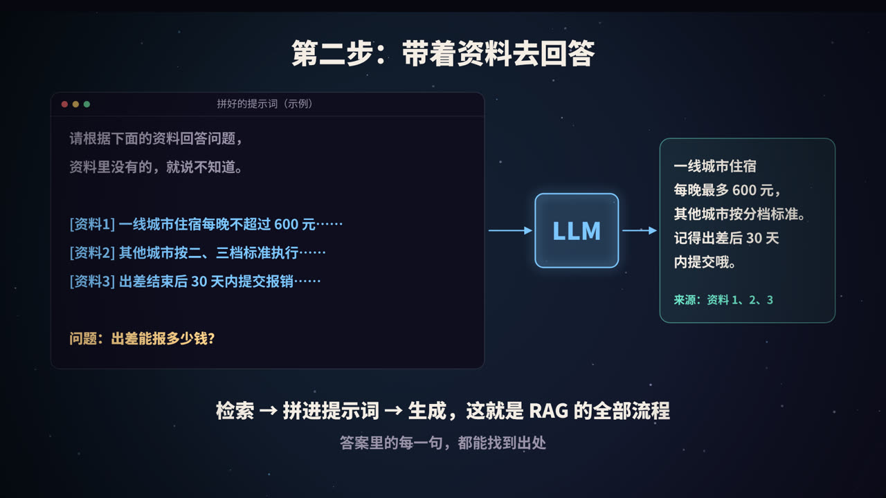
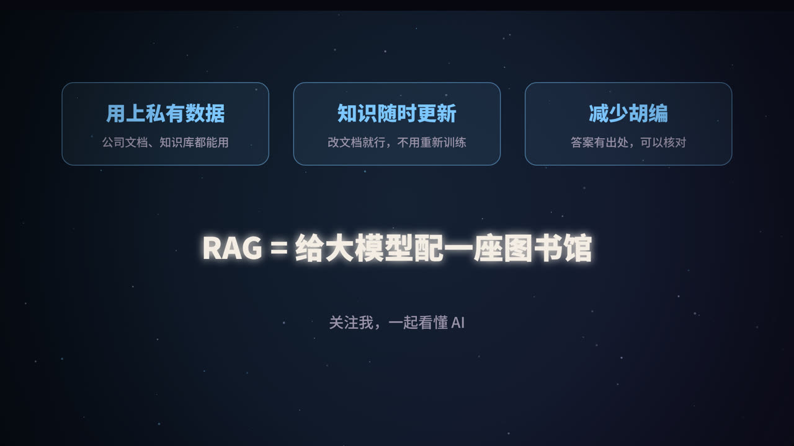

title: RAG 是什么：给大模型配一座图书馆
subtitle: 检索增强生成的完整原理：切块、向量化、语义检索、拼提示词，再到混合检索、重排序和效果评估
tag: 计算机 · AI
color: #7cc7ff



## 大模型的三个「不知道」

直接问大模型「我们公司出差住宿能报多少钱」，它只能说不知道，或者更糟：编一个听起来很合理的数字。原因有三个：

1. **私有数据它没见过**：公司制度、内部文档、客户资料，从来不在它的训练数据里；
2. **新知识它不知道**：训练数据有截止日期，之后发生的事它不了解；
3. **它不擅长说「不知道」**：模型的目标是生成「像样」的文字，缺少依据时容易出现幻觉。

**RAG（Retrieval-Augmented Generation，检索增强生成）** 就是为了解决这些问题：回答之前，先去资料库里查出相关内容，再让模型照着资料回答。

## 一个比喻：开卷考试



- **普通的 LLM 是闭卷考试**：只能靠训练时记住的东西作答，不会的题可能会瞎编；
- **RAG 是开卷考试**：先翻书找到相关章节，再根据书上的内容作答，答案有据可查。

名字拆开来看：

| 字母 | 英文 | 含义 |
|---|---|---|
| R | Retrieval（检索） | 根据问题，从资料库中找出相关片段 |
| A | Augmented（增强） | 把找到的片段放进提示词，增强模型的输入 |
| G | Generation（生成） | 模型基于这些资料生成答案 |

这个名字来自 Facebook AI（现 Meta AI）研究人员 2020 年发表的一篇论文。如今 RAG 已经是企业落地大模型最常见的方案之一，客服问答、内部知识库、文档助手，背后大多是它。

### RAG、微调、长上下文：怎么选

| 方案 | 做法 | 适合 | 局限 |
|---|---|---|---|
| **RAG** | 回答前检索资料 | 知识多、常更新、需要出处 | 效果依赖检索质量 |
| **微调** | 用数据继续训练模型 | 学习特定风格、格式、任务套路 | 成本高，更新慢，不适合频繁变化的知识 |
| **长上下文** | 把整份资料直接塞进提示词 | 资料量小、一次性分析 | 资料多时成本高，速度慢 |

一个常见的经验是：**想让模型「知道」新东西，优先用 RAG；想让模型「学会」一种做事方式，再考虑微调。** 两者也可以结合使用。

## 第一步：建索引——把资料变成向量



这一步在用户提问之前就离线完成了。

### 1. 加载与清洗

把 PDF、Word、网页、Markdown、数据库记录等各种格式的资料读取出来，转成纯文本。这一步往往比想象中麻烦：表格、页眉页脚、扫描件、多栏排版，都可能把文字搞乱。**资料质量决定了 RAG 效果的上限。**

### 2. 切块（Chunking）

一份文档可能有几十页，不能整个当作一条记录，要切成一段一段的「片段」（chunk）：

- **太大**：一段里混杂多个主题，检索不精准，还浪费提示词空间；
- **太小**：上下文被切断，片段本身说不清楚一件事。

常见做法是每段几百个 token，相邻片段之间留一些**重叠**，避免一句话被从中间切断。更好的做法是按文档结构切：按标题、段落、条款来切，保留章节标题作为片段的上下文。

### 3. 向量化（Embedding）

用一个**向量模型**（embedding model）把每个片段转换成一串数字，比如 768 维或 1024 维的向量。这串数字代表了这段文字的「意思」：

```text
"一线城市住宿每晚不超过 600 元"  →  [0.12, -0.83, 0.47, ..., 0.05]
```

### 4. 存入向量数据库

把向量、原文和元数据（来源文件、页码、更新时间、所属部门等）一起存进**向量数据库**，以便之后快速查找。常见的选择有 Milvus、Qdrant、Weaviate、Chroma，以及 PostgreSQL 的 pgvector 插件、Elasticsearch 的向量检索等。

## 第二步：语义检索——按「意思」找



### 向量为什么能代表「意思」

向量模型经过大量训练，会把意思相近的文字映射到向量空间里相近的位置。所以「出差能报多少钱？」虽然一个「报销」都没提，它的向量依然和「差旅报销标准」「住宿费上限」靠得很近，而离「年会安排」很远。

这就是**语义检索**和传统**关键词检索**最大的区别：前者按意思找，后者按字面匹配。

### 怎么衡量「近」

最常用的是**余弦相似度**：看两个向量的方向有多接近。

```text
            A · B
cos(A,B) = ───────
           |A|·|B|
```

值越接近 1，意思越相近。检索时，把用户问题也转成向量，然后找出相似度最高的 K 个片段（Top-K），通常 K 取 3 到 10。

### 海量数据怎么快速找

如果有上千万个片段，逐个计算相似度太慢。向量数据库会使用**近似最近邻（ANN）**算法，比如 **HNSW**（一种分层的图结构索引），用很小的精度损失，换取几个数量级的速度提升。

### 用代码看清楚

下面用 Python 展示检索的核心逻辑。`embed()` 可以换成任何向量模型的接口：

```python
import numpy as np

def embed(texts):
    """调用向量模型，返回形状为 (len(texts), dim) 的数组"""
    ...

# 建索引（离线）
chunks = ["一线城市住宿每晚不超过 600 元……", "其他城市按二、三档标准执行……", "年会安排在 12 月……"]
vecs = embed(chunks)
vecs = vecs / np.linalg.norm(vecs, axis=1, keepdims=True)   # 归一化，点积即余弦相似度

# 检索（在线）
def search(question, k=3):
    q = embed([question])[0]
    q = q / np.linalg.norm(q)
    scores = vecs @ q
    top = np.argsort(-scores)[:k]
    return [(chunks[i], float(scores[i])) for i in top]
```

## 第三步：带着资料去回答



把检索到的片段拼进提示词，再交给大模型。一个典型的模板是：

```text
请根据下面的资料回答用户的问题。
如果资料中没有相关信息，请直接说「资料中没有找到」，不要编造。
回答时请标注引用的资料编号。

[资料1] 来源：差旅报销制度 第 3 条
一线城市住宿每晚不超过 600 元……

[资料2] 来源：差旅报销制度 第 4 条
其他城市按二、三档标准执行……

问题：出差能报多少钱？
```

这里有三个关键设计：

1. **明确要求只依据资料回答**，减少幻觉；
2. **允许说「不知道」**，比编一个答案好得多；
3. **要求标注出处**，用户可以点进原文核对，这也是 RAG 相比纯模型最大的信任优势。

## 进阶：让 RAG 更准

基础版 RAG 搭起来很快，但要做到「好用」，通常还需要以下手段。

### 混合检索

语义检索擅长理解意思，但对**专有名词、型号、编号**不敏感，比如「错误码 E1024」。传统的关键词检索（如 BM25 算法）正好相反。实践中常把两者结合：两路分别检索，再融合排序。

### 重排序（Rerank）

先用向量检索粗选出几十个候选片段，再用一个更精确（也更慢）的**重排序模型**逐一判断「这段话和问题到底有多相关」，选出最好的几个。这一步通常能明显提升准确率。

### 改写问题

用户的问题往往口语化、不完整，比如在多轮对话里只问一句「那住宿呢？」。可以先让模型把问题改写成一个完整、清晰的检索语句，或者生成多个不同角度的查询，分别检索后合并结果。

### 元数据过滤

先按部门、时间、文档类型等条件筛选，再做向量检索。比如只检索「2026 年生效」的制度，避免旧版本的规定混进来。

### 更多方向

- **父子片段**：用小片段做检索（更精准），命中后返回它所在的大段落（上下文更完整）；
- **GraphRAG**：从文档中抽取实体和关系构建知识图谱，适合需要综合多处信息的问题；
- **Agentic RAG**：让模型自己决定要不要检索、检索什么、要不要再查一次，把检索当成 Agent 的一个工具。

## 怎么评估 RAG 的效果

RAG 出了问题，要先分清是「没找到」还是「找到了但答错了」：

| 环节 | 关注的指标 | 含义 |
|---|---|---|
| 检索 | 召回率（Recall@K） | 正确的资料有没有出现在前 K 个结果里 |
| 检索 | 精确度、排序 | 前几名是不是都相关，最相关的是否排在前面 |
| 生成 | 忠实度 | 回答是否完全基于资料，有没有自己添油加醋 |
| 生成 | 答案相关性 | 回答有没有真正回应问题 |

建议准备一份「问题 + 标准答案 + 应命中的资料」的测试集，每次调整切块、模型或提示词后都跑一遍，用数据说话。RAGAS 等开源框架可以帮你自动计算部分指标。

## 常见的坑

| 现象 | 可能的原因 | 解决办法 |
|---|---|---|
| 明明文档里有，就是答不出来 | 切块把关键信息切断了；PDF 解析出错 | 调整切块策略；检查解析结果 |
| 答案引用了过期的制度 | 新旧版本文档同时在库里 | 按时间过滤；下线旧文档 |
| 专有名词、编号搜不到 | 纯向量检索对字面不敏感 | 加入关键词检索（混合检索） |
| 检索结果对，回答却在编 | 提示词约束不够 | 明确要求只依据资料，允许说不知道 |
| 回答很慢、成本高 | 塞进提示词的片段太多太长 | 加重排序，只保留最相关的几段 |

## 总结



- RAG 的流程只有三步：**建索引（切块、向量化、入库）→ 检索 → 带着资料生成**。
- 向量让检索可以**按意思**而不是按字面进行，这是 RAG 的核心能力。
- 它的价值在于：**用上私有数据、知识随时更新、答案有出处**。
- 想做好 RAG，功夫往往不在模型，而在**资料质量、切块策略和检索调优**。

一句话：RAG 就是给大模型配了一座随时可查的图书馆。

<div class="refs" markdown="1">

### 参考资料

- Lewis, P., et al. (2020). Retrieval-Augmented Generation for Knowledge-Intensive NLP Tasks. *NeurIPS*.
- Malkov, Y. A., & Yashunin, D. A. (2018). Efficient and robust approximate nearest neighbor search using Hierarchical Navigable Small World graphs. *IEEE TPAMI*.
- Robertson, S., & Zaragoza, H. (2009). The Probabilistic Relevance Framework: BM25 and Beyond.
- Es, S., et al. (2023). RAGAS: Automated Evaluation of Retrieval Augmented Generation. *arXiv:2309.15217*.

</div>
