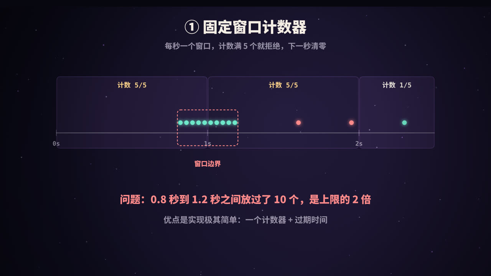
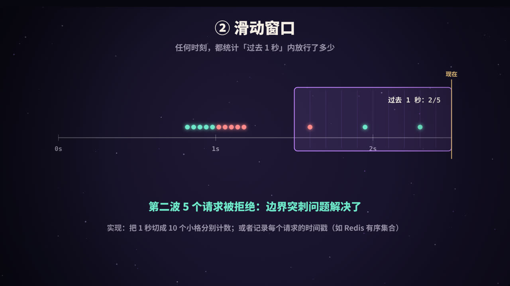
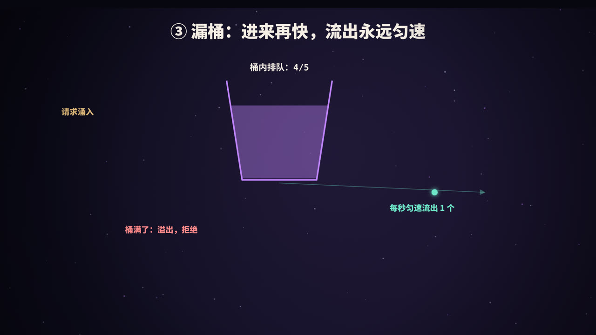

title: 限流算法：固定窗口、滑动窗口、漏桶、令牌桶
subtitle: 为什么要限流，四种经典算法的原理、动画演示与代码实现，单机与分布式限流，以及被限流之后该怎么做
tag: 计算机与后端
color: #c084fc


## 为什么需要限流

任何系统都有处理能力的上限。假设一个服务每秒最多稳定处理 1000 个请求（1000 QPS），而秒杀开始的那一刻涌进来 3000 QPS：

- 线程池被占满，请求开始排队，响应越来越慢；
- 数据库连接耗尽，慢查询堆积；
- 最终服务被拖垮，**所有人**都用不了，包括原本能被正常服务的那 1000 个请求。

**限流**（Rate Limiting）的思路是：只放行系统能承受的那部分请求，超出的部分直接拒绝或排队。宁可让一部分请求失败，也不能让整个系统崩溃。


限流的作用不止于此：

| 目的 | 例子 |
|---|---|
| 保护系统 | 秒杀、大促、突发热点时防止被打垮 |
| 公平使用 | 限制单个用户、单个 IP 的请求频率，防止爬虫和恶意刷接口 |
| 控制成本 | 调用按次计费的第三方接口、大模型 API 时控制用量 |
| 遵守外部约束 | 下游服务或第三方平台本身有调用频率限制 |

限流可以有不同的**维度**：按整个接口、按用户、按 IP、按 API Key、按租户等。

所有限流算法要回答的核心问题都是同一个：**现在这个请求，该不该放行？** 下面用同一组请求来比较四种经典算法。示例中的上限是「每秒 5 个」。

## ① 固定窗口计数器



### 原理

把时间切成固定长度的窗口（比如每 1 秒一个），每个窗口一个计数器：

1. 请求到来，看它落在哪个窗口；
2. 计数器小于上限，放行并加 1；否则拒绝；
3. 进入下一个窗口时，计数器清零。

### 代码

```java
public class FixedWindowLimiter {
    private final int limit;
    private final long windowMillis;
    private long windowStart = System.currentTimeMillis();
    private int count = 0;

    public FixedWindowLimiter(int limit, long windowMillis) {
        this.limit = limit;
        this.windowMillis = windowMillis;
    }

    public synchronized boolean tryAcquire() {
        long now = System.currentTimeMillis();
        if (now - windowStart >= windowMillis) {   // 进入新窗口，清零
            windowStart = now;
            count = 0;
        }
        if (count < limit) {
            count++;
            return true;
        }
        return false;
    }
}
```

用 Redis 实现更简单：`INCR` 一个以「当前秒」命名的 key，第一次创建时设置过期时间。

### 问题：窗口边界的突刺

假设在第 0.8 到 1.0 秒之间来了 5 个请求，第 1.0 到 1.2 秒之间又来了 5 个。它们分属两个窗口，各自都没超过 5，于是**全部放行**。结果在短短 0.4 秒内放过了 10 个请求，是上限的 2 倍。

固定窗口实现极其简单，但在窗口切换的瞬间无法真正控制住速率。

## ② 滑动窗口



### 原理

不再使用固定的窗口边界，而是在每个请求到来时，统计**以当前时刻为终点、往前 1 秒**之内已经放行了多少个请求。窗口随时间连续滑动，所以不存在「边界」。

在同样的请求序列下，第一波 5 个请求放行后，第二波 5 个请求到来时，「过去 1 秒」内已经有 5 个了，于是全部被拒绝，突刺问题解决了。

### 两种实现方式

**滑动日志**：记录每个被放行请求的时间戳，每次请求时删掉 1 秒以前的记录，再看剩下的数量。结果精确，但请求多时占用内存较大。

```java
public class SlidingLogLimiter {
    private final int limit;
    private final long windowMillis;
    private final Deque<Long> log = new ArrayDeque<>();

    public SlidingLogLimiter(int limit, long windowMillis) {
        this.limit = limit;
        this.windowMillis = windowMillis;
    }

    public synchronized boolean tryAcquire() {
        long now = System.currentTimeMillis();
        while (!log.isEmpty() && now - log.peekFirst() >= windowMillis) {
            log.pollFirst();                       // 移出窗口之外的记录
        }
        if (log.size() < limit) {
            log.addLast(now);
            return true;
        }
        return false;
    }
}
```

**滑动窗口计数**：把 1 秒切成 10 个 100 毫秒的小格，每格各自计数，统计时把最近 10 格加起来。格子越细越精确，内存占用固定。Sentinel 等框架就是用这种思路统计 QPS 的。

## ③ 漏桶



### 原理

想象一个底部有小孔的桶：

- 请求像水一样从上面倒进桶里（进入队列）；
- 桶底以**固定的速率**漏出水（按固定速度处理请求）；
- 桶的容量有限，水满了，再倒进来的就会溢出（请求被拒绝）。

不管进来的请求多么集中，出去的速度永远是匀速的。

### 特点

- **优点**：输出非常平滑，适合保护处理能力固定、经不起任何波动的下游；
- **缺点**：无法利用系统的空闲能力应对突发。即使系统此刻很空闲，突然来的一批请求也只能排队、按固定速度慢慢处理，延迟会增加。

Nginx 的 `limit_req` 模块就是基于漏桶思想实现的：

```nginx
limit_req_zone $binary_remote_addr zone=api:10m rate=10r/s;

server {
    location /api/ {
        limit_req zone=api burst=20 nodelay;   # 允许最多 20 个突发请求
    }
}
```

## ④ 令牌桶


### 原理

把思路反过来：

- 系统以**固定速率**往桶里放「令牌」，比如每秒 5 个；
- 桶有容量上限，满了就不再放；
- 每个请求必须先从桶里**拿到一个令牌**才能被处理，拿不到就拒绝（或等待）。

### 为什么能应对突发

系统空闲的时候，令牌会在桶里攒起来。当突发流量到来时，攒下的令牌可以被**立即用掉**，请求不需要排队。

比如令牌桶容量是 5、每秒放 1 个。平时桶是满的，突然来了 7 个请求：前 5 个立刻拿到令牌通过，后 2 个被拒绝。之后每秒恢复 1 个令牌。

所以令牌桶**既限制了长期的平均速率，又允许一定程度的突发**，这正是大多数业务想要的，因此它是最常用的限流算法。

### 代码

实现时不需要真的有一个线程每秒往桶里放令牌，只要在每次请求时，根据距离上次补充过去了多久，「补算」出应该增加的令牌数：

```java
public class TokenBucketLimiter {
    private final double capacity;      // 桶容量：允许的最大突发
    private final double ratePerMs;     // 每毫秒补充的令牌数
    private double tokens;
    private long lastRefill = System.currentTimeMillis();

    public TokenBucketLimiter(double capacity, double ratePerSecond) {
        this.capacity = capacity;
        this.ratePerMs = ratePerSecond / 1000.0;
        this.tokens = capacity;
    }

    public synchronized boolean tryAcquire() {
        long now = System.currentTimeMillis();
        tokens = Math.min(capacity, tokens + (now - lastRefill) * ratePerMs);  // 补算令牌
        lastRefill = now;
        if (tokens >= 1) {
            tokens -= 1;
            return true;
        }
        return false;
    }
}
```

Google Guava 提供了现成的实现：

```java
RateLimiter limiter = RateLimiter.create(5.0);   // 每秒 5 个许可
if (limiter.tryAcquire()) {
    handle(request);
} else {
    reject(request);                              // 返回 429
}
```

## 四种算法对比


| 算法 | 原理 | 优点 | 缺点 | 适合 |
|---|---|---|---|---|
| 固定窗口 | 每个窗口一个计数器 | 实现最简单，开销最小 | 窗口边界可能放过 2 倍流量 | 对精度要求不高的场景 |
| 滑动窗口 | 统计过去一段时间的请求数 | 统计精确，没有边界突刺 | 内存或计算开销稍大 | 需要精确控制的接口限流 |
| 漏桶 | 请求排队，匀速处理 | 输出绝对平滑 | 不能利用空闲能力应对突发，会增加延迟 | 保护处理能力固定的下游 |
| 令牌桶 | 匀速产生令牌，请求消耗令牌 | 限制平均速率，同时允许突发 | 需要合理设置容量和速率 | 大多数 API 限流（最常用） |

## 分布式限流

上面的代码都是**单机**限流：每台机器各自计数。如果服务部署了 10 台机器，每台限 100 QPS，整体就是约 1000 QPS。但负载不均衡时，有的机器先触发限流，有的还很空闲。

如果需要**多台机器共享同一个额度**（比如「每个用户每分钟最多调用 60 次」），计数器必须放在一个公共的地方，最常用的是 Redis。为了保证「读取计数、判断、更新」这几步不被其他请求插队，通常用 **Lua 脚本**让它们在 Redis 中原子执行。

一个基于有序集合（ZSET）的滑动窗口实现：

```lua
-- KEYS[1]: 限流的 key，如 rate:user:1001
-- ARGV[1]: 当前时间（毫秒）  ARGV[2]: 窗口长度（毫秒）  ARGV[3]: 上限  ARGV[4]: 本次请求的唯一 ID
local key, now, window, limit = KEYS[1], tonumber(ARGV[1]), tonumber(ARGV[2]), tonumber(ARGV[3])
redis.call('ZREMRANGEBYSCORE', key, 0, now - window)          -- 删除窗口之外的记录
if redis.call('ZCARD', key) < limit then
  redis.call('ZADD', key, now, ARGV[4])                       -- 记录本次请求
  redis.call('PEXPIRE', key, window)
  return 1                                                    -- 放行
end
return 0                                                      -- 拒绝
```

分布式限流要注意：

- 每次请求都要访问一次 Redis，会增加延迟，Redis 本身也可能成为瓶颈；
- 要想好 Redis 不可用时怎么办：是放行所有请求（保可用），还是拒绝所有请求（保护系统）；
- 多台机器的时钟可能有偏差，用 Redis 服务端的时间（`TIME` 命令）更可靠。

## 在哪一层限流

| 层次 | 工具 | 特点 |
|---|---|---|
| 接入层 / 网关 | Nginx、API 网关（如 Spring Cloud Gateway、Kong） | 最早拦截，保护整个后端 |
| 服务内部 | Guava RateLimiter、Sentinel、Resilience4j | 粒度细，可以按方法、按参数限流 |
| 下游调用 | 客户端侧的速率控制 | 遵守第三方接口的调用频率限制 |

实践中常常多层组合：网关挡住明显异常的流量，服务内部再做精细控制。

## 被限流之后怎么做

### 服务端：给出明确的响应

- 返回 HTTP 状态码 **429 Too Many Requests**；
- 通过 `Retry-After` 响应头告诉客户端多久之后可以重试；
- 很多 API 还会返回 `X-RateLimit-Limit`、`X-RateLimit-Remaining` 等头部，让客户端知道自己的额度。

### 客户端：优雅地重试

- **不要立刻重试**，否则只会让情况更糟；
- 使用**指数退避**：第一次等 1 秒，第二次 2 秒，第三次 4 秒……
- 加上**随机抖动**，避免大量客户端在同一时刻一起重试；
- 设置最大重试次数。

### 其他保护手段

限流常常和这些机制配合使用：

- **熔断**：下游持续出错时，暂时停止调用它，快速失败；
- **降级**：关闭非核心功能，或返回兜底数据；
- **排队**：对于不着急的请求，放进消息队列慢慢处理（见本系列《消息队列》）。

## 阈值怎么定

1. **压测**：找到系统在可接受延迟下的最大吞吐量；
2. **留余量**：阈值设在压测极限的 70%～80% 左右；
3. **按资源最紧张的环节定**：瓶颈往往在数据库或某个下游，而不是应用本身；
4. **持续观测和调整**：随着代码和机器配置变化，阈值也要更新。很多框架支持动态修改限流规则，无需重启。

## 高频面试题速答

**Q：令牌桶和漏桶有什么区别？**
漏桶控制的是**流出速率**，输出绝对平滑，不允许突发；令牌桶控制的是**令牌的产生速率**，桶中攒下的令牌可以应对突发流量。

**Q：固定窗口有什么问题？如何解决？**
在窗口边界附近可能放过两倍于上限的请求。使用滑动窗口可以解决。

**Q：分布式环境下怎么限流？**
把计数放到 Redis 等共享存储中，用 Lua 脚本保证原子性；或者使用 Sentinel 集群限流等方案。

## 总结


- 限流的目的：**宁可拒绝一部分，也不能全部崩溃**；
- **固定窗口**最简单，但有边界突刺；**滑动窗口**统计精确；
- **漏桶**输出平滑，**令牌桶**允许突发，后者最常用；
- 多台机器共享额度时，用 **Redis + Lua** 做分布式限流；
- 被限流时返回 **429 + Retry-After**，客户端用**指数退避**重试。

<div class="refs" markdown="1">

### 参考资料

- Google Guava 文档：`com.google.common.util.concurrent.RateLimiter`.
- Nginx 文档：ngx_http_limit_req_module.
- Alibaba Sentinel 文档：流量控制.
- RFC 6585：Additional HTTP Status Codes（429 Too Many Requests）.
- Stripe Engineering (2017). Scaling your API with rate limiters.

</div>
