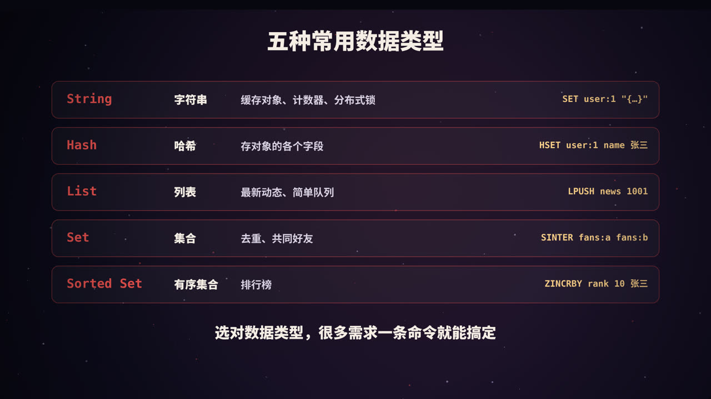
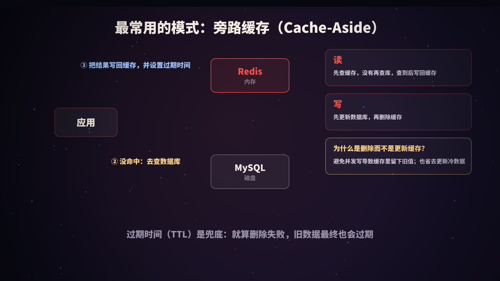
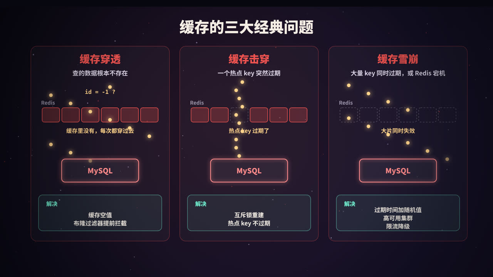

title: Redis 缓存：为什么快，怎么用，有哪些坑
subtitle: 单线程与 IO 多路复用、五种数据类型、旁路缓存模式与一致性、过期与淘汰、穿透击穿雪崩，以及持久化和高可用
tag: 计算机与后端
color: #ef5350


## 为什么需要缓存

数据库的数据存放在磁盘上，一次查询往往需要毫秒级的时间。当流量变大时，数据库的 CPU、连接数和磁盘 IO 都会成为瓶颈。

但大多数业务有一个特点：**少量数据被反复读取**（热点数据）。比如首页商品、热门文章、用户的基本信息。把这些数据放到**内存**里，读请求先查内存，查不到再去数据库，就能大幅减轻数据库的压力，同时让响应快得多。

**Redis** 就是最常用的内存缓存。衡量缓存效果最重要的指标是**命中率**：请求中能直接在缓存里找到数据的比例。

## Redis 为什么这么快


### 1. 数据在内存里

内存的访问延迟大约在百纳秒级别，而固态硬盘的随机读取大约在百微秒级别，相差上千倍。这是 Redis 快的根本原因。

### 2. 单线程执行命令

Redis 用**一个主线程**按顺序执行所有命令。这听起来像是缺点，实际上却是优点：

- 不需要加锁，没有锁竞争；
- 没有多线程之间的上下文切换开销；
- 每条命令天然是原子执行的。

因为瓶颈主要在内存和网络，而不在 CPU，单线程已经足够快。

### 3. IO 多路复用

一个线程怎么同时服务成千上万个客户端连接？靠的是操作系统提供的 **IO 多路复用**（Linux 上是 epoll）：线程不去逐个等待每个连接，而是让内核告诉它「哪些连接有数据可读写了」，然后只处理这些连接。

Redis 6.0 起引入了多线程来处理**网络数据的读写**，但**命令的执行仍然是单线程**，所以原子性等特性不受影响。

### 4. 精心设计的数据结构

每种数据类型在底层都会根据数据量自动选择更合适的编码。比如数据少时用紧凑的连续内存结构（listpack 等），节省空间；数据多时换成哈希表、跳表等，保证操作效率。

## 五种常用数据类型



| 类型 | 适合的场景 | 常用命令 |
|---|---|---|
| **String** | 缓存对象（JSON）、计数器、分布式锁 | `SET` `GET` `INCR` `SETNX` |
| **Hash** | 存储对象的各个字段，可单独修改某个字段 | `HSET` `HGET` `HGETALL` |
| **List** | 最新动态列表、简单队列 | `LPUSH` `RPOP` `LRANGE` |
| **Set** | 去重、标签、共同好友（交集） | `SADD` `SISMEMBER` `SINTER` |
| **Sorted Set** | 排行榜、按分数或时间排序的列表 | `ZADD` `ZINCRBY` `ZREVRANGE` |

几个典型用法：

```bash
# 计数器：文章阅读量 +1，原子操作，不会并发出错
INCR article:1001:views

# 排行榜：给张三加 10 分，再取前 10 名
ZINCRBY rank 10 "张三"
ZREVRANGE rank 0 9 WITHSCORES

# 分布式锁：键不存在时才设置，30 秒后自动过期
SET lock:order:1001 <随机唯一值> NX PX 30000
```

分布式锁的值要用随机的唯一值，释放锁时先确认值是自己的再删除（通常用 Lua 脚本保证原子性），避免误删别人的锁。

此外还有 Bitmap（签到、在线状态）、HyperLogLog（海量去重计数）、GEO（附近的人）、Stream（消息流）等类型，适合更特定的场景。

## 最常用的模式：旁路缓存（Cache-Aside）



### 读

1. 先查缓存，命中就直接返回；
2. 没命中，查数据库；
3. 把查到的结果写入缓存，并**设置过期时间**，再返回。

### 写

1. 先**更新数据库**；
2. 再**删除缓存**。

用伪代码表示：

```python
def get_user(user_id):
    key = f"user:{user_id}"
    data = redis.get(key)
    if data is not None:
        return json.loads(data)                       # 命中
    user = db.query("SELECT * FROM user WHERE id = %s", user_id)
    redis.set(key, json.dumps(user), ex=600 + random.randint(0, 120))  # 写回，过期时间加随机值
    return user

def update_user(user_id, fields):
    db.execute("UPDATE user SET ... WHERE id = %s", user_id)
    redis.delete(f"user:{user_id}")                   # 删除缓存，下次读时再加载
```

### 为什么是「删除」缓存，而不是「更新」缓存

- **避免并发写入导致脏数据**：两个请求同时更新同一条数据，更新数据库和更新缓存的顺序可能交错，最终缓存里留下的是旧值；
- **避免无用功**：有些数据写得多、读得少，每次都更新缓存是浪费，删除后等真正需要时再加载更划算；
- **缓存的值可能需要复杂计算**：比如需要关联多张表，每次写入都重新计算代价很高。

### 为什么先更新数据库，再删除缓存

如果反过来先删缓存，在你更新数据库之前，另一个读请求可能发现缓存为空，去数据库读到**旧值**并写回缓存，于是缓存中长期留着旧数据。

先更新数据库再删缓存，出现不一致的窗口要小得多，但仍然存在极端情况。常见的补充手段：

- **一定要设置过期时间**，作为最后的兜底；
- **延迟双删**：更新数据库、删除缓存后，隔一小段时间再删一次；
- **订阅数据库的变更日志**（如通过 Canal 监听 MySQL binlog），由专门的程序负责删除缓存，并在失败时重试。

> 缓存和数据库之间只能做到**最终一致**。如果业务要求强一致（比如账户余额），就不要依赖缓存的数据做决定。

## 过期与淘汰

### 过期键怎么删

Redis 结合两种策略：

- **惰性删除**：访问一个键时，发现它已过期，就删除；
- **定期删除**：后台定时随机抽查一批设置了过期时间的键，删除其中已过期的。

### 内存满了怎么办

通过 `maxmemory` 设置内存上限，`maxmemory-policy` 决定内存满了以后怎么办：

| 策略 | 行为 |
|---|---|
| `noeviction`（默认） | 不淘汰，写入时直接报错 |
| `allkeys-lru` | 在所有键中淘汰最近最少使用的 |
| `allkeys-lfu` | 在所有键中淘汰使用频率最低的 |
| `volatile-lru` / `volatile-lfu` | 只在设置了过期时间的键中淘汰 |
| `volatile-ttl` | 优先淘汰快要过期的键 |
| `allkeys-random` / `volatile-random` | 随机淘汰 |

纯缓存场景，通常选择 `allkeys-lru` 或 `allkeys-lfu`。

## 缓存的三大经典问题



### 缓存穿透：查不存在的数据

**现象**：请求的数据在数据库里根本不存在，缓存自然也没有，于是每次请求都会打到数据库。如果有人恶意用大量不存在的 ID 来请求，数据库就会被压垮。

**解决**：

- **缓存空值**：数据库查不到时，也在缓存里存一个「空」标记，设置较短的过期时间；
- **布隆过滤器**：把所有存在的 ID 放进布隆过滤器，请求先经过它判断，「一定不存在」的直接拦截；
- **参数校验**：明显不合法的 ID（如负数）在入口就拒绝。

### 缓存击穿：热点 key 突然过期

**现象**：某个访问量极高的 key 恰好过期，瞬间大量请求同时发现缓存为空，一起涌向数据库。

**解决**：

- **互斥锁重建**：只允许一个请求去查数据库并重建缓存，其他请求等待或短暂重试；
- **逻辑过期 / 热点不过期**：不给热点 key 设置真实的过期时间，而是在值里记录一个逻辑过期时间，发现过期后由后台线程异步刷新，期间先返回旧值。

互斥锁的核心逻辑：

```python
def get_hot(key):
    data = redis.get(key)
    if data is not None:
        return data
    if redis.set(f"lock:{key}", "1", nx=True, ex=10):   # 抢到锁的请求负责重建
        try:
            data = load_from_db(key)
            redis.set(key, data, ex=600)
        finally:
            redis.delete(f"lock:{key}")
        return data
    time.sleep(0.05)                                    # 没抢到锁：稍等再查缓存
    return get_hot(key)
```

### 缓存雪崩：大面积失效

**现象**：大量 key 在同一时间过期（比如都在系统启动时写入、过期时间相同），或者 Redis 本身宕机，请求全部落到数据库上。

**解决**：

- **过期时间加随机值**，让 key 的过期时间分散开；
- **Redis 高可用**：主从 + 哨兵或集群部署，避免单点故障；
- **限流、降级、熔断**：保护数据库，必要时返回默认数据或提示稍后重试；
- **多级缓存**：在应用本地再加一层缓存（如 Caffeine）。

### 一句话区分

| 问题 | 关键词 | 核心解法 |
|---|---|---|
| 穿透 | 数据**不存在** | 缓存空值、布隆过滤器 |
| 击穿 | **一个**热点 key 过期 | 互斥锁、逻辑过期 |
| 雪崩 | **大量** key 同时失效或 Redis 宕机 | 随机过期时间、高可用、限流降级 |

## 其他需要注意的问题

- **大 key**：单个 key 的值特别大（如几 MB 的字符串，或几十万个元素的集合），读写和删除都可能阻塞主线程。应该拆分，删除时使用 `UNLINK` 异步删除。
- **热 key**：单个 key 的访问量过高，集群中某个节点压力过大。可以使用本地缓存，或者把一个 key 复制成多份分散访问。
- **慎用 `KEYS *`**：它会遍历所有键，阻塞主线程，生产环境应该用 `SCAN` 渐进式遍历。

## 持久化与高可用


### 持久化

| 方式 | 原理 | 优点 | 缺点 |
|---|---|---|---|
| **RDB** | 定期把内存数据生成一个快照文件 | 文件紧凑，恢复快 | 两次快照之间的数据可能丢失 |
| **AOF** | 把每条写命令追加到日志文件 | 数据更安全 | 文件更大，恢复较慢 |

AOF 的刷盘策略由 `appendfsync` 控制：`always`（每条命令都刷盘，最安全最慢）、`everysec`（每秒一次，默认，最多丢约 1 秒数据）、`no`（交给操作系统）。Redis 4.0 起还支持 **RDB + AOF 混合持久化**，兼顾恢复速度和数据安全。

### 高可用

- **主从复制**：从节点复制主节点的数据，分担读请求，并作为备份；
- **哨兵（Sentinel）**：监控主节点，主节点故障时自动把一个从节点提升为新的主节点；
- **集群（Cluster）**：把数据按 key 分到 **16384 个哈希槽**中，分散到多个主节点上，实现水平扩展，每个主节点还可以有自己的从节点。

> 无论怎样配置，缓存都只是**加速层**。数据库里永远要有一份权威数据，缓存丢了可以重建。

## 高频面试题速答

**Q：Redis 是单线程的，为什么还这么快？**
数据在内存中；单线程避免了锁和上下文切换；使用 IO 多路复用处理大量连接；底层数据结构高效。

**Q：如何保证缓存和数据库的一致性？**
常用旁路缓存：先更新数据库，再删除缓存，并设置过期时间兜底；要求更高时，可以延迟双删或基于 binlog 异步删除缓存。只能做到最终一致。

**Q：缓存穿透、击穿、雪崩的区别？**
穿透是查不存在的数据；击穿是单个热点 key 过期；雪崩是大量 key 同时失效或缓存服务宕机。

**Q：RDB 和 AOF 怎么选？**
能接受分钟级数据丢失、追求恢复速度，用 RDB；更看重数据安全，用 AOF（everysec）；实际中常两者结合。

## 总结


- **快**：内存 + 单线程 + IO 多路复用 + 高效数据结构；
- **用对**：选对数据类型；旁路缓存「先更新数据库，再删除缓存」，并设置过期时间；
- **防坑**：穿透、击穿、雪崩各有对策；注意大 key 和热 key；
- **稳**：持久化保证重启后数据还在，主从、哨兵、集群保证高可用。

<div class="refs" markdown="1">

### 参考资料

- Redis 官方文档：Data types；Key eviction；Persistence；Replication；High availability with Redis Sentinel；Scale with Redis Cluster；Distributed Locks with Redis.
- Facebook (2013). Scaling Memcache at Facebook. *NSDI*.（关于缓存失效与一致性的经典实践）
- 黄健宏.《Redis 设计与实现》.

</div>
