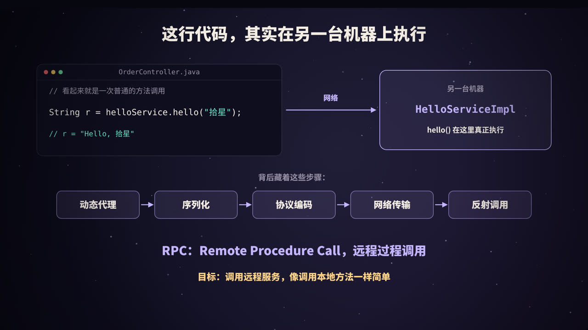
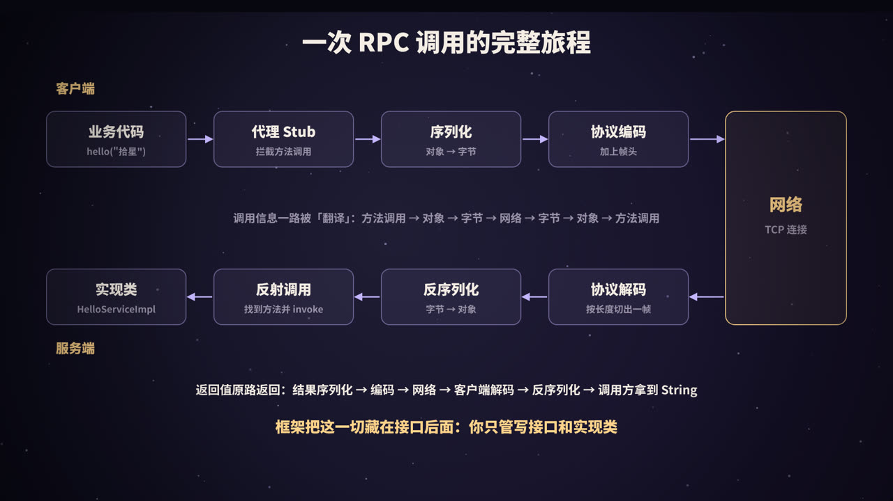
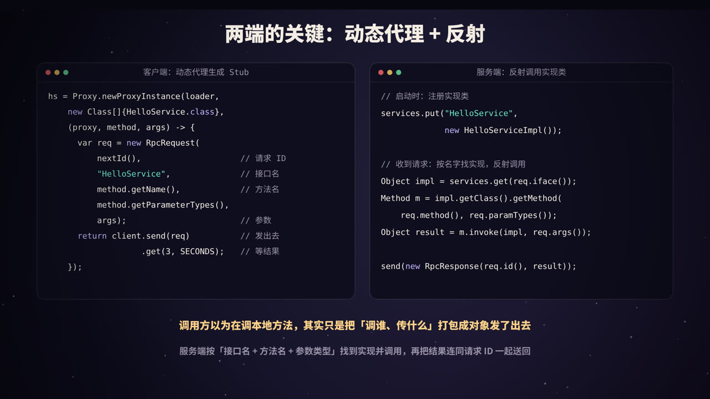
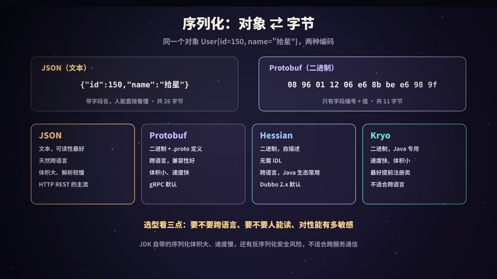
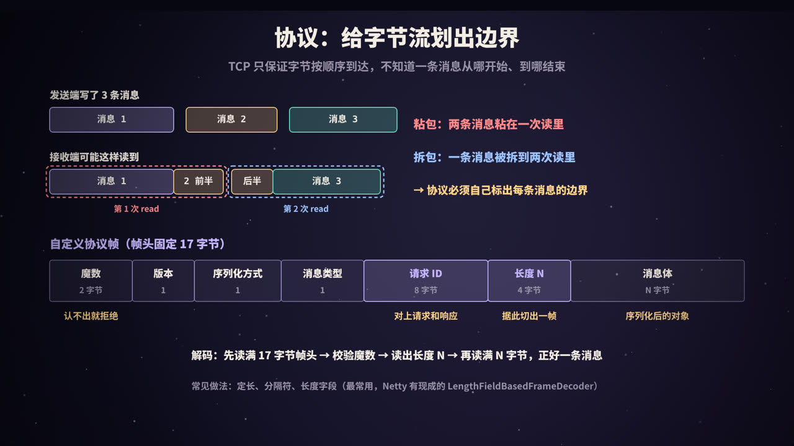
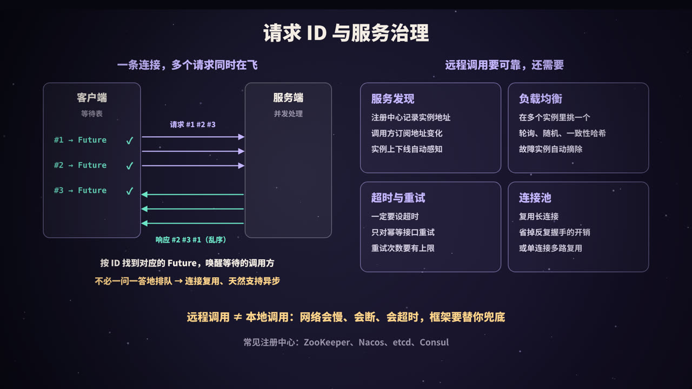
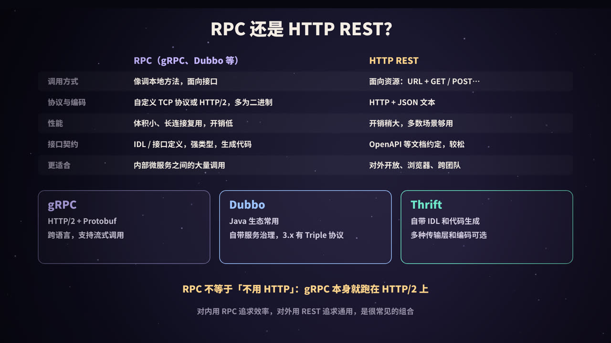

title: RPC 原理：像调本地方法一样调远程服务
subtitle: RPC 的目标与完整调用链路，动态代理与反射、序列化方式对比、协议帧与粘包拆包、请求 ID 多路复用，服务发现、负载均衡与超时重试，RPC 与 HTTP REST 的取舍，附 Java 21 手写迷你 RPC
tag: 计算机与后端
color: #c4b5fd



## 为什么需要 RPC

一个系统刚开始往往是**单体应用**：下单、用户、库存、支付都在同一个进程里，订单模块要查用户，直接调用 `userService.getUser(42)` 就行，几纳秒到几微秒就返回了。

随着业务和团队变大，系统会被拆成多个独立部署的服务（微服务）。用户服务跑在另一组机器上，订单服务想拿到用户信息，就必须**通过网络**去问它。最原始的做法是自己动手：

1. 拼一个 HTTP 请求，把参数转成 JSON；
2. 选一台用户服务的机器，建立连接，发出去；
3. 等响应，处理超时、连接失败；
4. 把返回的 JSON 解析回对象，判断是成功还是出错。

每调一个接口都写一遍，既啰嗦又容易出错。**RPC**（Remote Procedure Call，远程过程调用）要解决的就是这件事：

> **让调用远程服务，看起来就像调用一个本地方法。**

调用方只面对一个接口：

```java
String r = helloService.hello("拾星");   // 实际上在另一台机器上执行
```

序列化、网络传输、找机器、超时处理……全部由 RPC 框架在背后完成。RPC 这个概念早在 20 世纪 80 年代就被系统地提出并实现，后来的 CORBA、Java RMI、Thrift、Dubbo、gRPC 都是这一思想在不同时代的实现。

### 远程调用终究不是本地调用

「像本地调用一样」只是**写法上**的像。本质上有几处根本不同，后文的很多设计都是为了应对它们：

| | 本地调用 | 远程调用 |
|---|---|---|
| 耗时 | 纳秒～微秒 | 内网通常是亚毫秒到毫秒级，跨地域可达几十毫秒以上 |
| 失败方式 | 要么成功，要么抛异常 | 还可能**超时**：不知道对方到底执行了没有 |
| 参数传递 | 传引用，双方共享同一块内存 | 只能**按值**传递：参数被序列化成字节，对方拿到的是一份拷贝 |
| 部分失败 | 进程挂了大家一起挂 | 对方可能挂了、慢了、网络断了，而你还活着 |
| 版本 | 编译时就一致 | 双方独立部署，接口可能不一致 |

一篇经典的技术报告《A Note on Distributed Computing》（1994）专门论证过：试图把远程对象和本地对象完全等同看待，是很多分布式系统问题的根源。好的 RPC 框架会让调用**写起来**像本地调用，但工程师心里必须清楚：**网络还在那里**。

## 一次调用的完整链路



把 `helloService.hello("拾星")` 这一次调用拆开，会经过下面这些步骤：

| 步骤 | 位置 | 做了什么 |
|---|---|---|
| ① 业务代码 | 客户端 | 调用接口方法，以为它是本地对象 |
| ② 代理 Stub | 客户端 | 框架生成的代理对象拦截调用，把「调哪个接口、哪个方法、什么参数」打包成**请求对象**，分配**请求 ID** |
| ③ 服务发现 + 负载均衡 | 客户端 | 从注册中心拿到的地址列表里选一台服务器，从连接池拿一条连接 |
| ④ 序列化 | 客户端 | 请求对象 → 字节 |
| ⑤ 协议编码 | 客户端 | 加上帧头（魔数、版本、请求 ID、长度……），变成一个完整的**帧** |
| ⑥ 网络传输 | TCP | 字节流发往服务端 |
| ⑦ 协议解码 | 服务端 | 从字节流中按长度切出完整的一帧 |
| ⑧ 反序列化 | 服务端 | 字节 → 请求对象 |
| ⑨ 调度 + 反射调用 | 服务端 | 按「接口名 + 方法名 + 参数类型」找到实现类和方法，放进业务线程池执行 |
| ⑩ 原路返回 | 两端 | 结果（或异常）→ 序列化 → 编码 → 网络 → 客户端解码 → 反序列化 → 按请求 ID 唤醒等待的调用方 |

最早的 RPC 设计就把这套结构概括为：**用户代码 ↔ 用户 Stub ↔ RPC 运行时 ↔ 网络 ↔ RPC 运行时 ↔ 服务端 Stub ↔ 服务实现**。几十年过去，框架换了一代又一代，骨架基本没变。

下面按顺序拆开每一层。

## 两端的关键：动态代理与反射



### 客户端：Stub 是怎么来的

调用方手里只有一个**接口**，没有实现类。那 `helloService` 这个对象是哪来的？答案是 RPC 框架在运行时（或编译时）**生成了一个实现了该接口的代理对象**，也叫 **Stub**（桩）。它的每个方法都只做一件事：把调用信息打包，发出去，等结果。

生成 Stub 的方式主要有三种：

| 方式 | 原理 | 例子 |
|---|---|---|
| JDK 动态代理 | `java.lang.reflect.Proxy` 在运行时生成实现指定接口的类，所有方法调用都转到一个 `InvocationHandler` | 本文的迷你 RPC；很多框架的默认或可选实现 |
| 字节码生成 | 用 Javassist、ByteBuddy 等直接生成代理类的字节码，少一层反射分派，性能更好 | Dubbo 默认使用 Javassist 生成代理 |
| IDL 代码生成 | 先写接口描述文件（IDL），再用工具**在编译前**生成客户端 Stub 和服务端骨架代码 | gRPC（`.proto`）、Thrift（`.thrift`） |

JDK 动态代理的核心只有几行：

```java
HelloService hs = (HelloService) Proxy.newProxyInstance(loader,
    new Class<?>[]{HelloService.class},
    (proxy, method, args) -> {
        var req = new RpcRequest(nextId(), "HelloService",
                method.getName(), method.getParameterTypes(), args);
        return client.send(req).get(3, TimeUnit.SECONDS);   // 发出去，等结果
    });
```

注意请求里除了方法名，还带上了**参数类型列表**：Java 允许方法重载，`hello(String)` 和 `hello(String, int)` 是两个不同的方法，只靠名字找不准。

### 服务端：从「名字」找到「方法」

服务端启动时，把实现类注册到一张表里：`接口名 → 实现对象`。收到请求后：

```java
Object impl = services.get(req.iface());
Method m = impl.getClass().getMethod(req.method(), req.paramTypes());
Object result = m.invoke(impl, req.args());
```

这就是最朴素的**反射调用**。生产级框架会做一些优化：

- **缓存 Method 对象**：`getMethod` 查找有开销，可以在启动时就建好「方法签名 → Method」的映射；
- **避免反射**：Dubbo 会为实现类生成一个 Wrapper 类，用普通的 `if/switch` 直接调用方法；gRPC 由代码生成器生成服务端骨架，按方法编号分派，同样不需要反射；
- **线程模型**：网络 I/O 线程只负责收发和解码，业务逻辑放到独立的**业务线程池**执行，否则一个慢方法会卡住整条连接的收发。业务线程池满了，就要拒绝请求（Dubbo 里常见的「线程池耗尽」报错就是这种情况，线程池原理见本系列《线程池》）。

## 序列化：对象 ⇄ 字节



网络上只能传字节。**序列化**把内存里的对象变成字节，**反序列化**再变回来。它直接决定了三件事：**传多少字节**、**编解码要花多少 CPU**、**能不能跨语言**。

### 同一个对象，两种编码

对象 `User{id=150, name="拾星"}`：

- **JSON**：`{"id":150,"name":"拾星"}`，**26 字节**。字段名原样带着，人能直接看懂；
- **Protobuf**：`08 96 01 12 06 e6 8b be e6 98 9f`，**11 字节**。

Protobuf 之所以小，是因为它**不传字段名**，只传「字段编号 + 值」。双方事先通过 `.proto` 文件约定好「1 号字段是 id，2 号字段是 name」。逐字节拆开：

| 字节 | 含义 |
|---|---|
| `08` | tag = (字段编号 1 << 3) \| 线路类型 0（varint） |
| `96 01` | 150 的 varint 编码 |
| `12` | tag = (字段编号 2 << 3) \| 线路类型 2（长度前缀） |
| `06` | 后面跟着 6 个字节 |
| `e6 8b be e6 98 9f` | 「拾星」的 UTF-8 编码 |

**varint** 是一种变长整数：每个字节只用低 7 位存数据，最高位为 1 表示「后面还有字节」。小数字只占 1 个字节，这对 ID、数量、状态码这类通常不大的整数非常省空间。

下面这段 Python 不依赖任何库，手工实现了上面的编码过程：

```python
import json

def varint(n):
    """Protobuf 的变长整数：每字节低 7 位存数据，最高位 1 表示「后面还有」"""
    out = bytearray()
    while True:
        b, n = n & 0x7F, n >> 7
        if n:
            out.append(b | 0x80)
        else:
            out.append(b)
            return bytes(out)

def field(number, wire_type, payload):
    # 每个字段前面是一个 tag = (字段编号 << 3) | 线路类型
    return varint(number << 3 | wire_type) + payload

user = {"id": 150, "name": "拾星"}

js = json.dumps(user, ensure_ascii=False, separators=(",", ":")).encode()
name = user["name"].encode()
pb = field(1, 0, varint(user["id"])) + field(2, 2, varint(len(name)) + name)   # 0=varint, 2=长度前缀

print("JSON    ", len(js), "字节:", js.decode())
print("Protobuf", len(pb), "字节:", pb.hex(" "))
print("150 的 varint:", varint(150).hex(" "), "| 1 的 varint:", varint(1).hex(" "), "| 300 的 varint:", varint(300).hex(" "))
```

输出：

```text
JSON     26 字节: {"id":150,"name":"拾星"}
Protobuf 11 字节: 08 96 01 12 06 e6 8b be e6 98 9f
150 的 varint: 96 01 | 1 的 varint: 01 | 300 的 varint: ac 02
```

用官方的 `protobuf` 库按同样的定义（`int64 id = 1; string name = 2;`）序列化，得到的字节完全一致。

### 常见序列化方式对比

| | JSON | Protobuf | Hessian | Kryo | JDK 自带序列化 |
|---|---|---|---|---|---|
| 格式 | 文本 | 二进制 | 二进制 | 二进制 | 二进制 |
| 需要 IDL | 否 | 是（`.proto`） | 否，自描述 | 否 | 否 |
| 跨语言 | 好 | 好 | 有多语言实现，Java 生态用得最多 | 基本只用于 Java | 只能 Java |
| 体积 / 速度 | 体积大、解析较慢 | 体积小、速度快 | 中等 | 体积小、速度快 | 体积大、较慢 |
| 可读性 | 人能直接读 | 需要工具解码 | 需要工具解码 | 需要工具解码 | 需要工具解码 |
| 典型使用 | HTTP REST、对外接口 | gRPC 默认 | Dubbo 2.x 默认（Hessian2） | Java 内部高性能通信、缓存 | 不推荐用于跨服务通信 |

几点补充：

- **Protobuf 的兼容性规则**：字段靠编号识别，所以**不能修改已有字段的编号和类型**；新增字段是安全的（老代码会跳过不认识的字段）；删除字段后要把编号标记为 `reserved`，防止将来被复用；
- **Kryo** 为了又快又小，默认要求提前**注册类**（把类映射成一个整数 ID），不同服务的注册顺序必须一致，否则解不出来；
- **安全**：能「根据字节流里的类名创建任意对象」的序列化方式，都可能被构造恶意数据触发**反序列化漏洞**。JDK 序列化和一些 JSON、Hessian 库都出过这类问题。生产中要开启类白名单，不要反序列化不可信来源的数据。

选型时问自己三个问题：**要不要跨语言？要不要人能直接读？对性能有多敏感？** 对内的高频调用通常选 Protobuf 或 Hessian 这类二进制格式；对外开放、需要调试方便的接口选 JSON。

## 协议设计：给字节流划出边界



序列化得到一串字节后，还不能直接往 TCP 连接里写，因为 **TCP 是字节流，没有「消息」的概念**（TCP 本身的原理见本系列《TCP 三次握手》）。

### 粘包与拆包

发送端连续写了 3 条消息，接收端调用 `read` 时，可能出现：

- **粘包**：一次 `read` 读到了「消息 1 + 消息 2 的前半部分」；
- **拆包**：消息 2 被拆成两半，分两次 `read` 才读完。

原因有很多：发送端的 Nagle 算法会把小数据攒在一起发；一条大消息超过 MSS 会被拆成多个 TCP 段；接收端 `read` 时缓冲区里有多少就读多少……这些都是 TCP 的正常行为。严格来说「粘包」不是 TCP 的 bug，而是**应用层协议没有定义消息边界**。

### 三种划分边界的方法

| 方法 | 做法 | 例子 |
|---|---|---|
| 定长 | 每条消息固定 N 字节，不足补齐 | 少见，浪费空间 |
| 分隔符 | 用特殊字符标记消息结尾 | HTTP/1.1 的请求头以空行 `\r\n\r\n` 结束；按行分隔的文本协议 |
| **长度字段** | 消息前面写上消息体的长度 | 绝大多数 RPC 协议；HTTP 的 `Content-Length`；gRPC；Thrift 的 Framed 传输 |

RPC 协议几乎都用**长度字段**：先读一个固定长度的帧头，从中拿到消息体的长度 N，再读满 N 个字节，正好是一条完整的消息。Netty 提供了现成的 `LengthFieldBasedFrameDecoder` 做这件事，大多数基于 Netty 的 RPC 框架都直接用它。

### 一个帧头里放什么

本文迷你 RPC 的帧头固定 17 字节：

| 字段 | 长度 | 作用 |
|---|---|---|
| 魔数 | 2 字节 | 固定值（这里是 `0xCAFE`），一眼认出「这是我的协议」。端口被扫描、连错服务时可以立即断开，而不是把乱码当成一个超大的长度去读 |
| 版本 | 1 字节 | 协议升级时新老版本共存 |
| 序列化方式 | 1 字节 | 告诉对方用哪种方式反序列化消息体 |
| 消息类型 | 1 字节 | 请求、响应、心跳…… |
| 请求 ID | 8 字节 | 把响应和请求对应起来（下一节的核心） |
| 长度 | 4 字节 | 消息体有多少字节 |
| 消息体 | N 字节 | 序列化后的请求或响应对象 |

真实的协议大同小异：

- **Dubbo 协议**：16 字节帧头，依次是魔数 `0xdabb`（2 字节）、标志位（1 字节，包含请求/响应、是否需要回复、是否为心跳等事件、序列化方式编号）、状态（1 字节，用于响应）、请求 ID（8 字节）、消息体长度（4 字节）；
- **gRPC**：跑在 HTTP/2 上，每条消息前面是 1 字节的「是否压缩」标志加 4 字节长度，然后是 Protobuf 消息体；调用哪个方法写在 HTTP/2 的 `:path` 伪头里，形如 `/包名.服务名/方法名`；
- **心跳**：长连接上长时间没有数据时，定期发送心跳帧，及时发现「半死」的连接（对方机器断电了，TCP 并不会马上知道）。

## 请求 ID：一条连接上的多路复用



如果一条连接上只能「发一个请求、等它的响应、再发下一个」，那么一个慢请求就会挡住后面所有请求，想要并发就只能开很多连接。

**请求 ID** 解决了这个问题：

1. 客户端为每个请求分配一个唯一的 ID，并在一张**等待表**里登记 `ID → Future`；
2. 多个请求可以连续写到**同一条连接**上，不必等前一个返回；
3. 服务端并发处理，哪个先处理完就先写回哪个，**响应可以乱序**；
4. 客户端有一个专门的线程读取响应，按响应里的 ID 从等待表中取出对应的 Future，填入结果，唤醒等待的调用方。

<figure>
<svg viewBox="0 0 440 330" xmlns="http://www.w3.org/2000/svg" role="img" aria-label="请求 ID 多路复用">
  <rect width="440" height="330" fill="#0f0e1c"/>
  <defs>
    <marker id="ra" viewBox="0 0 10 10" refX="9" refY="5" markerWidth="7" markerHeight="7" orient="auto"><path d="M0,0 L10,5 L0,10 z" fill="#c4b5fd"/></marker>
    <marker id="rm" viewBox="0 0 10 10" refX="9" refY="5" markerWidth="7" markerHeight="7" orient="auto"><path d="M0,0 L10,5 L0,10 z" fill="#6ee7c8"/></marker>
  </defs>
  <g font-family="PingFang SC, Noto Sans SC, sans-serif" text-anchor="middle">
    <text x="70" y="26" fill="#f4ede4" font-size="15" font-weight="800">客户端</text>
    <text x="370" y="26" fill="#f4ede4" font-size="15" font-weight="800">服务端</text>
    <line x1="70" y1="38" x2="70" y2="318" stroke="rgba(255,255,255,.25)" stroke-width="2"/>
    <line x1="370" y1="38" x2="370" y2="318" stroke="rgba(255,255,255,.25)" stroke-width="2"/>
    <line x1="72" y1="60" x2="366" y2="78" stroke="#c4b5fd" stroke-width="2" marker-end="url(#ra)"/>
    <text x="200" y="58" fill="#c4b5fd" font-size="12" font-weight="700">#1 slow(A, 300ms)</text>
    <line x1="72" y1="92" x2="366" y2="110" stroke="#c4b5fd" stroke-width="2" marker-end="url(#ra)"/>
    <text x="200" y="90" fill="#c4b5fd" font-size="12" font-weight="700">#2 slow(B, 100ms)</text>
    <line x1="72" y1="124" x2="366" y2="142" stroke="#c4b5fd" stroke-width="2" marker-end="url(#ra)"/>
    <text x="200" y="122" fill="#c4b5fd" font-size="12" font-weight="700">#3 slow(C, 200ms)</text>
    <line x1="368" y1="180" x2="74" y2="198" stroke="#6ee7c8" stroke-width="2" marker-end="url(#rm)"/>
    <text x="240" y="178" fill="#6ee7c8" font-size="12" font-weight="700">#2 的结果</text>
    <line x1="368" y1="216" x2="74" y2="234" stroke="#6ee7c8" stroke-width="2" marker-end="url(#rm)"/>
    <text x="240" y="214" fill="#6ee7c8" font-size="12" font-weight="700">#3 的结果</text>
    <line x1="368" y1="252" x2="74" y2="270" stroke="#6ee7c8" stroke-width="2" marker-end="url(#rm)"/>
    <text x="240" y="250" fill="#6ee7c8" font-size="12" font-weight="700">#1 的结果</text>
    <rect x="110" y="284" width="220" height="38" rx="10" fill="rgba(196,181,253,.12)" stroke="#c4b5fd"/>
    <text x="220" y="308" fill="#f4ede4" font-size="13" font-weight="700">按 ID 查等待表 → 唤醒对应调用方</text>
  </g>
</svg>
<figcaption>三个请求复用同一条连接，服务端谁先算完谁先回，客户端按请求 ID 把结果交给正确的调用方</figcaption>
</figure>

这带来几个好处：

- **连接复用**：少量长连接就能承载很高的并发。Dubbo 默认每个服务提供者只建立一条共享的长连接；
- **天然异步**：调用方拿到的本来就是一个 Future，同步调用只是「发出去后立刻 `get()` 等待」，框架很容易同时提供同步和异步两种 API；
- **超时好处理**：等待超时后，把 ID 从等待表里删掉即可；迟到的响应找不到主人，直接丢弃。

对比一下 HTTP：HTTP/1.1 虽然支持管线化（pipelining），但要求**响应必须按请求的顺序返回**，前面的慢请求会堵住后面的（队头阻塞），实际几乎没人用，浏览器只好对同一域名开多条连接。**HTTP/2** 引入了「流」（stream），每个流有自己的 ID，多个请求和响应在一条连接上交错传输，本质上就是同一个思路。gRPC 正是借助 HTTP/2 的流实现了多路复用。

## 动手：用 Java 21 写一个迷你 RPC

把前面几节串起来，一个最小但完整的 RPC 框架只需要两百多行。它包含：

- **接口 + 实现**：`HelloService` / `HelloServiceImpl`；
- **动态代理**：客户端用 `Proxy.newProxyInstance` 生成 Stub；
- **序列化**：抽象成 `Serializer` 接口，演示用 JDK 自带序列化（实际项目换成 Protobuf、Hessian 等）；
- **协议**：17 字节帧头 + 消息体，`readFully` 按长度读满；
- **服务端**：`ServerSocket` + 虚拟线程，按接口名找到实现，反射调用；
- **客户端**：一条连接、请求 ID、等待表、独立的读线程、超时。

保存为 `MiniRpc.java`，用 JDK 21 直接运行源文件：`java MiniRpc.java`（如果终端中文乱码，加上 `-Dstdout.encoding=UTF-8`）。

```java
import java.io.*;
import java.lang.reflect.*;
import java.lang.reflect.Proxy;
import java.net.*;
import java.util.*;
import java.util.concurrent.*;
import java.util.concurrent.atomic.*;

public class MiniRpc {

    // ========== 1. 服务接口与实现（服务端和客户端共享接口） ==========
    public interface HelloService {
        String hello(String name);
        int add(int a, int b);
        String slow(String tag, long millis);   // 模拟耗时不同的接口
    }

    static class HelloServiceImpl implements HelloService {
        public String hello(String name) { return "Hello, " + name; }
        public int add(int a, int b) { return a + b; }
        public String slow(String tag, long millis) {
            try { Thread.sleep(millis); } catch (InterruptedException e) { Thread.currentThread().interrupt(); }
            return tag + " 用时 " + millis + "ms";
        }
    }

    // ========== 2. 请求与响应 ==========
    record RpcRequest(long id, String iface, String method,
                      Class<?>[] paramTypes, Object[] args) implements Serializable {}
    record RpcResponse(long id, Object result, String error) implements Serializable {}

    // ========== 3. 序列化（可替换：JSON、Protobuf、Hessian、Kryo……） ==========
    interface Serializer {
        byte code();
        byte[] encode(Object obj) throws IOException;
        Object decode(byte[] bytes) throws IOException;
    }

    // 演示用 JDK 自带序列化：省事，但体积大、只能 Java 用，生产中不推荐
    static class JdkSerializer implements Serializer {
        public byte code() { return 1; }
        public byte[] encode(Object obj) throws IOException {
            var bos = new ByteArrayOutputStream();
            try (var oos = new ObjectOutputStream(bos)) { oos.writeObject(obj); }
            return bos.toByteArray();
        }
        public Object decode(byte[] bytes) throws IOException {
            try (var ois = new ObjectInputStream(new ByteArrayInputStream(bytes))) {
                return ois.readObject();
            } catch (ClassNotFoundException e) { throw new IOException(e); }
        }
    }

    // ========== 4. 协议：17 字节帧头 + 消息体 ==========
    // | 魔数 2 | 版本 1 | 序列化方式 1 | 消息类型 1 | 请求 ID 8 | 长度 4 | 消息体 N |
    static final short MAGIC = (short) 0xCAFE;
    static final byte VERSION = 1, TYPE_REQUEST = 0, TYPE_RESPONSE = 1;
    static final int HEADER_LEN = 17, MAX_BODY = 8 * 1024 * 1024;

    record Frame(byte type, byte serializer, long id, byte[] body) {}

    static void writeFrame(DataOutputStream out, Frame f) throws IOException {
        synchronized (out) {                     // 多个线程共用一条连接，写一帧要互斥
            out.writeShort(MAGIC);
            out.writeByte(VERSION);
            out.writeByte(f.serializer());
            out.writeByte(f.type());
            out.writeLong(f.id());
            out.writeInt(f.body().length);
            out.write(f.body());
            out.flush();
        }
    }

    static Frame readFrame(DataInputStream in) throws IOException {
        short magic = in.readShort();            // readXxx / readFully 会一直读到够数为止
        if (magic != MAGIC) throw new IOException("魔数不对，不是本协议的数据: " + Integer.toHexString(magic & 0xffff));
        byte version = in.readByte();
        if (version != VERSION) throw new IOException("不支持的版本: " + version);
        byte serializer = in.readByte();
        byte type = in.readByte();
        long id = in.readLong();
        int len = in.readInt();
        if (len < 0 || len > MAX_BODY) throw new IOException("非法长度: " + len);
        byte[] body = new byte[len];
        in.readFully(body);                      // 按长度读满，粘包、拆包都在这里被处理掉
        return new Frame(type, serializer, id, body);
    }

    // ========== 5. 服务端：解码 → 反序列化 → 反射调用 → 写回响应 ==========
    static class RpcServer {
        private final Map<String, Object> services = new ConcurrentHashMap<>();
        private final Serializer serializer = new JdkSerializer();
        private final ServerSocket ss;

        RpcServer(int port) throws IOException { ss = new ServerSocket(port); }
        int port() { return ss.getLocalPort(); }
        <T> void register(Class<T> iface, T impl) { services.put(iface.getName(), impl); }

        void start() {
            Thread.ofVirtual().start(() -> {
                while (true) {
                    try {
                        Socket s = ss.accept();
                        Thread.ofVirtual().start(() -> serve(s));
                    } catch (IOException e) { return; }
                }
            });
        }

        private void serve(Socket s) {
            try (s; var in = new DataInputStream(new BufferedInputStream(s.getInputStream()));
                 var out = new DataOutputStream(new BufferedOutputStream(s.getOutputStream()))) {
                while (true) {
                    Frame f = readFrame(in);
                    // 每个请求交给一个虚拟线程处理：慢请求不会挡住同一连接上的快请求
                    Thread.ofVirtual().start(() -> handle(f, out));
                }
            } catch (EOFException e) {
                // 客户端关闭连接
            } catch (IOException e) {
                System.out.println("[server] 连接异常: " + e.getMessage());
            }
        }

        private void handle(Frame f, DataOutputStream out) {
            RpcResponse resp;
            try {
                var req = (RpcRequest) serializer.decode(f.body());
                Object impl = services.get(req.iface());
                if (impl == null) throw new IllegalStateException("没有这个服务: " + req.iface());
                Method m = impl.getClass().getMethod(req.method(), req.paramTypes());
                Object result = m.invoke(impl, req.args());
                resp = new RpcResponse(req.id(), result, null);
                System.out.printf("[server] #%d %s%s -> %s%n", req.id(), req.method(), Arrays.toString(req.args()), result);
            } catch (InvocationTargetException e) {
                resp = new RpcResponse(f.id(), null, e.getCause().toString());
            } catch (Exception e) {
                resp = new RpcResponse(f.id(), null, e.toString());
            }
            try {
                writeFrame(out, new Frame(TYPE_RESPONSE, serializer.code(), f.id(), serializer.encode(resp)));
            } catch (IOException ignored) {}
        }
    }

    // ========== 6. 客户端：动态代理 + 请求 ID + 等待表 ==========
    static class RpcClient implements Closeable {
        private final Socket socket;
        private final DataOutputStream out;
        private final DataInputStream in;
        private final Serializer serializer = new JdkSerializer();
        private final AtomicLong nextId = new AtomicLong();
        private final Map<Long, CompletableFuture<RpcResponse>> pending = new ConcurrentHashMap<>();
        private final long timeoutMs;

        RpcClient(String host, int port, long timeoutMs) throws IOException {
            this.socket = new Socket(host, port);
            this.out = new DataOutputStream(new BufferedOutputStream(socket.getOutputStream()));
            this.in = new DataInputStream(new BufferedInputStream(socket.getInputStream()));
            this.timeoutMs = timeoutMs;
            Thread.ofVirtual().start(this::readLoop);   // 单独的线程负责收响应
        }

        // 收到响应后，按请求 ID 找到对应的 Future 并唤醒调用方：响应可以乱序到达
        private void readLoop() {
            try {
                while (true) {
                    Frame f = readFrame(in);
                    var resp = (RpcResponse) serializer.decode(f.body());
                    var future = pending.remove(f.id());
                    if (future != null) future.complete(resp);
                    else System.out.printf("[client] 丢弃迟到的响应 #%d（调用方早已超时）%n", f.id());
                }
            } catch (IOException e) {
                pending.values().forEach(fu -> fu.completeExceptionally(e));
            }
        }

        CompletableFuture<RpcResponse> send(RpcRequest req) throws IOException {
            var future = new CompletableFuture<RpcResponse>();
            pending.put(req.id(), future);              // 先登记，再发送
            writeFrame(out, new Frame(TYPE_REQUEST, serializer.code(), req.id(), serializer.encode(req)));
            return future;
        }

        @SuppressWarnings("unchecked")
        <T> T proxy(Class<T> iface) {
            return (T) Proxy.newProxyInstance(iface.getClassLoader(), new Class<?>[]{iface},
                (proxy, method, args) -> {
                    if (method.getDeclaringClass() == Object.class)       // toString/hashCode 等不走远程
                        return method.getName().equals("toString") ? "RpcProxy(" + iface.getSimpleName() + ")" : method.invoke(this, args);
                    var req = new RpcRequest(nextId.incrementAndGet(), iface.getName(),
                            method.getName(), method.getParameterTypes(), args);
                    try {
                        RpcResponse resp = send(req).get(timeoutMs, TimeUnit.MILLISECONDS);
                        if (resp.error() != null) throw new RuntimeException("远程异常: " + resp.error());
                        return resp.result();
                    } catch (TimeoutException e) {
                        pending.remove(req.id());                         // 超时后不再等待
                        throw new RuntimeException("调用超时 #" + req.id() + "（" + timeoutMs + "ms）");
                    }
                });
        }

        public void close() throws IOException { socket.close(); }
    }

    // ========== 7. 演示 ==========
    public static void main(String[] args) throws Exception {
        var server = new RpcServer(0);                                  // 0 = 随机空闲端口
        server.register(HelloService.class, new HelloServiceImpl());
        server.start();

        try (var client = new RpcClient("127.0.0.1", server.port(), 1000)) {
            HelloService helloService = client.proxy(HelloService.class);
            System.out.println("代理对象: " + helloService + "，类名 " + helloService.getClass().getSimpleName());

            // ① 像调本地方法一样调远程服务
            System.out.println("结果: " + helloService.hello("拾星"));
            System.out.println("结果: 1 + 2 = " + helloService.add(1, 2));

            // ② 同一条连接上并发发出 3 个请求，响应乱序返回，靠请求 ID 对上号
            System.out.println("---- 一条连接，3 个请求同时在飞 ----");
            long t0 = System.nanoTime();
            List<Thread> ts = new ArrayList<>();
            for (var c : List.of(new Object[]{"A", 300L}, new Object[]{"B", 100L}, new Object[]{"C", 200L})) {
                ts.add(Thread.ofVirtual().start(() ->
                        System.out.println("[client] 拿到 " + helloService.slow((String) c[0], (Long) c[1]))));
                Thread.sleep(20);                                        // 让请求 ID 按 A、B、C 的顺序分配
            }
            for (var th : ts) th.join();
            System.out.printf("3 个请求总耗时约 %dms（串行要 600ms）%n", (System.nanoTime() - t0) / 1_000_000);

            // ③ 超时：服务端要 1500ms，客户端只等 1000ms
            System.out.println("---- 超时 ----");
            try { helloService.slow("D", 1500); }
            catch (RuntimeException e) { System.out.println("[client] " + e.getMessage()); }
            Thread.sleep(700);                                           // 等迟到的响应回来，看看它的下场
        }

        // ④ 粘包演示：3 帧一次性写进同一块缓冲区，解码器照样能逐帧切开
        System.out.println("---- 粘包演示 ----");
        var ser = new JdkSerializer();
        var buf = new ByteArrayOutputStream();
        var dos = new DataOutputStream(buf);
        for (long id = 1; id <= 3; id++)
            writeFrame(dos, new Frame(TYPE_REQUEST, ser.code(), id,
                    ser.encode(new RpcRequest(id, "HelloService", "hello", new Class<?>[]{String.class}, new Object[]{"#" + id}))));
        byte[] all = buf.toByteArray();
        System.out.println("缓冲区共 " + all.length + " 字节，第一帧帧头: " + HexFormat.ofDelimiter(" ").formatHex(all, 0, HEADER_LEN));
        var din = new DataInputStream(new ByteArrayInputStream(all));
        for (int i = 0; i < 3; i++) {
            Frame f = readFrame(din);
            var r = (RpcRequest) ser.decode(f.body());
            System.out.printf("解出第 %d 帧: 请求 ID=%d, 消息体 %d 字节, 参数=%s%n", i + 1, f.id(), f.body().length, r.args()[0]);
        }
        try { readFrame(new DataInputStream(new ByteArrayInputStream(new byte[]{'G', 'E', 'T', ' '}))); }
        catch (IOException e) { System.out.println("收到不认识的数据: " + e.getMessage()); }
    }
}
```

输出（耗时每次运行略有不同）：

```text
代理对象: RpcProxy(HelloService)，类名 $Proxy0
[server] #1 hello[拾星] -> Hello, 拾星
结果: Hello, 拾星
[server] #2 add[1, 2] -> 3
结果: 1 + 2 = 3
---- 一条连接，3 个请求同时在飞 ----
[server] #4 slow[B, 100] -> B 用时 100ms
[client] 拿到 B 用时 100ms
[server] #5 slow[C, 200] -> C 用时 200ms
[client] 拿到 C 用时 200ms
[server] #3 slow[A, 300] -> A 用时 300ms
[client] 拿到 A 用时 300ms
3 个请求总耗时约 311ms（串行要 600ms）
---- 超时 ----
[client] 调用超时 #6（1000ms）
[server] #6 slow[D, 1500] -> D 用时 1500ms
[client] 丢弃迟到的响应 #6（调用方早已超时）
---- 粘包演示 ----
缓冲区共 945 字节，第一帧帧头: ca fe 01 01 00 00 00 00 00 00 00 00 01 00 00 01 2a
解出第 1 帧: 请求 ID=1, 消息体 298 字节, 参数=#1
解出第 2 帧: 请求 ID=2, 消息体 298 字节, 参数=#2
解出第 3 帧: 请求 ID=3, 消息体 298 字节, 参数=#3
收到不认识的数据: 魔数不对，不是本协议的数据: 4745
```

从输出里可以看到这一路讲的每个要点：

1. **代理对象**：`helloService` 的真实类型是运行时生成的 `$Proxy0`，调用它的方法就像调本地方法，结果却来自服务端；
2. **多路复用**：请求 #3、#4、#5 按顺序发出，服务端按「谁先算完谁先回」的顺序返回了 #4、#5、#3，客户端靠请求 ID 把每个结果交回给正确的线程；三个请求共用一条连接，总耗时约等于最慢的那个（300ms），而不是三者之和；
3. **超时**：服务端要 1500ms，客户端等到 1000ms 就放弃了。但注意，服务端**仍然把方法执行完了**。超时只代表「我不等了」，不代表「对方没做」，这就是为什么只有**幂等**的接口才能放心重试；
4. **粘包**：3 帧被一次性写进同一块缓冲区，解码器按帧头里的长度逐帧切开，一条不差；第一帧的帧头 `ca fe | 01 | 01 | 00 | 00…01 | 00 00 01 2a` 分别是魔数、版本、序列化方式、消息类型、请求 ID=1、长度 298；
5. **魔数**：收到 `GET ` 这种不认识的数据时，立刻判定不是本协议，不会把乱码当成长度去读一大块数据；
6. **JDK 序列化的体积**：一个只有一个字符串参数的请求，序列化后有 298 字节，大部分是类描述信息。这正是生产中不用它的原因之一。

离生产级还差什么？连接断开重连、心跳、服务发现和负载均衡、业务线程池和过载保护、更高效的序列化、基于 NIO（Netty）的网络层、优雅停机、监控和链路追踪……下一节逐个说。

## 服务治理：让远程调用可靠

调用能跑通只是第一步。真实环境里，一个服务有很多实例，它们会上线、下线、变慢、宕机，**服务治理**就是处理这些情况的一整套机制。

### 服务发现

客户端怎么知道用户服务有哪些机器？靠**注册中心**：

1. 服务提供者启动时，把自己的地址（IP、端口、权重、版本等）**注册**到注册中心；
2. 服务消费者**订阅**它关心的服务，拿到地址列表并缓存在本地；
3. 实例上线或下线时，注册中心**推送变更**；实例宕机来不及注销的，靠心跳或会话超时被剔除；
4. 注册中心本身挂了，消费者还可以用**本地缓存**的地址列表继续调用，只是感知不到新的变化。

常见的注册中心有 ZooKeeper、Nacos、etcd、Consul。在 Kubernetes 里，也可以直接用它的 Service 和 DNS 做服务发现。

### 负载均衡

拿到地址列表后，每次调用要从中**选一台**。这种在调用方选择的方式叫**客户端负载均衡**，省掉了一层集中式的代理。常见策略：

| 策略 | 说明 |
|---|---|
| 加权随机 | 按权重随机选一台，简单且长期看比较均匀，Dubbo 的默认策略 |
| 加权轮询 | 按权重依次轮流 |
| 最少活跃调用 | 优先选正在处理的请求最少的实例，自动避开慢节点 |
| 一致性哈希 | 相同参数总是落到同一台机器，适合有本地缓存或有状态的场景 |

各种算法的细节，见本系列《负载均衡与一致性哈希》。

### 超时、重试与容错

- **一定要设超时**。没有超时的远程调用，一旦对方卡住，调用方的线程就会一直挂着，线程池很快被占满，故障沿着调用链向上蔓延（雪崩）；
- **超时要沿调用链递减**：A 调 B 设了 1 秒，B 调 C 就不应该还设 3 秒。gRPC 的 **deadline** 会随请求一起传递给下游，下游能知道「留给我的时间还剩多少」；
- **重试只用于幂等接口**。查询可以重试；扣款、下单这类操作，超时后对方可能已经执行成功，盲目重试会导致重复扣款。必须重试的写操作要先做好幂等（比如用唯一请求号去重）；
- **重试要有上限和退避**：限制次数，间隔逐渐拉长并加随机抖动，避免对方刚恢复又被重试流量打垮。

Dubbo 把调用失败后的处理方式叫**集群容错**策略：默认的 **Failover** 失败后自动换一台重试（默认额外重试 2 次），**Failfast** 失败立即报错（适合非幂等写操作），**Failsafe** 失败时忽略（适合写日志之类的操作），**Failback** 失败后在后台定时重发，**Forking** 同时调多台、谁先返回用谁。

再往上还有**熔断**（对方持续出错时暂时停止调用，快速失败）、**限流**（保护服务端不被打垮，见本系列《限流算法》）和**降级**（调用失败时返回兜底数据）。

### 连接管理

- **长连接 + 复用**：每次调用都新建 TCP 连接，光握手就要多一个往返。RPC 框架都使用长连接：要么像 Dubbo、gRPC 那样一条连接多路复用，要么维护一个**连接池**；
- **心跳与重连**：定期检测连接是否健康，断开后自动重连；
- **优雅停机**：服务下线前先从注册中心注销、等待处理中的请求完成，再关闭进程，避免调用方看到大量报错。

### 可观测性

一次用户请求可能经过十几个服务。RPC 框架通常支持在请求里携带**附加信息**（Dubbo 叫 attachment，gRPC 叫 metadata），用来传递 TraceId 等链路追踪信息，配合监控系统就能看到「这个请求在每个服务上各花了多少时间」。

## RPC 还是 HTTP REST



### 两者的区别

| | RPC | HTTP REST |
|---|---|---|
| 调用方式 | 面向**接口和方法**，像调本地函数 | 面向**资源**：URL 表示资源，GET / POST / PUT / DELETE 表示操作 |
| 协议 | 自定义 TCP 协议，或基于 HTTP/2 | HTTP/1.1 或 HTTP/2 |
| 编码 | 多为二进制（Protobuf、Hessian） | 多为 JSON 文本 |
| 接口契约 | IDL 或共享的接口定义，强类型，可以生成代码 | OpenAPI 等文档约定，相对松散 |
| 性能 | 消息小、长连接复用，开销低 | 文本解析和头部开销稍大，但多数场景够用 |
| 调试 | 需要专门工具 | 浏览器、curl 就能调 |
| 浏览器支持 | 一般不能直接调用 | 天然支持 |
| 适合 | 内部微服务之间的大量调用 | 对外开放 API、前后端交互、跨团队或跨公司对接 |

需要澄清两个常见误解：

1. **RPC 不等于「不用 HTTP」**。RPC 是一种**调用模型**，HTTP 是一种**传输协议**。gRPC 就跑在 HTTP/2 上，它仍然是 RPC；
2. **REST 也不一定慢**。在网络延迟占大头的场景里，序列化格式的差别可能不明显。真正的差异更多在于**工程体验**：RPC 有强类型契约、生成的客户端代码和内置的服务治理；REST 更通用、更易调试、生态更广。

常见的组合是：**对内用 RPC 追求效率和强契约，对外用 REST 追求通用性**，在网关处做转换。

### 三个常见框架

**gRPC**

- 基于 **HTTP/2 + Protobuf**，用 `.proto` 文件定义服务，代码生成器为十几种语言生成客户端和服务端代码；
- 支持四种调用方式：一元调用（一问一答）、服务端流、客户端流、双向流；
- 内置 deadline、取消、元数据、拦截器等能力，在云原生领域使用广泛；
- 浏览器不能直接调用原生 gRPC，需要 gRPC-Web 加代理，或者通过网关转成 REST。

参考写法（`.proto` 定义，需要配合 `protoc` 和 gRPC 插件生成代码，本文未在本机编译）：

```protobuf
syntax = "proto3";

package demo;

option java_multiple_files = true;

service HelloService {
  rpc Hello (HelloRequest) returns (HelloReply);                  // 一元调用
  rpc HelloStream (HelloRequest) returns (stream HelloReply);     // 服务端流
}

message HelloRequest {
  string name = 1;    // 字段编号一旦发布就不要再改
}

message HelloReply {
  string message = 1;
}
```

生成代码后，客户端的调用同样是「像调本地方法」：`stub.hello(HelloRequest.newBuilder().setName("拾星").build())`。

**Dubbo**

- 起源于国内互联网公司、后来成为 Apache 顶级项目的 Java RPC 框架，在国内 Java 生态中应用很广；
- 以 Java 接口作为契约，不强制写 IDL；自带丰富的服务治理能力：注册中心、负载均衡、集群容错、路由规则、动态配置等；
- 经典的 dubbo 协议基于 TCP 长连接，2.x 默认使用 Hessian2 序列化；3.x 新增了基于 HTTP/2 的 **Triple** 协议，与 gRPC 兼容，方便跨语言和穿透网关。

**Thrift**

- 最早由一家社交网络公司开发，后来捐给 Apache 基金会；
- 自带 IDL 和代码生成，支持多种语言；
- 传输层和编码层都可以替换：编码有二进制（TBinaryProtocol）、紧凑（TCompactProtocol）、JSON 等；传输有普通 Socket、带 4 字节长度前缀的 Framed 传输等。

选型大致可以这样考虑：多语言、云原生、需要流式调用，选 **gRPC**；纯 Java 技术栈、需要开箱即用的服务治理，选 **Dubbo**；已有 Thrift 体系的，继续用 **Thrift**。

## 实践中的坑

1. **没有超时，或者超时太长**：下游一慢，上游线程全部挂住，整条链路雪崩。每个调用都要有合理的超时，并且沿调用链递减；
2. **对非幂等接口自动重试**：超时后重试导致重复下单、重复扣款。写接口要么关闭重试，要么先做幂等；
3. **在循环里调用 RPC**：查 100 个用户就发 100 次请求，延迟叠加。提供批量接口，一次查完；
4. **一次传太多数据**：一个响应几十 MB，序列化慢、占内存，还会阻塞同一连接上的其他请求。分页或者改用流式接口；
5. **接口不兼容的变更**：删字段、改字段类型、改 Protobuf 字段编号、给枚举加新值但老客户端不认识……发布前要考虑新老版本共存的那段时间；
6. **异常对象跨不过去**：服务端抛出的自定义异常类在客户端不存在，反序列化失败。对外暴露错误码，而不是直接抛内部异常；
7. **上下文丢失**：`ThreadLocal` 里的用户信息、TraceId 不会自动跟着请求走，需要通过 attachment / metadata 显式传递；
8. **把 RPC 当成本地调用来设计接口**：本地调用很便宜，可以设计得很「碎」；远程调用每次都有网络开销，接口粒度要粗一些，一次调用把事情办完。

## 高频面试题速答

**Q：RPC 的核心原理是什么？**
客户端通过代理（Stub）把方法调用转换成请求对象，经过序列化和协议编码后通过网络发送；服务端解码、反序列化，按接口名和方法签名找到实现并调用，再把结果按原路返回。目标是让远程调用像本地调用一样简单。

**Q：动态代理在 RPC 中起什么作用？**
调用方只有接口没有实现，框架用动态代理（JDK Proxy、字节码生成）或 IDL 代码生成出一个实现了接口的代理对象，拦截所有方法调用，转成网络请求。

**Q：什么是粘包和拆包，怎么解决？**
TCP 是字节流，不保留消息边界，一次读可能包含多条消息或半条消息。应用层协议需要自己定义边界：定长、分隔符，或者最常用的长度字段（先读固定长度的帧头，再按长度读满消息体），Netty 中对应 `LengthFieldBasedFrameDecoder`。

**Q：RPC 协议的帧头一般包含什么？**
魔数（识别协议）、版本、序列化方式、消息类型（请求、响应、心跳）、状态、请求 ID、消息体长度。

**Q：请求 ID 有什么用？**
把响应和请求对应起来。有了它，一条连接上可以同时有多个未完成的请求，响应可以乱序返回，客户端按 ID 找到等待中的 Future 并唤醒调用方，从而实现连接复用和异步调用。

**Q：常见的序列化方式怎么选？**
JSON 可读、跨语言，但体积大、慢；Protobuf 体积小、快、跨语言、兼容性好，需要 IDL；Hessian 二进制自描述，Java 生态常用；Kryo 快但基本只用于 Java。对内高频调用用二进制格式，对外接口用 JSON。不要用 JDK 自带序列化做跨服务通信。

**Q：RPC 和 HTTP REST 有什么区别？**
RPC 面向方法、多用二进制编码和长连接、有强类型契约和服务治理，适合内部服务间调用；REST 面向资源、基于 HTTP + JSON、通用易调试，适合对外开放。RPC 不等于不用 HTTP，gRPC 就基于 HTTP/2。

**Q：调用超时了，可以直接重试吗？**
不一定。超时只说明客户端没等到结果，服务端可能已经执行成功。只有幂等的接口才能直接重试，非幂等的写操作要先做幂等处理（如唯一请求号去重），重试还要限制次数并加退避。

**Q：注册中心挂了，服务还能调用吗？**
一般可以。消费者会在本地缓存地址列表，注册中心不可用时继续使用缓存的地址，只是无法感知新的上下线变化。

## 总结


- RPC 的目标是**让远程调用像本地调用一样简单**，但远程调用会慢、会失败、会超时，不能真的当成本地调用；
- 完整链路：**代理 Stub → 序列化 → 协议编码 → 网络 → 解码 → 反序列化 → 反射/调度到实现 → 原路返回**；
- **动态代理**把方法调用变成请求对象，服务端按「接口名 + 方法名 + 参数类型」找到实现；
- **序列化**决定体积、速度和跨语言能力：JSON 可读，Protobuf 小而快，Hessian、Kryo 各有所长；
- **协议帧**用长度字段划分消息边界，解决 TCP 的粘包拆包；魔数、版本、序列化方式让协议可识别、可演进；
- **请求 ID** 让一条连接上的多个请求并发进行、乱序返回，实现多路复用和异步；
- 生产中还需要**服务发现、负载均衡、超时重试、连接管理、熔断限流**；
- 对内多用 **RPC**（gRPC、Dubbo、Thrift），对外多用 **REST**，两者常常组合使用。

<div class="refs" markdown="1">

### 参考资料

- Implementing Remote Procedure Calls. *ACM Transactions on Computer Systems*, 1984.
- A Note on Distributed Computing. Sun Microsystems Laboratories Technical Report SMLI TR-94-29, 1994.
- RFC 5531：RPC: Remote Procedure Call Protocol Specification Version 2.
- RFC 9113：HTTP/2.
- gRPC 文档：Core concepts, architecture and lifecycle；gRPC over HTTP2（PROTOCOL-HTTP2.md）.
- Protocol Buffers 文档：Encoding；Language Guide (proto3).
- Apache Dubbo 文档：Dubbo 协议；Triple 协议；负载均衡；集群容错.
- Apache Thrift 文档：Thrift Protocol / Transport.
- Netty API 文档：LengthFieldBasedFrameDecoder.
- Java SE 21 API 文档：java.lang.reflect.Proxy；java.lang.reflect.Method.

</div>
