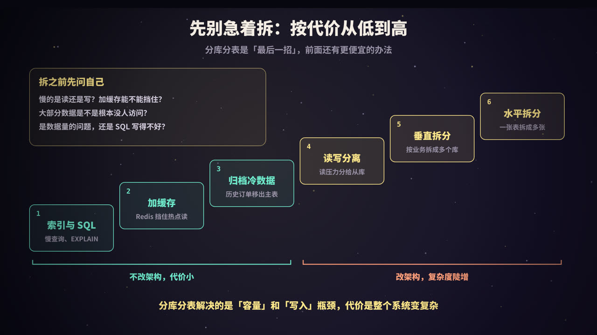
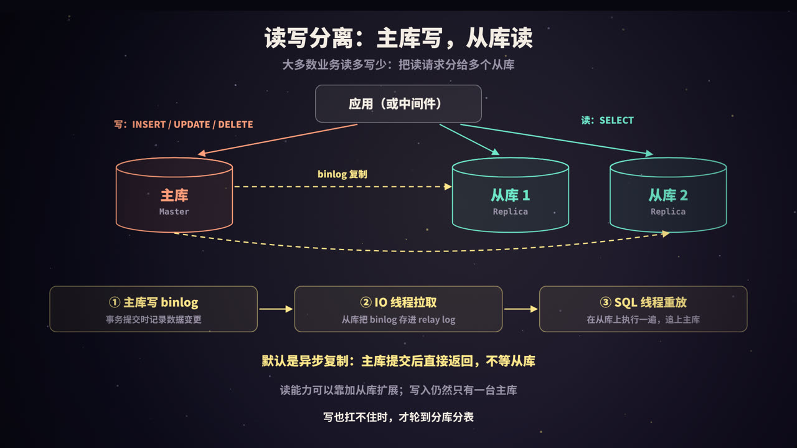
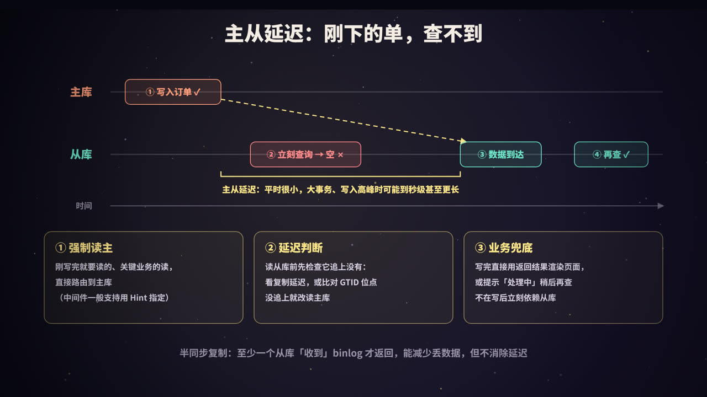
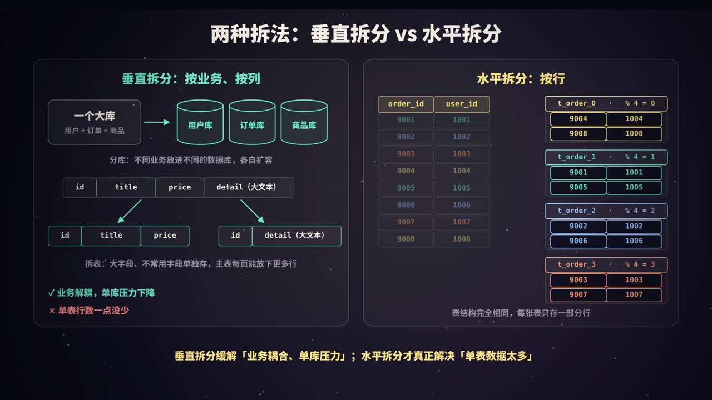
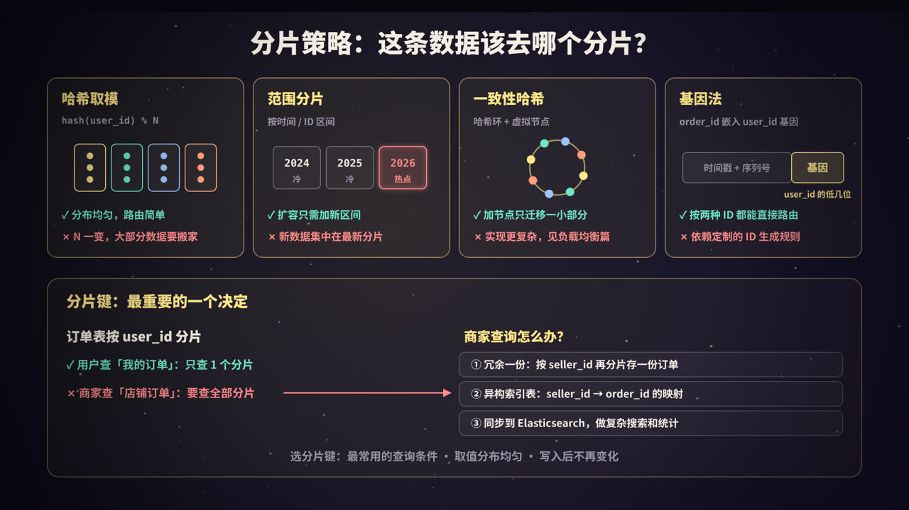
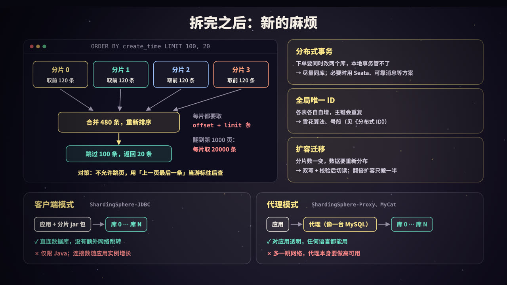

title: 分库分表与读写分离：一台数据库扛不住之后
subtitle: 单库单表的瓶颈与「先优化再拆分」，基于 binlog 的主从复制、主从延迟与强制读主、延迟判断，垂直拆分与水平拆分，哈希、范围、一致性哈希、基因法四种分片策略，分片键的选择，跨分片分页、分布式事务、全局 ID、扩容迁移，ShardingSphere 与 MyCat，附三段可运行的 Python 演示
tag: 计算机与后端
color: #fde68a


## 一台数据库会在哪里撑不住

业务刚上线时，一台 MySQL、一张 `t_order` 表就够用了。几年之后，订单表从 100 万行涨到了 10 亿行，各种问题陆续冒出来：

| 现象 | 背后的原因 |
|---|---|
| **查询变慢** | 数据和索引远远超过内存（InnoDB 缓冲池），大量查询要读磁盘；B+ 树也变高了，每次查找多几次 IO |
| **连接打满** | 应用实例越来越多，每个实例都有自己的连接池，数据库报 `ERROR 1040: Too many connections`（MySQL 默认 `max_connections` 是 151） |
| **写入排队** | 所有写请求都挤在一台机器上：同一块磁盘的写入带宽、redo log 和 binlog 的刷盘、热点行上的锁争用 |
| **运维变难** | 加字段、建索引要跑很久；全量备份和恢复的时间以小时计；一次故障影响全部业务 |

这里有两类不同性质的瓶颈，后面会反复用到：

- **单表太大**：行数多、索引大，影响的是查询效率和 DDL。解决办法是把一张表拆成多张小表；
- **单机扛不住**：连接数、CPU、磁盘 IO、写入吞吐都受限于一台机器。解决办法是把数据和请求分散到多台机器上。

关于 B+ 树为什么会变高、索引为什么要能放进内存，见本系列《数据库索引：为什么是 B+ 树》。一个常见的估算是：InnoDB 的页是 16KB，假设主键是 BIGINT、一行数据约 1KB，那么三层 B+ 树大约能存两千万行。这只是数量级上的参考，行越宽，能存的越少。

## 先别急着拆



分库分表能解决容量问题，但它会让整个系统变复杂：很多原本一条 SQL 就能完成的事情，拆分之后都要额外处理。所以业界普遍的建议是：**能不拆就不拆**，先把便宜的办法用完。

按代价从低到高，大致是这样一个顺序：

| 顺序 | 手段 | 解决什么 | 代价 |
|---|---|---|---|
| 1 | **索引与 SQL 优化** | 慢查询、全表扫描 | 几乎为零，用 `EXPLAIN` 找问题 |
| 2 | **加缓存** | 热点数据的高频读 | 要处理缓存一致性（见本系列《Redis 缓存》） |
| 3 | **归档冷数据** | 表里大部分是很少访问的历史数据 | 历史数据的查询要走另一条路径 |
| 4 | **读写分离** | 读多写少，读压力大 | 主从延迟 |
| 5 | **垂直拆分** | 多个业务挤在一个库里 | 不能跨库 JOIN，要拆服务 |
| 6 | **水平拆分** | 单表数据量太大、写入扛不住 | 跨分片查询、分布式事务、扩容…… |

前三步不改架构，后三步要改架构，复杂度是陡增的。

### 归档：最容易被忽略的一步

很多订单表的情况是：总共 10 亿行，但用户 99% 的时间只看最近几个月的订单。这时候，与其把 10 亿行拆成 64 张表，不如**把半年以前的订单搬到归档库**（可以用更便宜的存储，或者列式数据库），主表只保留热数据。主表一下子就小了一个数量级，索引能放进内存，查询自然就快了。

用户查看「全部历史订单」时，再去归档库查。这种查询频率低、对延迟不敏感，慢一点也可以接受。

### 什么时候才需要拆

《阿里巴巴 Java 开发手册》里有一条经常被引用的建议：单表行数超过 500 万行或者单表容量超过 2GB，才推荐进行分库分表；如果预计三年后的数据量根本达不到这个级别，就不要在建表时就分库分表。

这个数字是经验值，不是硬性门槛。真正的判断依据是：**前面的手段都用过了，瓶颈仍然在数据量和写入上**。几个可以问自己的问题：

- 慢的是读还是写？如果是读，缓存和读写分离往往就够了；
- 大部分数据是不是根本没人访问？如果是，先归档；
- 是数据量的问题，还是 SQL 写得不好？一条没有走索引的查询，在 100 万行的表上也很慢。

## 读写分离：主库写，从库读



大多数互联网业务**读多写少**：商品详情被浏览成千上万次，才会被下单一次。既然读请求占了大头，最直接的办法是：**一台主库负责写，几台从库负责读**。

### 主从复制是怎么工作的

MySQL 的主从复制依赖 **binlog**（二进制日志）。binlog 是 MySQL Server 层的日志，记录了所有对数据的修改，它有三种格式：

| 格式 | 记录什么 | 特点 |
|---|---|---|
| STATEMENT | 原始的 SQL 语句 | 日志小，但 `NOW()`、`UUID()` 之类的函数在从库上执行结果可能不同 |
| **ROW** | 每一行数据修改前后的值 | 最准确，日志较大；MySQL 5.7.7 起是默认格式 |
| MIXED | 一般用 STATEMENT，可能出问题时自动改用 ROW | 折中 |

复制过程分三步：

1. **主库写 binlog**：事务提交时，把这个事务的修改写入 binlog；
2. **从库的 IO 线程拉取**：从库上的 IO 线程（复制接收线程）连接主库，主库把新的 binlog 事件发过来，IO 线程把它们写入从库本地的 **relay log**（中继日志）；
3. **从库的 SQL 线程重放**：SQL 线程（应用线程）读取 relay log，在从库上把这些修改执行一遍，数据就追上了主库。

早期的 SQL 线程是单线程重放的，主库上几十个线程并发写入，从库只有一个线程在追，很容易越落越远。MySQL 5.6 之后陆续引入了多线程并行复制：5.7 基于主库的组提交信息判断哪些事务可以并行，8.0 又增加了基于 WRITESET（事务修改了哪些行）的判断，从库的追赶能力大大增强。

### 三种复制模式

| 模式 | 主库提交时等什么 | 主库宕机时 | 性能 |
|---|---|---|---|
| **异步复制**（默认） | 什么都不等，写完 binlog 就返回 | 还没传到从库的事务会丢失 | 最好 |
| **半同步复制** | 等至少一个从库确认「已收到」binlog（写入 relay log） | 已提交的事务至少在一个从库上有备份 | 多一次网络往返 |
| **组复制**（MGR） | 等多数节点对事务达成一致 | 多数节点存活即可继续，数据不丢 | 开销更大 |

注意半同步复制的「确认」是指从库**收到并写入了 relay log**，而不是**已经重放完毕**。所以半同步能减少主库宕机时丢数据的风险，但**不能消除读写分离中的主从延迟**。另外，半同步在等待从库确认超时后会退化成异步复制，避免主库一直卡住。

### 读请求怎么分到从库上

读写分离需要一个「路由」层来判断每条 SQL 该发到哪里：

- **写语句**（INSERT、UPDATE、DELETE）和 `SELECT ... FOR UPDATE` 发到主库；
- **普通 SELECT** 按负载均衡策略（轮询、随机、权重）发到某个从库；
- **事务中的读**：大多数中间件默认让事务内的所有语句都走主库，因为事务里往往刚写过数据，紧接着就要读。

路由层可以在应用里（比如 Spring 的 `AbstractRoutingDataSource`，或者 ShardingSphere-JDBC），也可以是一个独立的代理（比如 ShardingSphere-Proxy、MyCat、ProxySQL）。

读写分离的扩展能力是**单向的**：读不够，加从库就行；但写入始终只有一台主库。而且每个从库都要重放主库的全部写入，加从库并不能分担写压力。当写入也扛不住时，才需要分库分表。

## 主从延迟：刚下的单，查不到



异步复制意味着：主库提交成功的那一刻，从库上还没有这条数据。从主库提交到从库重放完成的这段时间，叫**主从延迟**。

最典型的故障是这样的：

1. 用户付款，订单状态在主库上更新为「已支付」；
2. 页面立刻跳转到订单详情，读请求被路由到了从库；
3. 从库还没重放这条修改，用户看到的仍然是「待支付」，以为付款失败，又付了一次。

### 延迟从哪里来

平时的主从延迟通常很小，但以下情况会让它明显变大：

- **大事务**：一个事务在主库上执行了很久（比如一次性更新几百万行），提交后才写入 binlog，从库也要花差不多的时间重放；
- **写入高峰**：主库并发写入很多，从库的重放并行度跟不上；
- **从库负载高**：从库上跑着大查询、报表，和重放线程抢 CPU 和 IO；
- **从库配置差**、网络抖动、从库所在机器的磁盘慢。

### 怎么观察延迟

- `SHOW REPLICA STATUS` 里的 `Seconds_Behind_Source`（MySQL 8.0.22 之前是 `SHOW SLAVE STATUS` 和 `Seconds_Behind_Master`）。它是根据正在重放的事件时间戳估算的，并不精确：比如 IO 线程本身落后了，它可能仍然显示 0；
- 更可靠的做法是**心跳表**：在主库上定时写入当前时间，在从库上读出来和当前时间比较，差值就是真实延迟。Percona Toolkit 的 `pt-heartbeat` 就是这么做的；
- **GTID 位点**：开启 GTID 后，每个事务都有一个全局唯一的编号，比较主库和从库已执行的 GTID 集合，就知道从库有没有追上某个具体的事务。

### 对策一：强制读主

对「刚写完就要读」或者「对一致性要求高」的读，直接发给主库。粒度可以有几种：

| 粒度 | 做法 | 例子 |
|---|---|---|
| 按语句 | 用 Hint 给某条 SQL 打标 | ShardingSphere 的 `HintManager`，MyCat 的注释 Hint |
| 按请求 | 同一个请求里一旦有写，后续的读都走主库 | 在请求上下文里放一个标记 |
| 按用户 | 用户写入后的一小段时间内，他的读都走主库 | 写完在 Redis 里记一个短期过期的标记，读时检查 |
| 按业务 | 支付、库存等关键读一律走主库 | 在代码层面区分数据源 |

ShardingSphere-JDBC 中强制路由到主库的写法（**参考写法**，需要真实的 ShardingSphere 环境）：

```java
try (HintManager hint = HintManager.getInstance()) {
    hint.setWriteRouteOnly();                 // 本线程接下来的读都走主库
    Order order = orderMapper.selectById(orderId);
}
```

代价是主库的读压力会增加。如果强制读主的范围太大，读写分离就失去了意义。

### 对策二：延迟判断

读从库之前，先判断它有没有追上：

- **粗粒度**：定时检查从库的延迟，超过阈值（比如 1 秒）就把它摘掉，读请求暂时都发给主库或其他从库；
- **细粒度**：写入时记下这个事务的 GTID（MySQL 可以通过 `session_track_gtids` 在响应里把它返回给客户端），读之前在从库上检查这个 GTID 是否已经执行。MySQL 提供了 `WAIT_FOR_EXECUTED_GTID_SET()` 函数，可以在从库上等待某个 GTID 集合执行完成，等待超时就改读主库。

细粒度的做法最精确，但实现复杂，一般需要中间件或数据库代理支持。

### 对策三：业务兜底

- 写完之后，直接用写操作返回的数据渲染页面，不再查一次；
- 对非关键数据，提示「处理中，请稍后刷新」；
- 在产品设计上避免「写完立刻读列表」的强依赖。

很多时候，**业务层的一点小改动比技术方案更便宜**。

## 垂直拆分与水平拆分



读写分离解决不了的，就要靠「拆」了。拆分有两个方向。

### 垂直拆分：按业务、按列

**垂直分库**：把不同业务的表放到不同的数据库里。原来一个「电商库」里有用户表、订单表、商品表，拆成用户库、订单库、商品库，各自部署在不同的机器上。

- 它和微服务的拆分天然对应：用户服务只访问用户库，订单服务只访问订单库；
- 各个库可以独立扩容、独立优化，一个业务的慢查询不会拖垮其他业务；
- 代价：原来的跨表 JOIN 变成了跨库，只能在应用层分别查询再组装；原来的本地事务也可能变成跨库事务。

**垂直分表**：把一张宽表按列拆成两张。比如商品表里有一个很大的「图文详情」字段，列表页根本用不到它：

```sql
-- 拆分前
t_product(id, title, price, stock, ..., detail TEXT)
-- 拆分后：常用字段一张表，大字段和不常用字段一张表，用同一个主键关联
t_product(id, title, price, stock, ...)
t_product_detail(id, detail TEXT)
```

InnoDB 按页（默认 16KB）存储数据，行越小，一页能放下的行越多，同样大小的缓冲池能缓存的行也越多，查询需要读的页就越少。

垂直拆分的局限是：**单表的行数一点没少**。订单表拆到了独立的订单库，它仍然有 10 亿行。

### 水平拆分：按行

**水平拆分**是把一张表的数据**按行**分散到多张结构完全相同的表中。比如按 `user_id % 4`，把 `t_order` 拆成 `t_order_0` 到 `t_order_3`，每张表只存四分之一的数据。

几个常用的术语（ShardingSphere 的叫法）：

| 术语 | 含义 | 例子 |
|---|---|---|
| **逻辑表** | 应用看到的表名 | `t_order` |
| **真实表** | 数据库里真实存在的表 | `t_order_0`、`t_order_1` …… |
| **数据节点** | 库名 + 真实表名，数据分片的最小单元 | `ds_0.t_order_0` |
| **分片键** | 用来决定数据去哪个分片的字段 | `user_id` |

水平拆分又分两种：

| | 只分表（同一个库里） | 分库分表（多个库） |
|---|---|---|
| 单表数据量 | 变小 | 变小 |
| 连接数、CPU、IO、写入吞吐 | **仍受限于一台机器** | 分散到多台机器 |
| 事务 | 同一个库，还能用本地事务 | 跨库就是分布式事务 |
| 适合 | 单表太大，但机器负载不高 | 单机已经扛不住 |

实践中常见的是「分库 + 分表」组合，比如 2 个库 × 每库 4 张表 = 8 个分片，后面的代码演示就是这种结构。

## 分片策略与分片键



水平拆分的核心问题是：**给定一条数据，它应该放在哪个分片上？** 这由分片键和分片算法共同决定。

### 四种分片策略

| 策略 | 做法 | 优点 | 缺点 |
|---|---|---|---|
| **哈希取模** | `hash(分片键) % N` | 数据分布均匀，路由简单 | N 一变，大部分数据要换位置 |
| **范围分片** | 按时间、ID 区间划分 | 扩容只需新增区间；范围查询方便；冷数据好归档 | 新数据集中在最新的分片上，形成热点 |
| **一致性哈希** | 哈希环 + 虚拟节点 | 增减节点只迁移一小部分数据 | 实现更复杂，分布均匀程度要靠虚拟节点调优 |
| **基因法** | 把分片键的「基因」嵌进另一个 ID 里 | 用两种 ID 都能直接定位分片 | 依赖定制的 ID 生成规则 |

**哈希取模**是最常用的。整数类型的分片键可以直接取模，字符串类型的先算一个哈希值（如 CRC32）。它的问题出在扩容上：分片数从 8 变成 9，按取模重新计算，大约 89% 的数据要换位置（后面的实验三会实测）。

**范围分片**最典型的是按时间：`t_order_202601`、`t_order_202602`……每个月一张表。扩容就是建新表，老表可以直接归档甚至删除。但所有的新订单都写进当月的表，写入压力并没有被分散。它更适合日志、流水这类「按时间写、按时间查」的数据。

**一致性哈希**的原理见本系列《负载均衡与一致性哈希》。在数据库分片中，更常见的是它的一个工程变体：**预分片**。先把数据划分成固定数量的逻辑槽（比如 1024 个），再用一张映射表记录每个槽在哪个物理库上。扩容时只需要把一部分槽连同数据搬到新库，再修改映射表，分片算法本身不变。Redis Cluster 的 16384 个哈希槽也是同样的思路。

**基因法**解决的是「两个字段都想当分片键」的问题。订单表按 `user_id` 分片，但很多查询是按 `order_id` 来的。如果分片数是 2 的幂（比如 8），那么 `user_id % 8` 就等于 `user_id` 的低 3 位。生成 `order_id` 时，把它的低 3 位换成 `user_id` 的低 3 位，于是：

```text
order_id % 8 == user_id % 8      → 用 order_id 也能直接算出分片
```

这就像订单号里带着用户的「基因」。要注意给基因预留足够的位数：如果将来可能扩容到 64 个分片，就要预留 6 位。

### 分片键怎么选

分片键几乎决定了分库分表后的一切：哪些查询快，哪些查询慢，数据是否均匀。一旦选定，后期很难更改。选择的原则：

1. **覆盖最核心、最高频的查询**：带分片键的查询只访问一个分片；不带分片键的查询要访问所有分片；
2. **取值分布均匀**：避免某些值的数据特别多。比如按 `seller_id` 分片，一个大商家的订单可能比几千个小商家加起来还多；
3. **写入后不会改变**：分片键一改，数据就要从一个分片搬到另一个分片；
4. **相关联的表用同一个分片键**：订单表和订单明细表都按 `user_id` 分片，同一个用户的订单和明细就落在同一个库里，可以在库内 JOIN，也能用本地事务。ShardingSphere 把这种表叫**绑定表**。

还有一个常见的小坑：**库和表的分片规则相关**。比如库用 `user_id % 2`，表用 `user_id % 4`：`user_id` 是偶数时一定进 0 号库，而它对 4 取模只可能是 0 或 2，于是 0 号库里只有 `t_order_0` 和 `t_order_2` 有数据，另外两张表永远是空的。正确的做法是先算一个总的槽位（比如 `user_id % 8`），再由槽位推出库号和表号，或者让库和表使用相互独立的规则。

### 订单按 user_id 分片，商家怎么查

电商的订单表通常按 `user_id`（买家）分片，因为 C 端用户查「我的订单」是最高频的查询。但商家后台要查「我的店铺订单」，这个查询不带 `user_id`，只能把请求广播到所有分片。常见的解决办法：

| 方案 | 做法 | 适合 |
|---|---|---|
| **冗余一份数据** | 再存一份按 `seller_id` 分片的订单，通过双写或订阅 binlog 异步同步 | 商家端查询量大、字段多 |
| **异构索引表** | 只存 `seller_id → order_id` 的映射，按 `seller_id` 分片。先查映射拿到 order_id，再按 order_id（配合基因法）回查订单 | 只需按某个字段定位订单 |
| **同步到搜索引擎** | 通过 binlog 把订单同步到 Elasticsearch，复杂搜索、多条件筛选、统计都在 ES 上做 | 运营后台、多维度查询 |

订阅 binlog 做数据同步，常用的开源工具是 Canal：它把自己伪装成一个 MySQL 从库，接收主库推送的 binlog，再把变更投递到消息队列或其他存储。这几种方案都是**最终一致**的，商家可能会晚一点看到新订单，大多数场景下可以接受。

**小表可以不分片**：省份、配置、字典这类数据量小、变化少的表，可以在每个库里都存一份完整的副本，这样任何分片都能和它在库内 JOIN。ShardingSphere 把这种表叫**广播表**。

## 拆分之后：新的麻烦



分库分表解决了容量问题，同时也把很多原本由数据库自动完成的事情，变成了需要应用或中间件处理的问题。

### 跨分片查询

中间件收到一条 SQL 后，先解析出分片键的条件，再决定发给哪些分片：

| 情况 | 例子 | 访问的分片 |
|---|---|---|
| 带分片键的等值条件 | `WHERE user_id = 123` | 1 个 |
| 带分片键的 IN 条件 | `WHERE user_id IN (1, 2, 3)` | 最多 3 个 |
| 不带分片键 | `WHERE seller_id = 7` | **全部** |

不带分片键的查询要发给所有分片，再把结果合并。分片越多，这种查询越慢，而且会占用所有分片的连接。所以要尽量让高频查询都带上分片键。

聚合函数也要改写：`COUNT`、`SUM`、`MAX` 可以在各分片算完再合并，但 `AVG` 不能直接平均各分片的平均值，要改写成各分片分别算 `SUM` 和 `COUNT`，合并后再相除。ShardingSphere 这类中间件会自动做这种改写。

### 跨分片排序分页

这是最容易踩坑的地方。比如按下单时间倒序，查第 6 页（每页 20 条）：

```sql
SELECT * FROM t_order ORDER BY create_time DESC LIMIT 100, 20;
```

**错误的做法**：把这条 SQL 原样发给每个分片，各自返回第 101～120 条，再合并取 20 条。全局的第 101～120 条，可能分布在任何分片的前 120 条里，每个分片各自跳过 100 条，会把真正需要的数据跳过去。后面的实验一会实测：这样得到的 20 条，与正确答案一条都不重合。

**正确的做法**：每个分片都返回**前 offset + limit 条**（这里是 120 条），中间件把 8 个分片的结果归并排序，再跳过前 100 条，取 20 条。各分片的结果本身是有序的，归并可以用多路归并，只需要依次取出，不用全部加载到内存里重新排序。

问题是：翻得越深，每个分片要返回的数据越多。查第 1000 页，每个分片都要返回 20000 条，8 个分片一共 16 万条，最终只用 20 条。

常见的对策：

- **禁止跳页，用游标翻页**：前端只提供「下一页」，请求时带上上一页最后一条的排序值，SQL 改成 `WHERE (create_time, order_id) < (?, ?) ORDER BY create_time DESC, order_id DESC LIMIT 20`。每个分片只需返回 20 条，无论翻到第几页，代价都一样。排序字段要加上唯一的 `order_id` 作为第二排序键，避免同一时间的多条数据被漏掉或重复；
- **限制最大页数**：很多搜索类产品只允许翻到前几十页；
- **交给搜索引擎**：复杂的排序、筛选、分页由 ES 负责。

### 分布式事务

分库之后，一次下单如果要同时修改两个库，本地事务就管不了了。关于事务和 ACID 的基础，见本系列《事务与 ACID》。

首选的办法是**避免跨库事务**：通过选择合适的分片键，让一个业务操作涉及的数据落在同一个库里。比如订单和订单明细都按 `user_id` 分片，下单写这两张表就还是本地事务。

确实避免不了时，可选的方案：

| 方案 | 一致性 | 说明 |
|---|---|---|
| **XA 两阶段提交** | 强一致 | 数据库原生支持；但要锁住资源直到第二阶段完成，性能差 |
| **Seata AT 模式** | 最终一致 | 自动记录修改前的数据，回滚时反向补偿，对业务侵入小 |
| **TCC** | 最终一致 | 业务自己实现 Try、Confirm、Cancel 三个接口，灵活但工作量大 |
| **可靠消息 / 本地消息表** | 最终一致 | 把「另一个库的修改」变成一条消息，由消费者异步执行（见本系列《消息队列》） |

大多数互联网业务选择最终一致的方案，再配合幂等（见本系列《幂等性设计》）和对账兜底。

### 全局唯一 ID

单库时，订单号用自增主键就够了。分成 8 张表后，每张表各自从 1 开始自增，主键就重复了。

需要一个全局唯一、趋势递增的 ID 生成方案，比如雪花算法、号段模式，详见本系列《分布式 ID：雪花算法》。如果要用基因法，就在生成的 ID 里预留几位，嵌入分片键的基因。

### 扩容与数据迁移

8 个分片不够用了，要扩到 16 个。用取模分片时，大部分数据的位置都会变，而且这一切要在**不停服**的情况下完成。常用的方案是**双写迁移**：

1. **准备新集群**，按新的分片规则建好库表；
2. **开启双写**：应用写旧库的同时也写新库，仍然以旧库为准；
3. **迁移历史数据**：把旧库的存量数据按新规则导入新库，迁移期间产生的增量通过双写或订阅 binlog 补齐；
4. **数据校验**：对比新旧库的数据，修复不一致的部分；
5. **切读**：读请求逐步（按比例灰度）切到新库，观察一段时间；
6. **切写**：以新库为准，停止写旧库，下线旧集群。

每一步都要能回滚。如果切读后发现问题，可以立刻切回旧库，因为旧库的数据一直是完整的。

**翻倍扩容**可以大大减少迁移量。分片数从 N 变成 2N 时，原来在 k 号分片的数据，只可能留在 k 号，或者搬到 k + N 号，而且正好一半留下、一半搬走（实验三会实测）。如果分片的单位是库，还可以更省事：

1. 给每个旧库加一个从库，等它追上主库；
2. 把这些从库提升为新的主库，路由规则从 `% N` 改成 `% 2N`；
3. 此时新旧库里都有完整的旧数据，各自删掉不属于自己的那一半即可。

这个方案几乎不需要搬数据，代价是每次扩容都要翻倍。所以很多团队会在一开始就**预留足够的分片数**，比如直接分成 64 张表，前期放在少量的库里，以后只需要把表迁移到新库上，分片规则不用变。

### 其他要注意的

- **DDL 要在所有分片上执行**：给逻辑表加一个字段，实际要在 64 张真实表上执行，中途失败要能补齐；
- **唯一约束只在单表内有效**：比如「手机号唯一」，在分表后只能保证同一张表内不重复，全局唯一要靠其他手段（比如单独一张按手机号分片的映射表）；
- **运维和排查成本**：一条数据在哪个库，要先算出分片才能去查。

## 中间件：客户端模式与代理模式

分片路由、SQL 改写、结果归并、读写分离，这些事情一般交给中间件来做。中间件分两种形态：

<figure>
<svg viewBox="0 0 440 320" xmlns="http://www.w3.org/2000/svg" role="img" aria-label="客户端模式与代理模式">
  <rect width="440" height="320" fill="#0f0e1c"/>
  <defs><marker id="sa" viewBox="0 0 10 10" refX="9" refY="5" markerWidth="7" markerHeight="7" orient="auto"><path d="M0,0 L10,5 L0,10 z" fill="#fde68a"/></marker></defs>
  <g font-family="PingFang SC, Noto Sans SC, sans-serif" text-anchor="middle">
    <line x1="220" y1="16" x2="220" y2="304" stroke="rgba(255,255,255,.12)" stroke-dasharray="6 6"/>
    <text x="110" y="32" fill="#fde68a" font-size="17" font-weight="800">客户端模式</text>
    <rect x="18" y="50" width="184" height="86" rx="12" fill="rgba(255,255,255,.06)" stroke="#9a93a8"/>
    <text x="110" y="74" fill="#f4ede4" font-size="14" font-weight="700">应用进程（Java）</text>
    <rect x="32" y="88" width="156" height="36" rx="8" fill="rgba(253,230,138,.14)" stroke="#fde68a"/>
    <text x="110" y="111" fill="#fde68a" font-size="12" font-weight="700">ShardingSphere-JDBC</text>
    <line x1="78" y1="136" x2="62" y2="198" stroke="#fde68a" stroke-width="2.5" marker-end="url(#sa)"/>
    <line x1="142" y1="136" x2="158" y2="198" stroke="#fde68a" stroke-width="2.5" marker-end="url(#sa)"/>
    <rect x="20" y="202" width="80" height="48" rx="10" fill="rgba(110,231,200,.10)" stroke="#6ee7c8"/>
    <text x="60" y="231" fill="#6ee7c8" font-size="14" font-weight="700">ds_0</text>
    <rect x="120" y="202" width="80" height="48" rx="10" fill="rgba(110,231,200,.10)" stroke="#6ee7c8"/>
    <text x="160" y="231" fill="#6ee7c8" font-size="14" font-weight="700">ds_1</text>
    <text x="110" y="276" fill="#9a93a8" font-size="12">路由在应用进程内完成</text>
    <text x="110" y="295" fill="#9a93a8" font-size="12">直连各个数据库</text>
    <text x="330" y="32" fill="#fde68a" font-size="17" font-weight="800">代理模式</text>
    <rect x="238" y="50" width="184" height="44" rx="12" fill="rgba(255,255,255,.06)" stroke="#9a93a8"/>
    <text x="330" y="77" fill="#f4ede4" font-size="14" font-weight="700">应用（任意语言）</text>
    <line x1="330" y1="94" x2="330" y2="124" stroke="#fde68a" stroke-width="2.5" marker-end="url(#sa)"/>
    <text x="340" y="113" fill="#9a93a8" font-size="11" text-anchor="start">MySQL 协议</text>
    <rect x="252" y="128" width="156" height="40" rx="10" fill="rgba(253,230,138,.14)" stroke="#fde68a"/>
    <text x="330" y="153" fill="#fde68a" font-size="13" font-weight="700">Proxy / MyCat</text>
    <line x1="300" y1="168" x2="282" y2="198" stroke="#fde68a" stroke-width="2.5" marker-end="url(#sa)"/>
    <line x1="360" y1="168" x2="378" y2="198" stroke="#fde68a" stroke-width="2.5" marker-end="url(#sa)"/>
    <rect x="240" y="202" width="80" height="48" rx="10" fill="rgba(110,231,200,.10)" stroke="#6ee7c8"/>
    <text x="280" y="231" fill="#6ee7c8" font-size="14" font-weight="700">ds_0</text>
    <rect x="340" y="202" width="80" height="48" rx="10" fill="rgba(110,231,200,.10)" stroke="#6ee7c8"/>
    <text x="380" y="231" fill="#6ee7c8" font-size="14" font-weight="700">ds_1</text>
    <text x="330" y="276" fill="#9a93a8" font-size="12">应用以为只连了一台 MySQL</text>
    <text x="330" y="295" fill="#9a93a8" font-size="12">多一跳网络</text>
  </g>
</svg>
<figcaption>客户端模式把分片逻辑做成应用里的一个 jar 包；代理模式在应用和数据库之间加一个独立的服务</figcaption>
</figure>

| | 客户端模式 | 代理模式 |
|---|---|---|
| 代表 | ShardingSphere-JDBC | ShardingSphere-Proxy、MyCat |
| 形态 | 一个 jar 包，实现了 JDBC 接口，应用把它当成普通数据源使用 | 独立部署的服务，对外实现 MySQL 协议，应用像连一台 MySQL 一样连它 |
| 性能 | 直连数据库，没有额外的网络跳转 | 多一跳网络，代理本身可能成为瓶颈 |
| 语言 | 只支持 Java（JVM 语言） | 任何能连 MySQL 的语言和工具都能用 |
| 连接数 | 每个应用实例都要连所有库，实例多了连接数会膨胀 | 连接集中在代理上，便于管理 |
| 运维 | 不用部署额外组件，但分片规则的升级要随应用发布 | 要单独部署、监控，代理本身要做高可用 |
| 适合 | Java 业务服务的在线读写 | 多语言环境、DBA 运维、数据迁移、命令行直接查数据 |

两种模式也可以混合使用：业务服务用 JDBC 模式追求性能，运维和数据分析通过 Proxy 访问同一套分片数据。

**Apache ShardingSphere** 是目前最活跃的开源方案，支持数据分片、读写分离、分布式事务（XA、Seata）、数据加密、影子库等功能。**MyCat** 是较早流行的代理方案。另外，Vitess 是一个面向 MySQL 的分片集群系统；如果不想在应用层处理分片，也可以考虑 TiDB、OceanBase 这类原生的分布式数据库，它们在数据库内部自动完成分片和扩容，对应用表现为一个整体的数据库。

### ShardingSphere 配置示例

下面是 ShardingSphere 5.x 的 YAML 配置，实现「2 个库 × 每库 4 张表，按 `user_id` 分片，主键用雪花算法」。这是**参考写法**，需要真实的 MySQL 和 ShardingSphere 环境，本文没有实际运行；不同版本的字段名有差异，以对应版本的官方文档为准：

```yaml
dataSources:
  ds_0:
    dataSourceClassName: com.zaxxer.hikari.HikariDataSource
    driverClassName: com.mysql.cj.jdbc.Driver
    jdbcUrl: jdbc:mysql://db0:3306/order_db
    username: app
    password: "******"
  ds_1:
    dataSourceClassName: com.zaxxer.hikari.HikariDataSource
    driverClassName: com.mysql.cj.jdbc.Driver
    jdbcUrl: jdbc:mysql://db1:3306/order_db
    username: app
    password: "******"

rules:
- !SHARDING
  tables:
    t_order:
      actualDataNodes: ds_${0..1}.t_order_${0..3}      # 8 个数据节点
      databaseStrategy:
        standard:
          shardingColumn: user_id
          shardingAlgorithmName: db_inline
      tableStrategy:
        standard:
          shardingColumn: user_id
          shardingAlgorithmName: table_inline
      keyGenerateStrategy:
        column: order_id
        keyGeneratorName: snowflake
  shardingAlgorithms:
    db_inline:
      type: INLINE
      props:
        algorithm-expression: ds_${user_id % 2}
    table_inline:
      type: INLINE
      props:
        algorithm-expression: t_order_${user_id.intdiv(2) % 4}   # 避免与库规则相关
  keyGenerators:
    snowflake:
      type: SNOWFLAKE
```

注意表规则用的是 `user_id.intdiv(2) % 4` 而不是 `user_id % 4`，这就是前面提到的「库和表的分片规则不能相关」。读写分离也是在 `rules` 里再加一段 `!READWRITE_SPLITTING` 规则，为每个逻辑库指定一个写数据源和若干个读数据源，以及读请求的负载均衡算法。

## 动手实验

下面三段代码都只依赖 Python 标准库（Python 3.13，SQLite 3.45），可以直接运行。

### 实验一：2 库 × 4 表的哈希分片与跨分片分页

用两个 SQLite 数据库文件模拟两个库，每个库里建 `t_order_0` 到 `t_order_3` 四张表。按 `user_id % 8` 算出槽位，再推出库号和表号；`order_id` 用基因法生成。最后对比跨分片分页的错误做法、正确做法和游标做法。

```python
import sqlite3, random, heapq, os, tempfile

DBS, TABLES = 2, 4                  # 2 个库 × 每库 4 张表 = 8 个分片
SLOTS = DBS * TABLES

# ---------- 1. 建库建表：ds_0、ds_1 两个库，每个库里 t_order_0 ~ t_order_3 ----------
tmp = tempfile.mkdtemp()
conns = [sqlite3.connect(os.path.join(tmp, f"ds_{d}.db")) for d in range(DBS)]
for c in conns:
    for t in range(TABLES):
        c.execute(f"""CREATE TABLE t_order_{t} (
            order_id INTEGER PRIMARY KEY, user_id INTEGER, seller_id INTEGER,
            amount INTEGER, create_time INTEGER)""")
        c.execute(f"CREATE INDEX idx_user_{t} ON t_order_{t}(user_id)")

# ---------- 2. 路由规则 ----------
def route(user_id):
    slot = user_id % SLOTS            # 分片键取模，得到 0~7 号槽位
    return slot // TABLES, slot % TABLES   # 槽位 -> (库号, 表号)

# 基因法：order_id 的低 3 位 = user_id % 8，于是按 order_id 也能直接算出分片
seq = 0
def next_order_id(user_id):
    global seq
    seq += 1
    return (seq << 3) | (user_id % SLOTS)

def route_by_order(order_id):
    slot = order_id & (SLOTS - 1)     # 取出低 3 位「基因」
    return slot // TABLES, slot % TABLES

def insert(user_id, seller_id, amount, ts):
    d, t = route(user_id)
    oid = next_order_id(user_id)
    conns[d].execute(f"INSERT INTO t_order_{t} VALUES (?,?,?,?,?)", (oid, user_id, seller_id, amount, ts))
    return oid

# ---------- 3. 写入 2000 条订单，同时在一张「单表」里存一份作为标准答案 ----------
rnd = random.Random(42)
truth = sqlite3.connect(":memory:")
truth.execute("CREATE TABLE t_order (order_id INTEGER, user_id INTEGER, seller_id INTEGER, amount INTEGER, create_time INTEGER)")
ts = 1_700_000_000
for _ in range(2000):
    ts += rnd.randint(1, 5)
    u, s, amt = rnd.randint(1, 300), rnd.randint(1, 20), rnd.randint(10, 999)
    oid = insert(u, s, amt, ts)
    truth.execute("INSERT INTO t_order VALUES (?,?,?,?,?)", (oid, u, s, amt, ts))

print("== 各分片行数 ==")
for d in range(DBS):
    print(f"ds_{d}:", [conns[d].execute(f"SELECT COUNT(*) FROM t_order_{t}").fetchone()[0] for t in range(TABLES)])

# ---------- 4. 带分片键的查询：只访问一张表 ----------
d, t = route(123)
rows = conns[d].execute(f"SELECT order_id, create_time FROM t_order_{t} WHERE user_id=? ORDER BY create_time DESC LIMIT 3", (123,)).fetchall()
print(f"\n== user_id=123 -> ds_{d}.t_order_{t}，只查 1 个分片 ==")
print(rows)
oid = rows[0][0]
print(f"order_id={oid} 的低 3 位 = {oid & 7}，按基因路由到 ds_{route_by_order(oid)[0]}.t_order_{route_by_order(oid)[1]}")

# ---------- 5. 不带分片键的查询：只能广播到全部 8 张表 ----------
def scatter(sql, args=()):
    out, touched = [], 0
    for d in range(DBS):
        for t in range(TABLES):
            out += conns[d].execute(sql.format(t=t), args).fetchall(); touched += 1
    return out, touched
rows, n = scatter("SELECT COUNT(*) FROM t_order_{t} WHERE seller_id=?", (7,))
print(f"\n== seller_id=7 的订单数：{sum(r[0] for r in rows)}，访问了 {n} 张表 ==")

# ---------- 6. 跨分片分页：ORDER BY create_time DESC LIMIT 20 OFFSET 100 ----------
OFFSET, LIMIT = 100, 20
expect = truth.execute("SELECT order_id FROM t_order ORDER BY create_time DESC, order_id DESC LIMIT ? OFFSET ?", (LIMIT, OFFSET)).fetchall()
expect = [r[0] for r in expect]

def page_wrong(offset, limit):          # 错误：每个分片各自 LIMIT 20 OFFSET 100
    rows, _ = scatter("SELECT create_time, order_id FROM t_order_{t} ORDER BY create_time DESC, order_id DESC LIMIT ? OFFSET ?", (limit, offset))
    rows.sort(reverse=True)
    return [r[1] for r in rows[:limit]]

def page_right(offset, limit):          # 正确：每个分片取前 offset+limit 条，归并后再跳过 offset 条
    per = []
    fetched = 0
    for d in range(DBS):
        for t in range(TABLES):
            r = conns[d].execute(f"SELECT create_time, order_id FROM t_order_{t} ORDER BY create_time DESC, order_id DESC LIMIT ?", (offset + limit,)).fetchall()
            fetched += len(r); per.append(r)
    merged = heapq.merge(*per, reverse=True)          # 各分片内部已有序：多路归并
    out = [r[1] for i, r in enumerate(merged) if offset <= i < offset + limit]
    return out, fetched

w = page_wrong(OFFSET, LIMIT)
r, fetched = page_right(OFFSET, LIMIT)
print("\n== 第 6 页（OFFSET 100, LIMIT 20）==")
print("错误做法与标准答案一致？", w == expect, f"（重合 {len(set(w) & set(expect))}/20 条）")
print("正确做法与标准答案一致？", r == expect, f"，共从分片取回 {fetched} 行，只用了 20 行")
for page in (1, 5, 10, 12):
    _, f = page_right((page - 1) * LIMIT, LIMIT)
    print(f"  第 {page:>2} 页：从 8 个分片共取回 {f:>4} 行")

# ---------- 7. 游标分页：记住上一页最后一条，按 (create_time, order_id) 往后查 ----------
def page_cursor(last, limit):
    per, fetched = [], 0
    for d in range(DBS):
        for t in range(TABLES):
            sql = f"SELECT create_time, order_id FROM t_order_{t} "
            sql += ("WHERE (create_time, order_id) < (?, ?) " if last else "") + "ORDER BY create_time DESC, order_id DESC LIMIT ?"
            r = conns[d].execute(sql, (*last, limit) if last else (limit,)).fetchall()
            fetched += len(r); per.append(r)
    rows = list(heapq.merge(*per, reverse=True))[:limit]
    return rows, fetched

last, ok = None, True
for page in range(1, 100):
    rows, f = page_cursor(last, LIMIT)
    exp = truth.execute("SELECT order_id FROM t_order ORDER BY create_time DESC, order_id DESC LIMIT ? OFFSET ?", (LIMIT, (page - 1) * LIMIT)).fetchall()
    ok &= [x[1] for x in rows] == [e[0] for e in exp]
    if page in (1, 10, 50, 90): print(f"  游标分页第 {page:>2} 页：共取回 {f} 行")
    last = rows[-1]
print("游标分页 99 页全部与标准答案一致？", ok)
```

输出：

```text
== 各分片行数 ==
ds_0: [247, 221, 248, 263]
ds_1: [257, 269, 247, 248]

== user_id=123 -> ds_0.t_order_3，只查 1 个分片 ==
[(15435, 1700005873), (14875, 1700005678), (12115, 1700004625)]
order_id=15435 的低 3 位 = 3，按基因路由到 ds_0.t_order_3

== seller_id=7 的订单数：83，访问了 8 张表 ==

== 第 6 页（OFFSET 100, LIMIT 20）==
错误做法与标准答案一致？ False （重合 0/20 条）
正确做法与标准答案一致？ True ，共从分片取回 960 行，只用了 20 行
  第  1 页：从 8 个分片共取回  160 行
  第  5 页：从 8 个分片共取回  800 行
  第 10 页：从 8 个分片共取回 1600 行
  第 12 页：从 8 个分片共取回 1901 行
  游标分页第  1 页：共取回 160 行
  游标分页第 10 页：共取回 160 行
  游标分页第 50 页：共取回 160 行
  游标分页第 90 页：共取回 160 行
游标分页 99 页全部与标准答案一致？ True
```

几个观察：

- 2000 条订单比较均匀地分到了 8 张表里（221～269 行）。哈希取模的均匀性依赖分片键本身的分布，这里的 `user_id` 是随机的；
- `user_id=123` 的查询只访问 `ds_0.t_order_3`，用它的 `order_id` 也能按基因路由到同一张表；
- 按 `seller_id` 查询，必须访问全部 8 张表；
- 跨分片分页，错误做法得到的 20 条与正确答案**一条都不重合**；正确做法要从各分片取回 `8 × (offset + limit)` 行，第 10 页就要取回 1600 行，只为了用其中的 20 行（第 12 页是 1901 行而不是 1920 行，是因为有的分片总共不到 240 行）；
- 游标分页无论翻到第几页，每次都只取回 160 行（8 个分片 × 20），结果也完全正确。

### 实验二：读写分离与「刚写完读不到」

用一个后台线程模拟异步复制：主库写完就返回，从库每条 binlog 事件延迟 0.2 秒才重放。路由器支持三种读法：直接读从库、强制读主、带 GTID 位点的延迟判断。

```python
import sqlite3, threading, queue, time

class Master:
    """主库：执行写入，并把每条变更追加到 binlog，返回它的位点（类似 GTID 序号）"""
    def __init__(self):
        self.db = sqlite3.connect(":memory:", check_same_thread=False)
        self.db.execute("CREATE TABLE t_order (order_id INTEGER PRIMARY KEY, status TEXT)")
        self.binlog, self.pos, self.lock = queue.Queue(), 0, threading.Lock()
    def write(self, sql, args):
        with self.lock:
            self.db.execute(sql, args); self.db.commit()
            self.pos += 1
            self.binlog.put((self.pos, sql, args))   # 异步复制：放进 binlog 就返回，不等从库
            return self.pos

class Replica:
    """从库：后台线程拉取 binlog 并重放，每条事件模拟 lag 秒的复制延迟"""
    def __init__(self, master, lag):
        self.db = sqlite3.connect(":memory:", check_same_thread=False)
        self.db.execute("CREATE TABLE t_order (order_id INTEGER PRIMARY KEY, status TEXT)")
        self.applied, self.lag = 0, lag
        threading.Thread(target=self._apply, args=(master,), daemon=True).start()
    def _apply(self, master):
        while True:
            pos, sql, args = master.binlog.get()
            time.sleep(self.lag)                      # 网络传输 + 排队 + 重放耗时
            self.db.execute(sql, args); self.db.commit(); self.applied = pos

class Router:
    def __init__(self, master, replica):
        self.m, self.r = master, replica
    def write(self, sql, args):
        return self.m.write(sql, args)
    def read(self, sql, args, force_master=False, min_pos=0):
        if force_master:
            src = "主库(强制)"
        elif self.r.applied < min_pos:                # 延迟判断：从库还没重放到这个位点
            src = "主库(从库未追上)"
        else:
            src = "从库"
        db = self.m.db if src.startswith("主库") else self.r.db
        return src, db.execute(sql, args).fetchall()

m = Master(); r = Replica(m, lag=0.2); rt = Router(m, r)
Q = "SELECT * FROM t_order WHERE order_id=?"

pos = rt.write("INSERT INTO t_order VALUES (?, ?)", (1001, "已支付"))
print("写入完成，主库位点 =", pos, "，从库已重放到", r.applied)
print("1) 直接读从库       :", rt.read(Q, (1001,)))
print("2) 强制读主         :", rt.read(Q, (1001,), force_master=True))
print("3) 带位点读（GTID） :", rt.read(Q, (1001,), min_pos=pos))
time.sleep(0.3)
print("…… 0.3 秒后，从库已重放到", r.applied)
print("4) 带位点读（GTID） :", rt.read(Q, (1001,), min_pos=pos))
```

输出：

```text
写入完成，主库位点 = 1 ，从库已重放到 0
1) 直接读从库       : ('从库', [])
2) 强制读主         : ('主库(强制)', [(1001, '已支付')])
3) 带位点读（GTID） : ('主库(从库未追上)', [(1001, '已支付')])
…… 0.3 秒后，从库已重放到 1
4) 带位点读（GTID） : ('从库', [(1001, '已支付')])
```

第 1 次读从库，拿到的是空结果，这就是「刚下的单查不到」。强制读主总能读到，但所有压力都给了主库。带位点的延迟判断最聪明：从库没追上时自动改读主库，追上之后又回到从库。真实系统中，「位点」就是 GTID，判断由中间件或 `WAIT_FOR_EXECUTED_GTID_SET()` 完成。

### 实验三：扩容时要搬多少数据

取 10 万个随机的 `user_id`，统计分片数变化后，按取模规则需要换位置的数据比例：

```python
import random
keys = random.Random(7).sample(range(10**9), 100_000)   # 10 万个 user_id

def moved(old_n, new_n):
    return sum(k % old_n != k % new_n for k in keys) / len(keys)

for old, new in [(8, 9), (8, 12), (8, 16), (16, 32)]:
    print(f"{old:>2} 个分片 -> {new:>2} 个：{moved(old, new):6.1%} 的数据要换位置")

# 翻倍扩容时，数据只会从 k 号分片搬到 k+old 号分片，不会去别处
old, new = 8, 16
targets = {k % old: set() for k in keys}
for k in keys: targets[k % old].add(k % new)
print("翻倍扩容后各分片数据的去向：", {s: sorted(v) for s, v in sorted(targets.items())})
```

输出：

```text
 8 个分片 ->  9 个： 88.9% 的数据要换位置
 8 个分片 -> 12 个： 66.6% 的数据要换位置
 8 个分片 -> 16 个： 50.0% 的数据要换位置
16 个分片 -> 32 个： 50.1% 的数据要换位置
翻倍扩容后各分片数据的去向： {0: [0, 8], 1: [1, 9], 2: [2, 10], 3: [3, 11], 4: [4, 12], 5: [5, 13], 6: [6, 14], 7: [7, 15]}
```

从 8 个加到 9 个，看起来只多了一个分片，却有近 89% 的数据要搬家；翻倍扩容只需要搬一半，而且每个分片的数据只会去一个固定的新分片，迁移可以按分片一一对应地进行。这就是为什么取模分片通常按 2 的幂规划，扩容时成倍地扩。

## 工程实践与常见的坑

### 怎么规划

- **按 3～5 年的数据量估算**分片数，宁可一次分得多一些（比如 64 或 128 张表），前期放在少量库上。后期扩容只是「把表搬到新库」，分片规则不用变；
- **分片数取 2 的幂**，方便翻倍扩容和基因法；
- **先读写分离，再垂直拆分，最后水平拆分**，每一步都确认上一步确实不够用了；
- 想清楚**哪些查询必须带分片键**，在代码评审中检查不带分片键的 SQL。

### 常见的坑

| 坑 | 后果 | 怎么避免 |
|---|---|---|
| 分片键选错 | 核心查询全部变成广播查询 | 按最高频的查询选分片键，提前列出所有查询模式 |
| 数据倾斜 | 某个分片特别大、特别热 | 避免用分布不均的字段（如大商家的 seller_id）做分片键 |
| 库和表的分片规则相关 | 有的表永远是空的 | 先算总槽位，再推出库号和表号 |
| 深分页 | 每个分片返回大量数据，拖垮中间件 | 游标翻页，限制最大页数 |
| 不带分片键的更新 | 一条 UPDATE 锁住所有分片上的行 | 更新必须带分片键或主键 |
| 读写分离后写完立刻读 | 读到旧数据 | 强制读主、延迟判断、业务兜底 |
| 过早分库分表 | 系统复杂度大增，却没解决真正的问题 | 先优化、先归档、先读写分离 |

## 高频面试题速答

**Q：什么时候需要分库分表？**
单表数据量太大导致查询和 DDL 变慢，或者单机的连接数、写入吞吐扛不住时。在此之前应先做索引优化、缓存、归档和读写分离。经验值是单表超过 500 万行或 2GB 再考虑，但这不是硬性标准。

**Q：分库和分表分别解决什么问题？**
分表解决单表数据量大的问题（索引更小、查询更快）；分库解决单机资源瓶颈（连接数、CPU、IO、写入吞吐）。只分表不分库，所有压力仍在一台机器上。

**Q：读写分离的原理是什么？有什么问题？**
主库处理写，从库处理读，从库通过 binlog 复制主库的数据：IO 线程拉取 binlog 写入 relay log，SQL 线程重放。默认是异步复制，所以存在主从延迟，刚写入的数据可能在从库上读不到。

**Q：主从延迟怎么解决？**
关键读强制走主库（Hint、按请求或按用户打标）；读从库前判断延迟，比如比对 GTID，没追上就读主库；业务上用写操作的返回值展示结果，避免写后立即读从库。同时从根源上减少大事务、开启并行复制。

**Q：垂直拆分和水平拆分有什么区别？**
垂直拆分按业务或按列拆，不同的表或字段放到不同的库或表中，解决业务耦合和单库压力，但单表行数不变；水平拆分按行拆，把一张表的数据按分片键分散到多张结构相同的表中，解决单表数据量大的问题。

**Q：常见的分片策略有哪些？**
哈希取模（均匀，但扩容要大量迁移）；范围分片（扩容简单，但有热点）；一致性哈希或预分片（扩容迁移少）；基因法（把分片键的低位嵌入另一个 ID，两种 ID 都能路由）。

**Q：订单表按 user_id 分片，商家按 seller_id 查询怎么办？**
冗余一份按 seller_id 分片的数据；或者建 seller_id 到 order_id 的异构索引表；或者把数据同步到 Elasticsearch。数据同步一般通过双写或订阅 binlog，是最终一致的。

**Q：跨分片分页怎么做？**
每个分片取前 offset + limit 条，中间件归并排序后再跳过 offset 条。翻页越深代价越大，实践中用游标翻页（带上上一页最后一条的排序值），或限制最大页数，复杂查询交给搜索引擎。

**Q：分库分表后主键怎么生成？**
不能再用各表的自增主键，要用全局唯一的 ID，比如雪花算法或号段模式。需要按两种 ID 路由时，可以在 ID 里嵌入分片键的基因。

**Q：怎么做不停服扩容？**
双写迁移：新集群建好后开启双写，迁移历史数据并补齐增量，校验一致后先灰度切读，再切写，下线旧集群，每一步可回滚。取模分片尽量翻倍扩容，只需迁移一半数据；也可以一开始就多分一些表，后期只迁移表、不改规则。

**Q：ShardingSphere-JDBC 和 ShardingSphere-Proxy 有什么区别？**
JDBC 是客户端模式，以 jar 包形式嵌入 Java 应用，直连数据库，性能好但只支持 Java，连接数随实例增长；Proxy 是代理模式，独立部署，实现 MySQL 协议，任何语言都能用，但多一跳网络，自身需要高可用。

## 总结


- 一台数据库的瓶颈分两类：**单表太大**（查询、DDL 变慢）和**单机扛不住**（连接、IO、写入）；
- **先优化，再拆分**：索引、缓存、归档、读写分离都比分库分表便宜；
- **读写分离**：主库写、从库读，基于 binlog 异步复制；主从延迟导致「刚写完读不到」，用**强制读主**、**延迟判断**和业务兜底来应对；
- **垂直拆分**按业务、按列拆，解决耦合和单库压力；**水平拆分**按行拆，才真正解决单表数据太多；
- **分片策略**：哈希取模、范围、一致性哈希（预分片）、基因法；**分片键**要覆盖核心查询、分布均匀、不会改变，非分片键查询靠冗余、异构索引表或 ES；
- 拆分的代价：**跨分片查询与分页**、**分布式事务**、**全局 ID**、**扩容迁移**，这些都要在设计时想清楚；
- 中间件分**客户端模式**（ShardingSphere-JDBC）和**代理模式**（ShardingSphere-Proxy、MyCat）。

能不拆就不拆；要拆，先选对分片键。

<div class="refs" markdown="1">

### 参考资料

- MySQL 8.0 Reference Manual：Replication（Binary Log Formats、Replication Threads、Semisynchronous Replication、Replication with Global Transaction Identifiers）.
- MySQL 8.0 Reference Manual：Group Replication；Functions Used with Global Transaction Identifiers（WAIT_FOR_EXECUTED_GTID_SET）.
- Apache ShardingSphere 官方文档：数据分片、读写分离、分布式事务、YAML 配置.
- Mycat 项目文档与 GitHub 仓库.
- Seata 官方文档：AT、TCC、SAGA、XA 模式.
- Canal 项目文档（alibaba/canal）：基于 MySQL binlog 的增量订阅与消费.
- Percona Toolkit 文档：pt-heartbeat.
- 《阿里巴巴 Java 开发手册》：MySQL 数据库 · 建表规约.
- *Designing Data-Intensive Applications*（O'Reilly, 2017），第 5 章 Replication、第 6 章 Partitioning.
- Python 文档：sqlite3、heapq；SQLite 文档：Row Values.

</div>
