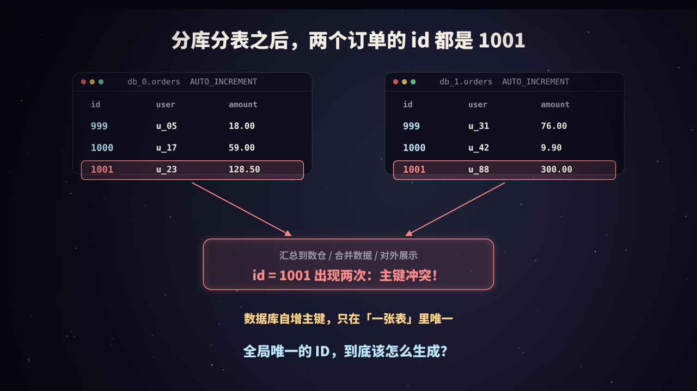
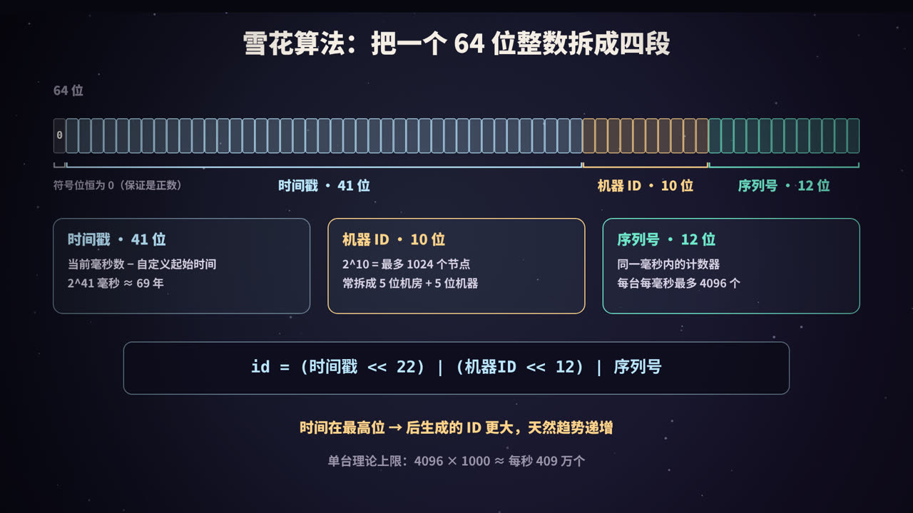
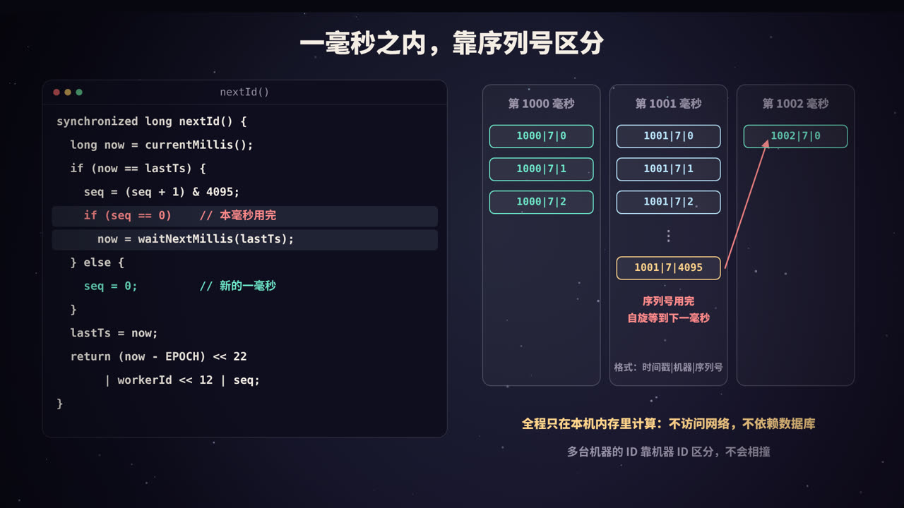
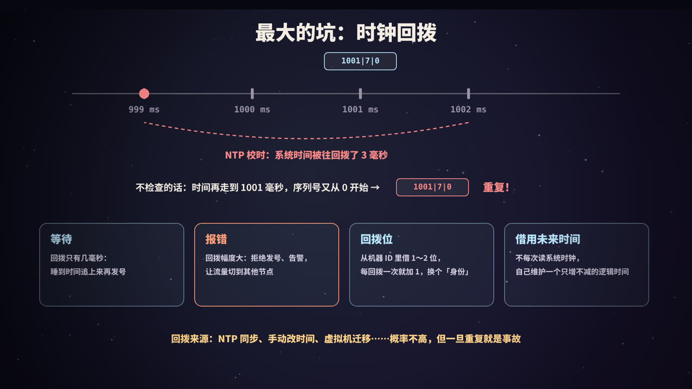
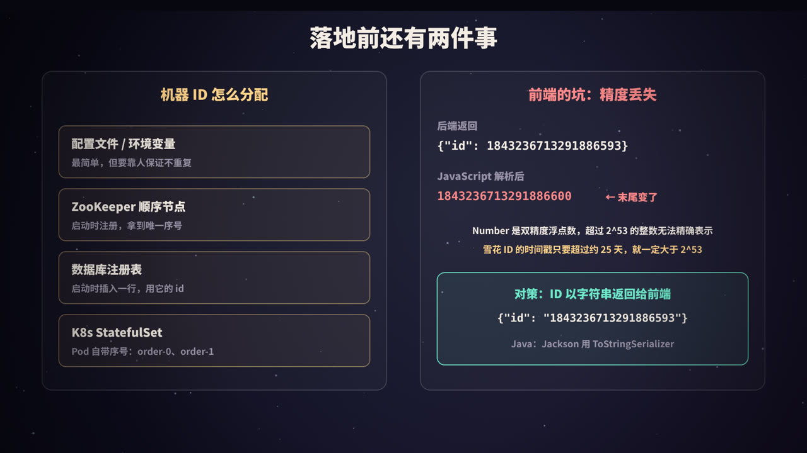

title: 分布式 ID：雪花算法，以及它要解决的那些麻烦
subtitle: 分库分表后自增主键为何冲突、合格 ID 的五条要求、UUID / 步长 / 号段 / Redis / 雪花五种方案对比，雪花算法 64 位结构、序列号溢出、时钟回拨与机器 ID 分配、前端精度丢失，附 Java 21 实现与四组实测
tag: 计算机与后端
color: #bae6fd



## 自增主键为什么不够用了

单库单表的时候，主键几乎不用操心：建表时写一句 `id BIGINT AUTO_INCREMENT PRIMARY KEY`，数据库帮你从 1 开始往上数，绝不重复。

当订单表涨到几亿行、单库扛不住写入时，就要**分库分表**（见本系列《分库分表与读写分离》）：把一张 `orders` 拆成 `db_0.orders`、`db_1.orders`……每个库各自维护自己的自增计数器，于是：

- `db_0` 里有一条 `id = 1001` 的订单；
- `db_1` 里也有一条 `id = 1001` 的订单。

只要这两条数据还待在各自的库里，看起来相安无事。可一旦遇到下面这些情况，问题立刻暴露：

- 数据同步到数据仓库、搜索引擎做汇总分析，两条记录**主键冲突**；
- 用户拿着订单号来查询，系统根本不知道是哪一条；
- 扩容时要把数据从一个库迁移到另一个库，主键撞车，迁移失败；
- 订单号要传给支付、物流等下游系统，对方要求全局唯一。

数据库的自增主键只在**一张表里**唯一。拆分之后，我们需要一个**跨库、跨表、跨机器都不会重复**的 ID，这就是**分布式 ID**。

> 不只是分库分表。微服务里的消息 ID、链路追踪的 Trace ID、幂等请求的请求号，凡是「多个节点同时在生成编号」的地方，都需要分布式 ID。

## 合格的分布式 ID 要满足什么


| 要求 | 含义 | 不满足会怎样 |
|---|---|---|
| **全局唯一** | 任何时候、任何节点生成的 ID 都不重复 | 主键冲突、数据错乱，这是底线 |
| **趋势递增** | 整体上后生成的 ID 更大 | 数据库索引写入变慢、空间浪费 |
| **高性能** | 生成快，能扛住下单高峰 | 发号成为整个链路的瓶颈 |
| **高可用** | 发号服务不能轻易挂 | 发号一挂，下单、支付全部失败 |
| **不易暴露业务量** | 别人不能从 ID 推算出订单量 | 竞争对手隔天各下一单，两个订单号一减就知道你一天卖了多少 |

其中最容易被忽略的是第二条：**为什么 ID 最好是递增的？**

### 有序主键对 B+ 树更友好

MySQL 的 InnoDB 存储引擎把整张表的数据按主键组织成一棵 **B+ 树**（聚簇索引，见本系列《B+ 树》）。数据存放在 16KB 大小的叶子页里，页与页之间按主键顺序排列。

- **主键递增**：新数据永远比已有数据大，只需要追加到最右边的那一页。这一页写满了就开一个新页，前面的页再也不用动。写入是顺序的，页几乎都是满的；
- **主键随机**（比如 UUID）：新数据可能要插到任意一页的中间。目标页满了，就要**页分裂**：把一页拆成两页，各放一半数据。结果是写入位置到处跳、需要的页更可能不在内存里（要读磁盘），而且大量页只有一半满，浪费空间。

MySQL 官方文档对此有明确的描述：按顺序插入时，聚簇索引的页大约能填到 **15/16**；按随机顺序插入时，页的填充率在 **1/2 到 15/16** 之间。

另外，InnoDB 的**二级索引**叶子节点里存的是主键值。主键越长，每个二级索引都跟着变大。一个 36 个字符的 UUID 字符串，比 8 字节的 BIGINT 长 4 倍多。

后面的「动手实验」里有一组实测：同样插入 30 万行，随机 UUID 主键比递增主键慢了一个数量级。

### 趋势递增，不是严格递增

要求的是「**趋势**递增」：整体上越来越大即可，不要求每个 ID 都比上一个大，更不要求连续。

严格递增、连续的 ID 反而有坏处：它要求所有节点共享一个计数器，难以做到高性能和高可用；而且连续的 ID 很容易被人推算出业务量，这正是第五条要求要避免的。

## 常见方案一览


### 方案一：UUID

UUID（通用唯一识别码）是一个 128 位的数，通常写成 36 个字符的字符串，比如 `550e8400-e29b-41d4-a716-446655440000`。最常用的版本 4（UUIDv4）里有 122 位是随机数，任何机器都可以在本地直接生成，不需要协调。

```java
String id = java.util.UUID.randomUUID().toString();
```

- 优点：简单、本地生成、性能好、不依赖任何服务；
- 缺点：**无序**，作为 InnoDB 主键时写入性能差（上一节）；**太长**，用字符串存要 36 字节，占空间，二级索引也跟着变大；不是数字，无法直接比较先后。

UUID 适合做请求号、文件名、Trace ID 这类不当数据库主键的场景。

> **UUIDv7**：2024 年发布的 RFC 9562 定义了新的 UUID 版本 7，开头 48 位是 Unix 毫秒时间戳，后面是随机数。它是**按时间有序**的，解决了「无序」这个最大的问题，但长度仍是 128 位。如果团队想用标准化、不需要分配机器号的方案，UUIDv7 值得考虑。

### 方案二：数据库自增 + 步长

让多个数据库的自增计数器**起点不同、步长相同**。MySQL 提供了两个系统变量：

```sql
-- 库 1：1, 3, 5, 7, ...
SET @@auto_increment_offset = 1;
SET @@auto_increment_increment = 2;
-- 库 2：2, 4, 6, 8, ...
SET @@auto_increment_offset = 2;
SET @@auto_increment_increment = 2;
```

- 优点：简单，单个库内有序；
- 缺点：每次取号都要访问数据库，性能受限于数据库；**扩容困难**，从 2 个库变成 3 个库，步长要从 2 改成 3，已经发出去的号段要小心避开。

还有一种更朴素的做法：单独搞一个「发号库」，用一张只有自增主键的表，每次插入一行拿到 id。它的问题是单点，性能也上不去。

### 方案三：号段模式

数据库方案的瓶颈在于「每个 ID 都访问一次数据库」。号段模式的思路是**批发**：一次从数据库领一段号，比如 `1001～2000`，放在内存里慢慢发，用完了再去领下一段。

数据库里只需要一张表，记录每种业务当前分配到哪里了：

```sql
CREATE TABLE id_alloc (
  biz_tag VARCHAR(64) PRIMARY KEY,   -- 业务标识，如 order、user
  max_id  BIGINT NOT NULL,           -- 已经分配出去的最大 id
  step    INT NOT NULL               -- 每次领多少个
);

-- 领号段：一条 UPDATE 原子完成，多个服务实例并发领也不会重复
UPDATE id_alloc SET max_id = max_id + step WHERE biz_tag = 'order';
SELECT max_id, step FROM id_alloc WHERE biz_tag = 'order';
-- 本实例可以使用 (max_id - step, max_id] 这一段
```

步长 1000，就意味着数据库的访问次数降到原来的千分之一。美团开源的 **Leaf** 在号段模式上又做了两点改进：

- **双 Buffer**：当前号段消耗到一定比例（美团文章中是 10%）时，就异步去领下一段，放在第二个 Buffer 里。当前号段用完时直接切换，取号永远不用等数据库；
- **数据库短暂故障也能撑一会**：内存里还有号段，数据库宕机几分钟，发号不受影响。

号段模式的缺点：

- 服务重启时，内存里没发完的号段**直接作废**，ID 不连续（通常这不是问题）；
- 同一个实例发出的 ID 是连续的，多个实例交替领段，**ID 仍然容易被推算**出业务量，不适合直接做对外的订单号；
- 依然依赖数据库，只是依赖得少了。

### 方案四：Redis INCR

Redis 的 `INCR` 命令是原子的，天然适合当计数器：

```text
127.0.0.1:6379> INCR id:order
(integer) 1001
127.0.0.1:6379> INCR id:order
(integer) 1002
```

- 优点：性能好，ID 有序；
- 缺点：引入了对 Redis 的依赖；更要命的是**持久化**：RDB 快照会丢失最近一次快照后的写入，AOF 按每秒刷盘也可能丢最后一秒。Redis 宕机恢复后，计数器可能**回退**到之前的值，于是发出重复的 ID。需要配合 AOF `always`、主从等措施，或者在 ID 里再拼上日期前缀。

### 方案五：雪花算法

前面四种方案，要么无序，要么每次取号都依赖一个中心化的存储。**雪花算法**（Snowflake）是 Twitter 在 2010 年开源的方案，换了一个思路：**不需要协调，每台机器根据「当前时间 + 自己的编号 + 本地计数」在本地拼出一个 64 位整数**。

### 五种方案对比

| 方案 | 唯一性来源 | 有序性 | 性能 | 依赖 | 主要问题 |
|---|---|---|---|---|---|
| UUIDv4 | 122 位随机数 | 无序 | 本地生成，很高 | 无 | 太长、无序、索引性能差 |
| 数据库自增 + 步长 | 不同起点、相同步长 | 单库内有序 | 受限于数据库 | 数据库 | 扩容难、每次访问数据库 |
| 号段模式 | 数据库原子更新 max_id | 趋势递增 | 很高 | 数据库（弱） | 重启浪费号段、ID 较连续 |
| Redis INCR | Redis 原子自增 | 严格递增 | 高 | Redis | 宕机恢复可能回退 |
| 雪花算法 | 时间 + 机器 ID + 序列号 | 趋势递增 | 本地生成，极高 | 时钟、机器 ID 分配 | 时钟回拨 |

实践中最常用的是**号段模式**和**雪花算法**，美团 Leaf 就同时提供了这两种模式。

## 雪花算法：把 64 位拆成四段



雪花 ID 是一个 64 位的整数（Java 的 `long`、MySQL 的 `BIGINT`），从高位到低位分成四段：

| 段 | 位数 | 内容 | 能表示的范围 |
|---|---|---|---|
| 符号位 | 1 | 恒为 0 | 保证 ID 是正数 |
| 时间戳 | 41 | 当前毫秒数 − 自定义起始时间（epoch） | 2^41 毫秒 ≈ **69.7 年** |
| 机器 ID | 10 | 生成这个 ID 的节点编号 | 2^10 = **1024** 个节点 |
| 序列号 | 12 | 同一毫秒内的自增计数 | 每毫秒 2^12 = **4096** 个 |

拼接方式就是位运算：

```text
id = (当前毫秒 - EPOCH) << 22  |  机器ID << 12  |  序列号
       └─ 左移 10+12 位 ─┘        └─ 左移 12 位 ┘
```

几个值得细想的设计：

- **为什么时间戳放在最高位？** 整数比大小是从高位开始比的。时间放在最高位，后生成的 ID 就一定更大（只要时钟不回退），这就是「趋势递增」的来源；
- **为什么要自定义起始时间？** 如果直接用 1970 年以来的毫秒数，41 位只能用到 2039 年左右。从系统上线的时间（比如 2024-01-01）开始算，就能再用将近 70 年。Twitter 用的起始时间是 2010 年 11 月；
- **为什么符号位是 0？** Java 没有无符号 long，最高位是 1 就成了负数。留着它为 0，ID 永远是正数，排序、存储都不出意外；
- **单台机器的理论上限**：每毫秒 4096 个，也就是每秒约 409.6 万个。绝大多数业务远远用不到。

### 各段的位数可以调整

41 / 10 / 12 不是定律，而是 Twitter 当时的选择。各家会按自己的需要重新分配：

| 实现 | 时间 | 机器 | 序列号 | 说明 |
|---|---|---|---|---|
| Twitter Snowflake | 41 位，毫秒 | 10 位（5 位机房 + 5 位机器） | 12 位 | 原版 |
| Sonyflake（默认配置） | 39 位，10 毫秒为单位 | 16 位 | 8 位 | 时间跨度更长（约 174 年），单机吞吐更低 |
| 百度 UidGenerator（默认配置） | 28 位，**秒** | 22 位 | 13 位 | 机器 ID 位数多，每次启动都分配新 ID |

如果机器很少、单机并发很高，就多给序列号几位；如果是容器化部署、实例频繁重建，就多给机器 ID 几位。**总位数守住 63 位**（保留符号位）即可。

## 生成过程：一毫秒之内靠序列号



生成 ID 的逻辑只有十几行：

<figure>
<svg viewBox="0 0 440 370" xmlns="http://www.w3.org/2000/svg" role="img" aria-label="雪花算法生成 ID 的流程">
  <rect width="440" height="370" fill="#0f0e1c"/>
  <defs><marker id="sa" viewBox="0 0 10 10" refX="9" refY="5" markerWidth="7" markerHeight="7" orient="auto"><path d="M0,0 L10,5 L0,10 z" fill="#bae6fd"/></marker></defs>
  <g font-family="PingFang SC, Noto Sans SC, sans-serif" text-anchor="middle">
    <rect x="30" y="16" width="240" height="40" rx="10" fill="rgba(255,255,255,.06)" stroke="#9a93a8"/>
    <text x="150" y="41" fill="#f4ede4" font-size="15" font-weight="700">读取当前毫秒 now</text>
    <line x1="150" y1="56" x2="150" y2="80" stroke="#bae6fd" stroke-width="2.5" marker-end="url(#sa)"/>
    <rect x="30" y="82" width="240" height="40" rx="10" fill="rgba(255,211,138,.10)" stroke="#ffd38a"/>
    <text x="150" y="107" fill="#ffd38a" font-size="15" font-weight="800">now &lt; lastTs ？（时钟回拨）</text>
    <line x1="270" y1="102" x2="296" y2="102" stroke="#ff8a8a" stroke-width="2.5" marker-end="url(#sa)"/>
    <text x="283" y="94" fill="#ff8a8a" font-size="12">是</text>
    <rect x="298" y="78" width="132" height="48" rx="10" fill="rgba(255,138,138,.10)" stroke="#ff8a8a"/>
    <text x="364" y="98" fill="#ff8a8a" font-size="13" font-weight="800">回拨少：等待</text>
    <text x="364" y="117" fill="#ff8a8a" font-size="13" font-weight="800">回拨多：报错</text>
    <line x1="150" y1="122" x2="150" y2="150" stroke="#bae6fd" stroke-width="2.5" marker-end="url(#sa)"/>
    <text x="162" y="140" fill="#9a93a8" font-size="12">否</text>
    <rect x="30" y="152" width="240" height="40" rx="10" fill="rgba(255,211,138,.10)" stroke="#ffd38a"/>
    <text x="150" y="177" fill="#ffd38a" font-size="15" font-weight="800">now == lastTs ？（同一毫秒）</text>
    <line x1="270" y1="172" x2="296" y2="172" stroke="#bae6fd" stroke-width="2.5" marker-end="url(#sa)"/>
    <text x="283" y="164" fill="#9a93a8" font-size="12">是</text>
    <rect x="298" y="146" width="132" height="52" rx="10" fill="rgba(186,230,253,.10)" stroke="#bae6fd"/>
    <text x="364" y="167" fill="#bae6fd" font-size="13" font-weight="800">seq = seq + 1</text>
    <text x="364" y="186" fill="#9a93a8" font-size="12">到 4096 则等下一毫秒</text>
    <line x1="150" y1="192" x2="150" y2="222" stroke="#bae6fd" stroke-width="2.5" marker-end="url(#sa)"/>
    <text x="162" y="211" fill="#9a93a8" font-size="12">否</text>
    <rect x="30" y="224" width="240" height="40" rx="10" fill="rgba(110,231,200,.10)" stroke="#6ee7c8"/>
    <text x="150" y="249" fill="#6ee7c8" font-size="15" font-weight="800">seq = 0（新的一毫秒）</text>
    <line x1="150" y1="264" x2="150" y2="292" stroke="#bae6fd" stroke-width="2.5" marker-end="url(#sa)"/>
    <path d="M364,198 L364,316 L274,316" fill="none" stroke="#bae6fd" stroke-width="2.5" marker-end="url(#sa)"/>
    <rect x="30" y="294" width="240" height="52" rx="10" fill="rgba(186,230,253,.14)" stroke="#bae6fd"/>
    <text x="150" y="315" fill="#f4ede4" font-size="14" font-weight="800">lastTs = now，拼接 ID</text>
    <text x="150" y="335" fill="#9a93a8" font-size="12">时间 &lt;&lt; 22 | 机器 &lt;&lt; 12 | seq</text>
  </g>
</svg>
<figcaption>每次生成 ID 时的判断流程：先查时钟回拨，再看是否还在同一毫秒内</figcaption>
</figure>

用一个具体例子走一遍（格式：时间戳 | 机器 | 序列号）：

| 时刻 | 发生了什么 | 生成的 ID |
|---|---|---|
| 第 1000 毫秒 | 本毫秒第一个请求，序列号从 0 开始 | 1000 \| 7 \| 0 |
| 第 1000 毫秒 | 同一毫秒又来两个请求 | 1000 \| 7 \| 1、1000 \| 7 \| 2 |
| 第 1001 毫秒 | 进入新的一毫秒，序列号归 0 | 1001 \| 7 \| 0 |
| 第 1001 毫秒 | 流量高峰，序列号一路涨到 4095 | 1001 \| 7 \| 4095 |
| 第 1001 毫秒 | 第 4097 个请求：本毫秒的号用完了，**自旋等到下一毫秒** | 1002 \| 7 \| 0 |

整个过程**只读本机时钟、只在内存里算**，不访问网络、不依赖数据库，所以极快。多台机器之间不需要任何通信，因为机器 ID 不同，拼出来的 ID 不可能相同。

### 「趋势递增」的含义

- **同一台机器**：时间不回退的前提下，生成的 ID 是严格递增的；
- **多台机器之间**：同一毫秒内，机器 7 生成的 ID 可能比机器 3 晚一点生成的 ID 更大，各机器的时钟也有细微差别。所以从全局看，ID 只是**大致按时间递增**。

这对 B+ 树来说已经足够：新 ID 都集中在索引的「最右边」附近，不会到处随机插入。

### 一个隐蔽的坑：低流量时序列号总是 0

按上面的写法，每进入新的一毫秒，序列号都从 0 开始。如果一个服务每秒只发几十个 ID，几乎每个 ID 都落在不同的毫秒里，**序列号几乎全是 0**。后面的实验输出也能看到这一点。

这意味着 ID 的低 12 位基本固定，如果有人用 `id % 8` 来决定数据放到哪张分表，结果**所有数据都会进同一张表**。应对办法：

- 分片时对 ID 做一次哈希再取模，而不是直接取模；
- 或者让每一毫秒的序列号从一个随机的小数字开始（一些开源实现提供了这个选项）。

## 最大的坑：时钟回拨



雪花算法把唯一性押在了「时间只会往前走」上。可服务器的时钟**会往回走**：

- **NTP 校时**：机器时钟走快了，NTP 服务把它往回调；
- 运维**手动修改**系统时间；
- **虚拟机迁移、快照恢复**后，系统时间发生跳变；
- 闰秒处理不当。

假设时钟在第 1002 毫秒时被往回拨了 3 毫秒，回到了第 999 毫秒。如果代码不做任何检查，当时间再次走到第 1001 毫秒时，序列号又从 0 开始，生成的 `1001 | 7 | 0` 和之前那个**一模一样**。

正确的实现都会记住上一次的时间戳 `lastTs`，一旦发现 `now < lastTs` 就说明时钟回拨了。接下来怎么办，有几种策略：

| 策略 | 做法 | 适用 |
|---|---|---|
| **等待** | 回拨幅度很小（几毫秒）时，原地等时间追上 `lastTs` 再继续发号 | 小幅回拨，代价是短暂的延迟 |
| **报错** | 回拨幅度大时，直接抛异常拒绝发号，触发告警，由上游重试到其他节点 | 大幅回拨，宁可失败也不发重复号 |
| **回拨位** | 从机器 ID 里借出 1～2 位作为「回拨计数」，每发生一次回拨就加 1，相当于换了个身份继续发号 | 想在回拨期间不中断服务 |
| **借用未来时间** | 不再每次读取系统时钟，而是自己维护一个只增不减的逻辑时间；某个时间单位的序列号用完了，就把逻辑时间加 1 | 百度 UidGenerator 的缓存模式采用了类似思路 |

实际系统往往组合使用：小回拨等待、大回拨报错，再加上运维层面的预防。

### 进程重启时的回拨

`lastTs` 只存在内存里。如果时钟回拨发生在**进程重启期间**，新进程不知道上次发到了什么时间，检查就失效了。

美团 Leaf 的 snowflake 模式为此做了额外的防护：节点会定期把自己的当前时间上报到 ZooKeeper；启动时，如果发现本机时间比上次上报的时间还早，就**拒绝启动**并报警。

### 运维层面的预防

- 时间同步尽量**平滑调整**（slew，让时钟慢慢变快或变慢），避免直接**跳变**（step）；
- 监控各节点的时钟偏差，偏差过大就告警；
- 不要在线上服务器上手动改时间。

## 落地：机器 ID 分配与前端精度



### 机器 ID 怎么分配

雪花算法的唯一性还依赖一个前提：**同一时刻，不能有两个节点使用相同的机器 ID**。常见的分配方式：

| 方式 | 做法 | 优缺点 |
|---|---|---|
| 配置文件 / 环境变量 | 部署时给每个实例写死一个编号 | 最简单；靠人保证不重复，实例一多容易出错 |
| ZooKeeper 顺序节点 | 启动时在 ZooKeeper 下创建顺序节点，用节点序号作为机器 ID | 自动、可靠；Leaf 的 snowflake 模式采用此方式，并在本地缓存一份以降低对 ZooKeeper 的依赖 |
| 数据库注册表 | 启动时往一张表插入一行（记录 IP、端口、启动时间），用这行的自增 id 作为机器 ID | 不需要额外组件；UidGenerator 采用此方式，每次启动都换新 ID，所以它给机器 ID 留了 22 位 |
| Redis 抢占 | 用 `SET workerId:N <实例> NX EX 60` 抢一个空闲编号，并定期续期 | 适合实例频繁扩缩容；要处理续期失败 |
| K8s StatefulSet | Pod 名称自带序号（order-0、order-1……），直接解析出来 | 部署方式受限于 StatefulSet |

容器化部署时要特别小心：实例被重新调度后，如果新实例拿到的编号恰好和一个「还没彻底退出」的旧实例相同，就可能在短时间内生成重复 ID。依赖租约（如 ZooKeeper 临时节点、Redis 过期键）的方案，要确保旧实例失去租约后**立即停止发号**。

### 前端的坑：精度丢失

后端用 `long` 生成了 ID，序列化成 JSON 返回给前端：

```json
{"id": 367144209683083265}
```

前端 `JSON.parse` 之后，拿到的却是 `367144209683083260`，末尾变了。用这个 ID 再去请求详情接口，自然查不到数据。

原因是 JavaScript 的 `Number` 类型是 **64 位双精度浮点数**，只有 53 位用来存有效数字。能精确表示的最大整数是 `Number.MAX_SAFE_INTEGER = 2^53 − 1 = 9007199254740991`。超过这个值，相邻的整数就可能被映射成同一个浮点数。

雪花 ID 会超过这个值吗？几乎一定会：时间戳左移了 22 位，只要时间戳部分超过 2^31 毫秒（约 **24.9 天**），ID 就大于 2^53。也就是说，系统上线不到一个月，所有新 ID 都会在前端丢精度。

解决办法：**ID 以字符串的形式返回给前端**。

```java
// 方式一：给字段加注解（Jackson）
@JsonSerialize(using = ToStringSerializer.class)
private Long id;

// 方式二：全局把 Long 都序列化成字符串
SimpleModule module = new SimpleModule();
module.addSerializer(Long.class, ToStringSerializer.instance);
module.addSerializer(Long.TYPE, ToStringSerializer.instance);
objectMapper.registerModule(module);
```

Twitter 的开放 API 就是这么做的：每个对象同时返回数字形式的 `id` 和字符串形式的 `id_str`，并提醒 JavaScript 开发者使用后者。前端如果确实要对 ID 做运算，可以用 `BigInt`。

## 动手实验

以下代码都在本机（2 核 CPU，OpenJDK 21，Python 3.13，Node.js 22）实际运行过，输出是真实结果；耗时类数字在不同机器上会有差别。

### 实验一：Java 21 实现线程安全的雪花算法

这个实现包含了前面讲到的所有要点：位运算拼接、同一毫秒序列号自增、序列号溢出等待下一毫秒、小幅时钟回拨等待、大幅回拨报错，以及反解析。时钟通过 `LongSupplier` 注入，方便在测试里模拟回拨。

```java
import java.time.Instant;
import java.util.Set;
import java.util.concurrent.*;
import java.util.function.LongSupplier;

public class Snowflake {
    // 自定义起始时间：2024-01-01T00:00:00Z，41 位时间戳从这里开始算，约可用 69 年
    static final long EPOCH = 1704067200000L;
    static final int WORKER_BITS = 10, SEQ_BITS = 12;
    static final long MAX_WORKER = (1L << WORKER_BITS) - 1;   // 1023
    static final long SEQ_MASK   = (1L << SEQ_BITS) - 1;      // 4095
    static final long MAX_BACKWARD_MS = 5;                    // 容忍的最大回拨毫秒数

    private final long workerId;
    private final LongSupplier clock;     // 时钟可替换，方便演示回拨
    private long lastTs = -1, seq = 0;

    Snowflake(long workerId, LongSupplier clock) {
        if (workerId < 0 || workerId > MAX_WORKER)
            throw new IllegalArgumentException("workerId 超出范围: " + workerId);
        this.workerId = workerId;
        this.clock = clock;
    }
    Snowflake(long workerId) { this(workerId, System::currentTimeMillis); }

    public synchronized long nextId() {
        long now = clock.getAsLong();
        if (now < lastTs) {                                   // 时钟回拨
            long back = lastTs - now;
            if (back > MAX_BACKWARD_MS)
                throw new IllegalStateException("时钟回拨 " + back + " ms，拒绝发号");
            now = waitUntilAfter(lastTs - 1);                 // 小幅回拨：等时间追上来
        }
        if (now == lastTs) {
            seq = (seq + 1) & SEQ_MASK;
            if (seq == 0) now = waitUntilAfter(lastTs);       // 本毫秒 4096 个用完
        } else {
            seq = 0;
        }
        lastTs = now;
        return ((now - EPOCH) << (WORKER_BITS + SEQ_BITS)) | (workerId << SEQ_BITS) | seq;
    }

    private long waitUntilAfter(long ts) {
        long now = clock.getAsLong();
        while (now <= ts) { Thread.onSpinWait(); now = clock.getAsLong(); }
        return now;
    }

    record Parts(Instant time, long workerId, long seq) {}
    static Parts parse(long id) {
        return new Parts(Instant.ofEpochMilli((id >>> (WORKER_BITS + SEQ_BITS)) + EPOCH),
                         (id >>> SEQ_BITS) & MAX_WORKER, id & SEQ_MASK);
    }

    public static void main(String[] args) throws Exception {
        // 1. 生成几个 ID 并反解析
        Snowflake gen = new Snowflake(7);
        System.out.println("== 生成与反解析 ==");
        for (int i = 0; i < 3; i++) {
            long id = gen.nextId();
            System.out.printf("%d  %s  二进制位数=%d%n", id, parse(id), 64 - Long.numberOfLeadingZeros(id));
        }

        // 2. 序列号溢出：用一个「冻结」的时钟，同一毫秒内要 4097 个
        long[] fake = {EPOCH + 1000};
        int[] calls = {0};
        Snowflake frozen = new Snowflake(1, () -> ++calls[0] > 4200 ? fake[0] + 1 : fake[0]);
        long last = 0;
        for (int i = 0; i < 4097; i++) last = frozen.nextId();
        System.out.println("\n== 同一毫秒第 4097 个 ID ==");
        System.out.println(parse(last) + "  （时间被推到下一毫秒，序列号归 0）");

        // 3. 时钟回拨：回拨 3ms 等待，回拨 50ms 报错
        System.out.println("\n== 时钟回拨 ==");
        long[] now = {EPOCH + 10_000};
        Snowflake g2 = new Snowflake(2, () -> now[0]);
        g2.nextId();
        now[0] -= 3;
        Thread t = Thread.ofVirtual().start(() -> System.out.println("回拨 3ms：等待后发号 " + parse(g2.nextId())));
        Thread.sleep(50); now[0] += 4; t.join();
        now[0] -= 50;
        try { g2.nextId(); } catch (IllegalStateException e) { System.out.println("回拨 50ms：" + e.getMessage()); }

        // 4. 多线程并发生成 10 万个，检查重复并测速
        System.out.println("\n== 并发测试 ==");
        Snowflake g3 = new Snowflake(3);
        int threads = 8, perThread = 12_500;
        Set<Long> ids = ConcurrentHashMap.newKeySet();
        long[] buf = new long[threads * perThread];
        long t0 = System.nanoTime();
        try (ExecutorService pool = Executors.newFixedThreadPool(threads)) {
            for (int k = 0; k < threads; k++) {
                int base = k * perThread;
                pool.submit(() -> { for (int i = 0; i < perThread; i++) buf[base + i] = g3.nextId(); });
            }
        }
        long cost = System.nanoTime() - t0;
        for (long id : buf) ids.add(id);
        System.out.printf("线程数=%d 生成=%d 去重后=%d 耗时=%.1f ms 约 %.0f 万个/秒%n",
                threads, buf.length, ids.size(), cost / 1e6, buf.length / (cost / 1e9) / 1e4);
        long min = ids.stream().min(Long::compare).get(), max = ids.stream().max(Long::compare).get();
        System.out.println("最小 " + parse(min));
        System.out.println("最大 " + parse(max));
    }
}
```

用 `java -Dstdout.encoding=UTF-8 Snowflake.java` 直接运行（Java 11 起支持单文件源码直接运行），输出：

```text
== 生成与反解析 ==
367144209607585792  Parts[time=2026-10-10T03:00:00.780Z, workerId=7, seq=0]  二进制位数=59
367144209683083264  Parts[time=2026-10-10T03:00:00.798Z, workerId=7, seq=0]  二进制位数=59
367144209683083265  Parts[time=2026-10-10T03:00:00.798Z, workerId=7, seq=1]  二进制位数=59

== 同一毫秒第 4097 个 ID ==
Parts[time=2024-01-01T00:00:01.001Z, workerId=1, seq=0]  （时间被推到下一毫秒，序列号归 0）

== 时钟回拨 ==
回拨 3ms：等待后发号 Parts[time=2024-01-01T00:00:10.001Z, workerId=2, seq=0]
回拨 50ms：时钟回拨 50 ms，拒绝发号

== 并发测试 ==
线程数=8 生成=100000 去重后=100000 耗时=27.1 ms 约 369 万个/秒
最小 Parts[time=2026-10-10T03:00:00.861Z, workerId=3, seq=0]
最大 Parts[time=2026-10-10T03:00:00.886Z, workerId=3, seq=1680]
```

几个观察：

- **反解析**：从 ID 里可以直接读出生成时间、机器号和序列号，排查问题时很方便。这也意味着雪花 ID 会**泄露生成时间**；
- **二进制位数是 59**：起始时间是 2024 年，时间戳部分还很小。随着时间推移，ID 会逐渐变长，最终用满 63 位；
- **第一段输出里，序列号大多是 0**：打印很慢，几乎每个 ID 都在不同的毫秒生成，正是前面说的「低流量时序列号总是 0」；
- **并发测试**：8 个线程生成 10 万个 ID，没有重复，速度约每秒三四百万个（两次运行分别是 225 万和 369 万个/秒，受机器负载影响）。这已经接近单机理论上限 409.6 万个/秒：`synchronized` 并不是瓶颈，每毫秒 4096 个的序列号上限才是。

### 实验二：号段模式

用 Python 和 SQLite 模拟号段模式的核心逻辑：一条 `UPDATE` 领号段，内存里发号，用完再领。

```python
import sqlite3, threading
from concurrent.futures import ThreadPoolExecutor

db = sqlite3.connect("leaf.db", check_same_thread=False, isolation_level=None)
db.execute("DROP TABLE IF EXISTS id_alloc")
db.execute("CREATE TABLE id_alloc (biz_tag TEXT PRIMARY KEY, max_id INTEGER, step INTEGER)")
db.execute("INSERT INTO id_alloc VALUES ('order', 1000, 1000)")
db_calls = 0

def fetch_segment(tag):
    """去数据库领一个号段：max_id += step，返回 (起点, 终点]"""
    global db_calls
    db_calls += 1
    db.execute("BEGIN IMMEDIATE")                         # 写锁，保证多个实例不会领到同一段
    db.execute("UPDATE id_alloc SET max_id = max_id + step WHERE biz_tag = ?", (tag,))
    max_id, step = db.execute("SELECT max_id, step FROM id_alloc WHERE biz_tag = ?", (tag,)).fetchone()
    db.execute("COMMIT")
    return max_id - step, max_id

class SegmentIdGen:
    def __init__(self, tag):
        self.tag, self.lock = tag, threading.Lock()
        self.cur, self.end = fetch_segment(tag)
    def next_id(self):
        with self.lock:
            if self.cur >= self.end:                     # 号段用完，再领一段
                self.cur, self.end = fetch_segment(self.tag)
            self.cur += 1
            return self.cur

gen = SegmentIdGen("order")
print("前 3 个:", [gen.next_id() for _ in range(3)])
with ThreadPoolExecutor(8) as pool:
    ids = list(pool.map(lambda _: gen.next_id(), range(20000)))
print("并发取 20000 个，重复数:", len(ids) - len(set(ids)), " 访问数据库次数:", db_calls)

# 模拟服务重启：内存里没用完的号段直接丢弃
gen2 = SegmentIdGen("order")
print("重启后第一个 ID:", gen2.next_id(), " (上一个实例最后发到", max(ids), ")")
```

输出：

```text
前 3 个: [1001, 1002, 1003]
并发取 20000 个，重复数: 0  访问数据库次数: 21
重启后第一个 ID: 22001  (上一个实例最后发到 21003 )
```

两万多个 ID 只访问了 21 次数据库；重启后，上一个号段里没发完的 21004～22000 被直接跳过。生产实现（如 Leaf）还会加上双 Buffer 预加载，让「领下一段」不阻塞发号。

### 实验三：有序主键 vs 随机主键

SQLite 的 `WITHOUT ROWID` 表和 InnoDB 一样，按主键把整行数据组织在一棵 B 树里。我们只给它约 2MB 的页缓存，模拟「数据量比内存大」的情况，比较三种主键的写入：

```python
import sqlite3, uuid, time, os

N = 300_000
def bench(name, keys):
    path = f"{name}.db"
    if os.path.exists(path): os.remove(path)
    db = sqlite3.connect(path)
    db.execute("PRAGMA cache_size = -2000")        # 只给约 2MB 页缓存，模拟「数据比内存大」
    # WITHOUT ROWID：数据按主键组织成一棵 B 树，和 InnoDB 的聚簇索引类似
    db.execute("CREATE TABLE t (id BLOB PRIMARY KEY, payload TEXT) WITHOUT ROWID")
    t0 = time.perf_counter()
    for i in range(0, N, 1000):
        db.executemany("INSERT INTO t VALUES (?, ?)", [(k, "x" * 100) for k in keys[i:i + 1000]])
        db.commit()
    cost = time.perf_counter() - t0
    pages = db.execute("PRAGMA page_count").fetchone()[0]
    db.close(); os.remove(path)
    print(f"{name:<12} 插入 {N} 行 {cost:5.2f} s   文件 {pages * 4096 / 1e6:5.1f} MB")

seq_keys  = [i.to_bytes(8, "big") for i in range(N)]               # 递增的 8 字节整数（类似雪花 ID）
uuid_keys = [str(uuid.uuid4()).encode() for _ in range(N)]         # 36 字节的随机 UUID 字符串
# 类似 UUIDv7：前 6 字节是递增的时间戳，后 10 字节随机（Python 3.13 还没有内置 uuid7）
v7_keys = [(1_700_000_000_000 + i).to_bytes(6, "big") + os.urandom(10) for i in range(N)]
bench("递增 8 字节", seq_keys)
bench("有序 16 字节", v7_keys)
bench("UUID 字符串", uuid_keys)
```

输出：

```text
递增 8 字节      插入 300000 行  0.98 s   文件  39.7 MB
有序 16 字节     插入 300000 行  0.84 s   文件  42.4 MB
UUID 字符串     插入 300000 行 11.79 s   文件  49.7 MB
```

随机 UUID 主键的写入慢了 **10 倍以上**，文件也大了约 25%。而同样是 16 字节、但按时间有序的主键，速度和 8 字节递增主键几乎一样。可见**拖慢写入的主要是「无序」，而不是「长」**；「长」主要影响的是空间，以及（在 InnoDB 里）所有二级索引的大小。

> 这是一个用 SQLite 做的粗略实验，用来直观感受差异，不能直接换算成 MySQL 的性能数字。差距的大小与缓存大小、磁盘、数据量都有关系：数据能全部放进内存时，差距会小很多。

### 实验四：JavaScript 的精度问题

```python
import json

id_ = 367144209683083265          # 上面 Java 程序生成的一个雪花 ID
print("2^53            =", 2**53)
print("雪花 ID         =", id_, " 是否超过 2^53:", id_ > 2**53)
print("转成 float 再转回 =", int(float(id_)))           # JS 的 Number 就是 64 位 float
print("相邻两个 ID 变成 float 后相等:", float(id_) == float(id_ + 1))
print("2^53 + 1 == 2^53 ?", float(2**53 + 1) == float(2**53))

# 41 位时间戳只要超过 2^31 毫秒，ID 就 ≥ 2^53
print("2^31 毫秒约等于 %.1f 天" % (2**31 / 1000 / 86400))
print("2^41 毫秒约等于 %.1f 年" % (2**41 / 1000 / 86400 / 365.25))

# 后端以字符串输出，前端拿到的就是精确值
print(json.dumps({"id": str(id_)}))
```

```text
2^53            = 9007199254740992
雪花 ID         = 367144209683083265  是否超过 2^53: True
转成 float 再转回 = 367144209683083264
相邻两个 ID 变成 float 后相等: True
2^53 + 1 == 2^53 ? True
2^31 毫秒约等于 24.9 天
2^41 毫秒约等于 69.7 年
{"id": "367144209683083265"}
```

在 Node.js 里看看前端实际拿到的是什么：

```bash
node -e '
const body = "{\"id\": 367144209683083265, \"idStr\": \"367144209683083265\"}";
const o = JSON.parse(body);
console.log("JSON.parse 数字:", o.id);
console.log("字符串字段     :", o.idStr);
console.log("安全整数上限   :", Number.MAX_SAFE_INTEGER, Number.isSafeInteger(o.id));
console.log("用 BigInt 处理 :", (BigInt(o.idStr) >> 22n).toString(), "<- 右移 22 位得到时间戳偏移");
'
```

```text
JSON.parse 数字: 367144209683083260
字符串字段     : 367144209683083265
安全整数上限   : 9007199254740991 false
用 BigInt 处理 : 87534000798 <- 右移 22 位得到时间戳偏移
```

`...265` 被存成了离它最近的双精度浮点数 `...264`（Python 输出），JavaScript 打印时又用「能唯一确定这个浮点数的最短十进制」显示，于是变成了 `...260`。无论哪种，都已经不是原来的 ID 了。

## 工程实践与选型

### 怎么选

| 场景 | 推荐 |
|---|---|
| 数据库主键、订单号，要求趋势递增、性能高 | **雪花算法**或**号段模式** |
| 不想分配机器 ID、能接受 128 位 | **UUIDv7** |
| 请求号、Trace ID、文件名，不做主键 | UUIDv4 即可 |
| 必须严格连续（如发票号、凭证号） | 数据库自增 / 号段，并在业务上处理「作废号」 |
| 订单号不想暴露业务量和时间 | 雪花 ID 再做一层可逆的混淆，或单独生成对外展示用的编号 |

雪花算法和号段模式的取舍：

- **雪花算法**：不依赖任何存储，本地生成；但要处理时钟回拨，要分配机器 ID，ID 中带有时间信息；
- **号段模式**：不怕时钟回拨，ID 更短（从小数字开始）；但依赖数据库，ID 较连续，容易被推算。

### 不要自己从零写

成熟的实现已经处理了各种边界情况：

- **Java 生态**：MyBatis-Plus 的 `IdType.ASSIGN_ID` 默认就是雪花算法；Hutool 提供了 `IdUtil.getSnowflake(workerId, datacenterId)`；
- **独立发号服务**：美团 Leaf（号段 + snowflake 两种模式）、百度 UidGenerator；
- **其他语言**：Go 的 Sonyflake 等。

使用时重点确认三件事：**机器 ID 怎么来、时钟回拨怎么处理、起始时间设的是什么**。

### 常见的坑

1. **机器 ID 重复**：两个实例配了同一个 workerId，同一毫秒就可能生成相同的 ID。上线前一定要确认分配机制；
2. **起始时间改了**：上线后修改 EPOCH，新 ID 可能与旧 ID 重复或变小。起始时间一旦确定，永远不要改；
3. **前端精度**：ID 返回给前端时一律用字符串，接口文档里写清楚；
4. **用 ID 直接取模分片**：低流量时序列号几乎都是 0，导致数据倾斜；应先哈希再取模；
5. **把 ID 当作安全凭证**：雪花 ID 可以被推算（知道时间和机器号，序列号又很小），不能当作访问令牌，鉴权要单独做；
6. **ID 泄露信息**：反解析能得到生成时间和机器号。如果这些信息敏感，对外展示时要另做处理。

## 高频面试题速答

**Q：分库分表后为什么不能用数据库自增主键？**
每个库、每张表的自增计数器是独立的，会生成相同的 ID。合并数据、迁移扩容、对外提供订单号时都会冲突。

**Q：为什么不直接用 UUID 做主键？**
UUIDv4 是无序的，作为 InnoDB 聚簇索引的主键会导致随机写入和频繁页分裂；36 个字符太长，所有二级索引都会跟着变大；不是数字，没法比较先后。

**Q：雪花算法的结构是什么？**
64 位：1 位符号位（恒为 0）+ 41 位毫秒时间戳（约 69 年）+ 10 位机器 ID（1024 个节点）+ 12 位序列号（每毫秒 4096 个）。

**Q：同一毫秒内序列号用完了怎么办？**
自旋等待到下一毫秒，序列号归 0 后继续生成。

**Q：雪花算法 ID 是严格递增的吗？**
同一台机器上（时钟不回退时）是严格递增的；多台机器之间只是趋势递增。

**Q：什么是时钟回拨？怎么处理？**
系统时间因 NTP 校时等原因往回跳，可能生成重复 ID。处理方式：记录上次时间戳，回拨幅度小就等待，幅度大就报错拒绝发号；也可以预留回拨位，或者使用不依赖系统时钟的逻辑时间。

**Q：机器 ID 怎么分配？**
配置文件、ZooKeeper 顺序节点、数据库注册表、Redis 抢占、K8s StatefulSet 序号等。关键是保证同一时刻没有两个节点使用相同的机器 ID。

**Q：号段模式和雪花算法怎么选？**
号段模式依赖数据库但不怕时钟回拨，ID 较短较连续；雪花算法完全本地生成，但依赖时钟和机器 ID 分配。需要防止被推算业务量时，号段模式要额外处理。

**Q：雪花 ID 传给前端有什么问题？**
JavaScript 的 Number 只能精确表示 2^53 以内的整数，雪花 ID 超过这个范围会丢失精度。后端应该把 ID 序列化成字符串。

## 总结


- 分库分表后，自增主键只在单表内唯一，需要**全局唯一、趋势递增、高性能、高可用、不易暴露业务量**的分布式 ID；
- **UUID** 简单但无序且长；**数据库步长**难扩容；**号段模式**批量领号，性能高、依赖弱；**Redis INCR** 有丢数据回退的风险；**雪花算法**本地生成、极快、趋势递增；
- 雪花 ID 的 64 位 = **1 位符号 + 41 位时间戳 + 10 位机器 ID + 12 位序列号**，时间在最高位，所以趋势递增；
- 同一毫秒靠**序列号**区分，用完就**等下一毫秒**；
- 最大的风险是**时钟回拨**：小幅等待、大幅报错，配合回拨位、逻辑时间和运维预防；
- 落地时要保证**机器 ID 不重复**，返回给前端时**用字符串**，避免超过 2^53 后丢精度。

<div class="refs" markdown="1">

### 参考资料

- Twitter Engineering Blog：Announcing Snowflake（2010）；twitter-archive/snowflake 代码仓库.
- RFC 9562：Universally Unique IDentifiers (UUIDs)，2024（取代 RFC 4122，定义了 UUIDv7）.
- MySQL 8.0 Reference Manual：Clustered and Secondary Indexes；The Physical Structure of an InnoDB Index；Replication Source Configuration Options（auto_increment_increment、auto_increment_offset）.
- 美团技术团队：Leaf——美团点评分布式 ID 生成系统（2017）；Meituan-Dianping/Leaf 代码仓库.
- baidu/uid-generator 代码仓库与文档.
- sony/sonyflake 代码仓库与文档.
- Redis 官方文档：INCR 命令；Redis persistence.
- ECMAScript Language Specification：The Number Type；MDN：Number.MAX_SAFE_INTEGER、BigInt.
- Jackson Databind 文档：ToStringSerializer.
- SQLite 文档：Clustered Indexes and the WITHOUT ROWID Optimization.

</div>
