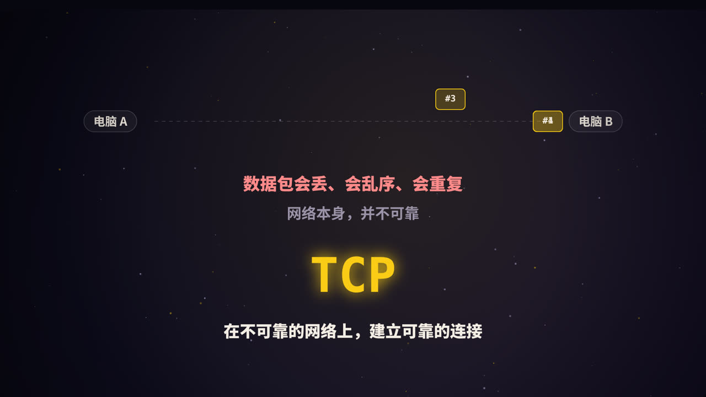
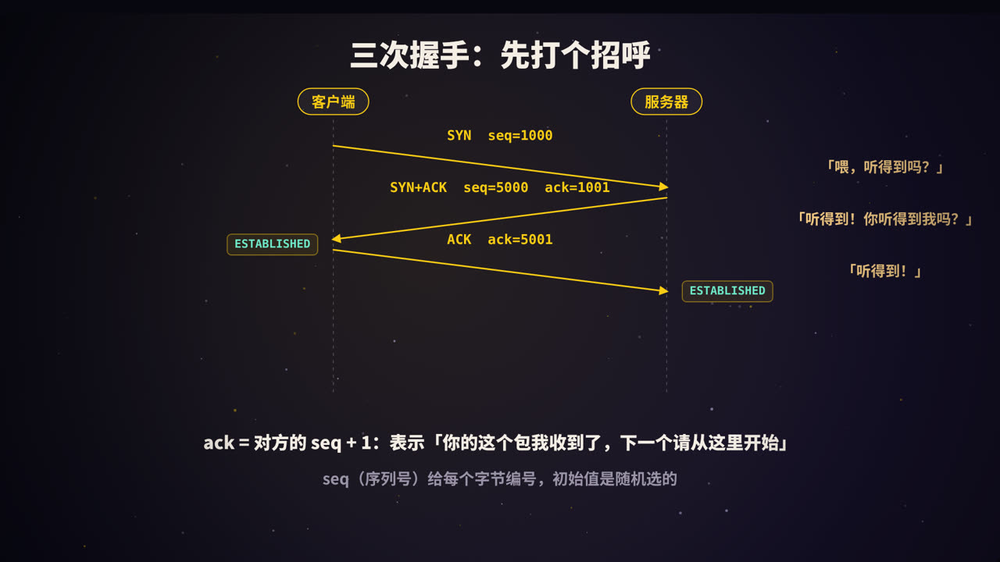
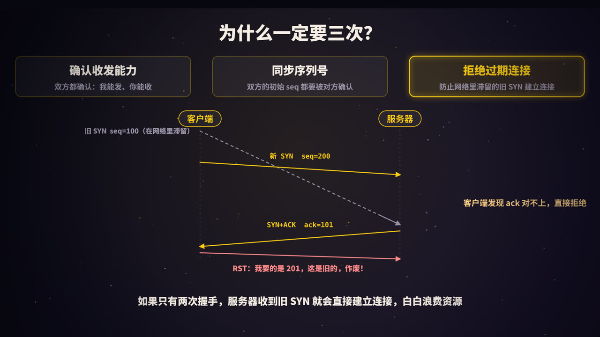
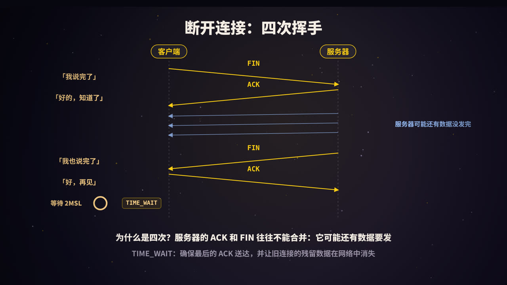
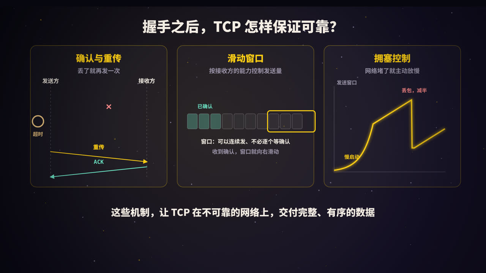
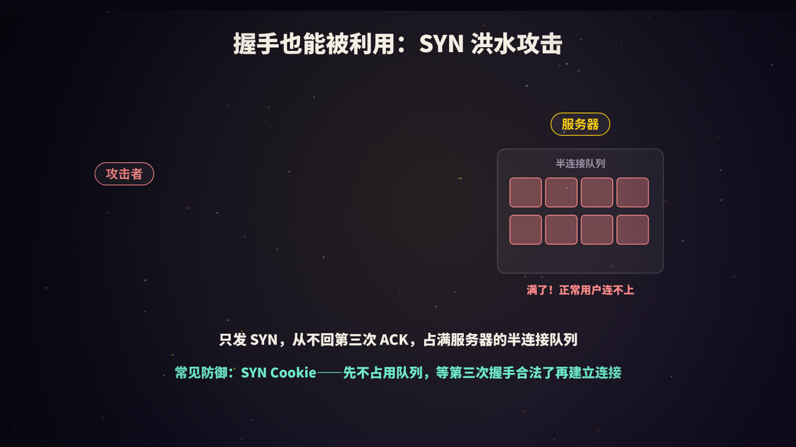
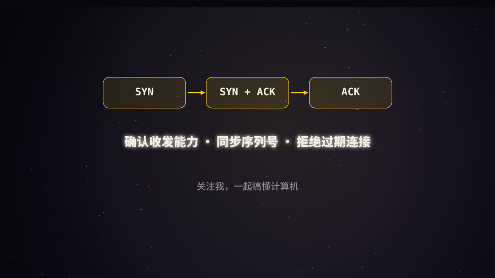

title: TCP 三次握手：为什么偏偏是三次
subtitle: 握手过程与序列号、为什么不能两次、四次挥手与 TIME_WAIT、重传与滑动窗口、拥塞控制，以及 SYN 洪水攻击
tag: 计算机与后端
color: #facc15



## 不可靠的网络，可靠的连接

互联网底层的 IP 协议只负责「尽力而为」地把数据包送到目的地，但它不保证：

- 数据包一定能到（可能**丢失**）；
- 按发送的顺序到达（可能**乱序**）；
- 只到达一次（可能**重复**）。

而我们访问网页、传输文件、调用接口时，需要的是完整、有序、不重复的数据。**TCP（传输控制协议）** 就是在不可靠的 IP 之上，构建出一条可靠的「字节流管道」。

建立这条管道之前，双方要先「打个招呼」，这就是著名的**三次握手**。

## 三次握手的过程



### 一个类比

就像打电话时确认信号：

1. 「喂，听得到吗？」
2. 「听得到！你听得到我吗？」
3. 「听得到！」

三句话之后，双方都确认了：我能说、对方能听；对方能说、我能听。

### 真实的报文

| 步骤 | 方向 | 报文 | 客户端状态 | 服务器状态 |
|---|---|---|---|---|
| 0 | | | CLOSED | LISTEN（监听端口） |
| 1 | 客户端 → 服务器 | `SYN, seq=x` | SYN_SENT | |
| 2 | 服务器 → 客户端 | `SYN+ACK, seq=y, ack=x+1` | | SYN_RCVD |
| 3 | 客户端 → 服务器 | `ACK, ack=y+1` | ESTABLISHED | ESTABLISHED |

几个关键字段：

- **SYN**（Synchronize）：请求建立连接，并同步自己的初始序列号；
- **ACK**（Acknowledgment）：确认收到了对方的数据；
- **seq**（序列号）：TCP 给发送的每个字节编号，`seq` 是本次报文第一个字节的编号；
- **ack**（确认号）：「我已经收到了你编号到 ack−1 为止的所有数据，下一个请从 ack 开始」。

SYN 报文虽然不携带数据，但规定它要占用一个序列号，所以对 SYN 的确认是 `x+1`。

### 初始序列号为什么是随机的

每个连接的初始序列号（ISN）都是随机生成的，而不是从 0 开始。原因有两个：

1. **避免和旧连接混淆**：如果同一对地址和端口上，旧连接残留的数据包晚到了，随机的序列号让它几乎不可能恰好落在新连接的有效范围里；
2. **安全**：如果序列号可以预测，攻击者就能伪造报文，插入到别人的连接中。

## 为什么一定是三次



这是面试中最常被追问的问题。可以从三个角度回答。

### 1. 确认双方的收发能力

| 握手后 | 客户端知道 | 服务器知道 |
|---|---|---|
| 第 1 次 | 什么都不确定 | 客户端能发，自己能收 |
| 第 2 次 | 自己能发能收，服务器能发能收 | （同上） |
| 第 3 次 | （同上） | 自己能发，客户端能收 |

只有三次之后，**双方都确认了**对方和自己的发送、接收能力都正常。

### 2. 同步双方的初始序列号

TCP 是双向通信，两个方向各有一套序列号。客户端的 ISN 由服务器在第二步确认；服务器的 ISN 必须由客户端在第三步确认。少了第三次，服务器就无法确定客户端是否收到了自己的序列号。

### 3. 防止过期的连接请求建立连接（最重要）

TCP 的规范（RFC 793）中特别强调了这一点。设想这样一个场景：

1. 客户端发出一个 SYN（seq=100），但它在网络中滞留了很久；
2. 客户端等不到回应，又发了一个新的 SYN（seq=200），并正常完成了连接和通信；
3. 后来，那个旧的 SYN 终于到达了服务器。

**如果只有两次握手**：服务器收到旧 SYN 并回复后，就认为连接已经建立了，开始为它分配资源、等待数据。但客户端根本不需要这个连接，服务器的资源就被白白浪费了。

**有了第三次握手**：服务器回复 `SYN+ACK, ack=101`；客户端发现这个确认号对应的是自己早已放弃的请求（当前期待的应该是 201），就回复 **RST** 报文，让服务器放弃这个连接。

### 那为什么不是四次

理论上，服务器的 ACK（确认客户端的 SYN）和 SYN（发出自己的序列号）可以分两次发。但它们可以合并在同一个报文里，没必要多一次往返，所以三次就够了。

## 断开连接：四次挥手



### 过程

| 步骤 | 方向 | 报文 | 含义 |
|---|---|---|---|
| 1 | 客户端 → 服务器 | `FIN` | 我的数据发完了 |
| 2 | 服务器 → 客户端 | `ACK` | 知道了（但我可能还有数据要发） |
| 3 | 服务器 → 客户端 | `FIN` | 我的数据也发完了 |
| 4 | 客户端 → 服务器 | `ACK` | 知道了，再见 |

这里以客户端主动关闭为例，实际上任何一方都可以先发起关闭。

### 为什么是四次，而不是三次

因为 TCP 是**全双工**的，两个方向要分别关闭。服务器收到客户端的 FIN 时，可能还有数据没有发完，所以它先回一个 ACK，等自己的数据发完了，再单独发 FIN。如果服务器恰好没有数据要发，第二步和第三步有时也可以合并。

### TIME_WAIT：为什么要等 2MSL

主动关闭的一方发出最后一个 ACK 后，不会立刻关闭，而是进入 **TIME_WAIT** 状态，等待 **2MSL**（MSL 是报文在网络中的最大生存时间）。原因有两个：

1. **确保最后的 ACK 送达**：如果这个 ACK 丢了，对方会重发 FIN，而处于 TIME_WAIT 的一方还能再回一次 ACK；
2. **让旧连接的数据包在网络中消失**：避免它们被同一个地址和端口上新建立的连接误收。

在高并发的服务端，大量短连接可能产生很多 TIME_WAIT，占用端口和资源。常见的应对方式包括：尽量使用**长连接**（如 HTTP keep-alive、连接池），以及在合适的场景下调整系统参数。

## 握手之后：TCP 如何保证可靠



三次握手只是开始，TCP 的可靠性主要依靠以下机制。

### 确认与重传

接收方收到数据后回复 ACK。发送方如果在一定时间内没有收到确认（**超时重传**），或者连续收到三个重复的 ACK（**快速重传**），就会重新发送这部分数据。

### 滑动窗口与流量控制

如果每发一个包都等确认，效率太低。TCP 允许发送方在**窗口**范围内连续发送多个包，不必逐个等待；收到确认后，窗口向前滑动。

接收方会在 ACK 中告诉发送方自己还有多少缓冲空间（**接收窗口**），发送方据此控制发送速度，避免把接收方「淹没」。这叫**流量控制**。

### 拥塞控制

流量控制照顾的是接收方，**拥塞控制**照顾的是整个网络。发送方维护一个**拥塞窗口**：

1. **慢启动**：刚开始时窗口很小，每收到一轮确认就翻倍，指数增长；
2. **拥塞避免**：达到一定阈值后，改为每轮只增加一点，线性增长；
3. **发现丢包**：认为网络可能拥塞了，把窗口大幅缩小，再慢慢恢复。

现代操作系统还有 CUBIC、BBR 等更先进的拥塞控制算法，但基本思想一致：**网络通畅时加速，出现拥塞时退让。**

## 握手也能被利用：SYN 洪水攻击



服务器收到 SYN 后，会把这个「半连接」放进一个队列，等待第三次握手。攻击者可以伪造大量源地址，只发 SYN，从不回复第三次 ACK，迅速占满这个队列，导致正常用户无法建立连接。这就是 **SYN 洪水攻击**（SYN Flood）。

常见的防御手段：

- **SYN Cookie**：服务器收到 SYN 时不立即分配队列资源，而是把连接信息编码进自己返回的初始序列号里。等收到合法的第三次 ACK 时，再从确认号中还原信息，建立连接。
- 增大半连接队列、缩短超时时间；
- 在网络层面使用防火墙和流量清洗服务。

## 动手观察

用 `tcpdump` 可以亲眼看到三次握手（需要管理员权限）：

```bash
sudo tcpdump -i any -nn 'tcp port 443 and (tcp[tcpflags] & (tcp-syn|tcp-fin) != 0)'
```

在另一个终端执行 `curl https://example.com`，就能看到带 `[S]`（SYN）、`[S.]`（SYN+ACK）和 `[F.]`（FIN+ACK）标记的报文。

查看本机各个连接的状态：

```bash
ss -tan | awk '{print $1}' | sort | uniq -c
```

## 高频面试题速答

**Q：为什么是三次握手，不是两次？**
主要是为了防止已经失效的连接请求突然到达服务器，导致服务器错误地建立连接；同时也是为了让双方都确认对方的收发能力，并同步双方的初始序列号。

**Q：第三次握手的 ACK 丢了会怎样？**
服务器停留在 SYN_RCVD 状态，会超时重发 SYN+ACK；客户端此时已认为连接建立，如果它直接发送数据，数据包中携带的 ACK 也能让服务器完成连接建立。

**Q：TIME_WAIT 出现在哪一方？为什么要等 2MSL？**
出现在主动关闭的一方。等待 2MSL 是为了确保最后的 ACK 能送达，并让旧连接的残留数据包在网络中消失。

**Q：流量控制和拥塞控制有什么区别？**
流量控制防止发送方压垮接收方，依据接收窗口；拥塞控制防止发送方压垮网络，依据拥塞窗口。

## 总结



- 三次握手：**SYN → SYN+ACK → ACK**；
- 为什么是三次：**确认收发能力、同步序列号、拒绝过期连接**；
- 四次挥手：因为双向分别关闭，服务器可能还有数据要发；主动关闭方要经历 **TIME_WAIT**；
- 可靠性来自：**确认与重传、滑动窗口、拥塞控制**；
- 握手过程也可能被利用，**SYN Cookie** 是经典的防御方法。

<div class="refs" markdown="1">

### 参考资料

- RFC 793 / RFC 9293：Transmission Control Protocol.
- RFC 5681：TCP Congestion Control.
- RFC 4987：TCP SYN Flooding Attacks and Common Mitigations.
- Stevens, W. R. *TCP/IP Illustrated, Volume 1*.（中译本：《TCP/IP 详解 卷 1》）

</div>
