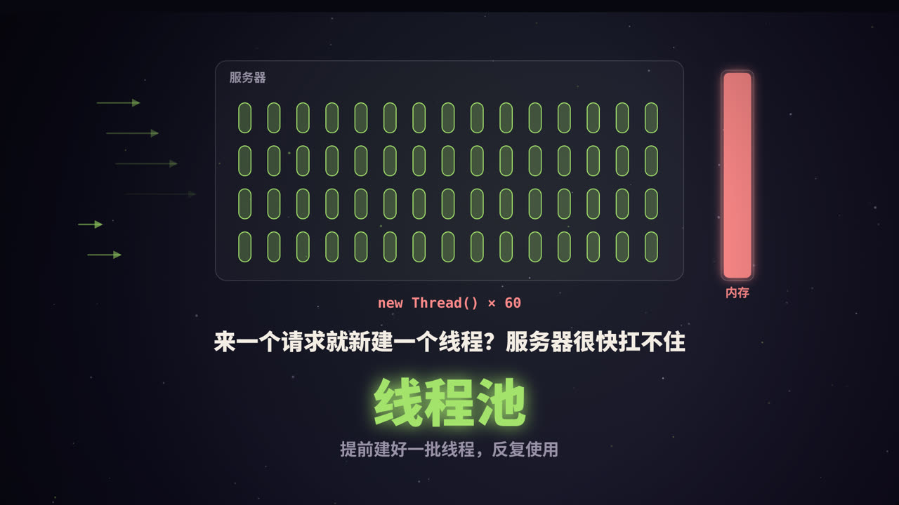
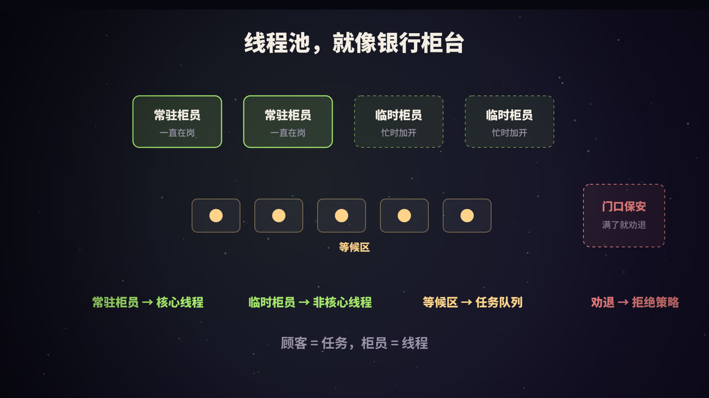
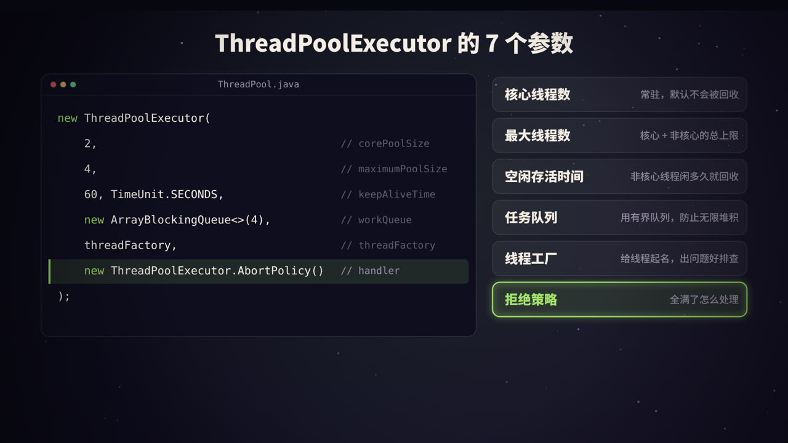
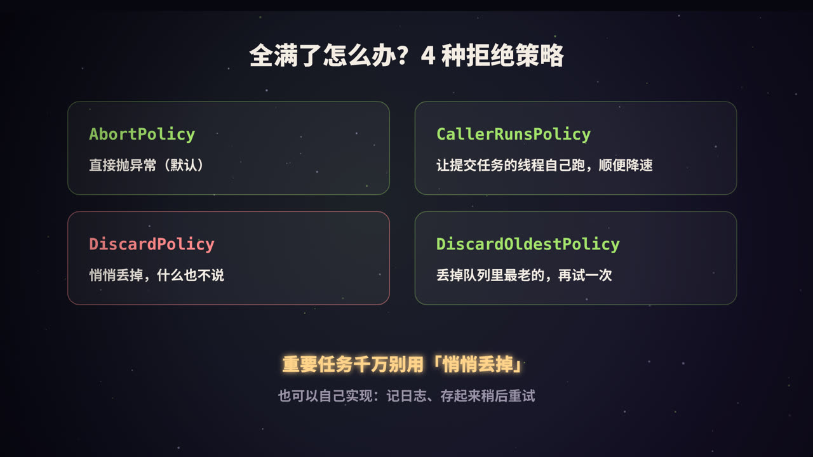
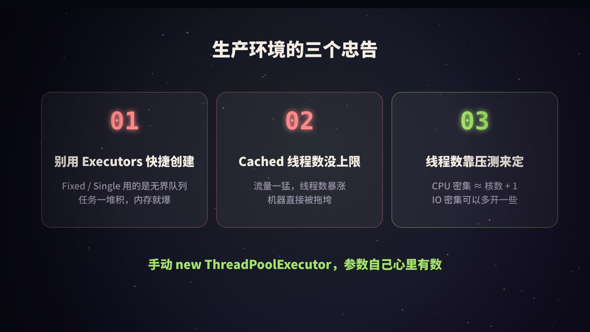

title: 线程池是什么：从银行柜台到 ThreadPoolExecutor 源码
subtitle: 为什么需要线程池、任务进来后的四步流转、7 个参数、4 种拒绝策略、线程数怎么定，以及生产环境里最常见的坑
tag: 计算机与后端
color: #a3e36b



## 为什么需要线程池

假设你写了一个 Web 服务，每来一个请求就 `new Thread()` 处理。流量小的时候没问题，流量一大，麻烦就来了：

1. **创建和销毁线程有成本**。Java 的平台线程对应一个操作系统线程，创建时要向系统申请资源、分配线程栈（64 位 Linux 上默认每个线程栈约 1MB），用完还要回收。
2. **线程太多会拖垮机器**。几千个线程同时存在，光是栈就要占用大量内存；CPU 在它们之间来回切换（上下文切换），真正干活的时间反而变少了。
3. **没有上限就没有保护**。流量突增时，线程数无限增长，最终可能导致内存溢出，整个服务宕机。

**线程池**的思路很简单：提前创建好一批线程，任务来了就交给空闲的线程执行，执行完线程不销毁，接着等下一个任务。同时给线程数和排队数都设上限，超出能力范围的任务，按事先定好的策略处理。

## 一个比喻：银行柜台



| 银行 | 线程池 |
|---|---|
| 顾客 | 任务（Runnable / Callable） |
| 常驻柜员，一直在岗 | **核心线程**（corePoolSize） |
| 等候区的椅子 | **任务队列**（workQueue） |
| 忙不过来时加开的临时窗口 | **非核心线程**（maximumPoolSize − corePoolSize） |
| 临时柜员闲下来一段时间就下班 | **空闲存活时间**（keepAliveTime） |
| 门口保安：满了就劝退 | **拒绝策略**（RejectedExecutionHandler） |

## 一个任务进来，会经历什么


调用 `execute(task)` 提交任务后，线程池按顺序做这几个判断：

1. **当前线程数 < 核心线程数？** 新建一个核心线程来执行这个任务（即使其他核心线程正闲着）。
2. **核心线程满了？** 尝试把任务放进队列排队。
3. **队列也满了？** 如果线程数还没到最大线程数，新建一个非核心线程来执行它。
4. **线程数也到上限了？** 执行拒绝策略。

视频里的例子：核心线程 2 个、最大线程 4 个、队列容量 4。连续提交 9 个任务：

| 任务 | 去向 |
|---|---|
| #1、#2 | 新建 2 个核心线程执行 |
| #3 ~ #6 | 核心线程都忙，进入队列排队 |
| #7、#8 | 队列满了，新建 2 个非核心线程执行 |
| #9 | 线程数已达 4，队列也满，被拒绝 |

> **最容易误解的一点**：很多人以为核心线程满了就会加线程。实际上是**先排队，队列满了才加线程**。如果用的是一个很大的队列，非核心线程几乎永远不会被创建，`maximumPoolSize` 形同虚设。

### 看一眼源码

JDK 中 `ThreadPoolExecutor.execute` 的核心逻辑（略有简化）：

```java
public void execute(Runnable command) {
    int c = ctl.get();
    // 1. 线程数小于核心线程数：创建核心线程
    if (workerCountOf(c) < corePoolSize) {
        if (addWorker(command, true)) return;
        c = ctl.get();
    }
    // 2. 线程池在运行，且成功放入队列
    if (isRunning(c) && workQueue.offer(command)) {
        int recheck = ctl.get();
        if (!isRunning(recheck) && remove(command))
            reject(command);                 // 放进去之后线程池被关了：拒绝
        else if (workerCountOf(recheck) == 0)
            addWorker(null, false);          // 一个线程都没有了：补一个
    }
    // 3. 入队失败：尝试创建非核心线程；4. 也失败：拒绝
    else if (!addWorker(command, false))
        reject(command);
}
```

`ctl` 是一个 `AtomicInteger`，高 3 位存线程池的运行状态，低 29 位存线程数量，用一个变量同时记录两件事，方便原子地更新。

每个线程（源码中叫 `Worker`）执行完手头的任务后，会不断从队列里取下一个任务；队列空了就阻塞等待。非核心线程等待超过 `keepAliveTime` 还没拿到任务，就会退出。

## 7 个参数逐个讲透



```java
new ThreadPoolExecutor(
    corePoolSize,      // 核心线程数
    maximumPoolSize,   // 最大线程数
    keepAliveTime,     // 非核心线程的空闲存活时间
    unit,              // 时间单位
    workQueue,         // 任务队列
    threadFactory,     // 线程工厂
    handler            // 拒绝策略
);
```

### 1. corePoolSize：核心线程数

线程池长期保持的线程数。默认情况下，核心线程即使空闲也不会被回收；调用 `allowCoreThreadTimeOut(true)` 后，核心线程空闲超时也会退出。核心线程默认不会预先创建，如果想在启动时就创建好，可以调用 `prestartAllCoreThreads()`。

### 2. maximumPoolSize：最大线程数

线程总数的上限，包括核心线程和非核心线程。只有当队列满了以后，才会创建核心线程之外的线程。

### 3、4. keepAliveTime + unit：空闲存活时间

超过核心线程数的那部分线程，空闲多久后被回收。

### 5. workQueue：任务队列

| 队列 | 特点 | 适用场景 |
|---|---|---|
| `ArrayBlockingQueue` | 基于数组，**有界**，必须指定容量 | 大多数业务场景，推荐 |
| `LinkedBlockingQueue` | 基于链表，不指定容量时上限为 `Integer.MAX_VALUE`，相当于**无界** | 指定容量后也可用 |
| `SynchronousQueue` | **不存储任务**，每次放入都要等一个线程来取 | 希望任务直接交给线程、不排队 |
| `PriorityBlockingQueue` | 按优先级排序，无界 | 需要优先级调度 |

### 6. threadFactory：线程工厂

用来创建线程。最重要的用途是**给线程起一个有意义的名字**，比如 `order-pool-3`。线上排查问题时，`jstack` 打印出的线程名能让你一眼看出是哪个业务的线程池出了问题。

### 7. handler：拒绝策略

线程和队列都满了以后，新任务怎么处理，下一节详细讲。

## 4 种拒绝策略



| 策略 | 行为 | 适用场景 |
|---|---|---|
| `AbortPolicy`（默认） | 抛出 `RejectedExecutionException` | 调用方需要明确知道任务被拒绝 |
| `CallerRunsPolicy` | 由提交任务的线程自己执行这个任务 | 不希望丢任务；同时让提交方变慢，形成自然的「背压」 |
| `DiscardPolicy` | 直接丢弃，不报错 | 任务可以丢失，比如非关键的统计上报 |
| `DiscardOldestPolicy` | 丢弃队列里最老的任务，再尝试提交当前任务 | 只关心最新数据的场景 |

也可以实现 `RejectedExecutionHandler` 接口自定义，比如记录日志、发告警，或者把任务持久化到消息队列，稍后重试：

```java
RejectedExecutionHandler handler = (task, executor) -> {
    log.warn("线程池已满，任务被拒绝: active={}, queue={}",
             executor.getActiveCount(), executor.getQueue().size());
    retryQueue.offer(task);   // 存起来稍后重试
};
```

> 重要的业务任务千万别用 `DiscardPolicy`，任务被悄悄丢掉，排查起来非常痛苦。

## 生产环境的三个忠告



### 1. 别用 Executors 的快捷方法

`Executors` 提供了几个创建线程池的快捷方法，用起来方便，却隐藏着风险：

| 方法 | 内部实现 | 风险 |
|---|---|---|
| `newFixedThreadPool(n)` | 核心 = 最大 = n，`LinkedBlockingQueue` 无界队列 | 任务堆积时队列无限增长，可能 OOM |
| `newSingleThreadExecutor()` | 单线程 + 无界队列 | 同上 |
| `newCachedThreadPool()` | 核心 0，最大 `Integer.MAX_VALUE`，`SynchronousQueue` | 流量突增时线程数暴涨 |
| `newScheduledThreadPool(n)` | 延迟队列无界 | 任务堆积时可能 OOM |

阿里巴巴《Java 开发手册》明确规定：线程池不允许使用 `Executors` 创建，而是通过 `ThreadPoolExecutor` 手动创建，让写代码的人对参数心里有数。

### 2. 线程数靠估算 + 压测来定

一个常用的估算起点：

- **CPU 密集型**（计算、加解密、压缩）：线程数 ≈ CPU 核数 + 1。线程再多也只是增加切换开销。
- **IO 密集型**（调接口、查数据库、读文件）：线程大部分时间在等待，可以多开。《Java 并发编程实战》给出的公式是：

```text
线程数 = CPU 核数 × 目标 CPU 利用率 × (1 + 等待时间 / 计算时间)
```

比如 8 核机器，任务等待 IO 的时间是计算时间的 4 倍，希望 CPU 跑满，那么大约是 8 × 1 × (1 + 4) = 40 个线程。

但这只是起点，真实的最佳值一定要通过**压测**得出，并在上线后持续观察。

### 3. 不同业务用不同的线程池

如果所有业务共用一个线程池，一个慢接口就能把线程全部占满，拖垮其他所有业务。按业务隔离线程池，可以把故障限制在局部。

## 其他实用知识

### execute 和 submit 的区别

- `execute(Runnable)`：没有返回值；任务抛出的异常会导致执行它的线程终止，并由线程的未捕获异常处理器打印出来。
- `submit(...)`：返回 `Future`；任务抛出的异常会被**包装在 Future 里**，只有调用 `future.get()` 时才会抛出。如果你从不调用 `get()`，异常就被「吞」了，日志里什么也看不到。

### 优雅关闭

```java
pool.shutdown();                                   // 不再接收新任务，已提交的继续执行
if (!pool.awaitTermination(30, TimeUnit.SECONDS)) { // 最多等 30 秒
    pool.shutdownNow();                            // 还没完成：中断正在执行的任务
}
```

`shutdown()` 是温和的关闭；`shutdownNow()` 会尝试中断所有正在执行的任务，并返回队列中还没开始的任务。

### 监控线程池

`ThreadPoolExecutor` 提供了不少可以直接读取的指标：

| 方法 | 含义 |
|---|---|
| `getPoolSize()` | 当前线程数 |
| `getActiveCount()` | 正在执行任务的线程数（近似值） |
| `getQueue().size()` | 队列中等待的任务数 |
| `getCompletedTaskCount()` | 已完成的任务数 |
| `getLargestPoolSize()` | 历史最大线程数 |

把这些指标定时上报到监控系统，队列持续增长、活跃线程长期打满时及时告警。`setCorePoolSize()` 和 `setMaximumPoolSize()` 还支持运行时动态调整，很多公司的「动态线程池」就是基于这一点做的。

### 一个完整的推荐写法

```java
ThreadFactory factory = new ThreadFactory() {
    private final AtomicInteger n = new AtomicInteger(1);
    public Thread newThread(Runnable r) {
        return new Thread(r, "order-pool-" + n.getAndIncrement());
    }
};

ThreadPoolExecutor pool = new ThreadPoolExecutor(
    8, 16,
    60, TimeUnit.SECONDS,
    new ArrayBlockingQueue<>(1000),
    factory,
    new ThreadPoolExecutor.CallerRunsPolicy()
);
```

### 新变化：虚拟线程

JDK 21 正式引入了**虚拟线程**（Virtual Threads）。它由 JVM 调度，创建成本极低，可以轻松创建上百万个。对于大量 IO 等待的场景，可以直接「每个任务一个虚拟线程」：

```java
try (ExecutorService executor = Executors.newVirtualThreadPerTaskExecutor()) {
    executor.submit(() -> callRemoteService());
}
```

虚拟线程不需要池化，但这不代表线程池过时了：CPU 密集型任务、需要限制并发数的场景（比如保护下游数据库），依然需要线程池或信号量等手段来控制。

## 总结


- 线程池的价值：**复用线程**省掉创建开销，**排队缓冲**扛住突发流量，**兜底拒绝**保护系统不被压垮。
- 任务流转顺序：**核心线程 → 队列 → 非核心线程 → 拒绝策略**，注意是先排队再加线程。
- 生产环境：手动创建 `ThreadPoolExecutor`，用**有界队列**，给线程**起名字**，**按业务隔离**，并**监控**关键指标。

<div class="refs" markdown="1">

### 参考资料

- Oracle. Java SE API 文档：`java.util.concurrent.ThreadPoolExecutor`.
- Goetz, B., et al. (2006). *Java Concurrency in Practice*.（中译本：《Java 并发编程实战》）
- 阿里巴巴.《Java 开发手册》并发处理章节.
- JEP 444: Virtual Threads (JDK 21).

</div>
