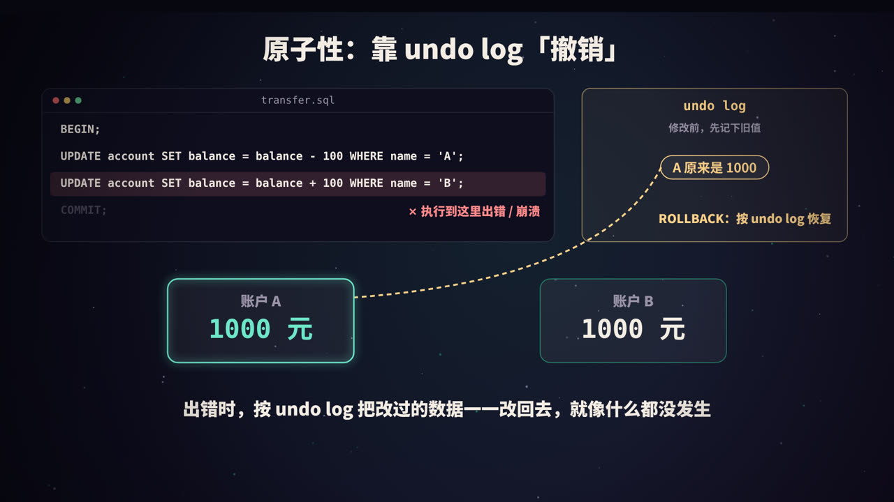
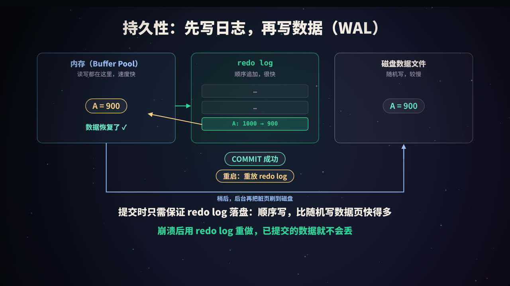
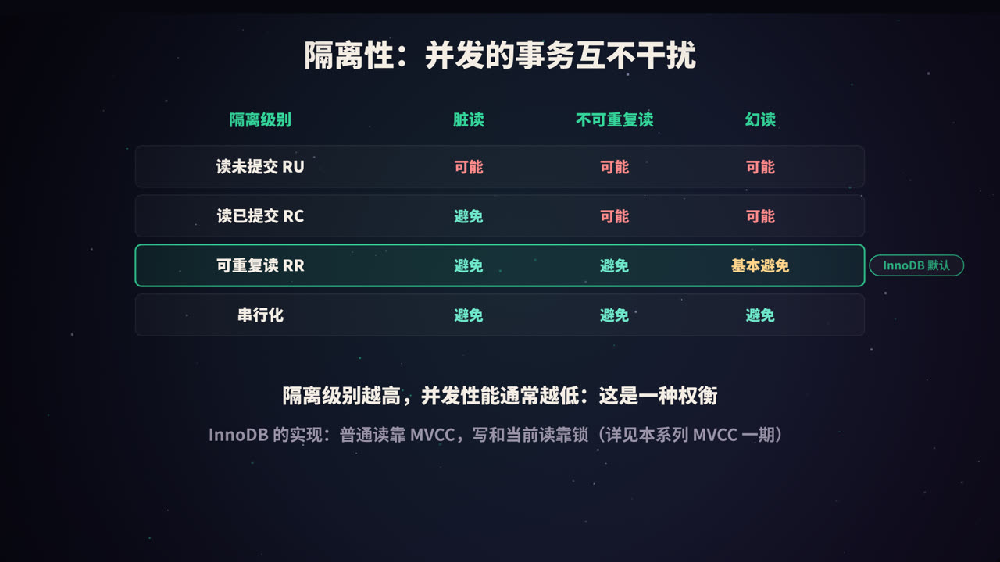
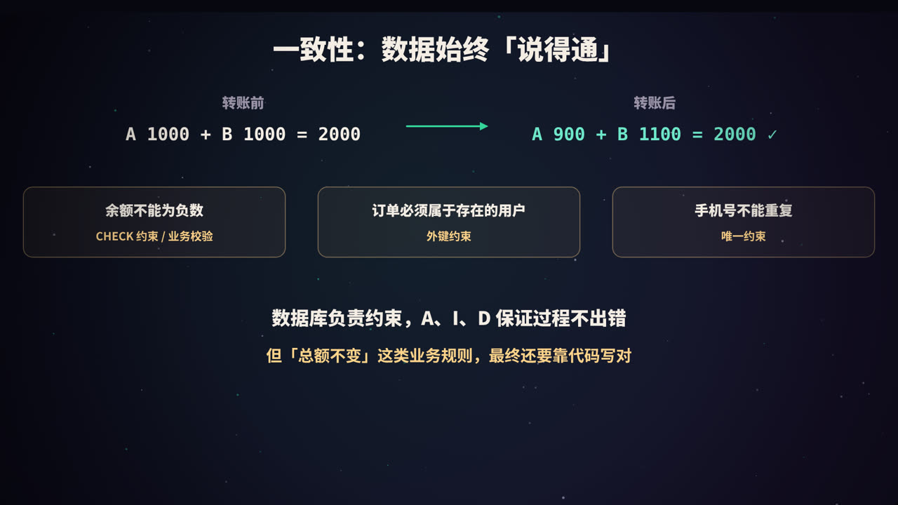
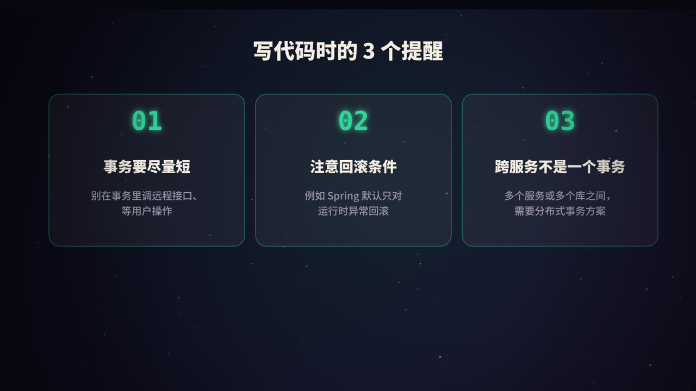
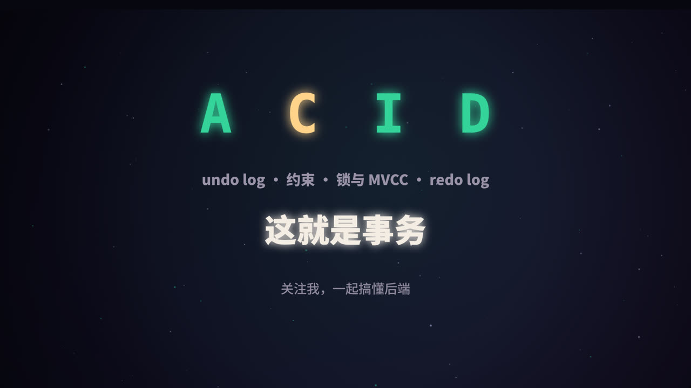

title: 事务与 ACID：InnoDB 是怎么保证数据不出错的
subtitle: 原子性靠 undo log，持久性靠 redo log 和 WAL，隔离性靠锁与 MVCC，一致性是最终目的。附 Spring 事务的常见坑和分布式事务入门
tag: 计算机与后端
color: #34d399


## 为什么需要事务

A 给 B 转账 100 元，至少需要两步：

```sql
UPDATE account SET balance = balance - 100 WHERE name = 'A';
UPDATE account SET balance = balance + 100 WHERE name = 'B';
```

如果第一步执行完、第二步还没执行时，系统崩溃了，A 的钱少了，B 的钱却没多，100 元凭空消失。

**事务**（transaction）就是把多个操作打包成一个整体：**要么全部成功，要么全部不做**。

```sql
BEGIN;
UPDATE account SET balance = balance - 100 WHERE name = 'A';
UPDATE account SET balance = balance + 100 WHERE name = 'B';
COMMIT;      -- 全部生效；如果中途出错，执行 ROLLBACK 全部撤销
```

> MySQL 默认开启 **autocommit**：如果没有显式 `BEGIN`，每一条语句都自动作为一个独立的事务提交。

## ACID 总览


| 特性 | 含义 | InnoDB 的实现 |
|---|---|---|
| **A** 原子性（Atomicity） | 事务中的操作要么全部完成，要么全部不做 | undo log |
| **C** 一致性（Consistency） | 事务前后，数据都满足预定的规则 | 数据库约束 + A、I、D + 应用逻辑 |
| **I** 隔离性（Isolation） | 并发执行的事务互不干扰 | 锁 + MVCC |
| **D** 持久性（Durability） | 事务一旦提交，修改就不会丢失 | redo log |

一个常被忽略的关键点：**C 是目的，A、I、D 是手段。** 原子性、隔离性、持久性共同保证数据始终处于一致的状态。

## 原子性：undo log



### 原理

InnoDB 在修改数据之前，会先把修改前的旧值记录到 **undo log** 里：

| 操作 | undo log 记录的内容 |
|---|---|
| `INSERT` | 新插入行的主键（回滚时删除它） |
| `DELETE` | 被删除行的完整内容（回滚时恢复它） |
| `UPDATE` | 被修改列的旧值（回滚时改回去） |

如果事务执行过程中出错，或者用户主动执行 `ROLLBACK`，InnoDB 就按照 undo log **反向**执行，把数据恢复到事务开始前的样子。

### 保存点

事务中还可以设置**保存点**，只回滚到某个位置，而不是全部撤销：

```sql
BEGIN;
UPDATE ...;
SAVEPOINT s1;
UPDATE ...;
ROLLBACK TO s1;   -- 只撤销 s1 之后的操作
COMMIT;
```

### undo log 的另一个用途

undo log 中保存的旧版本，同时也构成了 MVCC 的「版本链」，让快照读能看到历史版本。详见本系列《MySQL 的 MVCC》。

## 持久性：redo log 与 WAL



### 为什么不直接把数据写到磁盘

InnoDB 修改数据时，先改的是内存中的数据页（Buffer Pool），被改过但还没写回磁盘的页叫**脏页**。如果每次提交都把相关的数据页写回磁盘：

- 数据页分散在磁盘各处，是**随机写**，很慢；
- 一个页 16KB，可能只改了几个字节，却要整页写入。

### WAL：先写日志

InnoDB 采用 **WAL**（Write-Ahead Logging，预写日志）策略：

1. 修改数据时，先改内存中的数据页；
2. 同时把「对哪个页做了什么修改」记录到 **redo log**；
3. 事务提交时，只需保证 **redo log 写入磁盘**，就可以返回成功；
4. 脏页由后台线程在合适的时机，慢慢刷回磁盘。

redo log 是**顺序追加**写入的，比随机写数据页快得多，而且记录的内容很紧凑。

### 崩溃恢复

如果在脏页刷回磁盘之前系统崩溃了，内存中的修改全部丢失。重启时，InnoDB 读取 redo log，把已经提交、但还没写进数据文件的修改**重做**一遍，数据就恢复了。这就是持久性的来源。

### 刷盘策略

参数 `innodb_flush_log_at_trx_commit` 控制提交时 redo log 的刷盘方式：

| 取值 | 行为 | 可能丢失的数据 |
|---|---|---|
| `1`（默认） | 每次提交都写入并刷到磁盘 | 不丢失 |
| `2` | 每次提交写入操作系统缓存，约每秒刷一次盘 | 操作系统崩溃或断电时，可能丢最近约 1 秒的事务 |
| `0` | 约每秒写入并刷盘一次 | MySQL 进程崩溃也可能丢最近约 1 秒的事务 |

对数据安全要求高的场景，通常配合 `sync_binlog = 1` 一起使用，也就是常说的「**双 1 配置**」。

### redo log 和 binlog 的关系

MySQL 还有一种日志叫 **binlog**，由 Server 层记录，用于主从复制和数据恢复。为了保证 redo log 和 binlog 的内容一致，提交时使用了**两阶段提交**：

1. 写 redo log，标记为 prepare 状态；
2. 写 binlog；
3. 把 redo log 标记为 commit 状态。

崩溃恢复时，如果某个事务的 redo log 处于 prepare 状态，就检查 binlog 中是否有完整的记录，以此决定提交还是回滚。

## 隔离性：锁与 MVCC



### 并发事务会带来什么问题

| 问题 | 描述 |
|---|---|
| 脏读 | 读到了其他事务未提交的数据 |
| 不可重复读 | 同一事务内两次读同一行，结果不同 |
| 幻读 | 同一事务内两次范围查询，行数不同 |
| 丢失更新 | 两个事务都基于旧值修改，后提交的覆盖了先提交的 |

### 四种隔离级别

| 隔离级别 | 脏读 | 不可重复读 | 幻读 |
|---|---|---|---|
| 读未提交 | 可能 | 可能 | 可能 |
| 读已提交（RC） | 避免 | 可能 | 可能 |
| 可重复读（RR，InnoDB 默认） | 避免 | 避免 | InnoDB 中基本避免 |
| 串行化 | 避免 | 避免 | 避免 |

隔离级别越高，数据越「安全」，但并发性能通常越差。

### InnoDB 怎么实现

- **普通 SELECT（快照读）**：通过 **MVCC** 读取历史版本，不加锁，读写不阻塞；
- **写操作和当前读**（`UPDATE`、`DELETE`、`SELECT ... FOR UPDATE`）：通过**锁**来协调，包括**记录锁**（锁住一行）、**间隙锁**（锁住两条记录之间的空隙，防止插入）和两者结合的**临键锁**。

### 防止丢失更新

「先查余额，再在代码里计算，最后写回」是一个经典的坑：

```sql
-- 有问题：两个事务可能同时读到 1000，各自减 100 后都写回 900
SELECT balance FROM account WHERE id = 1;
UPDATE account SET balance = 900 WHERE id = 1;
```

正确的做法：

```sql
-- 方法一：让数据库原子地计算，并检查余额
UPDATE account SET balance = balance - 100 WHERE id = 1 AND balance >= 100;

-- 方法二：加锁读（悲观锁）
SELECT balance FROM account WHERE id = 1 FOR UPDATE;

-- 方法三：版本号（乐观锁）
UPDATE account SET balance = 900, version = version + 1 WHERE id = 1 AND version = 7;
```

### 死锁

两个事务互相等待对方持有的锁，就会形成**死锁**。InnoDB 会自动检测死锁，并回滚其中代价较小的一个事务。应用代码应该捕获这类错误并重试；同时，尽量让不同事务**按相同的顺序**访问资源，可以大幅减少死锁。

## 一致性：最终的目的



一致性指的是：事务开始前和结束后，数据都满足所有预定的规则。这些规则分两类：

1. **数据库能保证的**：主键唯一、非空、外键、唯一约束、`CHECK` 约束（MySQL 8.0.16 起生效）等；
2. **只有业务知道的**：比如「转账前后总额不变」「库存不能超卖」。

数据库通过原子性、隔离性、持久性，保证事务的执行过程不会破坏数据；但如果代码本身写错了，比如转账时只扣钱不加钱，数据库也无能为力。所以一致性是数据库和应用**共同**的责任。

## 写代码时的提醒



### 1. 事务要尽量短

事务越长，持有锁的时间就越长，阻塞其他事务；还会阻止 undo log 被清理。**不要在事务里调用远程接口、发送消息、等待用户操作**。

### 2. Spring `@Transactional` 的常见坑

| 现象 | 原因 |
|---|---|
| 同一个类里的方法 A 调用带 `@Transactional` 的方法 B，B 的事务没生效 | Spring 事务基于代理，类内部通过 `this` 调用会绕过代理 |
| 抛出受检异常（如 `IOException`）后没有回滚 | 默认只对 `RuntimeException` 和 `Error` 回滚，需要设置 `rollbackFor` |
| 异常被 `try-catch` 吞掉了，事务照常提交 | 事务管理器没感知到异常 |
| 在新线程里执行的数据库操作不在事务里 | 事务绑定在当前线程上 |
| 方法不是 `public`，注解不生效 | 基于代理的事务默认只作用于 public 方法 |

### 3. 跨服务不是一个本地事务

当一个业务操作涉及多个服务或多个数据库时，本地事务就无能为力了，需要**分布式事务**方案：

| 方案 | 思路 | 特点 |
|---|---|---|
| 两阶段提交（2PC/XA） | 协调者先让所有参与者准备，都成功后再统一提交 | 强一致，但性能较差，协调者故障时可能阻塞 |
| TCC | 每个操作拆成 Try、Confirm、Cancel 三步 | 灵活，但业务改造成本高 |
| Saga | 拆成一串本地事务，失败时按反方向执行补偿操作 | 适合长流程，保证最终一致 |
| 本地消息表 / Outbox | 业务数据和「待发送消息」在同一个本地事务里写入，再异步可靠投递 | 实现简单，最终一致，非常常用 |

互联网业务中，大多数场景选择的是**最终一致性**：允许短时间内不一致，但保证最终达到一致。

## 高频面试题速答

**Q：ACID 分别靠什么实现？**
原子性靠 undo log；持久性靠 redo log；隔离性靠锁和 MVCC；一致性是目的，由前三者和数据库约束、应用逻辑共同保证。

**Q：redo log 和 undo log 有什么区别？**
redo log 记录「修改后是什么样」，用于崩溃后重做，保证持久性；undo log 记录「修改前是什么样」，用于回滚和 MVCC，保证原子性和隔离性。

**Q：为什么不在提交时直接把数据页写入磁盘？**
数据页是随机写，代价高；redo log 是顺序写，代价低。先写日志，崩溃时也能通过日志恢复，这就是 WAL。

**Q：什么是「双 1 配置」？**
`innodb_flush_log_at_trx_commit = 1` 和 `sync_binlog = 1`，每次提交都把 redo log 和 binlog 刷到磁盘，最大程度保证数据不丢。

## 总结



- **原子性**：undo log 记录旧值，出错就撤销；
- **持久性**：WAL，先写 redo log，崩溃后重做；
- **隔离性**：快照读靠 MVCC，写和当前读靠锁；
- **一致性**：最终目的，需要数据库和代码共同保证；
- 写代码时：**事务要短，注意回滚条件，跨服务要用分布式事务方案**。

<div class="refs" markdown="1">

### 参考资料

- MySQL 8.0 Reference Manual: InnoDB and the ACID Model；Redo Log；Undo Logs；InnoDB Locking；Transaction Isolation Levels.
- Spring Framework Reference: Transaction Management（Declarative transaction management）.
- Kleppmann, M. (2017). *Designing Data-Intensive Applications*, Chapter 7: Transactions.（中译本：《数据密集型应用系统设计》）
- Garcia-Molina, H., & Salem, K. (1987). Sagas. *ACM SIGMOD*.

</div>
