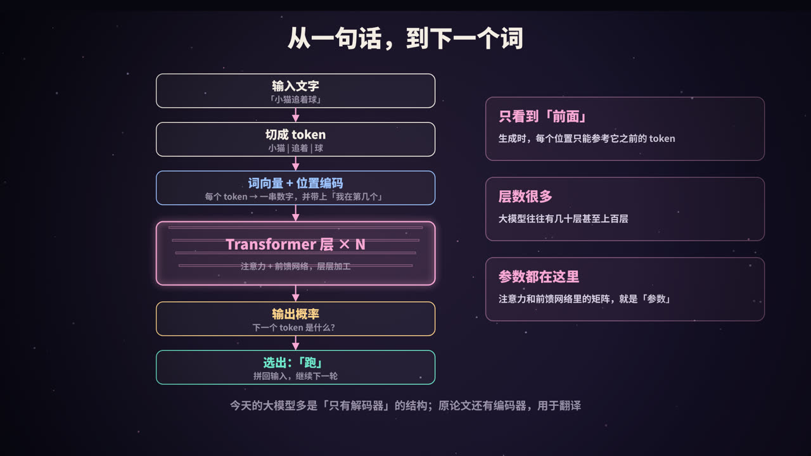
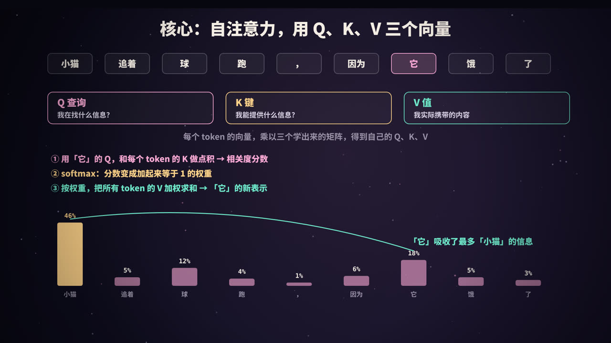
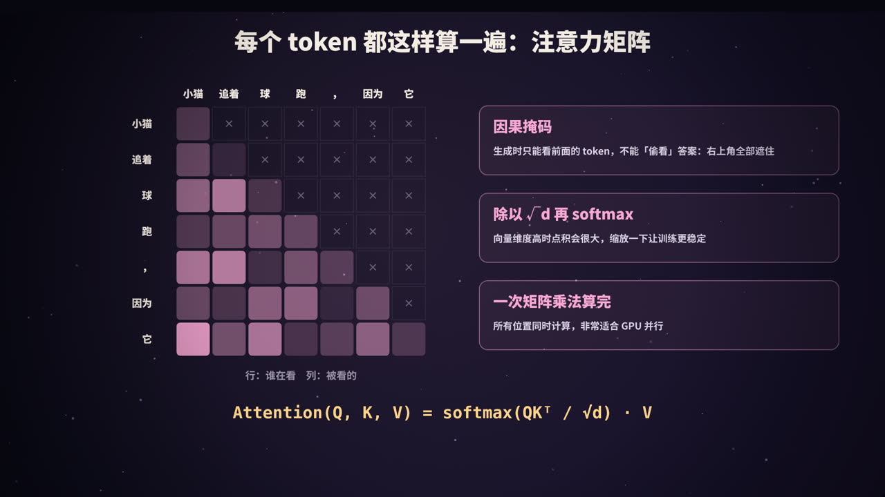
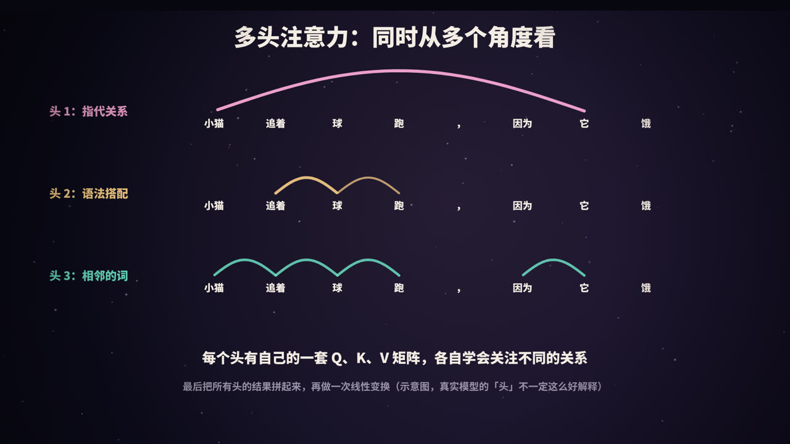
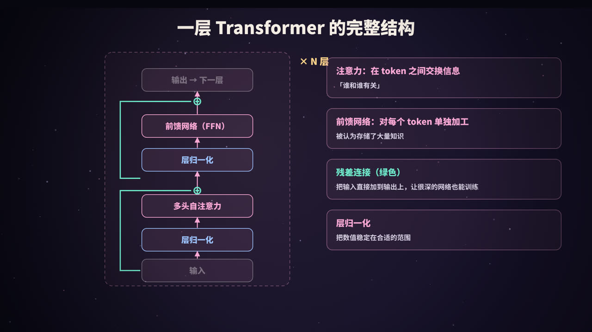

title: Transformer 详解：拆开大模型的骨架
subtitle: 从输入到输出的完整流程，自注意力的 Q、K、V 与公式推导，因果掩码、多头注意力、前馈网络、残差与归一化、位置编码，附一段可运行的 NumPy 实现
tag: AI 与大模型
color: #f9a8d4


## 为什么要单独讲 Transformer

GPT 的全称是 Generative Pre-trained **Transformer**。不只是 GPT，Claude、Gemini、Llama、DeepSeek、Qwen 等几乎所有大语言模型，核心结构都是 Transformer。它出自 2017 年 Google 研究人员发表的论文《Attention Is All You Need》，最初用于机器翻译，后来成为了整个大模型时代的基石。

本系列《什么是 LLM》从「猜下一个词」的角度介绍了大模型，这一篇深入一层，把 Transformer 内部的每个部件拆开来看。

## 从输入到输出：完整流程



今天的大语言模型多采用**只有解码器**（decoder-only）的 Transformer。生成一个词的完整流程是：

1. **分词**：把输入文字切成 token，比如「小猫 | 追着 | 球」，每个 token 对应词表中的一个编号；
2. **词嵌入**：通过查表，把每个 token 编号变成一个向量（比如 4096 维），这个向量表示 token 的含义（见本系列《Embedding 向量》）；
3. **位置编码**：给每个向量加上位置信息，让模型知道 token 的先后顺序；
4. **N 层 Transformer 块**：每一层包含「多头自注意力」和「前馈网络」，向量经过一层层加工，逐渐融合上下文信息；
5. **输出层**：把最后一个位置的向量映射到整个词表，经过 softmax 得到每个 token 作为下一个词的概率；
6. **采样**：选出一个 token（比如「跑」），拼回输入，重复整个过程。

模型的「参数」，主要就是嵌入表、注意力层和前馈网络中那些矩阵里的数字。大模型往往有几十层甚至上百层这样的 Transformer 块。

> 原始论文中的 Transformer 包括**编码器**和**解码器**两部分：编码器读入源语言句子，解码器生成目标语言。BERT 只用了编码器，GPT 系列只用了解码器。

## 核心：自注意力



### 要解决的问题

在「小猫追着球跑，因为它饿了」这句话中，模型处理「它」时，需要知道「它」指的是小猫。也就是说，每个 token 的表示都应该融合上下文中与它相关的信息。**自注意力**（self-attention）就是完成这件事的机制。

### Q、K、V 三个向量

对于每个 token 的向量 x，用三个可学习的矩阵分别相乘，得到三个新向量：

| 向量 | 计算 | 含义 |
|---|---|---|
| **Q**（Query，查询） | x · W_Q | 我在找什么样的信息？ |
| **K**（Key，键） | x · W_K | 我能提供什么样的信息？ |
| **V**（Value，值） | x · W_V | 我实际携带的信息内容 |

可以类比图书馆检索：Q 是你的检索词，K 是每本书的索引标签，V 是书的内容。检索词和标签越匹配，你从这本书里获取的内容就越多。

### 三步计算

以「它」为例：

1. **算相关度**：用「它」的 Q，分别和每个 token 的 K 做点积，得到一组分数。点积越大，说明越相关；
2. **归一化**：对分数做 softmax，变成一组加起来等于 1 的权重，比如「小猫」46%、「它」自己 18%、「球」12%……
3. **加权求和**：用这些权重，对所有 token 的 V 加权求和，得到「它」的新表示。这个新表示中，包含了大量来自「小猫」的信息。

每个 token 都会同时进行这样的计算。

## 注意力矩阵与公式



把所有 token 的 Q、K、V 分别堆成矩阵，所有位置的注意力就可以用一次矩阵运算算完：

```text
Attention(Q, K, V) = softmax( Q·Kᵀ / √d ) · V
```

- `Q·Kᵀ`：得到一个 n × n 的分数矩阵，第 i 行第 j 列表示第 i 个 token 对第 j 个 token 的关注程度；
- `/ √d`：d 是 K 向量的维度。维度高时点积的数值会很大，导致 softmax 的输出过于极端、梯度很小，除以 √d 进行缩放可以让训练更稳定；
- `softmax`：对每一行做归一化；
- `· V`：按权重对 V 加权求和。

### 因果掩码

生成文字时，模型是一个词一个词往后写的，第 i 个位置**不应该看到后面的词**（否则训练时就等于偷看了答案）。所以在 softmax 之前，把分数矩阵右上角（j > i 的部分）全部设为负无穷，softmax 之后这些位置的权重就变成了 0。这叫**因果掩码**（causal mask）。

### 一段可运行的实现

用 NumPy 实现带因果掩码的单头自注意力：

```python
import numpy as np

def softmax(x):
    e = np.exp(x - x.max(axis=-1, keepdims=True))
    return e / e.sum(axis=-1, keepdims=True)

def causal_self_attention(X, Wq, Wk, Wv):
    """X: (n, d_model)，n 个 token 的向量"""
    Q, K, V = X @ Wq, X @ Wk, X @ Wv                 # (n, d)
    d = Q.shape[-1]
    scores = Q @ K.T / np.sqrt(d)                    # (n, n)
    mask = np.triu(np.ones_like(scores), k=1)        # 右上角为 1
    scores = np.where(mask == 1, -1e9, scores)       # 遮住「未来」
    weights = softmax(scores)                        # 每行加起来等于 1
    return weights @ V, weights

rng = np.random.default_rng(0)
n, d_model, d = 5, 16, 8
X = rng.normal(size=(n, d_model))
Wq, Wk, Wv = (rng.normal(size=(d_model, d)) for _ in range(3))
out, w = causal_self_attention(X, Wq, Wk, Wv)
print(out.shape)          # (5, 8)
print(np.round(w, 2))     # 下三角矩阵：每个位置只关注自己和前面的 token
```

## 多头注意力



只用一组 Q、K、V，模型只能学到一种「关注方式」。但语言中的关系是多种多样的：指代关系、语法搭配、相邻词语、语义相似……

**多头注意力**（multi-head attention）的做法是：

1. 准备 h 组独立的 W_Q、W_K、W_V（比如 32 组），每组叫一个「头」；
2. 每个头独立计算注意力，各自可以学会关注不同类型的关系；
3. 把所有头的输出拼接起来，再乘以一个输出矩阵 W_O，得到最终结果。

为了不增加计算量，每个头的维度通常是总维度除以头数。比如总维度 4096、32 个头，每个头就是 128 维。

研究者确实在训练好的模型中发现了一些专门负责特定功能的头，但大多数头的作用并不容易用人类语言解释。视频中的三种关系只是示意。

## 一层的完整结构



一个 Transformer 块（以现代大模型常用的「前置归一化」结构为例）：

```text
x = x + MultiHeadAttention(LayerNorm(x))     # 子层 1：token 之间交换信息
x = x + FeedForward(LayerNorm(x))            # 子层 2：每个 token 单独加工
```

### 前馈网络（FFN）

对每个 token 的向量**单独**做两次线性变换，中间加一个非线性激活函数：

```text
FFN(x) = W₂ · activation(W₁ · x)
```

中间层通常比输入宽好几倍（比如 4 倍）。注意力负责在 token 之间「交换信息」，前馈网络负责对每个 token「深加工」。研究认为，模型学到的大量事实性知识存储在前馈网络的参数中。在很多大模型里，前馈网络占了参数的大头。

### 残差连接

`x = x + 子层(x)`：把子层的输入直接加到输出上。它像一条「高速公路」，让信息和梯度可以直接跨层传递，使得几十上百层的深度网络也能顺利训练。

### 层归一化

把每个向量的数值调整到稳定的范围，避免在层层传递中数值变得过大或过小。现代模型常用其变体 RMSNorm。

### 位置编码

自注意力本身是「无序」的：把句子中的词打乱，每个位置算出的注意力结果不变。所以必须额外告诉模型每个 token 的位置。原论文使用固定的正弦、余弦函数生成位置编码；现在很多大模型使用**旋转位置编码**（RoPE），它把位置信息融入 Q 和 K 的计算中，更好地表达 token 之间的相对距离。

## 为什么 Transformer 能胜出


在 Transformer 之前，处理序列的主流方法是 **RNN**（循环神经网络，包括 LSTM）。RNN 按顺序一个词一个词地处理，每一步都依赖上一步的结果。

| | RNN / LSTM | Transformer |
|---|---|---|
| 计算方式 | 按顺序逐个处理 | 所有位置同时计算 |
| 训练并行度 | 低，难以利用大量 GPU | 高，非常适合 GPU |
| 长距离依赖 | 信息要经过很多步传递，容易丢失 | 任意两个位置一步直达 |
| 扩展性 | 难以做得很大 | 可以稳定地扩展到上千亿参数 |

**可并行**、**能直接建模长距离关系**、**容易扩展**，这三点使 Transformer 能够在海量数据和算力上训练出越来越大的模型，从而有了今天的大模型。

### 代价

- **注意力的计算量与序列长度的平方成正比**：序列长度翻倍，注意力部分的计算量大约变成 4 倍。这是长上下文昂贵的主要原因之一，也催生了 FlashAttention、稀疏注意力等大量优化方法；
- **KV Cache**：生成时，每生成一个新 token，都要和之前所有 token 的 K、V 做注意力计算。为了避免重复计算，推理时会把之前算好的 K、V 缓存起来。它大大加快了生成速度，但会占用大量显存，上下文越长、并发越多，占用越大。

## 一些常见的模型参数

| 概念 | 含义 |
|---|---|
| 层数 | Transformer 块堆叠的数量 |
| 隐藏维度（d_model） | 每个 token 向量的长度 |
| 头数 | 多头注意力中头的数量 |
| FFN 维度 | 前馈网络中间层的宽度 |
| 上下文长度 | 一次能处理的最大 token 数 |
| 词表大小 | 分词器中 token 的总数 |

这些数字共同决定了模型的参数量和计算量。

## 总结


- Transformer 是几乎所有大语言模型的骨架，今天的主流是**只有解码器**的结构；
- **自注意力**：用 Q 和 K 的点积衡量相关度，softmax 后对 V 加权求和，让每个 token 融合上下文；
- **因果掩码**让生成时只能看到前面的 token；**多头注意力**从多个角度同时建模关系；
- 每一层由**注意力 + 前馈网络**组成，配合**残差连接**和**层归一化**，再堆叠 N 层；
- 它胜在**并行、长距离、可扩展**；代价是注意力随长度平方增长，推理需要 **KV Cache**。

<div class="refs" markdown="1">

### 参考资料

- Vaswani, A., et al. (2017). Attention Is All You Need. *NeurIPS*.
- Radford, A., et al. (2019). Language Models are Unsupervised Multitask Learners (GPT-2). OpenAI.
- Su, J., et al. (2021). RoFormer: Enhanced Transformer with Rotary Position Embedding. *arXiv:2104.09864*.
- Dao, T., et al. (2022). FlashAttention: Fast and Memory-Efficient Exact Attention with IO-Awareness. *NeurIPS*.
- Alammar, J. The Illustrated Transformer. jalammar.github.io
- Geva, M., et al. (2021). Transformer Feed-Forward Layers Are Key-Value Memories. *EMNLP*.

</div>
