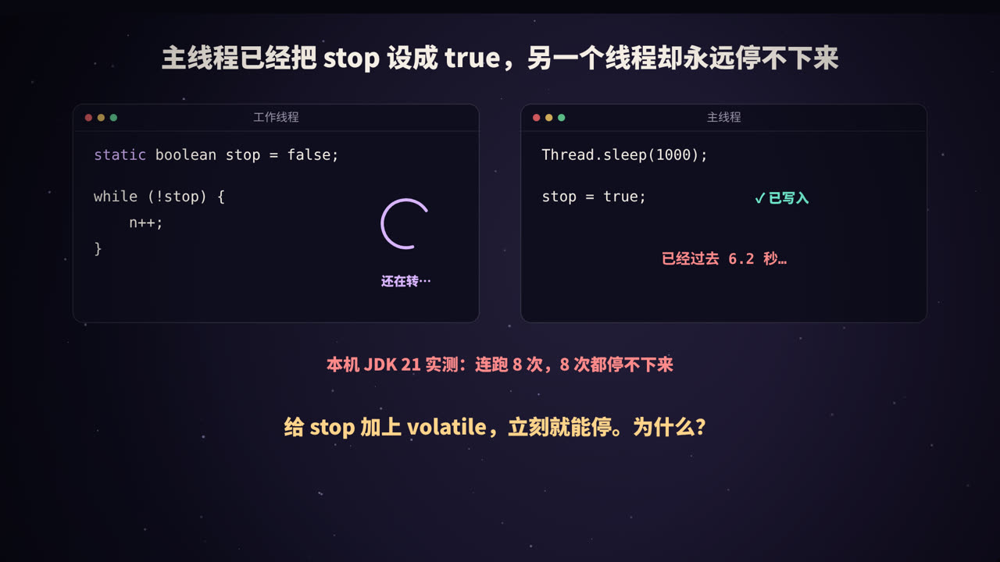
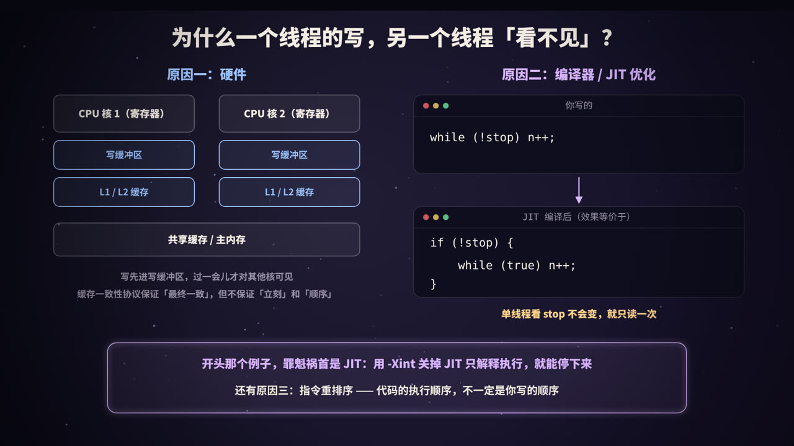
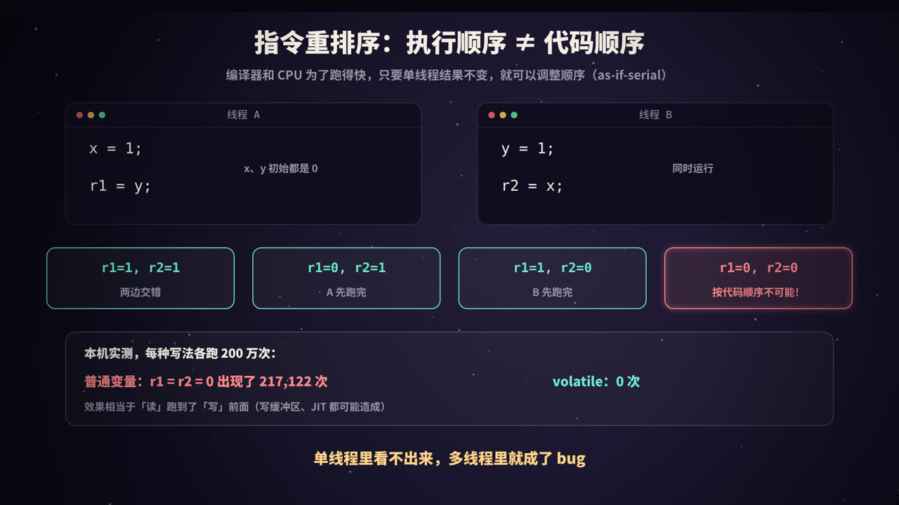
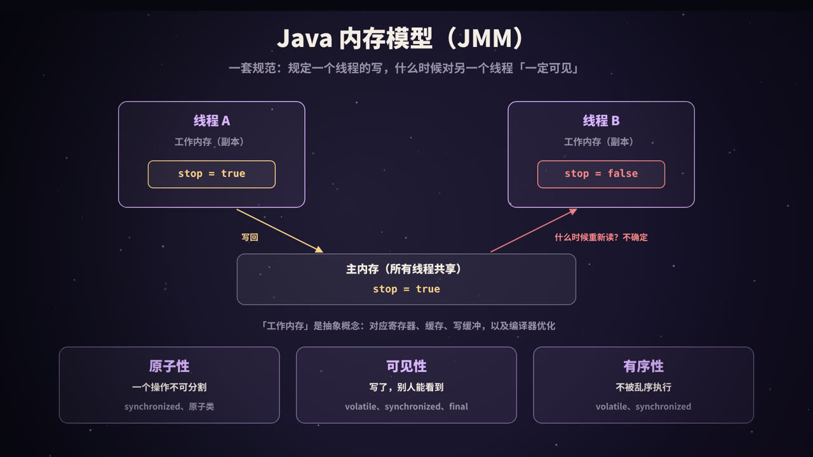
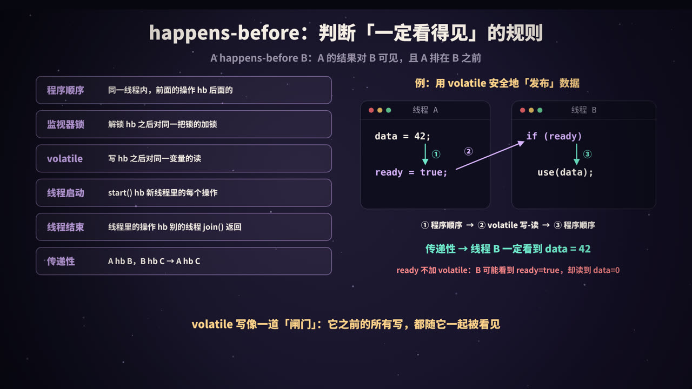
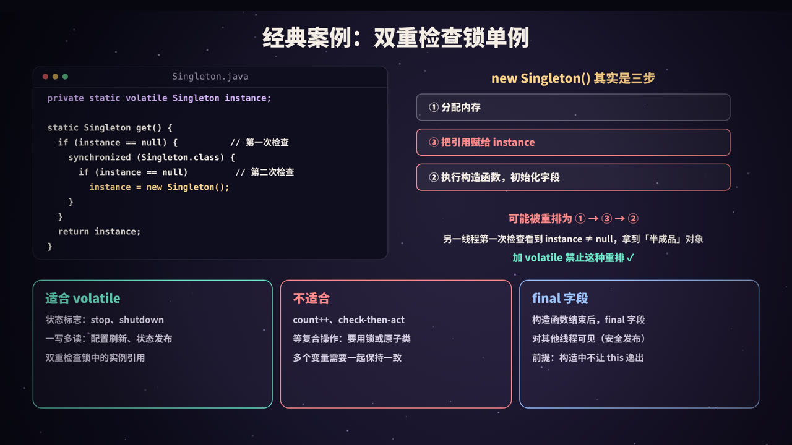

title: volatile 与 Java 内存模型：为什么另一个线程「看不见」你的写
subtitle: 停不下来的循环、CPU 缓存与 JIT 优化、指令重排序、JMM 的主内存与工作内存、原子性可见性有序性、volatile 的内存屏障与不保证原子性、happens-before 规则、双重检查锁单例与 final 字段，附 4 个真实运行的 Java 实验
tag: 计算机与后端
color: #d8b4fe



## 一个停不下来的循环

先看一段代码。工作线程在循环里检查一个标志 `stop`，主线程等 1 秒后把它设为 `true`：

```java
static boolean stop = false;

// 工作线程
while (!stop) n++;

// 主线程
Thread.sleep(1000);
stop = true;
```

按直觉，主线程一改，工作线程下一次检查就会看到 `true`，然后退出循环。但在我的机器上（JDK 21，HotSpot），**连续运行 8 次，工作线程 8 次都停不下来**。只要给 `stop` 加上 `volatile`，它就能立刻停下。

这一个关键字背后，是并发编程中最容易让人困惑的一块内容：**Java 内存模型**（Java Memory Model，JMM）。本文回答四个问题：

1. 为什么一个线程的写，另一个线程会「看不见」？
2. JMM 用什么规则来规定「什么时候一定看得见」？
3. `volatile` 到底保证了什么，又**不**保证什么？
4. 双重检查锁单例为什么必须加 `volatile`？

> 本系列《Java 的锁：synchronized、CAS 与 AQS》讲的是「多个线程同时改，怎么不打架」（互斥）；这一篇讲的是另一面：「一个线程改了，别的线程能不能看到、看到的顺序对不对」（可见性与有序性）。

## 为什么会「看不见」



### 原因一：硬件的缓存和写缓冲区

CPU 比内存快得多，访问一次主内存要花上百个时钟周期。为此，每个 CPU 核心都有自己的多级缓存（L1、L2），多个核心再共享 L3 和主内存。另外，CPU 执行写操作时，通常不会等写真正进入缓存，而是先放进一个**写缓冲区**（store buffer），然后马上执行后面的指令。

| 部件 | 是否核心私有 | 对可见性的影响 |
|---|---|---|
| 寄存器 | 是 | 值放在寄存器里，其他核心完全看不到 |
| 写缓冲区 | 是 | 写入暂存在这里，其他核心暂时看不到 |
| L1 / L2 缓存 | 是 | 由**缓存一致性协议**（如 MESI）在核心间同步 |
| L3 / 主内存 | 共享 | — |

缓存一致性协议保证了多个核心的缓存**最终**会一致，但它不保证「**立刻**」，更不保证不同变量之间的「**顺序**」。在 ARM 等内存模型更弱的处理器上，允许的乱序比 x86 还要多。

### 原因二：编译器和 JIT 的优化

对于开头那个例子，真正的「罪魁祸首」其实不是 CPU 缓存，而是 **JIT 编译器**。

JIT 在编译这段热点循环时，看到循环体里没有任何代码会修改 `stop`，而且 `stop` 不是 volatile，就认为「单线程语义下它不会变」，于是把读取提到循环外面（循环不变量外提）：

```java
// 你写的
while (!stop) n++;

// JIT 编译后，效果等价于
if (!stop) {
    while (true) n++;
}
```

这样只在进入循环时读一次 `stop`，之后再也不读了。主线程怎么改，这个循环都不知道。

这个优化对单线程程序完全正确，Java 规范也允许它这么做，因为普通变量从来没有承诺过「对其他线程可见」。

### 原因三：指令重排序

编译器和 CPU 还可能**调整指令的执行顺序**，下一节专门讲。

### 实验：停不下来的循环

```java
public class StopFlag {
    static boolean stop = false;            // 普通字段
    static volatile boolean vstop = false;  // volatile 字段

    public static void main(String[] args) throws Exception {
        // 1. 普通字段做停止标志
        Thread t1 = new Thread(() -> {
            long n = 0;
            while (!stop) n++;               // 空转，一直读 stop
            System.out.println("  [普通] 工作线程看到了 stop=true，循环了 " + n + " 次");
        });
        t1.setDaemon(true);                  // 守护线程：停不下来也不妨碍 JVM 退出
        t1.start();
        Thread.sleep(1000);                  // 让循环先跑一会儿，JIT 有时间编译它
        stop = true;
        System.out.println("[普通] 主线程已把 stop 设为 true");
        t1.join(2000);                       // 最多等 2 秒
        System.out.println("[普通] 2 秒后工作线程还活着吗？" + t1.isAlive());

        // 2. volatile 字段做停止标志
        Thread t2 = new Thread(() -> {
            long n = 0;
            while (!vstop) n++;
            System.out.println("  [volatile] 工作线程看到了 vstop=true，循环了 " + n + " 次");
        });
        t2.setDaemon(true);
        t2.start();
        Thread.sleep(1000);
        vstop = true;
        System.out.println("[volatile] 主线程已把 vstop 设为 true");
        t2.join(2000);
        System.out.println("[volatile] 2 秒后工作线程还活着吗？" + t2.isAlive());
    }
}
```

用 JDK 21 运行 `java -Dstdout.encoding=UTF-8 StopFlag.java`，某一次的输出：

```text
[普通] 主线程已把 stop 设为 true
[普通] 2 秒后工作线程还活着吗？true
[volatile] 主线程已把 vstop 设为 true
  [volatile] 工作线程看到了 vstop=true，循环了 2747199115 次
[volatile] 2 秒后工作线程还活着吗？false
```

普通字段的版本，等了 2 秒工作线程仍然在跑（它是守护线程，所以程序还能正常退出）；volatile 版本立刻停了下来。我在本机连续运行了 8 次，普通版本 8 次都没有停下。

再加上 `-Xint` 参数（关闭 JIT，只用解释器执行）运行同一个程序：

```text
[普通] 主线程已把 stop 设为 true
  [普通] 工作线程看到了 stop=true，循环了 110127131 次
[普通] 2 秒后工作线程还活着吗？false
[volatile] 主线程已把 vstop 设为 true
  [volatile] 工作线程看到了 vstop=true，循环了 109722230 次
[volatile] 2 秒后工作线程还活着吗？false
```

关掉 JIT 后，普通版本也停下来了（循环次数也少了一个数量级，因为解释执行慢得多）。这说明在这个例子里，问题出在 **JIT 的优化**上，而不是 CPU 缓存：x86 的缓存一致性协议会很快把新值同步过去，但 JIT 编译后的代码根本不再去读它。

> **注意：这类问题不保证每次都能复现。**它取决于 JVM 版本、JIT 是否已经编译了这段循环、循环体里有什么代码（比如在循环里调用 `System.out.println` 或 `Thread.sleep`，往往会让 JIT 不再做这种外提，看起来「又正常了」）、CPU 架构等。但「这次能停下来」不代表代码是对的——没有 volatile 或锁，**规范就不保证你能看到**。

## 指令重排序：执行顺序 ≠ 代码顺序



### as-if-serial

为了提高性能，编译器（javac 很少做，主要是 JIT）和 CPU 都会调整指令的执行顺序，比如：

- 编译器把两条没有依赖关系的语句调换位置，或者把读操作提前、写操作合并；
- CPU 乱序执行，先执行后面已经准备好数据的指令；
- 写缓冲区让「写」比后面的「读」更晚被其他核心看到，效果上就是「读」跑到了「写」前面。

它们都遵守同一条原则：**as-if-serial**，即**在单线程看来，结果和按代码顺序执行完全一样**。所以单线程程序永远感觉不到重排序。但多线程程序观察的是**另一个线程**的执行顺序，这个保证就不成立了。

### 实验：r1 和 r2 能同时为 0 吗

经典的测试：`x`、`y` 初始都是 0，两个线程同时执行：

| 线程 A | 线程 B |
|---|---|
| `x = 1;` | `y = 1;` |
| `r1 = y;` | `r2 = x;` |

如果每个线程都按代码顺序执行，无论怎样交错，至少有一个线程的写会发生在另一个线程的读之前，可能的结果只有 `(1,1)`、`(0,1)`、`(1,0)`。**`r1 = r2 = 0` 是不可能的**——除非发生了重排序。

下面的程序把这个测试重复 200 万次，统计 `(0,0)` 出现了多少次。为了让两个线程尽量「同时」执行每一轮，用两个 volatile 进度变量让它们步调一致；volatile 版本的读写通过 `VarHandle` 的 `setVolatile` / `getVolatile` 实现（数组元素不能直接声明为 volatile）。

```java
import java.lang.invoke.MethodHandles;
import java.lang.invoke.VarHandle;
import java.util.concurrent.CyclicBarrier;

/** 经典的「存储缓冲」测试：两个线程各写一个变量、再读另一个变量 */
public class Reorder {
    static final int N = 2_000_000;
    static int[] x, y, r1, r2;
    static volatile int pa, pb;          // 两个线程的进度，用来让它们步调一致
    static final VarHandle AA = MethodHandles.arrayElementVarHandle(int[].class);

    static long run(boolean useVolatile) throws Exception {
        x = new int[N]; y = new int[N]; r1 = new int[N]; r2 = new int[N]; pa = 0; pb = 0;
        CyclicBarrier start = new CyclicBarrier(2);
        Thread a = new Thread(() -> {
            await(start);
            for (int i = 0; i < N; i++) {
                while (pb < i) Thread.onSpinWait();   // 等对方也走到第 i 轮
                if (useVolatile) { AA.setVolatile(x, i, 1); r1[i] = (int) AA.getVolatile(y, i); }
                else             { x[i] = 1;                r1[i] = y[i]; }
                pa = i + 1;
            }
        });
        Thread b = new Thread(() -> {
            await(start);
            for (int i = 0; i < N; i++) {
                while (pa < i) Thread.onSpinWait();
                if (useVolatile) { AA.setVolatile(y, i, 1); r2[i] = (int) AA.getVolatile(x, i); }
                else             { y[i] = 1;                r2[i] = x[i]; }
                pb = i + 1;
            }
        });
        a.start(); b.start(); a.join(); b.join();
        long both0 = 0;
        for (int i = 0; i < N; i++) if (r1[i] == 0 && r2[i] == 0) both0++;
        return both0;
    }

    static void await(CyclicBarrier b) { try { b.await(); } catch (Exception e) { throw new RuntimeException(e); } }

    public static void main(String[] args) throws Exception {
        System.out.println("线程 A: x = 1; r1 = y;     线程 B: y = 1; r2 = x;");
        System.out.println("如果严格按代码顺序执行，r1 和 r2 不可能同时为 0\n");
        for (int round = 1; round <= 3; round++) {
            System.out.printf("第 %d 轮（各 %,d 次）  普通读写：r1 = r2 = 0 出现 %,d 次    volatile 读写：出现 %,d 次%n",
                    round, N, run(false), run(true));
        }
    }
}
```

本机（2 核 x86 虚拟机，JDK 21）的输出：

```text
线程 A: x = 1; r1 = y;     线程 B: y = 1; r2 = x;
如果严格按代码顺序执行，r1 和 r2 不可能同时为 0

第 1 轮（各 2,000,000 次）  普通读写：r1 = r2 = 0 出现 32,488 次    volatile 读写：出现 0 次
第 2 轮（各 2,000,000 次）  普通读写：r1 = r2 = 0 出现 217,122 次    volatile 读写：出现 0 次
第 3 轮（各 2,000,000 次）  普通读写：r1 = r2 = 0 出现 194,529 次    volatile 读写：出现 0 次
```

「不可能」的结果出现了十几万次；换成 volatile 读写后一次都没有。具体次数和机器、负载有关，每次运行都不同。从结果上看不出这次重排是 JIT 造成的还是 CPU 写缓冲区造成的，但对程序员来说没有区别：**没有同步，就不能假设另一个线程看到的顺序和你写的顺序一致。**

> 一个小插曲：这个程序的第一个版本没有让两个线程步调一致，结果普通读写也是 0 次——因为一个线程总是远远跑在另一个前面，两边的读写根本没有「同时」发生过。并发测试很难写对，严肃的场景请使用 OpenJDK 的 **jcstress** 工具。

## Java 内存模型（JMM）



### 为什么需要一个「模型」

不同 CPU 的内存行为差别很大：x86 只允许「写后读」这一种重排，ARM、POWER 允许的乱序多得多；不同 JIT 做的优化也不同。如果 Java 程序的并发行为依赖于具体的硬件，「一次编写，到处运行」就成了空话。

**JMM 是一套规范**（定义在 Java 语言规范第 17 章，现行版本来自 JDK 5 引入的 JSR-133），它规定：**在什么条件下，一个线程的写对另一个线程一定可见**。JVM 负责在每种平台上，用合适的编译限制和 CPU 指令实现这些保证；程序员只需要按规范写代码，不需要关心底层是 x86 还是 ARM。

### 主内存与工作内存

JMM 用一个抽象的模型来描述：

- 所有共享变量都存在**主内存**中；
- 每个线程有自己的**工作内存**，保存了它用到的变量的副本；
- 线程对变量的读写都在工作内存中进行，什么时候和主内存同步，**没有特别约束的话是不确定的**。

注意，「工作内存」是一个**抽象概念**，不是真实存在的某块内存。它对应的是寄存器、CPU 缓存、写缓冲区，以及编译器优化（比如把变量放在寄存器里不再重新读）带来的种种效果。

### 三大特性

| 特性 | 含义 | 反例 | 怎么保证 |
|---|---|---|---|
| **原子性** | 一个操作要么全做完，要么完全没做，中间状态不会被别的线程看到 | `count++` 丢失更新 | synchronized、Lock、原子类 |
| **可见性** | 一个线程修改了共享变量，其他线程能看到新值 | 停不下来的循环 | volatile、synchronized、Lock、final |
| **有序性** | 在其他线程看来，操作按预期的顺序发生 | `r1 = r2 = 0` | volatile、synchronized、Lock |

关于原子性有一个细节：Java 规范保证对 `int`、`boolean`、引用等类型的单次读写是原子的；但对**非 volatile 的 `long` 和 `double`**，规范允许 JVM 把一次 64 位写拆成两次 32 位写（JLS 17.7），另一个线程可能读到「一半新、一半旧」的值。声明为 volatile 后，`long` / `double` 的读写就是原子的了。不过现代 64 位 JVM 实际上都是原子读写的。

**synchronized 能同时保证三个特性**：同一时刻只有一个线程执行（原子性）；解锁前把修改刷出、加锁后重新读取（可见性）；临界区内的代码不会被重排到临界区之外（有序性）。**volatile 只保证后两个**，这正是下一节的重点。

## volatile 做了什么


### 保证一：可见性

- 对 volatile 变量的**写**，会让这次写（以及之前的所有写，见后文 happens-before）对之后读这个变量的线程可见；
- 对 volatile 变量的**读**，每次都会真正去读最新的值，JIT 不能把它缓存在寄存器里，也不能把它提到循环外面。

这就是开头的循环加上 volatile 就能停下来的原因。

### 保证二：禁止重排序（内存屏障）

JMM 通过**内存屏障**（memory barrier / fence）来限制重排序。按照 JSR-133 给编译器实现者的指南（JSR-133 Cookbook）中的保守策略：

| 位置 | 插入的屏障 | 作用 |
|---|---|---|
| volatile **写之前** | StoreStore | 前面的普通写，必须先于这次 volatile 写完成 |
| volatile **写之后** | StoreLoad | 这次 volatile 写，必须先于后面的读写完成（最重的一种屏障） |
| volatile **读之后** | LoadLoad + LoadStore | 后面的普通读写，不能提前到这次 volatile 读之前 |

可以简单记成：**volatile 写之前的操作不能往后挪，volatile 读之后的操作不能往前挪**。这正好构成了「发布-获取」的语义：写线程先准备好数据、最后写 volatile 标志；读线程先读 volatile 标志、再去读数据。

具体到 CPU 上，实际生成的指令取决于架构。x86 本身的内存模型较强（称为 TSO），只会出现「写后读」的重排，所以只有 StoreLoad 需要真正的指令：HotSpot 在 volatile 写之后加一条**带 lock 前缀的指令**（如 `lock addl`），它会等写缓冲区清空后才继续执行，其他几种屏障在 x86 上不需要额外指令。ARM 等平台上，则需要使用专门的屏障指令或带获取/释放语义的读写指令。

> 从 JDK 9 开始，`VarHandle` 还提供了比 volatile 更细粒度的访问模式：`getAcquire` / `setRelease`（只保证单向顺序）和 `getOpaque` / `setOpaque`（只保证不被优化掉）。它们主要用于编写 JUC 这类底层并发库，普通业务代码用 volatile 就足够了。

### 不保证：原子性

这是 volatile 最常见的误用。`volatile int count` 之后，`count++` 仍然是**读-改-写**三步：两个线程可以同时读到同一个最新值，各自加 1，再先后写回，其中一次更新照样丢失。volatile 只保证「读到的是最新值」，不保证「读和写之间没有别人插进来」。

```java
import java.util.concurrent.atomic.AtomicInteger;

public class VolatileCount {
    static volatile int vcount = 0;
    static final AtomicInteger acount = new AtomicInteger();

    public static void main(String[] args) throws Exception {
        Thread[] ts = new Thread[4];
        for (int round = 1; round <= 3; round++) {
            vcount = 0; acount.set(0);
            for (int i = 0; i < 4; i++) {
                ts[i] = new Thread(() -> {
                    for (int j = 0; j < 1_000_000; j++) { vcount++; acount.incrementAndGet(); }
                });
                ts[i].start();
            }
            for (Thread t : ts) t.join();
            System.out.printf("第 %d 轮：volatile int = %,d    AtomicInteger = %,d   （期望 4,000,000）%n", round, vcount, acount.get());
        }
    }
}
```

输出：

```text
第 1 轮：volatile int = 2,786,860    AtomicInteger = 4,000,000   （期望 4,000,000）
第 2 轮：volatile int = 3,249,620    AtomicInteger = 4,000,000   （期望 4,000,000）
第 3 轮：volatile int = 2,086,256    AtomicInteger = 4,000,000   （期望 4,000,000）
```

volatile 版本每轮都少了几十万到近 200 万次。需要原子的复合操作时，用 `AtomicInteger`（CAS）、`LongAdder` 或加锁，原理见本系列《Java 的锁》。

### volatile 与 synchronized 对比

| | volatile | synchronized |
|---|---|---|
| 作用对象 | 变量 | 方法、代码块 |
| 原子性 | 只保证单次读 / 写 | 保证整个临界区 |
| 可见性 | 保证 | 保证 |
| 有序性 | 保证（禁止相关重排） | 保证（临界区作为整体） |
| 是否阻塞线程 | 不会 | 抢不到锁会阻塞 |
| 开销 | 读几乎和普通读一样；写有一次屏障的开销 | 无竞争时较低，有竞争时较高 |

## happens-before：判断「一定看得见」的规则



### 定义

JMM 没有直接用「屏障」「缓存」这些硬件概念来描述规则，而是定义了一个更抽象的关系：**happens-before**（先行发生，简称 hb）。

> 如果操作 A happens-before 操作 B，那么 A 的结果对 B 可见，并且 A 在 B 之前发生（在 B 看来）。

反过来说：**如果两个操作之间没有 happens-before 关系，JVM 就可以随意重排它们，一个线程的写也不一定对另一个线程可见。**多个线程访问同一个变量、至少有一个是写、而它们之间又没有 happens-before 关系，这种情况叫**数据竞争**（data race）。

注意，happens-before 不等于「时间上先发生」。它是一种**可见性保证**：时间上先发生的写，如果没有 hb 关系，后面的读也不一定能看到。

### 常用规则

| 规则 | 内容 |
|---|---|
| **程序顺序规则** | 同一个线程中，前面的操作 hb 后面的操作 |
| **监视器锁规则** | 对一个锁的解锁 hb 之后对**同一个锁**的加锁 |
| **volatile 变量规则** | 对一个 volatile 变量的写 hb 之后对**同一个变量**的读 |
| **线程启动规则** | `Thread.start()` hb 新线程中的每一个操作 |
| **线程终止规则** | 线程中的所有操作 hb 其他线程从该线程的 `join()` 返回（或 `isAlive()` 返回 false） |
| **中断规则** | 调用 `interrupt()` hb 被中断线程检测到中断 |
| **传递性** | A hb B，B hb C，那么 A hb C |

JUC 中的工具类也在文档中给出了 happens-before 保证，比如：放入并发集合的操作 hb 从集合中取出的操作；向线程池提交任务 hb 任务开始执行；`Future` 中任务的完成 hb `get()` 返回；`CountDownLatch.countDown()` hb 对应的 `await()` 返回。

### 用传递性安全地发布数据

最有用的是把几条规则用**传递性**串起来：

```java
int data;                    // 普通变量
volatile boolean ready;      // volatile 变量

// 线程 A
data = 42;                   // ①
ready = true;                // ②  volatile 写

// 线程 B
if (ready) {                 // ③  volatile 读，读到了 true
    use(data);               // ④  一定看到 42
}
```

- ① hb ②：程序顺序规则；
- ② hb ③：volatile 变量规则（③ 读到了 ② 写入的值）；
- ③ hb ④：程序顺序规则；
- 传递性：① hb ④，所以线程 B 一定能看到 `data = 42`。

这说明 volatile 写像一道「**闸门**」：**写 volatile 之前的所有写，都会随着它一起对读到这个 volatile 值的线程可见**，哪怕 `data` 本身不是 volatile。

如果 `ready` 不是 volatile，② 和 ③ 之间就没有 hb 关系，线程 B 可能看到 `ready = true`，却读到 `data = 0`（因为 ① 和 ② 被重排，或者 `data` 的新值还没对 B 可见）。

这条链也解释了为什么「用 synchronized 保护写，却不保护读」是错的：监视器锁规则要求解锁和加锁是**同一把锁**，读线程不加锁，就没有 hb 关系，可见性就没有保证。

## 双重检查锁单例



### 问题出在 new 上

懒加载单例的常见写法是双重检查锁（Double-Checked Locking，DCL）：

```java
public class Singleton {
    private static Singleton instance;        // 没有 volatile：有问题！

    public static Singleton getInstance() {
        if (instance == null) {                 // 第一次检查：不加锁，避免每次都同步
            synchronized (Singleton.class) {
                if (instance == null) {         // 第二次检查：防止重复创建
                    instance = new Singleton();
                }
            }
        }
        return instance;
    }
}
```

看起来很完美，问题出在 `instance = new Singleton()` 这一行。它编译后的字节码是（用 `javap -c` 查看 `instance = new NewObj()`）：

```text
0: new           #7                  // class NewObj
3: dup
4: invokespecial #9                  // Method "<init>":()V
7: putstatic     #10                 // Field instance:LNewObj;
```

概念上是三步：

1. **分配内存**（`new`）；
2. **执行构造函数**，初始化字段（`invokespecial <init>`）；
3. **把引用赋给 `instance`**（`putstatic`）。

第 2 步和第 3 步之间没有数据依赖，在单线程看来先赋值再初始化结果是一样的，所以 JIT 或 CPU 可以把它们重排成 **1 → 3 → 2**。

<figure>
<svg viewBox="0 0 440 330" xmlns="http://www.w3.org/2000/svg" role="img" aria-label="双重检查锁的重排序问题">
  <rect width="440" height="330" fill="#0f0e1c"/>
  <defs><marker id="va" viewBox="0 0 10 10" refX="9" refY="5" markerWidth="7" markerHeight="7" orient="auto"><path d="M0,0 L10,5 L0,10 z" fill="#ff8a8a"/></marker></defs>
  <g font-family="PingFang SC, Noto Sans SC, sans-serif" text-anchor="middle">
    <text x="110" y="28" fill="#d8b4fe" font-size="16" font-weight="800">线程 A（创建实例）</text>
    <text x="330" y="28" fill="#d8b4fe" font-size="16" font-weight="800">线程 B（获取实例）</text>
    <line x1="220" y1="44" x2="220" y2="300" stroke="rgba(255,255,255,.12)" stroke-dasharray="5 5"/>
    <rect x="16" y="50" width="188" height="48" rx="10" fill="rgba(255,255,255,.06)" stroke="#9a93a8"/>
    <text x="110" y="79" fill="#f4ede4" font-size="14" font-weight="700">① 分配内存</text>
    <rect x="16" y="112" width="188" height="48" rx="10" fill="rgba(255,138,138,.12)" stroke="#ff8a8a"/>
    <text x="110" y="141" fill="#ff8a8a" font-size="14" font-weight="700">③ instance = 地址</text>
    <rect x="16" y="236" width="188" height="48" rx="10" fill="rgba(255,255,255,.06)" stroke="#9a93a8"/>
    <text x="110" y="265" fill="#f4ede4" font-size="14" font-weight="700">② 执行构造函数</text>
    <line x1="204" y1="136" x2="234" y2="174" stroke="#ff8a8a" stroke-width="2.5" marker-end="url(#va)"/>
    <rect x="236" y="160" width="188" height="48" rx="10" fill="rgba(255,255,255,.06)" stroke="#9a93a8"/>
    <text x="330" y="182" fill="#f4ede4" font-size="13" font-weight="700">第一次检查：instance ≠ null</text>
    <text x="330" y="199" fill="#9a93a8" font-size="12">直接返回，不进同步块</text>
    <rect x="236" y="222" width="188" height="62" rx="10" fill="rgba(255,138,138,.12)" stroke="#ff8a8a"/>
    <text x="330" y="248" fill="#ff8a8a" font-size="13" font-weight="800">使用对象：字段还是默认值</text>
    <text x="330" y="268" fill="#9a93a8" font-size="12">拿到了「半成品」</text>
    <text x="220" y="318" fill="#6ee7c8" font-size="13" font-weight="700">instance 加 volatile 后，③ 不能被重排到 ② 之前</text>
  </g>
</svg>
<figcaption>没有 volatile 时，线程 A 可能先把引用写出去再执行构造函数；线程 B 在第一次检查时看到非空引用，就会直接使用一个还没初始化完的对象</figcaption>
</figure>

线程 B 的第一次检查**没有加锁**，它和线程 A 的写之间没有任何 happens-before 关系，所以完全可能看到「引用已经赋值、构造函数还没执行完」的对象，拿到的字段是 0 或 null。这类 bug 极难复现，一旦发生又非常诡异。

### 正确写法

给 `instance` 加上 `volatile`：对 `instance` 的写是 volatile 写，构造函数中的写不能被重排到它之后；线程 B 读 `instance` 是 volatile 读，根据 happens-before 规则，读到非空引用时一定能看到完整初始化的对象。这个修复从 JDK 5（JSR-133 加强了 volatile 的语义）开始才有效，更早的版本中，DCL 即使加了 volatile 也是错的。

```java
import java.util.Set;
import java.util.concurrent.ConcurrentHashMap;
import java.util.concurrent.CountDownLatch;

public class Singleton {
    private static volatile Singleton instance;      // 关键：volatile
    private final int[] config;
    static int constructed = 0;                        // 构造次数（只在锁内修改）

    private Singleton() {
        constructed++;
        config = new int[]{1, 2, 3};                   // 模拟一些初始化工作
    }

    public static Singleton getInstance() {
        Singleton local = instance;                    // 只读一次 volatile，减少开销
        if (local == null) {                           // 第一次检查：不加锁
            synchronized (Singleton.class) {
                local = instance;
                if (local == null) {                   // 第二次检查：加锁后再确认
                    instance = local = new Singleton();
                }
            }
        }
        return local;
    }

    public static void main(String[] args) throws Exception {
        int threads = 16;
        Set<Integer> ids = ConcurrentHashMap.newKeySet();
        CountDownLatch go = new CountDownLatch(1);
        Thread[] ts = new Thread[threads];
        for (int i = 0; i < threads; i++) {
            ts[i] = new Thread(() -> {
                try { go.await(); } catch (InterruptedException e) {}
                Singleton s = getInstance();
                if (s.config.length != 3) System.out.println("看到了未初始化完的对象！");
                ids.add(System.identityHashCode(s));
            });
            ts[i].start();
        }
        go.countDown();                                // 16 个线程同时开抢
        for (Thread t : ts) t.join();
        System.out.println(threads + " 个线程拿到的不同实例个数 = " + ids.size() + "，构造函数执行次数 = " + constructed);
    }
}
```

输出：

```text
16 个线程拿到的不同实例个数 = 1，构造函数执行次数 = 1
```

这里用一个局部变量 `local` 暂存 `instance`，是一个常见的小优化：已经初始化之后，每次调用只读一次 volatile 变量，而不是两次。

需要说明：这个测试只能验证「只创建了一个实例」，**无法证明「不加 volatile 一定会出错」**，也无法证明「加了 volatile 一定不出错」——重排序导致的半成品对象问题出现概率极低，在 x86 上更是很难观察到。正确性要靠 JMM 的规则来推理，而不是靠测试跑通。

### 更简单的替代方案

大多数情况下，有比 DCL 更简单、同样线程安全的懒加载写法：

```java
// 1. 静态内部类（Holder 模式）：利用类加载机制保证线程安全和懒加载
public class Singleton {
    private Singleton() {}
    private static class Holder {
        static final Singleton INSTANCE = new Singleton();   // 第一次访问 Holder 时才初始化
    }
    public static Singleton getInstance() { return Holder.INSTANCE; }
}

// 2. 枚举：最简洁，还能防止反射和反序列化破坏单例
public enum Config {
    INSTANCE;
}
```

JVM 保证类的初始化过程是线程安全的（JLS 12.4.2），并且初始化完成的结果对所有之后访问这个类的线程可见。（这两段是参考写法，原理已有 JLS 保证，本文没有单独为它们编写测试。）

## volatile 的适用场景与 final 字段

### 适合用 volatile 的场景

满足下面两个条件时，可以用 volatile 代替锁：

1. 对变量的写操作**不依赖当前值**（不是 `count++`、`x = x * 2` 这种读-改-写），或者只有一个线程会写；
2. 该变量**不需要和其他变量一起**保持某种约束（比如 `low <= high`）。

典型场景：

| 场景 | 例子 |
|---|---|
| **状态标志** | `volatile boolean running`，用于停止线程、关闭服务 |
| **一写多读** | 定时任务刷新配置，把新配置对象赋给一个 volatile 引用，业务线程读取 |
| **安全发布** | 准备好数据后写一个 volatile 标志 / 引用，读者通过它拿到完整数据 |
| **双重检查锁** | 单例的实例引用 |

JUC 中大量使用 volatile：AQS 的 `state`、`ConcurrentHashMap` 中的节点值和链表指针、`FutureTask` 的状态、线程池的运行状态等，配合 CAS 实现无锁的读和原子的更新。

### 不适合的场景

- `count++`、`if (x == null) x = ...` 这类**检查再执行**（check-then-act）的复合操作；
- 多个变量需要作为一个整体保持一致；

这时需要用锁或原子类。另外，**volatile 修饰引用时，只保证引用本身的可见性**，不保证引用指向的对象内部字段的线程安全。`volatile List<String> list` 不会让 `list.add()` 变得线程安全。最佳实践是：给 volatile 引用赋值一个**不可变对象**，修改时创建新对象整体替换（写时复制）。

### final 字段的安全发布

除了 volatile 和锁，`final` 字段也有特殊的内存语义（JLS 17.5）：

> 对象的构造函数执行结束后，其他线程只要通过这个对象的引用看到了它，就**一定能看到 final 字段被正确初始化的值**，以及 final 字段引用的对象在构造函数中被初始化的状态，即使这个引用是通过数据竞争获得的。

这就是**不可变对象天然线程安全**的原因：`String`、`Integer` 等类的字段都是 final，可以放心在线程之间传递。

这个保证有一个前提：**不能让 `this` 在构造函数中逸出**。比如在构造函数中把 `this` 注册到某个监听器列表、或者启动一个使用 `this` 的线程，其他线程就可能在构造函数结束前拿到这个对象，final 的保证就失效了。

普通（非 final）字段没有这个保证：如果对象是通过数据竞争发布的（比如赋值给一个普通的静态字段），其他线程可能看到字段的默认值。

## 高频面试题速答

**Q：volatile 有什么作用？**
保证可见性（写对之后的读可见，JIT 不能缓存该变量）和有序性（通过内存屏障禁止相关的指令重排序），不保证复合操作的原子性。

**Q：volatile 能保证 count++ 线程安全吗？**
不能。`count++` 是读-改-写三步，volatile 只保证每次读到最新值，两个线程仍然可能读到同一个值、各自加 1 后写回，造成丢失更新。应使用 `AtomicInteger`、`LongAdder` 或加锁。

**Q：什么是 JMM？为什么需要它？**
Java 内存模型是 Java 语言规范第 17 章定义的一套规则，规定多线程下一个线程的写何时对另一个线程可见。它屏蔽了不同 CPU 和编译器在缓存、重排序上的差异，让并发程序的行为在所有平台上一致。

**Q：什么是 happens-before？举几条规则。**
如果 A happens-before B，A 的结果对 B 可见且 A 排在 B 之前。规则包括：程序顺序规则、监视器锁规则（解锁 hb 后续对同一锁的加锁）、volatile 规则（写 hb 后续对同一变量的读）、线程启动和终止规则、传递性等。

**Q：volatile 的底层是怎么实现的？**
JVM 在 volatile 读写前后插入内存屏障，禁止编译器和 CPU 做相关的重排。以 x86 为例，volatile 写之后会生成一条带 lock 前缀的指令，起到 StoreLoad 屏障的作用，确保写缓冲区中的数据在后续读操作之前对其他核心可见；volatile 读在 x86 上不需要额外指令，但同样会限制编译器的重排和优化。

**Q：双重检查锁为什么要加 volatile？**
`instance = new Singleton()` 包含分配内存、初始化、赋值引用三步，后两步可能被重排。没有 volatile，另一个线程可能在第一次检查时看到非空引用，却拿到尚未初始化完成的对象。volatile 禁止了这种重排，并建立了 happens-before 关系。

**Q：volatile 和 synchronized 有什么区别？**
volatile 只能修饰变量，保证可见性和有序性，不保证原子性，不会阻塞线程；synchronized 修饰方法或代码块，三者都保证，但会导致线程阻塞。volatile 是更轻量的同步手段，只适用于状态标志、一写多读等简单场景。

## 总结


- 多线程下「看不见」的来源有三个：**CPU 缓存与写缓冲区**、**编译器 / JIT 优化**（比如把循环里的读提到循环外）、**指令重排序**；单线程感觉不到，因为它们都遵守 as-if-serial；
- **JMM** 是一套跨平台的规范，用主内存与工作内存的抽象描述多线程的内存行为，关心**原子性、可见性、有序性**；
- **volatile** 保证**可见性**和**有序性**（内存屏障），但**不保证原子性**：`volatile count++` 照样丢失更新；
- **happens-before** 是判断可见性的依据：程序顺序、监视器锁、volatile、线程启动与终止，再加上**传递性**。volatile 写之前的所有写，都会随它一起对读到它的线程可见；
- **双重检查锁**的实例引用必须加 volatile，否则可能拿到半成品对象；更简单的选择是 Holder 模式或枚举；
- **final 字段**在构造完成后对其他线程可见，是不可变对象线程安全的基础，前提是 `this` 不在构造中逸出；
- 「我跑了很多次都没问题」不能证明并发代码正确，要按 JMM 的规则推理。

<div class="refs" markdown="1">

### 参考资料

- The Java Language Specification, Java SE 21 Edition, Chapter 17: Threads and Locks（§17.4 Memory Model，§17.5 final Field Semantics，§17.7 Non-Atomic Treatment of double and long）；§12.4.2 Detailed Initialization Procedure.
- JSR-133: Java Memory Model and Thread Specification Revision.
- The JSR-133 Cookbook for Compiler Writers.
- The "Double-Checked Locking is Broken" Declaration.
- 《Java 并发编程实战》（Java Concurrency in Practice），第 3 章「对象的共享」、第 16 章「Java 内存模型」.
- JEP 193: Variable Handles；Java SE 21 API 文档：`java.lang.invoke.VarHandle`、`java.util.concurrent` 包说明中的 Memory Consistency Properties.
- Intel 64 and IA-32 Architectures Software Developer's Manual, Volume 3A：Memory Ordering 相关章节.
- OpenJDK jcstress：The Java Concurrency Stress tests.

</div>
